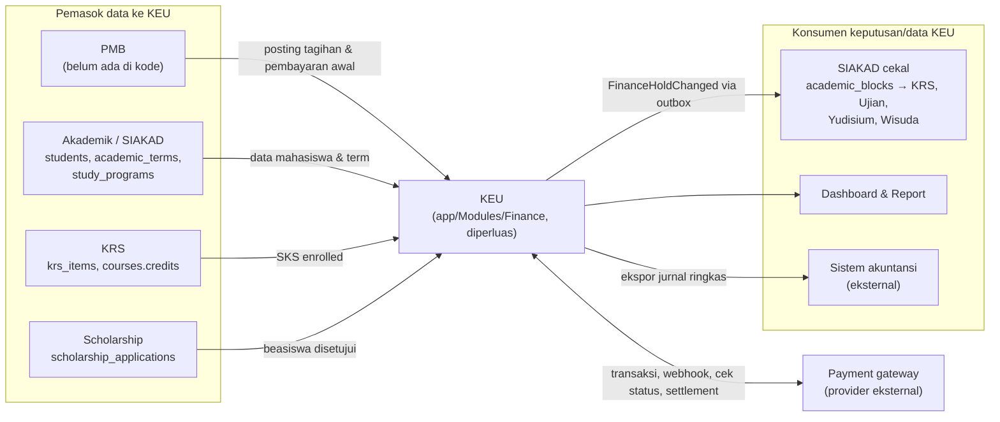

# 01 — Overview dan Ruang Lingkup

> **Status:** rancangan. Disusun 2026-10-13.
> Kembali ke [README](README.md) · Istilah: [29](29-glossary-dan-keputusan-bisnis.md) · Kebutuhan rinci: [02](02-analisis-kebutuhan-bisnis.md)

Dokumen ini menetapkan tujuan modul **KEU — Administrasi Keuangan Mahasiswa**, siapa penggunanya, fitur yang termasuk dan tidak termasuk dalam ruang lingkup, serta batas tanggung jawab KEU terhadap modul lain di Civitas One. Semua klaim tentang kondisi aplikasi mengacu ke temuan repository di [README §3](README.md#3-temuan-repository).

## Daftar Isi

1. [Latar Belakang](#1-latar-belakang)
2. [Tujuan dan Manfaat](#2-tujuan-dan-manfaat)
3. [Pengguna](#3-pengguna)
4. [Ruang Lingkup Fungsional](#4-ruang-lingkup-fungsional)
5. [Di Luar Ruang Lingkup](#5-di-luar-ruang-lingkup)
6. [Batas terhadap Modul Lain](#6-batas-terhadap-modul-lain)
7. [Empat Lapisan yang Tidak Boleh Dicampur](#7-empat-lapisan-yang-tidak-boleh-dicampur)
8. [Ketersediaan per Paket](#8-ketersediaan-per-paket)
9. [Prinsip Rancangan](#9-prinsip-rancangan)
10. [Hal yang Masih Perlu Dikonfirmasi](#10-hal-yang-masih-perlu-dikonfirmasi)

---

## 1. Latar Belakang

Civitas One adalah aplikasi manajemen akademik **multi-tenant**: satu instalasi melayani banyak perguruan tinggi, dengan data dipisahkan oleh `university_id`. Kondisi modul keuangan saat ini:

| Aspek | Kondisi saat ini | Sumber |
|---|---|---|
| Tagihan | Tabel `invoices` dengan satu nominal (`amount`), `paid_amount`, `status` `unpaid/partial/paid`, dan `period` berupa teks bebas. Tidak ada rincian komponen | `app/Modules/Finance/Database/Migrations/2026_07_20_020000_*` |
| Pembayaran | Tabel `payments` menunjuk satu tagihan (`invoice_id`). Tidak ada status verifikasi | `2026_07_20_020001_*` |
| Endpoint | Hanya `GET /invoices`, `GET /invoices/{id}`, `GET /payments`. Tidak ada endpoint tulis | `app/Modules/Finance/Routes/api.php` |
| Portal mahasiswa | `PortalInvoicesPage` berisi data statis dan belum didaftarkan di `ROUTES.portal` | `frontend/src/pages/portal/PortalInvoicesPage.tsx` |
| Prioritas produk | "Keuangan — Tagihan & Pembayaran" ditandai **P0**: kampus belum dapat memakai sistem untuk operasional keuangan nyata | `docs/FRONTEND-IMPLEMENTASI.md §5.1` |
| Referensi fitur | SEVIMA §12 mendefinisikan 11 fitur KEU yang tersedia di semua paket, beserta keterhubungan dengan cekal SIAKAD | `docs/SEVIMA_Penjelasan_Modul.md §12` |

Artinya, bagian terbesar dari modul KEU adalah pembangunan baru. Meski begitu, tabel `invoices` dan `payments` sudah dibaca oleh Dashboard, Report, statistik platform, dan frontend, sehingga rancangan ini **memperluas** tabel tersebut, bukan menggantinya ([KEU-KD-01](29-glossary-dan-keputusan-bisnis.md#2-keputusan-desain-keu-kd)).

## 2. Tujuan dan Manfaat

| No | Tujuan | Manfaat bagi kampus | Ukuran keberhasilan (target rancangan [R]) |
|---|---|---|---|
| T1 | Menerbitkan tagihan yang benar sesuai tarif yang berlaku | Mengurangi kesalahan input manual dan sengketa | 100% tagihan dapat ditelusuri ke komponen, versi tarif, dan potongannya |
| T2 | Menerima pembayaran dari banyak kanal dengan verifikasi yang dapat dipercaya | Uang masuk tercatat sekali, tepat waktu, dan pada mahasiswa yang benar | Tidak ada pembayaran ganda akibat callback berulang; pembayaran online terverifikasi < 1 menit setelah callback valid |
| T3 | Memisahkan kewajiban, penerimaan, penerapan, deposit, dan piutang | Angka keuangan konsisten di semua laporan | Invarian `INV-01`…`INV-14` ([19 §8](19-rancangan-database-dan-relasi.md#8-invarian-dan-query-pemeriksaan)) lulus setiap hari |
| T4 | Mendukung kebijakan keuangan yang berbeda per kampus | Satu produk dapat dipakai PTN (UKT) dan PTS (SPP) | Kebijakan potongan, denda, cicilan, dan cekal diatur lewat konfigurasi, tanpa perubahan kode |
| T5 | Memberi pimpinan gambaran piutang yang dapat ditelusuri | Keputusan penagihan berbasis data | Setiap angka dashboard dapat dibuka hingga daftar tagihan dan alokasi sumbernya |
| T6 | Menghubungkan status keuangan dengan layanan akademik | Kebijakan cekal berjalan otomatis dan adil | Cekal dibuka ≤ 60 detik setelah pembayaran terverifikasi; tidak dapat dilewati lewat frontend |
| T7 | Menyediakan jejak audit dan pemisahan kewenangan | Siap diperiksa auditor internal/eksternal | Setiap tindakan sensitif memiliki pelaku, waktu, alasan, dan penyetuju |

## 3. Pengguna

Pemetaan pengguna dari kebutuhan bisnis ke role sistem. Role berlabel **Baru** belum ada di `OrganizationalRoleSeeder`. Matriks hak akses lengkap ada di [03](03-role-dan-hak-akses.md).

| No | Pengguna (kebutuhan bisnis) | Role sistem | Kebutuhan utama di KEU |
|---|---|---|---|
| 1 | Super Admin | `super_admin` (Ada) | Mengatur entitlement paket (kuota kanal), memantau kesehatan integrasi lintas tenant. Tidak melakukan transaksi keuangan tenant sehari-hari ([KEU-BR-313](25-business-rules-dan-validasi.md)) |
| 2 | Administrator keuangan | `finance_administrator` (Ada, diperluas) | Master data, penyusunan tarif, penerbitan tagihan individual dan massal, kebijakan potongan, denda, cicilan, dan cekal |
| 3 | Staf keuangan / petugas loket | `finance_officer` (**Baru**), `cashier` (**Baru**) | Verifikasi bukti transfer, pencatatan pembayaran manual, pembayaran tunai di loket, sesi kas, pengajuan koreksi dan refund |
| 4 | Bendahara / pejabat penyetuju | `finance_manager` (**Baru**); tingkat lanjut `vice_rector` / `rector` | Menyetujui tarif, pembatalan tagihan, koreksi, refund, pembebasan denda, pengecualian cekal, dan penutupan periode |
| 5 | Mahasiswa | `student` (Ada) | Melihat tagihan dan riwayat, membayar online, mengunggah bukti transfer, memakai voucher dan deposit, mengajukan cicilan, keberatan UKT, dan sengketa tagihan |
| 6 | Dosen / petugas akademik | `academic_administrator`, `academic_advisor`, `lecturer` (Ada) | Melihat **status** cekal keuangan mahasiswa sesuai kewenangan, tanpa nominal ([KEU-Q-19](29-glossary-dan-keputusan-bisnis.md#3-pertanyaan-terbuka-keu-q)) |
| 7 | Pimpinan fakultas / prodi | `dean`, `head_of_study_program` (Ada) | Ringkasan piutang dan tingkat pelunasan dalam cakupan fakultas/prodinya |
| 8 | Pimpinan universitas | `rector`, `vice_rector` (Ada) | Dashboard seluruh tenant; penyetuju tingkat lanjut sesuai ambang nominal |
| 9 | Auditor internal | `auditor` (Ada) | Membaca seluruh data dan audit trail tanpa hak ubah; ekspor terbatas dan teraudit |
| 10 | Administrator sistem integrasi | `integration_administrator` (**Baru** [K]) | Kredensial dan kanal gateway, pemantauan webhook, outbox, dan sinkronisasi cekal |

Pemilik dan admin universitas (`university_owner`, `university_administrator`) tetap mengelola pengaturan tenant secara umum dan dapat membaca ringkasan keuangan.

## 4. Ruang Lingkup Fungsional

| Kelompok | Fitur | Dokumen | Fase ([28](28-roadmap-implementasi.md)) |
|---|---|---|---|
| Master & konfigurasi | Komponen biaya, rekening penerima, periode keuangan, penomoran dokumen, pengaturan `finance.*` | [04](04-master-data-dan-konfigurasi.md) | 1 |
| Tarif | Tarif tetap dan per SKS/MK berdasarkan term, angkatan, fakultas/prodi, jenjang, jalur, kelas, status, golongan UKT; versi, persetujuan, publikasi, snapshot | [05](05-rancangan-tarif-uang-kuliah.md) | 1 |
| Tagihan | Individual, massal, per SKS, tambahan, susulan, berulang per term; pembatalan dan koreksi berizin; sengketa; riwayat | [06](06-rancangan-tagihan-mahasiswa.md) | 2 |
| Pembayaran | Model penerimaan ↔ alokasi, kelebihan bayar, kuitansi | [07](07-rancangan-pembayaran.md) | 2 |
| Pembayaran online | Provider, kanal sesuai kuota paket, VA/QRIS/e-wallet, webhook, idempotensi, kedaluwarsa, pembayaran ganda/terlambat | [08](08-rancangan-pembayaran-online-dan-gateway.md) | 4A |
| Pembayaran tunai & manual | Loket dan sesi kas, transfer manual, unggah dan verifikasi bukti, penolakan, koreksi | [09](09-rancangan-pembayaran-tunai-dan-manual.md) | 2 |
| Cicilan | Rencana dan termin, uang muka, penjadwalan ulang, pelunasan dipercepat | [10](10-rancangan-cicilan-tagihan.md) | 3B |
| Beasiswa & potongan | Beasiswa penuh/parsial, potongan nominal/persen per komponen, kuota, persetujuan, pencabutan, urutan perhitungan | [11](11-rancangan-beasiswa-dan-potongan.md) | 3A |
| Voucher | Kode, kuota total dan per mahasiswa, kelayakan, reservasi, pembatalan | [12](12-rancangan-voucher-tagihan.md) | 3D |
| Denda | Aturan nominal/persen, frekuensi, tenggang, plafon, job idempoten, pembebasan | [13](13-rancangan-denda.md) | 3E |
| Deposit | Ledger saldo titipan, pemakaian, pengembalian, pembekuan | [14](14-rancangan-deposit-mahasiswa.md) | 3C |
| UKT | Golongan, penetapan, keberatan, validasi tarif | [15](15-rancangan-ukt-dan-validasi-penerima.md) | 3A |
| Monitoring piutang | Indikator, umur piutang, ketertelusuran | [16](16-rancangan-monitoring-piutang.md) | 5 |
| Cekal keuangan | Kebijakan, evaluasi, pengecualian, sinkronisasi ke SIAKAD | [17](17-rancangan-cekal-keuangan.md) | 4C |
| Rekonsiliasi & penyesuaian | Rekonsiliasi provider/bank, refund, reversal, koreksi, penutupan periode, ekspor akuntansi | [18](18-rancangan-rekonsiliasi-dan-penyesuaian.md) | 2 (reversal), 4B, 5 |
| Laporan & dashboard | 18 laporan dan dashboard per audiens | [22](22-rancangan-laporan-dan-dashboard.md) | 5 |
| Notifikasi | Pemberitahuan tagihan, pembayaran, cekal, persetujuan | [23](23-rancangan-notifikasi.md) | 2–5 |
| Keamanan & audit | RBAC, scope, SoD, webhook, berkas, enkripsi, masking, audit, retensi, anomali | [24](24-keamanan-audit-dan-kontrol-internal.md) | 0–5 |

## 5. Di Luar Ruang Lingkup

| Hal | Alasan | Penanganan |
|---|---|---|
| Buku besar (general ledger), jurnal penuh, neraca, laporan laba rugi | KEU adalah administrasi keuangan mahasiswa, bukan sistem akuntansi ([KEU-KD-15](29-glossary-dan-keputusan-bisnis.md#2-keputusan-desain-keu-kd)) | Ekspor jurnal ringkas per periode ([18 §8](18-rancangan-rekonsiliasi-dan-penyesuaian.md)) |
| Penggajian, anggaran, belanja, aset | Domain keuangan institusi, bukan mahasiswa | — |
| Pemrosesan kartu kredit langsung | Ruang lingkup PCI DSS ([KEU-A-09](29-glossary-dan-keputusan-bisnis.md#4-asumsi-keu-a)) | Hanya melalui halaman hosted/tokenisasi provider |
| Tagihan pendaftar PMB sebelum menjadi mahasiswa | Dikelola modul PMB ([KEU-A-15](29-glossary-dan-keputusan-bisnis.md#4-asumsi-keu-a)) | KEU menerima posting tagihan `admission` setelah konversi |
| Penilaian kelayakan ekonomi UKT (skoring dari dokumen) | Proses seleksi kampus/PMB | KEU menyimpan hasil penetapan, ringkasan, dan dokumen pendukung |
| Seleksi beasiswa (pendaftaran, wawancara) | Modul Scholarship | KEU menerima hasil (`scholarship_applications.status = approved`) |
| Penegakan cekal di titik layanan akademik | Milik modul akademik (SIAKAD) | KEU memutuskan dan menyinkronkan; SIAKAD menegakkan ([KEU-KD-09](29-glossary-dan-keputusan-bisnis.md#2-keputusan-desain-keu-kd)) |
| Penghapusan piutang tak tertagih (*write-off*) | Keputusan akuntansi | Tipe disiapkan tetapi nonaktif ([KEU-Q-26](29-glossary-dan-keputusan-bisnis.md#3-pertanyaan-terbuka-keu-q)) |
| Multi mata uang | Tidak ada kebutuhan ([KEU-A-01](29-glossary-dan-keputusan-bisnis.md#4-asumsi-keu-a)) | IDR saja |
| Penagihan ke sponsor/pihak ketiga (invoice ke perusahaan pemberi beasiswa) | Belum ada kebutuhan eksplisit | Dicatat sebagai pengembangan lanjutan; beasiswa eksternal tetap dicatat sebagai potongan dengan `funding_source = external` |

## 6. Batas terhadap Modul Lain

### 6.1 Peta konteks

### 6.2 Tabel batas tanggung jawab

| Modul | Kondisi di repository | Milik modul tersebut | Milik KEU | Antarmuka |
|---|---|---|---|---|
| **PMB** | Hanya dokumen (`docs/pmb`) | Tagihan pendaftaran (`pmb_invoices`), seleksi, daftar ulang, voucher promosi saat masih pendaftar (bila tidak memakai KEU, [KEU-Q-23](29-glossary-dan-keputusan-bisnis.md#3-pertanyaan-terbuka-keu-q)) | Tagihan `admission` setelah pendaftar menjadi mahasiswa, beserta pembayaran yang sudah diterima PMB; lapisan gateway bersama ([KEU-KD-14](29-glossary-dan-keputusan-bisnis.md#2-keputusan-desain-keu-kd)) | Kontrak in-process `FinanceBillingService::postExternalInvoice` dengan `source_type = pmb_invoice` ([20](20-rancangan-api-dan-integrasi.md)) |
| **Akademik** | Ada (`students`, `academic_terms`, `study_programs`, `faculties`) | Identitas mahasiswa, status (`StudentStatus`), angkatan, prodi, term | Tidak menyimpan salinan data akademik kecuali snapshot di tagihan | Baca langsung via model (modul satu aplikasi). Event `StudentStatusChanged` (**belum ada**) |
| **KRS** | Ada (`krs_submissions`, `krs_items`, `KrsPlanService`) | Rencana studi, status `krs_items` (`draft/pending/enrolled/dropped`), persetujuan dosen wali | Dasar tagihan per SKS/MK dan tagihan susulan | Baca `krs_items` berstatus `enrolled` ([06 §5](06-rancangan-tagihan-mahasiswa.md)); event `KrsSubmissionApproved` dll. (**belum ada**) |
| **Penjadwalan** | Ada (`class_sections`, `class_schedules`) | Jadwal kelas dan ruang | Tidak ada. KEU hanya menelusuri `class_sections.course_id` untuk SKS dan MK berbiaya praktikum | — |
| **Ujian** | Ada (`ExamService::startAttempt`) | Pelaksanaan ujian dan penegakan syarat ikut ujian | Keputusan apakah tunggakan membatasi layanan `exam` | Penegakan oleh SIAKAD (`AcademicBlockGuard`) atau jalur sementara `FinanceClearanceGuard` ([17 §9](17-rancangan-cekal-keuangan.md)) |
| **Wisuda / Yudisium** | Belum ada modul (hanya halaman portal statis) | Pendaftaran wisuda, kelulusan | Tagihan biaya wisuda (`invoice_type = additional`, komponen kategori `graduation`) dan cekal layanan `yudisium`/`graduation` bila dikonfigurasi | Sama dengan Ujian |
| **Scholarship** | Ada, read-only | Program beasiswa dan seleksi penerima | Nilai potongan pada tagihan (`discount_schemes`, `student_discounts`) | `scholarship_applications.status = approved` → penetapan penerima ([11 §4](11-rancangan-beasiswa-dan-potongan.md)) |
| **Akuntansi / GL** | Tidak ada | Jurnal, buku besar, laporan keuangan institusi | Data sumber dan ekspor jurnal ringkas | Ekspor berkas per periode tertutup ([18 §8](18-rancangan-rekonsiliasi-dan-penyesuaian.md)) |
| **Payment gateway** | Tidak ada | Pemrosesan dana, VA/QRIS, settlement ke rekening kampus | Kredensial, kanal, transaksi, webhook, verifikasi, rekonsiliasi | Adapter `PaymentGatewayContract` ([08](08-rancangan-pembayaran-online-dan-gateway.md)) |
| **ApprovalWorkflow** | Ada | Mesin persetujuan bertingkat | Definisi workflow keuangan dan penerapan hasilnya; guard pemisahan tugas ([KEU-KD-17](29-glossary-dan-keputusan-bisnis.md#2-keputusan-desain-keu-kd)) | `ApprovalRequestService::submit()`, event `ApprovalRequestApproved/Rejected` |
| **Notification** | Ada (kanal `database`, `mail`) | Pengiriman dan template | Event dan isi notifikasi keuangan | `NotificationDispatcher::dispatch()` ([23](23-rancangan-notifikasi.md)) |
| **FileManagement** | Ada | Penyimpanan privat, checksum, unduhan berizin | Kaitan berkas ke bukti bayar, dokumen UKT, bukti refund | `FileAttacher`, `file_uploads` |
| **AuditLog** | Ada | Penyimpanan audit | Aksi audit keuangan | Trait `Auditable`, `AuditLogService::recordAction()` |
| **Dashboard & Report** | Ada, membaca `invoices`/`payments` | Kerangka dashboard umum | Definisi angka keuangan | Penyesuaian query lama ([19 §6.3](19-rancangan-database-dan-relasi.md#63-penyesuaian-konsumen-yang-ada)) + dashboard KEU ([22](22-rancangan-laporan-dan-dashboard.md)) |

## 7. Empat Lapisan yang Tidak Boleh Dicampur

Permintaan bisnis meminta pembedaan tegas antara empat lapisan berikut. Rancangan memisahkan tanggung jawab, data, dan pemiliknya:

| Lapisan | Pertanyaan yang dijawab | Data utama | Pemilik | Di dalam KEU? |
|---|---|---|---|---|
| **A. Administrasi keuangan mahasiswa** | Berapa kewajiban mahasiswa, berapa yang sudah dibayar dan diterapkan, berapa sisanya, apa dasarnya? | `invoices`, `invoice_items`, `payments`, `payment_allocations`, `deposit_*`, `installment_*`, potongan, denda, cekal | Bagian keuangan kampus | **Ya**, inti KEU |
| **B. Pembayaran dan integrasi bank** | Bagaimana uang berpindah dari mahasiswa ke rekening kampus, dan bagaimana sistem mengetahuinya? | `payment_gateway_accounts`, `payment_channels`, `payment_transactions`, `payment_webhook_events`, settlement, mutasi bank | Provider/bank (pemrosesan dana); KEU (pencatatan) | **Sebagian**: KEU memegang pencatatan dan verifikasi. Pemindahan dana dan settlement tetap di provider |
| **C. Akuntansi / buku besar** | Bagaimana penerimaan dan piutang dibukukan ke akun-akun institusi? | Jurnal, bagan akun, buku besar | Bagian akuntansi | **Tidak**. KEU menyediakan `fee_components.accounting_code` dan ekspor jurnal ringkas |
| **D. Pelaporan manajemen** | Bagaimana kinerja penagihan per fakultas/prodi/angkatan, dan berapa umur piutangnya? | Agregat dari lapisan A (+ snapshot) | Pimpinan | **Ya**, untuk laporan yang bersumber dari A dan B. Laporan keuangan institusi berada di C |

Konsekuensi desain:

1. Status di lapisan B (`payment_transactions.status`) **tidak pernah** langsung mengubah status di lapisan A. Perubahan hanya terjadi melalui pembuatan `payments` terverifikasi dan `payment_allocations` ([KEU-KD-10](29-glossary-dan-keputusan-bisnis.md#2-keputusan-desain-keu-kd)).
2. Piutang di lapisan D dihitung dari `invoices.outstanding_amount`, **bukan** dari selisih "total tagihan − total pembayaran" ([16](16-rancangan-monitoring-piutang.md)). Dengan begitu, kelebihan bayar dan deposit tidak menutupi tunggakan secara diam-diam.
3. Angka di lapisan D untuk periode yang sudah ditutup tidak berubah. Koreksi dibukukan di periode terbuka berikutnya ([KEU-KD-16](29-glossary-dan-keputusan-bisnis.md#2-keputusan-desain-keu-kd)).

## 8. Ketersediaan per Paket

Menurut `SEVIMA_Penjelasan_Modul.md §12`, seluruh fitur KEU tersedia mulai paket **Growth**. Satu-satunya pembeda antarpaket adalah jumlah kanal pembayaran online:

| Paket (referensi SEVIMA) | Maksimal kanal pembayaran online | Paket di repository (`subscription_plans`) |
|---|---:|---|
| Growth | 3 | — |
| Business | 3 | — |
| Professional | 4 | `professional` |
| Premium | 5 | — |
| Enterprise | 6 | `enterprise` |
| — | — | `trial`, `starter` (tidak ada di referensi) |

> **Perbedaan yang ditandai.** Kode paket di repository (`trial/starter/professional/enterprise`, `TenancySeeder`) tidak sama dengan nama paket referensi, dan `subscription_plans.limits` saat ini hanya berisi `max_users` serta `max_storage_gb`. Rancangan memperlakukan kuota kanal sebagai entitlement `finance.payment_channels` yang diatur Super Admin per paket/tenant ([KEU-Q-01](29-glossary-dan-keputusan-bisnis.md#3-pertanyaan-terbuka-keu-q)). Loket dan transfer manual tidak dihitung sebagai kanal online ([KEU-Q-02](29-glossary-dan-keputusan-bisnis.md#3-pertanyaan-terbuka-keu-q)). Rincian penegakan kuota ada di [08](08-rancangan-pembayaran-online-dan-gateway.md).

## 9. Prinsip Rancangan

| No | Prinsip | Wujud dalam rancangan |
|---|---|---|
| P1 | Kewajiban ≠ penerimaan ≠ penerapan | Tabel terpisah: `invoices` / `payments` / `payment_allocations` / `deposit_transactions` ([KEU-KD-04](29-glossary-dan-keputusan-bisnis.md#2-keputusan-desain-keu-kd)) |
| P2 | Data finansial terverifikasi tidak dihapus atau ditimpa | Reversal dan `finance_adjustments` ([KEU-KD-05](29-glossary-dan-keputusan-bisnis.md#2-keputusan-desain-keu-kd)) |
| P3 | Tagihan membawa snapshot | Tarif dan atribut komponen disalin ke `invoice_items` ([KEU-KD-07](29-glossary-dan-keputusan-bisnis.md#2-keputusan-desain-keu-kd)) |
| P4 | Kebijakan kampus adalah konfigurasi | Pengaturan `finance.*` ([04 §5](04-master-data-dan-konfigurasi.md)); nilai default ditandai [K] |
| P5 | Konkurensi diselesaikan di database | Kunci baris dengan urutan baku, unique constraint, dan generated key ([19 §7](19-rancangan-database-dan-relasi.md#7-strategi-integritas-konkurensi-dan-histori)) |
| P6 | Integrasi dapat diulang dan diaudit | Idempotensi API, deduplikasi webhook, outbox ([KEU-KD-22](29-glossary-dan-keputusan-bisnis.md#2-keputusan-desain-keu-kd)) |
| P7 | Penegakan di backend | Hak akses, SoD, dan cekal tidak bergantung pada frontend ([24](24-keamanan-audit-dan-kontrol-internal.md)) |
| P8 | Fitur berisiko dinonaktifkan sampai kebijakannya jelas | Denda, cekal, dan cicilan memiliki saklar `enabled` ([28](28-roadmap-implementasi.md)) |

## 10. Hal yang Masih Perlu Dikonfirmasi

Pertanyaan prioritas P1 yang paling memengaruhi ruang lingkup:

| ID | Pertanyaan singkat | Dampak bila belum dijawab |
|---|---|---|
| [KEU-Q-01](29-glossary-dan-keputusan-bisnis.md#3-pertanyaan-terbuka-keu-q) | Pemetaan paket dan kuota kanal | Kanal online tidak dapat diaktifkan secara sah |
| [KEU-Q-03](29-glossary-dan-keputusan-bisnis.md#3-pertanyaan-terbuka-keu-q) | Provider gateway yang dikontrak | Adapter dan pengujian kontrak tertunda |
| [KEU-Q-04](29-glossary-dan-keputusan-bisnis.md#3-pertanyaan-terbuka-keu-q) | Urutan perhitungan potongan | Nilai tagihan berpotongan dapat berbeda dari harapan kampus |
| [KEU-Q-06](29-glossary-dan-keputusan-bisnis.md#3-pertanyaan-terbuka-keu-q) | Kebijakan denda | Denda tetap nonaktif |
| [KEU-Q-07](29-glossary-dan-keputusan-bisnis.md#3-pertanyaan-terbuka-keu-q) | Layanan yang dicekal dan ambangnya | Cekal tetap nonaktif |
| [KEU-Q-12](29-glossary-dan-keputusan-bisnis.md#3-pertanyaan-terbuka-keu-q) | Dasar SKS untuk tagihan per SKS | Tagihan per SKS memakai default `enrolled` |
| [KEU-Q-13](29-glossary-dan-keputusan-bisnis.md#3-pertanyaan-terbuka-keu-q) | UKT atau SPP | Keduanya disiapkan |

Daftar lengkap ada di [29 §3](29-glossary-dan-keputusan-bisnis.md#3-pertanyaan-terbuka-keu-q).
