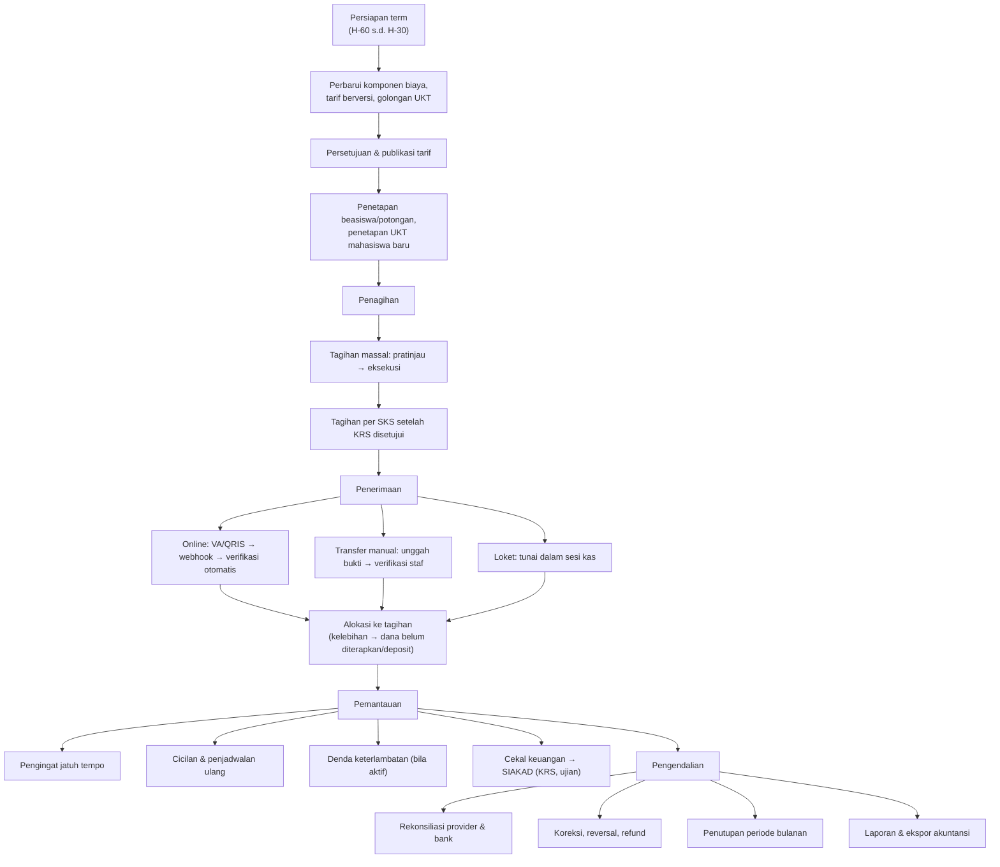
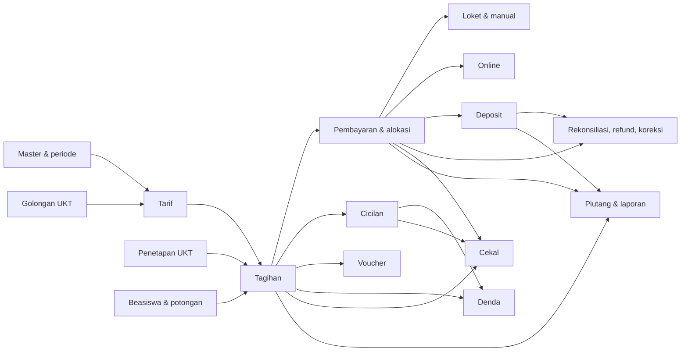

# 02 — Analisis Kebutuhan Bisnis

> **Status:** rancangan. Disusun 2026-10-13.
> Kembali ke [README](README.md) · Ruang lingkup: [01](01-overview-dan-ruang-lingkup.md) · Hak akses: [03](03-role-dan-hak-akses.md) · Aturan: [25](25-business-rules-dan-validasi.md)

Dokumen ini memetakan proses bisnis keuangan mahasiswa ke fitur, lalu menurunkannya menjadi kebutuhan fungsional (`KEU-FR-<AREA>-NN`) dan non-fungsional (`KEU-NFR-NN`). Setiap kebutuhan diberi label sumber: **[Ref]** berasal dari permintaan bisnis atau dokumen referensi, **[R]** rekomendasi perancang, **[K]** perlu konfirmasi kebijakan.

## Daftar Isi

1. [Sumber dan Metode](#1-sumber-dan-metode)
2. [Proses Bisnis Utama](#2-proses-bisnis-utama)
3. [Pemetaan Proses ke Fitur](#3-pemetaan-proses-ke-fitur)
4. [Kebutuhan Fungsional](#4-kebutuhan-fungsional)
5. [Kebutuhan Non-Fungsional](#5-kebutuhan-non-fungsional)
6. [Entitas dan Dependensi](#6-entitas-dan-dependensi)
7. [Kebutuhan Pasti, Asumsi, dan Pertanyaan Terbuka](#7-kebutuhan-pasti-asumsi-dan-pertanyaan-terbuka)
8. [Risiko Transaksi Keuangan dan Integrasi](#8-risiko-transaksi-keuangan-dan-integrasi)

---

## 1. Sumber dan Metode

| Sumber | Isi yang dipakai |
|---|---|
| Permintaan bisnis modul KEU (prompt rancangan) | Daftar fitur, aturan wajib, format dokumentasi |
| `docs/SEVIMA_Penjelasan_Modul.md §12` | 11 fitur KEU, kuota kanal per paket, keterhubungan cekal |
| `docs/RANCANGAN-APLIKASI.md` §3.10, §4.23, §4.24 | Cakupan keuangan dalam blueprint aplikasi |
| `docs/academic-learning/` | Kontrak cekal SIAKAD (`academic_blocks`, `AcademicBlockGuard`, `ACADEMIC_BLOCKED`), event akademik |
| `docs/pmb/` | Posting tagihan dan pembayaran PMB ke Finance |
| `docs/semester-pendek/` | Tagihan semester pendek per SKS |
| Kode repository | Kondisi aktual ([README §3](README.md#3-temuan-repository)) |

Metode: (1) menyusun alur siklus keuangan satu term; (2) menurunkan fitur dari setiap langkah; (3) menurunkan kebutuhan dan aturan bisnis; (4) memisahkan hal yang pasti, asumsi, dan pertanyaan terbuka; (5) mengidentifikasi risiko.

## 2. Proses Bisnis Utama

### 2.1 Siklus keuangan satu term akademik

### 2.2 Uraian proses

| Kode | Proses | Pelaku | Pemicu | Keluaran |
|---|---|---|---|---|
| PB-01 | Penyusunan tarif term | Administrator keuangan, bendahara | Kalender akademik term baru | Jadwal tarif `published` |
| PB-02 | Penetapan UKT mahasiswa | Administrator keuangan, bendahara, (PMB) | Mahasiswa baru diterima; keberatan; peninjauan ulang | `ukt_determinations` aktif |
| PB-03 | Penetapan beasiswa/potongan | Administrator keuangan, bendahara | SK beasiswa, hasil seleksi Scholarship | `student_discounts` aktif |
| PB-04 | Penerbitan tagihan semester | Administrator keuangan | Jadwal penagihan term | Tagihan `unpaid` + notifikasi |
| PB-05 | Penerbitan tagihan per SKS / susulan | Sistem/administrator | KRS disetujui/berubah | Tagihan per SKS atau susulan |
| PB-06 | Tagihan tambahan | Administrator keuangan | Layanan berbayar (wisuda, cuti, dll.) | Tagihan `additional` |
| PB-07 | Pembayaran online | Mahasiswa, provider | Mahasiswa memilih kanal | Transaksi → pembayaran terverifikasi → alokasi |
| PB-08 | Pembayaran transfer manual | Mahasiswa, staf keuangan | Mahasiswa mentransfer ke rekening kampus | Pembayaran `pending_verification` → `verified`/`rejected` |
| PB-09 | Pembayaran tunai loket | Petugas loket | Mahasiswa datang ke loket | Pembayaran `verified` + kuitansi; sesi kas ditutup & diverifikasi |
| PB-10 | Cicilan | Mahasiswa/staf, bendahara | Pengajuan cicilan | Rencana `active` + termin |
| PB-11 | Voucher | Mahasiswa/staf | Kode voucher dimasukkan | Baris potongan voucher |
| PB-12 | Denda | Sistem, bendahara | Lewat jatuh tempo + tenggang | Tagihan denda; pembebasan berizin |
| PB-13 | Deposit | Staf, mahasiswa | Kelebihan bayar, top-up | Saldo deposit; pemakaian; refund |
| PB-14 | Cekal keuangan | Sistem, staf, bendahara | Tunggakan memenuhi kebijakan | `finance_holds` → `academic_blocks` |
| PB-15 | Rekonsiliasi | Staf keuangan | Settlement provider/mutasi bank | Batch rekonsiliasi tertutup |
| PB-16 | Koreksi & refund | Staf, bendahara | Kesalahan pencatatan, kelebihan bayar, pembatalan | `finance_adjustments`, `refunds` |
| PB-17 | Penutupan periode | Bendahara | Akhir bulan | Periode `closed`, ekspor jurnal |
| PB-18 | Pemantauan piutang | Pimpinan, staf | Harian/berkala | Dashboard, laporan |

## 3. Pemetaan Proses ke Fitur

| Proses | Fitur | Area | Dokumen |
|---|---|---|---|
| PB-01 | Komponen biaya, jadwal & aturan tarif, persetujuan, publikasi, resolusi tarif | MST, TAR | [04](04-master-data-dan-konfigurasi.md), [05](05-rancangan-tarif-uang-kuliah.md) |
| PB-02 | Golongan UKT, penetapan, keberatan, validasi | UKT | [15](15-rancangan-ukt-dan-validasi-penerima.md) |
| PB-03 | Skema potongan, penerima, kuota, pencabutan | SCH | [11](11-rancangan-beasiswa-dan-potongan.md) |
| PB-04, PB-05, PB-06 | Tagihan individual & massal, per SKS, susulan, tambahan, pembatalan, sengketa | INV | [06](06-rancangan-tagihan-mahasiswa.md) |
| PB-07 | Kanal, transaksi online, webhook, kedaluwarsa | PG | [08](08-rancangan-pembayaran-online-dan-gateway.md) |
| PB-07, PB-08, PB-09 | Penerimaan, alokasi, kuitansi, kelebihan bayar | PAY | [07](07-rancangan-pembayaran.md) |
| PB-08, PB-09 | Loket, sesi kas, bukti transfer, verifikasi | MAN | [09](09-rancangan-pembayaran-tunai-dan-manual.md) |
| PB-10 | Rencana cicilan, termin, penjadwalan ulang | INS | [10](10-rancangan-cicilan-tagihan.md) |
| PB-11 | Voucher, kuota, reservasi | VCH | [12](12-rancangan-voucher-tagihan.md) |
| PB-12 | Aturan denda, job, pembebasan | LTF | [13](13-rancangan-denda.md) |
| PB-13 | Ledger deposit, pemakaian, refund | DEP | [14](14-rancangan-deposit-mahasiswa.md) |
| PB-14 | Kebijakan cekal, evaluasi, pengecualian, sinkronisasi | HLD | [17](17-rancangan-cekal-keuangan.md) |
| PB-15, PB-16, PB-17 | Rekonsiliasi, refund, reversal, penutupan periode, ekspor akuntansi | REC | [18](18-rancangan-rekonsiliasi-dan-penyesuaian.md) |
| PB-18 | Dashboard, umur piutang, laporan | AR, RPT | [16](16-rancangan-monitoring-piutang.md), [22](22-rancangan-laporan-dan-dashboard.md) |

## 4. Kebutuhan Fungsional

Prioritas: **M** = wajib (MVP fase terkait), **S** = sebaiknya ada, **C** = dapat menyusul.

### 4.1 Master dan konfigurasi (MST)

| ID | Kebutuhan | Sumber | Prioritas | Rincian |
|---|---|---|---|---|
| KEU-FR-MST-01 | Sistem mengelola komponen biaya beserta kategori, basis tagih, prioritas alokasi, dan atribut perilaku (dapat dipotong, dicicil, dasar denda, memengaruhi cekal) | [Ref] | M | [04 §2](04-master-data-dan-konfigurasi.md) |
| KEU-FR-MST-02 | Sistem mengelola rekening penerima kampus dengan nomor terenkripsi dan tampilan termasking | [Ref] | M | [04 §3](04-master-data-dan-konfigurasi.md) |
| KEU-FR-MST-03 | Sistem menghasilkan nomor dokumen unik per tenant untuk setiap jenis dokumen keuangan | [Ref] | M | [04 §4](04-master-data-dan-konfigurasi.md) |
| KEU-FR-MST-04 | Sistem menyediakan pengaturan kebijakan keuangan per tenant (`finance.*`) yang dapat diubah tanpa deploy | [R] | M | [04 §5](04-master-data-dan-konfigurasi.md) |
| KEU-FR-MST-05 | Sistem mengelola periode keuangan bulanan (buka, menutup, tutup, buka kembali) | [Ref] | M | [04 §6](04-master-data-dan-konfigurasi.md), [18 §8](18-rancangan-rekonsiliasi-dan-penyesuaian.md) |
| KEU-FR-MST-06 | Sistem memetakan mata kuliah yang dikenai biaya per MK (mis. praktikum) | [R] | S | [04 §2.4](04-master-data-dan-konfigurasi.md) |

### 4.2 Tarif (TAR)

| ID | Kebutuhan | Sumber | Prioritas | Rincian |
|---|---|---|---|---|
| KEU-FR-TAR-01 | Tarif dapat berbeda per term berlaku, angkatan, fakultas/prodi, jenjang, jalur masuk, kelas/sistem kuliah, status mahasiswa, semester ke-, dan golongan UKT | [Ref] | M | [05 §3](05-rancangan-tarif-uang-kuliah.md) |
| KEU-FR-TAR-02 | Tarif mendukung nominal tetap, per SKS, dan per MK, termasuk batas minimal/maksimal satuan (paket SKS) | [Ref] | M | [05 §3](05-rancangan-tarif-uang-kuliah.md) |
| KEU-FR-TAR-03 | Tarif berversi dengan masa berlaku, melalui alur draf → persetujuan → publikasi | [Ref] | M | [05 §6](05-rancangan-tarif-uang-kuliah.md) |
| KEU-FR-TAR-04 | Sistem memilih tarif secara deterministik bila beberapa aturan cocok, dan menolak publikasi bila ada konflik setara | [Ref] | M | [05 §4](05-rancangan-tarif-uang-kuliah.md), [05 §5](05-rancangan-tarif-uang-kuliah.md) |
| KEU-FR-TAR-05 | Staf dapat mempratinjau tarif yang akan dikenakan pada seorang mahasiswa sebelum menagih | [R] | M | [05 §7](05-rancangan-tarif-uang-kuliah.md) |
| KEU-FR-TAR-06 | Perubahan master tarif tidak mengubah tagihan yang sudah terbit | [Ref] | M | [05 §8](05-rancangan-tarif-uang-kuliah.md) |
| KEU-FR-TAR-07 | Tarif dapat diimpor dari berkas XLSX/CSV dengan validasi per baris | [R] | S | [05 §6](05-rancangan-tarif-uang-kuliah.md) |

### 4.3 Tagihan (INV)

| ID | Kebutuhan | Sumber | Prioritas | Rincian |
|---|---|---|---|---|
| KEU-FR-INV-01 | Staf dapat membuat tagihan individual (draf atau langsung terbit) dengan rincian komponen | [Ref] | M | [06 §4](06-rancangan-tagihan-mahasiswa.md) |
| KEU-FR-INV-02 | Staf dapat menerbitkan tagihan massal berdasarkan kriteria, dengan pratinjau sebelum eksekusi | [Ref] | M | [06 §6](06-rancangan-tagihan-mahasiswa.md) |
| KEU-FR-INV-03 | Sistem menghitung tagihan per SKS dari KRS sesuai kebijakan akademik | [Ref] | M | [06 §5](06-rancangan-tagihan-mahasiswa.md) |
| KEU-FR-INV-04 | Sistem mendukung tagihan tambahan, susulan, dan penagihan berulang per term | [Ref] | M | [06 §7](06-rancangan-tagihan-mahasiswa.md) |
| KEU-FR-INV-05 | Pembatalan dan koreksi tagihan terbit memerlukan alasan dan otorisasi, tanpa menghapus histori | [Ref] | M | [06 §8](06-rancangan-tagihan-mahasiswa.md) |
| KEU-FR-INV-06 | Setiap tagihan menampilkan nomor, mahasiswa, periode, rincian, nilai awal, potongan, denda, dibayar, sisa, tanggal terbit, jatuh tempo, dan status | [Ref] | M | [06 §3](06-rancangan-tagihan-mahasiswa.md) |
| KEU-FR-INV-07 | Mahasiswa atau staf dapat mengajukan sengketa tagihan | [Ref] | S | [06 §9](06-rancangan-tagihan-mahasiswa.md) |
| KEU-FR-INV-08 | Sistem menampilkan riwayat lengkap tagihan (status, baris, alokasi, koreksi) | [Ref] | M | [06 §10](06-rancangan-tagihan-mahasiswa.md) |
| KEU-FR-INV-09 | Sistem menerima posting tagihan dari PMB dan Semester Pendek secara idempoten | [Ref] | S | [06 §7.4](06-rancangan-tagihan-mahasiswa.md), [20](20-rancangan-api-dan-integrasi.md) |

### 4.4 Pembayaran umum dan alokasi (PAY)

| ID | Kebutuhan | Sumber | Prioritas | Rincian |
|---|---|---|---|---|
| KEU-FR-PAY-01 | Sistem mencatat penerimaan dana terpisah dari penerapannya ke tagihan | [R] | M | [07 §2](07-rancangan-pembayaran.md) |
| KEU-FR-PAY-02 | Satu pembayaran dapat melunasi beberapa tagihan; satu tagihan dapat dibayar oleh beberapa pembayaran | [Ref] | M | [07 §4](07-rancangan-pembayaran.md) |
| KEU-FR-PAY-03 | Kelebihan bayar tercatat sebagai dana belum diterapkan dan dapat dialokasikan, dikonversi ke deposit, atau dikembalikan | [Ref] | M | [07 §6](07-rancangan-pembayaran.md) |
| KEU-FR-PAY-04 | Setiap pembayaran terverifikasi menghasilkan kuitansi yang dapat dicetak dan diverifikasi keasliannya | [Ref] | M | [07 §7](07-rancangan-pembayaran.md), [09 §8](09-rancangan-pembayaran-tunai-dan-manual.md) |
| KEU-FR-PAY-05 | Pembayaran yang salah dicatat dikoreksi dengan reversal, bukan dihapus | [Ref] | M | [18 §6](18-rancangan-rekonsiliasi-dan-penyesuaian.md) |

### 4.5 Pembayaran online (PG)

| ID | Kebutuhan | Sumber | Prioritas | Rincian |
|---|---|---|---|---|
| KEU-FR-PG-01 | Kampus dapat mengonfigurasi akun provider dan kanal (VA, QRIS, e-wallet, gerai) sesuai kemampuan provider | [Ref] | M | [08 §3](08-rancangan-pembayaran-online-dan-gateway.md) |
| KEU-FR-PG-02 | Jumlah kanal online aktif dibatasi kuota paket | [Ref] | M | [08 §4](08-rancangan-pembayaran-online-dan-gateway.md) |
| KEU-FR-PG-03 | Mahasiswa dapat membuat transaksi untuk satu atau beberapa tagihan/termin dan melihat instruksi bayar | [Ref] | M | [08 §5](08-rancangan-pembayaran-online-dan-gateway.md) |
| KEU-FR-PG-04 | Status pembayaran online ditentukan oleh webhook bertanda tangan valid dan konfirmasi ke provider, bukan oleh redirect browser | [Ref] | M | [08 §7](08-rancangan-pembayaran-online-dan-gateway.md) |
| KEU-FR-PG-05 | Webhook berulang, tidak berurutan, terlambat, atau bernominal tidak sesuai ditangani tanpa pembayaran ganda | [Ref] | M | [08 §8](08-rancangan-pembayaran-online-dan-gateway.md), [08 §9](08-rancangan-pembayaran-online-dan-gateway.md) |
| KEU-FR-PG-06 | Biaya administrasi kanal dapat ditanggung kampus atau mahasiswa | [Ref] | S | [08 §10](08-rancangan-pembayaran-online-dan-gateway.md) |
| KEU-FR-PG-07 | Sistem mendeteksi gangguan provider dan berhenti menawarkan kanal yang terganggu | [Ref] | S | [08 §12](08-rancangan-pembayaran-online-dan-gateway.md) |

### 4.6 Pembayaran tunai dan manual (MAN)

| ID | Kebutuhan | Sumber | Prioritas | Rincian |
|---|---|---|---|---|
| KEU-FR-MAN-01 | Petugas loket mencatat pembayaran tunai dalam sesi kas dan mencetak kuitansi | [Ref] | M | [09 §3](09-rancangan-pembayaran-tunai-dan-manual.md) |
| KEU-FR-MAN-02 | Mahasiswa mengunggah bukti transfer; staf memverifikasi atau menolak dengan alasan | [Ref] | M | [09 §4](09-rancangan-pembayaran-tunai-dan-manual.md) |
| KEU-FR-MAN-03 | Sistem mencegah duplikasi referensi transaksi dan bukti | [Ref] | M | [09 §6](09-rancangan-pembayaran-tunai-dan-manual.md) |
| KEU-FR-MAN-04 | Pembuat dan penyetuju transaksi dipisahkan bila kebijakan SoD aktif | [Ref] | M | [09 §7](09-rancangan-pembayaran-tunai-dan-manual.md) |
| KEU-FR-MAN-05 | Sesi kas ditutup dengan hitung fisik dan diverifikasi oleh pengguna lain | [R] | S | [09 §3](09-rancangan-pembayaran-tunai-dan-manual.md) |

### 4.7 Cicilan (INS)

| ID | Kebutuhan | Sumber | Prioritas | Rincian |
|---|---|---|---|---|
| KEU-FR-INS-01 | Tagihan dapat dibagi ke beberapa termin dengan nominal/persen dan jatuh tempo, termasuk uang muka | [Ref] | M | [10 §3](10-rancangan-cicilan-tagihan.md) |
| KEU-FR-INS-02 | Rencana cicilan memerlukan persetujuan dan dapat dijadwalkan ulang atau dibatalkan dengan persetujuan | [Ref] | M | [10 §5](10-rancangan-cicilan-tagihan.md) |
| KEU-FR-INS-03 | Pembayaran diterapkan ke termin secara berurutan; pelunasan dipercepat diizinkan | [Ref] | M | [10 §6](10-rancangan-cicilan-tagihan.md) |
| KEU-FR-INS-04 | Laporan tidak menghitung kewajiban yang sama dua kali (tagihan dan termin) | [Ref] | M | [10 §9](10-rancangan-cicilan-tagihan.md) |

### 4.8 Beasiswa dan potongan (SCH)

| ID | Kebutuhan | Sumber | Prioritas | Rincian |
|---|---|---|---|---|
| KEU-FR-SCH-01 | Sistem mendukung beasiswa penuh/parsial dan potongan nominal/persen per komponen dan per periode | [Ref] | M | [11 §2](11-rancangan-beasiswa-dan-potongan.md) |
| KEU-FR-SCH-02 | Penetapan penerima memiliki kuota, masa berlaku, persetujuan, pencabutan, dan evaluasi kelayakan | [Ref] | M | [11 §3](11-rancangan-beasiswa-dan-potongan.md) |
| KEU-FR-SCH-03 | Urutan perhitungan tarif, beasiswa, potongan, voucher, potongan manual dapat dikonfigurasi | [Ref] | M | [11 §5](11-rancangan-beasiswa-dan-potongan.md) |
| KEU-FR-SCH-04 | Sistem mencegah potongan ganda, potongan melebihi batas, dan perubahan historis tak terkendali | [Ref] | M | [11 §6](11-rancangan-beasiswa-dan-potongan.md) |

### 4.9 Voucher (VCH)

| ID | Kebutuhan | Sumber | Prioritas | Rincian |
|---|---|---|---|---|
| KEU-FR-VCH-01 | Voucher memiliki kode unik, nilai nominal/persen, masa berlaku, kuota total dan per mahasiswa, minimum, batas maksimal, kelayakan | [Ref] | M | [12 §2](12-rancangan-voucher-tagihan.md) |
| KEU-FR-VCH-02 | Penerapan voucher tervalidasi, tercatat, dan dilepas bila tagihan dibatalkan | [Ref] | M | [12 §4](12-rancangan-voucher-tagihan.md) |
| KEU-FR-VCH-03 | Kuota tidak terlampaui saat dipakai bersamaan | [Ref] | M | [12 §7](12-rancangan-voucher-tagihan.md) |
| KEU-FR-VCH-04 | Voucher dapat dipakai untuk konteks PMB melalui layanan yang sama | [Ref] | S | [12 §8](12-rancangan-voucher-tagihan.md) |

### 4.10 Denda (LTF)

| ID | Kebutuhan | Sumber | Prioritas | Rincian |
|---|---|---|---|---|
| KEU-FR-LTF-01 | Aturan denda mendukung nominal tetap, persen, per hari/periode, plafon, tenggang, jenis tagihan, dan term | [Ref] | M | [13 §3](13-rancangan-denda.md) |
| KEU-FR-LTF-02 | Denda dibentuk oleh job terjadwal yang idempoten dan berhenti setelah lunas | [Ref] | M | [13 §5](13-rancangan-denda.md) |
| KEU-FR-LTF-03 | Pembebasan dan koreksi denda memerlukan persetujuan | [Ref] | M | [13 §7](13-rancangan-denda.md) |

### 4.11 Deposit (DEP)

| ID | Kebutuhan | Sumber | Prioritas | Rincian |
|---|---|---|---|---|
| KEU-FR-DEP-01 | Deposit dicatat sebagai ledger mutasi yang menjelaskan sumber setiap perubahan saldo | [Ref] | M | [14 §3](14-rancangan-deposit-mahasiswa.md) |
| KEU-FR-DEP-02 | Deposit dapat dipakai untuk tagihan berikutnya tanpa melebihi saldo tersedia, termasuk saat bersamaan | [Ref] | M | [14 §5](14-rancangan-deposit-mahasiswa.md) |
| KEU-FR-DEP-03 | Deposit dapat dikembalikan melalui proses refund berizin | [Ref] | M | [14 §7](14-rancangan-deposit-mahasiswa.md) |

### 4.12 UKT (UKT)

| ID | Kebutuhan | Sumber | Prioritas | Rincian |
|---|---|---|---|---|
| KEU-FR-UKT-01 | Kampus mengelola golongan UKT dan menetapkan golongan per mahasiswa dengan masa berlaku dan dokumen pendukung | [Ref] | M | [15 §3](15-rancangan-ukt-dan-validasi-penerima.md) |
| KEU-FR-UKT-02 | Penetapan, perubahan, dan keberatan UKT memiliki persetujuan dan riwayat | [Ref] | M | [15 §5](15-rancangan-ukt-dan-validasi-penerima.md) |
| KEU-FR-UKT-03 | Sistem memvalidasi bahwa setiap golongan memiliki tarif yang sesuai | [Ref] | M | [15 §7](15-rancangan-ukt-dan-validasi-penerima.md) |

### 4.13 Monitoring piutang (AR)

| ID | Kebutuhan | Sumber | Prioritas | Rincian |
|---|---|---|---|---|
| KEU-FR-AR-01 | Dashboard menampilkan total tagihan, pembayaran terverifikasi, piutang (belum/jatuh tempo), umur piutang, per unit dan dimensi | [Ref] | M | [16 §3](16-rancangan-monitoring-piutang.md) |
| KEU-FR-AR-02 | Setiap indikator memiliki rumus baku dan dapat ditelusuri ke transaksi sumber | [Ref] | M | [16 §4](16-rancangan-monitoring-piutang.md) |
| KEU-FR-AR-03 | Kategori umur piutang dapat dikonfigurasi | [Ref] | M | [16 §6](16-rancangan-monitoring-piutang.md) |

### 4.14 Cekal keuangan (HLD)

| ID | Kebutuhan | Sumber | Prioritas | Rincian |
|---|---|---|---|---|
| KEU-FR-HLD-01 | Kebijakan cekal dapat dikonfigurasi (jenis tagihan, ambang, tenggang, layanan, cakupan) | [Ref] | M | [17 §3](17-rancangan-cekal-keuangan.md) |
| KEU-FR-HLD-02 | Cekal diterapkan dan dibuka otomatis sesuai status pembayaran terverifikasi | [Ref] | M | [17 §4](17-rancangan-cekal-keuangan.md) |
| KEU-FR-HLD-03 | Pengecualian dan pembukaan manual memerlukan alasan, masa berlaku, dan persetujuan | [Ref] | M | [17 §6](17-rancangan-cekal-keuangan.md) |
| KEU-FR-HLD-04 | Status cekal disinkronkan ke SIAKAD dengan retry, log, dan rekonsiliasi; penegakan di backend | [Ref] | M | [17 §7](17-rancangan-cekal-keuangan.md) |

### 4.15 Rekonsiliasi, refund, koreksi, periode (REC)

| ID | Kebutuhan | Sumber | Prioritas | Rincian |
|---|---|---|---|---|
| KEU-FR-REC-01 | Rekonsiliasi transaksi online dengan settlement provider dan pembayaran bank dengan mutasi rekening | [Ref] | M | [18 §3](18-rancangan-rekonsiliasi-dan-penyesuaian.md) |
| KEU-FR-REC-02 | Pengembalian dana dengan penahanan dana, persetujuan, dan bukti penyelesaian | [Ref] | M | [18 §5](18-rancangan-rekonsiliasi-dan-penyesuaian.md) |
| KEU-FR-REC-03 | Koreksi dengan alasan, pelaku, waktu, referensi asal, persetujuan, melalui reversal | [Ref] | M | [18 §6](18-rancangan-rekonsiliasi-dan-penyesuaian.md) |
| KEU-FR-REC-04 | Penutupan periode keuangan dan ekspor ke akuntansi | [Ref] | S | [18 §8](18-rancangan-rekonsiliasi-dan-penyesuaian.md) |

### 4.16 Laporan, notifikasi, keamanan (RPT, NTF, SEC)

| ID | Kebutuhan | Sumber | Prioritas | Rincian |
|---|---|---|---|---|
| KEU-FR-RPT-01 | 18 laporan dengan sumber data, rumus, filter, kolom, pengelompokan, hak akses | [Ref] | M | [22](22-rancangan-laporan-dan-dashboard.md) |
| KEU-FR-RPT-02 | Ekspor CSV/XLSX/PDF dibatasi hak akses dan dicatat di audit | [Ref] | M | [22 §5](22-rancangan-laporan-dan-dashboard.md) |
| KEU-FR-NTF-01 | Notifikasi tagihan, pengingat, pembayaran, cicilan, cekal, dan persetujuan | [Ref] | M | [23](23-rancangan-notifikasi.md) |
| KEU-FR-SEC-01 | RBAC dengan cakupan data, pemisahan tugas, dan audit tindakan sensitif | [Ref] | M | [03](03-role-dan-hak-akses.md), [24](24-keamanan-audit-dan-kontrol-internal.md) |
| KEU-FR-SEC-02 | Perlindungan webhook, berkas, kredensial, dan data sensitif | [Ref] | M | [24](24-keamanan-audit-dan-kontrol-internal.md) |

## 5. Kebutuhan Non-Fungsional

| ID | Kategori | Kebutuhan | Target [R] |
|---|---|---|---|
| KEU-NFR-01 | Akurasi | Seluruh perhitungan uang memakai aritmetika desimal; tidak ada float di jalur perhitungan | 0 selisih pembulatan di luar aturan [KEU-BR-011](25-business-rules-dan-validasi.md) |
| KEU-NFR-02 | Integritas | Invarian `INV-01`…`INV-14` diperiksa setiap hari | 0 pelanggaran tanpa tindak lanjut > 1 hari kerja |
| KEU-NFR-03 | Konkurensi | Operasi nominal aman terhadap permintaan paralel (alokasi, deposit, voucher, penomoran) | Uji paralel 50 permintaan tanpa pelanggaran invarian |
| KEU-NFR-04 | Kinerja API | Endpoint baca daftar (paginated) | p95 < 500 ms untuk 25 baris pada tenant 10.000 mahasiswa |
| KEU-NFR-05 | Kinerja penagihan massal | Billing run diproses di antrean secara bertahap | 10.000 tagihan < 15 menit; progres terlihat |
| KEU-NFR-06 | Latensi verifikasi online | Dari webhook valid sampai pembayaran `verified` dan alokasi | p95 < 10 detik; cekal terbuka ≤ 60 detik |
| KEU-NFR-07 | Ketersediaan webhook | Endpoint webhook selalu menyimpan payload sebelum memproses | Respons < 2 detik; pemrosesan asinkron |
| KEU-NFR-08 | Keterauditan | Setiap transisi status dan tindakan sensitif tercatat dengan pelaku, waktu, alasan | 100% tindakan dalam katalog [24 §8](24-keamanan-audit-dan-kontrol-internal.md) |
| KEU-NFR-09 | Keamanan | RBAC + scope, SoD, enkripsi kredensial dan nomor rekening, masking | Lulus uji keamanan [26](26-skenario-pengujian.md) area `SEC` |
| KEU-NFR-10 | Multi-tenant | Isolasi data per `university_id` pada setiap query dan berkas | Uji isolasi per endpoint |
| KEU-NFR-11 | Zona waktu | Batas hari dalam zona waktu tenant; penyimpanan UTC | Uji batas 23:59/00:00 WIB/WITA/WIT |
| KEU-NFR-12 | Retensi | Data keuangan dan audit disimpan minimal 10 tahun [K] | Kebijakan retensi terkonfigurasi |
| KEU-NFR-13 | Kegunaan | Antarmuka Bahasa Indonesia, responsif desktop/tablet/mobile, istilah konsisten dengan [29 §5](29-glossary-dan-keputusan-bisnis.md#5-pemetaan-istilah-indonesiakode) | Uji UI area `UI` |
| KEU-NFR-14 | Skalabilitas laporan | Laporan historis memakai snapshot dan ekspor asinkron | Ekspor 100.000 baris tanpa timeout HTTP |
| KEU-NFR-15 | Ketahanan integrasi | Kegagalan provider/SIAKAD tidak menghilangkan data; ada retry dan antrean mati (*dead letter*) | Outbox `dead` terpantau dan dapat di-retry |
| KEU-NFR-16 | Kompatibilitas | Endpoint dan field lama `invoices`/`payments` tetap berfungsi | `FinanceListEndpointsTest` tetap hijau |

## 6. Entitas dan Dependensi

Entitas lengkap dan relasinya ada di [19](19-rancangan-database-dan-relasi.md). Dependensi pembangunan antarfitur:

## 7. Kebutuhan Pasti, Asumsi, dan Pertanyaan Terbuka

| Klasifikasi | Contoh | Penanganan dalam rancangan |
|---|---|---|
| **Pasti** (dari permintaan bisnis) | Snapshot tarif; webhook tidak dipercaya dari redirect; tidak menghapus transaksi terverifikasi; ledger deposit; cekal ditegakkan di backend; status provider ≠ status tagihan; kuota kanal per paket | Diturunkan menjadi aturan `KEU-BR-*` tanpa label [K] |
| **Asumsi** | Mata uang IDR; satu provider aktif per tenant; mahasiswa memiliki akun `users`; kolom jalur/kelas akan tersedia | `KEU-A-*` ([29 §4](29-glossary-dan-keputusan-bisnis.md#4-asumsi-keu-a)), dengan dampak bila salah |
| **Pertanyaan terbuka** | Urutan perhitungan potongan, kebijakan denda, layanan yang dicekal, ambang persetujuan, provider | `KEU-Q-*` ([29 §3](29-glossary-dan-keputusan-bisnis.md#3-pertanyaan-terbuka-keu-q)), dengan default rancangan yang aman |

Prinsip default: bila kebijakan belum ditetapkan, fitur yang dapat merugikan mahasiswa (denda, cekal) **nonaktif**, dan fitur yang mengubah uang (refund, koreksi, pembebasan) **memerlukan persetujuan**.

## 8. Risiko Transaksi Keuangan dan Integrasi

| ID | Risiko | Dampak | Kemungkinan | Mitigasi | Rujukan |
|---|---|---|---|---|---|
| R-01 | Webhook ganda/tak berurutan menghasilkan pembayaran ganda | Saldo salah, refund massal | Tinggi tanpa kontrol | Unique `dedupe_key`, unique `payments.payment_transaction_id`, transisi maju | [08 §8](08-rancangan-pembayaran-online-dan-gateway.md), [KEU-BR-004](25-business-rules-dan-validasi.md) |
| R-02 | Status lunas dari redirect palsu | Layanan akademik dibuka tanpa pembayaran | Sedang | Hanya webhook valid + konfirmasi provider | [KEU-BR-091](25-business-rules-dan-validasi.md) |
| R-03 | Race condition alokasi/deposit/voucher | Alokasi melebihi saldo, saldo negatif, kuota terlampaui | Sedang | Kunci baris, urutan kunci baku, CHECK constraint | [19 §7.2](19-rancangan-database-dan-relasi.md#72-batas-transaksi-database) |
| R-04 | Tarif salah konfigurasi menghasilkan ribuan tagihan salah | Sengketa massal | Sedang | Persetujuan tarif, pratinjau, `issue_mode = draft` | [05](05-rancangan-tarif-uang-kuliah.md), [06 §6](06-rancangan-tagihan-mahasiswa.md) |
| R-05 | Potongan ganda atau melebihi komponen | Kehilangan pendapatan | Sedang | `applies_to_item_id`, batas per komponen, stacking group | [11 §6](11-rancangan-beasiswa-dan-potongan.md) |
| R-06 | Bukti transfer palsu/digunakan ulang | Tagihan lunas tanpa dana | Sedang | Verifikasi dengan mutasi, unique `reference_key`, checksum | [09 §6](09-rancangan-pembayaran-tunai-dan-manual.md) |
| R-07 | Petugas memverifikasi transaksinya sendiri | Kecurangan internal | Sedang | SoD di service KEU | [KEU-BR-300](25-business-rules-dan-validasi.md) |
| R-08 | Cekal tidak terbuka setelah mahasiswa membayar | Mahasiswa gagal KRS/ujian | Sedang | Evaluasi berbasis event, SLA ≤ 60 detik, pengecualian cepat, pemantauan sync | [17](17-rancangan-cekal-keuangan.md) |
| R-09 | Cekal dilewati lewat API langsung | Kebijakan tidak efektif | Rendah bila guard dipasang | Guard di service KRS/Ujian | [KEU-BR-268](25-business-rules-dan-validasi.md) |
| R-10 | Selisih settlement tidak terdeteksi | Dana hilang tak terlacak | Sedang | Rekonsiliasi harian, pengecualian wajib diselesaikan | [18 §3](18-rancangan-rekonsiliasi-dan-penyesuaian.md) |
| R-11 | Laporan periode lalu berubah setelah koreksi | Hilangnya kepercayaan auditor | Sedang | `posting_date` + penutupan periode | [KEU-BR-014](25-business-rules-dan-validasi.md) |
| R-12 | Kebocoran nomor rekening/kredensial | Pelanggaran privasi/keamanan | Rendah | Enkripsi, masking, audit `viewed_sensitive` | [24](24-keamanan-audit-dan-kontrol-internal.md) |
| R-13 | Data lama tidak konsisten saat migrasi | Saldo awal salah | Sedang | Backfill + pemeriksaan invarian + daftar tinjauan manual | [19 §6.2](19-rancangan-database-dan-relasi.md#62-backfill-data-lama) |
| R-14 | Provider tidak mendukung API cek status atau refund | Kedaluwarsa/refund tidak dapat dikonfirmasi otomatis | Sedang | Polling hanya bila didukung; refund via transfer bank | [08 §11](08-rancangan-pembayaran-online-dan-gateway.md), [KEU-A-16](29-glossary-dan-keputusan-bisnis.md#4-asumsi-keu-a) |
