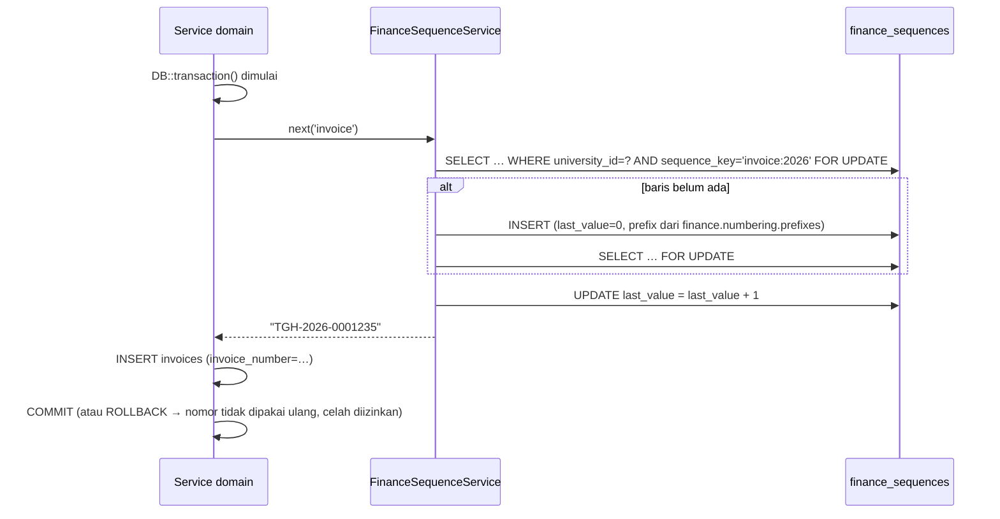
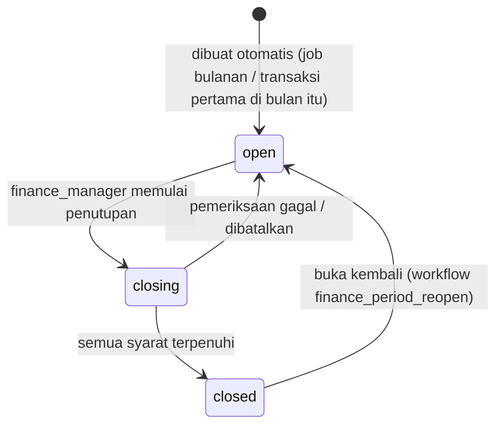

# 04 — Master Data dan Konfigurasi

> **Status:** rancangan. Disusun 2026-10-13.
> Kembali ke [README](README.md) · Skema: [19 §3.2](19-rancangan-database-dan-relasi.md#32-master-dan-konfigurasi) · Aturan: [25 §3](25-business-rules-dan-validasi.md) (rentang `KEU-BR-020`–`039`)

Dokumen ini mencakup data induk yang menjadi fondasi seluruh fitur KEU: komponen biaya, pemetaan mata kuliah berbiaya, rekening penerima, penomoran dokumen, pengaturan kebijakan tenant (`finance.*`), dan periode keuangan. Golongan UKT dibahas di [15](15-rancangan-ukt-dan-validasi-penerima.md), tarif di [05](05-rancangan-tarif-uang-kuliah.md), kanal pembayaran di [08](08-rancangan-pembayaran-online-dan-gateway.md), dan aturan denda di [13](13-rancangan-denda.md).

**Peta format baku** (berlaku untuk dokumen fitur 04–18):

| Butir | Bagian |
|---|---|
| 1–3 Tujuan, aktor, prasyarat | [§1](#1-tujuan-aktor-dan-prasyarat) |
| 4 Data masukan | [§2](#2-komponen-biaya)–[§6](#6-periode-keuangan) (tabel kolom per entitas) |
| 5–6 Proses dan status | [§2.3](#23-proses-dan-status), [§4](#4-penomoran-dokumen), [§6](#6-periode-keuangan) |
| 7–8 Aturan dan validasi | [§2.5](#25-aturan-dan-validasi), [§3](#3-rekening-penerima), [§5.3](#53-aturan-perubahan-pengaturan) |
| 9 Hak akses | [§7](#7-hak-akses) |
| 10–11 Struktur data dan relasi | [§8](#8-struktur-data-dan-relasi) |
| 12 API dan event | [§9](#9-api-dan-event) |
| 13 UI/UX | [§10](#10-uiux) |
| 14 Notifikasi | [§11](#11-notifikasi) |
| 15 Laporan | [§12](#12-laporan-terkait) |
| 16 Skenario kegagalan | [§13](#13-skenario-kegagalan) |
| 17 Audit trail | [§14](#14-audit-trail) |
| 18–19 Acceptance criteria dan test case | [§15](#15-acceptance-criteria-dan-test-case) |

## Daftar Isi

1. [Tujuan, Aktor, dan Prasyarat](#1-tujuan-aktor-dan-prasyarat)
2. [Komponen Biaya](#2-komponen-biaya)
3. [Rekening Penerima](#3-rekening-penerima)
4. [Penomoran Dokumen](#4-penomoran-dokumen)
5. [Pengaturan Tenant `finance.*`](#5-pengaturan-tenant-finance)
6. [Periode Keuangan](#6-periode-keuangan)
7. [Hak Akses](#7-hak-akses)
8. [Struktur Data dan Relasi](#8-struktur-data-dan-relasi)
9. [API dan Event](#9-api-dan-event)
10. [UI/UX](#10-uiux)
11. [Notifikasi](#11-notifikasi)
12. [Laporan Terkait](#12-laporan-terkait)
13. [Skenario Kegagalan](#13-skenario-kegagalan)
14. [Audit Trail](#14-audit-trail)
15. [Acceptance Criteria dan Test Case](#15-acceptance-criteria-dan-test-case)

---

## 1. Tujuan, Aktor, dan Prasyarat

| Aspek | Isi |
|---|---|
| **Tujuan** | Menyediakan daftar komponen biaya, rekening, nomor dokumen, kebijakan, dan periode yang konsisten untuk dipakai seluruh fitur KEU |
| **Manfaat** | Kebijakan kampus dapat diatur tanpa perubahan kode; komponen membawa perilaku (dapat dipotong, dicicil, dasar denda, memengaruhi cekal) yang disalin ke tagihan sehingga historis stabil |
| **Aktor** | Administrator keuangan (pengelola), bendahara (pengaturan sensitif, penutupan periode), administrator integrasi (rekening untuk kanal), auditor (baca) |
| **Prasyarat** | Tenant aktif (`universities.timezone`, `currency = IDR`). Role & permission KEU sudah di-seed ([03 §9](03-role-dan-hak-akses.md#9-implementasi)). Migration F01 ([19 §6.1](19-rancangan-database-dan-relasi.md#61-urutan-migration-modul-finance)) |

## 2. Komponen Biaya

### 2.1 Data masukan

Kolom lengkap: [19 §3.2.1](19-rancangan-database-dan-relasi.md#321-fee_components--baru).

| Kategori (`category`) | Contoh | Basis tagih yang lazim (`charge_basis`) |
|---|---|---|
| `ukt` | Uang Kuliah Tunggal | `fixed`, nominal ditentukan golongan UKT |
| `spp` | SPP tetap per semester | `fixed` |
| `per_credit` | Biaya per SKS | `per_credit` |
| `practicum` | Biaya praktikum | `per_course` atau `fixed` |
| `registration` | Biaya registrasi/daftar ulang | `fixed` |
| `development` | Dana pengembangan (DPP/SPI) | `fixed` |
| `administration` | Biaya administrasi | `fixed` |
| `late_fee` | Denda keterlambatan | `manual` (wajib, [KEU-BR-021](25-business-rules-dan-validasi.md)) |
| `graduation` | Biaya wisuda | `fixed` |
| `other` | Cuti akademik, migrasi, lain-lain | `fixed` / `manual` |

### 2.2 Komponen awal yang di-seed (*contoh*, dapat diubah tenant)

| Kode | Nama | Kategori | Basis | Prioritas alokasi | Dapat dipotong | Dapat dicicil | Dasar denda | Memengaruhi cekal |
|---|---|---|---|---:|:-:|:-:|:-:|:-:|
| `REG` | Biaya Registrasi | `registration` | `fixed` | 5 | ✗ | ✗ | ✗ | ✓ |
| `UKT` | Uang Kuliah Tunggal | `ukt` | `fixed` | 10 | ✓ | ✓ | ✓ | ✓ |
| `SPP` | SPP Semester | `spp` | `fixed` | 10 | ✓ | ✓ | ✓ | ✓ |
| `CUTI` | Biaya Cuti Akademik | `other` | `fixed` | 15 | ✗ | ✗ | ✓ | ✓ |
| `SKS` | Biaya per SKS | `per_credit` | `per_credit` | 20 | ✓ | ✓ | ✓ | ✓ |
| `PRAK` | Biaya Praktikum | `practicum` | `per_course` | 30 | ✓ | ✓ | ✓ | ✓ |
| `DPP` | Dana Pengembangan | `development` | `fixed` | 40 | ✓ | ✓ | ✓ | ✓ |
| `ADM` | Biaya Administrasi | `administration` | `fixed` | 50 | ✗ | ✗ | ✗ | ✗ |
| `WISUDA` | Biaya Wisuda | `graduation` | `fixed` | 60 | ✗ | ✗ | ✗ | ✗ |
| `DENDA` | Denda Keterlambatan | `late_fee` | `manual` | 90 | ✗ | ✗ | ✗ | ✗ |
| `LEGACY` | Tagihan Migrasi | `other` | `manual` | 100 | ✗ | ✗ | ✓ | ✓ |

Prioritas alokasi kecil dilunasi lebih dulu dalam *waterfall* satu tagihan ([KEU-KD-19](29-glossary-dan-keputusan-bisnis.md#2-keputusan-desain-keu-kd)). Contoh di atas membuat biaya registrasi terlunasi lebih dulu sehingga pembayaran parsial pertama menutup komponen yang biasanya menjadi syarat registrasi.

### 2.3 Proses dan status

Komponen tidak memiliki alur status; yang ada hanya `is_active`.

1. Administrator keuangan membuat komponen (kode dinormalisasi huruf besar, tanpa spasi).
2. Komponen dapat dinonaktifkan kapan saja. Komponen nonaktif tidak dapat dipakai di aturan tarif baru maupun tagihan manual baru, tetapi tetap muncul di tagihan lama dan laporan.
3. Penghapusan fisik hanya untuk komponen yang belum dirujuk `tariff_rules`, `invoice_items`, `discount_scheme_components`, `late_fee_rules`, atau `fee_component_courses`.
4. Perubahan atribut perilaku (`is_*`, `allocation_priority`) berlaku untuk tagihan yang diterbitkan **setelah** perubahan ([KEU-BR-034](25-business-rules-dan-validasi.md)).

### 2.4 Mata kuliah berbiaya per MK

Komponen dengan `charge_basis = per_course` (mis. praktikum) dikenakan per mata kuliah yang memenuhi syarat. Tabel `courses` saat ini **tidak** memiliki penanda praktikum (`courses`: `code`, `name`, `credits`, `semester_level`, `is_active`), sehingga KEU menyimpan pemetaannya sendiri di tabel **Baru** `fee_component_courses` ([19 §3.2.5](19-rancangan-database-dan-relasi.md#325-fee_component_courses--baru), [KEU-KD-33](29-glossary-dan-keputusan-bisnis.md#2-keputusan-desain-keu-kd)).

| Kolom | Makna |
|---|---|
| `fee_component_id` | Komponen `per_course` |
| `course_id` | Mata kuliah yang dikenai |
| `units` | Jumlah satuan per MK (default 1; mis. 2 untuk praktikum ganda) |
| `is_active` | Pemetaan berlaku untuk penagihan berikutnya |

Kuantitas tagihan = Σ `units` untuk MK yang terpetakan dan diambil mahasiswa (status `enrolled`) pada term tersebut ([06 §5](06-rancangan-tagihan-mahasiswa.md)). Daftar MK yang dihitung disimpan di `invoice_items.snapshot.courses` saat tagihan terbit, sehingga perubahan pemetaan tidak berlaku surut.

### 2.5 Aturan dan validasi

| Aturan | Validasi | Error |
|---|---|---|
| [KEU-BR-020](25-business-rules-dan-validasi.md) Kode unik per tenant; tidak dihapus bila sudah dirujuk | `unique(university_id, code)`; cek referensi sebelum hapus | 422 `VALIDATION_FAILED` / 409 `INVALID_STATUS_TRANSITION` (pesan "sudah dirujuk, nonaktifkan saja") |
| [KEU-BR-021](25-business-rules-dan-validasi.md) Kategori `late_fee` wajib `charge_basis = manual` | Form Request | 422 |
| `per_course` wajib memiliki minimal satu pemetaan MK aktif sebelum dipakai di aturan tarif | Saat validasi jadwal tarif ([05 §5](05-rancangan-tarif-uang-kuliah.md)) | Peringatan validasi |
| `allocation_priority` 1–999 | Form Request | 422 |
| `accounting_code` mengikuti pola bagan akun tenant [K] | Regex opsional di `finance.accounting.code_pattern` | 422 |

## 3. Rekening Penerima

Kolom: [19 §3.2.2](19-rancangan-database-dan-relasi.md#322-bank_accounts--baru). Rekening dikelola dengan permission `payment_channels.create/update` karena fungsinya melekat pada kanal transfer manual dan sumber refund.

| Aturan | Validasi |
|---|---|
| [KEU-BR-022](25-business-rules-dan-validasi.md) Nomor rekening disimpan terenkripsi (`encrypted`) + `account_number_hash` (HMAC atas digit saja) + `account_number_last4` | Normalisasi: hapus spasi/tanda baca. Unique `(university_id, account_number_hash)` |
| Nomor rekening hanya digit, panjang 6–20 | Form Request |
| `purpose ∈ {tuition, deposit, refund_source, general}` | Enum |
| Rekening yang dirujuk `payments`/`payment_channels`/`reconciliation_batches` tidak dapat dihapus | Service; nonaktifkan saja |
| Menonaktifkan rekening yang menjadi tujuan kanal `manual_transfer` aktif ditolak sampai kanal dinonaktifkan atau dialihkan | Service, 409 |
| Melihat nomor penuh dicatat `viewed_sensitive` ([KEU-BR-306](25-business-rules-dan-validasi.md)) | `GET /bank-accounts/{id}/reveal` |

## 4. Penomoran Dokumen

Format, kunci, dan contoh setiap jenis dokumen ada di [19 §7.1](19-rancangan-database-dan-relasi.md#71-nomor-transaksi-unik). Mekanisme:



| Ketentuan | Isi |
|---|---|
| Tahun | Tahun kalender zona waktu tenant saat dokumen dibuat ([KEU-BR-012](25-business-rules-dan-validasi.md)) |
| Prefiks | Dari `finance.numbering.prefixes` (default `TGH`, `PAY`, `TRX`, `ALC`, `KWT`, `CCL`, `BSW`, `UKT`, `BUK`, `DPT`, `ADJ`, `RFD`, `REC`, `BRN`, `CKL`, `DSP`, `SGK`, `KAS`). Perubahan prefiks hanya berlaku untuk nomor berikutnya |
| Lebar angka | Tetap per jenis (mis. 7 digit untuk tagihan). Bila habis, lebar bertambah otomatis tanpa mengubah nomor lama |
| Celah nomor | Diizinkan; nomor **tidak pernah dipakai ulang** ([KEU-BR-024](25-business-rules-dan-validasi.md)). Kebijakan kuitansi tanpa celah bersifat [K] ([KEU-Q-15](29-glossary-dan-keputusan-bisnis.md#3-pertanyaan-terbuka-keu-q)) |
| Urutan kunci | `finance_sequences` dikunci **pertama** dalam urutan baku ([KEU-BR-010](25-business-rules-dan-validasi.md)) |
| Transaksi panjang | Untuk tagihan massal, nomor diambil per tagihan di transaksi per mahasiswa, bukan satu transaksi besar, agar kunci tidak ditahan lama |

## 5. Pengaturan Tenant `finance.*`

### 5.1 Penyimpanan

Disimpan di `university_settings` (unik `university_id + key`, `group = 'finance'`) dan dibaca lewat `SystemSettingService::get($key, $default)` yang sudah ada. Nilai default di tabel berikut adalah **default rancangan**; nilai berlabel [K] wajib dikonfirmasi kampus sebelum fitur terkait diaktifkan.

### 5.2 Katalog kunci

Kolom **Sensitif** = hanya `finance_manager` yang dapat mengubah ([03 §4](03-role-dan-hak-akses.md#4-matriks-hak-akses) catatan ²).

| Kunci | Tipe | Default | Sensitif | Makna | Rincian |
|---|---|---|:-:|---|---|
| `finance.calculation.sequence` | array | `["tariff","scholarship","discount","voucher","manual_discount"]` [K] | | Urutan tahap perhitungan pengurang | [11 §5](11-rancangan-beasiswa-dan-potongan.md) |
| `finance.discount.percentage_base` | enum `remaining_component`/`gross_component` | `remaining_component` [K] | | Dasar potongan persen | [11 §5](11-rancangan-beasiswa-dan-potongan.md) |
| `finance.discount.stacking_policy` | enum `allow_except_group`/`best_only` | `allow_except_group` [K] | | Penggabungan skema | [11 §6](11-rancangan-beasiswa-dan-potongan.md) |
| `finance.rounding.mode` | enum `half_up`/`down`/`up` | `half_up` | | Pembulatan hasil persen | [KEU-BR-011](25-business-rules-dan-validasi.md) |
| `finance.rounding.scale` | int | `0` (rupiah penuh) | | Jumlah desimal hasil pembulatan | |
| `finance.allocation.strategy` | enum `fifo_due_date` | `fifo_due_date` | | Urutan alokasi otomatis | [07 §4](07-rancangan-pembayaran.md) |
| `finance.allocation.invoice_type_priority` | array | `["admission","semester","short_term","supplementary","additional","late_fee"]` [K] | | Pemecah seri bila jatuh tempo sama | [07 §4](07-rancangan-pembayaran.md) |
| `finance.overpayment.default_action` | enum `hold`/`deposit` | `hold` [K] | | Tindakan atas kelebihan bayar | [07 §6](07-rancangan-pembayaran.md) |
| `finance.tariff.semester_level_excludes_leave` | bool | `false` [K] | | Term cuti tidak dihitung dalam "semester ke-" | [05 §3.3](05-rancangan-tarif-uang-kuliah.md#33-semester-ke-) |
| `finance.invoice.default_due_days` | int | `30` | | Jatuh tempo default sejak terbit | [06 §4](06-rancangan-tagihan-mahasiswa.md) |
| `finance.invoice.eligible_student_statuses` | array | `["active"]` [K] | | Status mahasiswa yang ditagih tagihan semester | [06 §6](06-rancangan-tagihan-mahasiswa.md) |
| `finance.billing_run.preview_ttl_hours` | int | `24` | | Masa berlaku pratinjau tagihan massal | [06 §6.3](06-rancangan-tagihan-mahasiswa.md#63-proses) |
| `finance.payment.partial_allowed` | bool | `true` [K] | | Pembayaran parsial tanpa cicilan | [07 §5](07-rancangan-pembayaran.md) |
| `finance.payment.min_amount` | decimal | `10000.00` [K] | | Minimum per transaksi online | [08 §5](08-rancangan-pembayaran-online-dan-gateway.md) |
| `finance.posting_date_basis` | enum `paid_at`/`verified_at` | `paid_at` [K] | | Dasar tanggal pembukuan pembayaran | [07 §8](07-rancangan-pembayaran.md) |
| `finance.installment.enabled` | bool | `false` | | Saklar fitur cicilan | [10](10-rancangan-cicilan-tagihan.md) |
| `finance.installment.max_terms` | int | `4` [K] | | Maksimal termin (termasuk DP) | [10 §3](10-rancangan-cicilan-tagihan.md) |
| `finance.installment.min_down_payment_percentage` | decimal | `25.00` [K] | | DP minimal (% dari nominal dicicil) | [10 §3](10-rancangan-cicilan-tagihan.md) |
| `finance.installment.allowed_invoice_types` | array | `["semester","short_term","admission","additional"]` | | Tipe tagihan yang dapat dicicil | [10 §3](10-rancangan-cicilan-tagihan.md) |
| `finance.installment.student_request_enabled` | bool | `true` | | Mahasiswa dapat mengajukan sendiri | [10 §4](10-rancangan-cicilan-tagihan.md) |
| `finance.installment.last_due_limit` | enum `term_end`/`none` | `term_end` [K] | | Batas jatuh tempo termin terakhir | [10 §3](10-rancangan-cicilan-tagihan.md) |
| `finance.late_fee.enabled` | bool | `false` | | Saklar denda ([KEU-Q-06](29-glossary-dan-keputusan-bisnis.md#3-pertanyaan-terbuka-keu-q)) | [13](13-rancangan-denda.md) |
| `finance.late_fee.due_days` | int | `7` [K] | | Jatuh tempo tagihan denda sejak bucket | [13 §6](13-rancangan-denda.md) |
| `finance.late_fee.run_at` | time | `00:30` | | Jam job denda (zona tenant) | [13 §5](13-rancangan-denda.md) |
| `finance.aging.buckets` | array | `not_due`, `d1_30`, `d31_60`, `d61_90`, `d90_plus` | | Kategori umur piutang | [16 §6](16-rancangan-monitoring-piutang.md) |
| `finance.hold.enabled` | bool | `false` | | Saklar cekal | [17](17-rancangan-cekal-keuangan.md) |
| `finance.hold.sync_max_attempts` | int | `8` | | Batas retry sinkronisasi | [17 §7](17-rancangan-cekal-keuangan.md) |
| `finance.hold.release_sla_seconds` | int | `60` | | Target pembukaan cekal | [17 §4](17-rancangan-cekal-keuangan.md) |
| `finance.hold.available_services` | array | `["krs","exam","grade_view","transcript","yudisium","graduation"]` | | Kunci layanan yang dapat dicekal, mengikuti SIAKAD | [17 §2](17-rancangan-cekal-keuangan.md#2-konsep-keputusan-di-keu-penegakan-di-siakad) |
| `finance.hold.enforcement_mode` | enum `direct`/`projection` | `direct` | | Penegakan lewat `FinanceClearanceGuard` atau proyeksi `academic_blocks` | [17 §9](17-rancangan-cekal-keuangan.md#9-jalur-sementara-financeclearanceguard) |
| `finance.sod.enabled` | bool | `true` | ✓ | Pemisahan tugas | [03 §7](03-role-dan-hak-akses.md#7-pemisahan-tugas-sod) |
| `finance.approval.thresholds` | object | lihat §5.4 | ✓ | Ambang persetujuan | [03 §6](03-role-dan-hak-akses.md#6-persetujuan) |
| `finance.proof.max_size_mb` | int | `5` | | Ukuran maksimal bukti bayar (≤ `file.max_upload_size_mb`) | [09 §4](09-rancangan-pembayaran-tunai-dan-manual.md) |
| `finance.proof.allowed_mimes` | array | `["pdf","jpg","jpeg","png"]` | | Tipe berkas bukti | [09 §4](09-rancangan-pembayaran-tunai-dan-manual.md) |
| `finance.manual_transfer.unique_code_enabled` | bool | `false` [K] | | Kode unik nominal transfer | [09 §5](09-rancangan-pembayaran-tunai-dan-manual.md) |
| `finance.manual_transfer.max_backdate_days` | int | `60` [K] | | Batas usia tanggal transfer | [09 §4](09-rancangan-pembayaran-tunai-dan-manual.md) |
| `finance.cashier.require_session` | bool | `true` | | Tunai wajib dalam sesi kas | [09 §3](09-rancangan-pembayaran-tunai-dan-manual.md) |
| `finance.gateway.polling_after_minutes` | int | `15` | | Cek status transaksi tanpa webhook | [08 §11](08-rancangan-pembayaran-online-dan-gateway.md) |
| `finance.gateway.signature_tolerance_seconds` | int | `300` | | Toleransi waktu tanda tangan webhook | [08 §7](08-rancangan-pembayaran-online-dan-gateway.md) |
| `finance.voucher.reservation_minutes` | int | `30` | | Masa reservasi voucher | [12 §5](12-rancangan-voucher-tagihan.md) |
| `finance.voucher.return_quota_on_cancel` | bool | `true` [K] | | Kuota kembali saat tagihan batal | [12 §6](12-rancangan-voucher-tagihan.md) |
| `finance.voucher.max_attempts` | object | `{"count":10,"window_minutes":15}` | | Batas percobaan kode | [12 §4](12-rancangan-voucher-tagihan.md) |
| `finance.deposit.self_use_enabled` | bool | `false` [K] | | Mahasiswa memakai deposit sendiri | [14 §5](14-rancangan-deposit-mahasiswa.md) |
| `finance.deposit.topup_enabled` | bool | `false` [K] | | Top-up deposit mandiri | [14 §4](14-rancangan-deposit-mahasiswa.md) |
| `finance.deposit.auto_apply_on_issue` | bool | `false` [K] | | Saldo deposit otomatis dipakai saat tagihan baru terbit | [14 §5](14-rancangan-deposit-mahasiswa.md#5-pemakaian-deposit) |
| `finance.dispute.suspend_late_fee` | bool | `false` [K] | | Sengketa menunda denda | [06 §9](06-rancangan-tagihan-mahasiswa.md) |
| `finance.dispute.suspend_hold` | bool | `false` [K] | | Sengketa menunda cekal | [06 §9](06-rancangan-tagihan-mahasiswa.md) |
| `finance.ukt.appeal_window_days` | int | `30` [K] | | Batas pengajuan keberatan sejak penetapan | [15 §5](15-rancangan-ukt-dan-validasi-penerima.md) |
| `finance.notification.due_reminder_days` | array | `[7, 1]` | | Pengingat H-n jatuh tempo | [23](23-rancangan-notifikasi.md) |
| `finance.receipt.public_verification_enabled` | bool | `true` | | Halaman verifikasi kuitansi publik | [09 §8](09-rancangan-pembayaran-tunai-dan-manual.md) |
| `finance.numbering.prefixes` | object | lihat §4 | ✓ | Prefiks nomor dokumen | §4 |
| `finance.retention.years` | int | `10` [K] | ✓ | Retensi data keuangan & audit | [24 §11](24-keamanan-audit-dan-kontrol-internal.md) |
| `finance.retention.webhook_payload_days` | int | `400` | ✓ | Retensi payload webhook | [24 §11](24-keamanan-audit-dan-kontrol-internal.md) |
| `finance.retention.idempotency_hours` | int | `24` | ✓ | Retensi kunci idempotensi | [24 §11](24-keamanan-audit-dan-kontrol-internal.md) |
| `finance.retention.outbox_days` | int | `90` | ✓ | Retensi outbox terkirim | [24 §11](24-keamanan-audit-dan-kontrol-internal.md) |
| `entitlement.finance.payment_channels` | int | per paket ([01 §8](01-overview-dan-ruang-lingkup.md#8-ketersediaan-per-paket)) | — | Kuota kanal online. **Hanya Super Admin** via endpoint platform; tenant hanya membaca | [08 §4](08-rancangan-pembayaran-online-dan-gateway.md) |

### 5.3 Aturan perubahan pengaturan

| Aturan | Isi |
|---|---|
| [KEU-BR-036](25-business-rules-dan-validasi.md) | Perubahan berlaku **ke depan**: tidak menghitung ulang tagihan terbit, alokasi, denda yang sudah dibentuk, atau cekal yang sudah dievaluasi (evaluasi berikutnya memakai nilai baru) |
| Validasi tipe | Setiap kunci memiliki skema validasi (tipe, rentang, enum). Contoh: `finance.aging.buckets` harus berurutan, tidak tumpang tindih, dan mencakup seluruh rentang hari ≥ 1 |
| Ketergantungan | `finance.hold.enabled = true` ditolak bila belum ada kebijakan cekal aktif; `finance.late_fee.enabled = true` ditolak bila belum ada aturan denda aktif |
| Audit | Setiap perubahan tercatat (`old_values`/`new_values`) dengan alasan wajib untuk kunci sensitif ([KEU-BR-019](25-business-rules-dan-validasi.md)) |

### 5.4 Default `finance.approval.thresholds`

```json
{
  "manual_invoice":     { "enabled": true,  "min_amount": "25000000.00" },
  "billing_run":        { "enabled": false },
  "adjustment_level2":  { "min_amount": "10000000.00", "approver_role": "vice_rector" },
  "refund_level2":      { "min_amount": "10000000.00", "approver_role": "vice_rector" },
  "late_fee_waiver":    { "max_amount_officer": "0.00" },
  "voucher":            { "always": true }
}
```

Semua nominal adalah *contoh* [K] ([KEU-Q-08](29-glossary-dan-keputusan-bisnis.md#3-pertanyaan-terbuka-keu-q)).

## 6. Periode Keuangan

Kolom: [19 §3.2.3](19-rancangan-database-dan-relasi.md#323-finance_periods--baru). Prosedur penutupan lengkap: [18 §8](18-rancangan-rekonsiliasi-dan-penyesuaian.md).



| Ketentuan | Isi |
|---|---|
| Granularitas | Bulan kalender zona tenant ([KEU-KD-16](29-glossary-dan-keputusan-bisnis.md#2-keputusan-desain-keu-kd)) |
| Pembuatan | Job `finance:ensure-periods` pada hari pertama setiap bulan pukul 00:05 zona tenant, dan pembuatan *lazy* saat transaksi pertama dengan `posting_date` di bulan yang belum ada |
| Selama `closing` | Transaksi baru dengan `posting_date` di periode tersebut ditahan (409 `PERIOD_CLOSED` dengan pesan "sedang ditutup") |
| Setelah `closed` | Transaksi dengan `posting_date` di periode itu ditolak ([KEU-BR-014](25-business-rules-dan-validasi.md)); koreksi dibukukan di periode terbuka berikutnya |
| Tumpang tindih | Dilarang ([KEU-BR-023](25-business-rules-dan-validasi.md)) |

## 7. Hak Akses

| Aksi | Permission | Role default |
|---|---|---|
| Lihat komponen | `fee_components.read` | FA, FO, CS, FM, UO/UA, RK, AU |
| Kelola komponen & pemetaan MK | `fee_components.create/update/delete` | FA |
| Lihat/kelola rekening | `payment_channels.read` / `payment_channels.create/update` | FA, IA (kelola); FO, FM, AU (lihat) |
| Lihat nomor rekening penuh | `payment_channels.update` + audit `viewed_sensitive` | FA, IA |
| Lihat pengaturan | `finance_settings.read` | FA, FM, IA, UO/UA, AU |
| Ubah pengaturan non-sensitif / sensitif | `finance_settings.update` / + role `finance_manager` | FA, FM / FM |
| Tutup periode | `finance_periods.finalize` | FM |
| Ajukan buka kembali periode | `finance_periods.update` | FM (disetujui `vice_rector`) |

## 8. Struktur Data dan Relasi

| Tabel | Status | Rincian | Relasi utama |
|---|---|---|---|
| `fee_components` | Baru | [19 §3.2.1](19-rancangan-database-dan-relasi.md#321-fee_components--baru) | `1:N` `tariff_rules`, `invoice_items`, `discount_scheme_components`, `late_fee_rules`, `fee_component_courses` |
| `fee_component_courses` | Baru | [19 §3.2.5](19-rancangan-database-dan-relasi.md#325-fee_component_courses--baru) | `N:1` `fee_components`, `courses` |
| `bank_accounts` | Baru | [19 §3.2.2](19-rancangan-database-dan-relasi.md#322-bank_accounts--baru) | `1:N` `payment_channels`, `payments`, `reconciliation_batches` |
| `finance_sequences` | Baru | [19 §3.2.4](19-rancangan-database-dan-relasi.md#324-finance_sequences--baru) | — |
| `finance_periods` | Baru | [19 §3.2.3](19-rancangan-database-dan-relasi.md#323-finance_periods--baru) | `N:1` `approval_requests` (buka kembali) |
| `university_settings` | Ada | `group = 'finance'` | — |

## 9. API dan Event

Kontrak lengkap di [20](20-rancangan-api-dan-integrasi.md). Ringkasan:

| Method | URL | Permission | Catatan |
|---|---|---|---|
| GET | `/fee-components` | `fee_components.read` | Filter `category`, `is_active`, `search` |
| POST | `/fee-components` | `fee_components.create` | |
| GET/PUT | `/fee-components/{feeComponent}` | `.read` / `.update` | |
| PATCH | `/fee-components/{feeComponent}/activate`, `/deactivate` | `fee_components.update` | |
| DELETE | `/fee-components/{feeComponent}` | `fee_components.delete` | 409 bila sudah dirujuk |
| GET/PUT | `/fee-components/{feeComponent}/courses` | `.read` / `.update` | Ganti daftar pemetaan MK |
| GET/POST | `/bank-accounts` | `payment_channels.read` / `.create` | Nomor termasking |
| PUT | `/bank-accounts/{bankAccount}` | `payment_channels.update` | |
| GET | `/bank-accounts/{bankAccount}/reveal` | `payment_channels.update` | Audit `viewed_sensitive` |
| GET/PUT | `/finance-settings` | `finance_settings.read` / `.update` | PUT parsial per kunci; kunci sensitif butuh role FM |
| GET | `/finance-periods` | `finance_periods.read` | |
| POST | `/finance-periods/{financePeriod}/close` | `finance_periods.finalize` | [18 §8](18-rancangan-rekonsiliasi-dan-penyesuaian.md) |
| POST | `/finance-periods/{financePeriod}/reopen` | `finance_periods.update` | Membuat permintaan workflow |

Event: `FinancePeriodClosed` (outbox, konsumen akuntansi). Perubahan master tidak memancarkan event lintas modul.

## 10. UI/UX

Halaman di bawah menu **Master Keuangan** ([21 §3](21-rancangan-ui-ux-dan-menu.md)):

| Halaman | Rute | Komponen utama |
|---|---|---|
| Komponen Biaya | `/keuangan/master/komponen-biaya` | Tabel (kode, nama, kategori, basis, prioritas, ikon atribut perilaku, status), filter kategori/status, drawer detail dengan tab "Mata kuliah terpetakan" untuk `per_course`, form tambah/edit, aksi nonaktifkan |
| Rekening Penerima | `/keuangan/master/rekening` | Tabel termasking, tombol "Lihat nomor lengkap" (dengan konfirmasi dan dicatat) |
| Pengaturan Keuangan | `/keuangan/master/pengaturan` | Form berkelompok (Perhitungan, Tagihan, Pembayaran, Cicilan, Denda, Cekal, Persetujuan, Retensi). Kunci [K] diberi lencana "Perlu konfirmasi kebijakan". Kunci sensitif terkunci untuk non-FM |
| Periode Keuangan | `/keuangan/master/periode` | Daftar bulan dengan status, tombol "Mulai penutupan" (wizard pemeriksaan [18 §8](18-rancangan-rekonsiliasi-dan-penyesuaian.md)), riwayat buka kembali |

## 11. Notifikasi

| Event | Penerima | Kanal |
|---|---|---|
| `finance.period_closing_reminder` (H-3 akhir bulan) | `finance_manager` | database, mail |
| Perubahan kunci sensitif | `finance_manager` lain dan `auditor` | database |

## 12. Laporan Terkait

[KEU-RPT-18](22-rancangan-laporan-dan-dashboard.md) (audit perubahan) mencakup perubahan komponen, rekening, dan pengaturan. Daftar komponen dipakai sebagai dimensi di hampir semua laporan.

## 13. Skenario Kegagalan

| Skenario | Penanganan |
|---|---|
| Dua staf menyimpan pengaturan bersamaan | Optimistic locking per kunci (`updated_at` dikirim klien); yang kalah menerima 409 `STALE_VERSION` |
| Prefiks diubah di tengah tahun | Nomor baru memakai prefiks baru; nomor lama tetap. Unique tetap terjaga karena nomor menyertakan prefiks |
| Baris `finance_sequences` terkunci lama (transaksi menggantung) | Timeout kunci 5 detik → transaksi gagal dan dapat diulang; tidak ada nomor ganda |
| Komponen dinonaktifkan saat tagihan massal berjalan | Billing run memakai daftar komponen yang dibekukan saat pratinjau; komponen nonaktif setelah pratinjau tetap ditagih sesuai pratinjau, dengan peringatan di hasil run |
| Periode bulan berjalan belum dibuat karena job gagal | Pembuatan *lazy* saat transaksi pertama |

## 14. Audit Trail

| Aksi | `audit_logs.action` | Data yang dicatat |
|---|---|---|
| Buat/ubah/hapus komponen, pemetaan MK | `created`/`updated`/`deleted` | Nilai lama/baru |
| Buat/ubah rekening | `created`/`updated` | Tanpa nomor penuh (`$auditMasked`) |
| Lihat nomor rekening penuh | `viewed_sensitive` | Pengguna, waktu, rekening |
| Ubah pengaturan | `updated` | Kunci, nilai lama/baru, alasan |
| Tutup/buka kembali periode | `approved` / `forced_override` | Ringkasan penutupan, persetujuan |

## 15. Acceptance Criteria dan Test Case

| Acceptance criteria | Test case |
|---|---|
| [KEU-AC-MST-01](27-acceptance-criteria.md) Komponen, rekening, dan periode dikelola sesuai aturan | [KEU-TC-MST-001](26-skenario-pengujian.md), [-002](26-skenario-pengujian.md), [-003](26-skenario-pengujian.md), [-004](26-skenario-pengujian.md) |
| [KEU-AC-MST-02](27-acceptance-criteria.md) Penomoran unik pada permintaan paralel | [KEU-TC-MST-005](26-skenario-pengujian.md) |
| [KEU-AC-MST-03](27-acceptance-criteria.md) Pengaturan tersedia, tervalidasi, diaudit, tidak berlaku surut | [KEU-TC-MST-007](26-skenario-pengujian.md) |
| [KEU-AC-MST-04](27-acceptance-criteria.md) Pembulatan konsisten | [KEU-TC-MST-006](26-skenario-pengujian.md) |
