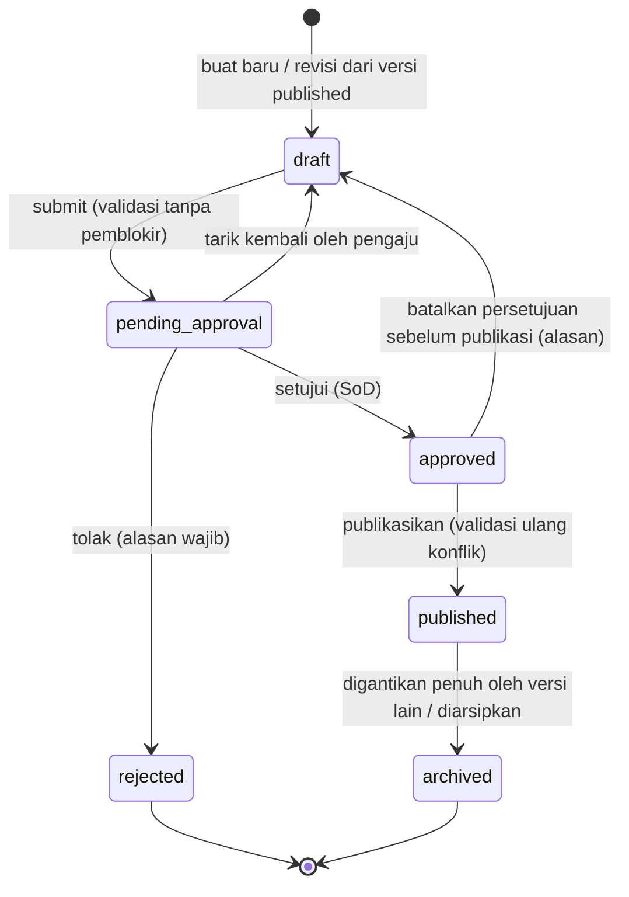

# 05 — Rancangan Tarif Uang Kuliah

> **Status:** rancangan. Disusun 2026-10-13.
> Kembali ke [README](README.md) · Skema: [19 §3.3](19-rancangan-database-dan-relasi.md#33-tarif-dan-golongan-ukt) · Aturan: `KEU-BR-020`–`039` ([25](25-business-rules-dan-validasi.md)) · Keputusan: [KEU-KD-07](29-glossary-dan-keputusan-bisnis.md#2-keputusan-desain-keu-kd), [KEU-KD-08](29-glossary-dan-keputusan-bisnis.md#2-keputusan-desain-keu-kd)

Tarif menentukan **berapa** yang ditagih untuk setiap komponen biaya kepada seorang mahasiswa pada suatu term. Dokumen ini menjelaskan struktur tarif berversi, kriteria pencocokan, aturan pemilihan bila beberapa aturan cocok, penanganan tarif yang tidak ditemukan atau bertentangan, alur persetujuan dan publikasi, serta snapshot yang membuat tagihan lama tidak berubah.

**Peta format baku:** tujuan/aktor/prasyarat §1 · data masukan §2–§3 · proses & status §6–§7 · aturan & validasi §4–§5, §8 · hak akses §10 · data & relasi §11 · API §12 · UI §13 · notifikasi §14 · laporan §15 · kegagalan §16 · audit §17 · AC & TC §18.

## Daftar Isi

1. [Tujuan, Aktor, dan Prasyarat](#1-tujuan-aktor-dan-prasyarat)
2. [Konsep dan Jenis Tarif](#2-konsep-dan-jenis-tarif)
3. [Kriteria dan Basis Perhitungan](#3-kriteria-dan-basis-perhitungan)
4. [Skor Spesifisitas dan Prioritas Pemilihan](#4-skor-spesifisitas-dan-prioritas-pemilihan)
5. [Konflik, Tarif Tidak Ditemukan, dan Validasi Jadwal](#5-konflik-tarif-tidak-ditemukan-dan-validasi-jadwal)
6. [Siklus Versi: Draf, Persetujuan, Publikasi, Revisi](#6-siklus-versi-draf-persetujuan-publikasi-revisi)
7. [Resolusi dan Pratinjau Tarif](#7-resolusi-dan-pratinjau-tarif)
8. [Snapshot dan Larangan Berlaku Surut](#8-snapshot-dan-larangan-berlaku-surut)
9. [Contoh Konfigurasi dan Perhitungan](#9-contoh-konfigurasi-dan-perhitungan)
10. [Hak Akses](#10-hak-akses)
11. [Struktur Data dan Relasi](#11-struktur-data-dan-relasi)
12. [API dan Event](#12-api-dan-event)
13. [UI/UX](#13-uiux)
14. [Notifikasi](#14-notifikasi)
15. [Laporan Terkait](#15-laporan-terkait)
16. [Skenario Kegagalan](#16-skenario-kegagalan)
17. [Audit Trail](#17-audit-trail)
18. [Acceptance Criteria dan Test Case](#18-acceptance-criteria-dan-test-case)

---

## 1. Tujuan, Aktor, dan Prasyarat

| Aspek | Isi |
|---|---|
| **Tujuan** | Menyediakan sumber nominal yang benar, berversi, dan disetujui untuk setiap komponen biaya |
| **Manfaat** | Tagihan massal dapat dihitung otomatis; perbedaan tarif per angkatan/prodi/jalur/kelas/golongan dapat diatur tanpa kode; tagihan lama tidak berubah saat tarif direvisi |
| **Aktor** | Administrator keuangan (menyusun, mengimpor, mengajukan, mempublikasikan), bendahara (menyetujui/menolak), pimpinan (tingkat lanjut bila dikonfigurasi), auditor (membaca) |
| **Prasyarat** | Komponen biaya ([04 §2](04-master-data-dan-konfigurasi.md#2-komponen-biaya)); `academic_terms` untuk term berlaku; golongan UKT bila memakai UKT ([15](15-rancangan-ukt-dan-validasi-penerima.md)); pemetaan MK untuk komponen `per_course` ([04 §2.4](04-master-data-dan-konfigurasi.md#24-mata-kuliah-berbiaya-per-mk)). Kriteria jalur/kelas memerlukan kolom `students.admission_path_code` dan `study_system_code` ([KEU-A-04](29-glossary-dan-keputusan-bisnis.md#4-asumsi-keu-a)) |

## 2. Konsep dan Jenis Tarif

| Konsep | Tabel | Penjelasan |
|---|---|---|
| **Jadwal tarif** | `tariff_schedules` | Satu versi kumpulan tarif dengan rentang term berlaku. Hanya jadwal `published` yang dipakai penagihan. Setelah `published`, jadwal dan aturannya tidak dapat diubah |
| **Aturan tarif** | `tariff_rules` | Satu baris = satu nominal untuk satu komponen pada satu kombinasi kriteria |
| **Komponen biaya** | `fee_components` | Jenis biaya beserta basis tagihnya ([04 §2](04-master-data-dan-konfigurasi.md#2-komponen-biaya)) |
| **Golongan UKT** | `ukt_groups` | Klasifikasi; nominalnya tetap ditentukan di aturan tarif ([15](15-rancangan-ukt-dan-validasi-penerima.md)) |

Jenis tarif yang didukung:

| Jenis | Komponen (kategori) | Basis | Contoh |
|---|---|---|---|
| SPP / UKT | `spp` / `ukt` | Tetap per term | SPP Rp7.000.000; UKT Golongan IV Rp5.500.000 |
| Biaya per SKS | `per_credit` | Jumlah SKS × tarif | 21 SKS × Rp150.000 |
| Paket SKS + kelebihan SKS | `spp` (paket) + `per_credit` dengan `free_units` | Kelebihan di atas paket × tarif | Paket 20 SKS termasuk SPP; SKS ke-21 dst. Rp200.000 |
| Biaya praktikum | `practicum` | Per MK terpetakan × tarif, atau tetap | 2 MK × Rp350.000 |
| Biaya registrasi | `registration` | Tetap | Rp250.000 pada term ganjil |
| Biaya pengembangan | `development` | Tetap, biasanya hanya semester 1 | DPP Rp5.000.000 |
| Biaya administrasi | `administration` | Tetap | Rp100.000 |
| Biaya cuti | `other` + kriteria `student_status = leave` | Tetap | Rp1.500.000 |
| Denda | `late_fee` | **Tidak** memakai aturan tarif; dihitung dari `late_fee_rules` ([13](13-rancangan-denda.md)) | — |

## 3. Kriteria dan Basis Perhitungan

### 3.1 Kriteria pencocokan

Kolom kriteria `null` berarti "semua". Satu aturan cocok untuk mahasiswa *m* pada term *T* bila **seluruh** kriteria yang terisi terpenuhi.

| Kriteria (`tariff_rules`) | Dibandingkan dengan | Catatan |
|---|---|---|
| `fee_component_id` | Komponen yang sedang dihitung | Wajib |
| `study_program_id` | `students.study_program_id` | |
| `faculty_id` | `study_programs.faculty_id` dari prodi mahasiswa | Diabaikan dalam skor bila `study_program_id` terisi (§4) |
| `degree_level` | `UPPER(study_programs.degree_level)` | `degree_level` di repo berupa teks bebas |
| `admission_year_from` / `_to` | `students.admission_year` (angkatan) | Inklusif; salah satu boleh `null` |
| `admission_path_code` | `students.admission_path_code` (**belum ada**) | Bila kolom mahasiswa `null`, aturan berkriteria jalur **tidak** cocok ([KEU-BR-035](25-business-rules-dan-validasi.md)) |
| `study_system_code` | `students.study_system_code` (**belum ada**) | Sama dengan di atas |
| `ukt_group_id` | Golongan dari `ukt_determinations` `active` yang berlaku pada *T* | Wajib terisi untuk komponen kategori `ukt` |
| `student_status` | `students.status` saat perhitungan | Nilai `StudentStatus`: `active`, `leave`, … |
| `semester_level_from` / `_to` | Semester ke- mahasiswa pada *T* | Lihat §3.3 |
| `term_type` | Jenis term *T*: `ganjil`, `genap`, `pendek` | `academic_terms.semester` saat ini hanya `ganjil/genap`; `pendek` mengikuti rancangan [semester-pendek](../../docs/semester-pendek/README.md) |

Rentang term berlaku ditentukan di tingkat jadwal (`effective_from_term_id`, `effective_until_term_id`), bukan di aturan.

### 3.2 Basis perhitungan nominal

| `charge_basis` komponen | Satuan (*u*) | Rumus baris tagihan |
|---|---|---|
| `fixed` | 1 | `amount` |
| `per_credit` | Σ `courses.credits` dari `krs_items` berstatus `enrolled` pada *T* ([06 §5](06-rancangan-tagihan-mahasiswa.md)) | `billable × amount` |
| `per_course` | Σ `fee_component_courses.units` untuk MK `enrolled` yang terpetakan | `billable × amount` |
| `manual` | Diinput staf | Tidak dicari di tarif (hanya tagihan manual) |

Untuk `per_credit` dan `per_course` ([KEU-BR-032](25-business-rules-dan-validasi.md)):

```
u          = satuan mentah (SKS atau unit MK)
u_net      = max(0, u − COALESCE(free_units, 0))
billable   = u_net = 0 ? 0 : clamp(u_net, COALESCE(min_units, 0), COALESCE(max_units, ∞))
nominal    = billable × amount          (dibulatkan sesuai finance.rounding.*)
```

- Bila `billable = 0`, komponen **tidak** ditagihkan (tidak ada baris nol). Mahasiswa tanpa SKS tidak dikenai minimal SKS.
- `free_units` dipakai untuk model "paket + kelebihan": paket 20 SKS sudah termasuk SPP, sehingga komponen `SKS` hanya menagih SKS di atas 20. Kolom ini ditambahkan ke [19 §3.3.3](19-rancangan-database-dan-relasi.md#333-tariff_rules--baru).

### 3.3 Semester ke-

`semester_level(m, T)` = banyaknya term reguler (`ganjil`/`genap`) sejak term masuk mahasiswa sampai *T* (inklusif), diurutkan menurut `academic_terms.start_date`. Term masuk = term ganjil tahun `admission_year`. Term cuti **ikut dihitung** sebagai default [K] karena masa studi tetap berjalan; kampus yang tidak menghitung cuti dapat menetapkan `finance.tariff.semester_level_excludes_leave = true` (dihitung dari `student_status_histories`).

## 4. Skor Spesifisitas dan Prioritas Pemilihan

Bila beberapa aturan cocok untuk komponen yang sama, sistem memilih aturan dengan **skor spesifisitas tertinggi** ([KEU-KD-08](29-glossary-dan-keputusan-bisnis.md#2-keputusan-desain-keu-kd), [KEU-BR-029](25-business-rules-dan-validasi.md)). Skor dihitung saat aturan disimpan (`tariff_rules.specificity_score`):

| Kriteria terisi | Bobot | Alasan urutan [R] |
|---|---:|---|
| `ukt_group_id` | 512 | Golongan UKT adalah penentu utama nominal UKT |
| `study_program_id` | 256 | Prodi lebih spesifik daripada fakultas |
| `faculty_id` (hanya bila `study_program_id` kosong) | 128 | |
| `admission_path_code` | 64 | Jalur masuk biasanya mengubah besaran (mis. Mandiri) |
| `study_system_code` | 32 | Kelas karyawan/internasional |
| `admission_year_from` atau `_to` | 16 | Angkatan |
| `degree_level` | 8 | Jenjang |
| `student_status` | 4 | Status khusus (cuti) |
| `semester_level_from` atau `_to` | 2 | Semester ke- |
| `term_type` | 1 | Ganjil/genap/pendek |

Karena bobot berupa pangkat dua, **dua aturan hanya bisa memiliki skor sama bila mengisi himpunan dimensi kriteria yang persis sama**. Akibatnya:

1. Aturan dengan himpunan dimensi berbeda selalu memiliki pemenang yang pasti.
2. Aturan dengan himpunan dimensi sama hanya bentrok bila **nilainya tumpang tindih** (mis. rentang angkatan 2024–2026 dan 2025–2027 untuk prodi yang sama). Bentrok seperti ini dideteksi saat validasi dan publikasi (§5).
3. Rentang yang lebih sempit **tidak** otomatis menang atas rentang lebar pada dimensi yang sama. Administrator harus memecah rentang (mis. 2024, 2025–2027). Keputusan ini sengaja diambil agar hasil dapat dijelaskan ke auditor tanpa aturan tersembunyi.

Bobot di atas berlaku seragam di seluruh tenant. Untuk membantu administrator memahami efeknya, validasi jadwal menghasilkan **laporan bayangan** (*shadowing*): daftar aturan yang tidak pernah terpilih atau selalu dikalahkan aturan lain untuk kombinasi tertentu (§5.3).

Pemilihan dilakukan atas kandidat dari **semua** jadwal `published` yang berlaku pada *T* (jadwal dengan `code` berbeda boleh berlaku bersamaan, mis. jadwal khusus program internasional).

## 5. Konflik, Tarif Tidak Ditemukan, dan Validasi Jadwal

### 5.1 Konflik setara (`TARIFF_AMBIGUOUS`)

Dua aturan *a* dan *b* untuk komponen yang sama **bentrok** bila:

- himpunan dimensi kriteria keduanya sama (skor sama), **dan**
- untuk setiap dimensi, nilainya beririsan: id/kode sama, atau rentang `[from, to]` beririsan, **dan**
- rentang term berlaku jadwal keduanya beririsan (bila berasal dari jadwal berbeda).

Pemeriksaan dijalankan:

| Kapan | Cakupan | Hasil bila bentrok |
|---|---|---|
| Simpan aturan di draf | Aturan lain di jadwal yang sama | Peringatan (draf boleh tidak konsisten sementara) |
| `submit` | Jadwal itu + jadwal `published` lain yang rentangnya beririsan | Ditolak 409 `TARIFF_AMBIGUOUS` dengan daftar pasangan bentrok |
| `publish` | Diulang karena jadwal lain mungkin terbit setelah persetujuan | Ditolak 409 `TARIFF_AMBIGUOUS` ([KEU-BR-030](25-business-rules-dan-validasi.md)) |
| Resolusi saat penagihan | Pertahanan terakhir | Baris tagihan tidak dibuat; `billing_run_items.reason_code = TARIFF_AMBIGUOUS` |

Dua aturan dengan seluruh kriteria **identik** dalam satu jadwal ditolak sejak disimpan melalui unique `(tariff_schedule_id, criteria_hash)` ([KEU-BR-028](25-business-rules-dan-validasi.md)).

### 5.2 Tarif tidak ditemukan (`TARIFF_NOT_FOUND`)

Sebuah komponen dianggap **wajib** pada suatu term bila ada setidaknya satu aturan untuk komponen itu di jadwal berlaku dengan `is_mandatory = true`. Validasi jadwal memastikan seluruh aturan satu komponen dalam satu jadwal memiliki nilai `is_mandatory` yang sama.

| Situasi | Komponen wajib | Komponen opsional |
|---|---|---|
| Tidak ada aturan yang cocok | `TARIFF_NOT_FOUND` ([KEU-BR-031](25-business-rules-dan-validasi.md)). Tagihan individual ditolak 422; pada tagihan massal, mahasiswa `failed` dengan alasan tersebut dan **tidak** ditagih sebagian | Dilewati tanpa baris (mis. DPP hanya untuk semester 1) |
| Cocok tetapi `billable = 0` (tanpa SKS/MK) | Dilewati; bila seluruh komponen wajib menghasilkan nol → `skipped` dengan `NO_CREDITS` | Dilewati |
| Komponen `ukt` tetapi mahasiswa tidak memiliki penetapan aktif | `UKT_GROUP_MISSING` ([KEU-BR-222](25-business-rules-dan-validasi.md)) | — |

Prinsip: lebih baik **tidak menagih** dan melapor daripada menagih sebagian komponen secara diam-diam.

### 5.3 Laporan validasi jadwal

`GET /tariff-schedules/{id}/validation` menghasilkan:

| Bagian | Isi | Tingkat |
|---|---|---|
| `conflicts` | Pasangan aturan bentrok (§5.1) | Memblokir submit/publikasi |
| `inconsistent_mandatory` | Komponen dengan `is_mandatory` campuran | Memblokir |
| `invalid_criteria` | Prodi bukan anggota fakultas yang diisi; `from > to`; `min_units > max_units`; komponen `ukt` tanpa golongan; komponen `per_course` tanpa pemetaan MK aktif ([KEU-BR-033](25-business-rules-dan-validasi.md)) | Memblokir |
| `unreachable_rules` | Aturan yang tidak mungkin cocok dengan mahasiswa mana pun saat ini (mis. prodi nonaktif, kombinasi jenjang–prodi mustahil) | Peringatan |
| `shadowed_rules` | Aturan yang selalu dikalahkan aturan lain bagi seluruh mahasiswa yang cocok | Peringatan |
| `coverage_gaps` | Kombinasi prodi × angkatan aktif yang tidak memiliki tarif untuk komponen wajib | Peringatan (menjadi `TARIFF_NOT_FOUND` saat penagihan) |
| `ukt_coverage` | Golongan UKT aktif tanpa tarif untuk prodi tertentu ([15 §7](15-rancangan-ukt-dan-validasi-penerima.md)) | Peringatan |

## 6. Siklus Versi: Draf, Persetujuan, Publikasi, Revisi

### 6.1 Status

Kanon status `tariff_schedules` diperluas dengan `approved` agar persetujuan dan publikasi menjadi dua langkah terpisah (pembaruan kanon: [README §5.4](README.md#54-kanon-status), [19 §3.3.2](19-rancangan-database-dan-relasi.md#332-tariff_schedules--baru)).



| Transisi | Permission | Syarat | Efek |
|---|---|---|---|
| `draft → pending_approval` | `tariffs.update` | Validasi §5.3 tanpa pemblokir; minimal 1 aturan | `submitted_by/at`; workflow `finance_tariff_schedule` bila aktif |
| `pending_approval → approved` | `tariffs.approve` | Penyetuju ≠ pengaju ([KEU-BR-026](25-business-rules-dan-validasi.md), [KEU-BR-300](25-business-rules-dan-validasi.md)) | `approved_by/at` |
| `pending_approval → rejected` | `tariffs.reject` | Alasan wajib | Versi ditutup; perbaikan lewat revisi baru |
| `approved → published` | `tariffs.publish` | Validasi konflik ulang; `effective_from_term` belum memiliki tagihan yang diterbitkan dari jadwal lain dengan `code` sama, kecuali revisi | `published_by/at`; penyesuaian rentang versi lama (§6.3) |
| `published → archived` | Sistem / `tariffs.publish` | Tidak ada term berlaku tersisa, atau digantikan penuh | `archived_at` |

### 6.2 Penyusunan dan impor

1. Administrator membuat jadwal (`code`, `name`, term berlaku) atau **revisi** dari versi `published` (semua aturan disalin, `version + 1`, `previous_schedule_id`).
2. Aturan ditambahkan satu per satu, lewat tampilan matriks (prodi × angkatan per komponen), atau **diimpor** dari XLSX/CSV dengan kolom: `component_code`, `faculty_code`, `study_program_code`, `degree_level`, `admission_year_from`, `admission_year_to`, `admission_path_code`, `study_system_code`, `ukt_group_code`, `student_status`, `semester_level_from`, `semester_level_to`, `term_type`, `amount`, `free_units`, `min_units`, `max_units`, `is_mandatory`, `notes`.
3. Impor bersifat **semua-atau-tidak**: bila ada baris tidak valid, tidak ada baris yang disimpan dan sistem mengembalikan berkas laporan galat per baris. Mode `replace` (ganti seluruh aturan draf) atau `append`.
4. Setiap perubahan draf memakai `lock_version` (optimistic locking).

### 6.3 Publikasi dan masa berlaku

Saat versi baru (`code` sama) dipublikasikan dengan `effective_from_term_id = T_new`:

- versi lama yang berlaku sebelum `T_new` diberi `effective_until_term_id` = term tepat sebelum `T_new`;
- versi lama yang rentangnya seluruhnya ≥ `T_new` diarsipkan;
- tagihan yang sudah terbit dari versi lama **tidak berubah** (§8).

Rentang dua jadwal `published` dengan `code` sama tidak boleh tumpang tindih setelah penyesuaian ini ([KEU-BR-027](25-business-rules-dan-validasi.md)).

## 7. Resolusi dan Pratinjau Tarif

Layanan `TariffResolver::resolve(Student $m, AcademicTerm $T, array $componentIds = null, ?TariffSchedule $draftOverlay = null)`:

```
kandidat_jadwal = jadwal published dengan effective_from ≤ T ≤ COALESCE(effective_until, ∞)
                  (+ draftOverlay bila pratinjau draf, menggantikan jadwal ber-code sama)
untuk setiap komponen c dalam (componentIds ?? komponen dengan aturan di kandidat_jadwal):
    aturan_cocok = aturan c di kandidat_jadwal yang semua kriterianya cocok dengan (m, T)
    bila kosong:
        bila c wajib → galat TARIFF_NOT_FOUND (atau UKT_GROUP_MISSING bila c kategori ukt dan m tanpa penetapan)
        lainnya     → lewati
    skor_maks = max(score)
    pemenang  = aturan_cocok dengan score = skor_maks
    bila |pemenang| > 1 → galat TARIFF_AMBIGUOUS
    hitung satuan & nominal (§3.2) → baris kandidat + snapshot
```

`GET /tariffs/resolve?student_id=…&academic_term_id=…` mengembalikan baris hasil beserta **penjelasan**: aturan terpilih, skor, kandidat lain yang cocok beserta skornya, satuan (SKS/MK) yang dihitung, dan galat per komponen. Parameter `schedule_id` (draf) memungkinkan pratinjau sebelum publikasi. Endpoint ini **tidak** membuat data apa pun.

## 8. Snapshot dan Larangan Berlaku Surut

Saat tagihan diterbitkan, setiap baris `charge` menyimpan ([KEU-BR-002](25-business-rules-dan-validasi.md), [KEU-KD-07](29-glossary-dan-keputusan-bisnis.md#2-keputusan-desain-keu-kd)):

| Kolom `invoice_items` | Isi |
|---|---|
| `unit_amount`, `quantity`, `amount` | Tarif satuan, satuan tertagih, nominal |
| `tariff_schedule_id`, `tariff_rule_id` | Versi dan aturan sumber |
| `allocation_priority`, `is_installmentable`, `is_late_fee_base`, `affects_clearance` | Disalin dari komponen saat terbit |
| `snapshot` | `{"schedule_code","schedule_version","score","criteria_matched":{…},"student_attributes":{"study_program_id","admission_year","ukt_group_code","status","semester_level",…},"units":{"raw":21,"free_units":0,"min_units":12,"max_units":null,"billable":21},"courses":[{"course_id","code","credits"}]}` |

Akibatnya ([KEU-BR-034](25-business-rules-dan-validasi.md)):

- Revisi tarif, perubahan atribut komponen, perubahan golongan UKT, atau perubahan pemetaan MK **tidak** mengubah tagihan terbit.
- Bila kampus memutuskan tarif baru berlaku untuk tagihan yang sudah terbit, perubahan dilakukan secara eksplisit melalui koreksi tagihan berizin (`finance_adjustments` tipe `invoice_correction`, [06 §8](06-rancangan-tagihan-mahasiswa.md)), satu per tagihan atau massal dengan daftar yang ditinjau.
- Tagihan berstatus `draft` memakai snapshot saat dibuat; tombol "Hitung ulang draf" menjalankan resolusi ulang dan mengganti baris draf (draf belum menjadi kewajiban).

## 9. Contoh Konfigurasi dan Perhitungan

Semua nominal adalah *contoh*.

### 9.1 Contoh A — Model SPP + per SKS (PTS)

Jadwal `TARIF-2026` versi 1, berlaku mulai **2026/2027 Ganjil**. Fakultas Teknik (FT) membawahi S1 Informatika (IF) dan S1 Teknik Sipil (TS).

| Aturan | Komponen | Kriteria | Nominal | Lainnya | Wajib | Skor |
|---|---|---|---:|---|:-:|---:|
| R1 | SPP | Fakultas FT; angkatan 2024–2026 | 6.500.000 | | ✓ | 128+16 = **144** |
| R2 | SPP | Prodi IF; angkatan 2024–2026 | 7.000.000 | | ✓ | 256+16 = **272** |
| R3 | SPP | Prodi IF; angkatan 2024–2026; kelas `KARYAWAN` | 8.000.000 | | ✓ | 256+32+16 = **304** |
| R4 | SKS | Fakultas FT | 150.000 / SKS | `min_units` 12 | ✓ | **128** |
| R5 | SKS | Prodi IF; jalur `MANDIRI` | 175.000 / SKS | `min_units` 12 | ✓ | 256+64 = **320** |
| R6 | PRAK | — | 350.000 / MK | | ✗ | **0** |
| R7 | REG | Term `ganjil` | 250.000 | | ✗ | **1** |
| R8 | DPP | Prodi IF; angkatan 2026; semester ke-1 | 5.000.000 | | ✗ | 256+16+2 = **274** |
| R9 | ADM | — | 100.000 | | ✓ | **0** |
| R10 | CUTI | Status `leave` | 1.500.000 | | ✗ | **4** |

**Mahasiswa 1 — Andi**, IF angkatan 2024, jalur `SNBT`, kelas `REGULER`, semester ke-5, mengambil 21 SKS dengan 2 MK praktikum terpetakan:

| Komponen | Aturan cocok (skor) | Terpilih | Perhitungan | Nominal |
|---|---|---|---|---:|
| SPP | R1 (144), R2 (272) | R2 | tetap | 7.000.000 |
| SKS | R4 (128) | R4 | `billable = clamp(21, 12, ∞) = 21` → 21 × 150.000 | 3.150.000 |
| PRAK | R6 (0) | R6 | 2 × 350.000 | 700.000 |
| REG | R7 (1) | R7 | tetap | 250.000 |
| DPP | — | — | Opsional, tidak cocok → dilewati | — |
| ADM | R9 (0) | R9 | tetap | 100.000 |
| **Total bruto** | | | | **11.200.000** |

**Mahasiswa 2 — Budi**, IF angkatan 2026, jalur `MANDIRI`, kelas `KARYAWAN`, semester ke-1, 18 SKS, 1 MK praktikum:

| Komponen | Aturan cocok (skor) | Terpilih | Perhitungan | Nominal |
|---|---|---|---|---:|
| SPP | R1 (144), R2 (272), R3 (304) | R3 | tetap | 8.000.000 |
| SKS | R4 (128), R5 (320) | R5 | 18 × 175.000 | 3.150.000 |
| PRAK | R6 | R6 | 1 × 350.000 | 350.000 |
| REG | R7 | R7 | tetap | 250.000 |
| DPP | R8 (274) | R8 | tetap | 5.000.000 |
| ADM | R9 | R9 | tetap | 100.000 |
| **Total bruto** | | | | **16.850.000** |

**Mahasiswa 3 — Citra**, TS angkatan 2025, mengambil 9 SKS (di bawah minimal): SPP → R1 = 6.500.000; SKS → R4, `billable = clamp(9, 12, ∞) = 12` → 12 × 150.000 = 1.800.000; tanpa praktikum; REG 250.000; ADM 100.000. **Total 8.650.000.**

**Mahasiswa 4 — Dewi**, TS angkatan 2023, status `leave`. Tagihan semester massal hanya menagih status `active` (`finance.invoice.eligible_student_statuses`), sehingga Dewi dilewati (`STUDENT_INACTIVE`). Run terpisah dengan `student_statuses = ["leave"]` dan `fee_component_ids = [CUTI]` menghasilkan satu baris CUTI dari R10 = **1.500.000**.

**Konflik:** bila ditambahkan R11 (SPP; prodi IF; angkatan 2025–2027; Rp7.250.000; skor 272), R2 dan R11 memiliki dimensi sama dan rentang angkatan beririsan pada 2025–2026. Submit ditolak `TARIFF_AMBIGUOUS` dengan pasangan (R2, R11). Perbaikan: ubah R2 menjadi angkatan 2024 saja, atau R11 menjadi 2027.

**Tidak ditemukan:** mahasiswa S1 Manajemen (Fakultas Ekonomi) tidak cocok dengan R1–R3. Karena SPP wajib, penagihan gagal `TARIFF_NOT_FOUND`, dan laporan `coverage_gaps` sudah memperingatkan hal ini sebelum publikasi.

### 9.2 Contoh B — Model UKT (PTN)

Jadwal `UKT-2026` berlaku mulai 2026/2027 Ganjil. Komponen `UKT` (kategori `ukt`), wajib, per prodi × golongan:

| Prodi | UKT-1 | UKT-2 | UKT-3 | UKT-4 | UKT-5 | UKT-6 | UKT-7 | UKT-8 |
|---|---:|---:|---:|---:|---:|---:|---:|---:|
| S1 Informatika | 500.000 | 1.000.000 | 3.000.000 | 5.500.000 | 7.000.000 | 8.500.000 | 10.000.000 | 12.000.000 |
| S1 Teknik Sipil | 500.000 | 1.000.000 | 2.800.000 | 5.000.000 | 6.500.000 | 8.000.000 | 9.500.000 | 11.000.000 |

Setiap sel adalah satu aturan dengan skor 512 + 256 = 768. Ditambah PRAK (350.000/MK, opsional) dan ADM (250.000, wajib).

**Rina Aprilia** (NIM `2024110012`, IF angkatan 2024, penetapan `UKT-4`, 2 MK praktikum) — sama dengan contoh [19 §5.1](19-rancangan-database-dan-relasi.md#51-mahasiswa--tagihan--detail-tagihan):

| Komponen | Perhitungan | Nominal |
|---|---|---:|
| UKT | Aturan IF × UKT-4 | 5.500.000 |
| PRAK | 2 × 350.000 | 700.000 |
| ADM | tetap | 250.000 |
| **Total bruto** | | **6.450.000** |

Potongan beasiswa dan voucher pada tagihan ini dihitung di [11 §5](11-rancangan-beasiswa-dan-potongan.md) dan [12 §4](12-rancangan-voucher-tagihan.md), menghasilkan nominal neto Rp6.050.000.

### 9.3 Contoh C — Paket SKS + kelebihan SKS

Aturan: SPP paket (termasuk 20 SKS) Rp7.500.000; komponen `SKS` dengan `free_units = 20`, Rp200.000/SKS. Mahasiswa mengambil 24 SKS → `u_net = 4` → baris SKS 4 × 200.000 = **800.000**. Mahasiswa dengan 18 SKS → `u_net = 0` → tidak ada baris SKS. Total masing-masing Rp8.300.000 dan Rp7.500.000.

## 10. Hak Akses

| Aksi | Permission | Role default |
|---|---|---|
| Lihat jadwal, aturan, validasi, pratinjau | `tariffs.read` | FA, FO, FM, UO/UA, RK, AU |
| Buat/ubah/hapus draf, impor, submit, revisi | `tariffs.create/update/delete` | FA |
| Setujui/tolak | `tariffs.approve/reject` | FM (+ tingkat lanjut bila workflow) |
| Publikasikan/arsipkan | `tariffs.publish` | FA, FM |

## 11. Struktur Data dan Relasi

| Tabel | Rincian | Catatan |
|---|---|---|
| `tariff_schedules` | [19 §3.3.2](19-rancangan-database-dan-relasi.md#332-tariff_schedules--baru) | Status termasuk `approved` |
| `tariff_rules` | [19 §3.3.3](19-rancangan-database-dan-relasi.md#333-tariff_rules--baru) | Termasuk `free_units` |
| `fee_components`, `fee_component_courses` | [04](04-master-data-dan-konfigurasi.md) | |
| `ukt_groups`, `ukt_determinations` | [15](15-rancangan-ukt-dan-validasi-penerima.md) | |
| `invoice_items` | Menyimpan snapshot (§8) | `tariff_schedule_id`, `tariff_rule_id` restrict |

ERD: [19 §4.2](19-rancangan-database-dan-relasi.md#42-tarif-ukt-dan-penagihan-massal).

## 12. API dan Event

| Method | URL | Permission | Keterangan |
|---|---|---|---|
| GET | `/tariff-schedules` | `tariffs.read` | Filter `status`, `effective_term_id`, `code` |
| POST | `/tariff-schedules` | `tariffs.create` | |
| GET / PUT / DELETE | `/tariff-schedules/{tariffSchedule}` | `.read` / `.update` / `.delete` | Ubah/hapus hanya `draft`; `lock_version` wajib |
| GET / POST | `/tariff-schedules/{tariffSchedule}/rules` | `.read` / `.update` | |
| PUT / DELETE | `/tariff-schedules/{tariffSchedule}/rules/{tariffRule}` | `tariffs.update` | |
| POST | `/tariff-schedules/{tariffSchedule}/import` | `tariffs.update` | Multipart; `mode=replace\|append` |
| GET | `/tariff-schedules/{tariffSchedule}/export` | `tariffs.read` | XLSX |
| GET | `/tariff-schedules/{tariffSchedule}/validation` | `tariffs.read` | §5.3 |
| POST | `/tariff-schedules/{tariffSchedule}/submit`, `/withdraw` | `tariffs.update` | |
| POST | `/tariff-schedules/{tariffSchedule}/approve`, `/reject` | `tariffs.approve` / `.reject` | SoD |
| POST | `/tariff-schedules/{tariffSchedule}/publish`, `/archive` | `tariffs.publish` | |
| POST | `/tariff-schedules/{tariffSchedule}/revise` | `tariffs.create` | Membuat versi draf baru |
| GET | `/tariffs/resolve` | `tariffs.read` | §7; `student_id`, `academic_term_id`, `fee_component_ids[]`, `schedule_id` |

Event internal: `TariffSchedulePublished` (memicu peringatan "draf tagihan perlu dihitung ulang" pada term terdampak). Tidak ada event lintas modul.

## 13. UI/UX

| Halaman | Rute | Inti |
|---|---|---|
| Daftar Jadwal Tarif | `/keuangan/master/tarif` | Tabel (kode, versi, term berlaku, status, jumlah aturan, diajukan/disetujui oleh), filter status/term |
| Detail Jadwal | `/keuangan/master/tarif/:id` | Tab **Aturan** (tabel + tampilan matriks prodi × angkatan per komponen), **Validasi** (konflik, celah, bayangan), **Pratinjau** (pilih mahasiswa & term → hasil resolusi dengan penjelasan), **Riwayat** (versi & persetujuan). Tombol sesuai status: Ajukan, Tarik, Setujui, Tolak, Publikasikan, Buat Revisi |
| Impor Aturan | Modal di Detail | Unduh templat, unggah, pratinjau hasil validasi per baris, konfirmasi |

Aturan UI: draf `published` tampil hanya-baca dengan lencana "Terkunci"; tombol Setujui disembunyikan bagi pengaju (tetap ditegakkan backend); konfirmasi publikasi menampilkan ringkasan dampak (jumlah aturan, term berlaku, versi yang akan dibatasi).

## 14. Notifikasi

| Event | Penerima | Kanal |
|---|---|---|
| Jadwal diajukan | Penyetuju (FM) — via ApprovalWorkflow bila mode workflow, atau `finance.approval_requested` | database, mail |
| Jadwal disetujui/ditolak | Pengaju | database |
| Jadwal dipublikasikan | FA, FM | database |

## 15. Laporan Terkait

Tidak ada laporan tarif tersendiri di 18 laporan. Tarif ditelusuri lewat [KEU-RPT-01](22-rancangan-laporan-dan-dashboard.md) (rincian tagihan memuat aturan dan versi) dan laporan validasi UKT [KEU-RPT-14](22-rancangan-laporan-dan-dashboard.md). Ekspor jadwal (XLSX) tersedia di halaman detail.

## 16. Skenario Kegagalan

| Skenario | Penanganan |
|---|---|
| Impor berisi baris rusak | Seluruh impor ditolak; laporan galat per baris |
| Dua admin menyunting draf bersamaan | `STALE_VERSION` |
| Jadwal lain terbit setelah persetujuan dan menimbulkan bentrok | Publikasi ditolak `TARIFF_AMBIGUOUS`; jadwal kembali ke `draft` via "Batalkan persetujuan", diperbaiki, diajukan ulang |
| Kolom jalur/kelas mahasiswa belum tersedia | Aturan berkriteria jalur/kelas ditandai `unreachable`; administrator memakai kriteria lain sampai data tersedia |
| Tarif salah sudah dipakai menerbitkan tagihan | Revisi tarif + koreksi tagihan berizin (`invoice_correction`) atau pembatalan bila belum ada alokasi |

## 17. Audit Trail

| Aksi | Dicatat di | Isi |
|---|---|---|
| Buat/ubah/hapus aturan draf | `audit_logs` | Nilai lama/baru per aturan |
| Impor | `audit_logs` (`imported`) | Berkas (`file_upload_id`), jumlah baris, mode |
| Submit/approve/reject/publish/archive/revise | `finance_status_histories` + `audit_logs` (`approved`/`rejected`) | Pelaku, waktu, alasan, hasil validasi saat transisi |

## 18. Acceptance Criteria dan Test Case

| Acceptance criteria | Test case |
|---|---|
| [KEU-AC-TAR-01](27-acceptance-criteria.md) Tarif berversi melewati persetujuan dan publikasi | [KEU-TC-TAR-005](26-skenario-pengujian.md), [KEU-TC-TAR-007](26-skenario-pengujian.md) |
| [KEU-AC-TAR-02](27-acceptance-criteria.md) Resolusi deterministik dan dapat dijelaskan | [KEU-TC-TAR-001](26-skenario-pengujian.md), [KEU-TC-TAR-002](26-skenario-pengujian.md) |
| [KEU-AC-TAR-03](27-acceptance-criteria.md) Konflik setara terblokir | [KEU-TC-TAR-004](26-skenario-pengujian.md), [KEU-TC-TAR-008](26-skenario-pengujian.md), [KEU-TC-TAR-009](26-skenario-pengujian.md) |
| [KEU-AC-TAR-04](27-acceptance-criteria.md) Tarif tidak ditemukan dilaporkan tanpa tagihan sebagian | [KEU-TC-TAR-003](26-skenario-pengujian.md) |
| [KEU-AC-TAR-05](27-acceptance-criteria.md) Snapshot tidak berubah oleh revisi | [KEU-TC-TAR-006](26-skenario-pengujian.md) |
| [KEU-AC-TAR-06](27-acceptance-criteria.md) Contoh §9 dapat direproduksi oleh test otomatis | [KEU-TC-TAR-001](26-skenario-pengujian.md), [KEU-TC-TAR-002](26-skenario-pengujian.md) |
