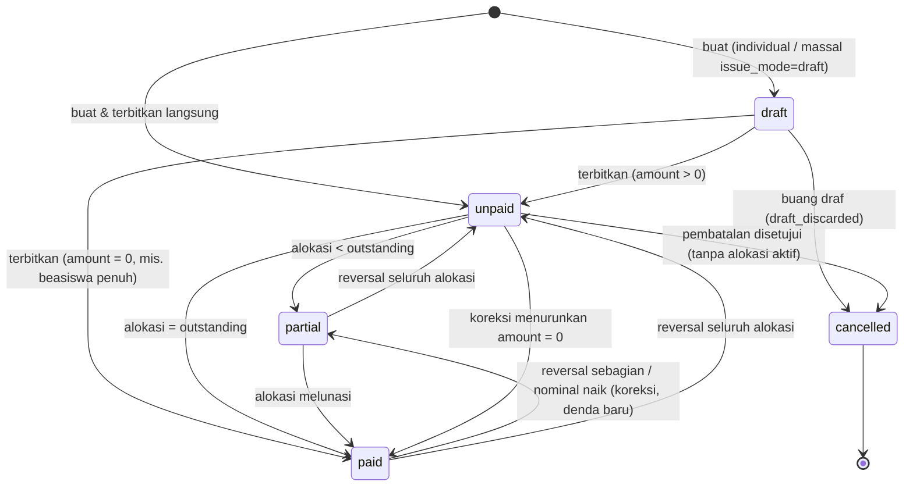
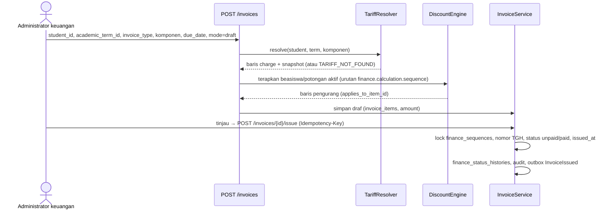
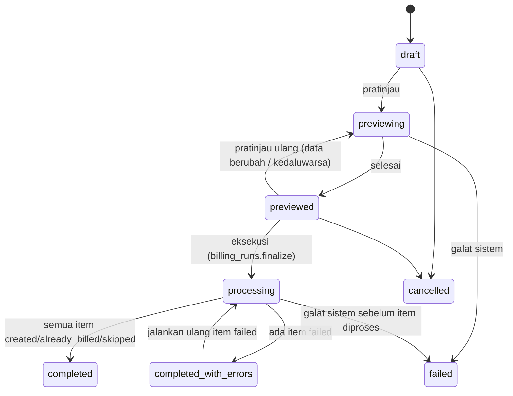
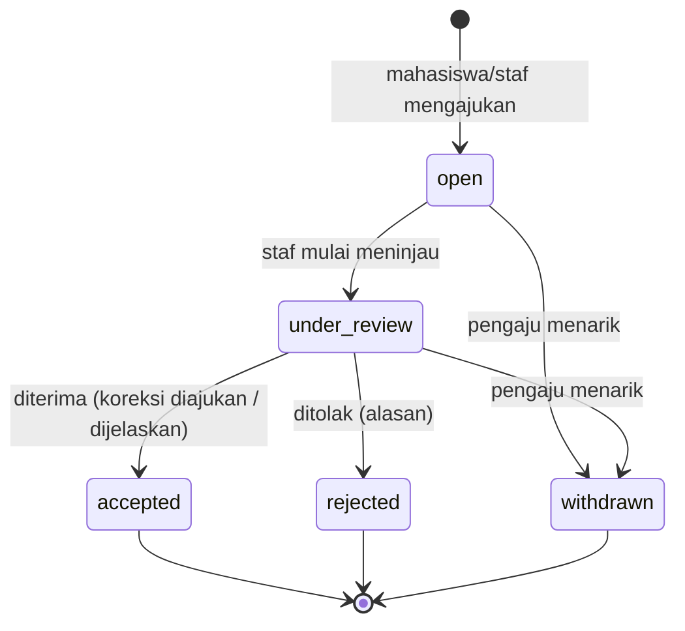
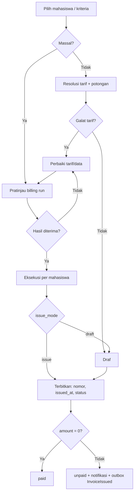
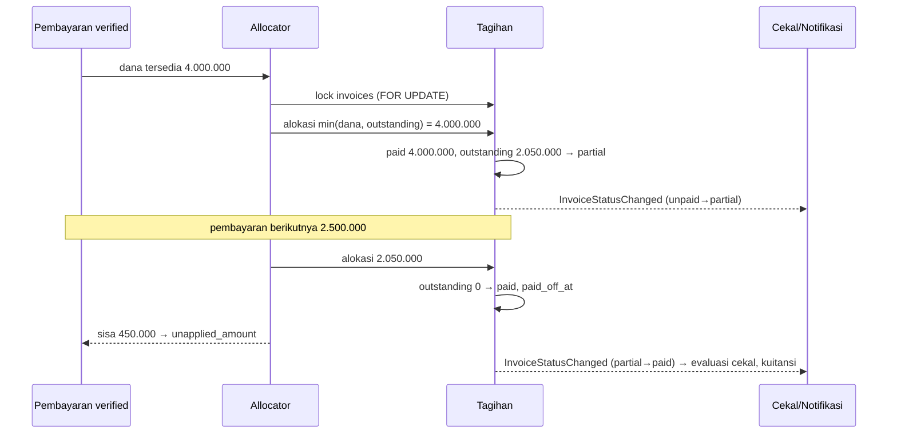
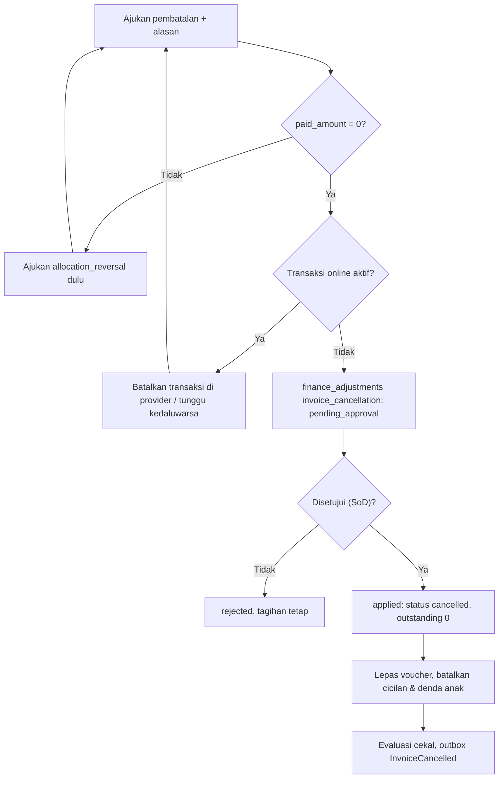

# 06 — Rancangan Tagihan Mahasiswa

> **Status:** rancangan. Disusun 2026-10-13.
> Kembali ke [README](README.md) · Skema: [19 §3.4–§3.5](19-rancangan-database-dan-relasi.md#34-tagihan) · Aturan: `KEU-BR-040`–`069` ([25](25-business-rules-dan-validasi.md)) · Keputusan: [KEU-KD-01](29-glossary-dan-keputusan-bisnis.md#2-keputusan-desain-keu-kd), [KEU-KD-11](29-glossary-dan-keputusan-bisnis.md#2-keputusan-desain-keu-kd), [KEU-KD-12](29-glossary-dan-keputusan-bisnis.md#2-keputusan-desain-keu-kd)

Tagihan adalah dokumen **kewajiban** mahasiswa. Dokumen ini menjelaskan jenis tagihan, definisi setiap nominal, siklus hidup dari draf sampai lunas atau dibatalkan, penagihan per SKS, penagihan massal, tagihan tambahan/susulan/berulang, posting dari PMB dan Semester Pendek, koreksi, sengketa, dan riwayat.

**Peta format baku:** tujuan/aktor/prasyarat §1 · data masukan §2 · proses & status §4–§10, diagram §11 · aturan & validasi di setiap bagian (ID `KEU-BR-*`) · hak akses §12 · data & relasi §13 · API §14 · UI §15 · notifikasi §16 · laporan §17 · kegagalan §18 · audit §19 · AC & TC §20.

## Daftar Isi

1. [Tujuan, Aktor, dan Prasyarat](#1-tujuan-aktor-dan-prasyarat)
2. [Jenis Tagihan dan Atribut Wajib](#2-jenis-tagihan-dan-atribut-wajib)
3. [Definisi Nominal](#3-definisi-nominal)
4. [Siklus Hidup dan Tagihan Individual](#4-siklus-hidup-dan-tagihan-individual)
5. [Tagihan per SKS](#5-tagihan-per-sks)
6. [Tagihan Massal](#6-tagihan-massal)
7. [Tagihan Tambahan, Susulan, Berulang, dan Eksternal](#7-tagihan-tambahan-susulan-berulang-dan-eksternal)
8. [Perubahan, Pembatalan, Koreksi, dan Perpanjangan](#8-perubahan-pembatalan-koreksi-dan-perpanjangan)
9. [Sengketa Tagihan](#9-sengketa-tagihan)
10. [Riwayat Tagihan](#10-riwayat-tagihan)
11. [Diagram Alur](#11-diagram-alur)
12. [Hak Akses](#12-hak-akses)
13. [Struktur Data dan Relasi](#13-struktur-data-dan-relasi)
14. [API dan Event](#14-api-dan-event)
15. [UI/UX](#15-uiux)
16. [Notifikasi](#16-notifikasi)
17. [Laporan Terkait](#17-laporan-terkait)
18. [Skenario Kegagalan](#18-skenario-kegagalan)
19. [Audit Trail](#19-audit-trail)
20. [Acceptance Criteria dan Test Case](#20-acceptance-criteria-dan-test-case)

---

## 1. Tujuan, Aktor, dan Prasyarat

| Aspek | Isi |
|---|---|
| **Tujuan** | Menerbitkan kewajiban yang benar, unik, dapat ditelusuri, dan tidak dapat diubah diam-diam |
| **Manfaat** | Mahasiswa melihat rincian biaya yang jelas; bagian keuangan menagih massal tanpa tagihan ganda; auditor dapat menelusuri setiap rupiah |
| **Aktor** | Administrator keuangan (membuat, menerbitkan, mengajukan koreksi/pembatalan), staf keuangan (koreksi, sengketa), bendahara (menyetujui koreksi/pembatalan), mahasiswa (melihat, mengajukan sengketa), sistem (penagihan per SKS, posting PMB/SP, tagihan denda) |
| **Prasyarat** | Jadwal tarif `published` ([05](05-rancangan-tarif-uang-kuliah.md)); penetapan UKT bila komponen UKT ([15](15-rancangan-ukt-dan-validasi-penerima.md)); penerima beasiswa aktif ([11](11-rancangan-beasiswa-dan-potongan.md)); `academic_terms`; periode keuangan terbuka untuk tanggal terbit |

## 2. Jenis Tagihan dan Atribut Wajib

### 2.1 Jenis (`invoices.invoice_type`)

| Nilai | Label UI | Contoh | Kunci anti-ganda |
|---|---|---|---|
| `semester` | Tagihan Semester | SPP/UKT, SKS, praktikum, registrasi semester berjalan | `billing_key = semester:{student_id}:{academic_term_id}` |
| `additional` | Tagihan Tambahan | Wisuda, cuti, legalisasi, kegiatan | `additional:{component_code}:{student_id}:{academic_term_id}` bila lewat tagihan massal; `null` bila manual (peringatan duplikat, §7.1) |
| `supplementary` | Tagihan Susulan | Kenaikan SKS setelah tagihan terbit; tahap kedua model dua tahap (§5) | `supplementary:{student_id}:{academic_term_id}:{component_code}:{target_units}` |
| `short_term` | Tagihan Semester Pendek | Biaya SP per SKS (dari modul SP) | `source_key = short_term_krs:{source_id}` |
| `admission` | Tagihan PMB | Biaya awal yang diposting PMB setelah konversi | `source_key = pmb_invoice:{pmb_invoice_id}` |
| `late_fee` | Tagihan Denda | Denda keterlambatan ([13](13-rancangan-denda.md)) | `late_fee:{parent_invoice_id}:{seq}` |

Kunci anti-ganda ditegakkan oleh unique `(university_id, billing_active_key)` dan `(university_id, source_key)`, yang hanya berlaku untuk tagihan **tidak** `cancelled` ([KEU-BR-041](25-business-rules-dan-validasi.md), [KEU-BR-057](25-business-rules-dan-validasi.md)).

### 2.2 Atribut wajib setiap tagihan

| Atribut bisnis | Kolom | Ketentuan |
|---|---|---|
| Nomor unik | `invoice_number` | `TGH-YYYY-NNNNNNN` ([KEU-BR-001](25-business-rules-dan-validasi.md)) |
| Mahasiswa pemilik | `student_id` | Wajib; tidak dapat diubah setelah terbit |
| Periode akademik | `academic_term_id` + label `period` | Wajib kecuali `additional` non-term |
| Rincian komponen | `invoice_items` | Minimal satu baris `charge` (kecuali `late_fee`) |
| Nilai awal (bruto) | `gross_amount` | §3 |
| Potongan | `discount_amount` | §3 |
| Denda | Tagihan anak `late_fee` (`parent_invoice_id`) | Ditampilkan sebagai "Denda terkait" di detail tagihan dasar ([KEU-KD-03](29-glossary-dan-keputusan-bisnis.md#2-keputusan-desain-keu-kd)) |
| Nilai dibayar | `paid_amount` (total alokasi) | §3 |
| Saldo terutang | `outstanding_amount` | §3 |
| Tanggal terbit | `issued_at` | Diisi saat `draft → unpaid` |
| Jatuh tempo | `due_date` (+ `original_due_date`) | ≥ tanggal terbit ([KEU-BR-046](25-business-rules-dan-validasi.md)) |
| Status | `status` + turunan `is_overdue`, `has_open_dispute` | §4 |

## 3. Definisi Nominal

### 3.1 Rumus

Definisi kanon ada di [README §5.3](README.md#53-kanon-nominal-definisi-yang-tidak-boleh-dicampur). Ringkasnya:

| Istilah | Rumus | Pemilik data |
|---|---|---|
| **Nominal bruto** | `gross_amount` = Σ baris `charge` + `late_fee` | Tagihan |
| **Total potongan** | `discount_amount` = −Σ baris `scholarship`, `discount`, `voucher`, `manual_discount`, `late_fee_waiver` | Tagihan |
| **Total penyesuaian** | `adjustment_amount` = Σ baris `adjustment` (±) | Tagihan |
| **Nominal tagihan (neto)** | `amount` = Σ seluruh baris = `gross − discount + adjustment` ≥ 0 | Tagihan ([KEU-BR-042](25-business-rules-dan-validasi.md)) |
| **Nominal pembayaran** | `payments.amount` (hanya `verified` yang dihitung sebagai uang masuk) | Penerimaan |
| **Total alokasi** | `paid_amount` = Σ `payment_allocations.amount` (bertanda) untuk tagihan ini | Penerapan |
| **Saldo terutang** | `outstanding_amount` = `amount − paid_amount` | Tagihan |
| **Saldo deposit** | `deposit_accounts.balance` (tersedia = `balance − held_amount`) | Deposit |
| **Dana belum diterapkan** | `payments.unapplied_amount` | Penerimaan |
| **Piutang** (per mahasiswa) | Σ `outstanding_amount` tagihan `unpaid`/`partial` | Turunan |
| **Piutang bersih** (per mahasiswa) | `max(0, piutang − deposit tersedia − Σ unapplied verified)` | Turunan, indikator saja |

Prinsip yang tidak boleh dilanggar:

- **Nominal pembayaran ≠ total alokasi.** Satu pembayaran dapat dialokasikan ke beberapa tagihan, sebagian, atau tidak sama sekali.
- **Deposit bukan pembayaran tagihan** sampai dipakai melalui alokasi ([KEU-BR-213](25-business-rules-dan-validasi.md)).
- **Piutang tidak dihitung dari "total tagihan − total pembayaran"**, karena kelebihan bayar seorang mahasiswa tidak boleh menutupi tunggakan mahasiswa lain atau tunggakan tagihan lain secara diam-diam.

### 3.2 Contoh lengkap

Mahasiswa **Rina Aprilia** (NIM `2024110012`, data [19 §5](19-rancangan-database-dan-relasi.md#5-contoh-alur-relasi)). Tagihan semester ganjil `TGH-2026-0001234`:

| Baris | `item_type` | Uraian | `amount` |
|---|---|---|---:|
| 1 | `charge` | UKT Golongan IV | 5.500.000 |
| 2 | `charge` | Praktikum 2 MK × 350.000 | 700.000 |
| 3 | `charge` | Administrasi | 250.000 |
| 4 | `scholarship` → baris 2 | Beasiswa Prestasi 50% praktikum | −350.000 |
| 5 | `voucher` → baris 3 | Voucher `ALUMNI50` | −50.000 |
| | | **Bruto / potongan / neto** | **6.450.000 / 400.000 / 6.050.000** |

Urutan peristiwa dan posisi setiap nominal (semua dalam rupiah):

| No | Peristiwa | `TGH-…1234` amount / paid / outstanding / status | `TGH-2027-0000088` (genap) amount / paid / outstanding | Σ pembayaran verified | Dana belum diterapkan | Deposit tersedia | Piutang | Piutang bersih |
|---|---|---|---|---:|---:|---:|---:|---:|
| 1 | Tagihan ganjil terbit | 6.050.000 / 0 / 6.050.000 / `unpaid` | — | 0 | 0 | 0 | 6.050.000 | 6.050.000 |
| 2 | VA `PAY-…5501` 4.000.000 terverifikasi (biaya admin 4.000 ditanggung mahasiswa, tidak dihitung) | 6.050.000 / 4.000.000 / 2.050.000 / `partial` | — | 4.000.000 | 0 | 0 | 2.050.000 | 2.050.000 |
| 3 | Loket `PAY-…5502` 2.500.000; alokasi 2.050.000 | 6.050.000 / 6.050.000 / 0 / `paid` | — | 6.500.000 | 450.000 | 0 | 0 | 0 |
| 4 | Kelebihan 450.000 dikonversi ke deposit | sama | — | 6.500.000 | 0 | 450.000 | 0 | 0 |
| 5 | Tagihan genap terbit | sama | 6.050.000 / 0 / 6.050.000 | 6.500.000 | 0 | 450.000 | 6.050.000 | 5.600.000 |
| 6 | Deposit 300.000 dipakai untuk tagihan genap | sama | 6.050.000 / 300.000 / 5.750.000 | 6.500.000 | 0 | 150.000 | 5.750.000 | 5.600.000 |
| 7 | Deposit 150.000 dikembalikan (refund selesai) | sama | sama | 6.500.000 | 0 | 0 | 5.750.000 | 5.750.000 |

Langkah 3 memperlihatkan perbedaan nominal pembayaran (Rp2.500.000) dan alokasi (Rp2.050.000). Langkah 6 memperlihatkan bahwa pemakaian deposit tidak mengubah piutang bersih (deposit berpindah menjadi alokasi). Langkah 7 memperlihatkan bahwa refund menaikkan piutang bersih karena dana titipan keluar dari kampus.

## 4. Siklus Hidup dan Tagihan Individual

### 4.1 Status



Status `unpaid/partial/paid` **diturunkan** dari nominal di setiap perubahan, tidak di-set bebas ([KEU-BR-042](25-business-rules-dan-validasi.md)). Tidak ada endpoint `PATCH {status}`. Atribut turunan:

| Atribut | Rumus | Catatan |
|---|---|---|
| `is_overdue` | `status ∈ {unpaid, partial} ∧ outstanding > 0 ∧ due_date_efektif < hari ini (zona tenant)` | Dihitung saat query; tidak ada job yang mengubah status ([KEU-KD-11](29-glossary-dan-keputusan-bisnis.md#2-keputusan-desain-keu-kd)). Untuk tagihan bercicilan, keterlambatan dinilai per termin ([10 §8](10-rancangan-cicilan-tagihan.md)) |
| `has_open_dispute` | Ada `invoice_disputes` `open`/`under_review` | Kolom cache |
| `has_active_installment_plan` | Ada `installment_plans` `active` | Kolom cache |

### 4.2 Tagihan individual



| Langkah | Aturan |
|---|---|
| Pemilihan baris | Komponen yang memiliki tarif **wajib** dihitung oleh `TariffResolver`; nominal tidak boleh diketik manual. Nominal manual hanya untuk komponen `charge_basis = manual` |
| Kelayakan mahasiswa | Status mahasiswa harus termasuk `finance.invoice.eligible_student_statuses` untuk tagihan `semester` ([KEU-BR-044](25-business-rules-dan-validasi.md)). Tagihan `additional` boleh untuk status lain (mis. `graduated` untuk biaya wisuda, `leave` untuk biaya cuti) |
| Jatuh tempo | Default `issued_at + finance.invoice.default_due_days`; boleh diisi manual, tetapi tidak lebih awal dari tanggal terbit dan tidak lebih dari 365 hari ([KEU-BR-046](25-business-rules-dan-validasi.md)) |
| Persetujuan | Tagihan manual dengan `amount ≥ finance.approval.thresholds.manual_invoice.min_amount` memerlukan `invoices.approve` sebelum terbit (workflow `finance_manual_invoice`) |
| Penerbitan | `draft → unpaid` (atau `paid` bila `amount = 0`, [KEU-BR-050](25-business-rules-dan-validasi.md)); `issued_at`, `issued_by`; nomor diambil saat terbit |
| Draf | Tidak terlihat di portal mahasiswa, tidak dihitung piutang, tidak dapat dibayar ([KEU-BR-040](25-business-rules-dan-validasi.md)) |
| Setelah terbit | Baris tidak dapat diubah atau dihapus; perubahan hanya lewat baris baru hasil `finance_adjustments` ([KEU-BR-043](25-business-rules-dan-validasi.md)) |

### 4.3 Tagihan yang dapat dibayar

Tagihan dapat menerima alokasi atau transaksi pembayaran hanya bila `status ∈ {unpaid, partial}` ([KEU-BR-055](25-business-rules-dan-validasi.md)). Selain itu → 409 `INVOICE_NOT_PAYABLE`.

## 5. Tagihan per SKS

### 5.1 Sumber data

```sql
-- SKS mahasiswa m pada term T (KEU-A-06)
SELECT SUM(c.credits)
FROM krs_items ki
JOIN class_sections cs ON cs.id = ki.class_section_id
JOIN courses c        ON c.id  = cs.course_id
WHERE ki.student_id = :m AND ki.academic_term_id = :T AND ki.status = 'enrolled';
```

Hanya `enrolled` yang dihitung, sejalan dengan `KrsItemStatus` (status `draft/pending` belum disetujui, `dropped` dibatalkan). Unit MK berbiaya (`per_course`) dihitung dengan join yang sama ke `fee_component_courses` ([04 §2.4](04-master-data-dan-konfigurasi.md#24-mata-kuliah-berbiaya-per-mk)).

### 5.2 Waktu penagihan [K]

Dasar SKS mengikuti [KEU-Q-12](29-glossary-dan-keputusan-bisnis.md#3-pertanyaan-terbuka-keu-q). Rancangan mendukung dua pola, dipilih per billing run:

| Pola | Alur | Cocok untuk |
|---|---|---|
| **Satu tahap** | Tagihan `semester` diterbitkan setelah KRS disetujui/dikunci, berisi komponen tetap + SKS + praktikum | Kampus yang mengizinkan KRS sebelum bayar |
| **Dua tahap** (default [K]) | (1) Tagihan `semester` berisi komponen tetap diterbitkan sebelum KRS (syarat registrasi). (2) Setelah KRS disetujui, billing run kedua menerbitkan tagihan `supplementary` berisi SKS/praktikum dengan `parent_invoice_id` ke tagihan semester | Kampus yang mewajibkan bayar registrasi sebelum KRS |

### 5.3 Perubahan SKS setelah tagihan terbit

Sistem menghitung **SKS tertagih** per mahasiswa per term:

```
billed_units(m, T, c) = Σ quantity baris charge komponen c pada tagihan m di term T yang tidak cancelled
                        + Σ quantity baris adjustment yang menunjuk komponen c (±)
delta = units_enrolled(m, T, c) − billed_units(m, T, c)     (setelah free_units/min/max diterapkan)
```

| Kondisi | Tindakan ([KEU-BR-045](25-business-rules-dan-validasi.md), [KEU-BR-051](25-business-rules-dan-validasi.md)) |
|---|---|
| `delta > 0` (tambah SKS) | Tagihan `supplementary` sebesar `delta × tarif snapshot asal`, `billing_key` memuat target unit sehingga evaluasi ulang tidak menghasilkan duplikat |
| `delta < 0` (batal SKS) dan tagihan sumber belum memiliki alokasi yang melampaui nominal baru | `finance_adjustments` tipe `invoice_correction`, alasan `WRONG_CREDITS`/`CREDITS_DROPPED`, menambah baris `adjustment` negatif (perlu persetujuan) |
| `delta < 0` dan nominal baru < total alokasi | Alokasi dibalik sebagian lebih dulu ([KEU-BR-056](25-business-rules-dan-validasi.md)); dana kembali menjadi dana belum diterapkan lalu dikonversi ke deposit atau dikembalikan sesuai kebijakan [K] |
| Setelah batas akhir perubahan KRS | Tidak ada pengurangan otomatis; hanya lewat koreksi manual berizin [K] |

Pemicu: event `KrsSubmissionApproved`, `KrsSubmissionLocked`, `KrsItemDropped` bila sudah tersedia ([KEU-A-11](29-glossary-dan-keputusan-bisnis.md#4-asumsi-keu-a)). Sebelum event tersedia, billing run terjadwal atau manual menjalankan perhitungan delta.

## 6. Tagihan Massal

### 6.1 Kriteria dan parameter

`billing_runs.criteria` ([19 §3.4.3](19-rancangan-database-dan-relasi.md#343-billing_runs--baru)): `faculty_ids`, `study_program_ids`, `admission_years`, `student_statuses` (default `finance.invoice.eligible_student_statuses`), `study_system_codes`, `admission_path_codes`, `student_ids`. Parameter lain: `academic_term_id`, `invoice_type`, `fee_component_ids` (`null` = komponen wajib), `due_date`, `issue_mode` (`draft` default untuk run pertama tenant [R], atau `issue`).

### 6.2 Status



### 6.3 Proses

| Tahap | Rincian |
|---|---|
| **Pratinjau** | Job antrean menghitung setiap mahasiswa: resolusi tarif, potongan, kelayakan. Hasil disimpan di `billing_run_items` (`computed_amount`, `preview_lines`, `reason_code`). Tidak ada tagihan dibuat. Ringkasan: jumlah mahasiswa, total nominal, jumlah per alasan gagal (`TARIFF_NOT_FOUND`, `TARIFF_AMBIGUOUS`, `UKT_GROUP_MISSING`, `STUDENT_INACTIVE`, `NO_CREDITS`, `ALREADY_BILLED`) |
| **Masa berlaku pratinjau** | `finance.billing_run.preview_ttl_hours` (default 24). Lewat masa itu, eksekusi menuntut pratinjau ulang |
| **Persetujuan** (opsional) | Bila `finance.approval.thresholds.billing_run.enabled`, eksekusi menunggu workflow `finance_billing_run` |
| **Eksekusi** | Job memproses per *chunk* (mis. 200 mahasiswa); **satu transaksi DB per mahasiswa**: hitung ulang, bandingkan dengan pratinjau, buat tagihan, histori, outbox. Bila hasil hitung ulang ≠ pratinjau → item `failed` dengan `PREVIEW_MISMATCH` (data berubah sejak pratinjau) |
| **Hasil per item** | `created`, `already_billed` (unique `billing_active_key` menolak), `skipped`, `failed` |
| **Konkurensi** | Satu run `processing` per `(academic_term_id, invoice_type)` per tenant, ditegakkan dengan kunci (`Cache::lock` + pemeriksaan status di DB) ([KEU-BR-052](25-business-rules-dan-validasi.md)) |
| **Pengulangan** | Run dapat dijalankan ulang; mahasiswa yang sudah tertagih menjadi `already_billed` ([KEU-BR-053](25-business-rules-dan-validasi.md)) |
| **Penerbitan draf massal** | Bila `issue_mode = draft`, setelah ditinjau, `POST /billing-runs/{id}/issue-drafts` menerbitkan semua draf run itu (job, satu transaksi per tagihan) |
| **Kinerja** | Target 10.000 tagihan < 15 menit ([KEU-NFR-05](02-analisis-kebutuhan-bisnis.md#5-kebutuhan-non-fungsional)); progres (`created_count` dll.) diperbarui per chunk |

## 7. Tagihan Tambahan, Susulan, Berulang, dan Eksternal

### 7.1 Tagihan tambahan (`additional`)

Untuk biaya di luar tagihan semester (wisuda, cuti, legalisasi). Dibuat individual atau massal dengan `fee_component_ids` tertentu. Untuk pembuatan manual tanpa `billing_key`, sistem memperingatkan bila sudah ada tagihan aktif dengan mahasiswa, komponen, dan term yang sama; staf harus mengonfirmasi dengan alasan.

### 7.2 Tagihan susulan (`supplementary`)

Lihat §5.2–§5.3. `parent_invoice_id` opsional menunjuk tagihan semester. Tagihan susulan adalah tagihan mandiri (nomor, jatuh tempo, status sendiri).

### 7.3 Tagihan berulang

Penagihan berulang dipenuhi dengan **billing run per term**, bukan entitas berulang terpisah ([KEU-BR-059](25-business-rules-dan-validasi.md)):

1. Aksi "Salin dari run sebelumnya" (`POST /billing-runs/{id}/duplicate`) membuat run `draft` baru dengan kriteria dan komponen yang sama untuk term berikutnya.
2. Run baru tetap melewati pratinjau dan, bila dikonfigurasi, persetujuan. Tidak ada penerbitan otomatis tanpa pratinjau.
3. Tagihan berulang bulanan (mis. asrama) **di luar** ruang lingkup saat ini; dapat dimodelkan sebagai `additional` dengan run per bulan bila diperlukan.

### 7.4 Posting tagihan eksternal (PMB dan Semester Pendek)

Kontrak in-process `FinanceBillingService::postExternalInvoice(ExternalInvoiceData $data): Invoice` ([20](20-rancangan-api-dan-integrasi.md)):

| Field | PMB | Semester Pendek |
|---|---|---|
| `source_type` | `pmb_invoice` | `short_term_krs` |
| `source_id` | `pmb_invoices.id` | ULID batch dari modul SP |
| `invoice_type` | `admission` | `short_term` |
| `student_id` | Mahasiswa hasil konversi | Mahasiswa |
| `lines` | Komponen biaya awal (kode komponen KEU) dengan nominal dari PMB | Komponen `SKS` × SKS SP (`academic.short_term.fee_per_credit`) |
| `payments` (opsional) | Pembayaran yang sudah diterima PMB (sumber `gateway`, referensi provider) → dibuat `verified` + dialokasikan | — |

Aturan:

- Idempoten: unique `source_key`; panggilan ulang mengembalikan tagihan yang sama ([KEU-BR-057](25-business-rules-dan-validasi.md)).
- Nominal dari modul sumber dianggap sudah disetujui di modul itu; KEU menyimpan snapshot `source_type/source_id` di baris (`pmb_invoice_item`, `krs_item`).
- Termin cicilan PMB diposting sebagai **rencana cicilan KEU** atas satu tagihan `admission`, bukan tagihan terpisah ([KEU-KD-02](29-glossary-dan-keputusan-bisnis.md#2-keputusan-desain-keu-kd); perbedaan dengan rancangan PMB dicatat INK-03, [KEU-Q-11](29-glossary-dan-keputusan-bisnis.md#3-pertanyaan-terbuka-keu-q)).
- Pembatalan dari modul sumber memakai `FinanceBillingService::cancelExternalInvoice($sourceType, $sourceId, $reason)`; tunduk pada [KEU-BR-047](25-business-rules-dan-validasi.md). Rancangan SP yang membatalkan tagihan SP kedaluwarsa tanpa pembayaran sejalan dengan aturan ini.

## 8. Perubahan, Pembatalan, Koreksi, dan Perpanjangan

### 8.1 Matriks perubahan

| Keadaan tagihan | Perubahan yang diizinkan | Mekanisme |
|---|---|---|
| `draft` | Ubah baris, jatuh tempo, deskripsi; hitung ulang; buang | Langsung (`invoices.update` / `.delete`), `lock_version` |
| `unpaid`/`partial`/`paid` | Tambah/kurangi komponen, koreksi nominal | `finance_adjustments` `invoice_correction` → baris `adjustment` |
| | Potongan manual | `manual_discount` ([11 §8](11-rancangan-beasiswa-dan-potongan.md)) |
| | Perpanjangan jatuh tempo | `invoice_correction` alasan `DUE_DATE_EXTENSION`, `payload.due_date`; `original_due_date` dipertahankan ([KEU-BR-058](25-business-rules-dan-validasi.md)) |
| | Terapkan/lepas voucher | [12](12-rancangan-voucher-tagihan.md) |
| `unpaid` tanpa alokasi aktif | Pembatalan | `finance_adjustments` `invoice_cancellation` |
| `cancelled` | Tidak ada | Tagihan pengganti dibuat baru |

Setiap penyesuaian wajib alasan (`reason_code` + `reason`), pelaku, dan persetujuan sesuai [03 §6](03-role-dan-hak-akses.md#6-persetujuan). Kode alasan tagihan: `WRONG_TARIFF`, `WRONG_CREDITS`, `CREDITS_DROPPED`, `DUPLICATE_INVOICE`, `STUDENT_STATUS_CHANGED`, `POLICY_DECISION`, `DISPUTE_ACCEPTED`, `DUE_DATE_EXTENSION`, `SCHOLARSHIP_LATE_APPLY`, `OTHER` (daftar lengkap [18 §6](18-rancangan-rekonsiliasi-dan-penyesuaian.md)).

### 8.2 Batas koreksi

- Nominal baru tidak boleh < `paid_amount` ([KEU-BR-056](25-business-rules-dan-validasi.md)). Bila perlu, pengaju harus lebih dulu mengajukan `allocation_reversal` agar dana kembali menjadi dana belum diterapkan.
- Pengurangan yang menyasar komponen tertentu memakai `applies_to_item_id` sehingga komponen tidak menjadi negatif ([KEU-BR-142](25-business-rules-dan-validasi.md)).
- Tagihan bercicilan aktif: perubahan nominal memicu penyesuaian rencana ([10 §7](10-rancangan-cicilan-tagihan.md)).

### 8.3 Pembatalan

| Syarat ([KEU-BR-047](25-business-rules-dan-validasi.md), [KEU-BR-048](25-business-rules-dan-validasi.md)) | Efek berantai saat `applied` ([KEU-BR-049](25-business-rules-dan-validasi.md)) |
|---|---|
| `paid_amount = 0` (alokasi aktif harus sudah dibalik) | `invoices.status = cancelled`, `cancelled_at/by`, `cancel_reason`, `cancel_adjustment_id`, `outstanding_amount = 0` |
| Tidak ada transaksi online `created/pending` atas tagihan ini, atau transaksi itu dibatalkan lebih dulu di provider | Redemption voucher `cancelled`/`released`; kuota kembali sesuai `finance.voucher.return_quota_on_cancel` |
| Alasan dan persetujuan (`finance_adjustments.approve`, SoD) | Rencana cicilan `cancelled`; denda anak yang belum dibayar ikut dibatalkan (tagihan `late_fee` anak) |
| Periode `posting_date` pembatalan terbuka | Evaluasi ulang cekal; outbox `InvoiceCancelled` (SP, akuntansi), `InvoiceStatusChanged` |

Pembayaran yang tiba melalui provider untuk tagihan yang sudah dibatalkan tetap dicatat dan menjadi dana belum diterapkan ([KEU-KD-21](29-glossary-dan-keputusan-bisnis.md#2-keputusan-desain-keu-kd)).

## 9. Sengketa Tagihan



| Aturan | Isi |
|---|---|
| Satu sengketa aktif per tagihan | Unique `active_key` ([KEU-BR-054](25-business-rules-dan-validasi.md)) |
| Kategori | `wrong_amount`, `wrong_component`, `discount_not_applied`, `payment_not_recorded`, `duplicate_invoice`, `other` |
| Efek pada denda/cekal | Tidak ada, kecuali `finance.dispute.suspend_late_fee` / `suspend_hold` = `true` [K] ([KEU-Q-24](29-glossary-dan-keputusan-bisnis.md#3-pertanyaan-terbuka-keu-q)) |
| Penerimaan | `accepted` wajib menautkan `finance_adjustment_id` (koreksi berizin), **atau** catatan penyelesaian bila tidak ada perubahan nominal (mis. pembayaran yang belum tercatat diselesaikan lewat verifikasi) |
| Penolakan | Alasan wajib, diberitahukan ke mahasiswa |
| Target layanan [R] | Ditinjau ≤ 5 hari kerja; sengketa `open` > 5 hari muncul di dashboard |

## 10. Riwayat Tagihan

`GET /invoices/{id}/history` menggabungkan dalam satu linimasa terurut:

| Sumber | Contoh entri |
|---|---|
| `finance_status_histories` (`subject_type = invoice`) | Dibuat, diterbitkan, berubah `partial → paid`, dibatalkan |
| `invoice_items` (baris pasca-terbit) | Voucher diterapkan, penyesuaian SKS, potongan manual |
| `payment_allocations` | Alokasi +2.050.000 dari `PAY-…5502`; pembalikan −2.050.000 |
| `finance_adjustments` | Koreksi diajukan/disetujui/diterapkan |
| `installment_plans` | Rencana cicilan aktif, dijadwalkan ulang |
| `invoice_disputes` | Sengketa diajukan/diputuskan |
| Tagihan `late_fee` anak | Denda bucket Oktober 2026 |
| `audit_logs` (staf saja) | Nilai lama/baru, IP, perangkat |

Mahasiswa melihat linimasa tanpa entri `audit_logs` dan tanpa nama staf (diganti "Bagian Keuangan").

## 11. Diagram Alur

### 11.1 Penerbitan



### 11.2 Pembayaran sebagian dan pelunasan



### 11.3 Pembatalan



## 12. Hak Akses

| Aksi | Permission | Role default |
|---|---|---|
| Lihat tagihan | `invoices.read` (+ scope) | FA, FO, CS, FM, UO/UA, RK, DK (scope), AU |
| Buat, terbitkan | `invoices.create` | FA |
| Ubah draf, terapkan voucher atas nama mahasiswa | `invoices.update` | FA, FO |
| Buang draf | `invoices.delete` | FA |
| Setujui tagihan manual di atas ambang | `invoices.approve` | FM |
| Ekspor | `invoices.export` | FA, FM, RK, AU |
| Tagihan massal | `billing_runs.read/create/finalize` | FA |
| Ajukan/putuskan koreksi & pembatalan | `finance_adjustments.create` / `.approve`, `.reject` | FA, FO / FM |
| Sengketa | `invoice_disputes.update` / `.approve`, `.reject` | FA, FO / FA, FM |
| Mahasiswa | `finance_self_service.read/create` | Hanya tagihan miliknya, bukan draf |

## 13. Struktur Data dan Relasi

| Tabel | Rincian |
|---|---|
| `invoices` (Ubah) | [19 §3.4.1](19-rancangan-database-dan-relasi.md#341-invoices--ubah) |
| `invoice_items` | [19 §3.4.2](19-rancangan-database-dan-relasi.md#342-invoice_items--baru) |
| `billing_runs`, `billing_run_items` | [19 §3.4.3](19-rancangan-database-dan-relasi.md#343-billing_runs--baru), [§3.4.4](19-rancangan-database-dan-relasi.md#344-billing_run_items--baru) |
| `invoice_disputes` | [19 §3.5.3](19-rancangan-database-dan-relasi.md#353-invoice_disputes--baru) |
| `finance_adjustments` | [19 §3.13.1](19-rancangan-database-dan-relasi.md#3131-finance_adjustments--baru) |

Relasi utama: Mahasiswa → Tagihan → Detail Tagihan ([19 §5.1](19-rancangan-database-dan-relasi.md#51-mahasiswa--tagihan--detail-tagihan)); Tagihan ← Alokasi ← Pembayaran ([19 §5.2](19-rancangan-database-dan-relasi.md#52-pembayaran--alokasi-pembayaran--tagihan)).

## 14. API dan Event

| Method | URL | Permission | Keterangan |
|---|---|---|---|
| GET | `/invoices` (Ada, diperluas) | `invoices.read` | Filter `status`, `invoice_type`, `academic_term_id`, `faculty_id`, `study_program_id`, `admission_year`, `is_overdue`, `has_open_dispute`, `due_from/to`, `issued_from/to`; `search` (nomor, NIM, nama) |
| GET | `/invoices/{invoice}` (Ada, diperluas) | `invoices.read` | Termasuk baris, ringkasan alokasi, cicilan, denda anak |
| POST | `/invoices` | `invoices.create` | `mode=draft\|issue`; **Idempotency-Key** wajib bila `issue` |
| PUT | `/invoices/{invoice}` | `invoices.update` | Draf saja; `lock_version` |
| POST | `/invoices/{invoice}/recalculate` | `invoices.update` | Draf saja |
| POST | `/invoices/{invoice}/issue` | `invoices.create` | **Idempotency-Key** |
| DELETE | `/invoices/{invoice}` | `invoices.delete` | Buang draf |
| POST | `/invoices/{invoice}/corrections` | `finance_adjustments.create` | `invoice_correction` |
| POST | `/invoices/{invoice}/cancellation-requests` | `finance_adjustments.create` | `invoice_cancellation` |
| GET | `/invoices/{invoice}/history`, `/pdf` | `invoices.read` | |
| GET | `/invoices/export` | `invoices.export` | Asinkron bila > 5.000 baris |
| POST | `/invoices/{invoice}/disputes` | `invoice_disputes.update` | Sengketa oleh staf |
| GET | `/invoice-disputes` | `invoice_disputes.read` | |
| POST | `/invoice-disputes/{dispute}/review`, `/accept`, `/reject` | `.update` / `.approve` / `.reject` | |
| GET/POST | `/billing-runs` | `billing_runs.read` / `.create` | |
| POST | `/billing-runs/{run}/preview`, `/cancel`, `/duplicate` | `billing_runs.create` | |
| GET | `/billing-runs/{run}/items` | `billing_runs.read` | Filter `result`, `reason_code` |
| POST | `/billing-runs/{run}/execute` | `billing_runs.finalize` | **Idempotency-Key** |
| POST | `/billing-runs/{run}/issue-drafts` | `invoices.create` | |
| GET | `/student/finance/invoices`, `/{invoice}`, `/{invoice}/pdf` | `finance_self_service.read` | Milik sendiri, tanpa draf |
| POST | `/student/finance/invoices/{invoice}/disputes` | `finance_self_service.create` | |

Event outbox: `InvoiceIssued`, `InvoiceStatusChanged` (payload `invoice_id`, `student_id`, `from_status`, `to_status`, `period`, `academic_term_id`), `InvoiceCancelled`. Kontrak in-process: `postExternalInvoice`, `cancelExternalInvoice`.

## 15. UI/UX

| Halaman | Rute | Inti |
|---|---|---|
| Daftar Tagihan | `/keuangan/tagihan` (Ada, diperluas) | Kolom: nomor, NIM, nama, prodi, periode, jenis, nominal, dibayar, sisa, jatuh tempo, status + lencana "Terlambat"/"Disengketakan"/"Cicilan". Filter sesuai API. Aksi massal: ekspor |
| Detail Tagihan | `/keuangan/tagihan/:id` (Ada, diperluas) | Ringkasan nominal (§3), tabel baris dengan potongan menjorok di bawah komponen sasaran, tab Pembayaran & Alokasi, Cicilan, Denda, Sengketa, Riwayat. Tombol: Terbitkan (draf), Koreksi, Batalkan, Perpanjang jatuh tempo, Cetak |
| Buat Tagihan | `/keuangan/tagihan/baru` | Pilih mahasiswa & term → pratinjau resolusi tarif → tambah komponen manual (`manual` saja) → simpan draf / terbitkan |
| Tagihan Massal | `/keuangan/tagihan/massal` | Wizard: kriteria → komponen & jatuh tempo → pratinjau (ringkasan + tabel item + filter alasan gagal) → eksekusi → progres |
| Sengketa | `/keuangan/tagihan/sengketa` | Antrean sengketa dengan umur |
| Portal: Tagihan Saya | `/portal/keuangan/tagihan` | Mengganti `PortalInvoicesPage` statis ([21](21-rancangan-ui-ux-dan-menu.md)) |

## 16. Notifikasi

| Event | Penerima | Kanal |
|---|---|---|
| `finance.invoice_issued` | Mahasiswa | database, mail |
| `finance.invoice_due_reminder` (H-7, H-1) | Mahasiswa dengan tagihan `unpaid/partial` | database, mail |
| `finance.invoice_overdue` (H+1) | Mahasiswa | database, mail |
| `finance.invoice_corrected` / `finance.invoice_cancelled` | Mahasiswa | database, mail |
| `finance.dispute_submitted` / `finance.dispute_resolved` | Staf keuangan / mahasiswa | database (+ mail ke mahasiswa) |

## 17. Laporan Terkait

[KEU-RPT-01](22-rancangan-laporan-dan-dashboard.md) tagihan per mahasiswa, [KEU-RPT-03](22-rancangan-laporan-dan-dashboard.md) tunggakan, [KEU-RPT-04](22-rancangan-laporan-dan-dashboard.md) umur piutang, [KEU-RPT-05](22-rancangan-laporan-dan-dashboard.md) pelunasan per angkatan, [KEU-RPT-16](22-rancangan-laporan-dan-dashboard.md) reversal & koreksi.

## 18. Skenario Kegagalan

| Skenario | Penanganan |
|---|---|
| Tarif tidak ditemukan / ambigu | Tagihan tidak dibuat; item run `failed` dengan alasan ([05 §5](05-rancangan-tarif-uang-kuliah.md#5-konflik-tarif-tidak-ditemukan-dan-validasi-jadwal)) |
| Dua admin menerbitkan tagihan semester yang sama bersamaan | Unique `billing_active_key`: satu berhasil, yang lain 409 `ALREADY_BILLED` |
| Job tagihan massal mati di tengah jalan | Item yang sudah `created` tetap; run dapat dilanjutkan; item `pending` diproses ulang dengan idempotensi `billing_key` |
| Data mahasiswa berubah antara pratinjau dan eksekusi | `PREVIEW_MISMATCH` per item; pratinjau ulang |
| Permintaan terbit diulang (klik ganda) | `Idempotency-Key` mengembalikan respons pertama |
| Pembatalan saat ada transaksi VA aktif | Ditolak sampai transaksi dibatalkan/kedaluwarsa |
| Periode untuk tanggal terbit sudah ditutup | Tanggal terbit/posting memakai hari ini (periode terbuka); bila periode berjalan sedang `closing` → 409 `PERIOD_CLOSED` |

## 19. Audit Trail

| Aksi | `finance_status_histories.action` | `audit_logs.action` |
|---|---|---|
| Buat draf, ubah draf | `created` | `created`, `updated` |
| Terbit | `issued` | `updated` (status) |
| Perubahan status karena alokasi/reversal | `status_derived` | — (alokasi diaudit sendiri) |
| Koreksi/pembatalan diajukan, disetujui, diterapkan | `adjustment_requested`, `adjustment_applied`, `cancelled` | `approved`/`rejected` |
| Sengketa | `dispute_opened`, `dispute_resolved` | `created`, `updated` |
| Ekspor | — | `exported` |

## 20. Acceptance Criteria dan Test Case

| Acceptance criteria | Test case |
|---|---|
| [KEU-AC-INV-01](27-acceptance-criteria.md) Tagihan berisi komponen yang benar sesuai konfigurasi | [KEU-TC-INV-001](26-skenario-pengujian.md), [KEU-TC-INV-016](26-skenario-pengujian.md) |
| [KEU-AC-INV-02](27-acceptance-criteria.md) Total dapat ditelusuri ke komponen, potongan, denda, pembayaran | [KEU-TC-INV-001](26-skenario-pengujian.md), [KEU-TC-PAY-001](26-skenario-pengujian.md) |
| [KEU-AC-INV-03](27-acceptance-criteria.md) Tagihan massal dengan pratinjau dan idempoten | [KEU-TC-INV-005](26-skenario-pengujian.md), [KEU-TC-INV-006](26-skenario-pengujian.md), [KEU-TC-INV-002](26-skenario-pengujian.md) |
| [KEU-AC-INV-04](27-acceptance-criteria.md) Tagihan per SKS dan susulan | [KEU-TC-INV-004](26-skenario-pengujian.md), [KEU-TC-INV-010](26-skenario-pengujian.md) |
| [KEU-AC-INV-05](27-acceptance-criteria.md) Pembatalan/koreksi berizin tanpa menghapus histori | [KEU-TC-INV-007](26-skenario-pengujian.md), [KEU-TC-INV-008](26-skenario-pengujian.md), [KEU-TC-INV-011](26-skenario-pengujian.md), [KEU-TC-INV-015](26-skenario-pengujian.md) |
| [KEU-AC-INV-06](27-acceptance-criteria.md) Sengketa | [KEU-TC-INV-013](26-skenario-pengujian.md) |
| [KEU-AC-INV-07](27-acceptance-criteria.md) Posting eksternal idempoten | [KEU-TC-INV-012](26-skenario-pengujian.md) |
| [KEU-AC-INV-08](27-acceptance-criteria.md) Endpoint lama kompatibel | [KEU-TC-API-006](26-skenario-pengujian.md) |
