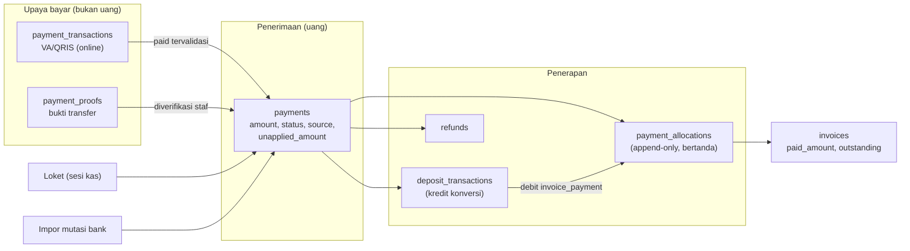
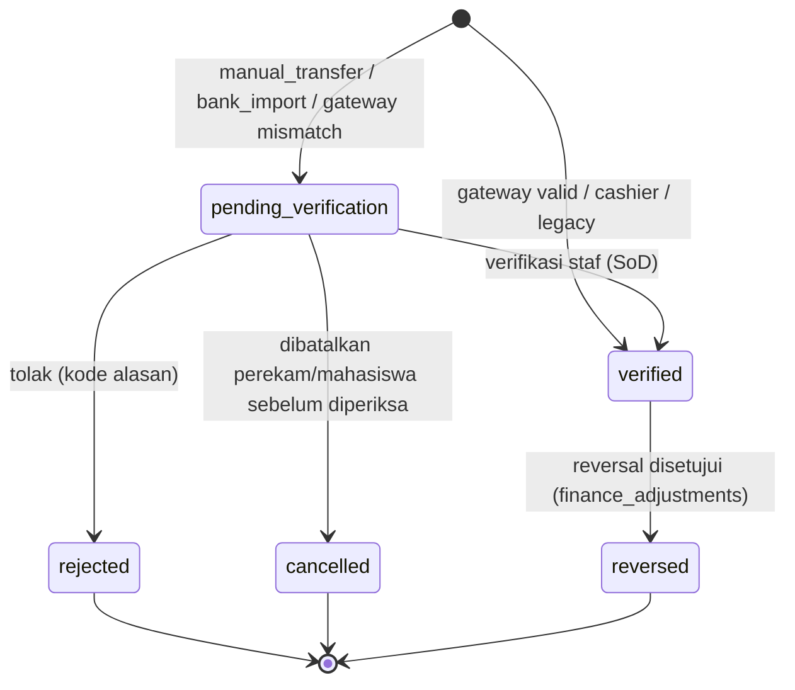

# 07 — Rancangan Pembayaran

> **Status:** rancangan. Disusun 2026-10-13.
> Kembali ke [README](README.md) · Skema: [19 §3.7](19-rancangan-database-dan-relasi.md#37-penerimaan-dan-penerapan-dana) · Aturan: `KEU-BR-070`–`089` ([25](25-business-rules-dan-validasi.md)) · Keputusan: [KEU-KD-04](29-glossary-dan-keputusan-bisnis.md#2-keputusan-desain-keu-kd), [KEU-KD-19](29-glossary-dan-keputusan-bisnis.md#2-keputusan-desain-keu-kd)

Dokumen ini adalah inti mekanisme uang masuk yang dipakai bersama oleh semua kanal: online ([08](08-rancangan-pembayaran-online-dan-gateway.md)), tunai dan transfer manual ([09](09-rancangan-pembayaran-tunai-dan-manual.md)), impor bank ([18](18-rancangan-rekonsiliasi-dan-penyesuaian.md)), serta posting PMB. Prinsipnya: **penerimaan** dana (`payments`) dicatat terpisah dari **penerapan** dana ke tagihan (`payment_allocations`).

**Peta format baku:** tujuan/aktor/prasyarat §1 · data masukan §2 · proses & status §3–§4 · aturan & validasi §4–§8 · hak akses §10 · data & relasi §11 · API §12 · UI §13 · notifikasi §14 · laporan §15 · kegagalan §16 · audit §17 · AC & TC §18.

## Daftar Isi

1. [Tujuan, Aktor, dan Prasyarat](#1-tujuan-aktor-dan-prasyarat)
2. [Model Penerimaan dan Penerapan](#2-model-penerimaan-dan-penerapan)
3. [Status Pembayaran](#3-status-pembayaran)
4. [Alokasi Pembayaran](#4-alokasi-pembayaran)
5. [Pembayaran Sebagian dan Minimum](#5-pembayaran-sebagian-dan-minimum)
6. [Kelebihan Bayar dan Dana Belum Diterapkan](#6-kelebihan-bayar-dan-dana-belum-diterapkan)
7. [Kuitansi](#7-kuitansi)
8. [Tanggal Pembukuan](#8-tanggal-pembukuan)
9. [Reversal dan Realokasi](#9-reversal-dan-realokasi)
10. [Hak Akses](#10-hak-akses)
11. [Struktur Data dan Relasi](#11-struktur-data-dan-relasi)
12. [API dan Event](#12-api-dan-event)
13. [UI/UX](#13-uiux)
14. [Notifikasi](#14-notifikasi)
15. [Laporan Terkait](#15-laporan-terkait)
16. [Skenario Kegagalan](#16-skenario-kegagalan)
17. [Audit Trail](#17-audit-trail)
18. [Acceptance Criteria dan Test Case](#18-acceptance-criteria-dan-test-case)

---

## 1. Tujuan, Aktor, dan Prasyarat

| Aspek | Isi |
|---|---|
| **Tujuan** | Mencatat setiap rupiah yang diterima tepat sekali, pada mahasiswa yang benar, dan menerapkannya ke tagihan tanpa melebihi kewajiban |
| **Manfaat** | Satu pembayaran dapat melunasi beberapa tagihan; kelebihan bayar dan pembayaran tanpa referensi tetap terlacak; koreksi dapat dilakukan tanpa menghapus histori |
| **Aktor** | Sistem (gateway, alokasi otomatis), petugas loket, staf keuangan (verifikasi, alokasi manual, konversi deposit), bendahara (penyetuju reversal/realokasi/refund), mahasiswa (membayar, melihat riwayat & kuitansi) |
| **Prasyarat** | Tagihan terbit ([06](06-rancangan-tagihan-mahasiswa.md)); kanal pembayaran ([08](08-rancangan-pembayaran-online-dan-gateway.md), [09](09-rancangan-pembayaran-tunai-dan-manual.md)); periode keuangan terbuka; penomoran ([04 §4](04-master-data-dan-konfigurasi.md#4-penomoran-dokumen)) |

## 2. Model Penerimaan dan Penerapan



| Konsep | Tabel | Arti |
|---|---|---|
| Upaya bayar | `payment_transactions`, `payment_proofs` | Niat atau klaim bayar. **Bukan** uang masuk |
| Penerimaan | `payments` | Uang yang diterima. Hanya `status = verified` yang diakui ([KEU-BR-003](25-business-rules-dan-validasi.md)) |
| Penerapan | `payment_allocations` | Bagian penerimaan (atau deposit) yang mengurangi saldo terutang tagihan tertentu |
| Sisa penerimaan | `payments.unapplied_amount` | Bagian yang belum dialokasikan, belum dikonversi ke deposit, dan belum dikembalikan |

Sumber dan tujuan penerimaan:

| `payments.source` | Asal | Status awal |
|---|---|---|
| `gateway` | Callback provider tervalidasi + konfirmasi status ([08 §7](08-rancangan-pembayaran-online-dan-gateway.md)) | `verified` (atau `pending_verification` bila nominal tidak sesuai, [KEU-KD-27](29-glossary-dan-keputusan-bisnis.md#2-keputusan-desain-keu-kd)) |
| `cashier` | Petugas loket dalam sesi kas | `verified` ([KEU-KD-25](29-glossary-dan-keputusan-bisnis.md#2-keputusan-desain-keu-kd)) |
| `manual_transfer` | Bukti transfer mahasiswa atau input staf | `pending_verification` |
| `bank_import` | Baris mutasi bank tak teridentifikasi dari rekonsiliasi | `pending_verification`, `student_id` boleh kosong ([KEU-KD-26](29-glossary-dan-keputusan-bisnis.md#2-keputusan-desain-keu-kd)) |
| `legacy` | Migrasi data lama | `verified` |

| `payments.purpose` | Penerapan |
|---|---|
| `invoice_payment` | Dialokasikan ke tagihan; sisa menjadi dana belum diterapkan |
| `deposit_topup` | Seluruhnya dikreditkan ke deposit saat terverifikasi ([14 §4](14-rancangan-deposit-mahasiswa.md)) |

Invarian kas per pembayaran (CHECK constraint, [19 §3.7.1](19-rancangan-database-dan-relasi.md#371-payments--ubah)):

```
amount = allocated_amount + deposited_amount + refunded_amount + unapplied_amount     (semua ≥ 0)
```

## 3. Status Pembayaran



| Transisi | Pemicu | Aturan |
|---|---|---|
| `→ verified` | Sistem (gateway valid, loket) atau staf (`payments.approve`) | Membuat kuitansi, menjalankan alokasi ([KEU-BR-078](25-business-rules-dan-validasi.md)); nominal, `student_id`, `received_at` menjadi immutable |
| `pending_verification → rejected` | Staf (`payments.reject`) | Kode alasan wajib ([KEU-BR-116](25-business-rules-dan-validasi.md)); tidak pernah ada alokasi |
| `pending_verification → cancelled` | Perekam/mahasiswa | Hanya sebelum diperiksa ([KEU-BR-083](25-business-rules-dan-validasi.md)) |
| `verified → reversed` | Penerapan `finance_adjustments` `payment_reversal` | Semua efek turunan dibalik ([KEU-BR-079](25-business-rules-dan-validasi.md)) |

Status pembayaran **berbeda** dari status transaksi provider dan status tagihan ([KEU-KD-10](29-glossary-dan-keputusan-bisnis.md#2-keputusan-desain-keu-kd)): transaksi VA dapat `expired` sementara tagihan tetap `unpaid`; satu tagihan dapat memiliki beberapa pembayaran; satu pembayaran dapat menyentuh beberapa tagihan.

## 4. Alokasi Pembayaran

### 4.1 Prinsip

| Aturan | Isi |
|---|---|
| [KEU-BR-071](25-business-rules-dan-validasi.md) | Alokasi hanya dari pembayaran `verified` (atau dari debit deposit) |
| [KEU-BR-072](25-business-rules-dan-validasi.md), [KEU-BR-005](25-business-rules-dan-validasi.md) | Σ alokasi per tagihan ≤ `invoices.amount`; satu alokasi ≤ `outstanding_amount` saat itu (`ALLOCATION_EXCEEDS_OUTSTANDING`); ≤ dana yang tersedia di pembayaran (`ALLOCATION_EXCEEDS_AVAILABLE`) |
| [KEU-BR-073](25-business-rules-dan-validasi.md) | Tagihan sasaran milik mahasiswa yang **sama** dengan pembayaran. Tidak ada alokasi lintas mahasiswa; pemindahan antar-mahasiswa adalah reversal + pencatatan ulang ([18 §6](18-rancangan-rekonsiliasi-dan-penyesuaian.md)) |
| [KEU-BR-055](25-business-rules-dan-validasi.md) | Tagihan sasaran berstatus `unpaid`/`partial` |
| Append-only | Baris alokasi tidak diubah/dihapus; pembatalan = baris negatif dengan `reversal_of_id` ([19 §3.7.2](19-rancangan-database-dan-relasi.md#372-payment_allocations--baru-append-only)) |

### 4.2 Metode (`allocation_method`)

| Metode | Kapan | Sasaran |
|---|---|---|
| `transaction_items` | Pembayaran gateway | Sesuai `payment_transaction_items` yang dipilih mahasiswa saat membuat transaksi |
| `auto_fifo` | Sisa dana setelah sasaran eksplisit, atau pembayaran tanpa sasaran | Strategi §4.3 |
| `manual` | Staf memilih tagihan & nominal | Tagihan milik mahasiswa yang sama |
| `deposit` | Pemakaian deposit ([14 §5](14-rancangan-deposit-mahasiswa.md)) | Tagihan yang dipilih |
| `reversal` | Penerapan pembalikan | Baris asal |
| `reallocation` | Pemindahan dana dari tagihan A ke B (mahasiswa sama) | Pasangan reversal + alokasi baru ([KEU-BR-080](25-business-rules-dan-validasi.md)) |

### 4.3 Strategi alokasi otomatis

`finance.allocation.strategy = fifo_due_date` ([KEU-BR-074](25-business-rules-dan-validasi.md)):

1. Sasaran eksplisit lebih dulu (item transaksi, pilihan tagihan saat unggah bukti, pilihan petugas loket).
2. Sisa dana diterapkan ke tagihan `unpaid/partial` milik mahasiswa yang sama, diurutkan:
   1. `due_date` efektif terlama (untuk tagihan bercicilan: jatuh tempo bagian terutang terdekat),
   2. posisi `invoice_type` dalam `finance.allocation.invoice_type_priority` (default: denda **terakhir** [K]),
   3. `issued_at`, lalu `invoice_number`.
3. Sisa setelah semua tagihan lunas → dana belum diterapkan (§6).
4. Tagihan yang sedang berada dalam transaksi online aktif (`pending_key`) **tidak** menjadi sasaran alokasi otomatis dari kanal lain, agar pembayaran VA yang sedang berjalan tidak tiba-tiba menjadi kelebihan bayar. Dana tetap menjadi dana belum diterapkan dan staf dapat mengalokasikannya setelah transaksi selesai.

### 4.4 Tagihan bercicilan

Untuk tagihan dengan rencana cicilan aktif ([KEU-KD-23](29-glossary-dan-keputusan-bisnis.md#2-keputusan-desain-keu-kd), [KEU-BR-075](25-business-rules-dan-validasi.md)):

```
terutang_di_luar_jadwal = invoices.outstanding_amount − Σ (term.amount − term.paid_amount) untuk termin tidak cancelled
urutan pengisian: (1) terutang_di_luar_jadwal (installment_term_id = null), (2) termin term_no naik
```

Alokasi yang mengisi termin mencatat `installment_term_id` dan menambah `installment_terms.paid_amount` di transaksi yang sama. Rincian di [10 §6](10-rancangan-cicilan-tagihan.md).

### 4.5 Alokasi tingkat komponen (*waterfall*)

Alokasi disimpan per tagihan. Alokasi per komponen **diturunkan** saat dibutuhkan (laporan per komponen, dasar denda, ekspor akuntansi), tanpa disimpan ([KEU-KD-19](29-glossary-dan-keputusan-bisnis.md#2-keputusan-desain-keu-kd)):

```
neto_komponen(i) = amount baris charge i + Σ amount baris pengurang/adjustment dengan applies_to_item_id = i
urutan = allocation_priority naik, lalu line_no
sisa_alokasi = paid_amount tagihan
untuk tiap komponen i dalam urutan:
    terapan(i) = min(neto_komponen(i), sisa_alokasi);  sisa_alokasi −= terapan(i)
```

Contoh pada `TGH-2026-0001234` ([06 §3.2](06-rancangan-tagihan-mahasiswa.md#32-contoh-lengkap)):

| Komponen | Prioritas | Neto | Setelah alokasi 4.000.000 | Setelah tambahan 2.050.000 |
|---|---:|---:|---:|---:|
| UKT | 10 | 5.500.000 | 4.000.000 | 5.500.000 |
| Praktikum (setelah beasiswa −350.000) | 30 | 350.000 | 0 | 350.000 |
| Administrasi (setelah voucher −50.000) | 50 | 200.000 | 0 | 200.000 |
| **Total** | | **6.050.000** | **4.000.000** | **6.050.000** |

Baris `adjustment` yang tidak menunjuk komponen tertentu diperlakukan sebagai komponen tersendiri dengan prioritas 999.

### 4.6 Transaksi dan penguncian

Setiap alokasi berjalan dalam satu transaksi DB dengan urutan kunci baku ([KEU-BR-010](25-business-rules-dan-validasi.md), [19 §7.2](19-rancangan-database-dan-relasi.md#72-batas-transaksi-database)): `deposit_accounts` (bila sumber deposit) → `payments` → `invoices` (urut `id`) → `installment_terms`. Dalam transaksi yang sama: insert `payment_allocations`, perbarui cache (`payments.allocated_amount/unapplied_amount`, `invoices.paid_amount/outstanding_amount/status/lock_version`, `installment_terms.paid_amount/status`), tulis `finance_status_histories`, `audit_logs`, dan outbox `InvoiceStatusChanged` bila status tagihan berubah.

## 5. Pembayaran Sebagian dan Minimum

| Pengaturan | Default | Efek ([KEU-BR-081](25-business-rules-dan-validasi.md)) |
|---|---|---|
| `finance.payment.partial_allowed` | `true` [K] ([KEU-Q-14](29-glossary-dan-keputusan-bisnis.md#3-pertanyaan-terbuka-keu-q)) | Bila `false`, transaksi online dan pembayaran loket untuk satu tagihan harus = saldo terutang tagihan (atau saldo termin yang jatuh tempo bila bercicilan). Transfer manual dengan nominal kurang tetap diterima (uang sudah masuk) lalu dialokasikan sebagian, dengan peringatan bagi verifikator |
| `finance.payment.min_amount` | Rp10.000 [K] | Minimum per transaksi online, tidak berlaku bila saldo terutang lebih kecil dari minimum. Batas minimum/maksimum kanal (`payment_channels.min_amount/max_amount`) juga berlaku |

## 6. Kelebihan Bayar dan Dana Belum Diterapkan

### 6.1 Asal

| Asal | Contoh |
|---|---|
| Kelebihan bayar | Transfer Rp2.500.000 untuk saldo Rp2.050.000 |
| Pembayaran ganda | Dua VA berbeda dibayar untuk tagihan yang sama ([08 §9](08-rancangan-pembayaran-online-dan-gateway.md)) |
| Pembayaran untuk tagihan yang sudah lunas/dibatalkan | Callback terlambat ([KEU-KD-21](29-glossary-dan-keputusan-bisnis.md#2-keputusan-desain-keu-kd)) |
| Pembayaran tanpa tagihan sasaran | Transfer tanpa memilih tagihan, mahasiswa belum punya tagihan |
| Pembalikan alokasi | Dana yang dilepas dari tagihan saat koreksi |

### 6.2 Tindakan

Kelebihan bayar tercatat sebagai `payments.unapplied_amount` ([KEU-BR-076](25-business-rules-dan-validasi.md)). Bila `finance.overpayment.default_action = hold` (default, [KEU-Q-09](29-glossary-dan-keputusan-bisnis.md#3-pertanyaan-terbuka-keu-q)), staf memilih salah satu:

| Tindakan | Endpoint | Persetujuan | Efek |
|---|---|---|---|
| Alokasikan ke tagihan lain milik mahasiswa yang sama | `POST /payments/{id}/allocations` | Tidak | Alokasi `manual` |
| Konversi ke deposit | `POST /payments/{id}/convert-to-deposit` | Tidak | `deposit_transactions` kredit `overpayment_conversion`, `payments.deposited_amount` naik ([14 §4](14-rancangan-deposit-mahasiswa.md)) |
| Kembalikan (refund) | `POST /refunds` (`source_type = overpayment`) | Ya | Ditahan saat diajukan; `refunded_amount` naik saat `completed` ([18 §5](18-rancangan-rekonsiliasi-dan-penyesuaian.md)) |

Bila `default_action = deposit`, sistem mengonversi otomatis setelah alokasi selesai (dalam transaksi terpisah dengan sumber `payment` yang unik, sehingga tidak terjadi dua kali).

Dana belum diterapkan **tidak** mengurangi piutang ([KEU-BR-241](25-business-rules-dan-validasi.md) untuk pending; untuk verified hanya mengurangi *piutang bersih* sebagai indikator). Dashboard menampilkan daftar dana belum diterapkan beserta umurnya agar tidak mengendap ([16](16-rancangan-monitoring-piutang.md)).

## 7. Kuitansi

| Ketentuan | Isi |
|---|---|
| Penerbitan | Otomatis saat pembayaran menjadi `verified` (satu kuitansi aktif per pembayaran, unique `active_key`) ([KEU-BR-078](25-business-rules-dan-validasi.md)) |
| Nomor | `KWT-YYYY-NNNNNNNN` ([19 §7.1](19-rancangan-database-dan-relasi.md#71-nomor-transaksi-unik)) |
| Isi | Nama kampus, nomor kuitansi, nomor pembayaran, tanggal terima, nama & NIM, nominal (angka dan terbilang), kanal, referensi, rincian alokasi (nomor tagihan & nominal), dana belum diterapkan bila ada, biaya admin yang dibayar mahasiswa (dipisahkan), kode verifikasi + QR ke halaman verifikasi ([09 §8](09-rancangan-pembayaran-tunai-dan-manual.md)) |
| Alokasi setelah kuitansi | Kuitansi mencerminkan alokasi saat terbit. Alokasi berikutnya dari dana belum diterapkan tidak mengubah kuitansi; riwayat alokasi terlihat di detail pembayaran |
| Cetak ulang | Ditandai "SALINAN", `print_count` naik |
| Pembatalan | `voided` hanya bersama reversal pembayaran, atau diganti (`replacement_receipt_id`) untuk koreksi data non-nominal (mis. salah ketik nama pembayar) |
| Arsip | PDF disimpan sebagai `file_uploads` privat saat pertama dibuat |

## 8. Tanggal Pembukuan

`payments.posting_date` menentukan periode laporan dan penutupan ([KEU-BR-082](25-business-rules-dan-validasi.md), [KEU-Q-27](29-glossary-dan-keputusan-bisnis.md#3-pertanyaan-terbuka-keu-q)):

| Sumber | `finance.posting_date_basis = paid_at` (default) | `= verified_at` |
|---|---|---|
| `gateway` | Tanggal bayar menurut provider (`payment_transactions.paid_at`, zona tenant) | Tanggal pembayaran diverifikasi sistem |
| `cashier` | Tanggal transaksi loket | Sama |
| `manual_transfer`, `bank_import` | Tanggal transfer pada mutasi yang dicocokkan | Tanggal verifikasi |

Bila tanggal hasil aturan di atas jatuh di periode `closed`, `posting_date` = tanggal verifikasi (periode terbuka berjalan), dan baris diberi penanda `late_posting` di histori agar laporan rekonsiliasi dapat menjelaskannya ([KEU-BR-014](25-business-rules-dan-validasi.md)). `payment_allocations.posting_date` = tanggal alokasi dibuat (zona tenant), dengan aturan periode tertutup yang sama.

## 9. Reversal dan Realokasi

Ringkasan; prosedur lengkap di [18 §6](18-rancangan-rekonsiliasi-dan-penyesuaian.md).

| Kebutuhan | Tipe `finance_adjustments` | Efek saat `applied` |
|---|---|---|
| Pembayaran salah catat (mahasiswa salah, nominal salah, dana tidak benar-benar masuk) | `payment_reversal` | Semua alokasi aktif dibalik, konversi deposit dibalik (bila saldo cukup), kuitansi `voided`, `payments.status = reversed` ([KEU-BR-079](25-business-rules-dan-validasi.md)) |
| Alokasi ke tagihan yang salah | `allocation_reversal` | Alokasi dibalik; dana kembali menjadi `unapplied_amount` |
| Pindah alokasi A → B (mahasiswa sama) | `reallocation` | Reversal di A + alokasi baru di B dalam satu transaksi |

Bila dana hasil konversi deposit sudah terpakai, pemakaian tersebut harus dibalik terlebih dahulu (pembalikan berantai, [KEU-BR-295](25-business-rules-dan-validasi.md)).

## 10. Hak Akses

| Aksi | Permission | Role default |
|---|---|---|
| Lihat pembayaran, alokasi, kuitansi | `payments.read`, `receipts.read` | FA, FO, CS, FM, IA (transaksi), UO/UA, RK, AU |
| Catat pembayaran manual/tunai | `payments.create` | FO, CS, FA |
| Verifikasi/tolak | `payments.approve` / `.reject` | FO, FM |
| Alokasi manual dana belum diterapkan | `payments.create` | FO, FA |
| Konversi ke deposit | `deposits.create` | FO, FA |
| Ajukan reversal/realokasi | `finance_adjustments.create` | FO, FA |
| Setujui reversal/realokasi | `finance_adjustments.approve` | FM |
| Cetak/terbitkan ulang kuitansi | `receipts.create` / `.update` | FO, CS / FO, FM |
| Ekspor | `payments.export` | FA, FM, AU |
| Mahasiswa | `finance_self_service.read` | Pembayaran dan kuitansi miliknya |

## 11. Struktur Data dan Relasi

| Tabel | Rincian |
|---|---|
| `payments` (Ubah) | [19 §3.7.1](19-rancangan-database-dan-relasi.md#371-payments--ubah) |
| `payment_allocations` | [19 §3.7.2](19-rancangan-database-dan-relasi.md#372-payment_allocations--baru-append-only) |
| `receipts` | [19 §3.7.4](19-rancangan-database-dan-relasi.md#374-receipts--baru) |
| `payment_transactions`, `payment_proofs`, `cashier_sessions` | [08](08-rancangan-pembayaran-online-dan-gateway.md), [09](09-rancangan-pembayaran-tunai-dan-manual.md) |

Contoh alur relasi: [19 §5.2](19-rancangan-database-dan-relasi.md#52-pembayaran--alokasi-pembayaran--tagihan).

## 12. API dan Event

| Method | URL | Permission | Keterangan |
|---|---|---|---|
| GET | `/payments` (Ada, diperluas) | `payments.read` | Permission lama `invoices.read` tetap diterima demi kompatibilitas. Filter `status`, `source`, `purpose`, `payment_channel_id`, `student_id`, `received_from/to`, `posting_from/to`, `has_unapplied` |
| GET | `/payments/{payment}` | `payments.read` | Alokasi, bukti, kuitansi, transaksi |
| POST | `/payments` | `payments.create` | Tunai/transfer manual oleh staf ([09](09-rancangan-pembayaran-tunai-dan-manual.md)); **Idempotency-Key** |
| POST | `/payments/{payment}/verify`, `/reject` | `payments.approve` / `.reject` | [09 §5](09-rancangan-pembayaran-tunai-dan-manual.md) |
| POST | `/payments/{payment}/cancel` | `payments.create` | `pending_verification` saja |
| POST | `/payments/{payment}/allocations` | `payments.create` | `[{invoice_id, installment_term_id?, amount}]`; **Idempotency-Key** |
| POST | `/payments/{payment}/auto-allocate` | `payments.create` | Menjalankan §4.3 untuk sisa dana |
| POST | `/payments/{payment}/convert-to-deposit` | `deposits.create` | `amount ≤ unapplied_amount`; **Idempotency-Key** |
| POST | `/payments/{payment}/reversal-requests` | `finance_adjustments.create` | `payment_reversal` |
| POST | `/payment-allocations/{allocation}/reversal-requests` | `finance_adjustments.create` | `allocation_reversal` |
| POST | `/payments/{payment}/reallocation-requests` | `finance_adjustments.create` | `reallocation` |
| GET | `/payments/export` | `payments.export` | |
| GET | `/receipts`, `/receipts/{receipt}/pdf` | `receipts.read` | |
| POST | `/receipts/{receipt}/reprint` | `receipts.create` | Salinan |
| POST | `/receipts/{receipt}/replace` | `receipts.update` | Koreksi data non-nominal |
| GET | `/student/finance/payments`, `/student/finance/receipts/{receipt}/pdf` | `finance_self_service.read` | Milik sendiri |

Event outbox: `PaymentVerified` (`payment_id`, `student_id`, `amount`, `source`, `allocations[]`), `PaymentReversed`, dan `InvoiceStatusChanged` untuk setiap tagihan yang statusnya berubah.

## 13. UI/UX

| Halaman | Rute | Inti |
|---|---|---|
| Daftar Pembayaran | `/keuangan/pembayaran` (Ada, diperluas) | Kolom: nomor, tanggal terima, NIM/nama, sumber, kanal, nominal, teralokasi, belum diterapkan, status. Filter sumber/status/kanal/tanggal; tab cepat "Menunggu verifikasi", "Ada dana belum diterapkan" |
| Detail Pembayaran | `/keuangan/pembayaran/:id` | Ringkasan invarian kas (§2), tabel alokasi (termasuk baris pembalik), bukti/transaksi, kuitansi. Tombol: Alokasikan, Konversi ke deposit, Ajukan refund, Ajukan reversal, Cetak kuitansi |
| Dialog Alokasi | Modal | Daftar tagihan terbuka milik mahasiswa (FIFO sebagai saran), input nominal per tagihan, total tidak boleh > dana tersedia; validasi langsung |
| Portal: Riwayat Pembayaran | `/portal/keuangan/pembayaran` | Daftar pembayaran beserta status, tautan kuitansi |

## 14. Notifikasi

| Event | Penerima | Kanal |
|---|---|---|
| `finance.payment_verified` | Mahasiswa | database, mail (tautan kuitansi) |
| `finance.payment_reversed` | Mahasiswa | database, mail |
| Dana belum diterapkan > 14 hari [R] | Staf keuangan (ringkasan harian) | database |

## 15. Laporan Terkait

[KEU-RPT-02](22-rancangan-laporan-dan-dashboard.md) pembayaran per periode, [KEU-RPT-06](22-rancangan-laporan-dan-dashboard.md) per kanal, [KEU-RPT-07](22-rancangan-laporan-dan-dashboard.md) loket, [KEU-RPT-08](22-rancangan-laporan-dan-dashboard.md) transaksi online, [KEU-RPT-16](22-rancangan-laporan-dan-dashboard.md) refund & reversal.

## 16. Skenario Kegagalan

| Skenario | Penanganan |
|---|---|
| Dua alokasi bersamaan ke tagihan yang sama | Kunci baris `invoices`; alokasi kedua menghitung ulang `outstanding` dan dibatasi (atau ditolak bila manual melebihi) |
| Alokasi manual melebihi dana tersedia | 422 `ALLOCATION_EXCEEDS_AVAILABLE` |
| Alokasi ke tagihan mahasiswa lain | 422 (validasi kepemilikan); tidak pernah dibuat |
| Pembayaran terverifikasi tetapi alokasi gagal (galat tak terduga) | Seluruh transaksi di-*rollback* sehingga status pembayaran tidak berubah; untuk gateway, webhook ditandai `failed` dan diproses ulang ([08 §8](08-rancangan-pembayaran-online-dan-gateway.md)) |
| Konversi deposit diulang | Unique `(source_type, source_id, entry_type)` di `deposit_transactions` mencegah dobel ([KEU-BR-202](25-business-rules-dan-validasi.md)) |
| Kuitansi PDF gagal dibuat | Kuitansi (data) tetap terbit; PDF dibuat ulang oleh job saat diunduh |

## 17. Audit Trail

| Aksi | `finance_status_histories` | `audit_logs` |
|---|---|---|
| Pembayaran dibuat | `recorded` | `created` |
| Verifikasi/tolak/batal | `verified`/`rejected`/`cancelled` | `verified`/`rejected`/`updated` |
| Alokasi/pembalikan | — (baris alokasi itu sendiri append-only) | `created` (alokasi) |
| Konversi deposit | `converted_to_deposit` | `created` |
| Kuitansi terbit/cetak/ganti | `receipt_issued`/`receipt_replaced` | `created`, `downloaded` (cetak ulang) |
| Reversal | `reversed` | `approved` (penyetuju) |

## 18. Acceptance Criteria dan Test Case

| Acceptance criteria | Test case |
|---|---|
| [KEU-AC-PAY-01](27-acceptance-criteria.md) Alokasi tidak melebihi saldo/dana | [KEU-TC-PAY-004](26-skenario-pengujian.md), [KEU-TC-PAY-005](26-skenario-pengujian.md), [KEU-TC-PAY-009](26-skenario-pengujian.md) |
| [KEU-AC-PAY-02](27-acceptance-criteria.md) Kelebihan bayar terlacak dan dapat diselesaikan | [KEU-TC-PAY-003](26-skenario-pengujian.md), [KEU-TC-DEP-001](26-skenario-pengujian.md) |
| [KEU-AC-PAY-03](27-acceptance-criteria.md) Kuitansi untuk setiap pembayaran terverifikasi | [KEU-TC-PAY-001](26-skenario-pengujian.md) |
| [KEU-AC-PAY-04](27-acceptance-criteria.md) Aman terhadap alokasi bersamaan | [KEU-TC-PAY-007](26-skenario-pengujian.md) |
| [KEU-AC-PAY-05](27-acceptance-criteria.md) Hanya pembayaran terverifikasi yang dihitung | [KEU-TC-AR-002](26-skenario-pengujian.md), [KEU-TC-PAY-008](26-skenario-pengujian.md) |
| [KEU-AC-PAY-06](27-acceptance-criteria.md) Realokasi berizin | [KEU-TC-PAY-010](26-skenario-pengujian.md) |
