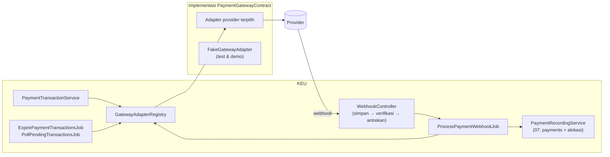
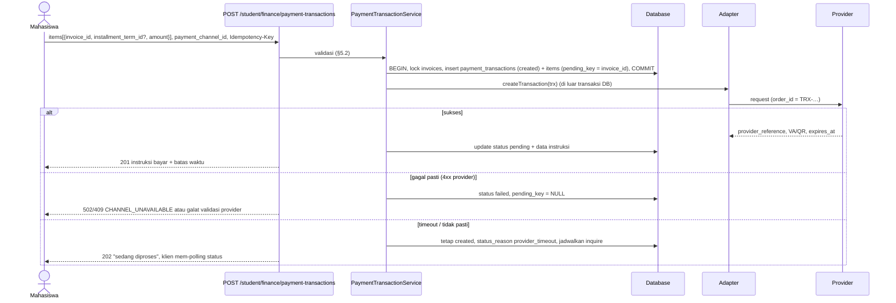
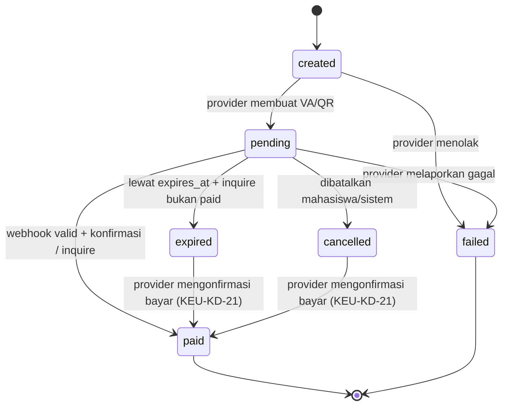
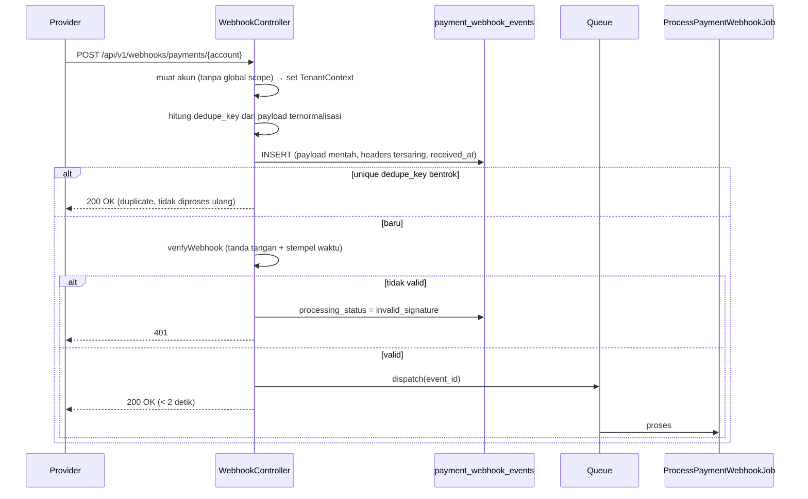

# 08 — Rancangan Pembayaran Online dan Gateway

> **Status:** rancangan. Disusun 2026-10-13. **Belum ada integrasi gateway apa pun di repository.**
> Kembali ke [README](README.md) · Skema: [19 §3.6](19-rancangan-database-dan-relasi.md#36-pembayaran-online) · Aturan: `KEU-BR-090`–`109` ([25](25-business-rules-dan-validasi.md)) · Keputusan: [KEU-KD-10](29-glossary-dan-keputusan-bisnis.md#2-keputusan-desain-keu-kd), [KEU-KD-14](29-glossary-dan-keputusan-bisnis.md#2-keputusan-desain-keu-kd), [KEU-KD-21](29-glossary-dan-keputusan-bisnis.md#2-keputusan-desain-keu-kd)

Dokumen ini merancang pembayaran melalui penyedia jasa pembayaran (*payment gateway*) atau integrasi bank langsung: virtual account (VA), QRIS, e-wallet, gerai ritel, atau kanal lain **yang benar-benar didukung provider yang dikontrak** ([KEU-Q-03](29-glossary-dan-keputusan-bisnis.md#3-pertanyaan-terbuka-keu-q)). Rancangan tidak mengikat ke satu provider; perilaku spesifik provider (format tanda tangan, kode status, kemampuan refund) ditangani oleh adapter.

Prinsip utama: **redirect browser tidak pernah menjadi bukti pembayaran** ([KEU-BR-091](25-business-rules-dan-validasi.md)). Status lunas hanya berasal dari callback/webhook bertanda tangan valid yang dikonfirmasi ke provider, atau dari pemeriksaan status langsung ke provider.

**Peta format baku:** tujuan/aktor/prasyarat §1 · data masukan §3, §5 · proses & status §5–§9 · aturan & validasi §4–§12 · hak akses §14 · data & relasi §15 · API §16 · UI §17 · notifikasi §18 · laporan §19 · kegagalan §20 · audit §21 · AC & TC §22.

## Daftar Isi

1. [Tujuan, Aktor, dan Prasyarat](#1-tujuan-aktor-dan-prasyarat)
2. [Arsitektur Adapter](#2-arsitektur-adapter)
3. [Provider, Kredensial, dan Kanal](#3-provider-kredensial-dan-kanal)
4. [Kuota Kanal per Paket](#4-kuota-kanal-per-paket)
5. [Pembuatan Transaksi](#5-pembuatan-transaksi)
6. [Status Transaksi dan Hubungannya dengan Status Lain](#6-status-transaksi-dan-hubungannya-dengan-status-lain)
7. [Webhook: Penerimaan dan Verifikasi](#7-webhook-penerimaan-dan-verifikasi)
8. [Idempotensi, Duplikasi, dan Urutan Callback](#8-idempotensi-duplikasi-dan-urutan-callback)
9. [Kasus Khusus](#9-kasus-khusus)
10. [Biaya Administrasi Provider](#10-biaya-administrasi-provider)
11. [Kemampuan Provider: Cek Status, Kedaluwarsa, Refund](#11-kemampuan-provider-cek-status-kedaluwarsa-refund)
12. [Gangguan Provider](#12-gangguan-provider)
13. [Riwayat Transaksi dan Rekonsiliasi](#13-riwayat-transaksi-dan-rekonsiliasi)
14. [Hak Akses](#14-hak-akses)
15. [Struktur Data dan Relasi](#15-struktur-data-dan-relasi)
16. [API dan Event](#16-api-dan-event)
17. [UI/UX](#17-uiux)
18. [Notifikasi](#18-notifikasi)
19. [Laporan Terkait](#19-laporan-terkait)
20. [Skenario Kegagalan](#20-skenario-kegagalan)
21. [Audit Trail](#21-audit-trail)
22. [Acceptance Criteria dan Test Case](#22-acceptance-criteria-dan-test-case)

---

## 1. Tujuan, Aktor, dan Prasyarat

| Aspek | Isi |
|---|---|
| **Tujuan** | Mahasiswa dapat membayar dari banyak kanal, dan pembayaran terverifikasi otomatis tanpa pembayaran ganda atau status palsu |
| **Manfaat** | Mengurangi beban verifikasi manual; status tagihan dan cekal diperbarui dalam hitungan detik |
| **Aktor** | Mahasiswa (membuat transaksi, membayar), provider (memproses dana, mengirim webhook), sistem (verifikasi, alokasi, kedaluwarsa, polling), administrator integrasi (kredensial, kanal, pemantauan), staf keuangan (menangani pengecualian), Super Admin (kuota paket) |
| **Prasyarat** | Kontrak provider dan kredensial sandbox/produksi ([KEU-Q-03](29-glossary-dan-keputusan-bisnis.md#3-pertanyaan-terbuka-keu-q)); entitlement kuota kanal ([KEU-Q-01](29-glossary-dan-keputusan-bisnis.md#3-pertanyaan-terbuka-keu-q)); URL webhook publik HTTPS didaftarkan di provider; worker antrean dan scheduler berjalan ([KEU-A-13](29-glossary-dan-keputusan-bisnis.md#4-asumsi-keu-a)); fondasi pembayaran ([07](07-rancangan-pembayaran.md)) |

## 2. Arsitektur Adapter



Kontrak `PaymentGatewayContract` (konseptual):

| Metode | Kegunaan | Wajib |
|---|---|---|
| `capabilities(): GatewayCapabilities` | Kanal yang didukung, `supportsStatusInquiry`, `supportsCancel`, `supportsRefund`, `supportsPartialRefund`, `supportsSettlementReport`, `closedAmountVa` | Ya |
| `createTransaction(PaymentTransaction): ProviderTransaction` | Membuat VA/QRIS/invoice provider; mengembalikan `provider_reference`, `va_number`/`qr_string`/`redirect_url`, `expires_at` | Ya |
| `verifyWebhook(Request, PaymentGatewayAccount): SignatureResult` | Memverifikasi tanda tangan/token dan stempel waktu | Ya |
| `parseWebhook(array $payload): NormalizedEvent` | `provider_event_id`, `provider_reference`, `order_id` (= `transaction_number`), `status` kanon, `paid_amount`, `paid_at`, `raw_status` | Ya |
| `inquireStatus(PaymentTransaction): NormalizedEvent` | Konfirmasi status langsung ke provider | Bila didukung |
| `cancelTransaction(PaymentTransaction): bool` | Membatalkan VA/QR yang belum dibayar | Bila didukung |
| `refund(Refund): ProviderRefund` | Refund lewat provider | Bila didukung |
| `fetchSettlement(account, from, to): iterable` | Laporan settlement untuk rekonsiliasi | Bila didukung |
| `testConnection(account): bool` | Uji kredensial | Ya |

Pemetaan status mentah provider ke status kanon `pending`, `paid`, `failed`, `expired`, `cancelled` dilakukan di adapter dan didokumentasikan per provider saat adapter dibuat. Lapisan ini dipakai bersama KEU dan PMB ([KEU-KD-14](29-glossary-dan-keputusan-bisnis.md#2-keputusan-desain-keu-kd)); `payment_transactions` menyimpan transaksi milik KEU, sedangkan PMB menautkan transaksinya ke domain PMB sesuai rancangan `docs/pmb`.

## 3. Provider, Kredensial, dan Kanal

### 3.1 Akun provider (`payment_gateway_accounts`)

| Ketentuan | Isi |
|---|---|
| Lingkungan | `sandbox` dan `production` dipisah (unique `university_id + provider + environment`) |
| Kredensial | `credentials` dan `webhook_secret` disimpan dengan cast `encrypted`; tidak pernah dikembalikan API, tidak tercatat di log/audit ([KEU-BR-100](25-business-rules-dan-validasi.md), [KEU-BR-305](25-business-rules-dan-validasi.md)). Respons hanya `credentials_configured: true` + 4 karakter terakhir |
| URL webhook | `https://{domain}/api/v1/webhooks/payments/{payment_gateway_account_id}`. Id akun pada URL menentukan tenant ([KEU-BR-101](25-business-rules-dan-validasi.md)) |
| Uji koneksi | `POST /payment-gateway-accounts/{id}/test-connection`; berhasil → `last_verified_at` |
| Aktivasi | `status = active` hanya setelah uji koneksi berhasil. Satu akun aktif per lingkungan ([KEU-A-03](29-glossary-dan-keputusan-bisnis.md#4-asumsi-keu-a)) |
| Rotasi kredensial | Kredensial baru disimpan; webhook diverifikasi dengan secret baru dan, selama masa transisi (`settings.previous_secret_valid_until`), juga secret lama |

### 3.2 Kanal (`payment_channels`)

| Jenis (`channel_type`) | `is_online` | Dihitung kuota | Contoh kode |
|---|:-:|:-:|---|
| `virtual_account` | ✓ | ✓ | `va_bni`, `va_mandiri`, `va_bsi` |
| `qris` | ✓ | ✓ | `qris` |
| `ewallet` | ✓ | ✓ | `ewallet_<nama>` |
| `retail_outlet` | ✓ | ✓ | `retail_<nama>` |
| `manual_transfer` | ✗ | ✗ [K] | `manual_transfer_bni` ([09](09-rancangan-pembayaran-tunai-dan-manual.md)) |
| `cashier` | ✗ | ✗ [K] | `cashier` |

Kanal online hanya dapat dibuat untuk kanal yang tercantum di `capabilities()` adapter. Atribut tampilan: nama, urutan, instruksi bayar (markdown sederhana), min/maks nominal, masa berlaku transaksi (`expiry_minutes`), penanggung biaya (§10).

## 4. Kuota Kanal per Paket

| Paket (referensi) | Kuota kanal online |
|---|---:|
| Growth | 3 |
| Business | 3 |
| Professional | 4 |
| Premium | 5 |
| Enterprise | 6 |

> **Perbedaan dengan repository:** kode paket di `subscription_plans` adalah `trial/starter/professional/enterprise`, dan kolom `limits` belum memuat kuota kanal. Rancangan memakai entitlement `finance.payment_channels` per tenant yang diatur Super Admin. Sampai `plan_feature_entitlements` tersedia, nilainya dibaca dari `university_settings` kunci `entitlement.finance.payment_channels` yang hanya dapat ditulis lewat endpoint platform ([KEU-Q-01](29-glossary-dan-keputusan-bisnis.md#3-pertanyaan-terbuka-keu-q), [28 §4](28-roadmap-implementasi.md#4-dependensi-lintas-tim)).

Aturan ([KEU-BR-090](25-business-rules-dan-validasi.md)):

1. Jumlah kanal `is_active ∧ is_online` ≤ entitlement. Aktivasi kanal ke-(n+1) ditolak 409 `CHANNEL_LIMIT_EXCEEDED`.
2. Pemeriksaan dilakukan dengan kunci baris pada kanal tenant (`SELECT … FOR UPDATE` atas kanal aktif) agar dua aktivasi bersamaan tidak melampaui kuota.
3. Satu kanal = satu `code` (mis. VA BNI dan VA Mandiri adalah dua kanal; QRIS satu kanal walaupun dapat dibayar dari banyak aplikasi).
4. Bila paket turun dan kuota menjadi lebih kecil dari kanal aktif, sistem **tidak** menonaktifkan kanal otomatis (agar transaksi berjalan tidak terputus). Sistem menolak aktivasi baru, menampilkan peringatan ke administrator integrasi dan Super Admin, dan kampus memilih kanal yang dinonaktifkan.
5. Halaman kanal menampilkan "Terpakai 3 dari 4 kanal".

## 5. Pembuatan Transaksi

### 5.1 Alur



Panggilan ke provider dilakukan **di luar** transaksi DB agar kunci tidak ditahan selama jaringan lambat. Kunci tagihan cukup ditahan saat menulis transaksi lokal; unique `pending_key` mencegah transaksi ganda untuk tagihan yang sama ([KEU-BR-093](25-business-rules-dan-validasi.md)).

### 5.2 Validasi

| Validasi | Error |
|---|---|
| Header `Idempotency-Key` wajib; kunci sama + payload sama → respons pertama dikembalikan ([KEU-BR-017](25-business-rules-dan-validasi.md)) | 409 `IDEMPOTENCY_KEY_REUSED` / `IDEMPOTENCY_IN_PROGRESS` |
| Tagihan milik mahasiswa yang login; status `unpaid`/`partial` | 404 / 409 `INVOICE_NOT_PAYABLE` |
| Tidak ada transaksi aktif lain untuk tagihan itu | 409 `ACTIVE_TRANSACTION_EXISTS` dengan tautan ke transaksi aktif ("lanjutkan transaksi yang ada atau batalkan") |
| `0 < amount item ≤ outstanding` (atau ≤ saldo termin bila menunjuk termin); parsial hanya bila `finance.payment.partial_allowed` ([KEU-BR-094](25-business-rules-dan-validasi.md), [KEU-BR-081](25-business-rules-dan-validasi.md)) | 422 |
| `amount ≥ max(finance.payment.min_amount, channel.min_amount)` kecuali seluruh saldo < minimum; `total_amount ≤ channel.max_amount` | 422 |
| Kanal aktif, online, `allow_invoice_payment`, `health_status ≠ down` ([KEU-BR-103](25-business-rules-dan-validasi.md)) | 409 `CHANNEL_UNAVAILABLE` |
| Pembatasan laju per mahasiswa (mis. 10 transaksi/jam) ([KEU-BR-311](25-business-rules-dan-validasi.md)) | 429 |

### 5.3 Komposisi nominal

```
amount              = Σ payment_transaction_items.amount           (untuk kewajiban)
customer_fee_amount = fee_bearer = student ? biaya kanal(amount) : 0   (§10)
total_amount        = amount + customer_fee_amount                 (yang ditagihkan provider)
```

VA dibuat sebagai **nominal tertutup** (*closed amount*) bila provider mendukung (`closedAmountVa`). VA nominal terbuka atau VA statis per mahasiswa diperlakukan sebagai kasus [K]: dana masuk dicatat sebagai pembayaran lalu dialokasikan FIFO ([07 §4.3](07-rancangan-pembayaran.md#43-strategi-alokasi-otomatis)).

### 5.4 Masa berlaku

`expires_at` = waktu pembuatan + `channel.expiry_minutes` (contoh VA 1.440 menit, QRIS 30 menit), atau nilai yang dikembalikan provider bila lebih awal. Masa berlaku transaksi **tidak** dibatasi jatuh tempo tagihan; pembayaran terlambat tetap diterima dan ditangani sebagai keterlambatan ([13](13-rancangan-denda.md)).

## 6. Status Transaksi dan Hubungannya dengan Status Lain



Transisi hanya maju ([KEU-BR-096](25-business-rules-dan-validasi.md)). `paid` final; pengembalian dana dicatat di `refunds`.

| Contoh keadaan | `payment_transactions.status` | `payments.status` | `invoices.status` |
|---|---|---|---|
| Mahasiswa membuat VA, belum bayar | `pending` | (tidak ada) | `unpaid` |
| VA kedaluwarsa tanpa bayar | `expired` | (tidak ada) | `unpaid` (dapat membuat transaksi baru) |
| VA dibayar penuh | `paid` | `verified` | `paid` |
| VA dibayar sebagian (nominal item < saldo) | `paid` | `verified` | `partial` |
| Provider melaporkan nominal berbeda | `paid` (`status_reason = amount_mismatch`) | `pending_verification` | Tidak berubah sampai diverifikasi |
| Dibayar setelah kedaluwarsa, tagihan sudah lunas lewat loket | `paid` | `verified`, seluruhnya dana belum diterapkan | `paid` |

## 7. Webhook: Penerimaan dan Verifikasi

### 7.1 Alur penerimaan



| Langkah | Ketentuan |
|---|---|
| Penentuan tenant | Dari `payment_gateway_account_id` pada URL, bukan dari isi payload ([KEU-BR-101](25-business-rules-dan-validasi.md)). Route webhook berada di luar `auth:sanctum` dan `tenant.access`; controller menetapkan `TenantContext` dari akun |
| Simpan dulu | Payload disimpan **sebelum** diproses, termasuk yang bertanda tangan tidak valid (forensik) ([KEU-BR-092](25-business-rules-dan-validasi.md)) |
| Tanda tangan | Diverifikasi adapter sesuai skema provider (HMAC atas body dengan `webhook_secret`, token callback di header, atau tanda tangan atas field tertentu). Perbandingan memakai *constant-time compare* ([KEU-BR-302](25-business-rules-dan-validasi.md)) |
| Anti-replay | Bila provider menyertakan stempel waktu, selisih > `finance.gateway.signature_tolerance_seconds` (300) ditolak; deduplikasi tetap menjadi pertahanan utama ([KEU-BR-303](25-business-rules-dan-validasi.md)) |
| Lapisan tambahan opsional | Daftar IP provider (`settings.allowed_ips`) bila provider menerbitkannya |
| Respons | Cepat (simpan + antrekan). Pemrosesan berat di job. Kode respons untuk duplikat = 200 agar provider berhenti mengirim ulang |
| Ukuran body | Dibatasi (mis. 256 KB); lebih besar ditolak 413 |

### 7.2 Pemrosesan di job

```
1. BEGIN; SELECT payment_webhook_events … FOR UPDATE; bila sudah processed/duplicate → selesai
2. Cari payment_transactions via provider_reference / order_id (dalam tenant akun). Tidak ketemu → ignored (dicatat)
3. SELECT payment_transactions … FOR UPDATE
4. Bila event menyatakan paid:
     a. Konfirmasi: inquireStatus() bila didukung (double-check). Hasil inquire yang dipakai bila berbeda
     b. Bandingkan nominal: provider_paid_amount vs total_amount
     c. Transisi transaksi → paid (atau abaikan bila sudah paid)
     d. PaymentRecordingService::recordGatewayPayment(trx) → payments (unique payment_transaction_id),
        alokasi transaction_items lalu auto_fifo, kuitansi, histori, audit, outbox PaymentVerified
5. Event lain (failed/expired/cancelled): transisi bila tidak mundur (§8.3)
6. processing_status = processed / ignored / mismatch; processed_at
7. COMMIT. Galat → ROLLBACK, attempts + 1, last_error; retry dengan backoff (1m, 5m, 30m, 2j, 6j), lalu failed + alert
```

## 8. Idempotensi, Duplikasi, dan Urutan Callback

### 8.1 Tiga lapis pencegahan pembayaran ganda

| Lapis | Mekanisme | Mencegah |
|---|---|---|
| 1 | Unique `(payment_gateway_account_id, dedupe_key)` pada `payment_webhook_events` | Callback identik diproses dua kali |
| 2 | Kunci baris `payment_transactions` + transisi hanya maju | Dua callback berbeda (mis. `settlement` dan `capture`) yang sama-sama menyatakan lunas diproses bersamaan |
| 3 | Unique `(university_id, payment_transaction_id)` pada `payments` | Satu transaksi provider menghasilkan dua penerimaan ([KEU-BR-004](25-business-rules-dan-validasi.md)) |

Lapis 3 tetap bekerja walaupun lapis 1 dan 2 lolos karena kesalahan kode.

### 8.2 Idempotensi API mahasiswa

`Idempotency-Key` (UUID/ULID dari klien) disimpan di `idempotency_keys` dan di `payment_transactions.idempotency_key` (unique per pembuat). Klik ganda atau jaringan putus-sambung menghasilkan satu transaksi.

### 8.3 Callback tidak berurutan

Peringkat status: `created`=0, `pending`=1, `failed`/`expired`/`cancelled`=2, `paid`=3.

| Status saat ini | Event masuk | Keputusan |
|---|---|---|
| `paid` | `pending`, `failed`, `expired`, `cancelled` | Diabaikan (`ignored`); dicatat |
| `expired`/`cancelled` | `paid` (terkonfirmasi) | Diterima ([KEU-BR-097](25-business-rules-dan-validasi.md)) |
| `expired` | `pending` | Diabaikan |
| `pending` | `pending` | Diabaikan (hanya `provider_status` diperbarui) |
| `failed` | `paid` | Diterima **hanya** setelah `inquireStatus` mengonfirmasi `paid`; bila provider tidak mendukung inquire → `mismatch`, ditinjau staf |

## 9. Kasus Khusus

### 9.1 Pembayaran diterima setelah kedaluwarsa atau dibatalkan

Uang sudah diterima kampus, sehingga selalu dicatat ([KEU-KD-21](29-glossary-dan-keputusan-bisnis.md#2-keputusan-desain-keu-kd)): transaksi `expired/cancelled → paid`, `payments` `verified` dibuat, alokasi ke tagihan bila masih terutang (melalui item transaksi, lalu FIFO), dan sisanya menjadi dana belum diterapkan. Staf diberi tahu bila ada sisa.

### 9.2 Pembayaran ganda

Contoh: mahasiswa membuat VA A, VA A kedaluwarsa secara lokal, mahasiswa membuat VA B dan membayar, lalu ternyata VA A juga dibayar. Keduanya tercatat sebagai penerimaan terpisah ([KEU-BR-102](25-business-rules-dan-validasi.md)). Pembayaran kedua dialokasikan ke sisa saldo (bila ada), dan kelebihannya menjadi dana belum diterapkan → staf menawarkan konversi ke deposit atau refund ([07 §6](07-rancangan-pembayaran.md#6-kelebihan-bayar-dan-dana-belum-diterapkan)). Mahasiswa dan staf menerima notifikasi.

### 9.3 Selisih nominal

Bila `provider_paid_amount ≠ total_amount` ([KEU-BR-095](25-business-rules-dan-validasi.md), [KEU-KD-27](29-glossary-dan-keputusan-bisnis.md#2-keputusan-desain-keu-kd)):

```
diterima            = provider_paid_amount
biaya_diakui        = min(customer_fee_amount, diterima)
payments.amount     = diterima − biaya_diakui
payments.status     = pending_verification    (bukan verified)
webhook             = mismatch;  transaksi = paid, status_reason = amount_mismatch
```

Staf memeriksa (mis. kelebihan karena biaya kanal berubah, kekurangan karena kesalahan provider), lalu memverifikasi dengan nominal yang benar atau menolak dan mengeskalasi ke provider. Tagihan tidak berubah sampai verifikasi.

### 9.4 Gagal

`failed`: tidak ada penerimaan, `pending_key` dilepas, mahasiswa dapat membuat transaksi baru.

### 9.5 Pembatalan oleh mahasiswa

Hanya untuk `created`/`pending` ([KEU-BR-099](25-business-rules-dan-validasi.md)). Bila provider mendukung pembatalan, sistem memanggil `cancelTransaction` lebih dulu. Bila tidak, transaksi ditandai `cancelled` secara lokal dengan `status_reason = cancelled_local_only`, VA dibiarkan kedaluwarsa di provider, dan pembayaran terlambat tetap diterima (§9.1).

### 9.6 Tagihan berubah saat transaksi aktif

Selama tagihan berada dalam transaksi `created/pending` (`pending_key` terisi), operasi yang menurunkan saldo terutang (voucher, koreksi turun, pemakaian deposit, alokasi manual dari kanal lain) ditolak 409 `ACTIVE_TRANSACTION_EXISTS` dengan pesan "selesaikan atau batalkan transaksi online terlebih dahulu". Pembayaran loket tetap boleh; dananya menjadi dana belum diterapkan bila transaksi online kemudian lunas (§9.2).

## 10. Biaya Administrasi Provider

| `fee_bearer` | Perilaku ([KEU-BR-104](25-business-rules-dan-validasi.md), [KEU-BR-077](25-business-rules-dan-validasi.md)) |
|---|---|
| `student` | `customer_fee_amount` dihitung dari `fee_type`/`fee_value` kanal (persen dibulatkan sesuai `finance.rounding.*`), ditampilkan terpisah sebelum mahasiswa memilih kanal, ditambahkan ke `total_amount`, dan dicatat di `payments.customer_fee_amount`. **Tidak** dialokasikan ke tagihan |
| `institution` (default [K], [KEU-Q-25](29-glossary-dan-keputusan-bisnis.md#3-pertanyaan-terbuka-keu-q)) | Mahasiswa membayar sesuai kewajiban. Potongan provider diketahui dari settlement dan dicatat ke `payments.provider_fee_amount` saat rekonsiliasi ([18 §3](18-rancangan-rekonsiliasi-dan-penyesuaian.md)). Pelunasan tagihan tidak terpengaruh |

Nilai `fee_value` adalah perkiraan untuk tampilan; nilai yang mengikat adalah yang dilaporkan provider. Selisih dicatat sebagai temuan rekonsiliasi.

## 11. Kemampuan Provider: Cek Status, Kedaluwarsa, Refund

| Proses | Jadwal | Perilaku |
|---|---|---|
| **Polling** (`PollPendingTransactionsJob`) | Setiap 5 menit | Transaksi `pending` tanpa webhook selama `finance.gateway.polling_after_minutes` (15) diperiksa dengan `inquireStatus`, lalu dengan *backoff* (15 menit, 1 jam, 6 jam, 24 jam) sampai `expires_at + 24 jam` ([KEU-BR-105](25-business-rules-dan-validasi.md)). Hasil `paid` diproses melalui jalur yang sama dengan webhook |
| **Kedaluwarsa** (`ExpirePaymentTransactionsJob`) | Setiap 5 menit | Transaksi `pending` dengan `expires_at < now − 10 menit` → `inquireStatus` dulu; bila `paid` → proses lunas; bila tidak → `expired`, `pending_key` dilepas ([KEU-BR-098](25-business-rules-dan-validasi.md)) |
| **Transaksi `created` menggantung** | Setiap 5 menit | Cari di provider dengan `order_id`; bila tidak ada → `failed` (`provider_timeout`) |
| **Refund via provider** | Saat refund diproses | Hanya bila `supportsRefund` dan pembayaran asal dari provider itu ([KEU-BR-294](25-business-rules-dan-validasi.md), [18 §5](18-rancangan-rekonsiliasi-dan-penyesuaian.md)) |
| **Settlement** | Harian | Diambil otomatis bila `supportsSettlementReport`; bila tidak, diunggah staf ([18 §3](18-rancangan-rekonsiliasi-dan-penyesuaian.md)) |

Bila provider **tidak** mendukung cek status ([KEU-A-16](29-glossary-dan-keputusan-bisnis.md#4-asumsi-keu-a)): kedaluwarsa hanya dicatat lokal (`status_reason = expired_local`), webhook `paid` yang datang kemudian tetap diterima, dan rekonsiliasi settlement harian menjadi pengaman utama.

## 12. Gangguan Provider

| Sinyal | Ambang (*contoh* [R]) | Tindakan otomatis |
|---|---|---|
| Kegagalan `createTransaction` per kanal | ≥ 5 kegagalan dalam 5 menit atau ≥ 50% dari ≥ 10 percobaan | `health_status = degraded`; kanal tetap tampil dengan peringatan |
| Kegagalan berlanjut | ≥ 15 menit `degraded` atau kegagalan koneksi total | `health_status = down`; kanal **disembunyikan** dari mahasiswa (`CHANNEL_UNAVAILABLE`) ([KEU-BR-103](25-business-rules-dan-validasi.md)) |
| Pemulihan | `testConnection` sukses 3 kali berturut-turut (cek tiap 5 menit) | Kembali `ok` |
| Webhook berhenti | Tidak ada webhook selama 2 jam padahal ada transaksi yang diketahui dibayar (dari polling) atau antrean `pending` tinggi | Alert `finance.integration_alert` ke administrator integrasi |
| Webhook `failed` menumpuk | > 10 event `failed` | Alert; halaman pemantauan menyediakan "Proses ulang" |

Administrator integrasi dapat menetapkan `health_status` manual (mis. pemeliharaan terjadwal). Saat kanal online tidak tersedia, portal menampilkan alternatif: kanal online lain, transfer manual, atau loket. Transaksi yang sudah `pending` tetap berlaku dan webhooknya tetap diproses.

## 13. Riwayat Transaksi dan Rekonsiliasi

- Mahasiswa melihat semua upaya bayar (termasuk yang kedaluwarsa/gagal) beserta status dan instruksi selama masih `pending`.
- Staf melihat linimasa per transaksi: pembuatan, respons provider, setiap webhook (valid/tidak, duplikat), hasil inquire, pembayaran dan alokasi yang dihasilkan.
- Rekonsiliasi settlement provider terhadap transaksi `paid` dijelaskan di [18 §3](18-rancangan-rekonsiliasi-dan-penyesuaian.md). Invarian harian `INV-12`: tidak ada transaksi `paid` tanpa `payments`.

## 14. Hak Akses

| Aksi | Permission | Role default |
|---|---|---|
| Kelola akun provider & kredensial | `payment_gateway_accounts.create/update` | IA |
| Lihat akun provider (tanpa rahasia) | `payment_gateway_accounts.read` | IA, FM, AU |
| Kelola kanal | `payment_channels.create/update` | IA, FA |
| Lihat transaksi online | `payments.read` | FA, FO, FM, IA, AU |
| Cek status manual ke provider | `payments.create` | FO, FA |
| Verifikasi pembayaran `mismatch` | `payments.approve` | FO, FM |
| Pantau & proses ulang webhook/outbox | `finance_integrations.read/update` | IA (FM, AU baca) |
| Atur kuota kanal | Endpoint platform Super Admin | SA |
| Membuat/membatalkan transaksi sendiri | `finance_self_service.create/update` | Mahasiswa |

## 15. Struktur Data dan Relasi

| Tabel | Rincian |
|---|---|
| `payment_gateway_accounts` | [19 §3.6.1](19-rancangan-database-dan-relasi.md#361-payment_gateway_accounts--baru) |
| `payment_channels` | [19 §3.6.2](19-rancangan-database-dan-relasi.md#362-payment_channels--baru) |
| `payment_transactions` | [19 §3.6.3](19-rancangan-database-dan-relasi.md#363-payment_transactions--baru) |
| `payment_transaction_items` | [19 §3.6.4](19-rancangan-database-dan-relasi.md#364-payment_transaction_items--baru) |
| `payment_webhook_events` | [19 §3.6.5](19-rancangan-database-dan-relasi.md#365-payment_webhook_events--baru) |
| `payments`, `payment_allocations` | [07](07-rancangan-pembayaran.md) |

ERD: [19 §4.4](19-rancangan-database-dan-relasi.md#44-pembayaran-online-dan-manual).

## 16. API dan Event

| Jenis | Method | URL | Permission / autentikasi |
|---|---|---|---|
| Mahasiswa | GET | `/student/finance/payment-channels` | `finance_self_service.read`; hanya kanal aktif & sehat, dengan perkiraan biaya |
| Mahasiswa | POST | `/student/finance/payment-transactions` | `finance_self_service.create`; **Idempotency-Key** |
| Mahasiswa | GET | `/student/finance/payment-transactions`, `/{transaction}` | `finance_self_service.read`; status lokal. Bila `pending` dan pemeriksaan terakhir > 60 detik, memicu inquire terbatas laju |
| Mahasiswa | POST | `/student/finance/payment-transactions/{transaction}/cancel` | `finance_self_service.update` |
| Staf | GET | `/payment-transactions`, `/{transaction}` | `payments.read` |
| Staf | POST | `/payment-transactions/{transaction}/check-status` | `payments.create` |
| Integrasi | GET/POST/PUT | `/payment-gateway-accounts`, `/{account}` | `payment_gateway_accounts.*` |
| Integrasi | POST | `/payment-gateway-accounts/{account}/test-connection` | `payment_gateway_accounts.update` |
| Integrasi | GET/POST/PUT | `/payment-channels`, `/{channel}` | `payment_channels.*` |
| Integrasi | PATCH | `/payment-channels/{channel}/activate`, `/deactivate`, `/health` | `payment_channels.update` |
| Integrasi | GET | `/payment-channels/quota` | `payment_channels.read` |
| Integrasi | GET | `/payment-webhook-events`, `/{event}` | `finance_integrations.read` (payload tersaring) |
| Integrasi | POST | `/payment-webhook-events/{event}/reprocess` | `finance_integrations.update` |
| Provider | POST | `/webhooks/payments/{paymentGatewayAccount}` | Tanpa sesi; tanda tangan wajib |
| Platform | PUT | `/platform/universities/{university}/entitlements/finance-payment-channels` | Super Admin |

Event outbox: `PaymentTransactionStatusChanged` (portal, monitoring), `PaymentVerified`. Kontrak lengkap: [20](20-rancangan-api-dan-integrasi.md).

## 17. UI/UX

| Halaman | Rute | Inti |
|---|---|---|
| Portal: Bayar Tagihan | `/portal/keuangan/bayar` | Pilih tagihan/termin dan nominal (penuh default; parsial bila diizinkan) → pilih kanal (kartu kanal dengan biaya admin dan total) → konfirmasi → instruksi |
| Portal: Instruksi Pembayaran | `/portal/keuangan/transaksi/:id` | Nomor VA (tombol salin) / QR, total, batas waktu (hitung mundur zona tenant), instruksi kanal, status yang diperbarui berkala. Setelah kembali dari halaman provider, halaman ini menampilkan "Menunggu konfirmasi" sampai status lokal `paid` (tidak pernah menganggap lunas dari redirect) |
| Transaksi Online (staf) | `/keuangan/pembayaran/online` | Tabel transaksi dengan filter status/kanal/tanggal, linimasa webhook, tombol "Cek status ke provider" |
| Kanal Pembayaran | `/keuangan/master/kanal` | Kartu kanal dengan status aktif, kesehatan, kuota terpakai; form kanal |
| Integrasi Gateway | `/keuangan/integrasi/gateway` | Akun provider (tanpa rahasia), uji koneksi, URL webhook untuk disalin, pemantauan webhook (gagal/tidak valid/duplikat), proses ulang |

## 18. Notifikasi

| Event | Penerima | Kanal |
|---|---|---|
| `finance.payment_instruction` | Mahasiswa | database (mail opsional) — nomor VA & batas waktu |
| `finance.payment_transaction_expired` | Mahasiswa | database |
| `finance.payment_verified` | Mahasiswa | database, mail |
| `finance.integration_alert` | Administrator integrasi (+ FM untuk `down`) | database, mail |
| Pembayaran ganda/selisih | Staf keuangan | database |

## 19. Laporan Terkait

[KEU-RPT-06](22-rancangan-laporan-dan-dashboard.md) pembayaran per kanal, [KEU-RPT-08](22-rancangan-laporan-dan-dashboard.md) transaksi online, [KEU-RPT-15](22-rancangan-laporan-dan-dashboard.md) rekonsiliasi.

## 20. Skenario Kegagalan

| Skenario | Penanganan |
|---|---|
| Provider timeout saat membuat VA | Transaksi `created` + inquire terjadwal; mahasiswa melihat "sedang diproses" |
| Webhook tiba sebelum respons `createTransaction` selesai disimpan | Job mencari transaksi via `order_id`; transaksi `created` diperlakukan seperti `pending` untuk transisi ke `paid` |
| Webhook untuk `order_id` yang tidak dikenal | `ignored` + dicatat; muncul di pemantauan (kemungkinan transaksi PMB atau lingkungan salah) |
| Webhook dengan id akun milik tenant lain di URL | Tanda tangan gagal karena secret berbeda → `invalid_signature`; bila lolos, transaksi tidak ditemukan di tenant akun → `ignored` |
| Database sibuk saat webhook | Payload sudah tersimpan; job di-retry |
| Job memproses tetapi alokasi gagal | Rollback penuh; event `failed`, retry; tidak ada pembayaran setengah jadi |
| Kredensial kedaluwarsa/dirotasi provider | Uji koneksi gagal → `degraded/down` → alert |
| Mahasiswa menutup browser setelah bayar | Tidak berpengaruh; status dari webhook/polling |

## 21. Audit Trail

| Aksi | Dicatat |
|---|---|
| Buat/ubah akun provider, rotasi kredensial | `audit_logs` (`created`/`updated`) **tanpa** nilai rahasia |
| Aktivasi/nonaktivasi kanal, perubahan kesehatan manual | `audit_logs` + `finance_status_histories` |
| Setiap webhook | `payment_webhook_events` (payload mentah, tanda tangan valid/tidak, IP, waktu) |
| Transisi transaksi | `finance_status_histories` (`subject_type = payment_transaction`) |
| Proses ulang webhook manual | `audit_logs` (`forced_override` bila memaksa status) |

## 22. Acceptance Criteria dan Test Case

| Acceptance criteria | Test case |
|---|---|
| [KEU-AC-PG-01](27-acceptance-criteria.md) Webhook berulang tidak membuat pembayaran ganda | [KEU-TC-PG-004](26-skenario-pengujian.md), [KEU-TC-PG-006](26-skenario-pengujian.md) |
| [KEU-AC-PG-02](27-acceptance-criteria.md) Tanda tangan tidak valid/replay tanpa efek | [KEU-TC-PG-005](26-skenario-pengujian.md), [KEU-TC-PG-013](26-skenario-pengujian.md), [KEU-TC-PG-014](26-skenario-pengujian.md) |
| [KEU-AC-PG-03](27-acceptance-criteria.md) Redirect tidak dipercaya | [KEU-TC-PG-003](26-skenario-pengujian.md) |
| [KEU-AC-PG-04](27-acceptance-criteria.md) Pembayaran terlambat/ganda/selisih tercatat benar | [KEU-TC-PG-007](26-skenario-pengujian.md), [KEU-TC-PG-008](26-skenario-pengujian.md), [KEU-TC-PG-009](26-skenario-pengujian.md), [KEU-TC-PG-012](26-skenario-pengujian.md) |
| [KEU-AC-PG-05](27-acceptance-criteria.md) Kuota kanal ditegakkan | [KEU-TC-PG-010](26-skenario-pengujian.md) |
| [KEU-AC-PG-06](27-acceptance-criteria.md) Status transaksi terpisah dari status tagihan; idempotensi pembuatan | [KEU-TC-PG-001](26-skenario-pengujian.md), [KEU-TC-PG-002](26-skenario-pengujian.md) |
| [KEU-AC-PG-07](27-acceptance-criteria.md) Gangguan provider ditangani | [KEU-TC-PG-011](26-skenario-pengujian.md), [KEU-TC-PG-015](26-skenario-pengujian.md) |
| [KEU-AC-PG-08](27-acceptance-criteria.md) Kredensial tidak pernah bocor | [KEU-TC-PG-016](26-skenario-pengujian.md) |
