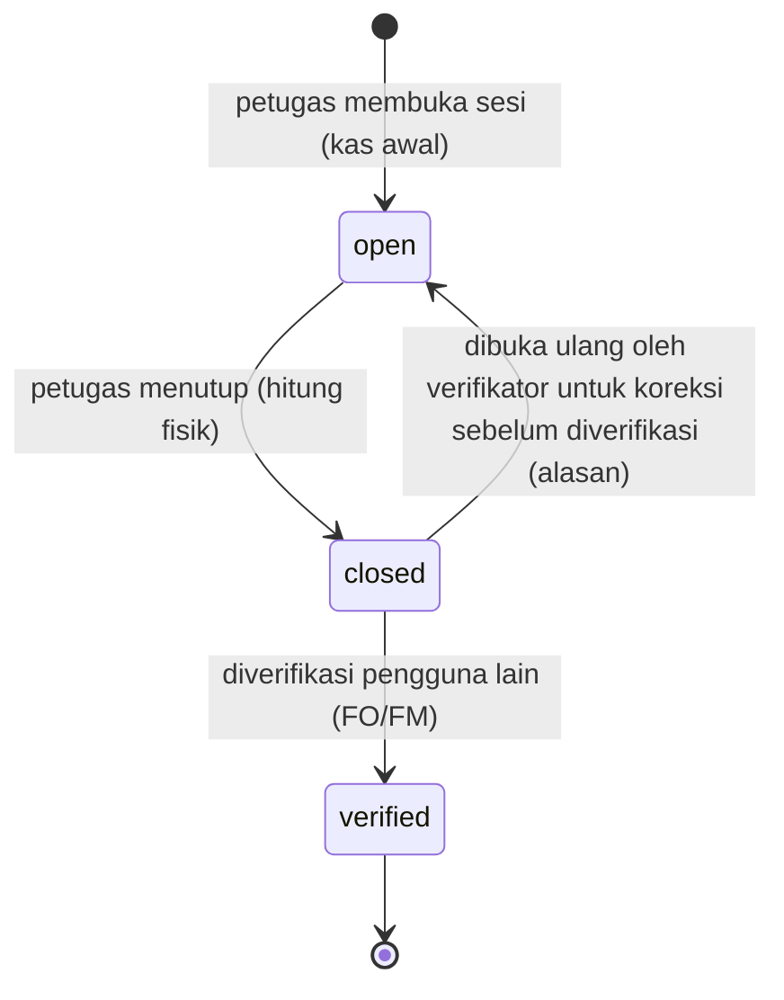
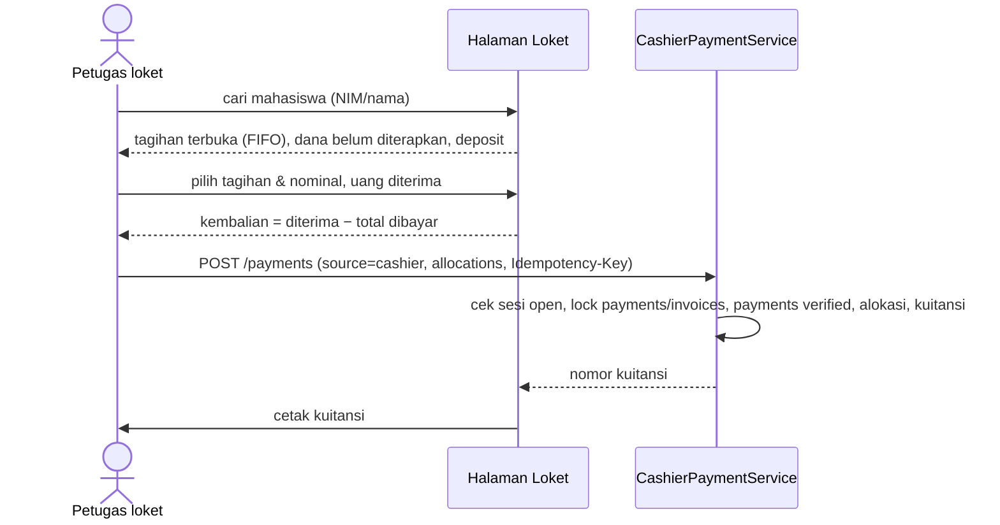
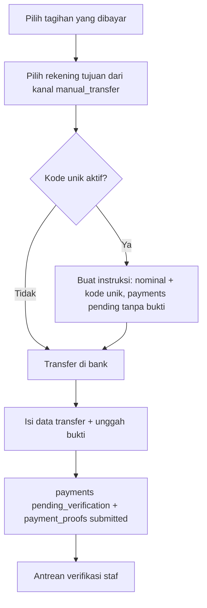
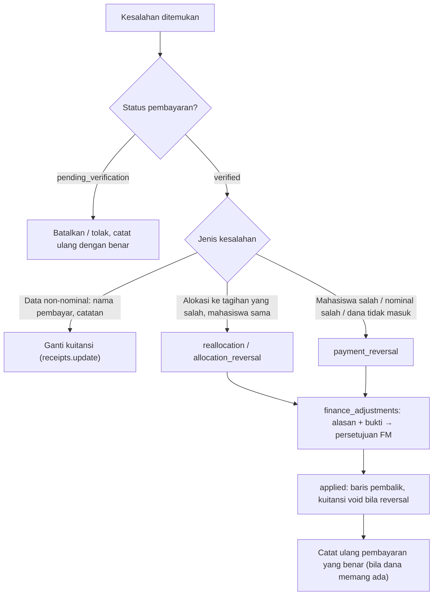

# 09 — Rancangan Pembayaran Tunai dan Manual

> **Status:** rancangan. Disusun 2026-10-13.
> Kembali ke [README](README.md) · Fondasi pembayaran: [07](07-rancangan-pembayaran.md) · Skema: [19 §3.7](19-rancangan-database-dan-relasi.md#37-penerimaan-dan-penerapan-dana) · Aturan: `KEU-BR-110`–`124` ([25](25-business-rules-dan-validasi.md))

Dokumen ini mencakup pembayaran yang **tidak** melalui gateway: tunai di loket, transfer ke rekening kampus yang buktinya diunggah mahasiswa, dan transfer yang dicatat staf. Kanal manual tidak dihitung dalam kuota kanal online [K] ([KEU-Q-02](29-glossary-dan-keputusan-bisnis.md#3-pertanyaan-terbuka-keu-q)). Ini adalah jalur pembayaran pertama yang dibangun ([28](28-roadmap-implementasi.md) Fase 2) karena tidak bergantung pada kontrak provider.

**Peta format baku:** tujuan/aktor/prasyarat §1 · data masukan §3–§4 · proses & status §3–§5 · aturan & validasi §3–§6 · hak akses & matriks kewenangan §7, §10 · data & relasi §11 · API §12 · UI §13 · notifikasi §14 · laporan §15 · kegagalan §16 · audit §17 · AC & TC §18.

## Daftar Isi

1. [Tujuan, Aktor, dan Prasyarat](#1-tujuan-aktor-dan-prasyarat)
2. [Jalur Pembayaran Manual](#2-jalur-pembayaran-manual)
3. [Pembayaran Tunai di Loket dan Sesi Kas](#3-pembayaran-tunai-di-loket-dan-sesi-kas)
4. [Transfer Manual dan Bukti Pembayaran](#4-transfer-manual-dan-bukti-pembayaran)
5. [Verifikasi, Penolakan, dan Kode Unik](#5-verifikasi-penolakan-dan-kode-unik)
6. [Pencegahan Duplikasi](#6-pencegahan-duplikasi)
7. [Matriks Kewenangan dan Pemisahan Tugas](#7-matriks-kewenangan-dan-pemisahan-tugas)
8. [Kuitansi](#8-kuitansi)
9. [Koreksi Pembayaran Manual](#9-koreksi-pembayaran-manual)
10. [Hak Akses](#10-hak-akses)
11. [Struktur Data dan Relasi](#11-struktur-data-dan-relasi)
12. [API dan Event](#12-api-dan-event)
13. [UI/UX](#13-uiux)
14. [Notifikasi](#14-notifikasi)
15. [Laporan Terkait](#15-laporan-terkait)
16. [Skenario Kegagalan](#16-skenario-kegagalan)
17. [Audit Trail](#17-audit-trail)
18. [Acceptance Criteria dan Test Case](#18-acceptance-criteria-dan-test-case)

---

## 1. Tujuan, Aktor, dan Prasyarat

| Aspek | Isi |
|---|---|
| **Tujuan** | Menerima pembayaran di luar gateway dengan bukti yang dapat diperiksa, kontrol kas yang jelas, dan tanpa duplikasi |
| **Manfaat** | Kampus dapat beroperasi sebelum gateway tersedia; mahasiswa tanpa akses kanal online tetap terlayani; uang tunai dapat dipertanggungjawabkan per sesi petugas |
| **Aktor** | Petugas loket (tunai, sesi kas), mahasiswa (unggah bukti), staf keuangan (input transfer, verifikasi, verifikasi sesi kas), bendahara (penyetuju reversal, penerima laporan selisih kas) |
| **Prasyarat** | Rekening penerima dan kanal `manual_transfer`/`cashier` aktif ([04 §3](04-master-data-dan-konfigurasi.md#3-rekening-penerima)); role `cashier`, `finance_officer` ([03](03-role-dan-hak-akses.md)); modul FileManagement (Ada) |

## 2. Jalur Pembayaran Manual

| Jalur | Siapa mencatat | `payments.source` | Status awal | Bukti |
|---|---|---|---|---|
| Tunai di loket | Petugas loket | `cashier` | `verified` ([KEU-KD-25](29-glossary-dan-keputusan-bisnis.md#2-keputusan-desain-keu-kd)) | Uang fisik + kuitansi |
| Non-tunai di loket (EDC debit) [K] | Petugas loket | `cashier`, `method = edc_debit` | `verified` | Struk EDC (nomor referensi wajib); dicocokkan saat rekonsiliasi bank |
| Transfer, bukti diunggah mahasiswa | Mahasiswa | `manual_transfer` | `pending_verification` | Unggahan bukti |
| Transfer, dicatat staf | Staf keuangan | `manual_transfer` | `pending_verification` | Unggahan bukti oleh staf (opsional bila ada referensi bank) |
| Mutasi bank tak teridentifikasi | Sistem/staf dari rekonsiliasi | `bank_import` | `pending_verification`, `student_id` kosong | Baris mutasi ([18 §4](18-rancangan-rekonsiliasi-dan-penyesuaian.md)) |

## 3. Pembayaran Tunai di Loket dan Sesi Kas

### 3.1 Sesi kas

| Aturan | Isi |
|---|---|
| [KEU-BR-110](25-business-rules-dan-validasi.md) | Pembayaran tunai hanya dapat dicatat dalam sesi `open` milik petugas itu (bila `finance.cashier.require_session = true`). Satu petugas paling banyak satu sesi `open` (unique `active_key`) |
| Kas awal | `opening_cash` diisi saat membuka (uang kembalian) |
| Kas diharapkan | `expected_cash = opening_cash + Σ pembayaran tunai verified dalam sesi − Σ refund tunai dibayarkan dalam sesi` (pembayaran yang direversal tetap dihitung bila uangnya tetap di laci, karena dicatat ulang ke mahasiswa yang benar) |
| [KEU-BR-119](25-business-rules-dan-validasi.md) Penutupan | Petugas memasukkan `counted_cash` (dengan rincian pecahan opsional di `notes`). `difference_amount = counted − expected`. Selisih ≠ 0 → catatan wajib dan notifikasi `finance.cashier_difference` ke bendahara |
| Verifikasi | Oleh pemegang `cashier_sessions.approve` yang **bukan** petugas sesi ([KEU-BR-300](25-business-rules-dan-validasi.md)); verifikator mencocokkan setoran ke bank dan laporan sesi |
| Selisih kas | Tidak dibebankan otomatis ke siapa pun. Tindak lanjut (mis. pengembalian oleh petugas) di luar sistem dan dicatat di `notes` |
| Lintas hari | Sesi yang belum ditutup lewat pukul 23:59 zona tenant ditandai "sesi menggantung" di dashboard; nomor sesi memakai tanggal buka |

### 3.2 Mencatat pembayaran tunai

| Validasi | Isi |
|---|---|
| Sesi | Sesi `open` milik petugas ([KEU-BR-110](25-business-rules-dan-validasi.md)) |
| Nominal | `amount > 0` ([KEU-BR-070](25-business-rules-dan-validasi.md)); total alokasi ≤ `amount`; tiap alokasi ≤ saldo terutang. Kelebihan yang memang diserahkan (mis. mahasiswa ingin menitip) dicatat sebagai dana belum diterapkan dan ditampilkan jelas pada kuitansi |
| Tagihan | Milik mahasiswa yang dipilih, `unpaid/partial`, tidak dalam transaksi online aktif kecuali petugas sengaja menjadikannya dana belum diterapkan |
| Kembalian | Dihitung UI, **tidak** disimpan sebagai pembayaran (uang kembalian tidak masuk sistem) |
| Idempotensi | `Idempotency-Key` mencegah kuitansi ganda karena klik ganda |

## 4. Transfer Manual dan Bukti Pembayaran

### 4.1 Alur mahasiswa

| Data masukan | Validasi ([KEU-BR-112](25-business-rules-dan-validasi.md), [KEU-BR-113](25-business-rules-dan-validasi.md), [KEU-BR-118](25-business-rules-dan-validasi.md), [KEU-BR-120](25-business-rules-dan-validasi.md)) |
|---|---|
| Tagihan (opsional, boleh lebih dari satu) | Milik sendiri, `unpaid/partial`. Bila kosong, dana dialokasikan FIFO setelah diverifikasi |
| Rekening tujuan (`bank_account_id`) | Rekening aktif dengan kanal `manual_transfer` aktif |
| Tanggal transfer | Tidak di masa depan (zona tenant); tidak lebih lama dari `finance.manual_transfer.max_backdate_days` (60) |
| Nominal yang ditransfer (`claimed_amount`) | > 0 |
| Bank pengirim, nama pemilik rekening pengirim, 4 digit akhir rekening pengirim (opsional) | Wajib kecuali 4 digit akhir. Nomor rekening pengirim **tidak** disimpan utuh |
| Nomor referensi bank (opsional) | Bila diisi, dinormalisasi (huruf besar, tanpa spasi) dan diperiksa duplikasi (§6) |
| Berkas bukti | `pdf/jpg/jpeg/png` (`finance.proof.allowed_mimes`), ≤ `finance.proof.max_size_mb` (5 MB) dan ≤ `file.max_upload_size_mb`; disimpan privat lewat `FileAttacher`; checksum SHA-256; pemindaian virus bila `file_upload.virus_scan_enabled` |
| `Idempotency-Key` | Wajib |

Selama `pending_verification` dan belum diperiksa, mahasiswa dapat **mengganti bukti** (bukti lama `superseded`) atau **membatalkan** pengajuan (`payments.status = cancelled`, [KEU-BR-083](25-business-rules-dan-validasi.md)).

### 4.2 Transfer dicatat staf

Staf keuangan mengisi data yang sama atas nama mahasiswa (mis. bukti dikirim lewat surel). `recorded_by` = staf, sehingga verifikasi harus oleh staf lain bila SoD aktif ([KEU-BR-300](25-business-rules-dan-validasi.md)).

## 5. Verifikasi, Penolakan, dan Kode Unik

### 5.1 Verifikasi

| Langkah | Ketentuan ([KEU-BR-115](25-business-rules-dan-validasi.md)) |
|---|---|
| Antrean | Diurutkan dari pengajuan tertua; lencana peringatan untuk kemungkinan duplikat (§6), nominal tidak cocok dengan saldo tagihan, dan umur > 2 hari kerja |
| Pencocokan | Verifikator mencocokkan dengan **mutasi rekening tujuan**: nominal, tanggal, nama pengirim, rekening tujuan. Bila mutasi sudah diimpor ([18 §3](18-rancangan-rekonsiliasi-dan-penyesuaian.md)), sistem menyarankan baris mutasi yang cocok |
| Nominal terverifikasi | Nominal yang benar-benar masuk menurut mutasi. Bila berbeda dari klaim, verifikator mengisi nominal sebenarnya + alasan; `payments.amount` = nominal sebenarnya, klaim tetap tersimpan di `payment_proofs.claimed_amount` |
| Referensi bank | `external_reference` diisi dari mutasi bila tersedia [R]; dipakai untuk `reference_key` |
| Alokasi | Default dari pilihan mahasiswa, lalu FIFO ([07 §4.3](07-rancangan-pembayaran.md#43-strategi-alokasi-otomatis)); verifikator dapat menyesuaikan dalam batas aturan |
| Kontrol | SoD (perekam staf ≠ verifikator); `lock_version` mencegah dua verifikator memutus pengajuan yang sama ([KEU-BR-013](25-business-rules-dan-validasi.md)) |
| Hasil | `payments.status = verified`, `verified_by/at`, `posting_date` ([07 §8](07-rancangan-pembayaran.md#8-tanggal-pembukuan)), `payment_proofs.status = approved`, alokasi, kuitansi, notifikasi |

### 5.2 Penolakan

Kode alasan wajib + catatan ([KEU-BR-116](25-business-rules-dan-validasi.md)):

| Kode | Arti | Tindak lanjut mahasiswa |
|---|---|---|
| `NOT_FOUND_IN_STATEMENT` | Dana tidak ditemukan di mutasi | Periksa kembali; unggah ulang bila salah rekening/tanggal |
| `AMOUNT_MISMATCH` | Nominal di bukti tidak sesuai mutasi dan tidak dapat dipastikan | Unggah bukti yang benar |
| `UNREADABLE` | Bukti tidak terbaca | Unggah ulang |
| `DUPLICATE_PROOF` | Bukti sudah dipakai untuk pengajuan lain | Hubungi bagian keuangan |
| `WRONG_ACCOUNT` | Transfer ke rekening yang bukan rekening penerima kampus | Hubungi bagian keuangan |
| `OTHER` | Lainnya (catatan wajib) | Sesuai catatan |

Penolakan bersifat final untuk pengajuan itu (`rejected`). Mahasiswa membuat pengajuan baru bila perlu. Penolakan tidak pernah memiliki alokasi.

### 5.3 Kode unik transfer [K]

Bila `finance.manual_transfer.unique_code_enabled = true` ([KEU-BR-117](25-business-rules-dan-validasi.md)):

1. Mahasiswa membuat **instruksi transfer** sebelum transfer: sistem membuat `payments` `pending_verification` tanpa bukti dengan `amount` = nominal tagihan dan `customer_fee_amount` = kode unik 1–999 yang belum dipakai pengajuan aktif lain untuk rekening dan nominal yang sama dalam 3 hari.
2. Nominal transfer = `amount + kode`. Kode memudahkan pencocokan mutasi; kode dicatat sebagai biaya yang dibayar mahasiswa (bukan pelunasan) dan tampil terpisah di kuitansi.
3. Instruksi tanpa bukti yang tidak dilengkapi dalam 3 hari otomatis `cancelled`.

Default nonaktif karena kampus perlu memutuskan perlakuan akuntansi selisih kode ([KEU-Q-29](29-glossary-dan-keputusan-bisnis.md#3-pertanyaan-terbuka-keu-q)).

## 6. Pencegahan Duplikasi

| Risiko | Mekanisme | Tingkat |
|---|---|---|
| Nomor referensi bank dipakai dua kali | `payments.reference_key = {channel_code}:{ref ternormalisasi}` unik untuk pembayaran yang tidak `rejected/cancelled` ([KEU-BR-114](25-business-rules-dan-validasi.md)) | Memblokir: 409 `DUPLICATE_REFERENCE` |
| Berkas bukti yang sama diunggah ulang | `payment_proofs.file_checksum` dicocokkan; bila sama dengan bukti lain → `duplicate_of_proof_id` terisi | Peringatan bagi verifikator. Bila bukti asal sudah `approved`, verifikasi memerlukan alasan *override* (`audit_logs` `forced_override`) |
| Pengajuan mirip | Mahasiswa sama, nominal sama, tanggal transfer ±3 hari, rekening tujuan sama | Peringatan |
| Satu baris mutasi dicocokkan ke dua pembayaran | Rekonsiliasi: satu baris mutasi → paling banyak satu pembayaran ([18 §3](18-rancangan-rekonsiliasi-dan-penyesuaian.md)) | Memblokir |
| Klik ganda | `Idempotency-Key` | Memblokir |

## 7. Matriks Kewenangan dan Pemisahan Tugas

**C** membuat · **V** memverifikasi · **A** menyetujui · **B** membatalkan · **K** mengoreksi (mengajukan reversal/penggantian). `✗` = dilarang untuk pelaku yang sama.

| Transaksi | Mahasiswa | Petugas loket (CS) | Staf keuangan (FO) | Adm. keuangan (FA) | Bendahara (FM) | Ketentuan SoD |
|---|---|---|---|---|---|---|
| Pembayaran tunai | — | C, B¹ | V (sesi) | — | V (sesi), A (reversal) | Pencatat ≠ verifikator sesi |
| Sesi kas | — | C (buka/tutup) | V | — | V | Petugas sesi ≠ verifikator |
| Transfer — diunggah mahasiswa | C, B (sebelum diperiksa) | — | V | V | V | Mahasiswa bukan pelaku SoD staf |
| Transfer — dicatat staf | — | — | C, V | C, V | V | Perekam ≠ verifikator (✗ pada orang yang sama) |
| Penolakan bukti | — | — | V (tolak) | V (tolak) | V (tolak) | — |
| Reversal pembayaran terverifikasi | — | K (ajukan) | K (ajukan) | K (ajukan) | A | Pengaju ≠ penyetuju |
| Penggantian kuitansi (data non-nominal) | — | — | K | — | K | Diaudit |
| Refund kelebihan bayar | — | — | C | C | A | Pengaju ≠ penyetuju; penyelesai ≠ penyetuju [R] |

¹ Petugas loket tidak dapat membatalkan pembayaran tunai yang sudah tercatat secara langsung karena statusnya `verified`; koreksi selalu lewat reversal (§9).

## 8. Kuitansi

Ketentuan umum kuitansi ada di [07 §7](07-rancangan-pembayaran.md#7-kuitansi). Ketentuan khusus:

| Aspek | Isi |
|---|---|
| Nomor | `KWT-YYYY-NNNNNNNN`; tidak dipakai ulang; kebijakan tanpa celah [K] ([KEU-Q-15](29-glossary-dan-keputusan-bisnis.md#3-pertanyaan-terbuka-keu-q)) |
| Format cetak | A5/A4 (PDF, dompdf) dan struk 80 mm untuk loket [R] |
| Kode verifikasi | `receipts.verification_code`: 32 karakter acak (base32, kriptografis), unik per tenant; dicetak sebagai teks dan QR |
| Halaman verifikasi publik | `GET /api/v1/public/receipts/verify/{code}` dan halaman `/kuitansi/verifikasi/{code}` (tanpa login, bila `finance.receipt.public_verification_enabled`). Menampilkan: nama kampus, nomor kuitansi, tanggal, nominal, nama mahasiswa termasking (mis. `R*** A*****`), status **Sah** / **Dibatalkan** (beserta nomor pengganti bila ada). Tidak menampilkan NIM, tagihan, atau data lain. Dibatasi laju per IP |
| Cetak ulang | Tanda "SALINAN", `print_count`, `last_printed_at`; audit `downloaded` |
| Pembatalan/penggantian | `voided` hanya bersama reversal; penggantian untuk data non-nominal membuat kuitansi baru dan menautkan `replacement_receipt_id` |

## 9. Koreksi Pembayaran Manual

Tidak ada penghapusan atau pengubahan nominal pembayaran terverifikasi ([KEU-BR-121](25-business-rules-dan-validasi.md), [KEU-BR-007](25-business-rules-dan-validasi.md)). Rincian mekanisme reversal: [18 §6](18-rancangan-rekonsiliasi-dan-penyesuaian.md).

## 10. Hak Akses

| Aksi | Permission | Role default |
|---|---|---|
| Buka/tutup sesi kas, catat tunai | `cashier_sessions.create/update`, `payments.create` | CS |
| Verifikasi sesi kas | `cashier_sessions.approve` | FO, FM |
| Catat transfer atas nama mahasiswa | `payments.create` | FO, FA |
| Lihat antrean & berkas bukti | `payments.read` | FO, FA, FM, AU |
| Verifikasi/tolak | `payments.approve` / `.reject` | FO, FM (FA bila diberi) |
| Cetak ulang / ganti kuitansi | `receipts.create` / `.update` | CS, FO / FO, FM |
| Mahasiswa: unggah, ganti bukti, batalkan, lihat | `finance_self_service.create/update/read` | Milik sendiri |

## 11. Struktur Data dan Relasi

| Tabel | Rincian |
|---|---|
| `payments` | [19 §3.7.1](19-rancangan-database-dan-relasi.md#371-payments--ubah) |
| `payment_proofs` | [19 §3.7.3](19-rancangan-database-dan-relasi.md#373-payment_proofs--baru) |
| `receipts` | [19 §3.7.4](19-rancangan-database-dan-relasi.md#374-receipts--baru) |
| `cashier_sessions` | [19 §3.7.5](19-rancangan-database-dan-relasi.md#375-cashier_sessions--baru-r) |
| `bank_accounts`, `payment_channels` | [04 §3](04-master-data-dan-konfigurasi.md#3-rekening-penerima), [08 §3](08-rancangan-pembayaran-online-dan-gateway.md#3-provider-kredensial-dan-kanal) |
| `file_uploads` (Ada) | Bukti dan arsip kuitansi |

## 12. API dan Event

| Method | URL | Permission | Keterangan |
|---|---|---|---|
| GET/POST | `/cashier-sessions` | `cashier_sessions.read` / `.create` | |
| GET | `/cashier-sessions/{session}` | `cashier_sessions.read` | Termasuk daftar pembayaran sesi |
| POST | `/cashier-sessions/{session}/close` | `cashier_sessions.update` | `counted_cash`, `notes` |
| POST | `/cashier-sessions/{session}/verify`, `/reopen` | `cashier_sessions.approve` | SoD |
| POST | `/payments` | `payments.create` | `source=cashier\|manual_transfer`, `student_id`, `amount`, `received_at`, `bank_account_id`, `external_reference`, `allocations[]`, berkas bukti; **Idempotency-Key** |
| GET | `/payment-proofs` | `payments.read` | Antrean; filter `status`, umur, `has_duplicate_warning` |
| GET | `/payment-proofs/{proof}/file` | `payments.read` | Stream berkas, audit `downloaded` |
| POST | `/payments/{payment}/verify` | `payments.approve` | `amount` (nominal sebenarnya), `external_reference`, `allocations[]`, `lock_version`, `reason` bila nominal berbeda / *override* duplikat |
| POST | `/payments/{payment}/reject` | `payments.reject` | `rejection_reason_code`, `rejection_note`, `lock_version` |
| POST | `/payments/{payment}/cancel` | `payments.create` | |
| GET | `/receipts/{receipt}/pdf` | `receipts.read` | `?format=a5\|thermal` |
| GET | `/public/receipts/verify/{code}` | Publik, terbatas laju | |
| GET | `/student/finance/manual-payment-accounts` | `finance_self_service.read` | Rekening tujuan dan instruksi |
| POST | `/student/finance/manual-payments` | `finance_self_service.create` | Multipart; **Idempotency-Key** |
| PUT | `/student/finance/manual-payments/{payment}/proof` | `finance_self_service.update` | Ganti bukti sebelum diperiksa |
| POST | `/student/finance/manual-payments/{payment}/cancel` | `finance_self_service.update` | |

Event outbox: `PaymentVerified`, `PaymentReversed`. Event internal: `PaymentProofSubmitted` (notifikasi antrean).

## 13. UI/UX

| Halaman | Rute | Inti |
|---|---|---|
| Loket | `/keuangan/pembayaran/loket` | Panel sesi (status, kas awal, total tunai hari ini), pencarian mahasiswa, daftar tagihan terbuka dengan kotak centang & nominal, kalkulator kembalian, tombol Bayar & Cetak. Ramah papan ketik (fokus otomatis ke pencarian NIM) |
| Sesi Kas | `/keuangan/pembayaran/sesi-kas` | Riwayat sesi, form tutup sesi (hitung fisik), antrean verifikasi sesi dengan selisih disorot |
| Verifikasi Bukti Bayar | `/keuangan/pembayaran/verifikasi` | Antrean (kiri) + panel detail (kanan): pratinjau berkas (zoom/putar), data klaim, saldo tagihan, saran baris mutasi, peringatan duplikat, form verifikasi (nominal sebenarnya, referensi, alokasi) atau tolak (kode + catatan). Pintasan papan ketik untuk antrean panjang |
| Kuitansi | `/keuangan/pembayaran/kuitansi` | Pencarian kuitansi, cetak ulang, ganti |
| Portal: Konfirmasi Transfer | `/portal/keuangan/konfirmasi-transfer` | Form unggah bukti dengan rekening tujuan (nomor lengkap untuk disalin), pratinjau berkas sebelum kirim; daftar pengajuan dengan status dan alasan penolakan |
| Verifikasi Kuitansi (publik) | `/kuitansi/verifikasi/:code` | Kartu hasil Sah/Dibatalkan |

## 14. Notifikasi

| Event | Penerima | Kanal |
|---|---|---|
| `finance.proof_submitted` | Staf keuangan (ringkasan per jam bila banyak) | database |
| `finance.payment_verified` | Mahasiswa | database, mail |
| `finance.payment_rejected` | Mahasiswa | database, mail (kode alasan + tindak lanjut) |
| `finance.cashier_difference` | Bendahara | database, mail |

## 15. Laporan Terkait

[KEU-RPT-07](22-rancangan-laporan-dan-dashboard.md) pembayaran loket (per sesi, per petugas, selisih), [KEU-RPT-02](22-rancangan-laporan-dan-dashboard.md) pembayaran per periode, [KEU-RPT-16](22-rancangan-laporan-dan-dashboard.md) reversal.

## 16. Skenario Kegagalan

| Skenario | Penanganan |
|---|---|
| Printer gagal saat cetak kuitansi | Pembayaran tetap tercatat; cetak ulang dari halaman kuitansi (tanpa tanda SALINAN untuk cetak pertama yang gagal — `print_count` hanya naik bila PDF berhasil dikirim) |
| Dua verifikator membuka pengajuan yang sama | Yang kedua menerima 409 `STALE_VERSION`/`INVALID_STATUS_TRANSITION` |
| Unggahan berkas gagal di tengah | Tidak ada `payments` yang dibuat (berkas dan data dalam satu permintaan; berkas yatim dibersihkan job FileManagement) |
| Petugas lupa menutup sesi | Sesi menggantung disorot; pembukaan sesi baru ditolak sampai sesi lama ditutup |
| Mahasiswa mentransfer ke rekening yang sudah nonaktif | Rekening nonaktif tidak ditampilkan; bila tetap terjadi, staf memverifikasi berdasarkan mutasi rekening tersebut (rekening tetap ada di master) |
| Bukti palsu terdeteksi setelah diverifikasi | `payment_reversal` dengan alasan `FRAUDULENT_PROOF` + audit; pertimbangkan cekal manual |

## 17. Audit Trail

| Aksi | Dicatat |
|---|---|
| Buka/tutup/verifikasi sesi | `finance_status_histories` (`cashier_session`) + `audit_logs` (`verified`) |
| Catat pembayaran, unggah/ganti bukti | `audit_logs` (`created`/`updated`), berkas dengan checksum |
| Lihat/unduh berkas bukti | `audit_logs` (`downloaded`) |
| Verifikasi (termasuk nominal berbeda, *override* duplikat) | `audit_logs` (`verified` / `forced_override`) dengan nilai klaim vs nominal sebenarnya |
| Tolak | `audit_logs` (`rejected`) + kode alasan |
| Cetak ulang/ganti kuitansi | `audit_logs` (`downloaded` / `updated`) |

## 18. Acceptance Criteria dan Test Case

| Acceptance criteria | Test case |
|---|---|
| [KEU-AC-MAN-01](27-acceptance-criteria.md) Tunai hanya dalam sesi kas, sesi ditutup & diverifikasi | [KEU-TC-MAN-001](26-skenario-pengujian.md), [KEU-TC-MAN-002](26-skenario-pengujian.md), [KEU-TC-MAN-010](26-skenario-pengujian.md) |
| [KEU-AC-MAN-02](27-acceptance-criteria.md) Bukti → verifikasi → alokasi | [KEU-TC-MAN-003](26-skenario-pengujian.md), [KEU-TC-MAN-005](26-skenario-pengujian.md) |
| [KEU-AC-MAN-03](27-acceptance-criteria.md) Penolakan beralasan | [KEU-TC-MAN-004](26-skenario-pengujian.md) |
| [KEU-AC-MAN-04](27-acceptance-criteria.md) Duplikasi dicegah | [KEU-TC-MAN-006](26-skenario-pengujian.md), [KEU-TC-MAN-007](26-skenario-pengujian.md), [KEU-TC-MAN-008](26-skenario-pengujian.md), [KEU-TC-MAN-011](26-skenario-pengujian.md) |
| [KEU-AC-MAN-05](27-acceptance-criteria.md) Pemisahan tugas | [KEU-TC-MAN-009](26-skenario-pengujian.md), [KEU-TC-MAN-012](26-skenario-pengujian.md) |
| [KEU-AC-MAN-06](27-acceptance-criteria.md) Kuitansi dapat diverifikasi publik tanpa membocorkan data | [KEU-TC-MAN-001](26-skenario-pengujian.md), [KEU-TC-SEC-003](26-skenario-pengujian.md) |
