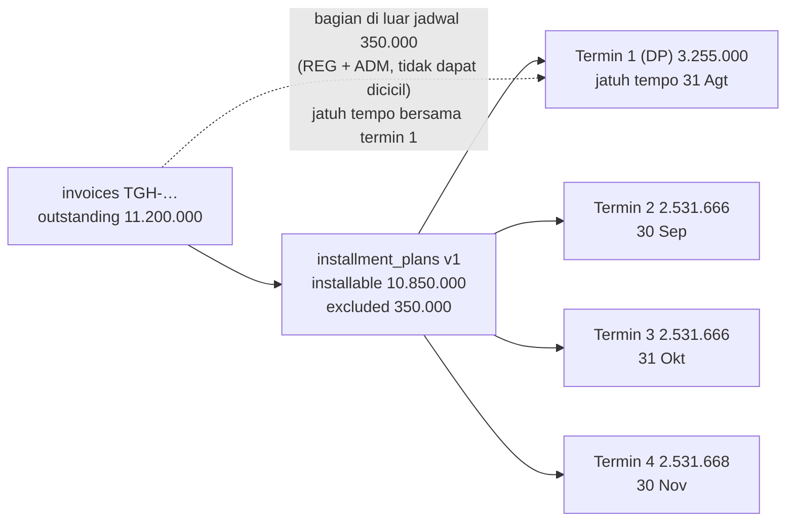
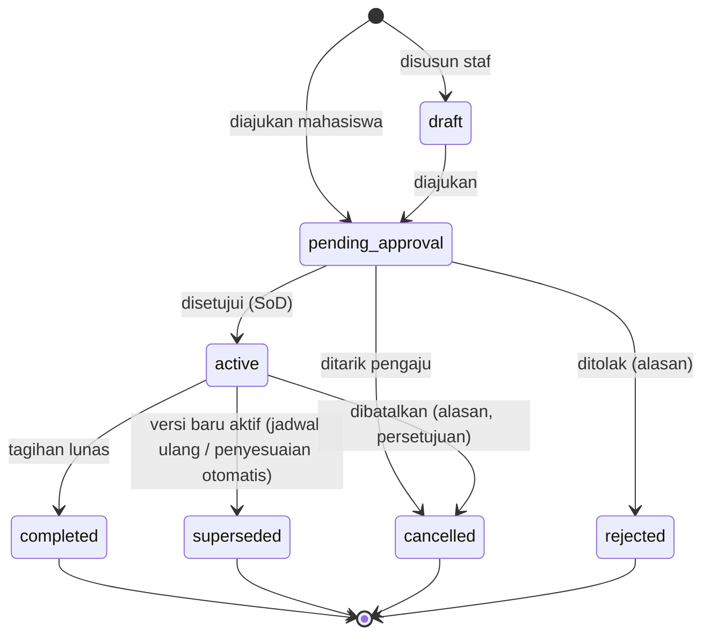

# 10 — Rancangan Cicilan Tagihan

> **Status:** rancangan. Disusun 2026-10-13. Fitur di balik saklar `finance.installment.enabled` (default `false`).
> Kembali ke [README](README.md) · Skema: [19 §3.5](19-rancangan-database-dan-relasi.md#35-cicilan-dan-sengketa) · Aturan: `KEU-BR-125`–`139` ([25](25-business-rules-dan-validasi.md)) · Keputusan: [KEU-KD-02](29-glossary-dan-keputusan-bisnis.md#2-keputusan-desain-keu-kd), [KEU-KD-23](29-glossary-dan-keputusan-bisnis.md#2-keputusan-desain-keu-kd), [KEU-KD-24](29-glossary-dan-keputusan-bisnis.md#2-keputusan-desain-keu-kd)

Cicilan membagi saldo terutang **satu tagihan** ke beberapa termin dengan jatuh tempo berbeda. Termin adalah **jadwal** di atas tagihan, bukan tagihan terpisah, sehingga kewajiban tidak pernah dihitung dua kali ([KEU-KD-02](29-glossary-dan-keputusan-bisnis.md#2-keputusan-desain-keu-kd)).

**Peta format baku:** tujuan/aktor/prasyarat §1 · data masukan §3–§4 · proses & status §4–§6 · aturan & validasi §3–§8 · hak akses §10 · data & relasi §11 · API §12 · UI §13 · notifikasi §14 · laporan §9, §15 · kegagalan §16 · audit §17 · AC & TC §18.

## Daftar Isi

1. [Tujuan, Aktor, dan Prasyarat](#1-tujuan-aktor-dan-prasyarat)
2. [Konsep](#2-konsep)
3. [Pembentukan Jadwal](#3-pembentukan-jadwal)
4. [Pengajuan dan Syarat](#4-pengajuan-dan-syarat)
5. [Persetujuan, Penjadwalan Ulang, dan Pembatalan](#5-persetujuan-penjadwalan-ulang-dan-pembatalan)
6. [Alokasi Pembayaran ke Termin](#6-alokasi-pembayaran-ke-termin)
7. [Interaksi dengan Potongan, Pembayaran, dan Koreksi](#7-interaksi-dengan-potongan-pembayaran-dan-koreksi)
8. [Denda dan Cekal per Termin](#8-denda-dan-cekal-per-termin)
9. [Pelaporan Tanpa Hitung Ganda](#9-pelaporan-tanpa-hitung-ganda)
10. [Hak Akses](#10-hak-akses)
11. [Struktur Data dan Relasi](#11-struktur-data-dan-relasi)
12. [API dan Event](#12-api-dan-event)
13. [UI/UX](#13-uiux)
14. [Notifikasi](#14-notifikasi)
15. [Laporan Terkait](#15-laporan-terkait)
16. [Skenario Kegagalan](#16-skenario-kegagalan)
17. [Audit Trail](#17-audit-trail)
18. [Acceptance Criteria dan Test Case](#18-acceptance-criteria-dan-test-case)

---

## 1. Tujuan, Aktor, dan Prasyarat

| Aspek | Isi |
|---|---|
| **Tujuan** | Memberi keringanan pembayaran terjadwal tanpa kehilangan kendali atas piutang |
| **Manfaat** | Mahasiswa dapat membayar bertahap; kampus menegakkan denda dan cekal berdasarkan termin yang benar-benar jatuh tempo |
| **Aktor** | Mahasiswa (mengajukan bila diizinkan), staf keuangan/administrator (menyusun atau mengajukan atas nama mahasiswa), bendahara (menyetujui), sistem (alokasi, penyesuaian otomatis) |
| **Prasyarat** | `finance.installment.enabled = true`; kebijakan cicilan dikonfirmasi ([KEU-Q-10](29-glossary-dan-keputusan-bisnis.md#3-pertanyaan-terbuka-keu-q)); tagihan terbit ([06](06-rancangan-tagihan-mahasiswa.md)) |

## 2. Konsep



| Istilah | Definisi |
|---|---|
| **Rencana cicilan** | Satu jadwal pembayaran atas satu tagihan; berversi (`version`, `previous_plan_id`) |
| **Termin** | Bagian jadwal dengan nominal dan jatuh tempo; termin 1 dapat ditandai uang muka (DP) |
| **Nominal dicicil** (`installable_amount`) | Σ nominal termin. Hanya dari komponen `is_installmentable = true` |
| **Bagian non-cicilan** (`excluded_amount`) | Sisa komponen yang tidak dapat dicicil saat rencana diaktifkan; jatuh tempo bersama termin pertama |
| **Terutang di luar jadwal** (turunan) | `invoices.outstanding_amount − Σ (amount − paid_amount)` termin aktif yang tidak `cancelled` ([KEU-KD-23](29-glossary-dan-keputusan-bisnis.md#2-keputusan-desain-keu-kd)). Mencakup bagian non-cicilan yang belum dibayar dan tambahan nominal setelah rencana aktif (§7) |

Persamaan yang selalu berlaku saat rencana aktif:

```
invoices.outstanding_amount = terutang_di_luar_jadwal + Σ sisa termin
```

## 3. Pembentukan Jadwal

### 3.1 Masukan

| Masukan | Validasi ([KEU-BR-127](25-business-rules-dan-validasi.md)) |
|---|---|
| Jumlah termin *n* (termasuk DP) | 2 ≤ *n* ≤ `finance.installment.max_terms` (default 4 [K]) |
| Uang muka | Nominal atau persen; ≥ `finance.installment.min_down_payment_percentage` (default 25% [K]) × `installable_amount`, dibulatkan ke atas ke rupiah penuh |
| Metode pembagian sisa | `equal` (rata), `percentage` (persen per termin, total 100%), `custom` (nominal per termin) |
| Jatuh tempo | Tanggal per termin atau tanggal termin pertama + interval (bulanan); naik tegas; termin 1 ≥ hari ini (zona tenant); termin terakhir ≤ `academic_terms.end_date` term tagihan bila `finance.installment.last_due_limit = term_end` [K] |

### 3.2 Perhitungan

```
neto_sisa(i)       = neto komponen i − terapan waterfall(i)          (07 §4.5)
excluded_amount    = Σ neto_sisa(i) untuk baris dengan is_installmentable = false
installable_amount = invoices.outstanding_amount − excluded_amount
DP                 = ceil(installable_amount × dp% )   (atau nominal input)
sisa               = installable_amount − DP
equal:  termin k   = floor(sisa / (n−1))  untuk k = 2..n−1;  termin n = sisa − Σ termin 2..n−1
```

Selisih pembulatan selalu masuk termin terakhir ([KEU-BR-128](25-business-rules-dan-validasi.md)). Sistem menolak jadwal bila `Σ termin ≠ installable_amount` (422 `INSTALLMENT_TOTAL_MISMATCH`, [KEU-BR-126](25-business-rules-dan-validasi.md)) atau bila ada termin ≤ 0.

### 3.3 Contoh

Tagihan semester Andi ([05 §9.1](05-rancangan-tarif-uang-kuliah.md#91-contoh-a--model-spp--per-sks-pts)) Rp11.200.000, belum ada pembayaran. Komponen REG (Rp250.000) dan ADM (Rp100.000) tidak dapat dicicil.

| Hal | Nilai |
|---|---:|
| `excluded_amount` | 350.000 |
| `installable_amount` | 10.850.000 |
| 4 termin, DP 30% | DP = 3.255.000 |
| Sisa untuk 3 termin | 7.595.000 → 2.531.666 + 2.531.666 + **2.531.668** (selisih pembulatan di termin terakhir) |

| Termin | Jatuh tempo | Nominal termin | Wajib dibayar pada tanggal itu |
|---|---|---:|---:|
| 1 (DP) | 31 Agt 2026 | 3.255.000 | 3.605.000 (termasuk bagian non-cicilan 350.000) |
| 2 | 30 Sep 2026 | 2.531.666 | 2.531.666 |
| 3 | 31 Okt 2026 | 2.531.666 | 2.531.666 |
| 4 | 30 Nov 2026 | 2.531.668 | 2.531.668 |
| **Total** | | **10.850.000** | **11.200.000** |

Setelah aktif: `invoices.due_date = 2026-11-30` (termin terakhir), `original_due_date` menyimpan jatuh tempo awal ([KEU-BR-135](25-business-rules-dan-validasi.md)).

## 4. Pengajuan dan Syarat

| Syarat ([KEU-BR-125](25-business-rules-dan-validasi.md)) | Galat |
|---|---|
| `invoice_type ∈ finance.installment.allowed_invoice_types` (bukan `late_fee`) | 422 |
| `status ∈ {unpaid, partial}`, `installable_amount > 0` | 409 `INVOICE_NOT_PAYABLE` |
| Tidak ada rencana `pending_approval`/`active` lain (unique `active_key`) | 409 `INVALID_STATUS_TRANSITION` |
| Tidak ada transaksi online aktif atas tagihan | 409 `ACTIVE_TRANSACTION_EXISTS` |
| Pengajuan mahasiswa hanya bila `finance.installment.student_request_enabled` | 403 |
| Kebijakan tambahan [K], mis. hanya sebelum jatuh tempo awal, atau tidak sedang memiliki termin lain yang terlambat | 422 dengan pesan kebijakan |

| Pengaju | `requested_via` | Bentuk pengajuan |
|---|---|---|
| Mahasiswa | `student` | Memilih *n* dan DP dari opsi yang diizinkan; sistem membuat usulan jadwal (`POST /student/finance/invoices/{id}/installment-requests`). Alasan wajib, dokumen pendukung opsional |
| Staf | `staff` | Menyusun jadwal bebas dalam batas §3.1 |

## 5. Persetujuan, Penjadwalan Ulang, dan Pembatalan

### 5.1 Status rencana



### 5.2 Status termin

| Status | Arti |
|---|---|
| `scheduled` | Belum ada alokasi |
| `partial` | `0 < paid_amount < amount` |
| `paid` | `paid_amount = amount` (`paid_off_at`) |
| `cancelled` | Rencana dibatalkan/digantikan sebelum termin lunas |
| *Terlambat* (turunan) | `status ∈ {scheduled, partial} ∧ due_date < hari ini` |

### 5.3 Persetujuan

Workflow `finance_installment_plan` ([03 §6](03-role-dan-hak-akses.md#6-persetujuan)); penyetuju ≠ pengaju ([KEU-BR-129](25-business-rules-dan-validasi.md)). Saat disetujui, dalam satu transaksi: `installment_plans.status = active`, `invoices.has_active_installment_plan = true`, `invoices.due_date` = jatuh tempo termin terakhir, histori, notifikasi, evaluasi ulang cekal (tagihan kini dinilai per termin).

Validasi diulang saat persetujuan: bila `outstanding_amount` tagihan berubah sejak pengajuan (mis. ada pembayaran), sistem menghitung ulang jadwal secara proporsional dan menampilkan perbedaan kepada penyetuju sebelum dikonfirmasi.

### 5.4 Penjadwalan ulang

Penjadwalan ulang membuat **versi baru** ([KEU-BR-132](25-business-rules-dan-validasi.md)):

1. Versi baru disusun atas **sisa** kewajiban saat ini: `installable_amount_baru = Σ sisa termin aktif`, `excluded_amount_baru = terutang di luar jadwal`.
2. Termin lama yang sudah `paid` tetap tersimpan pada versi lama sebagai riwayat; termin `partial` lama tetap mencatat bagian yang sudah dibayar.
3. Setelah disetujui: versi lama `superseded`, termin lama yang belum lunas `cancelled`, versi baru `active`.
4. Alokasi yang sudah ditandai ke termin lama **tidak** dipindahkan.

### 5.5 Pembatalan

`POST /installment-plans/{id}/cancel` dengan alasan, disetujui bendahara ([KEU-BR-133](25-business-rules-dan-validasi.md)): termin yang belum lunas `cancelled`; `has_active_installment_plan = false`; `invoices.due_date` dikembalikan ke `original_due_date`, atau tanggal baru yang ditetapkan saat pembatalan (dicatat sebagai `DUE_DATE_EXTENSION`). Bila tanggal itu sudah lewat, seluruh sisa langsung terlambat; dialog konfirmasi menampilkan akibat ini.

## 6. Alokasi Pembayaran ke Termin

Aturan alokasi ([KEU-BR-075](25-business-rules-dan-validasi.md), [07 §4.4](07-rancangan-pembayaran.md#44-tagihan-bercicilan)):

```
dana untuk tagihan bercicilan diterapkan berurutan:
  1. terutang_di_luar_jadwal                 → payment_allocations.installment_term_id = null
  2. termin aktif dengan term_no terkecil yang belum lunas → installment_term_id = termin itu
     (installment_terms.paid_amount += nominal; status scheduled/partial/paid)
  3. lanjut ke termin berikutnya sampai dana habis atau seluruh termin lunas
```

| Ketentuan | Isi |
|---|---|
| Urutan tetap | Pilihan "bayar termin 3" di UI hanya menentukan **nominal** yang dibayar; penerapannya tetap mengikuti urutan di atas agar jadwal tidak berlubang |
| Pelunasan dipercepat | Pembayaran melebihi termin jatuh tempo berikutnya melunasi termin-termin berikutnya; bila seluruh termin lunas, tagihan `paid` dan rencana `completed` ([KEU-BR-131](25-business-rules-dan-validasi.md), [KEU-BR-136](25-business-rules-dan-validasi.md)) |
| Pembalikan | Pembalikan alokasi bertanda termin mengurangi `paid_amount` termin tersebut; termin dapat kembali `partial/scheduled` dan menjadi terlambat bila jatuh temponya lewat |
| Deposit | Pemakaian deposit diperlakukan sama dengan pembayaran |

Contoh: Andi membayar Rp4.000.000 pada 28 Agustus → 350.000 ke bagian non-cicilan, 3.255.000 ke termin 1 (`paid`), 395.000 ke termin 2 (`partial`, sisa 2.136.666).

## 7. Interaksi dengan Potongan, Pembayaran, dan Koreksi

| Situasi | Perlakuan |
|---|---|
| Beasiswa/voucher/pembayaran **sebelum** rencana dibuat | Sudah tercermin di `outstanding_amount`; jadwal dihitung dari sisa tersebut. Rekomendasi [R]: terapkan seluruh potongan sebelum menyetujui cicilan |
| Nominal tagihan **turun** saat rencana aktif (beasiswa susulan, koreksi turun, voucher) | **Penyesuaian otomatis** ([KEU-KD-24](29-glossary-dan-keputusan-bisnis.md#2-keputusan-desain-keu-kd), [KEU-BR-134](25-business-rules-dan-validasi.md)): sistem membuat versi baru dengan pengurangan diambil dari termin belum lunas **paling akhir** ke depan; termin yang menjadi nol `cancelled`. Tidak memerlukan persetujuan (menguntungkan mahasiswa dan perubahan nominal asalnya sudah disetujui); dicatat dengan `basis` penyesuaian di histori |
| Nominal tagihan **naik** saat rencana aktif (koreksi naik) | Komponen yang dapat dicicil: kenaikan ditambahkan ke termin belum lunas **terakhir** lewat versi baru otomatis. Komponen non-cicilan: menjadi terutang di luar jadwal, jatuh tempo bersama termin pertama yang belum lunas; bila semua termin lunas, jatuh tempo = tanggal kenaikan + `finance.invoice.default_due_days` |
| Pembalikan alokasi pra-rencana | Menambah terutang di luar jadwal (aturan jatuh tempo sama dengan baris di atas) |
| Sengketa | Tidak mengubah jadwal; penyelesaian sengketa yang mengubah nominal memicu penyesuaian di atas |

## 8. Denda dan Cekal per Termin

Nominal **jatuh tempo dan belum dibayar** pada tanggal *d* untuk tagihan bercicilan:

```
jatuh_tempo_terutang(d) = Σ sisa termin aktif dengan due_date < d
                        + (terutang_di_luar_jadwal bila jatuh temponya < d)
```

| Fitur | Pemakaian |
|---|---|
| Denda | Bila `late_fee_rules.apply_per_installment_term = true`, denda dihitung per termin terlambat (`late_fee_assessments.installment_term_id`) dengan dasar sisa termin ([13 §4](13-rancangan-denda.md)) |
| Cekal | Bila `finance_hold_policies.use_installment_due_dates = true`, mahasiswa tidak dicekal selama `jatuh_tempo_terutang` di bawah ambang, walaupun total tagihan belum lunas ([17 §4](17-rancangan-cekal-keuangan.md), [KEU-BR-272](25-business-rules-dan-validasi.md)) |
| Pengingat | Pengingat H-7 dan H-1 per termin ([23](23-rancangan-notifikasi.md)) |

## 9. Pelaporan Tanpa Hitung Ganda

| Aturan ([KEU-BR-130](25-business-rules-dan-validasi.md)) | Penerapan |
|---|---|
| Piutang selalu dari `invoices.outstanding_amount` | Termin tidak pernah dijumlahkan ke total piutang |
| Rincian per termin hanya untuk distribusi waktu | Laporan umur piutang membagi `outstanding_amount` tagihan bercicilan menurut jatuh tempo termin; jumlah pembagian = `outstanding_amount` tagihan |
| Laporan cicilan | Kolom total memakai tagihan; kolom termin menampilkan rincian, dengan baris rekonsiliasi "Σ sisa termin + terutang di luar jadwal = sisa tagihan" |

Contoh pembagian umur piutang pada 15 Oktober 2026 (Andi sudah membayar Rp4.000.000):

| Bagian | Sisa | Jatuh tempo | Kategori umur |
|---|---:|---|---|
| Termin 2 | 2.136.666 | 30 Sep | 1–30 hari |
| Termin 3 | 2.531.666 | 31 Okt | Belum jatuh tempo |
| Termin 4 | 2.531.668 | 30 Nov | Belum jatuh tempo |
| **Total = sisa tagihan** | **7.200.000** | | |

## 10. Hak Akses

| Aksi | Permission | Role default |
|---|---|---|
| Lihat rencana | `installment_plans.read` | FA, FO, CS, FM, AU |
| Susun/ajukan atas nama mahasiswa | `installment_plans.create` | FA, FO |
| Jadwalkan ulang, batalkan (pengajuan) | `installment_plans.update` | FA, FO |
| Setujui/tolak | `installment_plans.approve` / `.reject` | FM |
| Mahasiswa mengajukan, melihat | `finance_self_service.create/read` | Milik sendiri |

## 11. Struktur Data dan Relasi

| Tabel | Rincian |
|---|---|
| `installment_plans` | [19 §3.5.1](19-rancangan-database-dan-relasi.md#351-installment_plans--baru) |
| `installment_terms` | [19 §3.5.2](19-rancangan-database-dan-relasi.md#352-installment_terms--baru) |
| `payment_allocations.installment_term_id` | [19 §3.7.2](19-rancangan-database-dan-relasi.md#372-payment_allocations--baru-append-only) |
| `late_fee_assessments.installment_term_id`, `finance_hold_invoices.installment_term_id` | [13](13-rancangan-denda.md), [17](17-rancangan-cekal-keuangan.md) |

Invarian: `INV-10` (Σ termin = `installable_amount`), `INV-11` (Σ `paid_amount` termin = Σ alokasi bertanda termin) ([19 §8](19-rancangan-database-dan-relasi.md#8-invarian-dan-query-pemeriksaan)).

## 12. API dan Event

| Method | URL | Permission | Keterangan |
|---|---|---|---|
| POST | `/installment-plans/preview` | `installment_plans.read` | Hitung usulan jadwal tanpa menyimpan |
| GET | `/installment-plans` | `installment_plans.read` | Filter `status`, `has_overdue_term`, term, prodi |
| POST | `/invoices/{invoice}/installment-plans` | `installment_plans.create` | `draft` atau langsung `pending_approval` |
| GET | `/installment-plans/{plan}` | `installment_plans.read` | Termin, versi, alokasi per termin |
| POST | `/installment-plans/{plan}/submit` | `installment_plans.create` | |
| POST | `/installment-plans/{plan}/approve`, `/reject` | `installment_plans.approve` / `.reject` | SoD |
| POST | `/installment-plans/{plan}/reschedule` | `installment_plans.update` | Membuat versi baru `pending_approval` |
| POST | `/installment-plans/{plan}/cancel` | `installment_plans.update` | Melalui persetujuan |
| POST | `/student/finance/invoices/{invoice}/installment-requests` | `finance_self_service.create` | **Idempotency-Key** |
| GET | `/student/finance/installment-plans/{plan}` | `finance_self_service.read` | |

Event: `InvoiceStatusChanged` saat lunas; event internal `InstallmentPlanActivated` (evaluasi cekal, pengingat).

## 13. UI/UX

| Halaman | Rute | Inti |
|---|---|---|
| Daftar Cicilan | `/keuangan/tagihan/cicilan` | Kolom: nomor rencana, mahasiswa, tagihan, versi, jumlah termin, termin berikut & jatuh tempo, sisa, status, lencana "Termin terlambat" |
| Penyusun Jadwal | Modal di Detail Tagihan | Pilih *n*, DP, metode; tabel termin dapat disunting (custom); baris total dengan indikator cocok/tidak cocok; pratinjau tampilan mahasiswa |
| Detail Rencana | `/keuangan/tagihan/cicilan/:id` | Linimasa versi, termin dengan progres bayar, alokasi per termin, tombol Setujui/Tolak/Jadwalkan Ulang/Batalkan |
| Portal: Ajukan Cicilan | Dari detail tagihan portal | Pilihan sederhana (jumlah termin, DP) dengan jadwal hasil hitung; alasan; status pengajuan |

## 14. Notifikasi

| Event | Penerima | Kanal |
|---|---|---|
| `finance.installment_requested` | Staf keuangan / penyetuju | database |
| `finance.installment_decided` | Mahasiswa | database, mail |
| `finance.installment_term_reminder` (H-7, H-1) | Mahasiswa | database, mail |
| Penyesuaian otomatis jadwal | Mahasiswa | database (jadwal baru) |

## 15. Laporan Terkait

[KEU-RPT-09](22-rancangan-laporan-dan-dashboard.md) laporan cicilan; [KEU-RPT-04](22-rancangan-laporan-dan-dashboard.md) umur piutang (pembagian per termin, §9).

## 16. Skenario Kegagalan

| Skenario | Penanganan |
|---|---|
| Pembayaran masuk saat rencana menunggu persetujuan | Alokasi berjalan normal (tanpa termin); saat persetujuan jadwal dihitung ulang (§5.3) |
| Dua staf menyetujui bersamaan | Unique `active_key` dan transisi status mencegah dua rencana aktif |
| Penyesuaian otomatis gagal (galat) | Perubahan nominal tagihan yang memicu ikut di-*rollback*; koreksi dapat diulang |
| Jatuh tempo termin jatuh pada hari libur | Tidak digeser otomatis; staf dapat memilih tanggal saat menyusun [R] |
| Mahasiswa mencoba mengajukan dua kali | `Idempotency-Key` + unique `active_key` |

## 17. Audit Trail

| Aksi | Dicatat |
|---|---|
| Pengajuan, persetujuan, penolakan, pembatalan, jadwal ulang | `finance_status_histories` (`installment_plan`) + `audit_logs` (`approved`/`rejected`) |
| Penyesuaian otomatis | `finance_status_histories` `auto_rebalanced` dengan payload perubahan termin |
| Perubahan status termin | `finance_status_histories` (`installment_term`) |

## 18. Acceptance Criteria dan Test Case

| Acceptance criteria | Test case |
|---|---|
| [KEU-AC-INS-01](27-acceptance-criteria.md) Σ termin + bagian non-cicilan = sisa tagihan | [KEU-TC-INS-001](26-skenario-pengujian.md), [KEU-TC-INS-002](26-skenario-pengujian.md), [KEU-TC-INS-003](26-skenario-pengujian.md), [KEU-TC-INS-004](26-skenario-pengujian.md) |
| [KEU-AC-INS-02](27-acceptance-criteria.md) Urutan alokasi dan pelunasan dipercepat | [KEU-TC-INS-005](26-skenario-pengujian.md), [KEU-TC-INS-006](26-skenario-pengujian.md) |
| [KEU-AC-INS-03](27-acceptance-criteria.md) Penjadwalan ulang berversi dan pembatalan berizin | [KEU-TC-INS-007](26-skenario-pengujian.md), [KEU-TC-INS-010](26-skenario-pengujian.md), [KEU-TC-INS-011](26-skenario-pengujian.md) |
| [KEU-AC-INS-04](27-acceptance-criteria.md) Tidak dihitung ganda di laporan | [KEU-TC-INS-008](26-skenario-pengujian.md), [KEU-TC-RPT-005](26-skenario-pengujian.md) |
| [KEU-AC-INS-05](27-acceptance-criteria.md) Penyesuaian otomatis saat nominal berubah | [KEU-TC-INS-009](26-skenario-pengujian.md) |
