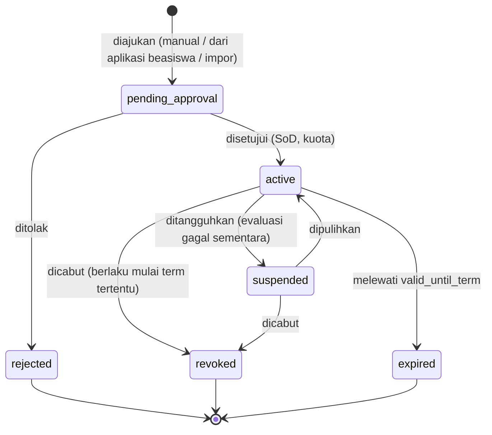
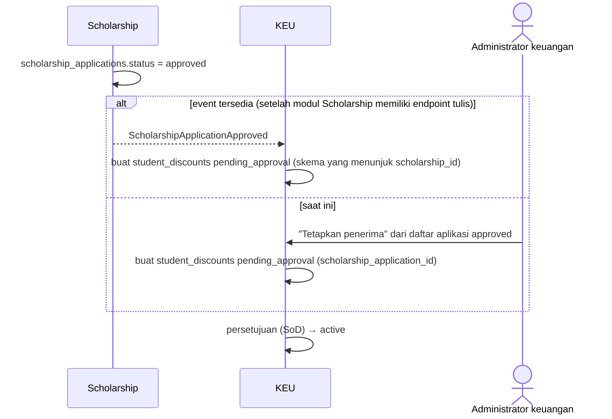

# 11 — Rancangan Beasiswa dan Potongan

> **Status:** rancangan. Disusun 2026-10-13.
> Kembali ke [README](README.md) · Skema: [19 §3.8](19-rancangan-database-dan-relasi.md#38-beasiswa-dan-potongan) · Aturan: `KEU-BR-140`–`159` ([25](25-business-rules-dan-validasi.md)) · Keputusan: [KEU-KD-20](29-glossary-dan-keputusan-bisnis.md#2-keputusan-desain-keu-kd), [KEU-KD-31](29-glossary-dan-keputusan-bisnis.md#2-keputusan-desain-keu-kd)

Beasiswa dan potongan adalah **pengurang kewajiban** yang dicatat sebagai baris negatif pada tagihan, masing-masing menunjuk komponen yang dipotong ([KEU-KD-20](29-glossary-dan-keputusan-bisnis.md#2-keputusan-desain-keu-kd)). Dokumen ini membedakan beasiswa dari penetapan UKT ([15](15-rancangan-ukt-dan-validasi-penerima.md)): UKT menentukan **tarif dasar**, sedangkan beasiswa **mengurangi** tagihan yang sudah dihitung dari tarif.

**Peta format baku:** tujuan/aktor/prasyarat §1 · data masukan §2–§3 · proses & status §3–§4, §7–§8 · aturan & validasi §5–§6 · hak akses §9 · data & relasi §10 · API §11 · UI §12 · notifikasi §13 · laporan §14 · kegagalan §15 · audit §16 · AC & TC §17.

## Daftar Isi

1. [Tujuan, Aktor, dan Prasyarat](#1-tujuan-aktor-dan-prasyarat)
2. [Jenis Beasiswa dan Potongan](#2-jenis-beasiswa-dan-potongan)
3. [Penerima Beasiswa dan Potongan](#3-penerima-beasiswa-dan-potongan)
4. [Integrasi dengan Modul Scholarship](#4-integrasi-dengan-modul-scholarship)
5. [Urutan Perhitungan](#5-urutan-perhitungan)
6. [Pencegahan Potongan Bermasalah](#6-pencegahan-potongan-bermasalah)
7. [Penerapan Susulan dan Pencabutan pada Tagihan Terbit](#7-penerapan-susulan-dan-pencabutan-pada-tagihan-terbit)
8. [Potongan Manual](#8-potongan-manual)
9. [Hak Akses](#9-hak-akses)
10. [Struktur Data dan Relasi](#10-struktur-data-dan-relasi)
11. [API dan Event](#11-api-dan-event)
12. [UI/UX](#12-uiux)
13. [Notifikasi](#13-notifikasi)
14. [Laporan Terkait](#14-laporan-terkait)
15. [Skenario Kegagalan](#15-skenario-kegagalan)
16. [Audit Trail](#16-audit-trail)
17. [Acceptance Criteria dan Test Case](#17-acceptance-criteria-dan-test-case)

---

## 1. Tujuan, Aktor, dan Prasyarat

| Aspek | Isi |
|---|---|
| **Tujuan** | Mengurangi kewajiban penerima beasiswa/potongan secara benar, terbatas, dapat diaudit, dan tidak berubah surut tanpa kendali |
| **Manfaat** | Program beasiswa tercermin otomatis pada tagihan; pimpinan mengetahui nilai beasiswa per sumber dana; tidak ada potongan ganda |
| **Aktor** | Administrator keuangan (skema, penetapan), staf keuangan (pengajuan penerima, evaluasi), bendahara (persetujuan), pengelola Scholarship (seleksi di modul Scholarship), mahasiswa (melihat beasiswa dan efeknya) |
| **Prasyarat** | Komponen biaya dengan atribut `is_discountable` ([04 §2](04-master-data-dan-konfigurasi.md#2-komponen-biaya)); urutan perhitungan dikonfirmasi ([KEU-Q-04](29-glossary-dan-keputusan-bisnis.md#3-pertanyaan-terbuka-keu-q), [KEU-Q-05](29-glossary-dan-keputusan-bisnis.md#3-pertanyaan-terbuka-keu-q)) |

## 2. Jenis Beasiswa dan Potongan

| Kebutuhan bisnis | Pemodelan (`discount_schemes`) | Contoh |
|---|---|---|
| Beasiswa penuh | `scheme_type = scholarship`, `calc_type = full` | KIP Kuliah: seluruh komponen yang dapat dipotong menjadi 0 (`funding_source = government`) |
| Beasiswa parsial | `scholarship` + `percentage` atau `fixed` | Beasiswa Prestasi 50% praktikum |
| Potongan nominal | `scheme_type = discount`, `calc_type = fixed` | Potongan karyawan Rp1.000.000 per term |
| Potongan persentase | `discount` + `percentage` | Potongan saudara kandung 10% SPP |
| Potongan per komponen | Baris `discount_scheme_components` (+ `max_percentage`) | Potongan hanya untuk SPP dan DPP; maksimal 50% dari praktikum |
| Potongan per periode | `valid_from_term_id`, `valid_until_term_id` pada skema dan penerima | Berlaku 2026/2027 Ganjil s.d. 2027/2028 Genap |
| Beasiswa prestasi / kategori kampus | `eligibility_rules` (mis. `{"min_gpa": 3.25, "student_statuses": ["active"], "admission_years": [2024, 2025]}`) | Evaluasi berkala (§3.4) |
| Kuota | `recipient_quota` (penerima aktif per term) | 50 penerima per term |
| Nilai bervariasi per penerima | `allow_value_override = true` + `student_discounts.value_override` | Beasiswa yayasan 30%–70% sesuai SK |
| Plafon per tagihan | `max_amount_per_invoice` | Potongan maksimal Rp5.000.000 per tagihan |

Skema tanpa baris `discount_scheme_components` berlaku untuk **semua** komponen `is_discountable = true`. Status skema: `draft` → `active` → `inactive`. Perubahan nilai pada skema `active` hanya berlaku untuk tagihan yang diterbitkan setelahnya karena parameter skema disalin ke `invoice_items.snapshot` ([KEU-BR-154](25-business-rules-dan-validasi.md)).

**Beasiswa bukan UKT** ([KEU-BR-230](25-business-rules-dan-validasi.md)): mahasiswa Golongan UKT-4 yang menerima beasiswa 50% ditagih tarif UKT-4 lalu dipotong 50%; golongan UKT-nya tetap 4.

## 3. Penerima Beasiswa dan Potongan

### 3.1 Status penetapan (`student_discounts`)



### 3.2 Aturan penetapan

| Aturan | Isi |
|---|---|
| [KEU-BR-147](25-business-rules-dan-validasi.md) | Satu penetapan `pending_approval/active` per (mahasiswa, skema) — unique `active_key` |
| [KEU-BR-146](25-business-rules-dan-validasi.md) | Rentang term penetapan berada dalam rentang skema; mahasiswa memenuhi `eligibility_rules` saat diajukan |
| [KEU-BR-148](25-business-rules-dan-validasi.md) | Jumlah penerima `active` skema pada term ≤ `recipient_quota`. Diperiksa saat persetujuan dengan kunci baris skema |
| [KEU-BR-149](25-business-rules-dan-validasi.md) | Persetujuan bila `requires_approval`; penyetuju ≠ pengaju |
| `value_override` | Hanya bila skema mengizinkan; rentang 0–100 untuk persen |
| SK | `decree_number` disarankan wajib untuk `scheme_type = scholarship` [R] |

### 3.3 Pencabutan dan penangguhan

Pencabutan wajib alasan dan `revoke_effective_term_id`. Pencabutan **tidak berlaku surut** ([KEU-BR-150](25-business-rules-dan-validasi.md), [KEU-Q-22](29-glossary-dan-keputusan-bisnis.md#3-pertanyaan-terbuka-keu-q)): tagihan yang sudah terbit untuk term sebelum `revoke_effective_term_id` tetap. Bila kampus memutuskan pencabutan berdampak pada tagihan term berjalan yang sudah terbit, staf mengajukan `invoice_correction` (alasan `POLICY_DECISION`) per tagihan dengan persetujuan. Penangguhan (`suspended`) membuat penetapan tidak diterapkan pada tagihan baru selama ditangguhkan.

### 3.4 Evaluasi kelayakan berkala

Job `finance:evaluate-discount-eligibility` berjalan di awal setiap term (atau dipicu manual) ([KEU-BR-152](25-business-rules-dan-validasi.md)):

1. Membaca `eligibility_rules` skema (mis. IPK minimal dari `AcademicRecordService`, status mahasiswa).
2. Menulis `last_evaluated_at` dan `evaluation_note` (mis. "IPK 3,05 < 3,25").
3. **Tidak** mencabut otomatis. Penetapan yang tidak lagi memenuhi syarat masuk antrean tinjauan staf untuk ditangguhkan, dicabut, atau dipertahankan dengan alasan.

## 4. Integrasi dengan Modul Scholarship

Modul `Scholarship` (Ada, read-only) menyimpan program (`scholarships`) dan pengajuan (`scholarship_applications` dengan `ScholarshipApplicationStatus`). Pembagian tanggung jawab:

| Hal | Scholarship | KEU |
|---|---|---|
| Program, kuota seleksi, pendaftaran, seleksi | ✓ | |
| Nilai potongan pada tagihan, komponen sasaran, masa berlaku penerapan | | ✓ (`discount_schemes` dengan `scholarship_id`) |
| Persetujuan pemberian beasiswa (seleksi) | ✓ | |
| Persetujuan penerapan ke tagihan | | ✓ (`student_discounts`) |

Alur:



- `scholarships.amount` hanya informasi program; nilai potongan ditentukan skema ([19 §3.8.4](19-rancangan-database-dan-relasi.md#384-scholarships-scholarship_applications--ada)).
- Satu aplikasi menghasilkan paling banyak satu penetapan aktif (`scholarship_application_id` diperiksa service).
- Program tanpa skema KEU tidak dapat ditetapkan ke tagihan; UI mengarahkan administrator membuat skema lebih dulu.

## 5. Urutan Perhitungan

### 5.1 Urutan lengkap dari tarif sampai saldo

| Tahap | Mengubah | Kapan | Dapat dikonfigurasi |
|---|---|---|---|
| 1. Tarif | `invoice_items` `charge` | Saat tagihan dihitung | — |
| 2. Beasiswa | Baris `scholarship` | Saat tagihan dihitung | Urutan relatif 2–5 lewat `finance.calculation.sequence` |
| 3. Potongan program | Baris `discount` | Saat tagihan dihitung | ✓ |
| 4. Voucher | Baris `voucher` | Saat voucher diterapkan ([12](12-rancangan-voucher-tagihan.md)) | ✓ |
| 5. Potongan manual | Baris `manual_discount` | Lewat penyesuaian berizin (§8) | ✓ |
| = **Nominal tagihan neto** (`invoices.amount`) | | | |
| 6. Denda | Tagihan `late_fee` **terpisah** | Setelah jatuh tempo + tenggang ([13](13-rancangan-denda.md)) | Dasar denda dari saldo tagihan dasar |
| 7. Deposit | Alokasi `deposit` | Saat dipakai ([14](14-rancangan-deposit-mahasiswa.md)) | — |
| 8. Pembayaran | Alokasi pembayaran | Saat terverifikasi ([07](07-rancangan-pembayaran.md)) | — |
| = **Saldo terutang** (`outstanding_amount`) | | | |

Tahap 2–5 mengubah **nominal tagihan**. Tahap 7–8 mengubah **saldo terutang**, bukan nominal. Tahap 6 menambah **tagihan baru**. Urutan tahap 2–5 dikonfigurasi dan **tidak** diasumsikan universal ([KEU-BR-140](25-business-rules-dan-validasi.md)); default rancangan `["tariff","scholarship","discount","voucher","manual_discount"]` [K].

### 5.2 Algoritma per komponen

```
untuk setiap baris charge c (komponen dapat dipotong):
    gross(c) = amount baris c ;  sisa(c) = gross(c)
    batas_komponen(c) = min over skema s yang menyasar c dari (max_percentage_s(c) × gross(c))   (bila ada)
    untuk setiap tahap t dalam finance.calculation.sequence (selain tariff):
        untuk setiap skema s di tahap t, urut priority naik (stacking group diperiksa §6):
            basis = (percentage_base = remaining_component) ? sisa(c) : gross(c)
            potong = full       → sisa(c)
                     percentage → round(basis × nilai% )
                     fixed      → bagian nilai skema yang dialokasikan ke c (§5.3)
            potong = min(potong, sisa(c), sisa_batas_komponen(c), sisa_plafon_tagihan(s))
            bila potong > 0 → baris pengurang (−potong, applies_to_item_id = c, source = s, snapshot parameter)
            sisa(c) −= potong
```

- Pembulatan sesuai `finance.rounding.*` (default rupiah penuh, *half up*) ([KEU-BR-011](25-business-rules-dan-validasi.md)).
- Potongan tidak pernah membuat komponen negatif ([KEU-BR-142](25-business-rules-dan-validasi.md)); batas per komponen dan plafon per tagihan ditegakkan ([KEU-BR-143](25-business-rules-dan-validasi.md)).
- Hanya komponen `is_discountable = true` (disalin ke tagihan) yang dapat dipotong ([KEU-BR-145](25-business-rules-dan-validasi.md)).

### 5.3 Potongan nominal tetap lintas komponen

Skema `fixed` bernilai per term untuk seluruh komponen sasaran. Nilai dialokasikan ke komponen sasaran berurutan `allocation_priority` naik: komponen pertama dipotong sampai sisanya nol atau nilai habis, lalu komponen berikutnya. Contoh: potongan karyawan Rp1.000.000 pada SPP (prioritas 10, sisa Rp7.000.000) → seluruhnya pada SPP.

### 5.4 Contoh A — tagihan Rina (konsisten dengan [19 §5.1](19-rancangan-database-dan-relasi.md#51-mahasiswa--tagihan--detail-tagihan))

| Komponen | Bruto | Tahap beasiswa: Prestasi 50% (hanya praktikum) | Tahap voucher: `ALUMNI50` Rp50.000 (hanya administrasi) | Neto komponen |
|---|---:|---:|---:|---:|
| UKT | 5.500.000 | — | — | 5.500.000 |
| Praktikum | 700.000 | −350.000 | — | 350.000 |
| Administrasi | 250.000 | — | −50.000 | 200.000 |
| **Total** | **6.450.000** | **−350.000** | **−50.000** | **6.050.000** |

### 5.5 Contoh B — pengaruh basis persentase

SPP Rp7.000.000. Mahasiswa menerima Beasiswa Yayasan 50% (tahap `scholarship`) dan potongan saudara kandung 10% (tahap `discount`).

| Basis (`finance.discount.percentage_base`) | Beasiswa 50% | Potongan 10% | Neto SPP |
|---|---:|---:|---:|
| `remaining_component` (default [K]) | −3.500.000 (50% × 7.000.000) | −350.000 (10% × sisa 3.500.000) | **3.150.000** |
| `gross_component` | −3.500.000 | −700.000 (10% × 7.000.000) | **2.800.000** |

Bila urutan ditukar (`discount` sebelum `scholarship`) dengan basis `remaining_component`: potongan 10% = 700.000 → sisa 6.300.000 → beasiswa 50% = 3.150.000 → neto 3.150.000. Basis `remaining_component` membuat hasil akhir sama untuk dua skema persentase apa pun urutannya, tetapi tidak untuk kombinasi persentase dan nominal tetap. Inilah alasan urutan dan basis harus diputuskan kampus ([KEU-Q-04](29-glossary-dan-keputusan-bisnis.md#3-pertanyaan-terbuka-keu-q)).

## 6. Pencegahan Potongan Bermasalah

| Masalah | Pencegahan |
|---|---|
| **Potongan ganda** (skema sama diterapkan dua kali) | (1) Satu penetapan aktif per mahasiswa × skema ([KEU-BR-147](25-business-rules-dan-validasi.md)); (2) unique `(invoice_id, reduction_key)` pada `invoice_items`, dengan `reduction_key` = `applies_to_item_id:source_type:source_id` untuk baris pengurang ([19 §3.4.2](19-rancangan-database-dan-relasi.md#342-invoice_items--baru)); (3) penerapan susulan memeriksa baris yang sudah ada |
| **Skema berbeda yang tidak boleh digabung** | `stacking_group`: dalam satu grup hanya skema dengan `priority` terkecil yang diterapkan pada satu tagihan ([KEU-BR-144](25-business-rules-dan-validasi.md)). Bila `finance.discount.stacking_policy = best_only`, hanya satu skema paling menguntungkan per komponen |
| **Potongan melebihi batas** | `min(potong, sisa komponen, batas max_percentage, plafon per tagihan)` ([KEU-BR-142](25-business-rules-dan-validasi.md), [KEU-BR-143](25-business-rules-dan-validasi.md)); CHECK aplikasi saat menulis baris; invarian per baris `charge` di [19 §3.4.2](19-rancangan-database-dan-relasi.md#342-invoice_items--baru) |
| **Diterapkan pada tagihan yang tidak memenuhi syarat** | Penetapan harus `active` dan berlaku pada term tagihan; komponen termasuk sasaran skema dan `is_discountable`; `invoice_type` termasuk yang diizinkan skema (default `semester`, `short_term`, `admission`, `supplementary`; tidak untuk `late_fee`) ([KEU-BR-146](25-business-rules-dan-validasi.md)) |
| **Perubahan historis tak terkendali** | Snapshot parameter di `invoice_items.snapshot` ([KEU-BR-154](25-business-rules-dan-validasi.md)); pencabutan tidak surut ([KEU-BR-150](25-business-rules-dan-validasi.md)); perubahan pada tagihan terbit hanya lewat `finance_adjustments` berizin |

## 7. Penerapan Susulan dan Pencabutan pada Tagihan Terbit

Penetapan yang disetujui **setelah** tagihan term terkait terbit diterapkan melalui penyesuaian ([KEU-BR-151](25-business-rules-dan-validasi.md), [KEU-KD-31](29-glossary-dan-keputusan-bisnis.md#2-keputusan-desain-keu-kd)):

1. Sistem membuat `finance_adjustments` tipe `invoice_correction`, `reason_code = SCHOLARSHIP_LATE_APPLY`, `payload` berisi baris pengurang hasil §5.2 atas tagihan terbit.
2. Karena pemberian penetapan sudah disetujui dengan SoD, penyesuaian ini **disetujui otomatis** oleh sistem (`approved_by = null`, sumber persetujuan = `student_discounts.approved_by`) dan langsung `applied`. Kampus dapat mewajibkan persetujuan terpisah lewat `finance.approval.thresholds.adjustment_level2` [K].
3. Bila nominal baru < `paid_amount` (tagihan sudah dibayar lebih dari nominal baru), penyesuaian yang sama **lebih dulu** membalik alokasi terbaru sebesar kelebihan (`allocation_reversal` dalam payload). Dana kembali menjadi dana belum diterapkan pada pembayaran asal, lalu ditangani sesuai `finance.overpayment.default_action` ([07 §6](07-rancangan-pembayaran.md#6-kelebihan-bayar-dan-dana-belum-diterapkan)).
4. Tagihan bercicilan: penyesuaian otomatis jadwal ([10 §7](10-rancangan-cicilan-tagihan.md#7-interaksi-dengan-potongan-pembayaran-dan-koreksi)).
5. Periode: `posting_date` = tanggal penerapan (periode terbuka).

Contoh: tagihan Rp7.000.000 sudah dibayar penuh; beasiswa 50% disetujui kemudian → alokasi dibalik Rp3.500.000, baris beasiswa −3.500.000 ditambahkan, tagihan tetap `paid` (neto 3.500.000 = dibayar 3.500.000), pembayaran asal memiliki dana belum diterapkan Rp3.500.000 untuk dikonversi ke deposit atau dikembalikan.

## 8. Potongan Manual

Potongan di luar skema (kebijakan khusus, keringanan individual, kompensasi kesalahan) dicatat sebagai `finance_adjustments` tipe `manual_discount` ([KEU-BR-153](25-business-rules-dan-validasi.md)):

| Aspek | Ketentuan |
|---|---|
| Sasaran | Baris `charge` tertentu (`target_type = invoice_item`) |
| Nominal | ≤ sisa komponen setelah potongan lain |
| Kode alasan | `POLICY_DECISION`, `HARDSHIP`, `ERROR_COMPENSATION`, `OTHER` |
| Bukti | `evidence_file_id` disarankan wajib di atas ambang [R] |
| Persetujuan | Selalu (`finance_adjustments.approve`, SoD); tingkat kedua di atas `adjustment_level2` |
| Efek | Baris `manual_discount` saat `applied` |

## 9. Hak Akses

| Aksi | Permission | Role default |
|---|---|---|
| Kelola skema | `discount_schemes.create/update` | FA |
| Ajukan/tangguhkan/cabut penerima | `student_discounts.create/update` | FA, FO |
| Setujui/tolak penerima | `student_discounts.approve/reject` | FM |
| Ajukan potongan manual | `finance_adjustments.create` | FA, FO |
| Setujui potongan manual | `finance_adjustments.approve` | FM |
| Lihat | `discount_schemes.read`, `student_discounts.read` | FA, FO, FM, RK, DK (scope), AU |
| Mahasiswa melihat beasiswanya | `finance_self_service.read` | Milik sendiri |

## 10. Struktur Data dan Relasi

| Tabel | Rincian |
|---|---|
| `discount_schemes` | [19 §3.8.1](19-rancangan-database-dan-relasi.md#381-discount_schemes--baru) |
| `discount_scheme_components` | [19 §3.8.2](19-rancangan-database-dan-relasi.md#382-discount_scheme_components--baru) |
| `student_discounts` | [19 §3.8.3](19-rancangan-database-dan-relasi.md#383-student_discounts--baru) |
| `scholarships`, `scholarship_applications` (Ada) | [19 §3.8.4](19-rancangan-database-dan-relasi.md#384-scholarships-scholarship_applications--ada) |
| `invoice_items` (baris `scholarship`, `discount`, `manual_discount`) | `applies_to_item_id`, `source_type = student_discount`/`finance_adjustment`, `reduction_key` |

## 11. API dan Event

| Method | URL | Permission | Keterangan |
|---|---|---|---|
| GET/POST | `/discount-schemes` | `discount_schemes.read` / `.create` | |
| GET/PUT | `/discount-schemes/{scheme}` | `.read` / `.update` | |
| PATCH | `/discount-schemes/{scheme}/activate`, `/deactivate` | `discount_schemes.update` | |
| GET/POST | `/student-discounts` | `student_discounts.read` / `.create` | Filter skema, status, term, prodi |
| POST | `/student-discounts/import` | `student_discounts.create` | XLSX (NIM, kode skema, term, nilai, SK) → `pending_approval` |
| POST | `/student-discounts/{award}/approve`, `/reject` | `.approve` / `.reject` | SoD, kuota |
| POST | `/student-discounts/{award}/suspend`, `/resume`, `/revoke` | `student_discounts.update` | Alasan wajib; `revoke` butuh `revoke_effective_term_id` |
| POST | `/student-discounts/{award}/apply-to-issued-invoices` | `student_discounts.update` | Membuat penyesuaian susulan (§7) |
| GET | `/student-discounts/eligibility-review` | `student_discounts.read` | Antrean hasil evaluasi |
| POST | `/scholarship-applications/{application}/award` | `student_discounts.create` | Dari aplikasi `approved` |
| POST | `/invoices/{invoice}/manual-discounts` | `finance_adjustments.create` | `manual_discount` |
| GET | `/student/finance/scholarships` | `finance_self_service.read` | Beasiswa/potongan aktif dan riwayat |

Event internal: `StudentDiscountActivated` (memicu pemeriksaan tagihan terbit term berjalan yang belum mendapat potongan).

## 12. UI/UX

| Halaman | Rute | Inti |
|---|---|---|
| Program Beasiswa & Potongan | `/keuangan/beasiswa/skema` | Daftar skema (jenis, kalkulasi, nilai, komponen, grup penumpukan, kuota terpakai/total, status) |
| Penerima | `/keuangan/beasiswa/penerima` | Tabel penerima dengan filter; aksi massal setujui (SoD per baris); impor |
| Persetujuan | `/keuangan/beasiswa/persetujuan` | Antrean `pending_approval` lintas skema |
| Evaluasi Kelayakan | `/keuangan/beasiswa/evaluasi` | Hasil evaluasi berkala dengan tombol Tangguhkan/Cabut/Pertahankan |
| Simulasi | Panel di detail skema | Pilih mahasiswa → hasil perhitungan §5 untuk term terpilih, memperlihatkan basis dan urutan |
| Portal: Beasiswa Saya | `/portal/keuangan/beasiswa` | Menggantikan `PortalScholarshipPage` statis untuk bagian keuangan (status penetapan, efek pada tagihan) |

## 13. Notifikasi

| Event | Penerima | Kanal |
|---|---|---|
| `finance.discount_awarded` | Mahasiswa | database, mail |
| `finance.discount_revoked` (termasuk penangguhan) | Mahasiswa | database, mail |
| `finance.invoice_corrected` (penerapan susulan) | Mahasiswa | database |
| Penetapan menunggu persetujuan | Penyetuju | database |

## 14. Laporan Terkait

[KEU-RPT-10](22-rancangan-laporan-dan-dashboard.md) beasiswa & potongan (per skema, sumber dana, prodi, term; nilai potongan dari baris tagihan non-batal).

## 15. Skenario Kegagalan

| Skenario | Penanganan |
|---|---|
| Kuota habis saat persetujuan massal | Persetujuan berurutan dengan kunci skema; yang melebihi kuota gagal dengan pesan kuota |
| Skema dinonaktifkan saat penetapan masih aktif | Penetapan tidak diterapkan ke tagihan baru; muncul di antrean tinjauan |
| Basis persentase diubah di tengah term | Berlaku untuk perhitungan berikutnya saja ([KEU-BR-036](25-business-rules-dan-validasi.md)); tagihan terbit tidak berubah |
| Penerapan susulan pada tagihan dengan transaksi online aktif | Ditunda: penyesuaian dibuat `pending_approval` dan diterapkan setelah transaksi selesai/kedaluwarsa |
| Data IPK belum final saat evaluasi | Evaluasi ditandai "data belum lengkap"; tidak ada tindakan otomatis |

## 16. Audit Trail

| Aksi | Dicatat |
|---|---|
| Buat/ubah skema | `audit_logs` (nilai lama/baru) |
| Penetapan: ajukan, setujui, tolak, tangguhkan, pulihkan, cabut | `finance_status_histories` (`student_discount`) + `audit_logs` |
| Evaluasi kelayakan | `student_discounts.last_evaluated_at`, `evaluation_note`; keputusan staf diaudit |
| Penerapan susulan, potongan manual | `finance_adjustments` + histori tagihan |

## 17. Acceptance Criteria dan Test Case

| Acceptance criteria | Test case |
|---|---|
| [KEU-AC-SCH-01](27-acceptance-criteria.md) Beasiswa penuh dan parsial dihitung benar | [KEU-TC-SCH-001](26-skenario-pengujian.md), [KEU-TC-SCH-002](26-skenario-pengujian.md) |
| [KEU-AC-SCH-02](27-acceptance-criteria.md) Urutan dan basis mengikuti konfigurasi | [KEU-TC-SCH-002](26-skenario-pengujian.md), [KEU-TC-SCH-004](26-skenario-pengujian.md) |
| [KEU-AC-SCH-03](27-acceptance-criteria.md) Tidak melebihi batas; tidak ganda; hanya penerima layak | [KEU-TC-SCH-003](26-skenario-pengujian.md), [KEU-TC-SCH-005](26-skenario-pengujian.md), [KEU-TC-SCH-006](26-skenario-pengujian.md) |
| [KEU-AC-SCH-04](27-acceptance-criteria.md) Tidak berlaku surut tanpa penyesuaian eksplisit | [KEU-TC-SCH-007](26-skenario-pengujian.md), [KEU-TC-SCH-008](26-skenario-pengujian.md) |
| [KEU-AC-SCH-05](27-acceptance-criteria.md) Persetujuan dan SoD | [KEU-TC-SCH-009](26-skenario-pengujian.md), [KEU-TC-SCH-010](26-skenario-pengujian.md) |
