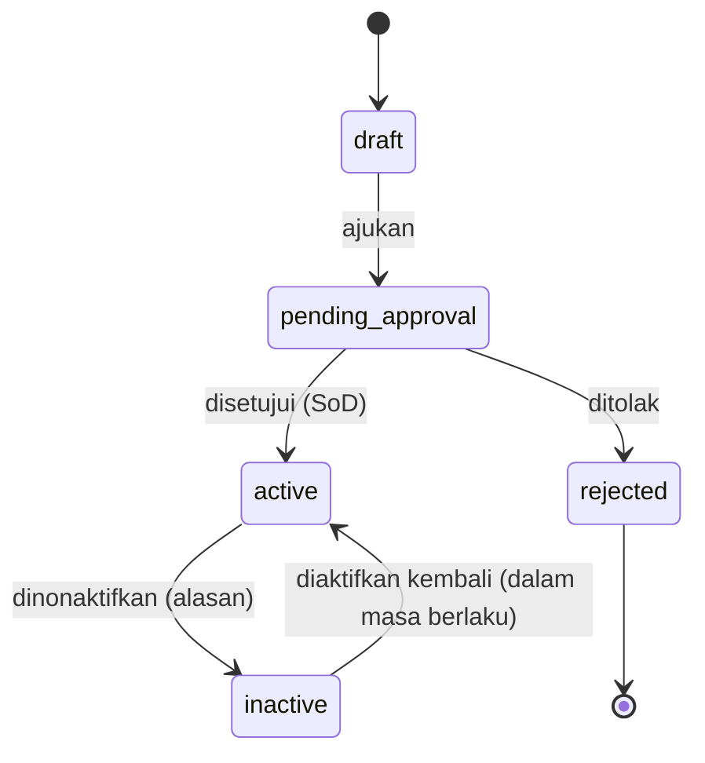
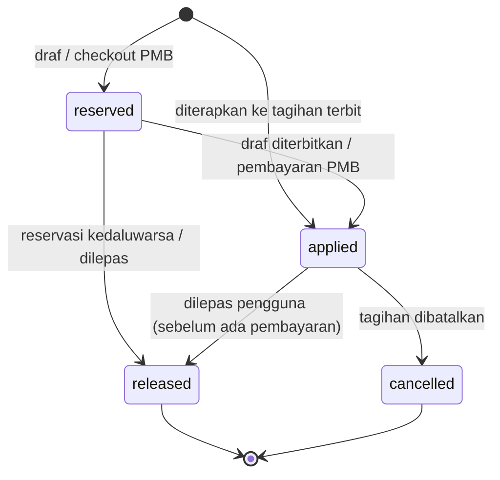
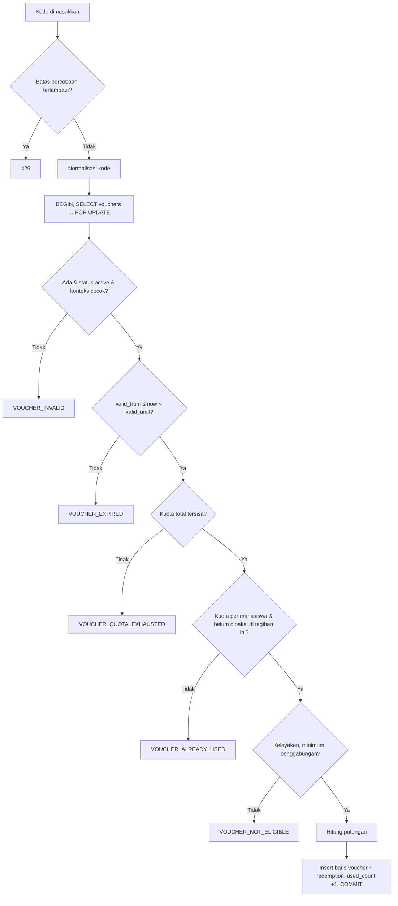
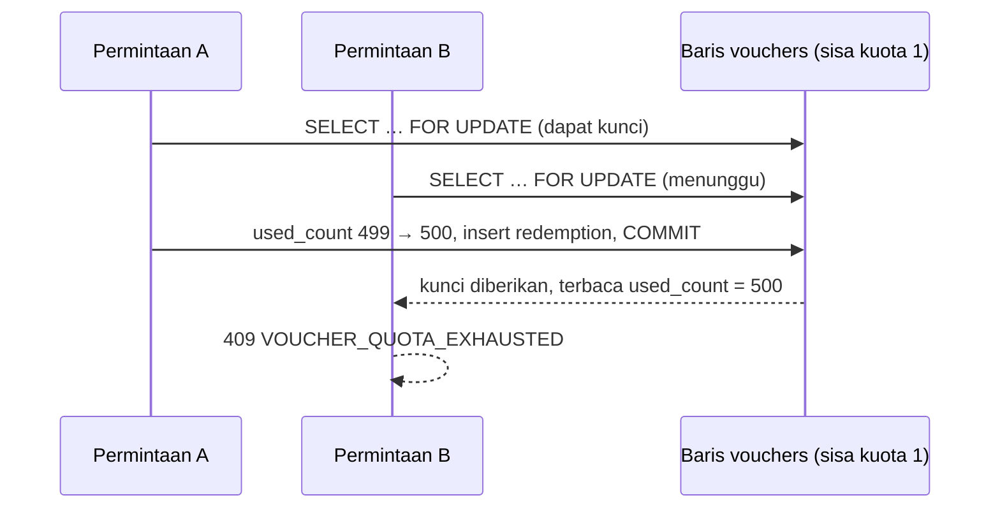

# 12 — Rancangan Voucher Tagihan

> **Status:** rancangan. Disusun 2026-10-13.
> Kembali ke [README](README.md) · Skema: [19 §3.9](19-rancangan-database-dan-relasi.md#39-voucher) · Aturan: `KEU-BR-160`–`179` ([25](25-business-rules-dan-validasi.md)) · Keputusan: [KEU-KD-30](29-glossary-dan-keputusan-bisnis.md#2-keputusan-desain-keu-kd)

Voucher adalah kode potongan yang dimasukkan oleh mahasiswa (atau staf atas namanya) untuk mengurangi tagihan, misalnya promosi PMB, program alumni, atau pembayaran dini. Berbeda dengan beasiswa yang ditetapkan per mahasiswa, voucher bersifat **klaim**: siapa pun yang memenuhi syarat dan memegang kode dapat memakainya, sehingga kuota dan konkurensi menjadi perhatian utama.

**Peta format baku:** tujuan/aktor/prasyarat §1 · data masukan §2 · proses & status §3–§6 · aturan & validasi §4, §7 · hak akses §9 · data & relasi §10 · API §11 · UI §12 · notifikasi §13 · laporan §14 · kegagalan §15 · audit §16 · AC & TC §17.

## Daftar Isi

1. [Tujuan, Aktor, dan Prasyarat](#1-tujuan-aktor-dan-prasyarat)
2. [Atribut Voucher](#2-atribut-voucher)
3. [Siklus Voucher dan Pemakaian](#3-siklus-voucher-dan-pemakaian)
4. [Penerapan dan Validasi](#4-penerapan-dan-validasi)
5. [Reservasi](#5-reservasi)
6. [Pembatalan dan Pelepasan](#6-pembatalan-dan-pelepasan)
7. [Konkurensi dan Kuota](#7-konkurensi-dan-kuota)
8. [Voucher untuk PMB](#8-voucher-untuk-pmb)
9. [Hak Akses](#9-hak-akses)
10. [Struktur Data dan Relasi](#10-struktur-data-dan-relasi)
11. [API dan Event](#11-api-dan-event)
12. [UI/UX](#12-uiux)
13. [Notifikasi](#13-notifikasi)
14. [Laporan Terkait](#14-laporan-terkait)
15. [Skenario Kegagalan](#15-skenario-kegagalan)
16. [Audit Trail](#16-audit-trail)
17. [Acceptance Criteria dan Test Case](#17-acceptance-criteria-dan-test-case)

---

## 1. Tujuan, Aktor, dan Prasyarat

| Aspek | Isi |
|---|---|
| **Tujuan** | Menyediakan potongan berbasis kode yang terkendali kuota, masa berlaku, dan kelayakannya |
| **Manfaat** | Mendukung program promosi dan insentif tanpa input manual per mahasiswa; penggunaan tercatat lengkap |
| **Aktor** | Administrator keuangan (membuat), bendahara (menyetujui), mahasiswa (memakai), staf keuangan (memakai/melepas atas nama mahasiswa), modul PMB (memakai untuk pendaftar) |
| **Prasyarat** | Komponen biaya dapat dipotong ([04 §2](04-master-data-dan-konfigurasi.md#2-komponen-biaya)); posisi tahap `voucher` dalam `finance.calculation.sequence` ([11 §5](11-rancangan-beasiswa-dan-potongan.md#5-urutan-perhitungan)) |

## 2. Atribut Voucher

| Kebutuhan bisnis | Kolom (`vouchers` / `voucher_eligibilities`) | Ketentuan |
|---|---|---|
| Kode voucher unik | `code` | Dinormalisasi: huruf besar, tanpa spasi; 4–40 karakter `[A-Z0-9-]`; unik per tenant ([KEU-BR-160](25-business-rules-dan-validasi.md)) |
| Jenis nominal/persentase | `calc_type`, `value` | `percentage` 0 < nilai ≤ 100; `fixed` > 0 |
| Masa berlaku | `valid_from`, `valid_until` (timestamptz) | `valid_from < valid_until`; dibandingkan dalam waktu absolut, ditampilkan dalam zona tenant |
| Kuota total | `total_quota` (`null` = tanpa batas) | `used_count + reserved_count ≤ total_quota` (CHECK) |
| Kuota per mahasiswa | `per_student_quota` (default 1) | Dihitung dari redemption `reserved/applied` milik subjek yang sama |
| Minimum transaksi | `min_invoice_amount` | Σ neto komponen yang memenuhi syarat sebelum voucher ≥ nilai ini |
| Batas potongan maksimal | `max_discount_amount` | Plafon potongan per pemakaian |
| Prodi/fakultas/angkatan/jalur yang memenuhi syarat | `voucher_eligibilities` `study_program`, `faculty`, `admission_year`, `admission_path` | Antartipe **DAN**, dalam satu tipe **ATAU** |
| Komponen yang memenuhi syarat | `voucher_eligibilities` `fee_component` | Tanpa baris = semua komponen `is_discountable` |
| Jenis tagihan | `voucher_eligibilities` `invoice_type` | Tanpa baris = `semester`, `short_term`, `admission`, `supplementary` |
| Konteks | `context` | `tuition` (tagihan KEU), `admission` (PMB), `any` |
| Penggabungan | `stacking_allowed` | Voucher lain pada tagihan yang sama hanya bila kedua voucher mengizinkan ([KEU-BR-167](25-business-rules-dan-validasi.md)) |
| Status aktif/nonaktif | `status` | §3 |
| Riwayat penggunaan | `voucher_redemptions` | §3.2 |
| Persetujuan penerbitan | `approval_request_id`, `approved_by` | Default selalu disetujui bendahara (`finance.approval.thresholds.voucher.always`) ([KEU-BR-172](25-business-rules-dan-validasi.md)) |

Contoh (*contoh*):

| Kode | Jenis | Nilai | Batas | Kuota | Kelayakan | Konteks |
|---|---|---:|---:|---|---|---|
| `ALUMNI50` | `fixed` | 50.000 | — | 500, 1/mhs | Komponen ADM | `tuition` |
| `PMB2026` | `percentage` | 10% | 500.000 | 1.000, 1/pendaftar | Jalur `MANDIRI` | `admission` |
| `BAYARAWAL5` | `percentage` | 5% | 300.000 | tanpa batas, 1/mhs/term [R] | Komponen SPP/UKT; berlaku s.d. 15 Agt | `tuition` |

## 3. Siklus Voucher dan Pemakaian

### 3.1 Status voucher



Keadaan turunan (bukan status): **Belum berlaku** (`now < valid_from`), **Kedaluwarsa** (`now ≥ valid_until`), **Habis** (`used_count + reserved_count ≥ total_quota`). Voucher `active` dengan pemakaian tidak dapat diubah nilai, kelayakan, atau kuota totalnya ke bawah dari pemakaian; perubahan nilai dilakukan dengan voucher baru.

### 3.2 Status pemakaian (`voucher_redemptions`)



| Transisi | `used_count` | `reserved_count` |
|---|---|---|
| → `reserved` | — | +1 |
| `reserved → applied` | +1 | −1 |
| → `applied` (langsung) | +1 | — |
| `reserved → released` | — | −1 |
| `applied → released` | −1 | — |
| `applied → cancelled` | −1 bila `finance.voucher.return_quota_on_cancel = true`; tetap bila `false` | — |

## 4. Penerapan dan Validasi

### 4.1 Tagihan yang dapat diberi voucher

| Pelaku | Syarat tagihan ([KEU-BR-168](25-business-rules-dan-validasi.md)) |
|---|---|
| Mahasiswa | Miliknya; `status = unpaid` dengan `paid_amount = 0`; tidak ada transaksi online aktif |
| Staf (`invoices.update`) | `draft`, `unpaid`, atau `partial`; nominal setelah voucher tetap ≥ `paid_amount`; tidak ada transaksi online aktif |

### 4.2 Urutan validasi



| Validasi | Aturan | Kode error |
|---|---|---|
| Batas percobaan | Maks `finance.voucher.max_attempts` (10 percobaan gagal / 15 menit per pengguna) ([KEU-BR-173](25-business-rules-dan-validasi.md)) | 429 |
| Ada, `active`, konteks | Kode tidak dikenal dan voucher nonaktif menghasilkan pesan yang sama (tidak membocorkan keberadaan kode) | 422 `VOUCHER_INVALID` |
| Masa berlaku | [KEU-BR-161](25-business-rules-dan-validasi.md) | 422 `VOUCHER_EXPIRED` (termasuk "belum berlaku" dengan pesan berbeda) |
| Kuota total | [KEU-BR-162](25-business-rules-dan-validasi.md) | 409 `VOUCHER_QUOTA_EXHAUSTED` |
| Kuota per mahasiswa, sekali per tagihan | [KEU-BR-164](25-business-rules-dan-validasi.md), [KEU-BR-163](25-business-rules-dan-validasi.md) (unique `active_key`) | 409 `VOUCHER_ALREADY_USED` |
| Kelayakan mahasiswa, komponen, jenis tagihan | [KEU-BR-165](25-business-rules-dan-validasi.md) | 422 `VOUCHER_NOT_ELIGIBLE` |
| Minimum transaksi | [KEU-BR-166](25-business-rules-dan-validasi.md) | 422 `VOUCHER_NOT_ELIGIBLE` (pesan "minimum belum terpenuhi") |
| Penggabungan voucher | [KEU-BR-167](25-business-rules-dan-validasi.md) | 422 `VOUCHER_NOT_ELIGIBLE` |
| Tagihan dapat diberi voucher | [KEU-BR-168](25-business-rules-dan-validasi.md) | 409 `INVOICE_NOT_PAYABLE` / `ACTIVE_TRANSACTION_EXISTS` |

### 4.3 Perhitungan potongan

```
basis_layak = Σ sisa komponen layak (setelah tahap sebelum voucher; basis sesuai finance.discount.percentage_base)
potongan    = percentage ? round(basis_layak × nilai%) : nilai
potongan    = min(potongan, COALESCE(max_discount_amount, ∞), Σ sisa komponen layak)
distribusi  = ke komponen layak menurut allocation_priority naik, tiap komponen ≤ sisanya
```

Satu baris `voucher` per komponen yang terkena (`applies_to_item_id`, `source_type = voucher_redemption`). Parameter voucher disalin ke `snapshot`. Contoh `ALUMNI50` pada tagihan Rina: komponen layak ADM sisa 250.000 → potongan 50.000 → satu baris −50.000 ([11 §5.4](11-rancangan-beasiswa-dan-potongan.md#54-contoh-a--tagihan-rina-konsisten-dengan-19-51)).

Voucher yang sudah diterapkan **tetap berlaku** walaupun kemudian voucher kedaluwarsa atau dinonaktifkan; yang diuji adalah masa berlaku saat penerapan ([KEU-BR-161](25-business-rules-dan-validasi.md)).

## 5. Reservasi

Reservasi menahan kuota tanpa mengubah tagihan terbit ([KEU-BR-169](25-business-rules-dan-validasi.md), [KEU-KD-30](29-glossary-dan-keputusan-bisnis.md#2-keputusan-desain-keu-kd)). Dipakai hanya pada:

| Situasi | `reservation_expires_at` | Menjadi `applied` saat |
|---|---|---|
| Voucher dipasang pada tagihan `draft` | `null` (berlaku selama draf) | Draf diterbitkan |
| *Checkout* PMB sebelum pendaftar membayar | `now + finance.voucher.reservation_minutes` (30) | PMB mengonfirmasi pembayaran ([§8](#8-voucher-untuk-pmb)) |

Job `finance:release-expired-voucher-reservations` (tiap 5 menit) melepas reservasi yang kedaluwarsa (`release_reason = reservation_expired`). Draf yang dibuang melepas reservasinya. Pada tagihan terbit, voucher langsung `applied` dalam satu transaksi, tanpa reservasi.

## 6. Pembatalan dan Pelepasan

| Kejadian | Perlakuan ([KEU-BR-170](25-business-rules-dan-validasi.md), [KEU-BR-171](25-business-rules-dan-validasi.md)) |
|---|---|
| Tagihan dibatalkan | Redemption `cancelled` (`release_reason = invoice_cancelled`); kuota kembali sesuai `finance.voucher.return_quota_on_cancel` [K] |
| Mahasiswa melepas voucher | Hanya bila tagihan masih `unpaid`, `paid_amount = 0`, tanpa transaksi aktif. Karena baris tagihan terbit tidak boleh diubah, sistem menambahkan baris `adjustment` positif sebesar potongan (`source_type = voucher_redemption`), redemption `released` (`removed_by_student`), `used_count − 1` |
| Staf melepas voucher | Sama, untuk `unpaid`/`partial` asalkan nominal baru ≥ `paid_amount`; alasan wajib (`removed_by_staff`) |
| Pembayaran atas tagihan direversal | Voucher **tidak** terpengaruh; voucher melekat pada tagihan, bukan pada pembayaran |
| Voucher dinonaktifkan | Pemakaian yang sudah `applied` tetap; reservasi aktif tetap dapat dikonversi kecuali administrator memilih "lepaskan semua reservasi" |

## 7. Konkurensi dan Kuota

Kuota ditegakkan di database, bukan di aplikasi saja ([KEU-BR-162](25-business-rules-dan-validasi.md)):

1. Seluruh validasi kuota dan penulisan redemption berada dalam **satu transaksi** yang diawali `SELECT … FROM vouchers WHERE id = ? FOR UPDATE`. Baris voucher dikunci **setelah** `finance_sequences` dan **sebelum** `invoices`, sesuai urutan kunci baku ([KEU-BR-010](25-business-rules-dan-validasi.md)).
2. Dalam kunci: hitung `used_count + reserved_count`, hitung pemakaian per subjek, periksa tagihan; lalu insert redemption dan perbarui penghitung.
3. Pengaman lapis kedua: CHECK `used_count + reserved_count ≤ total_quota` dan unique `active_key` (`voucher_id:invoice_id`).
4. Transaksi dibuat sesingkat mungkin (tanpa panggilan jaringan) agar antrean kunci pada voucher populer tidak lama.



Invarian harian `INV-13`: `vouchers.used_count` = jumlah redemption `applied` ([19 §8](19-rancangan-database-dan-relasi.md#8-invarian-dan-query-pemeriksaan)).

## 8. Voucher untuk PMB

Default rancangan: voucher PMB dikelola di KEU (`context = admission`) dan dipakai modul PMB melalui layanan in-process ([KEU-Q-23](29-glossary-dan-keputusan-bisnis.md#3-pertanyaan-terbuka-keu-q)):

| Kontrak `VoucherService` | Kegunaan |
|---|---|
| `validate(code, subject)` | Pratinjau tanpa menahan kuota |
| `reserve(code, subject, basis)` | `subject_type = pmb_applicant`, `subject_id` = id aplikasi PMB; `invoice_id = null`; kedaluwarsa 30 menit |
| `confirm(redemptionId, discountAmount)` | Saat pembayaran PMB berhasil → `applied` |
| `release(redemptionId, reason)` | Pembatalan/kedaluwarsa di sisi PMB |

Setelah pendaftar menjadi mahasiswa dan tagihan `admission` diposting ([06 §7.4](06-rancangan-tagihan-mahasiswa.md#74-posting-tagihan-eksternal-pmb-dan-semester-pendek)), potongan voucher PMB sudah tercermin di nominal yang diposting; redemption tetap tersimpan sebagai riwayat dengan `subject_type = pmb_applicant`. Kelayakan `admission_path` membaca jalur dari data pendaftar yang diberikan PMB saat validasi.

## 9. Hak Akses

| Aksi | Permission | Role default |
|---|---|---|
| Buat/ubah/ajukan voucher | `vouchers.create/update` | FA |
| Setujui/tolak | `vouchers.approve/reject` | FM |
| Terapkan/lepas atas nama mahasiswa | `invoices.update` | FA, FO |
| Lihat voucher & riwayat | `vouchers.read` | FA, FO, FM, AU |
| Mahasiswa menerapkan/melepas | `finance_self_service.update` | Tagihan sendiri |

## 10. Struktur Data dan Relasi

| Tabel | Rincian |
|---|---|
| `vouchers` | [19 §3.9.1](19-rancangan-database-dan-relasi.md#391-vouchers--baru) |
| `voucher_eligibilities` | [19 §3.9.2](19-rancangan-database-dan-relasi.md#392-voucher_eligibilities--baru) |
| `voucher_redemptions` | [19 §3.9.3](19-rancangan-database-dan-relasi.md#393-voucher_redemptions--baru) |
| `invoice_items` (`voucher`, `adjustment` pelepasan) | `source_type = voucher_redemption` |

## 11. API dan Event

| Method | URL | Permission | Keterangan |
|---|---|---|---|
| GET/POST | `/vouchers` | `vouchers.read` / `.create` | |
| GET/PUT | `/vouchers/{voucher}` | `.read` / `.update` | Batasan perubahan saat sudah dipakai (§3.1) |
| POST | `/vouchers/{voucher}/submit`, `/approve`, `/reject` | `.update` / `.approve` / `.reject` | SoD |
| PATCH | `/vouchers/{voucher}/activate`, `/deactivate` | `vouchers.update` | |
| GET | `/vouchers/{voucher}/redemptions` | `vouchers.read` | |
| POST | `/vouchers/generate` | `vouchers.create` | Pembuatan banyak kode unik sekali pakai (mis. 200 kode `ALM-XXXXXX`) [R] |
| POST | `/invoices/{invoice}/vouchers` | `invoices.update` | `{code}`; **Idempotency-Key** |
| DELETE | `/invoices/{invoice}/vouchers/{redemption}` | `invoices.update` | Alasan wajib |
| POST | `/student/finance/vouchers/validate` | `finance_self_service.read` | Pratinjau potongan atas tagihan tertentu |
| POST | `/student/finance/invoices/{invoice}/vouchers` | `finance_self_service.update` | **Idempotency-Key** |
| DELETE | `/student/finance/invoices/{invoice}/vouchers/{redemption}` | `finance_self_service.update` | |

Event: `InvoiceStatusChanged` bila status tagihan berubah (mis. voucher membuat nominal = 0 → `paid`). Tidak ada event lintas modul khusus voucher; PMB memakai kontrak in-process.

## 12. UI/UX

| Halaman | Rute | Inti |
|---|---|---|
| Voucher | `/keuangan/beasiswa/voucher` | Daftar (kode, jenis, nilai, masa berlaku, kuota terpakai/tersedia dengan progres, status & keadaan turunan), filter; form dengan bagian kelayakan |
| Detail Voucher | `/keuangan/beasiswa/voucher/:id` | Ringkasan, riwayat pemakaian (mahasiswa/pendaftar, tagihan, nominal, status), tombol Nonaktifkan |
| Portal: kolom voucher | Di detail tagihan portal | Input kode + "Terapkan"; pesan galat ramah sesuai kode; setelah diterapkan tampil baris potongan dan tombol "Lepas" bila diizinkan |

## 13. Notifikasi

| Event | Penerima | Kanal |
|---|---|---|
| Voucher menunggu persetujuan | Bendahara | database |
| Kuota voucher tinggal ≤ 10% | Administrator keuangan | database |
| Voucher diterapkan/dilepas oleh staf | Mahasiswa | database (`finance.invoice_corrected`) |

## 14. Laporan Terkait

[KEU-RPT-11](22-rancangan-laporan-dan-dashboard.md) penggunaan voucher (per kode, konteks, prodi, total potongan, kuota).

## 15. Skenario Kegagalan

| Skenario | Penanganan |
|---|---|
| Lonjakan permintaan pada voucher populer | Transaksi singkat + kunci baris; antrean wajar; tidak pernah melampaui kuota |
| Tebakan kode (*brute force*) | Batas percobaan, pesan seragam, audit percobaan gagal berulang sebagai anomali ([24 §12](24-keamanan-audit-dan-kontrol-internal.md)) |
| Voucher diterapkan lalu tagihan dikoreksi sehingga minimum tidak terpenuhi | Voucher tetap (diuji saat penerapan); staf dapat melepasnya dengan alasan |
| Job pelepasan reservasi tidak berjalan | Validasi kuota menghitung reservasi kedaluwarsa sebagai tidak aktif (pemeriksaan *lazy*) |

## 16. Audit Trail

| Aksi | Dicatat |
|---|---|
| Buat/ubah/ajukan/setujui/nonaktifkan voucher | `audit_logs` + `finance_status_histories` (`voucher`) |
| Penerapan/pelepasan/pembatalan | `voucher_redemptions` (append status) + `finance_status_histories` (`voucher_redemption`) + histori tagihan |
| Percobaan kode gagal | Log aplikasi + penghitung batas; percobaan berulang dicatat sebagai anomali |

## 17. Acceptance Criteria dan Test Case

| Acceptance criteria | Test case |
|---|---|
| [KEU-AC-VCH-01](27-acceptance-criteria.md) Validasi lengkap (masa berlaku, kelayakan, minimum, batas) | [KEU-TC-VCH-001](26-skenario-pengujian.md), [KEU-TC-VCH-002](26-skenario-pengujian.md), [KEU-TC-VCH-005](26-skenario-pengujian.md), [KEU-TC-VCH-009](26-skenario-pengujian.md) |
| [KEU-AC-VCH-02](27-acceptance-criteria.md) Kuota tidak terlampaui saat bersamaan | [KEU-TC-VCH-004](26-skenario-pengujian.md) |
| [KEU-AC-VCH-03](27-acceptance-criteria.md) Tidak dua kali pada tagihan yang sama | [KEU-TC-VCH-003](26-skenario-pengujian.md) |
| [KEU-AC-VCH-04](27-acceptance-criteria.md) Pembatalan tagihan melepas voucher; reservasi kedaluwarsa dilepas | [KEU-TC-VCH-006](26-skenario-pengujian.md), [KEU-TC-VCH-007](26-skenario-pengujian.md) |
| [KEU-AC-VCH-05](27-acceptance-criteria.md) Riwayat penggunaan lengkap; percobaan dibatasi | [KEU-TC-VCH-008](26-skenario-pengujian.md) |
