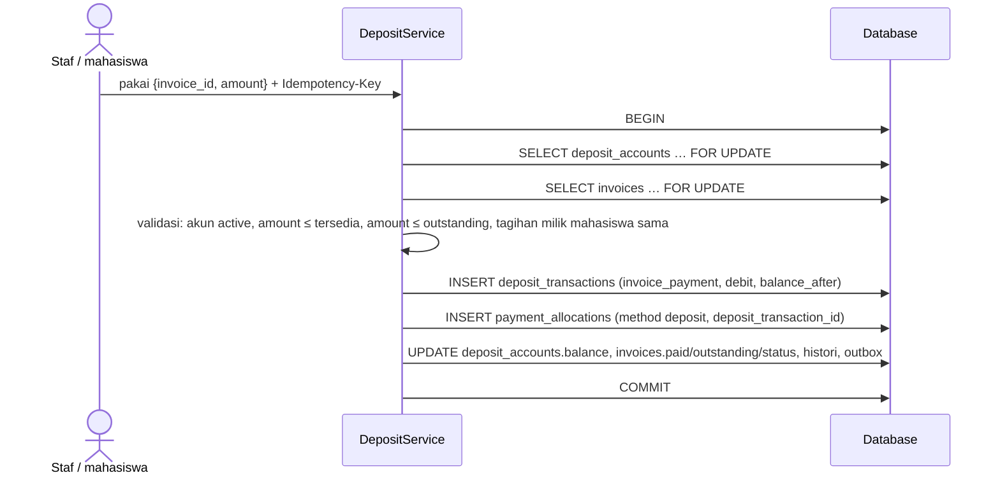
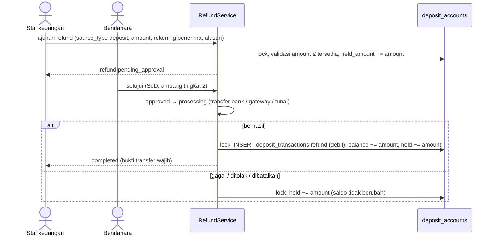

# 14 — Rancangan Deposit Mahasiswa

> **Status:** rancangan. Disusun 2026-10-13.
> Kembali ke [README](README.md) · Skema: [19 §3.11](19-rancangan-database-dan-relasi.md#311-deposit) · Aturan: `KEU-BR-200`–`219` ([25](25-business-rules-dan-validasi.md)) · Keputusan: [KEU-KD-06](29-glossary-dan-keputusan-bisnis.md#2-keputusan-desain-keu-kd)

Deposit adalah **saldo titipan** mahasiswa pada kampus yang dapat dipakai untuk membayar tagihan berikutnya atau dikembalikan. Deposit dicatat sebagai **ledger append-only**: saldo tidak pernah diubah tanpa baris mutasi yang menjelaskan sumbernya ([KEU-KD-06](29-glossary-dan-keputusan-bisnis.md#2-keputusan-desain-keu-kd)).

**Peta format baku:** tujuan/aktor/prasyarat §1 · data masukan §3–§4 · proses & status §4–§8 · aturan & validasi §3–§8 · hak akses §10 · data & relasi §11 · API §12 · UI §13 · notifikasi §14 · laporan §15 · kegagalan §16 · audit §17 · AC & TC §18.

## Daftar Isi

1. [Tujuan, Aktor, dan Prasyarat](#1-tujuan-aktor-dan-prasyarat)
2. [Konsep dan Pembedaan](#2-konsep-dan-pembedaan)
3. [Ledger Deposit](#3-ledger-deposit)
4. [Kredit Deposit](#4-kredit-deposit)
5. [Pemakaian Deposit](#5-pemakaian-deposit)
6. [Pembatalan Pemakaian](#6-pembatalan-pemakaian)
7. [Pengembalian Deposit](#7-pengembalian-deposit)
8. [Pembekuan dan Penutupan Akun](#8-pembekuan-dan-penutupan-akun)
9. [Rekonsiliasi Saldo](#9-rekonsiliasi-saldo)
10. [Hak Akses](#10-hak-akses)
11. [Struktur Data dan Relasi](#11-struktur-data-dan-relasi)
12. [API dan Event](#12-api-dan-event)
13. [UI/UX](#13-uiux)
14. [Notifikasi](#14-notifikasi)
15. [Laporan Terkait](#15-laporan-terkait)
16. [Skenario Kegagalan](#16-skenario-kegagalan)
17. [Audit Trail](#17-audit-trail)
18. [Acceptance Criteria dan Test Case](#18-acceptance-criteria-dan-test-case)

---

## 1. Tujuan, Aktor, dan Prasyarat

| Aspek | Isi |
|---|---|
| **Tujuan** | Menyimpan kelebihan bayar dan titipan mahasiswa secara tertelusur, memakainya untuk tagihan tanpa melebihi saldo, dan mengembalikannya dengan izin |
| **Manfaat** | Kelebihan bayar tidak hilang atau mengendap tanpa jejak; mahasiswa dapat memakai titipan untuk term berikutnya; saldo dapat dibuktikan dari mutasinya |
| **Aktor** | Staf keuangan (konversi, pemakaian, pengajuan refund, pembekuan), bendahara (penyesuaian, persetujuan refund), mahasiswa (melihat saldo, memakai bila diizinkan, top-up bila diizinkan), sistem (konversi otomatis bila dikonfigurasi) |
| **Prasyarat** | Pembayaran dan alokasi ([07](07-rancangan-pembayaran.md)); refund ([18 §5](18-rancangan-rekonsiliasi-dan-penyesuaian.md)) |

## 2. Konsep dan Pembedaan

| Konsep | Di mana | Contoh Rp | Milik siapa / status |
|---|---|---:|---|
| **Pembayaran yang sudah dialokasikan** | `payment_allocations` | 2.050.000 | Sudah menjadi pelunasan tagihan. Bukan deposit |
| **Kelebihan bayar belum dikonversi** (dana belum diterapkan) | `payments.unapplied_amount` | 450.000 | Milik mahasiswa, masih "menempel" pada pembayaran asal; menunggu keputusan (alokasi lain / deposit / refund) |
| **Saldo deposit** | `deposit_accounts.balance` = Σ mutasi | 450.000 (setelah konversi) | Milik mahasiswa sebagai titipan, terlepas dari pembayaran asal |
| **Saldo deposit tersedia** | `balance − held_amount` | 300.000 bila 150.000 sedang diajukan refund | Dapat dipakai atau dikembalikan |

Deposit **bukan** pembayaran tagihan sampai dipakai melalui alokasi, sehingga saldo deposit tidak mengurangi piutang; ia hanya mengurangi *piutang bersih* sebagai indikator ([KEU-BR-213](25-business-rules-dan-validasi.md), [06 §3](06-rancangan-tagihan-mahasiswa.md#3-definisi-nominal)).

## 3. Ledger Deposit

### 3.1 Jenis mutasi

| `entry_type` | Arah | Sumber (`source_type`) | Kapan |
|---|---|---|---|
| `overpayment_conversion` | kredit | `payment` | Dana belum diterapkan dikonversi ke deposit |
| `topup` | kredit | `payment` (`purpose = deposit_topup`) | Top-up terverifikasi |
| `adjustment_credit` | kredit | `finance_adjustment` | Penyesuaian berizin (mis. saldo awal migrasi) |
| `invoice_payment_reversal` | kredit | `payment_allocation` (baris pembalik) | Pemakaian deposit dibatalkan |
| `refund_reversal` | kredit | `refund` | Refund yang sudah selesai ternyata gagal (dana kembali) |
| `invoice_payment` | debit | `payment_allocation` | Deposit dipakai untuk tagihan |
| `refund` | debit | `refund` | Refund deposit selesai (`completed`) |
| `adjustment_debit` | debit | `finance_adjustment` | Penyesuaian berizin; reversal pembayaran yang sisanya sudah menjadi deposit |

### 3.2 Aturan ledger

| Aturan | Isi |
|---|---|
| [KEU-BR-200](25-business-rules-dan-validasi.md) | `balance = Σ kredit − Σ debit`; `balance_after` setiap baris = saldo setelah baris itu (urutan per akun). Baris tidak pernah diubah atau dihapus |
| [KEU-BR-201](25-business-rules-dan-validasi.md) | Saldo tersedia = `balance − held_amount`; `0 ≤ held_amount ≤ balance` (CHECK) |
| [KEU-BR-202](25-business-rules-dan-validasi.md) | Setiap mutasi memiliki sumber; satu sumber hanya membukukan satu mutasi per jenis (unique `source_type, source_id, entry_type`) — mencegah konversi atau pemakaian ganda |
| [KEU-BR-010](25-business-rules-dan-validasi.md) | Setiap mutasi: `SELECT deposit_accounts … FOR UPDATE` → insert mutasi → perbarui `balance`, `last_transaction_at`, `lock_version` dalam satu transaksi |
| [KEU-BR-210](25-business-rules-dan-validasi.md) | Satu akun per mahasiswa (`DEP-{NIM}`), dibuat otomatis saat kredit pertama |
| Pembalikan | Mutasi pembalik memakai `reversal_of_id` (unik) dan arah berlawanan |

## 4. Kredit Deposit

| Sumber dana | Alur | Persetujuan |
|---|---|---|
| **Kelebihan bayar** ([KEU-BR-204](25-business-rules-dan-validasi.md)) | `POST /payments/{id}/convert-to-deposit` dengan `amount ≤ unapplied_amount`. Dalam satu transaksi: kunci akun deposit → kunci pembayaran → mutasi `overpayment_conversion` → `payments.deposited_amount += amount`, `unapplied_amount −= amount`. Otomatis bila `finance.overpayment.default_action = deposit` | Tidak |
| **Top-up** ([KEU-BR-203](25-business-rules-dan-validasi.md)) | Pembayaran `purpose = deposit_topup` lewat kanal yang `allow_deposit_topup` (online bila `finance.deposit.topup_enabled`, [KEU-Q-21](29-glossary-dan-keputusan-bisnis.md#3-pertanyaan-terbuka-keu-q)), loket, atau transfer manual. Saat pembayaran `verified`, seluruh nominal dikreditkan (`deposited_amount = amount`) | Mengikuti verifikasi pembayaran |
| **Penyesuaian** | `finance_adjustments` `deposit_adjustment` (+), mis. migrasi saldo awal dari sistem lama ([28 §8](28-roadmap-implementasi.md#8-strategi-rilis-dan-migrasi-data)) | Ya ([KEU-BR-212](25-business-rules-dan-validasi.md)) |
| **Pembatalan pemakaian** | §6 | Mengikuti persetujuan penyesuaian |

## 5. Pemakaian Deposit

### 5.1 Alur

### 5.2 Aturan

| Aturan | Isi | Error |
|---|---|---|
| [KEU-BR-205](25-business-rules-dan-validasi.md) | Tagihan milik mahasiswa pemilik akun; `unpaid/partial`; tanpa transaksi online aktif | 404 / 409 |
| [KEU-BR-006](25-business-rules-dan-validasi.md) | `amount ≤ balance − held_amount` | 422 `DEPOSIT_INSUFFICIENT` |
| | `amount ≤ outstanding_amount` (atau mengikuti urutan termin, [10 §6](10-rancangan-cicilan-tagihan.md#6-alokasi-pembayaran-ke-termin)) | 422 `ALLOCATION_EXCEEDS_OUTSTANDING` |
| [KEU-BR-209](25-business-rules-dan-validasi.md) | Akun `active` | 409 `DEPOSIT_FROZEN` |
| [KEU-BR-206](25-business-rules-dan-validasi.md) | Pemakaian oleh mahasiswa sendiri hanya bila `finance.deposit.self_use_enabled` [K] ([KEU-Q-31](29-glossary-dan-keputusan-bisnis.md#3-pertanyaan-terbuka-keu-q)) | 403 |
| Otomatis saat terbit | Bila `finance.deposit.auto_apply_on_issue = true` [K], saldo tersedia dipakai otomatis saat tagihan baru terbit (setelah transaksi penerbitan, transaksi terpisah) | — |

### 5.3 Pemakaian bersamaan

Dua permintaan memakai saldo Rp450.000 masing-masing Rp300.000 secara bersamaan: permintaan pertama mengunci akun dan menurunkan saldo menjadi Rp150.000; permintaan kedua menunggu kunci, lalu membaca saldo Rp150.000 dan ditolak `DEPOSIT_INSUFFICIENT`. CHECK `balance >= 0` dan `balance_after >= 0` menjadi pengaman lapis kedua. `Idempotency-Key` mencegah klik ganda dihitung dua kali.

## 6. Pembatalan Pemakaian

Pemakaian yang salah (tagihan keliru, nominal keliru) dibatalkan dengan `finance_adjustments` `allocation_reversal` ([KEU-BR-207](25-business-rules-dan-validasi.md)). Saat `applied`, dalam satu transaksi:

1. Baris alokasi negatif (`reversal_of_id` = alokasi asal, sumber deposit yang sama).
2. Mutasi kredit `invoice_payment_reversal` (`reversal_of_id` = debit asal).
3. Saldo deposit naik; saldo terutang tagihan naik; status tagihan diturunkan ulang.

Bila tujuannya memindahkan pemakaian ke tagihan lain, gunakan `reallocation` (pembalikan + pemakaian baru dalam satu transaksi).

## 7. Pengembalian Deposit

| Aturan | Isi |
|---|---|
| [KEU-BR-208](25-business-rules-dan-validasi.md), [KEU-BR-282](25-business-rules-dan-validasi.md) | Saat diajukan, dana **ditahan** (`held_amount`). Ledger baru berubah saat `completed` |
| [KEU-BR-283](25-business-rules-dan-validasi.md) | Persetujuan bendahara; tingkat kedua di atas `refund_level2` |
| [KEU-BR-284](25-business-rules-dan-validasi.md) | `completed` wajib `transfer_reference` dan/atau bukti transfer |
| [KEU-BR-285](25-business-rules-dan-validasi.md) | `failed`/`rejected`/`cancelled` melepas penahanan |
| Rekening penerima | Atas nama mahasiswa (atau wali dengan surat kuasa [K]); nomor disimpan terenkripsi, ditampilkan termasking |

Proses refund lengkap (termasuk refund kelebihan bayar dan metode gateway) ada di [18 §5](18-rancangan-rekonsiliasi-dan-penyesuaian.md).

## 8. Pembekuan dan Penutupan Akun

| Status | Arti | Mutasi yang diizinkan |
|---|---|---|
| `active` | Normal | Semua |
| `frozen` | Dibekukan karena pemeriksaan, sengketa, dugaan kecurangan, atau permintaan hukum ([KEU-BR-209](25-business-rules-dan-validasi.md)); `frozen_reason` wajib | Kredit dan mutasi koreksi (pembalikan) saja; tidak ada pemakaian atau refund |
| `closed` | Ditutup, saldo dan penahanan nol ([KEU-BR-211](25-business-rules-dan-validasi.md)) | Tidak ada. Kredit baru memerlukan pembukaan kembali oleh staf (`active`) dengan alasan |

Mahasiswa berstatus `graduated`, `dropped_out`, atau `resigned` dengan saldo > 0 muncul di daftar "Deposit perlu tindak lanjut" untuk dikembalikan atau dipakai melunasi tagihan terakhir.

## 9. Rekonsiliasi Saldo

| Pemeriksaan | Frekuensi | Isi |
|---|---|---|
| `INV-07` | Harian (`finance:verify-integrity`) | `balance = Σ kredit − Σ debit` per akun |
| `INV-08` | Harian | `balance_after` mutasi terakhir = `balance` |
| Mutasi periode | Bulanan, saat penutupan periode | Saldo awal + Σ kredit − Σ debit (menurut `posting_date`) = saldo akhir, per akun dan total tenant ([KEU-RPT-13](22-rancangan-laporan-dan-dashboard.md)) |
| Kewajiban titipan | Bulanan | Total saldo deposit = saldo akun kewajiban titipan mahasiswa di ekspor akuntansi ([18 §8](18-rancangan-rekonsiliasi-dan-penyesuaian.md)) |

Contoh ledger (konsisten dengan [19 §5.3](19-rancangan-database-dan-relasi.md#53-mahasiswa--deposit--mutasi-deposit)):

| No | Mutasi | Kredit | Debit | `balance_after` | `held_amount` | Tersedia |
|---|---|---:|---:|---:|---:|---:|
| 1 | `overpayment_conversion` dari `PAY-…5502` | 450.000 | | 450.000 | 0 | 450.000 |
| 2 | `invoice_payment` → `TGH-2027-0000088` | | 300.000 | 150.000 | 0 | 150.000 |
| — | Refund 150.000 diajukan (penahanan, belum mutasi) | | | 150.000 | 150.000 | 0 |
| 3 | `refund` `RFD-…` selesai | | 150.000 | 0 | 0 | 0 |

## 10. Hak Akses

| Aksi | Permission | Role default |
|---|---|---|
| Lihat akun & mutasi | `deposits.read` | FA, FO, CS, FM, AU |
| Konversi kelebihan bayar | `deposits.create` | FO, FA |
| Pakai, bekukan, buka beku, tutup | `deposits.update` | FO, FA |
| Ajukan penyesuaian/refund | `finance_adjustments.create` / `refunds.create` | FO, FA |
| Setujui penyesuaian/refund | `finance_adjustments.approve` / `refunds.approve` | FM (+RK tingkat 2) |
| Ekspor | `deposits.export` | FA, FM, AU |
| Mahasiswa lihat / pakai / top-up | `finance_self_service.read/update/create` | Milik sendiri, sesuai saklar |

## 11. Struktur Data dan Relasi

| Tabel | Rincian |
|---|---|
| `deposit_accounts` | [19 §3.11.1](19-rancangan-database-dan-relasi.md#3111-deposit_accounts--baru) |
| `deposit_transactions` | [19 §3.11.2](19-rancangan-database-dan-relasi.md#3112-deposit_transactions--baru-append-only) |
| `payment_allocations.deposit_transaction_id` | Pasangan debit `invoice_payment` |
| `payments.deposited_amount` | Cache bagian pembayaran yang dikonversi |
| `refunds.deposit_transaction_id` | Debit `refund` saat selesai |

## 12. API dan Event

| Method | URL | Permission | Keterangan |
|---|---|---|---|
| GET | `/deposit-accounts` | `deposits.read` | Filter saldo > 0, status, prodi, status mahasiswa |
| GET | `/deposit-accounts/{account}` | `deposits.read` | |
| GET | `/deposit-accounts/{account}/transactions` | `deposits.read` | Ledger dengan saldo berjalan |
| POST | `/deposit-accounts/{account}/apply` | `deposits.update` | `{invoice_id, amount}`; **Idempotency-Key** |
| POST | `/deposit-accounts/{account}/freeze`, `/unfreeze`, `/close`, `/reopen` | `deposits.update` | Alasan wajib |
| POST | `/deposit-accounts/{account}/adjustments` | `finance_adjustments.create` | `deposit_adjustment` |
| GET | `/deposit-accounts/export` | `deposits.export` | |
| POST | `/payments/{payment}/convert-to-deposit` | `deposits.create` | **Idempotency-Key** |
| GET | `/student/finance/deposit` | `finance_self_service.read` | Saldo, tersedia, mutasi |
| POST | `/student/finance/deposit/apply` | `finance_self_service.update` | Bila diizinkan; **Idempotency-Key** |
| POST | `/student/finance/deposit/topups` | `finance_self_service.create` | Membuat transaksi online `purpose = deposit_topup` ([08](08-rancangan-pembayaran-online-dan-gateway.md)) |

Event outbox: `DepositBalanceChanged` (`deposit_account_id`, `student_id`, `entry_type`, `amount`, `balance_after`).

## 13. UI/UX

| Halaman | Rute | Inti |
|---|---|---|
| Saldo Deposit | `/keuangan/deposit` | Tabel akun (NIM, nama, prodi, status mahasiswa, saldo, ditahan, tersedia, mutasi terakhir, status akun); filter "perlu tindak lanjut" |
| Mutasi Deposit | `/keuangan/deposit/:id` | Ledger dengan kolom kredit/debit/saldo berjalan dan tautan sumber; tombol Pakai, Ajukan Refund, Bekukan, Penyesuaian |
| Pemakaian Deposit | Dialog | Pilih tagihan terbuka, nominal (maks otomatis = min(tersedia, sisa)) |
| Portal: Deposit Saya | `/portal/keuangan/deposit` | Saldo tersedia, riwayat mutasi; tombol "Pakai untuk tagihan" / "Top-up" bila diizinkan |

## 14. Notifikasi

| Event | Penerima | Kanal |
|---|---|---|
| `finance.deposit_changed` | Mahasiswa | database (mail untuk refund selesai) |
| `finance.refund_status_changed` | Mahasiswa, pengaju | database, mail |
| Deposit mahasiswa lulus/DO belum ditindaklanjuti (bulanan) | Staf keuangan | database |

## 15. Laporan Terkait

[KEU-RPT-13](22-rancangan-laporan-dan-dashboard.md) saldo & mutasi deposit; [KEU-RPT-16](22-rancangan-laporan-dan-dashboard.md) refund.

## 16. Skenario Kegagalan

| Skenario | Penanganan |
|---|---|
| Dua pemakaian bersamaan melebihi saldo | Kunci baris; yang kedua `DEPOSIT_INSUFFICIENT` |
| Konversi dari pembayaran yang sama dikirim dua kali | `Idempotency-Key` + unique sumber |
| Reversal pembayaran yang sisanya sudah dipakai dari deposit | Ditolak sampai pemakaian dibatalkan lebih dulu (pembalikan berantai, [KEU-BR-295](25-business-rules-dan-validasi.md)) |
| Refund ditransfer tetapi bank mengembalikan dana | `refund_reversal` (kredit) dengan bukti; status refund dicatat di histori |
| Saldo cache tidak cocok dengan ledger (bug) | `INV-07` melapor; tidak ada perbaikan otomatis; koreksi lewat penyesuaian berizin setelah investigasi |

## 17. Audit Trail

| Aksi | Dicatat |
|---|---|
| Setiap mutasi | `deposit_transactions` (append-only, sumber, pelaku, `posting_date`) |
| Bekukan/buka/tutup | `finance_status_histories` (`deposit_account`) + `audit_logs` dengan alasan |
| Penyesuaian & refund | `finance_adjustments`/`refunds` + persetujuan |
| Ekspor | `audit_logs` (`exported`) |

## 18. Acceptance Criteria dan Test Case

| Acceptance criteria | Test case |
|---|---|
| [KEU-AC-DEP-01](27-acceptance-criteria.md) Saldo = Σ mutasi | [KEU-TC-DEP-005](26-skenario-pengujian.md) |
| [KEU-AC-DEP-02](27-acceptance-criteria.md) Tidak melebihi saldo tersedia, termasuk paralel | [KEU-TC-DEP-003](26-skenario-pengujian.md), [KEU-TC-DEP-004](26-skenario-pengujian.md) |
| [KEU-AC-DEP-03](27-acceptance-criteria.md) Refund menahan dana dan mengubah ledger saat selesai | [KEU-TC-DEP-006](26-skenario-pengujian.md) |
| [KEU-AC-DEP-04](27-acceptance-criteria.md) Setiap mutasi tertelusur ke sumber; tidak ganda | [KEU-TC-DEP-001](26-skenario-pengujian.md), [KEU-TC-DEP-002](26-skenario-pengujian.md), [KEU-TC-DEP-008](26-skenario-pengujian.md), [KEU-TC-DEP-009](26-skenario-pengujian.md) |
| [KEU-AC-DEP-05](27-acceptance-criteria.md) Pembekuan ditegakkan | [KEU-TC-DEP-007](26-skenario-pengujian.md) |
