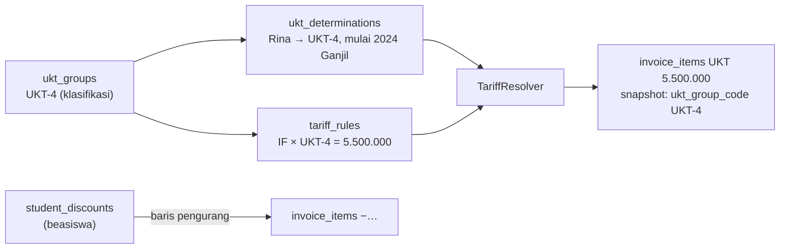
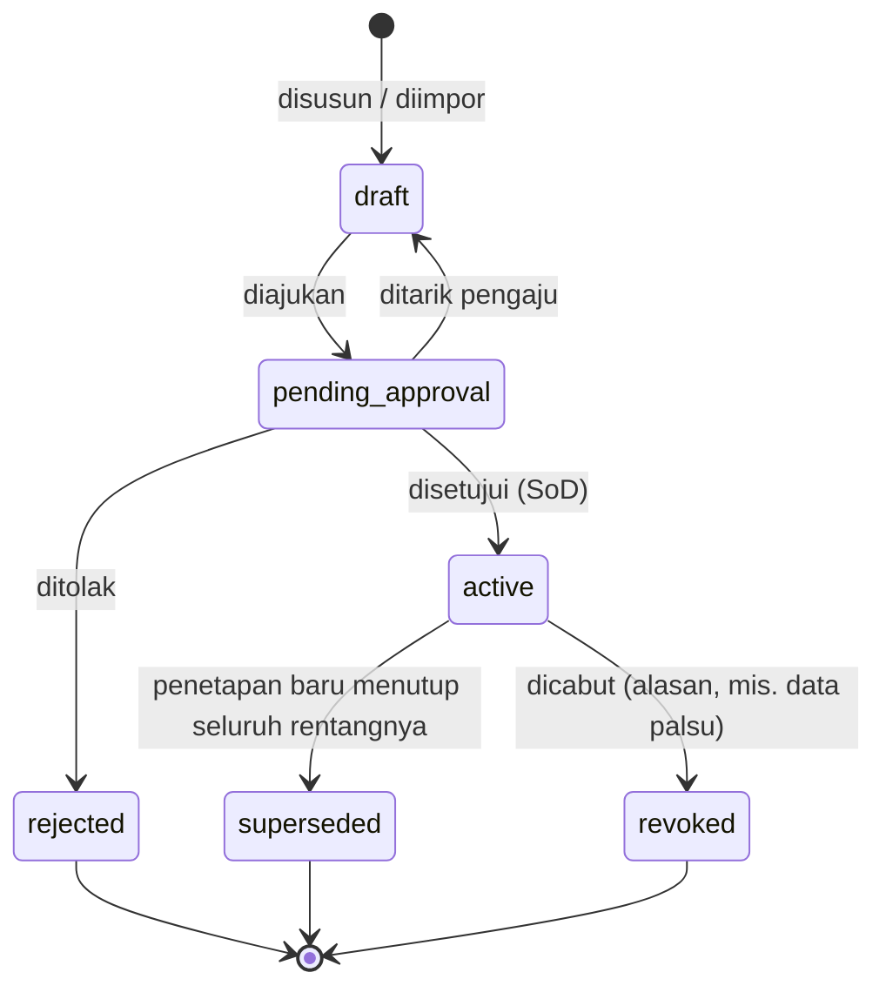
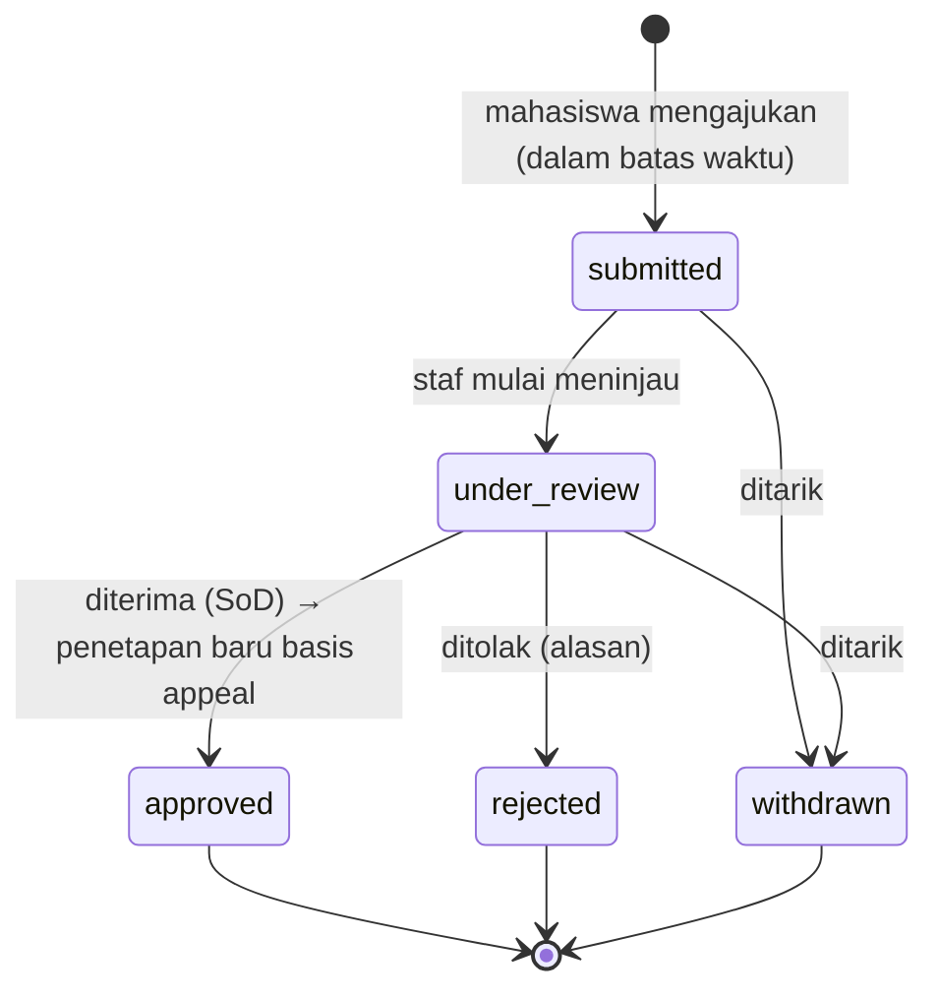

# 15 — Rancangan UKT dan Validasi Penerima

> **Status:** rancangan. Disusun 2026-10-13.
> Kembali ke [README](README.md) · Skema: [19 §3.3.1](19-rancangan-database-dan-relasi.md#331-ukt_groups--baru), [19 §3.12](19-rancangan-database-dan-relasi.md#312-ukt) · Aturan: `KEU-BR-220`–`239` ([25](25-business-rules-dan-validasi.md))

Uang Kuliah Tunggal (UKT) adalah model biaya kuliah per semester yang besarannya bergantung pada golongan kemampuan ekonomi mahasiswa. Dokumen ini mengatur master golongan, penetapan golongan per mahasiswa beserta persetujuan dan dokumennya, perubahan dan keberatan, serta validasi bahwa setiap penetapan memiliki tarif yang sesuai. Kampus yang memakai SPP tetap (PTS) dapat tidak memakai fitur ini ([KEU-Q-13](29-glossary-dan-keputusan-bisnis.md#3-pertanyaan-terbuka-keu-q)).

**Peta format baku:** tujuan/aktor/prasyarat §1 · data masukan §3 · proses & status §4–§5, §8 · aturan & validasi §3–§7 · hak akses §9 · data & relasi §10 · API §11 · UI §12 · notifikasi §13 · laporan §14 · kegagalan §15 · audit §16 · AC & TC §17.

## Daftar Isi

1. [Tujuan, Aktor, dan Prasyarat](#1-tujuan-aktor-dan-prasyarat)
2. [Pembedaan Konsep](#2-pembedaan-konsep)
3. [Golongan dan Penetapan](#3-golongan-dan-penetapan)
4. [Siklus Status Penetapan](#4-siklus-status-penetapan)
5. [Perubahan Golongan dan Keberatan](#5-perubahan-golongan-dan-keberatan)
6. [Dokumen Pendukung dan Kerahasiaan](#6-dokumen-pendukung-dan-kerahasiaan)
7. [Validasi Tarif dan Validasi Penerima](#7-validasi-tarif-dan-validasi-penerima)
8. [Impor Massal dan Integrasi PMB](#8-impor-massal-dan-integrasi-pmb)
9. [Hak Akses](#9-hak-akses)
10. [Struktur Data dan Relasi](#10-struktur-data-dan-relasi)
11. [API dan Event](#11-api-dan-event)
12. [UI/UX](#12-uiux)
13. [Notifikasi](#13-notifikasi)
14. [Laporan Terkait](#14-laporan-terkait)
15. [Skenario Kegagalan](#15-skenario-kegagalan)
16. [Audit Trail](#16-audit-trail)
17. [Acceptance Criteria dan Test Case](#17-acceptance-criteria-dan-test-case)

---

## 1. Tujuan, Aktor, dan Prasyarat

| Aspek | Isi |
|---|---|
| **Tujuan** | Menetapkan golongan UKT setiap mahasiswa secara sah, berizin, berdokumen, dan memastikan tagihan UKT memakai tarif golongan yang benar |
| **Manfaat** | Penagihan UKT otomatis; perubahan golongan dan keberatan memiliki jejak keputusan; kampus dapat membuktikan dasar setiap nominal UKT |
| **Aktor** | Administrator/staf keuangan (menyusun, mengimpor, meninjau keberatan), bendahara/pejabat berwenang (menyetujui penetapan dan keputusan keberatan), mahasiswa (melihat golongan, mengajukan keberatan), PMB (sumber penetapan awal mahasiswa baru) |
| **Prasyarat** | Master golongan (`ukt_groups`); tarif UKT per golongan di jadwal `published` ([05 §9.2](05-rancangan-tarif-uang-kuliah.md#92-contoh-b--model-ukt-ptn)); komponen kategori `ukt` |

## 2. Pembedaan Konsep

| Konsep | Wujud | Contoh | Yang **bukan** |
|---|---|---|---|
| **Golongan UKT** (klasifikasi) | `ukt_groups` | "Golongan IV" (`UKT-4`, level 4) | Bukan nominal |
| **Tarif UKT** (nilai tagihan) | `tariff_rules` dengan `ukt_group_id` | IF × UKT-4 = Rp5.500.000 | Bukan keputusan per mahasiswa |
| **Keputusan penetapan UKT** | `ukt_determinations` | Rina → UKT-4 mulai 2024/2025 Ganjil, SK No. 123/2024 | Bukan potongan |
| **Riwayat perubahan UKT** | Rantai `ukt_determinations` (`previous_determination_id`) + `finance_status_histories` + `ukt_appeals` | UKT-4 (2024) → UKT-3 (2027, hasil keberatan) | — |
| **Beasiswa** | `student_discounts` ([11](11-rancangan-beasiswa-dan-potongan.md)) | 50% praktikum | Tidak mengubah golongan ([KEU-BR-230](25-business-rules-dan-validasi.md)) |

## 3. Golongan dan Penetapan

### 3.1 Master golongan

| Kolom | Ketentuan ([KEU-BR-220](25-business-rules-dan-validasi.md)) |
|---|---|
| `code`, `name`, `level` | Unik per tenant; `level` menentukan urutan (1 = terendah) |
| `criteria_summary` | Uraian kategori/rentang penetapan (mis. "Penghasilan orang tua Rp3–5 juta/bulan"). **Informatif**: penilaian kelayakan dilakukan di luar KEU (PMB atau panitia), KEU menyimpan hasilnya |
| `is_active` | Golongan yang dirujuk tidak dapat dihapus |

### 3.2 Penetapan per mahasiswa

| Data masukan | Ketentuan |
|---|---|
| Mahasiswa, golongan | Wajib; golongan aktif |
| `effective_from_term_id`, `effective_until_term_id` | Term berlaku; `until` kosong = sampai ada penetapan baru |
| `basis` | `admission_assessment` (penetapan awal), `appeal` (hasil keberatan), `reassessment` (peninjauan ulang kampus), `correction` (koreksi kesalahan input), `migration` (data lama) |
| `decree_number`, `decree_date` | SK penetapan [R] wajib untuk `basis ≠ migration` |
| `assessment_summary` | Ringkasan **non-sensitif** (mis. skor total, kategori) |
| Dokumen pendukung | `file_uploads` (`fileable` = penetapan) (§6) |
| `reason` | Wajib untuk `reassessment` dan `correction` |

Aturan:

- [KEU-BR-221](25-business-rules-dan-validasi.md): rentang term penetapan `active` milik satu mahasiswa tidak tumpang tindih. Saat penetapan baru diaktifkan, penetapan lama yang beririsan diberi `effective_until_term_id` = term sebelum `effective_from` baru, atau menjadi `superseded` bila tertutup penuh.
- [KEU-BR-222](25-business-rules-dan-validasi.md): saat menghitung komponen kategori `ukt`, `TariffResolver` mencari penetapan `active` yang mencakup term tagihan. Bila tidak ada → `UKT_GROUP_MISSING`; mahasiswa tidak ditagih UKT (bukan ditagih golongan default).

## 4. Siklus Status Penetapan

| Transisi | Permission | Efek |
|---|---|---|
| `draft → pending_approval` | `ukt_determinations.update` | Workflow `finance_ukt_determination` |
| `pending_approval → active` | `ukt_determinations.approve` | Penyesuaian rentang penetapan lama; event `UktDeterminationActivated` ([KEU-BR-223](25-business-rules-dan-validasi.md)) |
| `active → revoked` | `ukt_determinations.approve` | Alasan wajib; penetapan sebelumnya **tidak** otomatis aktif kembali; mahasiswa tanpa penetapan → `UKT_GROUP_MISSING` sampai ditetapkan ulang |

`UktDeterminationActivated` hanya memicu **hitung ulang tagihan `draft`** term terkait. Tagihan terbit tidak berubah (§5.1).

## 5. Perubahan Golongan dan Keberatan

### 5.1 Perubahan golongan

Perubahan selalu berupa **penetapan baru** dengan `basis` yang sesuai dan `previous_determination_id` ([KEU-BR-224](25-business-rules-dan-validasi.md)). Penetapan baru **tidak berlaku surut** atas tagihan yang sudah terbit. Bila keputusan menyatakan berlaku untuk term yang tagihannya sudah terbit, staf mengajukan `invoice_correction` (alasan `UKT_CHANGED`) dengan persetujuan; sistem menyiapkan usulan selisih berdasarkan tarif golongan baru pada jadwal yang dipakai tagihan tersebut.

### 5.2 Keberatan

| Aturan ([KEU-BR-225](25-business-rules-dan-validasi.md), [KEU-BR-226](25-business-rules-dan-validasi.md)) | Isi |
|---|---|
| Batas waktu | Diajukan ≤ `finance.ukt.appeal_window_days` (30 [K]) sejak penetapan disetujui, atau sejak tagihan UKT pertama dengan penetapan itu terbit (mana yang lebih akhir) |
| Satu keberatan aktif per penetapan | Unique `active_key` |
| Isi | Alasan wajib, golongan yang diminta (opsional), dokumen pendukung |
| Kewajiban bayar | Keberatan **tidak** menunda kewajiban secara otomatis. Kampus dapat memperpanjang jatuh tempo lewat `DUE_DATE_EXTENSION` [K] |
| Keputusan diterima | Membuat penetapan baru (`basis = appeal`, `ukt_appeal_id`) dengan term berlaku yang ditetapkan peninjau, `pending_approval` → disetujui pejabat yang berbeda dari peninjau (SoD) |
| Keputusan ditolak | Alasan wajib; dikirim ke mahasiswa |

### 5.3 Contoh

| Tanggal | Peristiwa | Penetapan aktif | Dampak tagihan |
|---|---|---|---|
| Agt 2024 | Penetapan awal dari PMB (SK 123/2024) | UKT-4, mulai 2024/2025 Ganjil | Tagihan UKT Rp5.500.000 per term |
| 1 Agt 2026 | Tagihan 2026/2027 Ganjil terbit (UKT-4) | UKT-4 | Rp5.500.000 |
| 10 Agt 2026 | Rina mengajukan keberatan (orang tua kehilangan pekerjaan) | UKT-4 | — |
| 25 Agt 2026 | Keberatan diterima; penetapan UKT-3 mulai **2026/2027 Genap** disetujui | UKT-4 s.d. 2026/2027 Ganjil, UKT-3 mulai Genap | Tagihan Ganjil tetap Rp5.500.000; tagihan Genap Rp3.000.000 |
| Alternatif | Keputusan berlaku mulai Ganjil (term berjalan) | UKT-3 mulai Ganjil | Koreksi tagihan Ganjil −2.500.000 (`UKT_CHANGED`, berizin); kelebihan bayar bila sudah lunas ditangani [07 §6](07-rancangan-pembayaran.md#6-kelebihan-bayar-dan-dana-belum-diterapkan) |

## 6. Dokumen Pendukung dan Kerahasiaan

| Aspek | Ketentuan ([KEU-BR-228](25-business-rules-dan-validasi.md)) |
|---|---|
| Jenis dokumen | Slip gaji, surat keterangan penghasilan, kartu keluarga, rekening listrik, foto rumah, surat keterangan tidak mampu, dokumen keberatan |
| Penyimpanan | `file_uploads` disk privat, `fileable` = `ukt_determinations` atau `ukt_appeals`; checksum; pemindaian virus bila aktif |
| Akses | Pemilik `ukt_determinations.read` di lingkungan keuangan (FA, FO, FM, AU) dan mahasiswa pemilik. Dekan/kaprodi hanya melihat golongan, bukan dokumen |
| Audit | Setiap unduhan dicatat `downloaded`; melihat ringkasan penilaian dicatat `viewed_sensitive` |
| Minimisasi | `assessment_summary` tidak memuat angka penghasilan atau data pribadi anggota keluarga; data rinci tetap di dokumen |
| Retensi | Mengikuti retensi data keuangan ([24 §11](24-keamanan-audit-dan-kontrol-internal.md)) [K] |

## 7. Validasi Tarif dan Validasi Penerima

### 7.1 Validasi tarif per golongan

Laporan `GET /ukt-validation/tariffs?academic_term_id=…` ([KEU-BR-227](25-business-rules-dan-validasi.md)) memeriksa, untuk setiap prodi aktif × angkatan aktif × golongan aktif, apakah ada aturan tarif komponen `ukt` di jadwal `published` yang berlaku pada term tersebut. Hasilnya juga muncul di validasi jadwal tarif (`ukt_coverage`, [05 §5.3](05-rancangan-tarif-uang-kuliah.md#53-laporan-validasi-jadwal)).

| Temuan | Tingkat |
|---|---|
| Golongan aktif tanpa tarif pada prodi yang memiliki mahasiswa dengan golongan itu | **Kritis** (penagihan akan gagal) |
| Golongan aktif tanpa tarif pada prodi tanpa mahasiswa bergolongan itu | Peringatan |
| Urutan nominal tidak naik mengikuti `level` (mis. UKT-5 < UKT-4) | Peringatan (kemungkinan salah input) |

### 7.2 Validasi penerima

Laporan `GET /ukt-validation/recipients?academic_term_id=…` sebelum penagihan:

| Pemeriksaan | Contoh hasil |
|---|---|
| Mahasiswa aktif tanpa penetapan aktif untuk term | 12 mahasiswa angkatan 2026 belum ditetapkan |
| Penetapan `pending_approval` mendekati tanggal penagihan | 5 penetapan menunggu persetujuan |
| Penetapan untuk mahasiswa berstatus tidak aktif (`graduated`, `dropped_out`) | 3 penetapan perlu diakhiri |
| Keberatan terbuka | 7 keberatan sedang ditinjau |
| Perbedaan golongan dengan data PMB (bila tersedia) | 1 mahasiswa berbeda |

Pratinjau tagihan massal juga menampilkan `UKT_GROUP_MISSING` per mahasiswa ([06 §6.3](06-rancangan-tagihan-mahasiswa.md#63-proses)).

## 8. Impor Massal dan Integrasi PMB

| Sumber | Alur ([KEU-BR-229](25-business-rules-dan-validasi.md)) |
|---|---|
| **Impor berkas** | XLSX/CSV kolom `nim`, `ukt_group_code`, `effective_from_term`, `effective_until_term`, `basis`, `decree_number`, `decree_date`, `reason`. Validasi per baris (mahasiswa ada, golongan aktif, tidak tumpang tindih). Baris valid menjadi `draft` dalam satu batch; laporan galat untuk baris tidak valid. Batch diajukan lalu disetujui (persetujuan massal tetap memeriksa SoD per baris) |
| **PMB** | Setelah konversi pendaftar menjadi mahasiswa, PMB memanggil `UktDeterminationService::createFromAdmission($student, $groupCode, $term, $summary, $decree)` → penetapan `basis = admission_assessment`, status `pending_approval` (default) agar bagian keuangan tetap menyetujui sebelum penagihan |
| **Migrasi data lama** | `basis = migration`, disetujui sebagai batch dengan catatan sumber data |

## 9. Hak Akses

| Aksi | Permission | Role default |
|---|---|---|
| Kelola golongan | `ukt_groups.create/update` | FA |
| Susun/ajukan penetapan, tinjau keberatan | `ukt_determinations.create/update`, `ukt_appeals.update` | FA, FO |
| Setujui/tolak/cabut penetapan; putus keberatan | `ukt_determinations.approve/reject`, `ukt_appeals.approve/reject` | FM |
| Impor/ekspor | `ukt_determinations.import/export` | FA (impor); FA, FM, AU (ekspor) |
| Lihat golongan mahasiswa dalam scope (tanpa dokumen) | `ukt_determinations.read` + scope | DK |
| Mahasiswa: lihat golongan, ajukan keberatan | `finance_self_service.read/create` | Milik sendiri |

## 10. Struktur Data dan Relasi

| Tabel | Rincian |
|---|---|
| `ukt_groups` | [19 §3.3.1](19-rancangan-database-dan-relasi.md#331-ukt_groups--baru) |
| `ukt_determinations` | [19 §3.12.1](19-rancangan-database-dan-relasi.md#3121-ukt_determinations--baru) |
| `ukt_appeals` | [19 §3.12.2](19-rancangan-database-dan-relasi.md#3122-ukt_appeals--baru) |
| `tariff_rules.ukt_group_id` | [19 §3.3.3](19-rancangan-database-dan-relasi.md#333-tariff_rules--baru) |
| `file_uploads` (Ada) | Dokumen pendukung |

ERD: [19 §4.2](19-rancangan-database-dan-relasi.md#42-tarif-ukt-dan-penagihan-massal).

## 11. API dan Event

| Method | URL | Permission | Keterangan |
|---|---|---|---|
| GET/POST | `/ukt-groups` | `ukt_groups.read` / `.create` | |
| PUT | `/ukt-groups/{group}` | `ukt_groups.update` | |
| GET/POST | `/ukt-determinations` | `ukt_determinations.read` / `.create` | Filter golongan, status, term, prodi, angkatan |
| GET/PUT | `/ukt-determinations/{determination}` | `.read` / `.update` | Ubah hanya `draft` |
| POST | `/ukt-determinations/{determination}/submit`, `/withdraw` | `ukt_determinations.update` | |
| POST | `/ukt-determinations/{determination}/approve`, `/reject`, `/revoke` | `.approve` / `.reject` / `.approve` | SoD; alasan |
| POST | `/ukt-determinations/import` | `ukt_determinations.import` | |
| GET | `/ukt-determinations/export` | `ukt_determinations.export` | |
| POST | `/ukt-determinations/{determination}/documents` | `ukt_determinations.update` | Unggah dokumen |
| GET | `/ukt-appeals` | `ukt_appeals.read` | |
| POST | `/ukt-appeals/{appeal}/review`, `/approve`, `/reject` | `.update` / `.approve` / `.reject` | `approve` menyertakan golongan & term berlaku baru |
| GET | `/ukt-validation/tariffs`, `/ukt-validation/recipients` | `ukt_determinations.read` | §7 |
| GET | `/student/finance/ukt` | `finance_self_service.read` | Golongan aktif & riwayat |
| POST | `/student/finance/ukt-appeals` | `finance_self_service.create` | Multipart; **Idempotency-Key** |

Event: `UktDeterminationActivated` (internal, hitung ulang draf). Kontrak in-process untuk PMB: `UktDeterminationService::createFromAdmission`.

## 12. UI/UX

| Halaman | Rute | Inti |
|---|---|---|
| Golongan UKT | `/keuangan/ukt/golongan` | Daftar golongan + jumlah mahasiswa aktif per golongan |
| Penetapan Mahasiswa | `/keuangan/ukt/penetapan` | Tabel (NIM, nama, prodi, angkatan, golongan, berlaku, dasar, SK, status), filter; form penetapan dengan unggah dokumen; impor |
| Persetujuan | `/keuangan/ukt/persetujuan` | Antrean penetapan & keberatan |
| Validasi Penerima | `/keuangan/ukt/validasi` | Dua tab: Validasi Tarif, Validasi Penerima (§7) dengan tautan aksi |
| Riwayat | Tab di detail mahasiswa | Rantai penetapan + keberatan |
| Portal: UKT Saya | `/portal/keuangan/ukt` | Golongan aktif, riwayat, tombol "Ajukan Keberatan" selama dalam batas waktu |

## 13. Notifikasi

| Event | Penerima | Kanal |
|---|---|---|
| `finance.ukt_determined` | Mahasiswa | database, mail |
| `finance.ukt_appeal_submitted` | Staf keuangan | database |
| `finance.ukt_appeal_decided` | Mahasiswa | database, mail |

## 14. Laporan Terkait

[KEU-RPT-14](22-rancangan-laporan-dan-dashboard.md) penetapan UKT (sebaran golongan per prodi/angkatan/term, perubahan, keberatan, validasi).

## 15. Skenario Kegagalan

| Skenario | Penanganan |
|---|---|
| Dua penetapan aktif diajukan untuk term beririsan | Persetujuan kedua ditolak ([KEU-BR-221](25-business-rules-dan-validasi.md)) kecuali dimaksudkan menggantikan (rentang lama disesuaikan otomatis saat aktivasi) |
| Tagihan massal dijalankan saat banyak penetapan belum disetujui | Pratinjau menampilkan `UKT_GROUP_MISSING`; run dapat dijalankan ulang setelah persetujuan |
| Dokumen keberatan gagal diunggah | Keberatan tidak dibuat (satu permintaan multipart) |
| Golongan dinonaktifkan sementara masih ada penetapan aktif | Ditolak sampai penetapan dialihkan |

## 16. Audit Trail

| Aksi | Dicatat |
|---|---|
| Penetapan: buat, ajukan, setujui, tolak, cabut, digantikan | `finance_status_histories` (`ukt_determination`) + `audit_logs` (`approved`/`rejected`) |
| Keberatan: ajukan, tinjau, putus | `finance_status_histories` (`ukt_appeal`) + `audit_logs` |
| Akses dokumen / ringkasan penilaian | `audit_logs` (`downloaded` / `viewed_sensitive`) |
| Impor | `audit_logs` (`imported`) dengan berkas sumber |

## 17. Acceptance Criteria dan Test Case

| Acceptance criteria | Test case |
|---|---|
| [KEU-AC-UKT-01](27-acceptance-criteria.md) Penetapan menentukan tarif UKT tagihan | [KEU-TC-UKT-001](26-skenario-pengujian.md), [KEU-TC-UKT-002](26-skenario-pengujian.md) |
| [KEU-AC-UKT-02](27-acceptance-criteria.md) Rentang penetapan tidak tumpang tindih | [KEU-TC-UKT-004](26-skenario-pengujian.md) |
| [KEU-AC-UKT-03](27-acceptance-criteria.md) Keberatan menghasilkan penetapan baru berizin | [KEU-TC-UKT-005](26-skenario-pengujian.md), [KEU-TC-UKT-006](26-skenario-pengujian.md) |
| [KEU-AC-UKT-04](27-acceptance-criteria.md) Perubahan golongan tidak mengubah tagihan terbit | [KEU-TC-UKT-003](26-skenario-pengujian.md) |
| [KEU-AC-UKT-05](27-acceptance-criteria.md) Validasi tarif & penerima; dokumen terlindungi | [KEU-TC-UKT-007](26-skenario-pengujian.md), [KEU-TC-UKT-008](26-skenario-pengujian.md) |
