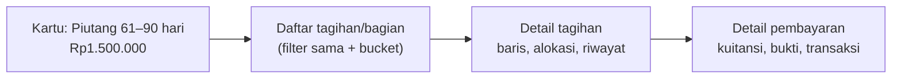

# 16 — Rancangan Monitoring Piutang

> **Status:** rancangan. Disusun 2026-10-13.
> Kembali ke [README](README.md) · Kanon nominal: [README §5.3](README.md#53-kanon-nominal-definisi-yang-tidak-boleh-dicampur) · Skema: [19 §3.15](19-rancangan-database-dan-relasi.md#315-piutang) · Aturan: `KEU-BR-240`–`259` ([25](25-business-rules-dan-validasi.md))

Monitoring piutang memberi gambaran kewajiban mahasiswa yang belum dilunasi, umur keterlambatannya, dan kinerja penagihan per unit. Setiap angka memiliki rumus baku dan dapat ditelusuri ke tagihan, alokasi, dan pembayaran sumbernya ([KEU-BR-243](25-business-rules-dan-validasi.md)). Spesifikasi tampilan dashboard dan laporan ada di [22](22-rancangan-laporan-dan-dashboard.md).

**Peta format baku:** tujuan/aktor/prasyarat §1 · data masukan §2, §7 · proses §5, §8 · aturan & rumus §3–§6, §9 · hak akses §11 · data & relasi §12 · API §13 · UI §14 · notifikasi §15 · laporan §16 · kegagalan §17 · audit §18 · AC & TC §19.

## Daftar Isi

1. [Tujuan, Aktor, dan Prasyarat](#1-tujuan-aktor-dan-prasyarat)
2. [Definisi Dasar](#2-definisi-dasar)
3. [Indikator](#3-indikator)
4. [Rumus Indikator](#4-rumus-indikator)
5. [Data Waktu Nyata dan Snapshot](#5-data-waktu-nyata-dan-snapshot)
6. [Umur Piutang](#6-umur-piutang)
7. [Filter dan Dimensi](#7-filter-dan-dimensi)
8. [Ketertelusuran (Drill-down)](#8-ketertelusuran-drill-down)
9. [Perlakuan yang Konsisten](#9-perlakuan-yang-konsisten)
10. [Contoh Perhitungan](#10-contoh-perhitungan)
11. [Hak Akses](#11-hak-akses)
12. [Struktur Data dan Relasi](#12-struktur-data-dan-relasi)
13. [API dan Event](#13-api-dan-event)
14. [UI/UX](#14-uiux)
15. [Notifikasi](#15-notifikasi)
16. [Laporan Terkait](#16-laporan-terkait)
17. [Skenario Kegagalan](#17-skenario-kegagalan)
18. [Audit Trail](#18-audit-trail)
19. [Acceptance Criteria dan Test Case](#19-acceptance-criteria-dan-test-case)

---

## 1. Tujuan, Aktor, dan Prasyarat

| Aspek | Isi |
|---|---|
| **Tujuan** | Menyajikan posisi dan tren piutang yang akurat, konsisten antarlaporan, dan dapat diaudit |
| **Manfaat** | Pimpinan dapat memprioritaskan penagihan; bagian keuangan mendeteksi tunggakan dini; auditor dapat mencocokkan angka ke transaksi |
| **Aktor** | Staf & administrator keuangan, bendahara, pimpinan universitas, dekan/kaprodi (dalam scope), auditor |
| **Prasyarat** | Tagihan, pembayaran, alokasi ([06](06-rancangan-tagihan-mahasiswa.md), [07](07-rancangan-pembayaran.md)); `FinanceScope` untuk dekan/kaprodi ([03 §5](03-role-dan-hak-akses.md#5-cakupan-data-financescope)); job snapshot harian |

## 2. Definisi Dasar

| Istilah | Definisi |
|---|---|
| **Tagihan efektif** | Tagihan yang sudah terbit (`issued_at` terisi) dan tidak `cancelled` pada tanggal acuan |
| **Piutang (saldo piutang aktif)** | Σ `outstanding_amount` tagihan `unpaid`/`partial` ([KEU-BR-240](25-business-rules-dan-validasi.md)) |
| **Jatuh tempo efektif** | `due_date` tagihan; untuk tagihan bercicilan, jatuh tempo masing-masing termin dan bagian di luar jadwal ([10 §9](10-rancangan-cicilan-tagihan.md#9-pelaporan-tanpa-hitung-ganda)) |
| **Tanggal acuan** (*as of*) | Tanggal posisi dihitung, akhir hari zona tenant |
| **Periode** | Rentang tanggal untuk indikator arus (pembayaran, penerbitan) berdasarkan `posting_date` atau `issued_at` |

Posisi pada tanggal acuan *t* (untuk laporan historis) dihitung ulang dari baris sumber, bukan dari kolom cache:

```
tagihan efektif(i, t) : issued_at ≤ t  ∧  (cancelled_at IS NULL ∨ cancelled_at > t)
nominal(i, t)         = Σ invoice_items.amount dengan created_at ≤ t
dibayar(i, t)         = Σ payment_allocations.amount dengan allocated_at ≤ t
sisa(i, t)            = nominal(i, t) − dibayar(i, t)
```

Untuk tanggal acuan = hari ini, hasilnya sama dengan kolom cache `amount`, `paid_amount`, `outstanding_amount` (dijamin invarian `INV-01`…`INV-03`).

## 3. Indikator

| No | Indikator (permintaan bisnis) | Kode | Jenis |
|---|---|---|---|
| 1 | Total tagihan diterbitkan | `issued_all`, `issued_effective` | Arus (rentang terbit) |
| 2 | Total pembayaran terverifikasi | `payments_verified` | Arus (rentang `posting_date`) |
| 3 | Total piutang | `receivable` | Posisi |
| 4 | Piutang belum jatuh tempo | `receivable_not_due` | Posisi |
| 5 | Piutang jatuh tempo | `receivable_due` | Posisi |
| 6 | Piutang berdasarkan umur | `aging[bucket]` | Posisi |
| 7 | Piutang per fakultas dan prodi | dimensi `faculty`, `study_program` | Posisi |
| 8 | Piutang per angkatan dan semester | dimensi `admission_year`, `academic_term` | Posisi |
| 9 | Piutang per jenis tagihan | dimensi `invoice_type` | Posisi |
| 10 | Mahasiswa belum lunas | `students_unpaid` (jumlah & daftar) | Posisi |
| 11 | Persentase tingkat pelunasan | `collection_rate`, `students_paid_rate` | Kohort |
| 12 | Pembayaran pending | `payments_pending` | Posisi |
| 13 | Tagihan disengketakan | `disputed` | Posisi |
| 14 | Deposit mahasiswa tersedia | `deposit_available` | Posisi |
| + | Dana belum diterapkan | `unapplied` | Posisi |
| + | Piutang bersih (indikator) | `net_receivable` | Posisi |

## 4. Rumus Indikator

Semua rumus dibatasi `university_id` tenant, scope pengguna, dan filter §7. "Sum" memakai aritmetika desimal.

| Kode | Rumus | Catatan |
|---|---|---|
| `issued_all` | Σ `amount` (nilai saat terbit) tagihan dengan `issued_at` dalam rentang, termasuk yang kemudian `cancelled` | Kolom pembanding untuk melihat volume pembatalan |
| `issued_effective` | Σ `amount` tagihan efektif dengan `issued_at` dalam rentang | Dasar tingkat pelunasan |
| `cancelled` | Σ `amount` saat dibatalkan, tagihan dengan `cancelled_at` dalam rentang | |
| `payments_verified` | Σ `payments.amount` dengan `status = verified` dan `posting_date` dalam rentang **dikurangi** Σ pembayaran `reversed` yang reversal-nya dibukukan dalam rentang | Biaya admin mahasiswa (`customer_fee_amount`) tidak termasuk ([KEU-BR-077](25-business-rules-dan-validasi.md)) |
| `allocations_net` | Σ `payment_allocations.amount` (bertanda) dengan `posting_date` dalam rentang | Pelunasan bersih dalam periode |
| `receivable` | Σ `outstanding_amount` tagihan `unpaid/partial` | ([KEU-BR-240](25-business-rules-dan-validasi.md)) |
| `receivable_not_due` | Σ bagian sisa dengan jatuh tempo efektif ≥ tanggal acuan | |
| `receivable_due` | `receivable − receivable_not_due` | |
| `aging[b]` | Σ bagian sisa yang `days_late` masuk rentang bucket *b* (§6) | Σ seluruh bucket = `receivable` |
| `students_unpaid` | Jumlah mahasiswa distinct dengan `receivable > 0` | Daftar dapat diunduh |
| `collection_rate` | Σ `paid_amount` ÷ Σ `amount` tagihan efektif dalam kohort (mis. term + jenis) × 100% | Dihitung per kohort, bukan per periode kas |
| `students_paid_rate` | Mahasiswa yang seluruh tagihan kohortnya lunas ÷ mahasiswa bertagihan dalam kohort × 100% | |
| `payments_pending` | Σ `payments.amount` dengan `status = pending_verification` (jumlah & nominal), dikelompokkan menurut umur pengajuan | Tidak mengurangi piutang ([KEU-BR-241](25-business-rules-dan-validasi.md)) |
| `disputed` | Jumlah dan Σ `outstanding_amount` tagihan dengan `has_open_dispute` | Tetap termasuk piutang |
| `deposit_available` | Σ (`balance − held_amount`) akun `active` | Tidak mengurangi piutang |
| `unapplied` | Σ `payments.unapplied_amount` pembayaran `verified` | Tidak mengurangi piutang |
| `net_receivable` | Σ per mahasiswa `max(0, receivable_m − deposit_available_m − unapplied_m)` | Indikator; dihitung **per mahasiswa** sehingga titipan mahasiswa A tidak menutup tunggakan mahasiswa B |

## 5. Data Waktu Nyata dan Snapshot

| Kebutuhan | Sumber | Alasan |
|---|---|---|
| Dashboard posisi saat ini | Tabel sumber (`invoices`, `installment_terms`, `payments`, `deposit_accounts`) dengan indeks `(university_id, status, due_date)` | Angka harus sama dengan detail tagihan saat itu |
| Tren harian/bulanan | `receivable_snapshots` | Menghindari perhitungan ulang historis yang berat |
| Posisi pada tanggal lalu (laporan historis) | Snapshot bila ada untuk tanggal itu; bila tidak, perhitungan *as of* (§2) | Perhitungan *as of* dijalankan sebagai job ekspor asinkron untuk data besar |
| Periode tertutup | Snapshot akhir bulan **dibekukan** saat periode `closed` | Laporan periode tertutup tidak berubah ([KEU-BR-247](25-business-rules-dan-validasi.md)) |

Job `finance:snapshot-receivables` berjalan setiap hari pukul 01:00 zona tenant untuk posisi akhir hari sebelumnya, per kombinasi dimensi (term, fakultas, prodi, angkatan, jenis tagihan, bucket umur). Menjalankan ulang untuk tanggal yang sama mengganti baris tanggal itu (*replace*), kecuali tanggal di periode `closed`.

## 6. Umur Piutang

### 6.1 Kategori

`finance.aging.buckets` (dapat dikonfigurasi, [KEU-BR-242](25-business-rules-dan-validasi.md)):

| Kode | Label | Rentang `days_late` |
|---|---|---|
| `not_due` | Belum jatuh tempo | ≤ 0 |
| `d1_30` | 1–30 hari | 1–30 |
| `d31_60` | 31–60 hari | 31–60 |
| `d61_90` | 61–90 hari | 61–90 |
| `d90_plus` | Lebih dari 90 hari | ≥ 91 |

Validasi konfigurasi: rentang berurutan, tidak tumpang tindih, mencakup seluruh bilangan bulat ≥ 1, dan selalu memuat `not_due`.

### 6.2 Perhitungan

```
days_late(bagian, t) = t − jatuh_tempo_efektif(bagian)          (hari kalender, zona tenant)
bagian = (tagihan tanpa cicilan → seluruh sisa tagihan)
         (tagihan bercicilan → setiap termin aktif dengan sisanya + bagian di luar jadwal)
```

Membagi tagihan bercicilan per termin membuat umur piutang akurat tanpa menghitung ganda: jumlah bagian selalu sama dengan sisa tagihan ([KEU-BR-130](25-business-rules-dan-validasi.md)).

## 7. Filter dan Dimensi

| Filter | Berlaku untuk | Semantik |
|---|---|---|
| Tanggal acuan | Indikator posisi | Default hari ini |
| Rentang tanggal | Indikator arus | `issued_at` (penerbitan) atau `posting_date` (pembayaran/alokasi) |
| Tahun akademik, semester (term) | Tagihan | `invoices.academic_term_id` (tagihan non-term masuk kelompok "Tanpa term") |
| Fakultas, program studi | Tagihan | Prodi mahasiswa **saat ini** (default) atau prodi pada snapshot tagihan (opsi) |
| Angkatan | Tagihan | `students.admission_year` |
| Jenis tagihan | Tagihan | `invoice_type` (denda dapat dikecualikan) |
| Status pembayaran | Tagihan | `unpaid`, `partial`, `paid`; turunan `is_overdue`, `has_open_dispute`, `has_active_installment_plan` |
| Kanal / sumber | Pembayaran | `payment_channel_id`, `payments.source` |
| Status mahasiswa | Mahasiswa | `StudentStatus` |

Scope dekan/kaprodi diterapkan sebelum filter ([KEU-BR-245](25-business-rules-dan-validasi.md)).

## 8. Ketertelusuran (Drill-down)

Setiap angka pada dashboard dan laporan adalah tautan ke daftar baris sumber dengan filter yang sama ([KEU-BR-243](25-business-rules-dan-validasi.md)):



| Indikator | Daftar sumber |
|---|---|
| Piutang, umur, per dimensi | `GET /receivables/items` (tagihan atau bagian termin, sisa, jatuh tempo efektif, `days_late`, bucket) |
| Pembayaran terverifikasi | `GET /payments?filter[status]=verified&filter[posting_from]=…` |
| Mahasiswa belum lunas | `GET /receivables/students` |
| Pembayaran pending | `GET /payment-proofs?filter[status]=submitted` dan `GET /payments?filter[status]=pending_verification` |

Total daftar sumber **wajib** sama dengan angka kartu; uji otomatis membandingkan keduanya ([KEU-TC-AR-001](26-skenario-pengujian.md)).

## 9. Perlakuan yang Konsisten

| Data | Tagihan diterbitkan (`issued_*`) | Piutang | Pembayaran terverifikasi | Tingkat pelunasan |
|---|---|---|---|---|
| Tagihan `draft` | Tidak | Tidak | — | Tidak |
| Tagihan `cancelled` | `issued_all` saja; `cancelled` terpisah | Tidak | — | Tidak |
| Pembayaran `pending_verification` | — | **Tidak** mengurangi | Tidak | Tidak |
| Pembayaran `rejected`/`cancelled` | — | — | Tidak | — |
| Pembayaran `reversed` | — | Alokasinya dibalik → piutang naik kembali | Dikurangkan pada periode reversal dibukukan | Mengikuti alokasi bersih |
| Baris alokasi pembalik | — | Ikut dijumlahkan (bertanda) | — | Bertanda |
| Termin cicilan | — | Bukan baris tersendiri; hanya membagi umur | — | Dari tagihan |
| Tagihan denda | Ya, sebagai `late_fee` | Ya, dapat difilter | — | Kohort terpisah |
| Deposit, dana belum diterapkan | — | **Tidak** mengurangi; hanya `net_receivable` | Konversi deposit tidak menambah pembayaran (sudah dihitung saat pembayaran asal) | — |
| Tagihan disengketakan | Ya | Ya, ditandai | — | Ya |

## 10. Contoh Perhitungan

Tanggal acuan **15 Oktober 2026**, term 2026/2027 Ganjil, Fakultas Teknik (*contoh*):

| Mahasiswa | Tagihan | Nominal | Dibayar (alokasi) | Sisa | Jatuh tempo efektif | Bucket |
|---|---|---:|---:|---:|---|---|
| Fajar (IF 2024) | Semester | 11.200.000 | 11.200.000 | 0 | 15 Sep | — (lunas) |
| Budi (IF 2026) | Semester | 16.850.000 | 10.000.000 | 6.850.000 | 15 Sep (30 hari) | 1–30 |
| Budi (IF 2026) | Semester **ganda, dibatalkan** | 16.850.000 | 0 | — | — | tidak dihitung |
| Citra (TS 2025) | Semester | 8.650.000 | 4.000.000 | 4.650.000 | 15 Sep (30 hari) | 1–30 |
| Citra (TS 2025) | Denda (bucket Sep) | 166.000 | 0 | 166.000 | 30 Sep (15 hari) | 1–30 |
| Dewi (TS 2023, cuti) | Tambahan (biaya cuti) | 1.500.000 | 0 | 1.500.000 | 15 Agt (61 hari) | 61–90 |
| Andi (IF 2024) | Semester, bercicilan | 11.200.000 | 4.000.000 | 7.200.000 | Termin 2: 30 Sep (2.136.666); termin 3–4 belum jatuh tempo (5.063.334) | 1–30 / belum jatuh tempo |

Data tambahan: Fajar membayar Rp11.650.000 (kelebihan Rp450.000 dikonversi ke deposit); Citra mengunggah bukti Rp650.000 yang belum diverifikasi; Dewi mengajukan sengketa atas biaya cutinya.

| Indikator | Perhitungan | Nilai |
|---|---|---:|
| `issued_all` | 11.200.000 + 16.850.000 + 16.850.000 + 8.650.000 + 166.000 + 1.500.000 + 11.200.000 | 66.416.000 |
| `cancelled` | Tagihan ganda Budi | 16.850.000 |
| `issued_effective` | 66.416.000 − 16.850.000 | 49.566.000 |
| Total alokasi | 11.200.000 + 10.000.000 + 4.000.000 + 4.000.000 | 29.200.000 |
| `payments_verified` | 11.650.000 + 10.000.000 + 4.000.000 + 4.000.000 | 29.650.000 |
| `receivable` | 6.850.000 + 4.650.000 + 166.000 + 1.500.000 + 7.200.000 (= 49.566.000 − 29.200.000) | 20.366.000 |
| `receivable_not_due` | Termin 3 + 4 Andi | 5.063.334 |
| `receivable_due` | 20.366.000 − 5.063.334 | 15.302.666 |
| `aging[d1_30]` | 6.850.000 + 4.650.000 + 166.000 + 2.136.666 | 13.802.666 |
| `aging[d61_90]` | Dewi | 1.500.000 |
| `students_unpaid` | Budi, Citra, Dewi, Andi | 4 dari 5 |
| `collection_rate` | 29.200.000 ÷ 49.566.000 | 58,91% |
| `payments_pending` | Bukti Citra | 650.000 (1 pengajuan) |
| `disputed` | Tagihan Dewi | 1 tagihan, 1.500.000 |
| `deposit_available` | Fajar | 450.000 |
| `net_receivable` | Per mahasiswa: Fajar max(0, 0 − 450.000) = 0; lainnya tanpa deposit | 20.366.000 |

Perhatikan: selisih `payments_verified − total alokasi` = 450.000 = deposit Fajar. Deposit Fajar tidak mengurangi piutang mahasiswa lain, sehingga `net_receivable` tetap 20.366.000.

## 11. Hak Akses

| Aksi | Permission | Role default |
|---|---|---|
| Dashboard keuangan | `finance_dashboard.read` | FA, FO, CS (ringkas), FM, UO/UA, RK, DK (scope), AU |
| Laporan piutang & daftar sumber | `finance_reports.read` | FA, FO, FM, UO/UA, RK, DK (scope), AU |
| Ekspor | `finance_reports.export` | FA, FM, RK, AU |

## 12. Struktur Data dan Relasi

| Tabel | Pemakaian |
|---|---|
| `invoices`, `invoice_items`, `installment_terms` | Posisi dan umur |
| `payments`, `payment_allocations` | Arus pembayaran dan pelunasan |
| `deposit_accounts` | Deposit tersedia |
| `invoice_disputes` | Sengketa |
| `receivable_snapshots` | Tren & historis ([19 §3.15.1](19-rancangan-database-dan-relasi.md#3151-receivable_snapshots--baru)) |

## 13. API dan Event

| Method | URL | Permission | Keterangan |
|---|---|---|---|
| GET | `/finance-dashboard/summary` | `finance_dashboard.read` | Kartu indikator §3 untuk tanggal acuan + filter |
| GET | `/receivables/summary` | `finance_reports.read` | Agregat per dimensi (`group_by=faculty,study_program,admission_year,academic_term,invoice_type`) |
| GET | `/receivables/aging` | `finance_reports.read` | Matriks bucket × dimensi |
| GET | `/receivables/items` | `finance_reports.read` | Daftar sumber (paginasi, sort, filter) |
| GET | `/receivables/students` | `finance_reports.read` | Mahasiswa belum lunas |
| GET | `/receivables/trend` | `finance_reports.read` | Dari snapshot |
| POST | `/finance-reports/{code}/exports` | `finance_reports.export` | Ekspor asinkron ([22 §5](22-rancangan-laporan-dan-dashboard.md)) |

Tidak memancarkan event; dashboard platform (`DashboardStatsService`, `PlatformStatisticsController`) disesuaikan agar memakai definisi yang sama ([19 §6.3](19-rancangan-database-dan-relasi.md#63-penyesuaian-konsumen-yang-ada)).

## 14. UI/UX

| Halaman | Rute | Inti |
|---|---|---|
| Dashboard Keuangan | `/keuangan/dashboard` | Kartu indikator (dengan tanggal acuan), grafik tren piutang & pembayaran, umur piutang bertumpuk, 10 prodi dengan piutang terbesar, antrean kerja (pending, sengketa, dana belum diterapkan) |
| Monitoring Piutang | `/keuangan/monitoring/piutang` | Matriks dimensi dengan filter §7; setiap sel dapat diklik ke daftar sumber |
| Umur Piutang | `/keuangan/monitoring/umur-piutang` | Tabel bucket × dimensi, ekspor |
| Mahasiswa Belum Lunas | `/keuangan/monitoring/belum-lunas` | Daftar mahasiswa, total sisa, bucket terburuk, status cekal, tautan profil keuangan |

## 15. Notifikasi

| Event | Penerima | Kanal |
|---|---|---|
| Ringkasan piutang mingguan [R] | FM, RK | mail |
| Pelanggaran invarian (`finance.integrity_violation`) | FM | database, mail |

## 16. Laporan Terkait

[KEU-RPT-03](22-rancangan-laporan-dan-dashboard.md) tunggakan, [KEU-RPT-04](22-rancangan-laporan-dan-dashboard.md) umur piutang, [KEU-RPT-05](22-rancangan-laporan-dan-dashboard.md) pelunasan per angkatan.

## 17. Skenario Kegagalan

| Skenario | Penanganan |
|---|---|
| Job snapshot gagal | Tren menampilkan celah tanggal dengan penanda; dashboard posisi tetap dari tabel sumber; job dapat dijalankan ulang |
| Query posisi lambat pada tenant besar | Indeks komposit; batas dimensi; ekspor asinkron; *cache* singkat (≤ 60 detik) untuk kartu dashboard [R] |
| Prodi mahasiswa berubah (pindah prodi) | Default memakai prodi saat ini; opsi "prodi saat tagihan terbit" membaca snapshot tagihan |
| Konfigurasi bucket diubah | Berlaku untuk perhitungan berikutnya; snapshot lama tetap dengan kode bucket lama |

## 18. Audit Trail

Membuka dashboard tidak diaudit. Ekspor laporan dan unduhan daftar mahasiswa dicatat (`exported`) dengan filter yang dipakai ([KEU-BR-246](25-business-rules-dan-validasi.md)).

## 19. Acceptance Criteria dan Test Case

| Acceptance criteria | Test case |
|---|---|
| [KEU-AC-AR-01](27-acceptance-criteria.md) Setiap angka dapat ditelusuri ke sumber dan totalnya sama | [KEU-TC-AR-001](26-skenario-pengujian.md) |
| [KEU-AC-AR-02](27-acceptance-criteria.md) Pembatalan, pending, reversal diperlakukan konsisten | [KEU-TC-AR-002](26-skenario-pengujian.md), [KEU-TC-AR-004](26-skenario-pengujian.md) |
| [KEU-AC-AR-03](27-acceptance-criteria.md) Bucket umur dapat dikonfigurasi dan tepat di batas | [KEU-TC-AR-003](26-skenario-pengujian.md) |
| [KEU-AC-AR-04](27-acceptance-criteria.md) Filter dan snapshot | [KEU-TC-AR-006](26-skenario-pengujian.md), [KEU-TC-AR-007](26-skenario-pengujian.md) |
| [KEU-AC-AR-05](27-acceptance-criteria.md) Scope fakultas/prodi | [KEU-TC-AR-005](26-skenario-pengujian.md) |
