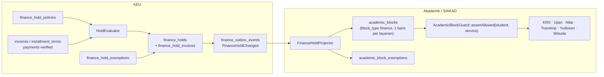
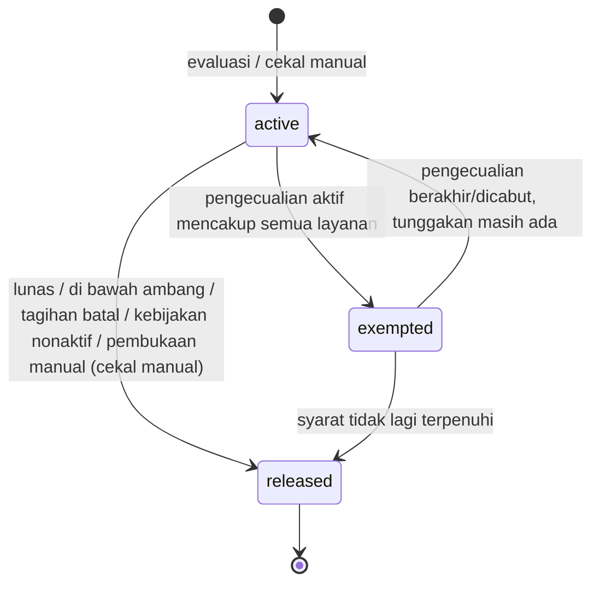
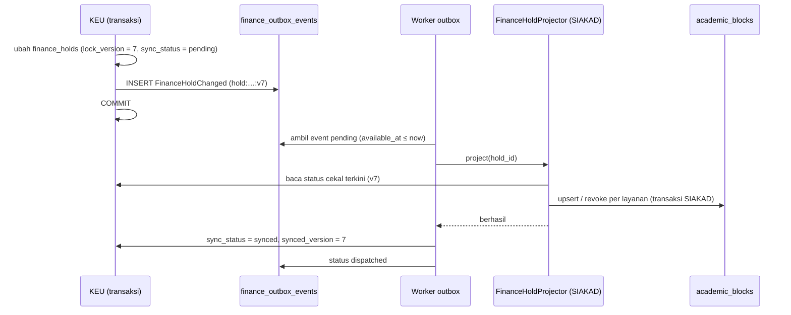

# 17 — Rancangan Cekal Keuangan Terintegrasi SIAKAD

> **Status:** rancangan. Disusun 2026-10-13. Fitur di balik saklar `finance.hold.enabled` (default `false`) sampai kebijakan ditetapkan ([KEU-Q-07](29-glossary-dan-keputusan-bisnis.md#3-pertanyaan-terbuka-keu-q)). **Belum ada mekanisme cekal apa pun di kode**; `KrsPlanService` dan `ExamService` saat ini tidak memeriksa status keuangan.
> Kembali ke [README](README.md) · Skema: [19 §3.16](19-rancangan-database-dan-relasi.md#316-cekal-keuangan) · Kontrak SIAKAD: [academic-learning/07 §3.5](../../docs/academic-learning/07-database-erd.md), [academic-learning/01 A.8](../../docs/academic-learning/01-siakad.md) · Aturan: `KEU-BR-260`–`279` ([25](25-business-rules-dan-validasi.md)) · Keputusan: [KEU-KD-09](29-glossary-dan-keputusan-bisnis.md#2-keputusan-desain-keu-kd), [KEU-KD-32](29-glossary-dan-keputusan-bisnis.md#2-keputusan-desain-keu-kd)

Cekal keuangan membatasi layanan akademik tertentu bagi mahasiswa yang memiliki tunggakan sesuai kebijakan kampus. Rancangan ini **tidak** mengasumsikan bahwa setiap tunggakan memblokir seluruh layanan: kampus menentukan jenis tagihan, komponen, ambang, masa tenggang, dan layanan yang dibatasi.

**Peta format baku:** tujuan/aktor/prasyarat §1 · data masukan §3 · proses & status §4–§7 · aturan & validasi §3–§9 · hak akses §11 · data & relasi §12 · API §13 · UI §14 · notifikasi §15 · laporan §16 · kegagalan §17 · audit §10, §18 · AC & TC §19.

## Daftar Isi

1. [Tujuan, Aktor, dan Prasyarat](#1-tujuan-aktor-dan-prasyarat)
2. [Konsep: Keputusan di KEU, Penegakan di SIAKAD](#2-konsep-keputusan-di-keu-penegakan-di-siakad)
3. [Kebijakan Cekal](#3-kebijakan-cekal)
4. [Evaluasi dan Pembukaan Otomatis](#4-evaluasi-dan-pembukaan-otomatis)
5. [Status dan Transisi](#5-status-dan-transisi)
6. [Pengecualian, Cekal Manual, dan Pembukaan Manual](#6-pengecualian-cekal-manual-dan-pembukaan-manual)
7. [Sinkronisasi ke SIAKAD](#7-sinkronisasi-ke-siakad)
8. [Penegakan di Backend](#8-penegakan-di-backend)
9. [Jalur Sementara: FinanceClearanceGuard](#9-jalur-sementara-financeclearanceguard)
10. [Pertanyaan Audit yang Harus Terjawab](#10-pertanyaan-audit-yang-harus-terjawab)
11. [Hak Akses](#11-hak-akses)
12. [Struktur Data dan Relasi](#12-struktur-data-dan-relasi)
13. [API dan Event](#13-api-dan-event)
14. [UI/UX](#14-uiux)
15. [Notifikasi](#15-notifikasi)
16. [Laporan Terkait](#16-laporan-terkait)
17. [Skenario Kegagalan](#17-skenario-kegagalan)
18. [Audit Trail](#18-audit-trail)
19. [Acceptance Criteria dan Test Case](#19-acceptance-criteria-dan-test-case)

---

## 1. Tujuan, Aktor, dan Prasyarat

| Aspek | Isi |
|---|---|
| **Tujuan** | Menghubungkan kewajiban keuangan dengan layanan akademik secara otomatis, adil, dapat dikecualikan dengan izin, dan tidak dapat dilewati |
| **Manfaat** | Kebijakan berjalan konsisten tanpa daftar manual; mahasiswa yang sudah membayar langsung terbuka aksesnya; setiap cekal dapat dijelaskan |
| **Aktor** | Sistem (evaluasi, sinkronisasi), administrator keuangan (kebijakan, cekal manual), staf keuangan (pengajuan pengecualian), bendahara (persetujuan pengecualian & pembukaan manual), BAAK/dosen wali/dekan/kaprodi (melihat status), mahasiswa (melihat status & cara menyelesaikan), administrator integrasi (memantau sinkronisasi), modul SIAKAD (menegakkan) |
| **Prasyarat** | Tagihan & pembayaran berjalan ([06](06-rancangan-tagihan-mahasiswa.md), [07](07-rancangan-pembayaran.md)); idealnya cicilan ([10](10-rancangan-cicilan-tagihan.md)) agar evaluasi per termin tersedia ([28](28-roadmap-implementasi.md) Fase 4C); `academic_blocks` + `AcademicBlockGuard` SIAKAD **atau** jalur sementara §9; outbox dan worker ([KEU-KD-22](29-glossary-dan-keputusan-bisnis.md#2-keputusan-desain-keu-kd)) |

## 2. Konsep: Keputusan di KEU, Penegakan di SIAKAD



| Lapisan | Pemilik | Isi |
|---|---|---|
| Keputusan | **KEU** | Kebijakan, evaluasi tunggakan, cekal per mahasiswa × kebijakan × term, pengecualian, alasan, dasar tunggakan ([KEU-KD-09](29-glossary-dan-keputusan-bisnis.md#2-keputusan-desain-keu-kd)) |
| Proyeksi | SIAKAD | `academic_blocks` (satu baris per layanan) dan `academic_block_exemptions`, `source_reference_type = finance_hold`, `source_reference_id = finance_holds.id` ([academic-learning/07 §3.5.3](../../docs/academic-learning/07-database-erd.md)) |
| Penegakan | SIAKAD | `AcademicBlockGuard` di service KRS/Ujian/dll., galat `409 ACADEMIC_BLOCKED` |

**Kunci layanan.** Dokumen `academic-learning` tidak seragam: skema 07 memakai `grade_view` dan daftar `krs, exam, grade_view, yudisium, graduation, transcript`, sedangkan 01 A.8 memakai `view_grades` dan daftar yang lebih panjang (`krs_change`, `exam_midterm`, `exam_final`, `thesis_defense`, `mbkm_registration`, `academic_letter`). Sesuai preseden INK-01 (07 adalah skema acuan), KEU memakai kunci dari 07 dan menerima kunci tambahan dari 01 hanya setelah SIAKAD menetapkannya. Ketidakkonsistenan ini dicatat sebagai INK-06 ([README §3.4](README.md#34-kesenjangan-dan-inkonsistensi-yang-ditemukan)). Daftar yang berlaku dibaca dari `finance.hold.available_services`.

## 3. Kebijakan Cekal

| Kebutuhan bisnis | Kolom `finance_hold_policies` | Contoh |
|---|---|---|
| Jenis tagihan yang memengaruhi cekal | `invoice_types` | `["semester","short_term","admission"]` |
| Komponen yang dihitung | `fee_component_ids` (`null` = komponen `affects_clearance = true` yang disalin ke tagihan) | UKT, SPP, SKS |
| Denda ikut dihitung | `include_late_fee` | `false` |
| Batas minimum tunggakan | `min_outstanding_amount` | Rp500.000 (tunggakan di bawahnya tidak mencekal) |
| Masa tenggang | `grace_days` | 7 hari setelah jatuh tempo |
| Evaluasi per termin cicilan | `use_installment_due_dates` | `true` |
| Layanan yang dibatasi | `services` | `["krs","exam"]` |
| Cakupan | `academic_term_id`, `study_program_id`, `admission_year_from/to` | Term berjalan; semua prodi |
| Pembukaan otomatis | `auto_release` | `true` |
| Pengecualian memerlukan persetujuan / batas lama | `exemption_requires_approval`, `max_exemption_days` | `true`, 30 hari |
| Prioritas antarkebijakan | `priority` | Kebijakan dengan cakupan berbeda dapat aktif bersamaan; masing-masing menghasilkan cekal sendiri |
| Aktif/nonaktif | `is_active` | Default nonaktif ([KEU-BR-260](25-business-rules-dan-validasi.md)) |

**Simulasi wajib sebelum aktivasi [R].** `POST /finance-hold-policies/{id}/simulate` menghasilkan daftar mahasiswa yang **akan** dicekal beserta tunggakan jatuh temponya, tanpa membuat data. Aktivasi kebijakan menampilkan ringkasan simulasi terakhir dan meminta konfirmasi.

Contoh kebijakan (*contoh*, [KEU-Q-07](29-glossary-dan-keputusan-bisnis.md#3-pertanyaan-terbuka-keu-q)):

| Kode | Layanan | Jenis tagihan | Ambang | Tenggang | Catatan |
|---|---|---|---:|---:|---|
| `CKL-KRS` | `krs` | `semester`, `short_term` | 1 | 0 | Tunggakan term **sebelumnya** yang jatuh tempo mencegah KRS term berikutnya |
| `CKL-UJIAN` | `exam` | `semester` | 500.000 | 7 | Ujian akhir dibatasi bila tunggakan term berjalan ≥ Rp500.000 |
| `CKL-YUDISIUM` | `yudisium`, `graduation` | semua kecuali `late_fee` | 1 | 0 | Semua tunggakan harus lunas sebelum yudisium |

## 4. Evaluasi dan Pembukaan Otomatis

### 4.1 Pemicu

| Pemicu | Mekanisme | Target waktu |
|---|---|---|
| `InvoiceStatusChanged`, `PaymentVerified`, `PaymentReversed`, `InvoiceCancelled`, `InstallmentPlanActivated`, perubahan pengecualian | Listener `afterCommit` → job antrean prioritas tinggi `EvaluateFinanceHoldsForStudent` | Cekal terbuka ≤ `finance.hold.release_sla_seconds` (60 detik) setelah pembayaran terverifikasi ([KEU-BR-263](25-business-rules-dan-validasi.md)) |
| Perubahan tanggal (jatuh tempo + tenggang terlewati) | Job harian `finance:evaluate-holds` pukul 00:15 zona tenant untuk seluruh mahasiswa dalam cakupan kebijakan aktif ([KEU-BR-271](25-business-rules-dan-validasi.md)) | Sebelum jam layanan |
| Kebijakan diaktifkan/diubah | Job evaluasi penuh untuk cakupan kebijakan | Menit |
| Permintaan staf | `POST /finance-holds/evaluate` (satu mahasiswa atau cakupan) | Langsung |

### 4.2 Algoritma per mahasiswa × kebijakan

```
hari_ini = tanggal zona tenant
tunggakan = 0; dasar = []
untuk setiap tagihan i milik mahasiswa dengan status unpaid/partial, invoice_type ∈ policy.invoice_types
        (+ late_fee bila include_late_fee), dalam cakupan term/prodi/angkatan kebijakan:
    lewati bila has_open_dispute ∧ finance.dispute.suspend_hold
    bila i bercicilan aktif ∧ policy.use_installment_due_dates:
        bagian = termin aktif dengan sisa > 0 (+ bagian di luar jadwal)          (10 §8)
    selain itu: bagian = [seluruh tagihan, jatuh tempo = due_date]
    untuk setiap bagian b dengan jatuh_tempo(b) + grace_days < hari_ini:
        nilai = sisa(b) × porsi komponen yang dihitung kebijakan (waterfall 07 §4.5)
        tunggakan += nilai; dasar += (i, termin?, nilai, overdue_since)
bila tunggakan > 0 ∧ tunggakan ≥ min_outstanding_amount:
    terapkan/perbarui cekal (status active, kecuali pengecualian aktif mencakup semua layanan → exempted)
    tulis finance_hold_invoices = dasar; basis_outstanding_amount = tunggakan
selain itu bila ada cekal aktif/exempted ∧ auto_release:
    released (release_reason = paid / below_threshold / invoice_cancelled)
```

Aturan:

- [KEU-BR-261](25-business-rules-dan-validasi.md): hanya tunggakan **jatuh tempo setelah tenggang** dan ≥ ambang yang mencekal.
- [KEU-BR-262](25-business-rules-dan-validasi.md): paling banyak satu cekal aktif per mahasiswa × kebijakan × term (unique `active_key`). Evaluasi ulang memperbarui cekal yang ada, tidak membuat yang baru.
- [KEU-BR-264](25-business-rules-dan-validasi.md): pembayaran `pending_verification` **tidak** membuka cekal. Portal menampilkan "pembayaran Anda sedang diverifikasi"; staf dapat memprioritaskan verifikasi atau memberi pengecualian.
- [KEU-BR-272](25-business-rules-dan-validasi.md): mahasiswa bercicilan tidak dicekal selama termin yang jatuh tempo sudah lunas.
- Setiap perubahan menaikkan `lock_version` dan menulis outbox `FinanceHoldChanged` dalam transaksi yang sama ([KEU-BR-018](25-business-rules-dan-validasi.md)).

## 5. Status dan Transisi

### 5.1 Status kanon

| Kolom | Nilai |
|---|---|
| `finance_holds.status` | `active`, `exempted`, `released` |
| `finance_holds.sync_status` | `pending`, `synced`, `failed` |
| `finance_hold_exemptions.status` | `pending_approval`, `active`, `expired`, `revoked`, `rejected` |



Setelah `released`, bila mahasiswa kembali menunggak dalam cakupan yang sama, evaluasi membuat cekal **baru** (riwayat cekal lama tetap).

### 5.2 Status tampilan (permintaan bisnis)

| Status tampilan | Kondisi | Arti bagi layanan |
|---|---|---|
| **Tidak dicekal** | Tidak ada cekal `active`/`exempted` | Layanan terbuka |
| **Dicekal** | `status = active` ∧ `sync_status = synced` | Layanan dalam `services` diblokir di SIAKAD |
| **Dalam pengecualian** | `status = exempted`, atau `active` dengan pengecualian sebagian (ditampilkan per layanan) | Layanan yang dikecualikan terbuka sampai `valid_until` |
| **Menunggu sinkronisasi** | `sync_status = pending` | Keputusan KEU sudah berubah; SIAKAD belum mengonfirmasi |
| **Gagal sinkronisasi** | `sync_status = failed` | Retry habis; perlu tindakan administrator integrasi ([KEU-BR-273](25-business-rules-dan-validasi.md)) |

## 6. Pengecualian, Cekal Manual, dan Pembukaan Manual

### 6.1 Pengecualian (dispensasi)

| Aturan ([KEU-BR-265](25-business-rules-dan-validasi.md)) | Isi |
|---|---|
| Cakupan | Per cekal dan **per layanan** (`services` ⊂ layanan cekal). Pengecualian `exam` tidak membuka `krs` |
| Masa berlaku | `valid_from`, `valid_until` wajib; `valid_until − valid_from ≤ max_exemption_days` kebijakan |
| Alasan & bukti | Alasan wajib; bukti (mis. surat perjanjian pembayaran) opsional |
| Persetujuan | Bila `exemption_requires_approval`: workflow `finance_hold_exemption`, penyetuju ≠ pengaju |
| Kedaluwarsa | Job tiap jam: `active` → `expired` saat lewat `valid_until`; cekal kembali `active` bila tunggakan masih ada; mahasiswa diberi tahu H-2 sebelum berakhir |
| Pencabutan | Oleh pemegang `finance_hold_exemptions.approve`, alasan wajib |

Pengecualian hanya dapat dibuat untuk cekal yang sudah ada. Untuk kesepakatan pembayaran sebelum cekal terbit, gunakan rencana cicilan atau perpanjangan jatuh tempo ([10](10-rancangan-cicilan-tagihan.md), [06 §8](06-rancangan-tagihan-mahasiswa.md#8-perubahan-pembatalan-koreksi-dan-perpanjangan)) sehingga cekal memang tidak terbit [R].

### 6.2 Cekal manual

Staf (`finance_holds.create`) dapat membuat cekal tanpa kebijakan (`finance_hold_policy_id = null`) dengan alasan, layanan, dan term, mis. dugaan bukti pembayaran palsu yang sedang diselidiki ([KEU-BR-266](25-business-rules-dan-validasi.md)). Cekal manual tidak dibuka oleh evaluasi otomatis.

### 6.3 Pembukaan manual

| Jenis cekal | Mekanisme pembukaan manual |
|---|---|
| Cekal **manual** | `POST /finance-holds/{id}/release-requests` (alasan) → persetujuan `finance_holds.approve` (workflow `finance_hold_release`, SoD) → `released`, `release_reason = manual`, `release_note` wajib ([KEU-KD-32](29-glossary-dan-keputusan-bisnis.md#2-keputusan-desain-keu-kd)) |
| Cekal **otomatis** (tunggakan masih ada) | Tidak dapat "dilepas" karena evaluasi berikutnya akan memasangnya kembali. Pembukaan dilakukan sebagai **pengecualian** untuk semua layanan dengan masa berlaku (§6.1) |
| Pembukaan karena pembayaran terverifikasi | Otomatis (§4) |

## 7. Sinkronisasi ke SIAKAD

### 7.1 Kontrak

| Aspek | Ketentuan ([KEU-BR-267](25-business-rules-dan-validasi.md)) |
|---|---|
| Event | `FinanceHoldChanged` di `finance_outbox_events`, `idempotency_key = hold:{id}:v{lock_version}`; `FinanceHoldExemptionChanged` untuk pengecualian |
| Payload | `finance_hold_id`, `student_id`, `academic_term_id`, `services[]`, `status`, `lock_version`, `reason` (tanpa nominal), `imposed_at`, `released_at`, pengecualian per layanan (`valid_from`, `valid_until`) |
| Prinsip konsumsi | **Event sebagai pemberitahuan, status dari sumber**: projector membaca status cekal terkini dari KEU saat memproses, lalu menyelaraskan proyeksi. Event lama atau tidak berurutan tidak dapat menimpa status yang lebih baru |
| Proyeksi per layanan | Untuk setiap layanan *s*: `academic_blocks` (`block_type = finance`, `service = s`, `academic_term_id`, `source_reference_type = finance_hold`, `source_reference_id`, `reason`, `starts_at`, `imposed_by`) dibuat/dipertahankan bila cekal `active/exempted` dan layanan masih termasuk; `revoked` (dengan `revoke_reason`) bila cekal `released` atau layanan dihapus |
| Pengecualian | Satu `academic_block_exemptions` per baris `academic_blocks` layanan yang dikecualikan, dengan `valid_from/until`, `reason`, `granted_by`, `approval_request_id` |
| Konfirmasi | Setelah proyeksi berhasil, KEU mencatat `sync_status = synced`, `synced_version = lock_version`, `last_synced_at` |



### 7.2 Retry dan kegagalan

| Langkah | Ketentuan |
|---|---|
| Retry | *Backoff* eksponensial: 10 dtk, 30 dtk, 2 mnt, 10 mnt, 30 mnt, 1 jam, 3 jam, 6 jam (`finance.hold.sync_max_attempts = 8`) |
| Setelah habis | Outbox `dead`, `finance_holds.sync_status = failed`, `last_sync_error`; alert `finance.integration_alert` ke administrator integrasi dan bendahara |
| Tindakan manual | `POST /finance-holds/{id}/resync` atau proses ulang outbox |
| Mode gagal ([KEU-BR-273](25-business-rules-dan-validasi.md), [KEU-Q-33](29-glossary-dan-keputusan-bisnis.md#3-pertanyaan-terbuka-keu-q)) | SIAKAD tetap memakai proyeksi terakhir. Kegagalan sinkronisasi **tidak** dianggap pembukaan. Bila yang gagal adalah pembukaan (mahasiswa sudah lunas tetapi blokir masih ada), kasus ini diprioritaskan di halaman pemantauan, dan staf dapat memberi pengecualian langsung di SIAKAD sebagai jalan darurat (diaudit) |

### 7.3 Rekonsiliasi status

Job harian `finance:reconcile-holds` (pukul 02:30 zona tenant) membandingkan, per mahasiswa × layanan, keadaan efektif menurut KEU (cekal `active` tanpa pengecualian berlaku) dengan `academic_blocks` `block_type = finance` ([KEU-BR-269](25-business-rules-dan-validasi.md)). Perbedaan memicu sinkronisasi ulang otomatis dan dicatat di laporan rekonsiliasi cekal ([KEU-RPT-17](22-rancangan-laporan-dan-dashboard.md)).

## 8. Penegakan di Backend

Penegakan **tidak boleh** hanya di frontend ([KEU-BR-268](25-business-rules-dan-validasi.md)). Titik penegakan di modul Akademik (kode yang ada):

| Layanan | Titik penegakan (service yang ada) | Kunci layanan |
|---|---|---|
| Menambah MK ke rencana KRS | `KrsPlanService::addItem()` | `krs` |
| Mengajukan KRS | `KrsPlanService::submit()` | `krs` |
| Persetujuan KRS oleh dosen wali (pemeriksaan ulang) | `KrsPlanService::approve()` | `krs` |
| Pendaftaran KRS oleh BAAK | `AcademicRecordService::enroll()` | `krs` (BAAK dapat *override* dengan alasan, audit `forced_override`, [R]) |
| Mulai ujian (portal dan akses publik via token + NIM) | `ExamService::startAttempt()` | `exam` |
| Lihat nilai, transkrip, yudisium, wisuda | Service terkait saat tersedia | `grade_view`, `transcript`, `yudisium`, `graduation` |

Respons ditolak: `409 ACADEMIC_BLOCKED` dengan `errors.blocks[]` berisi `block_type`, `reason`, unit penanggung jawab ("Bagian Keuangan"), `since`, dan instruksi penyelesaian. Nominal **tidak** ditampilkan kepada pihak di luar mahasiswa dan bagian keuangan ([KEU-BR-270](25-business-rules-dan-validasi.md)).

## 9. Jalur Sementara: FinanceClearanceGuard

Bila KEU fase cekal siap sebelum `academic_blocks` dibangun ([KEU-A-12](29-glossary-dan-keputusan-bisnis.md#4-asumsi-keu-a)), dipakai jalur sementara:

| Aspek | Ketentuan |
|---|---|
| Layanan | `FinanceClearanceService::check(Student $s, string $service): ClearanceResult` membaca `finance_holds` dan pengecualian yang berlaku langsung dari KEU |
| Guard | `FinanceClearanceGuard::assertAllowed($student, $service)` dipanggil di titik penegakan §8, dengan bentuk galat yang sama (`ACADEMIC_BLOCKED`, `block_type = finance`) |
| Saklar | `finance.hold.enforcement_mode = direct` (jalur sementara) atau `projection` (SIAKAD `academic_blocks`). Default `direct` sampai SIAKAD siap |
| Migrasi | Saat beralih ke `projection`, job sinkronisasi penuh membuat proyeksi untuk seluruh cekal aktif lebih dulu, lalu saklar diubah. Tidak ada jeda tanpa penegakan |
| Sinkronisasi | Pada mode `direct`, `sync_status` langsung `synced` (tidak ada proyeksi) |

## 10. Pertanyaan Audit yang Harus Terjawab

| Pertanyaan | Sumber jawaban |
|---|---|
| Siapa yang menetapkan cekal? | `imposed_by` (`null` = sistem) + `finance_hold_policy_id` (kebijakan dan versinya di `finance_status_histories.payload`) |
| Kapan status berubah? | `finance_status_histories` (`subject_type = finance_hold`): setiap `imposed`, `exempted`, `reactivated`, `released`, `sync_failed`, `synced` dengan waktu |
| Apa dasar tunggakannya? | `finance_hold_invoices` (tagihan/termin, sisa, `overdue_since`) + `basis_outstanding_amount` saat evaluasi; histori menyimpan dasar setiap evaluasi yang mengubah status |
| Siapa yang memberikan pengecualian? | `finance_hold_exemptions.requested_by`, `approved_by`, `approval_request_id`, alasan, bukti |
| Siapa yang membuka cekal secara manual? | `released_by`, `release_reason = manual`, `release_note`, persetujuan |
| Apakah SIAKAD sudah menerapkannya? | `sync_status`, `synced_version`, `last_synced_at`, `last_sync_error` + `academic_block_histories` di SIAKAD |

## 11. Hak Akses

| Aksi | Permission | Role default |
|---|---|---|
| Kelola & simulasi kebijakan | `finance_hold_policies.create/update/read` | FA (BAAK, FM, AU baca) |
| Lihat cekal (dengan nominal bila juga `invoices.read`) | `finance_holds.read` | FA, FO, FM, IA, RK, AU; AA, DW, DK (scope) tanpa nominal ([KEU-Q-19](29-glossary-dan-keputusan-bisnis.md#3-pertanyaan-terbuka-keu-q)) |
| Cekal manual, evaluasi, resync, ajukan pembukaan | `finance_holds.create/update` | FA, FO |
| Setujui pembukaan manual | `finance_holds.approve` | FM |
| Ajukan pengecualian | `finance_hold_exemptions.create` | FA, FO |
| Setujui/tolak/cabut pengecualian | `finance_hold_exemptions.approve/reject` | FM |
| Pantau sinkronisasi | `finance_integrations.read/update` | IA |
| Mahasiswa melihat status sendiri | `finance_self_service.read` | Milik sendiri |

## 12. Struktur Data dan Relasi

| Tabel | Rincian |
|---|---|
| `finance_hold_policies` | [19 §3.16.1](19-rancangan-database-dan-relasi.md#3161-finance_hold_policies--baru) |
| `finance_holds` | [19 §3.16.2](19-rancangan-database-dan-relasi.md#3162-finance_holds--baru) |
| `finance_hold_invoices` | [19 §3.16.3](19-rancangan-database-dan-relasi.md#3163-finance_hold_invoices--baru) |
| `finance_hold_exemptions` | [19 §3.16.4](19-rancangan-database-dan-relasi.md#3164-finance_hold_exemptions--baru) |
| `finance_outbox_events` | [19 §3.17.2](19-rancangan-database-dan-relasi.md#3172-finance_outbox_events--baru) |
| `academic_blocks`, `academic_block_exemptions` (SIAKAD, Baru) | Proyeksi tanpa FK lintas modul |

ERD: [19 §4.6](19-rancangan-database-dan-relasi.md#46-cekal-dan-integrasi).

## 13. API dan Event

| Method | URL | Permission | Keterangan |
|---|---|---|---|
| GET/POST | `/finance-hold-policies` | `finance_hold_policies.read` / `.create` | |
| GET/PUT | `/finance-hold-policies/{policy}` | `.read` / `.update` | |
| POST | `/finance-hold-policies/{policy}/simulate` | `finance_hold_policies.read` | Tanpa efek |
| PATCH | `/finance-hold-policies/{policy}/activate`, `/deactivate` | `finance_hold_policies.update` | Nonaktif → cekal dari kebijakan itu `released` (`policy_deactivated`) |
| GET | `/finance-holds` | `finance_holds.read` | Filter status tampilan, layanan, term, prodi, `sync_status` |
| GET | `/finance-holds/{hold}` | `finance_holds.read` | Dasar tunggakan, pengecualian, riwayat, status sinkronisasi |
| POST | `/finance-holds` | `finance_holds.create` | Cekal manual |
| POST | `/finance-holds/evaluate` | `finance_holds.update` | `{student_id?}` atau cakupan |
| POST | `/finance-holds/{hold}/release-requests` | `finance_holds.update` | Cekal manual saja; mencatat `release_requested` di histori dan, bila workflow aktif, membuat permintaan `finance_hold_release` |
| POST | `/finance-holds/{hold}/release` | `finance_holds.approve` | Mode langsung; SoD terhadap pengaju. Pada mode workflow, pembukaan diterapkan oleh listener setelah persetujuan |
| POST | `/finance-holds/{hold}/resync` | `finance_holds.update` | |
| GET | `/finance-holds/export` | `finance_holds.export` | |
| POST | `/finance-holds/{hold}/exemptions` | `finance_hold_exemptions.create` | |
| POST | `/finance-hold-exemptions/{exemption}/approve`, `/reject`, `/revoke` | `.approve` / `.reject` / `.approve` | |
| GET | `/students/{student}/finance-clearance` | `finance_holds.read` | Status per layanan (tanpa nominal kecuali `invoices.read`) |
| GET | `/student/finance/clearance` | `finance_self_service.read` | Status sendiri, tagihan penyebab, cara menyelesaikan |

Event outbox: `FinanceHoldChanged`, `FinanceHoldExemptionChanged`. Kontrak in-process: `FinanceClearanceService::check()` (jalur sementara), `FinanceHoldProjector` (SIAKAD).

## 14. UI/UX

| Halaman | Rute | Inti |
|---|---|---|
| Kebijakan Cekal | `/keuangan/monitoring/cekal/kebijakan` | Daftar & form kebijakan; panel simulasi dengan daftar mahasiswa terdampak; aktivasi dengan konfirmasi |
| Status Cekal | `/keuangan/monitoring/cekal` | Tabel mahasiswa dengan 5 status tampilan (lencana warna), layanan, tunggakan dasar, sejak, sinkronisasi; aksi Pengecualian, Evaluasi ulang, Sinkronkan ulang |
| Detail Cekal | Drawer | Dasar tunggakan, pengecualian, linimasa, log sinkronisasi |
| Pemantauan Sinkronisasi | `/keuangan/integrasi/sinkronisasi-cekal` | Antrean `pending/failed`, hasil rekonsiliasi harian |
| Akademik (BAAK/dosen wali) | Di profil mahasiswa SIAKAD | Lencana "Cekal keuangan: KRS, Ujian" + alasan umum, tanpa nominal |
| Portal | Banner di dashboard & halaman KRS/ujian | "Layanan KRS dibatasi karena tunggakan … Bayar sekarang / Hubungi Bagian Keuangan" + status verifikasi pembayaran bila ada |

## 15. Notifikasi

| Event | Penerima | Kanal |
|---|---|---|
| `finance.hold_imposed` | Mahasiswa | database, mail |
| `finance.hold_released` | Mahasiswa | database, mail |
| `finance.hold_exemption_decided` | Mahasiswa, pengaju | database, mail |
| `finance.hold_exemption_expiring` (H-2) | Mahasiswa | database, mail |
| `finance.hold_advisee_summary` (harian, tanpa nominal) | Dosen wali | database |
| `finance.integration_alert` (sinkronisasi gagal) | Administrator integrasi, bendahara | database, mail |

## 16. Laporan Terkait

[KEU-RPT-17](22-rancangan-laporan-dan-dashboard.md) cekal keuangan (cekal aktif per layanan/prodi, pengecualian, pembukaan, kegagalan sinkronisasi, rekonsiliasi).

## 17. Skenario Kegagalan

| Skenario | Penanganan |
|---|---|
| Event `PaymentVerified` hilang | Evaluasi harian memperbaiki; rekonsiliasi status |
| Projector gagal karena `academic_blocks` belum dimigrasi | Mode `direct` (§9); sinkronisasi gagal terpantau |
| Event tidak berurutan (v8 tiba sebelum v7) | Projector membaca status terkini; v7 yang tiba belakangan tidak mengubah apa pun |
| Mahasiswa membayar 5 menit sebelum batas KRS | Event-driven ≤ 60 detik; bila verifikasi manual, staf memprioritaskan atau memberi pengecualian |
| Kebijakan salah konfigurasi mencekal massal | Simulasi wajib; nonaktifkan kebijakan → semua cekalnya `released` (`policy_deactivated`) dan tersinkron |
| BAAK mendaftarkan KRS mahasiswa tercekal | Ditolak kecuali *override* beralasan (audit) |

## 18. Audit Trail

| Aksi | Dicatat |
|---|---|
| Kebijakan dibuat/diubah/diaktifkan | `audit_logs` + ringkasan simulasi saat aktivasi |
| Cekal terbit/diperbarui/dibuka | `finance_status_histories` + `finance_hold_invoices` |
| Pengecualian | `finance_hold_exemptions` + histori + `audit_logs` (`approved`/`rejected`) |
| Pembukaan manual | `audit_logs` (`approved`) + `release_note` |
| Sinkronisasi | `finance_outbox_events` (percobaan, galat) + histori `synced`/`sync_failed` |
| *Override* BAAK | `audit_logs` (`forced_override`) di modul Akademik |

## 19. Acceptance Criteria dan Test Case

| Acceptance criteria | Test case |
|---|---|
| [KEU-AC-HLD-01](27-acceptance-criteria.md) Cekal otomatis sesuai kebijakan (ambang, tenggang, termin) | [KEU-TC-HLD-001](26-skenario-pengujian.md), [KEU-TC-HLD-003](26-skenario-pengujian.md), [KEU-TC-HLD-009](26-skenario-pengujian.md) |
| [KEU-AC-HLD-02](27-acceptance-criteria.md) Tidak dapat dilewati via frontend/API langsung | [KEU-TC-HLD-006](26-skenario-pengujian.md) |
| [KEU-AC-HLD-03](27-acceptance-criteria.md) Terbuka ≤ 60 detik setelah pembayaran terverifikasi; pending tidak membuka | [KEU-TC-HLD-002](26-skenario-pengujian.md), [KEU-TC-HLD-011](26-skenario-pengujian.md) |
| [KEU-AC-HLD-04](27-acceptance-criteria.md) Pengecualian per layanan dan pembukaan manual berizin | [KEU-TC-HLD-004](26-skenario-pengujian.md), [KEU-TC-HLD-007](26-skenario-pengujian.md) |
| [KEU-AC-HLD-05](27-acceptance-criteria.md) Audit menjawab siapa/kapan/dasar/pengecualian | [KEU-TC-HLD-001](26-skenario-pengujian.md), [KEU-TC-HLD-004](26-skenario-pengujian.md) |
| [KEU-AC-HLD-06](27-acceptance-criteria.md) Kegagalan sinkronisasi terpantau, di-retry, direkonsiliasi | [KEU-TC-HLD-005](26-skenario-pengujian.md), [KEU-TC-HLD-010](26-skenario-pengujian.md) |
| [KEU-AC-HLD-07](27-acceptance-criteria.md) Nominal tersembunyi bagi pihak non-keuangan | [KEU-TC-HLD-008](26-skenario-pengujian.md), [KEU-TC-NTF-005](26-skenario-pengujian.md) |
