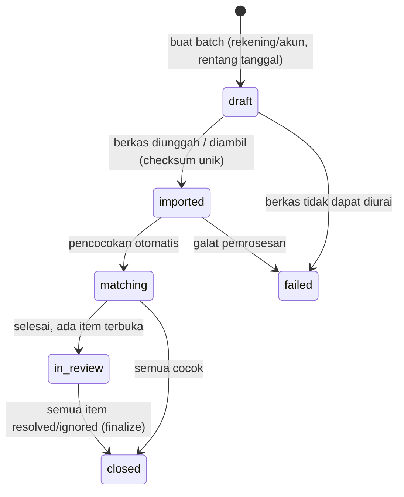
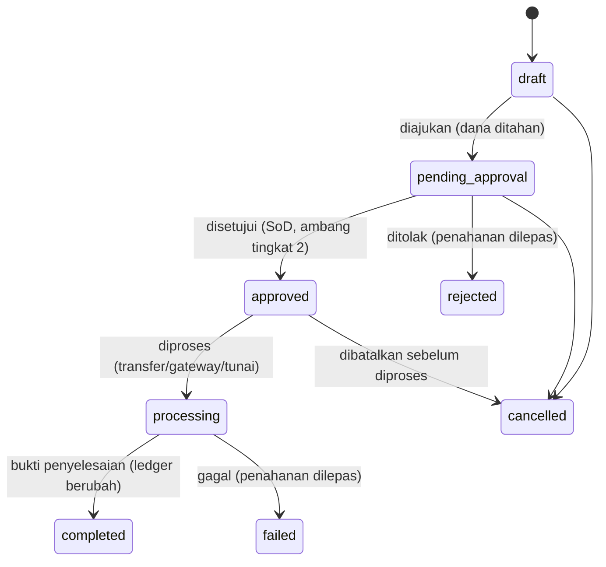
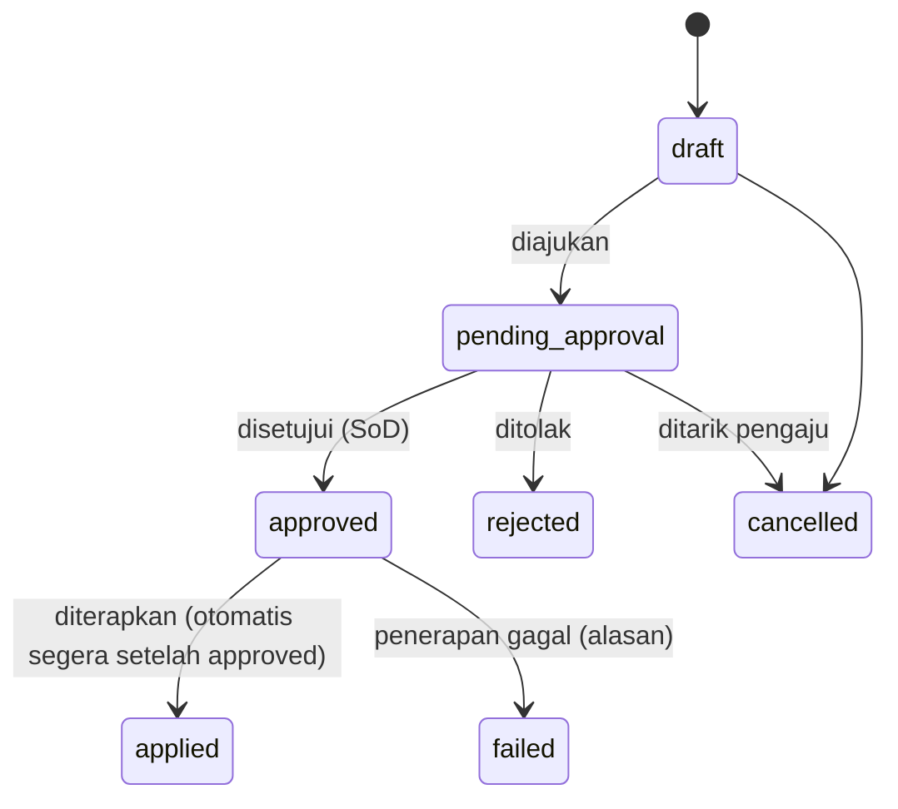
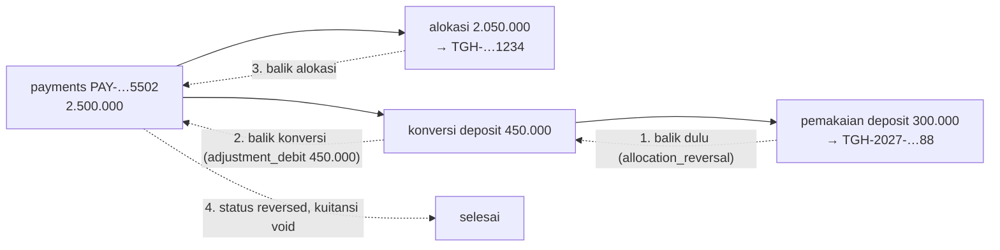
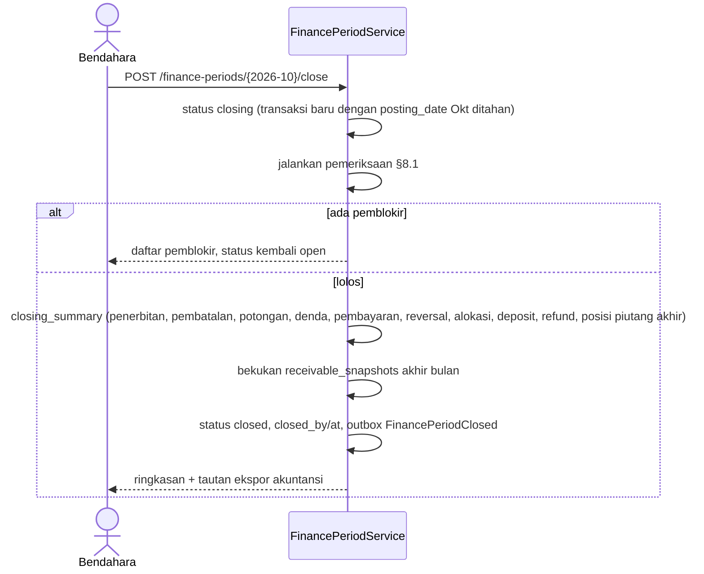

# 18 — Rancangan Rekonsiliasi, Pengembalian Dana, dan Penyesuaian

> **Status:** rancangan. Disusun 2026-10-13.
> Kembali ke [README](README.md) · Skema: [19 §3.13–§3.14](19-rancangan-database-dan-relasi.md#313-koreksi-dan-pengembalian-dana), [19 §3.2.3](19-rancangan-database-dan-relasi.md#323-finance_periods--baru) · Aturan: `KEU-BR-280`–`299` ([25](25-business-rules-dan-validasi.md)) · Keputusan: [KEU-KD-05](29-glossary-dan-keputusan-bisnis.md#2-keputusan-desain-keu-kd), [KEU-KD-15](29-glossary-dan-keputusan-bisnis.md#2-keputusan-desain-keu-kd), [KEU-KD-16](29-glossary-dan-keputusan-bisnis.md#2-keputusan-desain-keu-kd)

Dokumen ini mengatur pengendalian setelah transaksi terjadi: mencocokkan catatan sistem dengan laporan provider dan mutasi bank, mengembalikan dana, membalik dan mengoreksi transaksi tanpa menghapus histori, serta menutup periode keuangan dan mengekspor ringkasan ke akuntansi.

**Peta format baku:** tujuan/aktor/prasyarat §1 · data masukan §3, §5 · proses & status §3–§8 · aturan & validasi §3–§8 · hak akses §9 · data & relasi §10 · API §11 · UI §12 · notifikasi §13 · laporan §14 · kegagalan §15 · audit §16 · AC & TC §17.

## Daftar Isi

1. [Tujuan, Aktor, dan Prasyarat](#1-tujuan-aktor-dan-prasyarat)
2. [Batas Tanggung Jawab](#2-batas-tanggung-jawab)
3. [Rekonsiliasi](#3-rekonsiliasi)
4. [Penanganan Kasus Pengecualian](#4-penanganan-kasus-pengecualian)
5. [Kelebihan Bayar dan Pengembalian Dana](#5-kelebihan-bayar-dan-pengembalian-dana)
6. [Reversal dan Koreksi](#6-reversal-dan-koreksi)
7. [Penyesuaian Deposit dan Koreksi Tagihan](#7-penyesuaian-deposit-dan-koreksi-tagihan)
8. [Penutupan Periode dan Ekspor Akuntansi](#8-penutupan-periode-dan-ekspor-akuntansi)
9. [Hak Akses](#9-hak-akses)
10. [Struktur Data dan Relasi](#10-struktur-data-dan-relasi)
11. [API dan Event](#11-api-dan-event)
12. [UI/UX](#12-uiux)
13. [Notifikasi](#13-notifikasi)
14. [Laporan Terkait](#14-laporan-terkait)
15. [Skenario Kegagalan](#15-skenario-kegagalan)
16. [Audit Trail](#16-audit-trail)
17. [Acceptance Criteria dan Test Case](#17-acceptance-criteria-dan-test-case)

---

## 1. Tujuan, Aktor, dan Prasyarat

| Aspek | Isi |
|---|---|
| **Tujuan** | Memastikan setiap rupiah di sistem cocok dengan dana nyata, setiap kesalahan dikoreksi dengan jejak lengkap, dan laporan periode tertutup tidak berubah |
| **Manfaat** | Selisih terdeteksi cepat; auditor dapat menelusuri koreksi; bagian akuntansi menerima data ringkas yang seimbang |
| **Aktor** | Staf keuangan (impor, pencocokan, pengajuan koreksi/refund, pemrosesan refund), bendahara (persetujuan, penutupan periode), pimpinan (persetujuan tingkat lanjut), administrator integrasi (pengambilan settlement), bagian akuntansi (penerima ekspor), auditor |
| **Prasyarat** | Pembayaran ([07](07-rancangan-pembayaran.md)); rekening & kanal; persetujuan ([03 §6](03-role-dan-hak-akses.md#6-persetujuan)); kode akun pada komponen (`accounting_code`) untuk ekspor |

## 2. Batas Tanggung Jawab

| Hal | KEU | Payment gateway / bank | Akuntansi |
|---|---|---|---|
| Pemindahan dana dari mahasiswa ke rekening kampus | Mencatat & memverifikasi | **Memproses**, menyelesaikan (*settlement*) | — |
| Status transaksi provider | Mencerminkan, mengonfirmasi | **Sumber kebenaran** | — |
| Biaya provider | Mencatat dari settlement | Menetapkan & memotong | Membukukan beban |
| Kesesuaian pembayaran ↔ tagihan | **Pemilik** | — | — |
| Selisih settlement | Mendeteksi, mengeskalasi | Menjelaskan/memperbaiki | — |
| Refund | Mengajukan, menyetujui, mencatat | Memproses refund kanal (bila didukung) / transfer bank | Membukukan |
| Koreksi transaksi | **Pemilik** (reversal, penyesuaian) | — | Menerima efek pada periode terbuka |
| Penutupan periode | Mengunci data administrasi | — | Penutupan buku besar sendiri |
| Jurnal, buku besar, laporan keuangan institusi | Tidak ([KEU-KD-15](29-glossary-dan-keputusan-bisnis.md#2-keputusan-desain-keu-kd)) | — | **Pemilik** |

## 3. Rekonsiliasi

### 3.1 Jenis

| Jenis (`source_type`) | Sumber eksternal | Dicocokkan dengan | Frekuensi [R] |
|---|---|---|---|
| `gateway_settlement` | Laporan settlement provider (API bila `supportsSettlementReport`, atau berkas) | `payment_transactions` `paid` dan `payments` `gateway` | Harian |
| `bank_statement` | Mutasi rekening penerima (berkas CSV/XLSX dari internet banking; format per bank melalui *parser* yang dapat ditambah) | `payments` `manual_transfer`, setoran kas loket (per sesi kas), EDC | Harian/mingguan |

### 3.2 Status batch



| Aturan | Isi |
|---|---|
| [KEU-BR-286](25-business-rules-dan-validasi.md) | Berkas yang sama tidak dapat diimpor dua kali untuk jenis yang sama (unique `file_checksum`); baris dengan referensi yang sudah direkonsiliasi di batch lain ditandai `duplicate` |
| [KEU-BR-287](25-business-rules-dan-validasi.md) | Satu baris eksternal cocok dengan paling banyak satu pembayaran/transaksi, dan sebaliknya |
| Penutupan | Batch `closed` hanya bila tidak ada item `resolution_status = open`; oleh pemegang `reconciliations.finalize` (SoD dengan pengimpor disarankan) |

### 3.3 Aturan pencocokan

| Urutan | Kriteria | Hasil |
|---|---|---|
| 1 | Settlement: `provider_reference` atau `order_id` = `transaction_number` | Cocok pasti |
| 2 | Bank: `reference_key` pembayaran = referensi mutasi | Cocok pasti |
| 3 | Bank: nominal sama + tanggal ±3 hari + nama pengirim mirip + rekening tujuan sama | **Saran**, dikonfirmasi staf |
| 4 | Bank (setoran kas): Σ tunai sesi kas yang diverifikasi pada tanggal *d* = baris setoran tanggal *d* atau *d+1* | Cocok sesi |
| — | Tidak ditemukan | Status pengecualian (§3.4) |

### 3.4 Status item

| `match_status` | Arti | Tindakan penyelesaian (`resolution_action`) |
|---|---|---|
| `matched` | Cocok, nominal sama | — (`resolved` otomatis) |
| `amount_mismatch` | Cocok referensi, nominal berbeda (`difference_amount ≠ 0`) | Selidiki; `adjustment_created`, `escalated_to_provider`, atau `ignored_with_reason` |
| `missing_in_system` | Provider/bank mencatat dana, sistem tidak | Gateway: `recheck_marked_paid` ([KEU-BR-288](25-business-rules-dan-validasi.md)); bank: `unidentified_payment_created` ([KEU-BR-289](25-business-rules-dan-validasi.md)) |
| `missing_in_source` | Sistem mencatat lunas, provider/bank belum | Dibawa ke batch berikutnya (settlement H+1/H+2 lazim); > 3 hari kerja → `escalated_to_provider` |
| `duplicate` | Baris eksternal ganda | `ignored_with_reason` atau eskalasi |
| `unidentified` | Dana tanpa petunjuk mahasiswa | `unidentified_payment_created` |

Selisih yang ditutup tanpa koreksi wajib alasan tertulis ([KEU-BR-296](25-business-rules-dan-validasi.md)).

### 3.5 Biaya provider

Saat item settlement `matched`, `external_fee_amount` disalin ke `payments.provider_fee_amount`. Kolom ini adalah **informasi biaya** dan satu-satunya kolom pembayaran terverifikasi yang boleh diisi setelah verifikasi, sekali, oleh rekonsiliasi; nominal pembayaran tidak berubah.

### 3.6 Contoh batch settlement

Settlement provider tanggal 2 Oktober 2026 (*contoh*):

| Baris | Referensi | Bruto | Biaya | Neto | Sistem | Status | Tindakan |
|---|---|---:|---:|---:|---|---|---|
| 1 | `TRX-2026-00000871` | 4.004.000 | 4.000 | 4.000.000 | `paid`, 4.004.000 | `matched` | — |
| 2 | `TRX-2026-00000902` | 7.000.000 | 4.000 | 6.996.000 | `pending` | `missing_in_system` | Cek status → `paid` → pembayaran dibuat lewat jalur webhook |
| 3 | `TRX-2026-00000915` | 2.500.000 | 4.000 | 2.496.000 | `paid`, 2.550.000 | `amount_mismatch` (−50.000) | Eskalasi ke provider |
| — | `TRX-2026-00000920` | — | — | — | `paid`, 1.000.000 | `missing_in_source` | Dibawa ke batch 3 Okt |

Ringkasan batch: `source_total_amount` 13.504.000; `system_total_amount` (yang cocok referensinya) 13.554.000 setelah item 2 diselesaikan; selisih −50.000 tercatat pada item 3.

## 4. Penanganan Kasus Pengecualian

| Kasus (permintaan bisnis) | Penanganan |
|---|---|
| **Transaksi pending** | Polling/cek status ([08 §11](08-rancangan-pembayaran-online-dan-gateway.md#11-kemampuan-provider-cek-status-kedaluwarsa-refund)); item `missing_in_system` memicu cek status. Status lunas hanya dibuat melalui jalur verifikasi yang sama dengan webhook, bukan input manual ([KEU-BR-288](25-business-rules-dan-validasi.md)) |
| **Pembayaran masuk tanpa referensi tagihan** | Mahasiswa diketahui → `payments` diverifikasi lalu dialokasikan FIFO atau menjadi dana belum diterapkan. Mahasiswa tidak diketahui → `payments` `source = bank_import`, `pending_verification`, `student_id = null` (dana tak teridentifikasi, [KEU-KD-26](29-glossary-dan-keputusan-bisnis.md#2-keputusan-desain-keu-kd)); setelah diidentifikasi, staf mengisi mahasiswa dan memverifikasi (SoD) |
| **Nominal tidak sesuai** | Online: `mismatch` → `pending_verification` ([08 §9.3](08-rancangan-pembayaran-online-dan-gateway.md#93-selisih-nominal)); manual: verifikator memakai nominal mutasi ([09 §5.1](09-rancangan-pembayaran-tunai-dan-manual.md#51-verifikasi)); rekonsiliasi: `amount_mismatch` |
| **Pembayaran ganda** | Keduanya dicatat; kelebihan menjadi dana belum diterapkan → deposit atau refund (`source_type = duplicate_payment`) ([08 §9.2](08-rancangan-pembayaran-online-dan-gateway.md#92-pembayaran-ganda)) |
| **Pembatalan transaksi** | Transaksi online yang belum dibayar: dibatalkan ([08 §9.5](08-rancangan-pembayaran-online-dan-gateway.md#95-pembatalan-oleh-mahasiswa)). Pembayaran terverifikasi: hanya lewat reversal (§6) |

Dana tak teridentifikasi dilaporkan terpisah dengan umur; dana yang tetap tak teridentifikasi setelah batas waktu kebijakan kampus [K] ditangani di luar sistem (mis. pengumuman) dan tetap tercatat.

## 5. Kelebihan Bayar dan Pengembalian Dana

### 5.1 Sumber refund

| `refunds.source_type` | Dana berasal dari | Penahanan saat diajukan |
|---|---|---|
| `overpayment` | `payments.unapplied_amount` | Dana pembayaran asal dikurangi Σ refund aktif sebelum dapat dialokasikan |
| `duplicate_payment` | Pembayaran ganda (dana belum diterapkan) | Sama dengan di atas |
| `cancelled_invoice` | Dana yang dilepas dari tagihan yang dibatalkan (setelah reversal alokasi) | Sama dengan di atas |
| `deposit` | Saldo deposit | `deposit_accounts.held_amount` ([14 §7](14-rancangan-deposit-mahasiswa.md#7-pengembalian-deposit)) |

Untuk sumber pembayaran, dana yang dapat dialokasikan dihitung:

```
tersedia_untuk_alokasi(p) = p.unapplied_amount − Σ amount refund p yang berstatus pending_approval/approved/processing
```

### 5.2 Status



### 5.3 Aturan

| Aturan | Isi |
|---|---|
| [KEU-BR-282](25-business-rules-dan-validasi.md) | `amount > 0` dan ≤ dana tersedia sumber; dana ditahan saat diajukan |
| [KEU-BR-283](25-business-rules-dan-validasi.md) | Persetujuan bendahara; tingkat kedua (`vice_rector`) bila ≥ `refund_level2` ([KEU-Q-08](29-glossary-dan-keputusan-bisnis.md#3-pertanyaan-terbuka-keu-q)); penyetuju ≠ pengaju; pemroses sebaiknya ≠ penyetuju [R] |
| [KEU-BR-294](25-business-rules-dan-validasi.md) | Metode: `gateway_refund` hanya bila provider mendukung dan pembayaran asal dari provider itu; `bank_transfer` ke rekening atas nama mahasiswa (atau pihak yang dikuasakan, [K]); `cash` hanya dalam sesi kas, dengan tanda terima |
| [KEU-BR-284](25-business-rules-dan-validasi.md) | `completed` wajib `transfer_reference` dan/atau `transfer_proof_file_id` (atau `provider_refund_reference`) |
| Efek `completed` | Sumber pembayaran: `payments.refunded_amount += amount`, `unapplied_amount −= amount`. Sumber deposit: mutasi `refund` (debit), `held_amount −= amount`. `posting_date` = tanggal selesai (periode terbuka) |
| [KEU-BR-285](25-business-rules-dan-validasi.md) | `failed`/`rejected`/`cancelled` melepas penahanan; tidak ada perubahan ledger |
| Refund selesai lalu dana kembali | Deposit: `refund_reversal` (kredit). Pembayaran: penyesuaian `deposit_adjustment`/catatan; dana dikembalikan ke deposit mahasiswa |

## 6. Reversal dan Koreksi

### 6.1 Prinsip

1. Data finansial terverifikasi **tidak pernah** di-`UPDATE` nominalnya atau di-`DELETE` ([KEU-BR-007](25-business-rules-dan-validasi.md), [KEU-BR-281](25-business-rules-dan-validasi.md)).
2. Setiap koreksi adalah `finance_adjustments` dengan alasan, pelaku, waktu, referensi asal (`target_type/target_id`), bukti, dan persetujuan ([KEU-BR-280](25-business-rules-dan-validasi.md)).
3. Efek koreksi berupa **baris baru** (alokasi negatif, mutasi pembalik, baris tagihan `adjustment`) dalam satu transaksi saat `applied`.
4. Satu baris hanya dapat dibalik sekali (unique `reversal_of_id`).

### 6.2 Status penyesuaian



`failed` tidak diulang otomatis; pengaju membuat penyesuaian baru setelah penyebabnya diperbaiki (mis. saldo deposit tidak cukup untuk membalik konversi).

### 6.3 Katalog tipe

| `adjustment_type` | Sasaran | Efek saat `applied` | Kode alasan |
|---|---|---|---|
| `invoice_correction` | `invoice` / `invoice_item` | Baris `adjustment` (±), perpanjangan jatuh tempo, atau penerapan susulan beasiswa; dapat menyertakan pembalikan alokasi bila nominal baru < dibayar | `WRONG_TARIFF`, `WRONG_CREDITS`, `CREDITS_DROPPED`, `DUPLICATE_INVOICE`, `STUDENT_STATUS_CHANGED`, `UKT_CHANGED`, `POLICY_DECISION`, `DISPUTE_ACCEPTED`, `DUE_DATE_EXTENSION`, `SCHOLARSHIP_LATE_APPLY`, `LATE_FEE_ERROR`, `PAID_ON_TIME_VERIFIED_LATE`, `OTHER` |
| `invoice_cancellation` | `invoice` | `status = cancelled` + efek berantai ([06 §8.3](06-rancangan-tagihan-mahasiswa.md#83-pembatalan)) | `DUPLICATE_INVOICE`, `WRONG_STUDENT`, `STUDENT_STATUS_CHANGED`, `POLICY_DECISION`, `DRAFT_DISCARDED`, `OTHER` |
| `manual_discount` | `invoice_item` | Baris `manual_discount` | `POLICY_DECISION`, `HARDSHIP`, `ERROR_COMPENSATION`, `OTHER` |
| `late_fee_waiver` | `late_fee_assessment` / `invoice` (denda) | Baris `late_fee_waiver` | `POLICY_DECISION`, `HARDSHIP`, `SYSTEM_DOWNTIME`, `OTHER` |
| `payment_reversal` | `payment` | Semua alokasi aktif dibalik, konversi deposit dibalik, kuitansi `voided`, `payments.status = reversed`, outbox `PaymentReversed` | `WRONG_STUDENT`, `WRONG_AMOUNT`, `FUNDS_NOT_RECEIVED`, `FRAUDULENT_PROOF`, `DUPLICATE_RECORD`, `OTHER` |
| `allocation_reversal` | `payment_allocation` | Alokasi negatif; dana kembali ke `unapplied_amount` atau ke deposit | `WRONG_INVOICE`, `INVOICE_CORRECTION`, `OTHER` |
| `reallocation` | `payment_allocation` | Pembalikan + alokasi baru ke tagihan tujuan (mahasiswa sama) | `WRONG_INVOICE`, `STUDENT_REQUEST`, `OTHER` |
| `overpayment_to_deposit` | `payment` | Konversi (dipakai bila kampus mewajibkan persetujuan untuk konversi [K]) | `OVERPAYMENT` |
| `deposit_adjustment` | `deposit_account` | Mutasi `adjustment_credit/debit` | `OPENING_BALANCE`, `CORRECTION`, `RETURNED_REFUND`, `OTHER` |
| `write_off` [K] | `invoice` | **Nonaktif** ([KEU-BR-292](25-business-rules-dan-validasi.md), [KEU-Q-26](29-glossary-dan-keputusan-bisnis.md#3-pertanyaan-terbuka-keu-q)) | — |

### 6.4 Pembalikan berantai

Reversal harus membalik efek turunan dalam urutan terbalik dari pembentukannya ([KEU-BR-295](25-business-rules-dan-validasi.md)):



Bila saldo deposit tidak cukup karena sebagian sudah dipakai, penerapan `payment_reversal` gagal (`failed`, alasan "pemakaian deposit harus dibalik lebih dulu") dan UI menampilkan daftar langkah yang diperlukan.

### 6.5 Contoh

Reversal pembayaran loket yang dicatat pada mahasiswa yang salah: [19 §5.4](19-rancangan-database-dan-relasi.md#54-reversal-pembayaran-yang-salah-catat).

## 7. Penyesuaian Deposit dan Koreksi Tagihan

| Kebutuhan | Mekanisme |
|---|---|
| Saldo deposit awal hasil migrasi | `deposit_adjustment` (+) `OPENING_BALANCE`, batch, dengan berkas sumber |
| Koreksi saldo deposit karena kesalahan | `deposit_adjustment` (±) `CORRECTION` setelah investigasi `INV-07` |
| Koreksi tagihan | `invoice_correction` / `invoice_cancellation` ([06 §8](06-rancangan-tagihan-mahasiswa.md#8-perubahan-pembatalan-koreksi-dan-perpanjangan)) |
| Koreksi massal (mis. tarif salah untuk satu prodi) | Satu penyesuaian per tagihan, dibuat lewat aksi massal dari daftar yang ditinjau; persetujuan dapat dilakukan per batch, tetapi SoD diperiksa per baris |

## 8. Penutupan Periode dan Ekspor Akuntansi

### 8.1 Syarat penutupan

Bendahara memulai penutupan (`open → closing`). Sistem menjalankan pemeriksaan ([KEU-BR-290](25-business-rules-dan-validasi.md)):

| Pemeriksaan | Memblokir? |
|---|---|
| Tidak ada `finance_adjustments` `approved` (belum `applied`) dengan `posting_date` dalam periode | Ya |
| Semua sesi kas yang dibuka dalam periode `closed` dan `verified` | Ya |
| Invarian `INV-01`…`INV-14` tanpa pelanggaran baru dalam periode | Ya |
| Batch rekonsiliasi yang mencakup periode `closed`, atau item terbukanya diakui (*acknowledged*) dengan catatan | Ya (dapat diakui) |
| Pembayaran `pending_verification` berumur > 7 hari | Tidak (daftar peringatan) |
| Refund `processing` | Tidak (akan dibukukan pada tanggal selesainya) |

### 8.2 Langkah



Setelah `closed`, transaksi dengan `posting_date` di periode itu ditolak `PERIOD_CLOSED` ([KEU-BR-014](25-business-rules-dan-validasi.md)); koreksi dibukukan di periode terbuka berikutnya.

### 8.3 Pembukaan kembali

Workflow `finance_period_reopen` dengan dua tingkat (bendahara + `vice_rector`) dan alasan wajib ([KEU-BR-291](25-business-rules-dan-validasi.md), [KEU-Q-16](29-glossary-dan-keputusan-bisnis.md#3-pertanyaan-terbuka-keu-q)). Ringkasan penutupan lama disimpan di histori; penutupan ulang menghasilkan ringkasan baru dan ekspor akuntansi baru yang ditandai versi. Laporan yang sudah dibagikan menyebut versi ringkasan.

### 8.4 Ekspor akuntansi

Ekspor jurnal **ringkas** per periode `closed` ([KEU-KD-15](29-glossary-dan-keputusan-bisnis.md#2-keputusan-desain-keu-kd), [KEU-BR-293](25-business-rules-dan-validasi.md)). Pemetaan akun adalah keputusan bagian akuntansi [K] ([KEU-Q-18](29-glossary-dan-keputusan-bisnis.md#3-pertanyaan-terbuka-keu-q)); rancangan menyediakan kerangka berikut:

| Kejadian KEU (dalam periode, menurut `posting_date`) | Debit | Kredit | Dimensi |
|---|---|---|---|
| Penerbitan tagihan (baris `charge`) | Piutang mahasiswa | Pendapatan per `accounting_code` komponen | Prodi, term |
| Potongan beasiswa/potongan/voucher/manual | Beban beasiswa / pengurang pendapatan [K] | Piutang mahasiswa | Skema, sumber dana |
| Pembatalan/koreksi tagihan | Kebalikan dari penerbitan | | |
| Penerimaan pembayaran terverifikasi | Kas/bank (per rekening/kanal) | Titipan penerimaan belum diterapkan | Kanal |
| Alokasi ke tagihan | Titipan penerimaan belum diterapkan | Piutang mahasiswa | |
| Konversi ke deposit | Titipan penerimaan belum diterapkan | Kewajiban deposit mahasiswa | |
| Pemakaian deposit | Kewajiban deposit mahasiswa | Piutang mahasiswa | |
| Refund selesai | Titipan / kewajiban deposit | Kas/bank | |
| Biaya provider (dari settlement) | Beban administrasi bank | Kas/bank (neto settlement) | Provider |
| Reversal | Kebalikan dari baris asal | | |

Validasi: Σ debit = Σ kredit per batch; `accounting_export_batches` mencatat `row_count`, `total_debit`, `total_credit`, berkas CSV/XLSX (kolom: tanggal, nomor jurnal, akun, debit, kredit, uraian, dimensi, referensi dokumen). Komponen tanpa `accounting_code` membuat ekspor gagal dengan daftar komponen yang harus dilengkapi.

## 9. Hak Akses

| Aksi | Permission | Role default |
|---|---|---|
| Buat batch, impor, cocokkan, selesaikan item | `reconciliations.create/import/update` | FO, FA |
| Tutup batch | `reconciliations.finalize` | FM |
| Ajukan penyesuaian | `finance_adjustments.create` | FA, FO |
| Setujui/tolak penyesuaian | `finance_adjustments.approve/reject` | FM (+RK tingkat 2) |
| Ajukan, proses, selesaikan refund | `refunds.create/update` | FO, FA |
| Setujui/tolak refund | `refunds.approve/reject` | FM (+RK tingkat 2) |
| Tutup periode / ajukan buka kembali | `finance_periods.finalize` / `.update` | FM |
| Ekspor akuntansi | `finance_reports.export` | FA, FM, AU |

## 10. Struktur Data dan Relasi

| Tabel | Rincian |
|---|---|
| `reconciliation_batches`, `reconciliation_items` | [19 §3.14](19-rancangan-database-dan-relasi.md#314-rekonsiliasi) |
| `refunds` | [19 §3.13.2](19-rancangan-database-dan-relasi.md#3132-refunds--baru) |
| `finance_adjustments` | [19 §3.13.1](19-rancangan-database-dan-relasi.md#3131-finance_adjustments--baru) |
| `finance_periods` | [19 §3.2.3](19-rancangan-database-dan-relasi.md#323-finance_periods--baru) |
| `accounting_export_batches` | [19 §3.17.4](19-rancangan-database-dan-relasi.md#3174-accounting_export_batches--baru-r) |

ERD: [19 §4.5](19-rancangan-database-dan-relasi.md#45-koreksi-refund-rekonsiliasi-periode).

## 11. API dan Event

| Method | URL | Permission | Keterangan |
|---|---|---|---|
| GET/POST | `/reconciliation-batches` | `reconciliations.read` / `.create` | |
| POST | `/reconciliation-batches/{batch}/import` | `reconciliations.import` | Berkas atau `fetch=provider` |
| POST | `/reconciliation-batches/{batch}/match` | `reconciliations.update` | |
| GET | `/reconciliation-batches/{batch}/items` | `reconciliations.read` | Filter `match_status`, `resolution_status` |
| POST | `/reconciliation-items/{item}/resolve` | `reconciliations.update` | `resolution_action`, tautan pembayaran/penyesuaian/refund, catatan |
| POST | `/reconciliation-batches/{batch}/close` | `reconciliations.finalize` | |
| GET/POST | `/finance-adjustments` | `finance_adjustments.read` / `.create` | Endpoint pintasan per tipe tersedia di dokumen fitur |
| GET | `/finance-adjustments/{adjustment}` | `finance_adjustments.read` | Pratinjau efek |
| POST | `/finance-adjustments/{adjustment}/submit`, `/cancel` | `finance_adjustments.create` | |
| POST | `/finance-adjustments/{adjustment}/approve`, `/reject` | `.approve` / `.reject` | SoD; penerapan otomatis |
| GET/POST | `/refunds` | `refunds.read` / `.create` | |
| POST | `/refunds/{refund}/submit`, `/cancel` | `refunds.create` / `.update` | |
| POST | `/refunds/{refund}/approve`, `/reject` | `.approve` / `.reject` | |
| POST | `/refunds/{refund}/process`, `/complete`, `/fail` | `refunds.update` | `complete` wajib bukti |
| GET | `/finance-periods`; POST `/finance-periods/{period}/close`, `/reopen` | `finance_periods.*` | |
| GET/POST | `/accounting-exports` | `finance_reports.read` / `.export` | |

Event outbox: `PaymentReversed`, `RefundCompleted`, `FinancePeriodClosed`, `InvoiceStatusChanged`.

## 12. UI/UX

| Halaman | Rute | Inti |
|---|---|---|
| Rekonsiliasi | `/keuangan/monitoring/rekonsiliasi` | Daftar batch (sumber, rentang, cocok/pengecualian, selisih total, status); wizard impor |
| Detail Batch | `/keuangan/monitoring/rekonsiliasi/:id` | Tab per status item; panel kiri baris eksternal, kanan kandidat sistem; aksi selesaikan; ringkasan selisih |
| Pengembalian Dana | `/keuangan/pembayaran/refund` | Daftar refund, form pengajuan (sumber & dana tersedia), langkah proses dengan unggah bukti |
| Koreksi & Reversal | `/keuangan/pembayaran/koreksi` | Daftar penyesuaian per tipe/status; form dengan **pratinjau efek** (baris yang akan dibuat, saldo sebelum/sesudah, langkah berantai bila perlu) |
| Periode Keuangan | `/keuangan/master/periode` | Wizard penutupan (pemeriksaan, ringkasan, konfirmasi), riwayat buka kembali |
| Ekspor Akuntansi | `/keuangan/laporan/ekspor-akuntansi` | Daftar batch ekspor, unduh, status |

## 13. Notifikasi

| Event | Penerima | Kanal |
|---|---|---|
| `finance.reconciliation_exceptions` (ringkasan harian) | Staf keuangan | database |
| `finance.refund_status_changed` | Mahasiswa, pengaju | database, mail |
| `finance.payment_reversed` | Mahasiswa | database, mail |
| `finance.approval_requested` | Penyetuju | database, mail |
| `finance.period_closing_reminder` | Bendahara | database, mail |

## 14. Laporan Terkait

[KEU-RPT-15](22-rancangan-laporan-dan-dashboard.md) rekonsiliasi, [KEU-RPT-16](22-rancangan-laporan-dan-dashboard.md) pengembalian dana & reversal, [KEU-RPT-18](22-rancangan-laporan-dan-dashboard.md) audit perubahan.

## 15. Skenario Kegagalan

| Skenario | Penanganan |
|---|---|
| Format berkas bank berubah | Impor gagal (`failed`) dengan pesan kolom; parser diperbarui; berkas yang sama dapat diimpor ulang setelah batch `failed` (checksum hanya unik untuk batch tidak gagal) |
| Penyesuaian disetujui tetapi penerapan gagal (saldo kurang, periode tertutup, tagihan berubah) | `failed` + alasan; tidak ada efek parsial |
| Refund ditransfer ganda di luar sistem | Terdeteksi di rekonsiliasi bank (debit tanpa pasangan); ditangani dengan penyesuaian dan penagihan kembali di luar sistem [K] |
| Penutupan periode bersamaan dengan transaksi masuk | Status `closing` menahan transaksi baru periode itu; transaksi yang sedang berjalan selesai lebih dulu (kunci baris periode) |
| Komponen tanpa kode akun saat ekspor | Ekspor gagal dengan daftar komponen |

## 16. Audit Trail

| Aksi | Dicatat |
|---|---|
| Impor berkas | `audit_logs` (`imported`) + berkas + checksum |
| Penyelesaian item | `reconciliation_items.resolved_by/at`, `resolution_note` + `audit_logs` |
| Penyesuaian & refund | Baris entitas (append status) + `finance_status_histories` + `audit_logs` (`approved`/`rejected`) |
| Penutupan/pembukaan periode | `finance_periods` + `closing_summary` + `audit_logs` (`approved`/`forced_override`) |
| Ekspor akuntansi | `accounting_export_batches` + `audit_logs` (`exported`) |

## 17. Acceptance Criteria dan Test Case

| Acceptance criteria | Test case |
|---|---|
| [KEU-AC-REC-01](27-acceptance-criteria.md) Reversal tanpa menghapus; berantai bila perlu | [KEU-TC-REC-001](26-skenario-pengujian.md), [KEU-TC-REC-002](26-skenario-pengujian.md), [KEU-TC-REC-003](26-skenario-pengujian.md), [KEU-TC-REC-006](26-skenario-pengujian.md) |
| [KEU-AC-REC-02](27-acceptance-criteria.md) Refund: tahan → setujui → selesai dengan bukti | [KEU-TC-REC-004](26-skenario-pengujian.md), [KEU-TC-REC-005](26-skenario-pengujian.md), [KEU-TC-REC-014](26-skenario-pengujian.md) |
| [KEU-AC-REC-03](27-acceptance-criteria.md) Rekonsiliasi mendeteksi dan menyelesaikan selisih | [KEU-TC-REC-007](26-skenario-pengujian.md), [KEU-TC-REC-008](26-skenario-pengujian.md), [KEU-TC-REC-009](26-skenario-pengujian.md) |
| [KEU-AC-REC-04](27-acceptance-criteria.md) Periode tertutup terkunci; buka kembali berizin | [KEU-TC-REC-010](26-skenario-pengujian.md), [KEU-TC-REC-011](26-skenario-pengujian.md) |
| [KEU-AC-REC-05](27-acceptance-criteria.md) Ekspor akuntansi seimbang | [KEU-TC-REC-013](26-skenario-pengujian.md) |
| [KEU-AC-REC-06](27-acceptance-criteria.md) Dana tak teridentifikasi tercatat dan dapat diidentifikasi | [KEU-TC-REC-012](26-skenario-pengujian.md) |
| [KEU-AC-REC-07](27-acceptance-criteria.md) Batch hanya ditutup tanpa item terbuka | [KEU-TC-REC-007](26-skenario-pengujian.md) |
