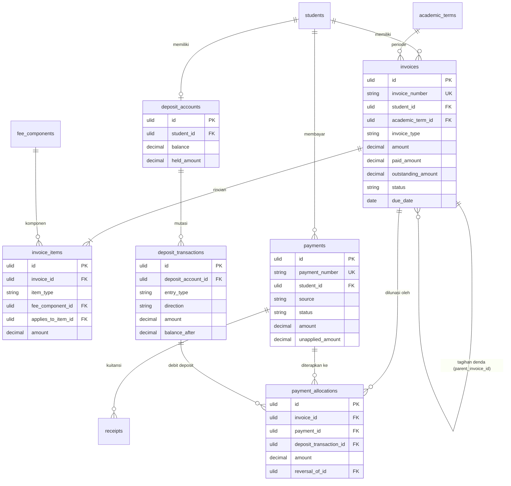
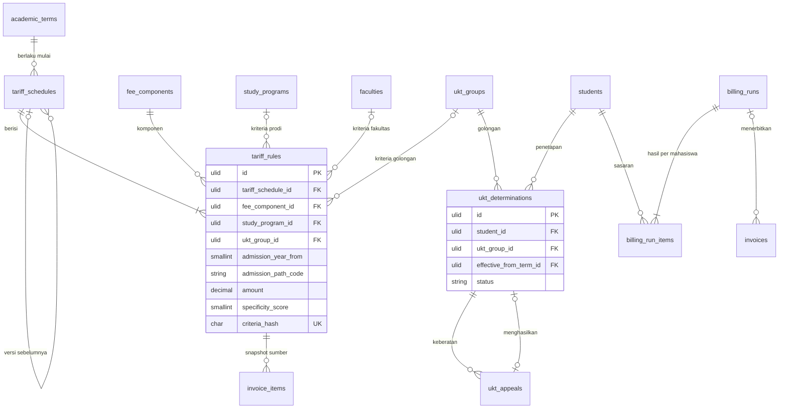
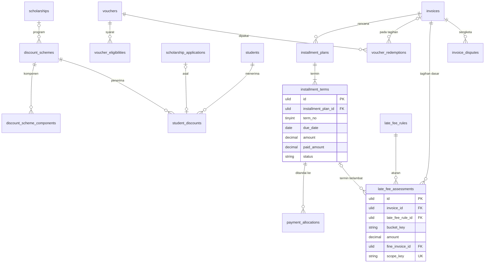
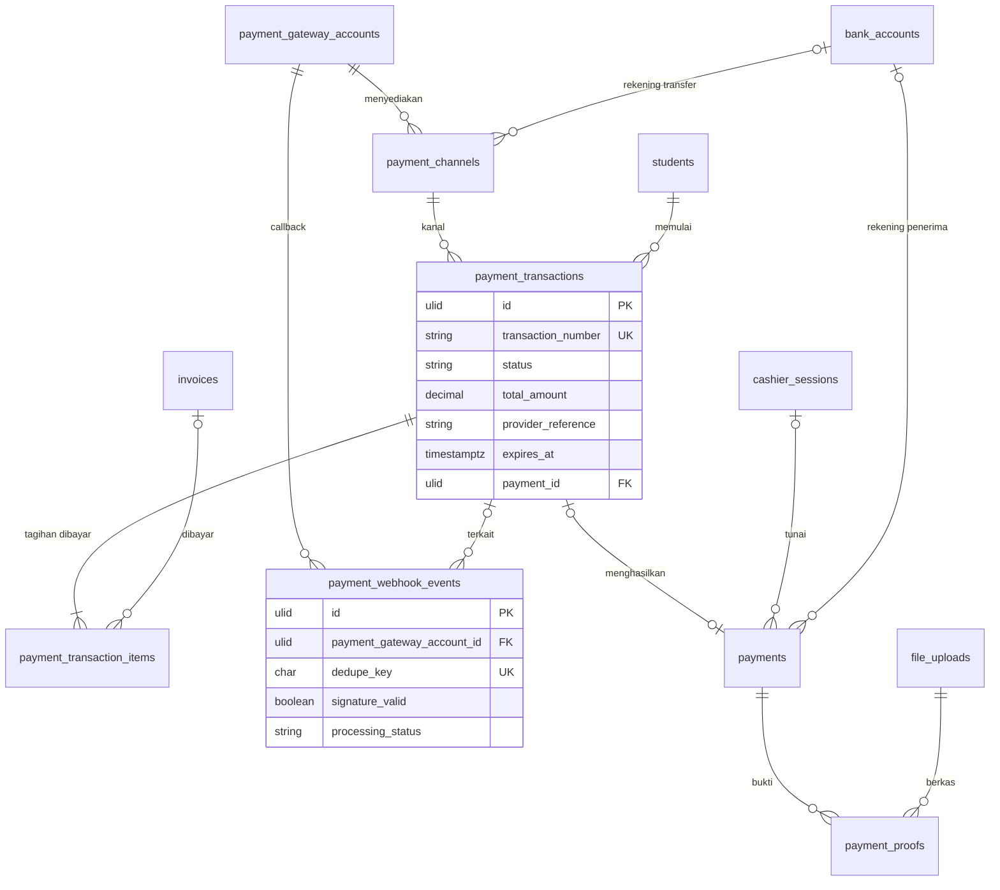
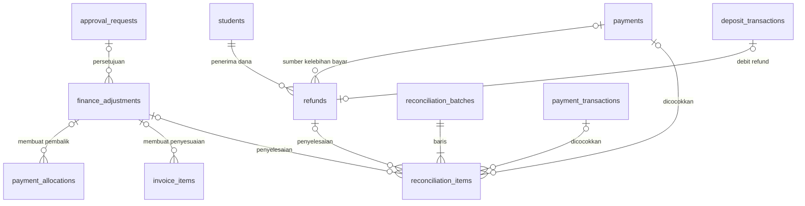
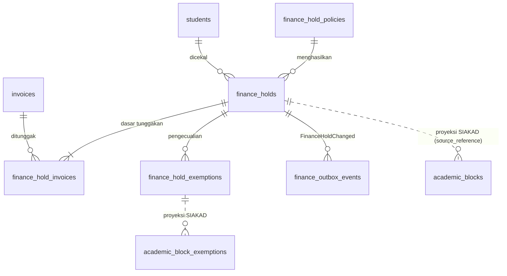
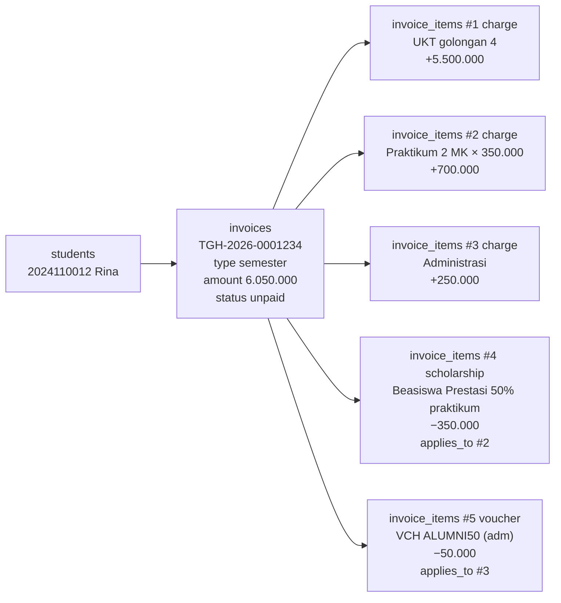
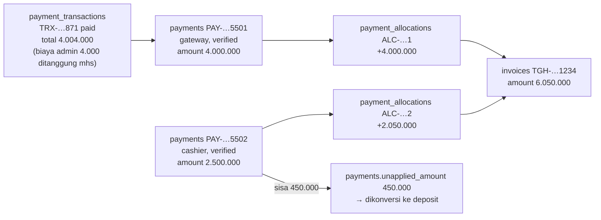
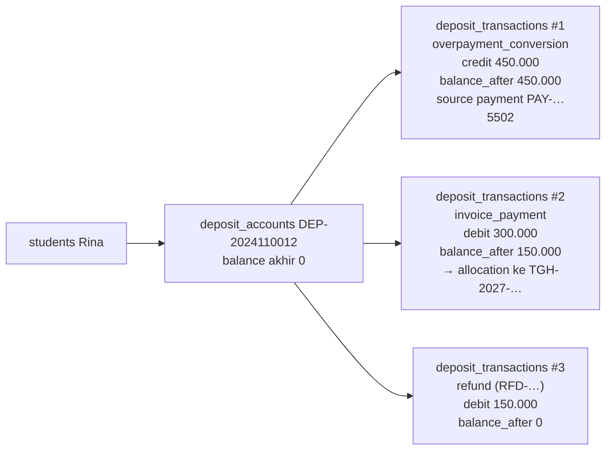

# 19 — Rancangan Database dan Relasi

> **Status:** rancangan, belum dimigrasikan. Tabel atau kolom berlabel **Baru**/**Ubah** belum ada di repository.
> **Disusun:** 2026-10-12, berdasarkan migration `app/Modules/Finance/Database/Migrations/2026_07_20_02000{0,1}_*`, `app/Modules/Academic`, `app/Modules/Scholarship`, `app/Modules/Tenancy`, `app/Modules/FileManagement`, `app/Modules/ApprovalWorkflow`, dan `app/Modules/AuditLog` pada commit `bb54756`.
> Kembali ke [README](README.md) · Kanon: [README §5](README.md#5-kanon-wajib-diikuti-seluruh-dokumen)

Dokumen ini adalah **skema acuan** modul KEU. Jika dokumen lain menyebut kolom, tipe, atau constraint yang berbeda, **dokumen inilah yang berlaku**. Aturan bisnis yang memakai kolom-kolom ini ada di [25](25-business-rules-dan-validasi.md). Konvensi umum (ULID, `timestampsTz`, `decimal(14,2)`, `string(20)` + PHP enum, `active_key`) mengikuti [README §5.1](README.md#51-konvensi-teknis) dan selaras dengan [academic-learning/07 §1](../../docs/academic-learning/07-database-erd.md).

## Daftar Isi

1. [Konvensi Khusus KEU](#1-konvensi-khusus-keu)
2. [Ringkasan Entitas](#2-ringkasan-entitas)
3. [Data Dictionary](#3-data-dictionary)
4. [ERD Mermaid](#4-erd-mermaid)
5. [Contoh Alur Relasi](#5-contoh-alur-relasi)
6. [Strategi Migrasi dari Skema yang Ada](#6-strategi-migrasi-dari-skema-yang-ada)
7. [Strategi Integritas, Konkurensi, dan Histori](#7-strategi-integritas-konkurensi-dan-histori)
8. [Invarian dan Query Pemeriksaan](#8-invarian-dan-query-pemeriksaan)
9. [Ringkasan Indeks dan Volume](#9-ringkasan-indeks-dan-volume)

---

## 1. Konvensi Khusus KEU

### 1.1 Kolom standar

Setiap tabel tenant baru memiliki kolom standar berikut. Di §3 kolom-kolom ini ditulis sebagai satu baris *"kolom standar"*.

| Kolom | Tipe | Null | Keterangan |
|---|---|---|---|
| `id` | `ulid` (`char(26)`) | tidak | PK, trait `HasUlids` |
| `university_id` | `ulid` | tidak | FK → `universities.id` cascade. Diisi `TenantScoped` |
| `created_at`, `updated_at` | `timestampTz` | ya | |

**Tabel append-only** (ledger, histori, alokasi) **tidak** memiliki `updated_at`. Modelnya memakai `const UPDATED_AT = null` dan kolom `created_at` diisi `useCurrent()`, mengikuti pola yang sudah ada.

### 1.2 Tipe data

| Jenis nilai | Tipe | Catatan |
|---|---|---|
| Uang | `decimal(14,2)` | Maks Rp999.999.999.999,99. Bertanda bila disebut "bertanda" |
| Persentase | `decimal(5,2)` | 0.00–100.00 |
| SKS / kuantitas | `decimal(8,2)` untuk `invoice_items.quantity`; `unsignedTinyInteger` untuk SKS mentah | Kuantitas desimal memberi ruang untuk satuan non-SKS |
| Nomor dokumen | `string(30)` | Format di §7.1 |
| Kode | `string(20)`–`string(40)` | Disimpan huruf besar (kode voucher dinormalisasi) |
| Status/kategori | `string(20)` (kategori panjang `string(30)`/`string(40)`) | PHP backed enum |
| Data rahasia | `text` + cast `encrypted` | Disertai kolom `*_last4` dan/atau `*_hash` (`char(64)`, HMAC-SHA256 dengan kunci aplikasi) untuk tampilan dan pencarian/unik |
| JSON | `json` | Hanya untuk konfigurasi, snapshot, dan payload, sesuai kebijakan [academic-learning/07 §1.6](../../docs/academic-learning/07-database-erd.md) |

### 1.3 Aturan `on delete`

| Referensi | `on delete` |
|---|---|
| `university_id` → `universities` | `cascade` (hanya terjadi lewat prosedur offboarding tenant) |
| Anak murni header (item, termin, baris batch) | `cascade`. Penghapusan header sendiri diblokir oleh service jika header sudah final |
| Referensi ke entitas keuangan atau master yang tercatat di riwayat (`students`, `invoices`, `payments`, `fee_components`, `academic_terms`, `tariff_rules`, dll.) | `restrict` |
| Aktor dan berkas opsional (`users`, `file_uploads`, `approval_requests`) | `set null` |

### 1.4 Generated column untuk unique parsial

Pola yang dipakai mengikuti [academic-learning/07 §1.8](../../docs/academic-learning/07-database-erd.md). Contoh:

```sql
active_key VARCHAR(80) GENERATED ALWAYS AS (
  CASE WHEN status IN ('pending_approval','active') THEN invoice_id END
) STORED,
UNIQUE KEY installment_plans_active_key_uq (university_id, active_key)
```

Kolom kunci yang bergantung pada status tabel **lain** tidak bisa dibuat sebagai generated column. Kolom seperti itu ditulis sebagai **kolom kunci terkelola** (`*_key`, nullable), diisi atau dikosongkan oleh service di dalam transaksi DB yang sama dengan perubahan status. Pada PostgreSQL, kedua pola ini diganti indeks unik parsial.

### 1.5 CHECK constraint

MySQL ≥ 8.0.16 menegakkan `CHECK`. Constraint nominal yang tidak bergantung status **ditambahkan** sebagai pengaman lapis kedua, misalnya `CHECK (amount > 0)` pada `payments` dan `CHECK (balance >= 0)` pada `deposit_accounts`. Validasi status tetap dilakukan di PHP enum dan service. Di SQLite (test), constraint ini juga didukung.

---

## 2. Ringkasan Entitas

| # | Tabel | Status | Kelompok | Fungsi singkat | Rincian |
|---|---|---|---|---|---|
| 1 | `fee_components` | Baru | Master | Komponen biaya | §3.2.1 |
| 2 | `bank_accounts` | Baru | Master | Rekening penerima kampus | §3.2.2 |
| 3 | `finance_periods` | Baru | Master | Periode pembukuan bulanan | §3.2.3 |
| 4 | `finance_sequences` | Baru | Master | Penomoran dokumen | §3.2.4 |
| 5 | `ukt_groups` | Baru | UKT | Golongan UKT | §3.3.1 |
| 6 | `tariff_schedules` | Baru | Tarif | Header versi tarif | §3.3.2 |
| 7 | `tariff_rules` | Baru | Tarif | Baris aturan tarif | §3.3.3 |
| 8 | `invoices` | **Ubah** | Tagihan | Tagihan | §3.4.1 |
| 9 | `invoice_items` | Baru | Tagihan | Rincian komponen, potongan, penyesuaian | §3.4.2 |
| 10 | `billing_runs` | Baru | Tagihan | Penerbitan massal | §3.4.3 |
| 11 | `billing_run_items` | Baru | Tagihan | Hasil per mahasiswa | §3.4.4 |
| 12 | `installment_plans` | Baru | Cicilan | Rencana cicilan | §3.5.1 |
| 13 | `installment_terms` | Baru | Cicilan | Termin | §3.5.2 |
| 14 | `invoice_disputes` | Baru | Tagihan | Sengketa tagihan | §3.5.3 |
| 15 | `payment_gateway_accounts` | Baru | Online | Akun/kredensial provider | §3.6.1 |
| 16 | `payment_channels` | Baru | Online | Kanal pembayaran | §3.6.2 |
| 17 | `payment_transactions` | Baru | Online | Upaya pembayaran ke provider | §3.6.3 |
| 18 | `payment_transaction_items` | Baru | Online | Tagihan yang dibayar dalam satu transaksi | §3.6.4 |
| 19 | `payment_webhook_events` | Baru | Online | Callback mentah | §3.6.5 |
| 20 | `payments` | **Ubah** | Pembayaran | Penerimaan dana | §3.7.1 |
| 21 | `payment_allocations` | Baru | Pembayaran | Penerapan dana ke tagihan | §3.7.2 |
| 22 | `payment_proofs` | Baru | Manual | Bukti transfer | §3.7.3 |
| 23 | `receipts` | Baru | Pembayaran | Kuitansi | §3.7.4 |
| 24 | `cashier_sessions` | Baru | Manual | Sesi kas loket | §3.7.5 |
| 25 | `discount_schemes` | Baru | Potongan | Skema beasiswa/potongan | §3.8.1 |
| 26 | `discount_scheme_components` | Baru | Potongan | Komponen yang dapat dipotong | §3.8.2 |
| 27 | `student_discounts` | Baru | Potongan | Penerima beasiswa/potongan | §3.8.3 |
| — | `scholarships`, `scholarship_applications` | Ada | Potongan | Program dan pengajuan beasiswa (modul Scholarship) | §3.8.4 |
| 28 | `vouchers` | Baru | Voucher | Master voucher | §3.9.1 |
| 29 | `voucher_eligibilities` | Baru | Voucher | Syarat kelayakan | §3.9.2 |
| 30 | `voucher_redemptions` | Baru | Voucher | Pemakaian voucher | §3.9.3 |
| 31 | `late_fee_rules` | Baru | Denda | Aturan denda | §3.10.1 |
| 32 | `late_fee_assessments` | Baru | Denda | Denda yang dibentuk per bucket | §3.10.2 |
| 33 | `deposit_accounts` | Baru | Deposit | Akun deposit | §3.11.1 |
| 34 | `deposit_transactions` | Baru | Deposit | Ledger mutasi deposit | §3.11.2 |
| 35 | `ukt_determinations` | Baru | UKT | Penetapan UKT mahasiswa | §3.12.1 |
| 36 | `ukt_appeals` | Baru | UKT | Keberatan UKT | §3.12.2 |
| 37 | `finance_adjustments` | Baru | Koreksi | Koreksi, reversal, pembebasan | §3.13.1 |
| 38 | `refunds` | Baru | Refund | Pengembalian dana | §3.13.2 |
| 39 | `reconciliation_batches` | Baru | Rekonsiliasi | Batch rekonsiliasi | §3.14.1 |
| 40 | `reconciliation_items` | Baru | Rekonsiliasi | Baris pencocokan | §3.14.2 |
| 41 | `receivable_snapshots` | Baru | Piutang | Snapshot agregat harian | §3.15.1 |
| 42 | `finance_hold_policies` | Baru | Cekal | Kebijakan cekal | §3.16.1 |
| 43 | `finance_holds` | Baru | Cekal | Status cekal per mahasiswa | §3.16.2 |
| 44 | `finance_hold_invoices` | Baru | Cekal | Dasar tunggakan cekal | §3.16.3 |
| 45 | `finance_hold_exemptions` | Baru | Cekal | Pengecualian cekal | §3.16.4 |
| 46 | `finance_status_histories` | Baru | Lintas | Riwayat transisi status | §3.17.1 |
| 47 | `finance_outbox_events` | Baru | Lintas | Outbox integrasi | §3.17.2 |
| 48 | `idempotency_keys` | Baru | Lintas | Idempotensi API | §3.17.3 |
| 49 | `accounting_export_batches` | Baru | Lintas | Ekspor ke akuntansi | §3.17.4 |

---

## 3. Data Dictionary

### 3.1 Tabel referensi dari modul lain (tidak dimiliki KEU)

| Tabel | Kolom yang dipakai KEU | Catatan |
|---|---|---|
| `universities` | `id`, `timezone`, `currency` | Zona waktu batas hari ([KEU-KD-13](29-glossary-dan-keputusan-bisnis.md#2-keputusan-desain-keu-kd)) |
| `students` | `id`, `user_id`, `nim`, `name`, `study_program_id`, `admission_year`, `status` | Kolom `admission_path_code` dan `study_system_code` **belum ada**. Diusulkan oleh [pmb/10](../../docs/pmb/10-database-erd-data-dictionary.md) sebagai `string(30)` nullable dan menjadi **prasyarat** kriteria tarif jalur/kelas ([KEU-A-04](29-glossary-dan-keputusan-bisnis.md#4-asumsi-keu-a)) |
| `faculties`, `study_programs` | `id`, `faculty_id`, `degree_level` (string bebas, mis. `S1`) | `degree_level` dinormalisasi huruf besar saat dibandingkan |
| `academic_terms` | `id`, `academic_year`, `semester`, `start_date`, `end_date`, `is_current` | Urutan term = `start_date`. Semester pendek bergantung pada rancangan [semester-pendek](../../docs/semester-pendek/README.md) |
| `krs_submissions`, `krs_items`, `class_sections`, `courses` | `krs_items.status`, `courses.credits` | Dasar tagihan per SKS ([06 §5](06-rancangan-tagihan-mahasiswa.md)) |
| `users` | `id` | Kolom aktor `*_by` |
| `file_uploads` | `id`, `checksum` (sha256), `mime_type`, `size_bytes`, `fileable_*` | Bukti bayar, dokumen UKT, bukti refund, berkas impor |
| `approval_requests` | `id`, `status`, `requestable_*` | Persetujuan ([03 §6](03-role-dan-hak-akses.md)) |
| `audit_logs` | — | Ditulis lewat `Auditable` / `AuditLogService` |
| `university_settings` | `key`, `value`, `group = 'finance'` | Pengaturan `finance.*` ([04 §5](04-master-data-dan-konfigurasi.md)) |

### 3.2 Master dan konfigurasi

#### 3.2.1 `fee_components` — Baru

**Fungsi:** daftar komponen biaya yang dapat ditagihkan (UKT, SPP, per SKS, praktikum, dll.).

| Kolom | Tipe | Null | Default | Keterangan |
|---|---|---|---|---|
| kolom standar | | | | |
| `code` | string(30) | tidak | | Kode unik, huruf besar (mis. `UKT`, `SPP`, `SKS`, `PRAK`, `REG`, `DPP`, `ADM`, `DENDA`) |
| `name` | string(150) | tidak | | |
| `category` | string(30) | tidak | | `ukt`, `spp`, `per_credit`, `practicum`, `registration`, `development`, `administration`, `late_fee`, `graduation`, `other` |
| `charge_basis` | string(20) | tidak | | `fixed` (nominal tetap), `per_credit` (× SKS), `per_course` (× jumlah MK yang memenuhi syarat, mis. praktikum), `manual` (nominal diinput) |
| `allocation_priority` | unsignedSmallInteger | tidak | 100 | Urutan *waterfall* alokasi dalam satu tagihan (kecil = dilunasi lebih dulu) ([KEU-KD-19](29-glossary-dan-keputusan-bisnis.md#2-keputusan-desain-keu-kd)) |
| `is_discountable` | boolean | tidak | true | Boleh dikenai beasiswa/potongan/voucher |
| `is_installmentable` | boolean | tidak | true | Boleh dicicil |
| `is_late_fee_base` | boolean | tidak | true | Dihitung sebagai dasar denda |
| `affects_clearance` | boolean | tidak | true | Default keikutsertaan dalam evaluasi cekal |
| `is_refundable` | boolean | tidak | false | Informasi kebijakan refund |
| `accounting_code` | string(50) | ya | null | Kode akun untuk ekspor ke akuntansi ([KEU-KD-15](29-glossary-dan-keputusan-bisnis.md#2-keputusan-desain-keu-kd)) |
| `display_order` | unsignedSmallInteger | tidak | 0 | Urutan tampil |
| `description` | text | ya | null | |
| `is_active` | boolean | tidak | true | |
| `created_by`, `updated_by` | ulid | ya | null | FK → `users` set null |

- **PK:** `id`. **Unique:** `(university_id, code)`.
- **Indeks:** `(university_id, is_active, category)`.
- **Integritas:** `category = late_fee` ⇒ `charge_basis = manual`. Komponen yang sudah dirujuk `tariff_rules` atau `invoice_items` tidak dapat dihapus, hanya dinonaktifkan. Perubahan atribut perilaku (`is_*`, `allocation_priority`) **tidak** mengubah tagihan yang sudah terbit, karena nilai tersebut disalin ke `invoice_items` ([KEU-KD-07](29-glossary-dan-keputusan-bisnis.md#2-keputusan-desain-keu-kd)).
- **Relasi:** `1:N` `tariff_rules`, `invoice_items`, `discount_scheme_components`, `late_fee_rules`.

#### 3.2.2 `bank_accounts` — Baru

**Fungsi:** rekening kampus untuk menerima transfer manual, ditampilkan ke mahasiswa, serta sebagai sumber dana refund.

| Kolom | Tipe | Null | Default | Keterangan |
|---|---|---|---|---|
| kolom standar | | | | |
| `bank_code` | string(20) | tidak | | Kode bank (mis. `BNI`, `BSI`, `MANDIRI`) |
| `bank_name` | string(100) | tidak | | |
| `account_number` | text | tidak | | Cast `encrypted` |
| `account_number_hash` | char(64) | tidak | | HMAC nomor rekening yang dinormalisasi (hanya digit) |
| `account_number_last4` | string(4) | tidak | | Untuk tampilan termasking |
| `account_holder` | string(150) | tidak | | |
| `purpose` | string(20) | tidak | `tuition` | `tuition`, `deposit`, `refund_source`, `general` |
| `is_active` | boolean | tidak | true | |
| `notes` | text | ya | null | |

- **Unique:** `(university_id, account_number_hash)`.
- **Indeks:** `(university_id, is_active, purpose)`.
- **Integritas:** nomor lengkap hanya didekripsi untuk tampilan instruksi bayar kepada mahasiswa (rekening kampus memang publik bagi pembayar) dan untuk staf yang memiliki `payment_channels.update`. Rekening yang sudah dirujuk `payments` tidak dapat dihapus.
- **Relasi:** `1:N` `payment_channels`, `payments`, `reconciliation_batches`.

#### 3.2.3 `finance_periods` — Baru

**Fungsi:** periode pembukuan bulanan untuk mengunci transaksi berdasarkan `posting_date` ([KEU-KD-16](29-glossary-dan-keputusan-bisnis.md#2-keputusan-desain-keu-kd)).

| Kolom | Tipe | Null | Default | Keterangan |
|---|---|---|---|---|
| kolom standar | | | | |
| `period_code` | char(7) | tidak | | `YYYY-MM` |
| `starts_on`, `ends_on` | date | tidak | | Tanggal zona tenant |
| `status` | string(20) | tidak | `open` | `open`, `closing`, `closed` |
| `closing_started_at` | timestampTz | ya | null | |
| `closed_at` | timestampTz | ya | null | |
| `closed_by` | ulid | ya | null | FK → `users` set null |
| `reopened_at` | timestampTz | ya | null | Terakhir dibuka kembali |
| `reopened_by` | ulid | ya | null | FK → `users` set null |
| `reopen_reason` | text | ya | null | |
| `approval_request_id` | ulid | ya | null | FK → `approval_requests` set null (untuk pembukaan kembali) |
| `closing_summary` | json | ya | null | Total per jenis saat ditutup (bukti penutupan) |

- **Unique:** `(university_id, period_code)`.
- **Integritas:** periode **tidak boleh tumpang tindih**. Transaksi dengan `posting_date` di periode `closed` ditolak (`PERIOD_CLOSED`); koreksinya dibukukan di periode terbuka berikutnya ([18 §8](18-rancangan-rekonsiliasi-dan-penyesuaian.md)). Baris periode dibuat otomatis oleh job bulanan bila belum ada.

#### 3.2.4 `finance_sequences` — Baru

**Fungsi:** penghitung nomor dokumen per tenant.

| Kolom | Tipe | Null | Default | Keterangan |
|---|---|---|---|---|
| kolom standar | | | | |
| `sequence_key` | string(40) | tidak | | `{jenis}:{tahun}`, mis. `invoice:2026` |
| `prefix` | string(10) | tidak | | mis. `TGH` |
| `last_value` | unsignedBigInteger | tidak | 0 | |

- **Unique:** `(university_id, sequence_key)`.
- **Integritas:** nilai diambil dengan `SELECT … FOR UPDATE` di transaksi yang sama dengan pembuatan dokumen. Celah nomor dapat terjadi bila transaksi gagal setelah pengambilan, dan hal ini **diizinkan**: nomor tidak dipakai ulang. Untuk kuitansi, kebijakan "tanpa celah" bersifat [K] ([KEU-Q-15](29-glossary-dan-keputusan-bisnis.md#3-pertanyaan-terbuka-keu-q)).

### 3.3 Tarif dan golongan UKT

#### 3.3.1 `ukt_groups` — Baru

**Fungsi:** master golongan UKT sebagai **klasifikasi**. Nilai rupiahnya ditentukan di `tariff_rules`.

| Kolom | Tipe | Null | Default | Keterangan |
|---|---|---|---|---|
| kolom standar | | | | |
| `code` | string(20) | tidak | | mis. `UKT-1` … `UKT-8` |
| `name` | string(100) | tidak | | mis. `Golongan I` |
| `level` | unsignedTinyInteger | tidak | | Urutan (1 = terendah) |
| `criteria_summary` | text | ya | null | Uraian kriteria penetapan (mis. rentang penghasilan) — informatif |
| `is_active` | boolean | tidak | true | |

- **Unique:** `(university_id, code)`.
- **Indeks:** `(university_id, is_active, level)`.
- **Relasi:** `1:N` `tariff_rules`, `ukt_determinations`, `ukt_appeals.requested_ukt_group_id`.

#### 3.3.2 `tariff_schedules` — Baru

**Fungsi:** header satu versi tarif yang berlaku untuk rentang term. Hanya versi `published` yang dipakai penagihan.

| Kolom | Tipe | Null | Default | Keterangan |
|---|---|---|---|---|
| kolom standar | | | | |
| `code` | string(40) | tidak | | mis. `TARIF-2026` |
| `name` | string(150) | tidak | | |
| `version` | unsignedSmallInteger | tidak | 1 | |
| `previous_schedule_id` | ulid | ya | null | FK → `tariff_schedules` set null (versi yang direvisi) |
| `effective_from_term_id` | ulid | tidak | | FK → `academic_terms` restrict |
| `effective_until_term_id` | ulid | ya | null | FK → `academic_terms` restrict. `null` = tanpa batas |
| `status` | string(20) | tidak | `draft` | `draft`, `pending_approval`, `published`, `rejected`, `archived` |
| `notes` | text | ya | null | |
| `submitted_by` | ulid | ya | null | FK → `users` set null |
| `submitted_at` | timestampTz | ya | null | |
| `approval_request_id` | ulid | ya | null | FK → `approval_requests` set null |
| `approved_by` | ulid | ya | null | FK → `users` set null |
| `approved_at` | timestampTz | ya | null | |
| `published_by` | ulid | ya | null | FK → `users` set null |
| `published_at` | timestampTz | ya | null | |
| `archived_at` | timestampTz | ya | null | |
| `lock_version` | unsignedInteger | tidak | 0 | Optimistic locking saat menyunting draf |

- **Unique:** `(university_id, code, version)`.
- **Indeks:** `(university_id, status, effective_from_term_id)`.
- **Integritas:** setelah `published`, header dan seluruh `tariff_rules`-nya **immutable**. Perubahan dilakukan dengan membuat versi baru (`version + 1`, `previous_schedule_id`). Saat versi baru dipublikasikan, versi lama yang rentangnya bertumpuk diberi `effective_until_term_id` = term sebelum `effective_from_term_id` versi baru, atau diarsipkan bila tertutup penuh. Rentang dua jadwal `published` dengan `code` sama tidak boleh tumpang tindih.
- **Relasi:** `1:N` `tariff_rules`.

#### 3.3.3 `tariff_rules` — Baru

**Fungsi:** satu baris = satu nominal untuk satu komponen biaya pada kombinasi kriteria tertentu.

| Kolom | Tipe | Null | Default | Keterangan |
|---|---|---|---|---|
| kolom standar | | | | |
| `tariff_schedule_id` | ulid | tidak | | FK → `tariff_schedules` cascade |
| `fee_component_id` | ulid | tidak | | FK → `fee_components` restrict |
| `faculty_id` | ulid | ya | null | FK → `faculties` restrict. `null` = semua |
| `study_program_id` | ulid | ya | null | FK → `study_programs` restrict |
| `degree_level` | string(10) | ya | null | Jenjang, mis. `D3`, `S1`, `S2` |
| `admission_year_from` | smallInteger | ya | null | Angkatan awal (inklusif) |
| `admission_year_to` | smallInteger | ya | null | Angkatan akhir (inklusif) |
| `admission_path_code` | string(30) | ya | null | Jalur masuk (prasyarat [KEU-A-04](29-glossary-dan-keputusan-bisnis.md#4-asumsi-keu-a)) |
| `study_system_code` | string(30) | ya | null | Kelas/jenis program (reguler, karyawan, dll.) |
| `ukt_group_id` | ulid | ya | null | FK → `ukt_groups` restrict |
| `student_status` | string(20) | ya | null | Nilai `StudentStatus` (mis. `leave` untuk biaya cuti) |
| `semester_level_from` | unsignedTinyInteger | ya | null | Semester ke- (inklusif) |
| `semester_level_to` | unsignedTinyInteger | ya | null | |
| `term_type` | string(20) | ya | null | `ganjil`, `genap`, `pendek` |
| `amount` | decimal(14,2) | tidak | | Nominal tetap, atau tarif per satuan bila `charge_basis ∈ {per_credit, per_course}` |
| `min_units` | decimal(8,2) | ya | null | Batas bawah satuan yang ditagih (mis. minimal 12 SKS) |
| `max_units` | decimal(8,2) | ya | null | Batas atas satuan yang ditagih (paket SKS) |
| `is_mandatory` | boolean | tidak | true | Jika `true` dan tidak ditemukan saat penagihan → `TARIFF_NOT_FOUND` |
| `specificity_score` | unsignedSmallInteger | tidak | | Dihitung service saat simpan ([05 §4](05-rancangan-tarif-uang-kuliah.md)) |
| `criteria_hash` | char(64) | tidak | | SHA-256 dari komponen + seluruh kriteria yang dinormalisasi |
| `notes` | string(255) | ya | null | |

- **Unique:** `(tariff_schedule_id, criteria_hash)`. Mencegah dua baris identik dalam satu versi.
- **Indeks:** `(university_id, fee_component_id, study_program_id)`, `(tariff_schedule_id, fee_component_id)`.
- **Integritas:** `amount ≥ 0`. `admission_year_from ≤ admission_year_to`, `semester_level_from ≤ semester_level_to`, dan `min_units ≤ max_units` bila keduanya terisi. Jika `study_program_id` terisi, `faculty_id` harus `null` atau sama dengan fakultas prodi tersebut. Tumpang tindih antarbaris dengan skor sama diperiksa saat publikasi (`TARIFF_AMBIGUOUS`, [05 §5](05-rancangan-tarif-uang-kuliah.md)).
- **Relasi:** `N:1` `tariff_schedules`, `fee_components`, `ukt_groups`. Dirujuk `invoice_items.tariff_rule_id`.

### 3.4 Tagihan

#### 3.4.1 `invoices` — Ubah

**Fungsi:** tagihan (kewajiban) mahasiswa. Kolom lama dipertahankan; kolom baru ditambahkan.

| Kolom | Tipe | Null | Default | Status | Keterangan |
|---|---|---|---|---|---|
| kolom standar | | | | Ada | |
| `student_id` | ulid | tidak | | Ada | FK → `students`. FK lama `cascade` **dipertahankan** demi kompatibilitas, tetapi penghapusan mahasiswa yang memiliki tagihan diblokir service ([KEU-BR-009](25-business-rules-dan-validasi.md)) |
| `period` | string(255) | tidak | | Ada | Label periode (mis. `2026/2027 Ganjil`). Diisi dari `academic_terms.label()` bila `academic_term_id` terisi |
| `amount` | decimal(14,2) | tidak | | Ada | **Nominal tagihan neto** = Σ `invoice_items.amount` |
| `paid_amount` | decimal(14,2) | tidak | 0 | Ada | **Total alokasi** = Σ `payment_allocations.amount` |
| `status` | string(20) | tidak | `draft` | **Ubah** (enum → string) | `draft`, `unpaid`, `partial`, `paid`, `cancelled` |
| `due_date` | date | tidak | | Ada | Jatuh tempo efektif. Bila ada cicilan aktif = jatuh tempo termin terakhir |
| `invoice_number` | string(30) | ya→tidak | | Baru | Nomor unik `TGH-YYYY-NNNNNNN`. Nullable selama backfill, kemudian `NOT NULL` |
| `academic_term_id` | ulid | ya | null | Baru | FK → `academic_terms` restrict. `null` untuk tagihan non-term |
| `invoice_type` | string(20) | tidak | `semester` | Baru | `semester`, `additional`, `supplementary`, `short_term`, `admission`, `late_fee` |
| `parent_invoice_id` | ulid | ya | null | Baru | FK → `invoices` restrict. Wajib untuk `late_fee`; opsional untuk `supplementary` |
| `billing_run_id` | ulid | ya | null | Baru | FK → `billing_runs` set null |
| `billing_key` | string(150) | ya | null | Baru | Kunci logis anti-ganda (§7.3), mis. `semester:{student}:{term}` |
| `billing_active_key` | string(150) | ya | | Baru | Generated: `IF(status <> 'cancelled', billing_key, NULL)` |
| `source_type` | string(40) | ya | null | Baru | `pmb_invoice`, `short_term_krs`, `krs_submission`, `manual`, `legacy` |
| `source_id` | ulid | ya | null | Baru | Id sumber di modul lain (tanpa FK lintas modul) |
| `gross_amount` | decimal(14,2) | tidak | 0 | Baru | §5.3 README |
| `discount_amount` | decimal(14,2) | tidak | 0 | Baru | Positif |
| `adjustment_amount` | decimal(14,2) | tidak | 0 | Baru | Bertanda |
| `outstanding_amount` | decimal(14,2) | tidak | 0 | Baru | `amount − paid_amount` |
| `currency` | char(3) | tidak | `IDR` | Baru | |
| `description` | string(255) | ya | null | Baru | |
| `original_due_date` | date | ya | null | Baru | Jatuh tempo awal sebelum cicilan/perpanjangan |
| `issued_at` | timestampTz | ya | null | Baru | Saat `draft → unpaid` |
| `issued_by` | ulid | ya | null | Baru | FK → `users` set null; `null` = sistem |
| `paid_off_at` | timestampTz | ya | null | Baru | Saat menjadi `paid`; dikosongkan bila turun dari `paid` karena reversal |
| `cancelled_at` | timestampTz | ya | null | Baru | |
| `cancelled_by` | ulid | ya | null | Baru | FK → `users` set null |
| `cancel_reason` | text | ya | null | Baru | |
| `cancel_adjustment_id` | ulid | ya | null | Baru | FK → `finance_adjustments` set null |
| `has_open_dispute` | boolean | tidak | false | Baru | Ortogonal terhadap status ([KEU-KD-11](29-glossary-dan-keputusan-bisnis.md#2-keputusan-desain-keu-kd)) |
| `has_active_installment_plan` | boolean | tidak | false | Baru | |
| `lock_version` | unsignedInteger | tidak | 0 | Baru | |

- **PK:** `id`. **Unique:** `(university_id, invoice_number)`, `(university_id, billing_active_key)`, `(university_id, source_type, source_id)` melalui generated `source_key = IF(status <> 'cancelled' AND source_type IS NOT NULL, CONCAT(source_type, ':', source_id), NULL)`.
- **Indeks:** `(university_id, status)` (Ada), `(university_id, student_id)` (Ada), `(university_id, status, due_date)`, `(university_id, academic_term_id, invoice_type, status)`, `(university_id, issued_at)`, `(university_id, parent_invoice_id)`.
- **CHECK:** `amount >= 0`, `paid_amount >= 0`, `paid_amount <= amount`, `outstanding_amount = amount - paid_amount`.
- **Integritas status:** status diturunkan dari nominal, tidak di-set bebas. Untuk tagihan yang sudah terbit, `paid_amount = 0` → `unpaid`, `0 < paid_amount < amount` → `partial`, `paid_amount = amount` → `paid`. Tagihan dengan `amount = 0` (mis. beasiswa penuh) langsung menjadi `paid` saat terbit. `cancelled` hanya dapat dicapai bila `paid_amount = 0` ([KEU-BR-047](25-business-rules-dan-validasi.md)).
- **Immutabilitas:** setelah `draft`, kolom nominal **hanya** berubah sebagai akibat penambahan `invoice_items` (adjustment/potongan/waiver) atau `payment_allocations`, di dalam transaksi yang sama dan dengan `lock_version + 1`.
- **Arsip:** tidak dihapus. `draft` yang dibuang menjadi `cancelled` dengan alasan `draft_discarded`.
- **Relasi:** `N:1` `students`, `academic_terms`, `billing_runs`. `1:N` `invoice_items`, `payment_allocations`, `installment_plans`, `invoice_disputes`, `late_fee_assessments`, `invoices` (anak denda).

#### 3.4.2 `invoice_items` — Baru

**Fungsi:** rincian baris tagihan: komponen biaya (positif), potongan (negatif), denda, dan penyesuaian. Baris tidak pernah diubah setelah tagihan terbit; koreksi ditambahkan sebagai baris baru.

| Kolom | Tipe | Null | Default | Keterangan |
|---|---|---|---|---|
| kolom standar | | | | `updated_at` hanya berubah selama tagihan `draft` |
| `invoice_id` | ulid | tidak | | FK → `invoices` cascade |
| `line_no` | unsignedSmallInteger | tidak | | Urut dalam tagihan |
| `item_type` | string(20) | tidak | | `charge`, `late_fee`, `scholarship`, `discount`, `voucher`, `manual_discount`, `late_fee_waiver`, `adjustment` |
| `fee_component_id` | ulid | ya | null | FK → `fee_components` restrict. Wajib untuk `charge`/`late_fee`; untuk baris pengurang = komponen sasaran |
| `applies_to_item_id` | ulid | ya | null | FK → `invoice_items` restrict. Wajib untuk `scholarship`, `discount`, `voucher`, `manual_discount`, `late_fee_waiver` ([KEU-KD-20](29-glossary-dan-keputusan-bisnis.md#2-keputusan-desain-keu-kd)) |
| `source_type` | string(40) | ya | null | `tariff_rule`, `student_discount`, `voucher_redemption`, `finance_adjustment`, `late_fee_assessment`, `krs_item`, `pmb_invoice_item`, `manual`, `legacy` |
| `source_id` | ulid | ya | null | |
| `description` | string(255) | tidak | | Teks tampil (mis. `Biaya per SKS (20 SKS × Rp150.000)`) |
| `quantity` | decimal(8,2) | tidak | 1 | Jumlah satuan (SKS, MK) |
| `unit_amount` | decimal(14,2) | tidak | | Harga satuan (snapshot) |
| `amount` | decimal(14,2) | tidak | | **Bertanda.** `charge`/`late_fee` > 0; pengurang < 0; `adjustment` ≠ 0 |
| `tariff_schedule_id` | ulid | ya | null | FK → `tariff_schedules` restrict (snapshot versi) |
| `tariff_rule_id` | ulid | ya | null | FK → `tariff_rules` restrict |
| `allocation_priority` | unsignedSmallInteger | tidak | | Disalin dari komponen saat terbit |
| `is_installmentable` | boolean | tidak | | Disalin dari komponen |
| `is_late_fee_base` | boolean | tidak | | Disalin dari komponen |
| `affects_clearance` | boolean | tidak | | Disalin dari komponen |
| `snapshot` | json | ya | null | Kriteria yang cocok, skor, parameter skema potongan, versi aturan denda |
| `created_by` | ulid | ya | null | FK → `users` set null |

- **Unique:** `(invoice_id, line_no)`.
- **Indeks:** `(university_id, fee_component_id)`, `(university_id, source_type, source_id)`, `(invoice_id, applies_to_item_id)`.
- **Integritas:**
  - Untuk setiap baris `charge`, Σ `amount` baris pengurang yang menunjuknya ≥ −`amount` baris tersebut. Artinya, **potongan tidak membuat komponen bernilai negatif** ([KEU-BR-142](25-business-rules-dan-validasi.md)).
  - `applies_to_item_id` harus berada di tagihan yang sama.
  - Baris `late_fee` dan `late_fee_waiver` hanya ada di tagihan `invoice_type = late_fee`.
- **Relasi:** `N:1` `invoices`, `fee_components`, `tariff_rules`. Self `applies_to_item_id`.

#### 3.4.3 `billing_runs` — Baru

**Fungsi:** proses penerbitan tagihan massal.

| Kolom | Tipe | Null | Default | Keterangan |
|---|---|---|---|---|
| kolom standar | | | | |
| `run_number` | string(30) | tidak | | `BRN-YYYY-NNNNN` |
| `academic_term_id` | ulid | tidak | | FK → `academic_terms` restrict |
| `invoice_type` | string(20) | tidak | `semester` | |
| `criteria` | json | tidak | | Filter: `faculty_ids`, `study_program_ids`, `admission_years`, `student_statuses`, `study_system_codes`, `admission_path_codes`, `student_ids` |
| `fee_component_ids` | json | ya | null | Komponen yang ditagihkan; `null` = semua komponen wajib yang punya tarif |
| `due_date` | date | tidak | | |
| `issue_mode` | string(20) | tidak | `draft` | `draft` (tagihan dibuat `draft`) atau `issue` (langsung terbit) |
| `status` | string(20) | tidak | `draft` | `draft`, `previewing`, `previewed`, `processing`, `completed`, `completed_with_errors`, `failed`, `cancelled` |
| `total_students` | unsignedInteger | tidak | 0 | |
| `created_count`, `already_billed_count`, `skipped_count`, `failed_count` | unsignedInteger | tidak | 0 | |
| `total_amount` | decimal(14,2) | tidak | 0 | Σ nominal tagihan yang dibuat |
| `previewed_at`, `started_at`, `finished_at` | timestampTz | ya | null | |
| `requested_by` | ulid | ya | null | FK → `users` set null |
| `finalized_by` | ulid | ya | null | FK → `users` set null (yang menjalankan) |
| `approval_request_id` | ulid | ya | null | FK → `approval_requests` set null (bila `finance.approval.thresholds.billing_run` aktif) |
| `idempotency_key` | string(100) | ya | null | |

- **Unique:** `(university_id, run_number)`.
- **Indeks:** `(university_id, academic_term_id, status)`.
- **Integritas:** pada satu term hanya boleh ada satu run `processing` per `invoice_type` (dicek service dengan lock). Run dapat dijalankan ulang; mahasiswa yang sudah tertagih menjadi `already_billed` berkat `invoices.billing_active_key`.

#### 3.4.4 `billing_run_items` — Baru

| Kolom | Tipe | Null | Default | Keterangan |
|---|---|---|---|---|
| kolom standar | | | | |
| `billing_run_id` | ulid | tidak | | FK → `billing_runs` cascade |
| `student_id` | ulid | tidak | | FK → `students` restrict |
| `result` | string(20) | tidak | `pending` | `pending`, `created`, `already_billed`, `skipped`, `failed` |
| `invoice_id` | ulid | ya | null | FK → `invoices` set null |
| `computed_amount` | decimal(14,2) | ya | null | Hasil hitung (pratinjau) |
| `reason_code` | string(40) | ya | null | mis. `TARIFF_NOT_FOUND`, `TARIFF_AMBIGUOUS`, `UKT_GROUP_MISSING`, `STUDENT_INACTIVE`, `NO_CREDITS` |
| `message` | text | ya | null | |
| `preview_lines` | json | ya | null | Rincian baris hasil pratinjau |

- **Unique:** `(billing_run_id, student_id)`.
- **Indeks:** `(billing_run_id, result)`.

### 3.5 Cicilan dan sengketa

#### 3.5.1 `installment_plans` — Baru

**Fungsi:** rencana cicilan atas satu tagihan ([KEU-KD-02](29-glossary-dan-keputusan-bisnis.md#2-keputusan-desain-keu-kd)). Satu tagihan paling banyak punya satu rencana `pending_approval`/`active`.

| Kolom | Tipe | Null | Default | Keterangan |
|---|---|---|---|---|
| kolom standar | | | | |
| `plan_number` | string(30) | tidak | | `CCL-YYYY-NNNNNNN` |
| `invoice_id` | ulid | tidak | | FK → `invoices` restrict |
| `student_id` | ulid | tidak | | FK → `students` restrict (denormalisasi) |
| `version` | unsignedSmallInteger | tidak | 1 | Bertambah pada penjadwalan ulang |
| `previous_plan_id` | ulid | ya | null | FK → `installment_plans` set null |
| `status` | string(20) | tidak | `draft` | `draft`, `pending_approval`, `active`, `completed`, `cancelled`, `rejected`, `superseded` |
| `term_count` | unsignedTinyInteger | tidak | | Jumlah termin, termasuk uang muka |
| `down_payment_amount` | decimal(14,2) | tidak | 0 | |
| `installable_amount` | decimal(14,2) | tidak | | Nominal yang dijadwalkan = Σ `installment_terms.amount` |
| `excluded_amount` | decimal(14,2) | tidak | 0 | Bagian tagihan yang **tidak** dicicil (komponen `is_installmentable = false`); jatuh tempo mengikuti termin pertama |
| `requested_via` | string(20) | tidak | | `student`, `staff` |
| `requested_by` | ulid | ya | null | FK → `users` set null |
| `reason` | text | ya | null | |
| `approval_request_id` | ulid | ya | null | FK → `approval_requests` set null |
| `approved_by` | ulid | ya | null | FK → `users` set null |
| `approved_at` | timestampTz | ya | null | |
| `cancelled_by` | ulid | ya | null | FK → `users` set null |
| `cancelled_at` | timestampTz | ya | null | |
| `cancel_reason` | text | ya | null | |
| `active_key` | varchar(26) generated | ya | | `IF(status IN ('pending_approval','active'), invoice_id, NULL)` |

- **Unique:** `(university_id, plan_number)`, `(university_id, active_key)`.
- **Indeks:** `(university_id, status)`, `(university_id, student_id)`.
- **Integritas:** `installable_amount = Σ installment_terms.amount` dan `installable_amount + excluded_amount = outstanding_amount` tagihan saat rencana diaktifkan ([KEU-BR-126](25-business-rules-dan-validasi.md)).

#### 3.5.2 `installment_terms` — Baru

| Kolom | Tipe | Null | Default | Keterangan |
|---|---|---|---|---|
| kolom standar | | | | |
| `installment_plan_id` | ulid | tidak | | FK → `installment_plans` cascade |
| `invoice_id` | ulid | tidak | | FK → `invoices` restrict (denormalisasi untuk laporan) |
| `term_no` | unsignedTinyInteger | tidak | | 1..n |
| `is_down_payment` | boolean | tidak | false | Hanya `term_no = 1` |
| `due_date` | date | tidak | | |
| `amount` | decimal(14,2) | tidak | | > 0 |
| `paid_amount` | decimal(14,2) | tidak | 0 | Σ alokasi yang ditandai ke termin ini |
| `status` | string(20) | tidak | `scheduled` | `scheduled`, `partial`, `paid`, `cancelled` |
| `paid_off_at` | timestampTz | ya | null | |

- **Unique:** `(installment_plan_id, term_no)`.
- **Indeks:** `(university_id, status, due_date)`, `(university_id, invoice_id)`.
- **Integritas:** `due_date` naik tegas mengikuti `term_no`. `0 ≤ paid_amount ≤ amount`. Termin **tidak** dihitung sebagai piutang tersendiri; piutang tetap dihitung dari `invoices` ([KEU-BR-130](25-business-rules-dan-validasi.md)).

#### 3.5.3 `invoice_disputes` — Baru

| Kolom | Tipe | Null | Default | Keterangan |
|---|---|---|---|---|
| kolom standar | | | | |
| `dispute_number` | string(30) | tidak | | `SGK-YYYY-NNNNNN` |
| `invoice_id` | ulid | tidak | | FK → `invoices` restrict |
| `student_id` | ulid | tidak | | FK → `students` restrict |
| `raised_via` | string(20) | tidak | | `student`, `staff` |
| `raised_by` | ulid | ya | null | FK → `users` set null |
| `category` | string(30) | tidak | | `wrong_amount`, `wrong_component`, `discount_not_applied`, `payment_not_recorded`, `duplicate_invoice`, `other` |
| `description` | text | tidak | | |
| `status` | string(20) | tidak | `open` | `open`, `under_review`, `accepted`, `rejected`, `withdrawn` |
| `resolution_note` | text | ya | null | |
| `resolved_by` | ulid | ya | null | FK → `users` set null |
| `resolved_at` | timestampTz | ya | null | |
| `finance_adjustment_id` | ulid | ya | null | FK → `finance_adjustments` set null (koreksi hasil sengketa) |
| `active_key` | varchar(26) generated | ya | | `IF(status IN ('open','under_review'), invoice_id, NULL)` |

- **Unique:** `(university_id, dispute_number)`, `(university_id, active_key)`.
- **Integritas:** `invoices.has_open_dispute` = ada sengketa aktif. Sengketa **tidak** menghentikan denda maupun cekal secara otomatis. Penangguhan seperti itu bersifat konfigurasi `finance.dispute.suspend_late_fee` / `finance.dispute.suspend_hold` [K].

### 3.6 Pembayaran online

#### 3.6.1 `payment_gateway_accounts` — Baru

**Fungsi:** akun/kredensial provider pembayaran milik tenant. Dipakai bersama KEU dan PMB ([KEU-KD-14](29-glossary-dan-keputusan-bisnis.md#2-keputusan-desain-keu-kd)).

| Kolom | Tipe | Null | Default | Keterangan |
|---|---|---|---|---|
| kolom standar | | | | `id` juga menjadi bagian URL webhook |
| `provider` | string(30) | tidak | | Kode adapter (mis. `midtrans`, `xendit`, `bni_direct`) — nilai mengikuti adapter yang benar-benar diimplementasikan |
| `name` | string(100) | tidak | | |
| `environment` | string(20) | tidak | `sandbox` | `sandbox`, `production` |
| `credentials` | text | tidak | | Cast `encrypted` (JSON berisi server key/API key/merchant id) |
| `webhook_secret` | text | ya | null | Cast `encrypted` |
| `settings` | json | ya | null | Opsi non-rahasia (mis. URL notifikasi yang didaftarkan, toleransi waktu tanda tangan) |
| `status` | string(20) | tidak | `inactive` | `active`, `inactive` |
| `last_verified_at` | timestampTz | ya | null | Uji koneksi terakhir yang berhasil |
| `created_by`, `updated_by` | ulid | ya | null | FK → `users` set null |

- **Unique:** `(university_id, provider, environment)`.
- **Integritas:** kredensial tidak pernah dikembalikan API dalam bentuk utuh; responsnya hanya `credentials_configured: true` + 4 karakter terakhir. Setiap perubahan diaudit tanpa nilai rahasia (`$hidden`).
- **Relasi:** `1:N` `payment_channels`, `payment_transactions`, `payment_webhook_events`, `reconciliation_batches`.

#### 3.6.2 `payment_channels` — Baru

**Fungsi:** kanal pembayaran yang ditawarkan kepada mahasiswa.

| Kolom | Tipe | Null | Default | Keterangan |
|---|---|---|---|---|
| kolom standar | | | | |
| `code` | string(40) | tidak | | mis. `va_bni`, `va_mandiri`, `qris`, `ewallet_dana`, `manual_transfer_bni`, `cashier` |
| `name` | string(100) | tidak | | Nama tampil |
| `channel_type` | string(20) | tidak | | `virtual_account`, `qris`, `ewallet`, `retail_outlet`, `manual_transfer`, `cashier` |
| `is_online` | boolean | tidak | | `true` untuk kanal via gateway. Dihitung terhadap kuota paket |
| `payment_gateway_account_id` | ulid | ya | null | FK → `payment_gateway_accounts` restrict. Wajib bila `is_online` |
| `provider_channel_code` | string(50) | ya | null | Kode kanal di provider |
| `bank_account_id` | ulid | ya | null | FK → `bank_accounts` restrict. Wajib untuk `manual_transfer` |
| `fee_bearer` | string(20) | tidak | `institution` | `institution`, `student` |
| `fee_type` | string(20) | tidak | `fixed` | `fixed`, `percentage` |
| `fee_value` | decimal(14,2) | tidak | 0 | Biaya administrasi provider (perkiraan untuk tampilan dan perhitungan) |
| `min_amount` | decimal(14,2) | ya | null | |
| `max_amount` | decimal(14,2) | ya | null | |
| `expiry_minutes` | unsignedInteger | ya | null | Masa berlaku transaksi (mis. VA 1440, QRIS 30) |
| `allow_invoice_payment` | boolean | tidak | true | |
| `allow_deposit_topup` | boolean | tidak | false | |
| `instructions` | text | ya | null | Instruksi pembayaran (markdown sederhana) |
| `display_order` | unsignedSmallInteger | tidak | 0 | |
| `is_active` | boolean | tidak | false | |
| `health_status` | string(20) | tidak | `ok` | `ok`, `degraded`, `down` — diisi monitoring ([08 §12](08-rancangan-pembayaran-online-dan-gateway.md)) |

- **Unique:** `(university_id, code)`.
- **Indeks:** `(university_id, is_active, is_online, display_order)`.
- **Integritas:** jumlah kanal dengan `is_active ∧ is_online` ≤ entitlement `finance.payment_channels` tenant (`CHANNEL_LIMIT_EXCEEDED`, [KEU-BR-090](25-business-rules-dan-validasi.md)). Kanal `cashier` dan `manual_transfer` **tidak dihitung** dalam kuota [K] ([KEU-Q-02](29-glossary-dan-keputusan-bisnis.md#3-pertanyaan-terbuka-keu-q)).

#### 3.6.3 `payment_transactions` — Baru

**Fungsi:** satu upaya pembayaran melalui provider (pembuatan VA/QRIS/invoice provider). Statusnya **berbeda** dari status pembayaran dan status tagihan ([KEU-KD-10](29-glossary-dan-keputusan-bisnis.md#2-keputusan-desain-keu-kd)).

| Kolom | Tipe | Null | Default | Keterangan |
|---|---|---|---|---|
| kolom standar | | | | |
| `transaction_number` | string(30) | tidak | | `TRX-YYYY-NNNNNNNN`. Dikirim ke provider sebagai *order id* |
| `student_id` | ulid | tidak | | FK → `students` restrict |
| `payment_channel_id` | ulid | tidak | | FK → `payment_channels` restrict |
| `payment_gateway_account_id` | ulid | tidak | | FK → `payment_gateway_accounts` restrict |
| `purpose` | string(20) | tidak | `invoice_payment` | `invoice_payment`, `deposit_topup` |
| `amount` | decimal(14,2) | tidak | | Nominal untuk kewajiban/top-up = Σ `payment_transaction_items.amount` |
| `customer_fee_amount` | decimal(14,2) | tidak | 0 | Biaya admin yang ditanggung mahasiswa |
| `total_amount` | decimal(14,2) | tidak | | Nominal yang ditagihkan provider = `amount + customer_fee_amount` |
| `status` | string(20) | tidak | `created` | `created`, `pending`, `paid`, `failed`, `expired`, `cancelled` |
| `provider_reference` | string(100) | ya | null | Id transaksi di provider |
| `va_number` | string(50) | ya | null | |
| `qr_string` | text | ya | null | |
| `redirect_url` | text | ya | null | |
| `expires_at` | timestampTz | ya | null | |
| `provider_status` | string(40) | ya | null | Status mentah terakhir dari provider |
| `provider_paid_amount` | decimal(14,2) | ya | null | Nominal yang dilaporkan provider |
| `paid_at` | timestampTz | ya | null | Waktu bayar menurut provider |
| `status_reason` | string(100) | ya | null | mis. `expired_by_provider`, `cancelled_by_student`, `amount_mismatch` |
| `payment_id` | ulid | ya | null | FK → `payments` set null. Terisi saat `paid` |
| `idempotency_key` | string(100) | tidak | | Dari header `Idempotency-Key` |
| `created_by` | ulid | ya | null | FK → `users` set null |
| `last_checked_at` | timestampTz | ya | null | Polling/cek status terakhir |
| `check_attempts` | unsignedSmallInteger | tidak | 0 | |
| `lock_version` | unsignedInteger | tidak | 0 | |

- **Unique:** `(university_id, transaction_number)`, `(payment_gateway_account_id, provider_reference)` (NULL diizinkan berganda), `(university_id, created_by, idempotency_key)`.
- **Indeks:** `(university_id, status, expires_at)` (job kedaluwarsa & polling), `(university_id, student_id, status)`.
- **Integritas:** transisi hanya maju: `created → pending → paid|failed|expired|cancelled`. Selain itu, `expired|cancelled → paid` diizinkan **hanya** bila provider mengonfirmasi pembayaran ([KEU-KD-21](29-glossary-dan-keputusan-bisnis.md#2-keputusan-desain-keu-kd)). `paid` bersifat final; pengembalian dana dicatat di `refunds`. `total_amount = amount + customer_fee_amount`.

#### 3.6.4 `payment_transaction_items` — Baru

| Kolom | Tipe | Null | Default | Keterangan |
|---|---|---|---|---|
| kolom standar | | | | |
| `payment_transaction_id` | ulid | tidak | | FK → `payment_transactions` cascade |
| `invoice_id` | ulid | ya | null | FK → `invoices` restrict. `null` untuk top-up deposit |
| `installment_term_id` | ulid | ya | null | FK → `installment_terms` restrict |
| `amount` | decimal(14,2) | tidak | | > 0 dan ≤ saldo terutang saat transaksi dibuat |
| `pending_key` | ulid | ya | null | **Kolom kunci terkelola**: = `invoice_id` selama transaksi `created/pending`, `NULL` setelah final |

- **Unique:** `(university_id, pending_key)`. Satu tagihan hanya boleh berada di satu transaksi online yang masih aktif ([KEU-BR-093](25-business-rules-dan-validasi.md)).
- **Indeks:** `(university_id, invoice_id)`.

#### 3.6.5 `payment_webhook_events` — Baru

**Fungsi:** setiap callback provider disimpan apa adanya untuk deduplikasi, audit, dan pemrosesan ulang.

| Kolom | Tipe | Null | Default | Keterangan |
|---|---|---|---|---|
| `id`, `university_id` | ulid | tidak | | Standar. `university_id` dari akun gateway pada URL |
| `payment_gateway_account_id` | ulid | tidak | | FK → `payment_gateway_accounts` restrict |
| `provider` | string(30) | tidak | | |
| `provider_event_id` | string(150) | ya | null | Id event dari provider bila ada |
| `dedupe_key` | char(64) | tidak | | SHA-256 dari `provider_event_id`, atau dari `provider_reference + status + paid_at + amount` bila provider tidak memberi id event |
| `event_type` | string(60) | ya | null | |
| `provider_reference` | string(100) | ya | null | |
| `signature_valid` | boolean | tidak | | |
| `signature_error` | string(100) | ya | null | |
| `headers` | json | ya | null | Header tersaring (tanpa `Authorization`) |
| `payload` | json | tidak | | Body mentah |
| `payload_hash` | char(64) | tidak | | |
| `source_ip` | string(45) | ya | null | |
| `received_at` | timestampTz | tidak | | |
| `processing_status` | string(20) | tidak | `received` | `received`, `processing`, `processed`, `duplicate`, `ignored`, `invalid_signature`, `mismatch`, `failed` |
| `processed_at` | timestampTz | ya | null | |
| `attempts` | unsignedSmallInteger | tidak | 0 | |
| `last_error` | text | ya | null | |
| `payment_transaction_id` | ulid | ya | null | FK → `payment_transactions` set null |
| `created_at`, `updated_at` | timestampTz | | | `updated_at` hanya untuk kolom pemrosesan |

- **Unique:** `(payment_gateway_account_id, dedupe_key)`. Callback ganda ditolak oleh constraint, bukan oleh pengecekan aplikasi saja.
- **Indeks:** `(university_id, processing_status, received_at)`, `(university_id, provider_reference)`.
- **Integritas:** kolom `payload`, `headers`, `signature_valid` tidak pernah diubah setelah insert. Callback dengan tanda tangan tidak valid **tetap disimpan** (`invalid_signature`) untuk forensik, tanpa diproses.
- **Retensi:** `finance.retention.webhook_payload_days` (contoh 400 hari), lalu `payload` diganti `{"purged": true}` sementara metadata dipertahankan ([24 §11](24-keamanan-audit-dan-kontrol-internal.md)).

### 3.7 Penerimaan dan penerapan dana

#### 3.7.1 `payments` — Ubah

**Fungsi:** satu penerimaan dana (uang masuk) dari mahasiswa, melalui kanal apa pun. Hanya `status = verified` yang diakui sebagai uang masuk ([KEU-BR-003](25-business-rules-dan-validasi.md)).

| Kolom | Tipe | Null | Default | Status | Keterangan |
|---|---|---|---|---|---|
| kolom standar | | | | Ada | |
| `invoice_id` | ulid | **ya** | null | **Ubah** (nullable) | Kolom lama. **Deprecated**: penerapan ke tagihan dicatat di `payment_allocations`. Untuk data lama berisi tagihan asal; untuk data baru diisi hanya bila seluruh dana dialokasikan ke satu tagihan (kompatibilitas laporan lama) |
| `amount` | decimal(14,2) | tidak | | Ada | Nominal diterima untuk kewajiban/top-up (tanpa biaya admin yang dibayar mahasiswa) |
| `paid_at` | date | tidak | | Ada | Tanggal bayar menurut bukti/provider (zona tenant) |
| `method` | string(255) | tidak | | Ada | Dipertahankan; diisi `payment_channels.code` untuk data baru |
| `payment_number` | string(30) | ya→tidak | | Baru | `PAY-YYYY-NNNNNNNN` |
| `student_id` | ulid | ya | null | Baru | FK → `students` restrict. `null` hanya untuk dana tak teridentifikasi (`source = bank_import`) |
| `source` | string(20) | tidak | `legacy` | Baru | `gateway`, `cashier`, `manual_transfer`, `bank_import`, `legacy` |
| `purpose` | string(20) | tidak | `invoice_payment` | Baru | `invoice_payment`, `deposit_topup` |
| `status` | string(20) | tidak | `pending_verification` | Baru | `pending_verification`, `verified`, `rejected`, `cancelled`, `reversed` |
| `payment_channel_id` | ulid | ya | null | Baru | FK → `payment_channels` restrict |
| `bank_account_id` | ulid | ya | null | Baru | FK → `bank_accounts` restrict (rekening penerima) |
| `payment_transaction_id` | ulid | ya | null | Baru | FK → `payment_transactions` restrict |
| `received_at` | timestampTz | tidak | | Baru | Waktu dana diterima (provider/loket/bukti) |
| `posting_date` | date | tidak | | Baru | Tanggal pembukuan. Untuk `verified`: tanggal verifikasi atau tanggal settlement sesuai `finance.posting_date_basis` [K] |
| `external_reference` | string(100) | ya | null | Baru | No. referensi bank/VA/RRN/settlement |
| `reference_key` | string(150) | ya | null | Baru | **Kunci terkelola** `{channel_code}:{ref dinormalisasi}`. Diisi bila referensi ada dan status ∉ {`rejected`, `cancelled`} |
| `payer_name` | string(150) | ya | null | Baru | |
| `customer_fee_amount` | decimal(14,2) | tidak | 0 | Baru | Biaya admin dibayar mahasiswa (bukan pelunasan) |
| `provider_fee_amount` | decimal(14,2) | tidak | 0 | Baru | Potongan provider yang ditanggung kampus (dari settlement) |
| `allocated_amount` | decimal(14,2) | tidak | 0 | Baru | Cache Σ alokasi dari pembayaran ini |
| `deposited_amount` | decimal(14,2) | tidak | 0 | Baru | Cache bagian yang dikonversi ke deposit |
| `refunded_amount` | decimal(14,2) | tidak | 0 | Baru | Cache bagian yang dikembalikan (refund `completed`) |
| `unapplied_amount` | decimal(14,2) | tidak | 0 | Baru | `amount − allocated − deposited − refunded` |
| `recorded_by` | ulid | ya | null | Baru | FK → `users` set null; `null` = sistem |
| `verified_by` | ulid | ya | null | Baru | FK → `users` set null; `null` = sistem (gateway) |
| `verified_at` | timestampTz | ya | null | Baru | |
| `rejected_by` | ulid | ya | null | Baru | FK → `users` set null |
| `rejected_at` | timestampTz | ya | null | Baru | |
| `rejection_reason_code` | string(40) | ya | null | Baru | `NOT_FOUND_IN_STATEMENT`, `AMOUNT_MISMATCH`, `UNREADABLE`, `DUPLICATE_PROOF`, `WRONG_ACCOUNT`, `OTHER` |
| `rejection_note` | text | ya | null | Baru | |
| `reversed_at` | timestampTz | ya | null | Baru | |
| `reversal_adjustment_id` | ulid | ya | null | Baru | FK → `finance_adjustments` set null |
| `cashier_session_id` | ulid | ya | null | Baru | FK → `cashier_sessions` restrict |
| `notes` | text | ya | null | Baru | |
| `lock_version` | unsignedInteger | tidak | 0 | Baru | |

- **Unique:** `(university_id, payment_number)`, `(university_id, reference_key)`, `(university_id, payment_transaction_id)` (satu transaksi provider → paling banyak satu pembayaran, [KEU-BR-004](25-business-rules-dan-validasi.md)).
- **Indeks:** `(university_id, paid_at)` (Ada), `(university_id, status, received_at)`, `(university_id, student_id, status)`, `(university_id, posting_date)`, `(university_id, source, status)`.
- **CHECK:** `amount > 0`, `unapplied_amount >= 0`, `allocated_amount + deposited_amount + refunded_amount + unapplied_amount = amount`.
- **Integritas:** nominal, `student_id`, dan `received_at` tidak berubah setelah `verified`. Kesalahan dikoreksi dengan reversal ([18 §6](18-rancangan-rekonsiliasi-dan-penyesuaian.md)). Alokasi hanya boleh dibuat dari pembayaran `verified`.
- **Relasi:** `1:N` `payment_allocations`, `payment_proofs`, `receipts`, `refunds`; `0..1` `payment_transactions`.

#### 3.7.2 `payment_allocations` — Baru (append-only)

**Fungsi:** penerapan dana ke tagihan. Sumber dana adalah pembayaran **atau** debit deposit ([KEU-KD-04](29-glossary-dan-keputusan-bisnis.md#2-keputusan-desain-keu-kd)).

| Kolom | Tipe | Null | Default | Keterangan |
|---|---|---|---|---|
| `id`, `university_id` | ulid | tidak | | Standar |
| `allocation_number` | string(30) | tidak | | `ALC-YYYY-NNNNNNNN` |
| `invoice_id` | ulid | tidak | | FK → `invoices` restrict |
| `installment_term_id` | ulid | ya | null | FK → `installment_terms` restrict. Diisi alokator bila tagihan bercicilan |
| `payment_id` | ulid | ya | null | FK → `payments` restrict |
| `deposit_transaction_id` | ulid | ya | null | FK → `deposit_transactions` restrict (entri debit `invoice_payment`) |
| `amount` | decimal(14,2) | tidak | | **Bertanda.** Positif = penerapan; negatif = pembalikan |
| `reversal_of_id` | ulid | ya | null | FK → `payment_allocations` restrict. Wajib bila `amount < 0` |
| `allocation_method` | string(20) | tidak | | `auto_fifo`, `transaction_items`, `manual`, `deposit`, `reversal`, `reallocation` |
| `posting_date` | date | tidak | | |
| `allocated_at` | timestampTz | tidak | | |
| `allocated_by` | ulid | ya | null | FK → `users` set null; `null` = sistem |
| `finance_adjustment_id` | ulid | ya | null | FK → `finance_adjustments` set null |
| `created_at` | timestampTz | tidak | | Tanpa `updated_at` |

- **Unique:** `(university_id, allocation_number)`, `(university_id, reversal_of_id)` (satu baris hanya dapat dibalik sekali).
- **Indeks:** `(university_id, invoice_id)`, `(university_id, payment_id)`, `(university_id, posting_date)`, `(university_id, installment_term_id)`.
- **CHECK:** `amount <> 0`; `(payment_id IS NULL) <> (deposit_transaction_id IS NULL)` (tepat satu sumber).
- **Integritas:**
  - Σ alokasi per tagihan ≤ `invoices.amount` ([KEU-BR-005](25-business-rules-dan-validasi.md)).
  - Σ alokasi per pembayaran ≤ `payments.amount − deposited − refunded`.
  - Baris tidak pernah di-`UPDATE`/`DELETE`.
  - Pembalikan memakai `amount = −asal`, sumber yang sama, dan `reversal_of_id = asal`.

#### 3.7.3 `payment_proofs` — Baru

**Fungsi:** bukti transfer manual yang diunggah mahasiswa atau staf.

| Kolom | Tipe | Null | Default | Keterangan |
|---|---|---|---|---|
| kolom standar | | | | |
| `payment_id` | ulid | tidak | | FK → `payments` restrict (pembayaran `manual_transfer` berstatus `pending_verification`) |
| `file_upload_id` | ulid | tidak | | FK → `file_uploads` restrict |
| `file_checksum` | char(64) | tidak | | Salinan `file_uploads.checksum` |
| `sender_bank` | string(50) | tidak | | |
| `sender_account_name` | string(150) | tidak | | |
| `sender_account_last4` | string(4) | ya | null | Hanya 4 digit akhir disimpan |
| `transfer_date` | date | tidak | | |
| `claimed_amount` | decimal(14,2) | tidak | | Nominal yang diklaim di bukti |
| `status` | string(20) | tidak | `submitted` | `submitted`, `approved`, `rejected`, `superseded` |
| `duplicate_of_proof_id` | ulid | ya | null | FK → `payment_proofs` set null (deteksi checksum sama) |
| `reviewed_by` | ulid | ya | null | FK → `users` set null |
| `reviewed_at` | timestampTz | ya | null | |
| `reject_reason_code` | string(40) | ya | null | Sama dengan `payments.rejection_reason_code` |
| `reject_note` | text | ya | null | |
| `active_key` | varchar(26) generated | ya | | `IF(status IN ('submitted','approved'), payment_id, NULL)` |

- **Unique:** `(university_id, active_key)`. Satu pembayaran hanya boleh punya satu bukti aktif.
- **Indeks:** `(university_id, file_checksum)`, `(university_id, status, created_at)`.

#### 3.7.4 `receipts` — Baru

| Kolom | Tipe | Null | Default | Keterangan |
|---|---|---|---|---|
| kolom standar | | | | |
| `receipt_number` | string(30) | tidak | | `KWT-YYYY-NNNNNNNN` |
| `payment_id` | ulid | tidak | | FK → `payments` restrict (`verified`) |
| `student_id` | ulid | tidak | | FK → `students` restrict |
| `amount` | decimal(14,2) | tidak | | = `payments.amount` |
| `issued_at` | timestampTz | tidak | | |
| `issued_by` | ulid | ya | null | FK → `users` set null; `null` = sistem |
| `status` | string(20) | tidak | `issued` | `issued`, `voided` |
| `voided_at` | timestampTz | ya | null | |
| `voided_by` | ulid | ya | null | FK → `users` set null |
| `void_reason` | text | ya | null | |
| `replacement_receipt_id` | ulid | ya | null | FK → `receipts` set null |
| `print_count` | unsignedSmallInteger | tidak | 0 | Cetak ulang ditandai "SALINAN" |
| `last_printed_at` | timestampTz | ya | null | |
| `file_upload_id` | ulid | ya | null | FK → `file_uploads` set null (arsip PDF) |
| `verification_code` | string(32) | tidak | | Kode acak untuk verifikasi keaslian kuitansi ([09 §8](09-rancangan-pembayaran-tunai-dan-manual.md)) |
| `active_key` | varchar(26) generated | ya | | `IF(status = 'issued', payment_id, NULL)` |

- **Unique:** `(university_id, receipt_number)`, `(university_id, active_key)`, `(university_id, verification_code)`.

#### 3.7.5 `cashier_sessions` — Baru [R]

**Fungsi:** sesi kas petugas loket (buka–tutup) untuk mencocokkan uang fisik dengan transaksi tunai.

| Kolom | Tipe | Null | Default | Keterangan |
|---|---|---|---|---|
| kolom standar | | | | |
| `session_number` | string(30) | tidak | | `KAS-YYYYMMDD-NNN` |
| `cashier_user_id` | ulid | tidak | | FK → `users` restrict |
| `opened_at` | timestampTz | tidak | | |
| `closed_at` | timestampTz | ya | null | |
| `opening_cash` | decimal(14,2) | tidak | 0 | |
| `expected_cash` | decimal(14,2) | ya | null | Σ pembayaran tunai `verified` dalam sesi + `opening_cash` |
| `counted_cash` | decimal(14,2) | ya | null | Hasil hitung fisik |
| `difference_amount` | decimal(14,2) | ya | null | `counted − expected` |
| `status` | string(20) | tidak | `open` | `open`, `closed`, `verified` |
| `verified_by` | ulid | ya | null | FK → `users` set null (≠ `cashier_user_id`) |
| `verified_at` | timestampTz | ya | null | |
| `notes` | text | ya | null | |
| `active_key` | varchar(26) generated | ya | | `IF(status = 'open', cashier_user_id, NULL)` |

- **Unique:** `(university_id, session_number)`, `(university_id, active_key)`. Satu petugas hanya punya satu sesi terbuka.

### 3.8 Beasiswa dan potongan

#### 3.8.1 `discount_schemes` — Baru

**Fungsi:** definisi skema pengurang kewajiban: beasiswa (penuh/parsial) dan potongan program. Potongan manual per tagihan **tidak** memakai tabel ini; potongan manual memakai `finance_adjustments` (`manual_discount`).

| Kolom | Tipe | Null | Default | Keterangan |
|---|---|---|---|---|
| kolom standar | | | | |
| `code` | string(30) | tidak | | |
| `name` | string(150) | tidak | | |
| `scheme_type` | string(20) | tidak | | `scholarship`, `discount` |
| `scholarship_id` | ulid | ya | null | FK → `scholarships` restrict (program beasiswa di modul Scholarship) |
| `funding_source` | string(20) | tidak | `internal` | `internal`, `government`, `external` (untuk laporan) |
| `calc_type` | string(20) | tidak | | `full`, `percentage`, `fixed` |
| `value` | decimal(14,2) | tidak | 0 | Persentase (0–100) atau nominal per term. Diabaikan untuk `full` |
| `max_amount_per_invoice` | decimal(14,2) | ya | null | Plafon potongan per tagihan |
| `stacking_group` | string(30) | ya | null | Skema dalam grup yang sama tidak dapat digabung pada satu tagihan |
| `priority` | unsignedSmallInteger | tidak | 100 | Urutan penerapan dalam tahap yang sama (kecil = lebih dulu) |
| `valid_from_term_id` | ulid | tidak | | FK → `academic_terms` restrict |
| `valid_until_term_id` | ulid | ya | null | FK → `academic_terms` restrict |
| `recipient_quota` | unsignedInteger | ya | null | Kuota penerima aktif per term |
| `requires_approval` | boolean | tidak | true | Penetapan penerima perlu persetujuan |
| `allow_value_override` | boolean | tidak | false | Nilai per penerima boleh berbeda (beasiswa parsial bervariasi) |
| `eligibility_rules` | json | ya | null | Syarat evaluasi (mis. `{"min_gpa": 3.0, "student_statuses": ["active"]}`). Dievaluasi service; bukan untuk query |
| `status` | string(20) | tidak | `draft` | `draft`, `active`, `inactive` |
| `created_by`, `updated_by` | ulid | ya | null | FK → `users` set null |

- **Unique:** `(university_id, code)`.
- **Integritas:** `calc_type = percentage` ⇒ `0 < value ≤ 100`; `fixed` ⇒ `value > 0`. Perubahan skema `active` tidak memengaruhi tagihan yang sudah terbit, karena parameter disalin ke `invoice_items.snapshot`.

#### 3.8.2 `discount_scheme_components` — Baru

| Kolom | Tipe | Null | Default | Keterangan |
|---|---|---|---|---|
| kolom standar | | | | |
| `discount_scheme_id` | ulid | tidak | | FK → `discount_schemes` cascade |
| `fee_component_id` | ulid | tidak | | FK → `fee_components` restrict |
| `max_percentage` | decimal(5,2) | ya | null | Batas maksimum potongan atas komponen ini (mis. 50% dari praktikum) |

- **Unique:** `(discount_scheme_id, fee_component_id)`. Skema tanpa baris komponen = berlaku untuk semua komponen `is_discountable`.

#### 3.8.3 `student_discounts` — Baru

**Fungsi:** penetapan penerima beasiswa/potongan per mahasiswa untuk rentang term.

| Kolom | Tipe | Null | Default | Keterangan |
|---|---|---|---|---|
| kolom standar | | | | |
| `award_number` | string(30) | tidak | | `BSW-YYYY-NNNNNN` |
| `student_id` | ulid | tidak | | FK → `students` restrict |
| `discount_scheme_id` | ulid | tidak | | FK → `discount_schemes` restrict |
| `scholarship_application_id` | ulid | ya | null | FK → `scholarship_applications` set null |
| `valid_from_term_id` | ulid | tidak | | FK → `academic_terms` restrict |
| `valid_until_term_id` | ulid | ya | null | FK → `academic_terms` restrict |
| `value_override` | decimal(14,2) | ya | null | Hanya bila `discount_schemes.allow_value_override` |
| `status` | string(20) | tidak | `pending_approval` | `pending_approval`, `active`, `suspended`, `revoked`, `expired`, `rejected` |
| `decree_number` | string(100) | ya | null | No. SK beasiswa |
| `requested_by` | ulid | ya | null | FK → `users` set null |
| `approval_request_id` | ulid | ya | null | FK → `approval_requests` set null |
| `approved_by` | ulid | ya | null | FK → `users` set null |
| `approved_at` | timestampTz | ya | null | |
| `revoked_by` | ulid | ya | null | FK → `users` set null |
| `revoked_at` | timestampTz | ya | null | |
| `revoke_reason` | text | ya | null | |
| `revoke_effective_term_id` | ulid | ya | null | FK → `academic_terms` restrict. Pencabutan berlaku mulai term ini (tidak retroaktif) |
| `last_evaluated_at` | timestampTz | ya | null | |
| `evaluation_note` | text | ya | null | |
| `active_key` | varchar(60) generated | ya | | `IF(status IN ('pending_approval','active'), CONCAT(student_id, ':', discount_scheme_id), NULL)` |

- **Unique:** `(university_id, award_number)`, `(university_id, active_key)`.
- **Indeks:** `(university_id, student_id, status)`, `(university_id, discount_scheme_id, status)`.

#### 3.8.4 `scholarships`, `scholarship_applications` — Ada

Tidak diubah strukturnya. `scholarships.amount` (nilai nominal program) tetap ada sebagai informasi program, tetapi nilai potongan tagihan **ditentukan** oleh `discount_schemes` yang menunjuk program tersebut. `scholarship_applications.status = approved` memicu pembuatan `student_discounts` ([11 §4](11-rancangan-beasiswa-dan-potongan.md)).

### 3.9 Voucher

#### 3.9.1 `vouchers` — Baru

| Kolom | Tipe | Null | Default | Keterangan |
|---|---|---|---|---|
| kolom standar | | | | |
| `code` | string(40) | tidak | | Dinormalisasi: huruf besar, tanpa spasi |
| `name` | string(150) | tidak | | |
| `context` | string(20) | tidak | `tuition` | `tuition`, `admission`, `any` |
| `calc_type` | string(20) | tidak | | `percentage`, `fixed` |
| `value` | decimal(14,2) | tidak | | |
| `max_discount_amount` | decimal(14,2) | ya | null | Batas potongan maksimal |
| `min_invoice_amount` | decimal(14,2) | ya | null | Minimum nominal komponen yang memenuhi syarat |
| `valid_from` | timestampTz | tidak | | |
| `valid_until` | timestampTz | tidak | | |
| `total_quota` | unsignedInteger | ya | null | `null` = tanpa batas |
| `per_student_quota` | unsignedSmallInteger | tidak | 1 | |
| `used_count` | unsignedInteger | tidak | 0 | Pemakaian `applied` |
| `reserved_count` | unsignedInteger | tidak | 0 | Pemakaian `reserved` |
| `stacking_allowed` | boolean | tidak | false | Boleh digabung dengan voucher lain pada tagihan yang sama |
| `status` | string(20) | tidak | `draft` | `draft`, `pending_approval`, `active`, `inactive`, `rejected` |
| `approval_request_id` | ulid | ya | null | FK → `approval_requests` set null |
| `created_by`, `approved_by` | ulid | ya | null | FK → `users` set null |
| `lock_version` | unsignedInteger | tidak | 0 | |

- **Unique:** `(university_id, code)`.
- **CHECK:** `valid_from < valid_until`; `total_quota IS NULL OR used_count + reserved_count <= total_quota`.
- **Integritas:** kuota ditegakkan dengan `SELECT … FOR UPDATE` pada baris voucher ([12 §7](12-rancangan-voucher-tagihan.md)).

#### 3.9.2 `voucher_eligibilities` — Baru

| Kolom | Tipe | Null | Default | Keterangan |
|---|---|---|---|---|
| kolom standar | | | | |
| `voucher_id` | ulid | tidak | | FK → `vouchers` cascade |
| `eligibility_type` | string(30) | tidak | | `study_program`, `faculty`, `admission_year`, `admission_path`, `fee_component`, `invoice_type` |
| `value` | string(60) | tidak | | Id (ULID) atau kode/tahun sesuai tipe. Divalidasi service per tipe |

- **Unique:** `(voucher_id, eligibility_type, value)`. Antar-tipe berlaku **DAN**, dalam satu tipe berlaku **ATAU**.

#### 3.9.3 `voucher_redemptions` — Baru

| Kolom | Tipe | Null | Default | Keterangan |
|---|---|---|---|---|
| kolom standar | | | | |
| `voucher_id` | ulid | tidak | | FK → `vouchers` restrict |
| `subject_type` | string(30) | tidak | `student` | `student`, `pmb_applicant` |
| `subject_id` | ulid | tidak | | Id mahasiswa atau aplikasi PMB |
| `student_id` | ulid | ya | null | FK → `students` restrict (bila `subject_type = student`) |
| `invoice_id` | ulid | ya | null | FK → `invoices` restrict |
| `invoice_item_id` | ulid | ya | null | FK → `invoice_items` restrict (baris `voucher`) |
| `discount_amount` | decimal(14,2) | tidak | 0 | |
| `status` | string(20) | tidak | `reserved` | `reserved`, `applied`, `released`, `cancelled` |
| `reserved_at` | timestampTz | tidak | | |
| `reservation_expires_at` | timestampTz | ya | null | Reservasi dilepas otomatis bila lewat |
| `applied_at` | timestampTz | ya | null | |
| `released_at` | timestampTz | ya | null | |
| `release_reason` | string(40) | ya | null | `reservation_expired`, `invoice_cancelled`, `removed_by_student`, `removed_by_staff` |
| `active_key` | varchar(60) generated | ya | | `IF(status IN ('reserved','applied'), CONCAT(voucher_id, ':', COALESCE(invoice_id, subject_id)), NULL)` |

- **Unique:** `(university_id, active_key)`. Voucher yang sama tidak dapat dipakai dua kali pada tagihan yang sama ([KEU-BR-163](25-business-rules-dan-validasi.md)).
- **Indeks:** `(university_id, voucher_id, subject_id, status)`.

### 3.10 Denda

#### 3.10.1 `late_fee_rules` — Baru

| Kolom | Tipe | Null | Default | Keterangan |
|---|---|---|---|---|
| kolom standar | | | | |
| `code` | string(30) | tidak | | |
| `name` | string(150) | tidak | | |
| `fee_component_id` | ulid | tidak | | FK → `fee_components` restrict (kategori `late_fee`) |
| `invoice_type` | string(20) | ya | null | Berlaku untuk tipe tagihan ini; `null` = semua kecuali `late_fee` |
| `academic_term_id` | ulid | ya | null | FK → `academic_terms` restrict; `null` = semua term |
| `calc_type` | string(20) | tidak | | `fixed`, `percentage` |
| `value` | decimal(14,2) | tidak | | Nominal atau persen per bucket |
| `frequency` | string(20) | tidak | | `once`, `daily`, `weekly`, `monthly` |
| `grace_days` | unsignedSmallInteger | tidak | 0 | Hari tenggang setelah jatuh tempo |
| `base_type` | string(30) | tidak | `outstanding_principal` | `outstanding_principal` (sisa komponen dasar denda), `original_principal` |
| `max_amount` | decimal(14,2) | ya | null | Plafon total denda per tagihan dasar (atau per termin) |
| `max_percentage` | decimal(5,2) | ya | null | Plafon sebagai % dari pokok awal |
| `apply_per_installment_term` | boolean | tidak | true | Bila tagihan bercicilan, denda dihitung per termin terlambat |
| `valid_from` | date | tidak | | |
| `valid_until` | date | ya | null | |
| `is_active` | boolean | tidak | true | |
| `created_by`, `updated_by` | ulid | ya | null | FK → `users` set null |

- **Unique:** `(university_id, code)`.
- **Integritas:** pada satu kombinasi (`invoice_type`, `academic_term_id`) hanya boleh ada satu aturan aktif dengan rentang `valid_from..valid_until` yang tumpang tindih (dicek service). Perubahan aturan berlaku untuk bucket berikutnya saja; bucket yang sudah dibukukan tidak dihitung ulang.

#### 3.10.2 `late_fee_assessments` — Baru

**Fungsi:** satu baris = denda untuk satu tagihan dasar (atau termin) dalam satu bucket waktu ([KEU-KD-03](29-glossary-dan-keputusan-bisnis.md#2-keputusan-desain-keu-kd)).

| Kolom | Tipe | Null | Default | Keterangan |
|---|---|---|---|---|
| kolom standar | | | | |
| `invoice_id` | ulid | tidak | | FK → `invoices` restrict (tagihan **dasar**) |
| `installment_term_id` | ulid | ya | null | FK → `installment_terms` restrict |
| `late_fee_rule_id` | ulid | tidak | | FK → `late_fee_rules` restrict |
| `bucket_key` | string(20) | tidak | | `once`, `YYYY-MM-DD`, `YYYY-Www`, `YYYY-MM` |
| `bucket_date` | date | tidak | | Tanggal acuan bucket (zona tenant) |
| `days_late` | unsignedSmallInteger | tidak | | Hari keterlambatan pada `bucket_date` (setelah tenggang) |
| `base_amount` | decimal(14,2) | tidak | | Dasar perhitungan saat bucket |
| `amount` | decimal(14,2) | tidak | | Denda bucket ini (sudah dibatasi plafon) |
| `waived_amount` | decimal(14,2) | tidak | 0 | Total pembebasan |
| `fine_invoice_id` | ulid | tidak | | FK → `invoices` restrict (tagihan `late_fee`) |
| `fine_invoice_item_id` | ulid | tidak | | FK → `invoice_items` restrict |
| `status` | string(20) | tidak | `assessed` | `assessed`, `waived`, `reversed` |
| `run_id` | ulid | ya | null | Id eksekusi job |
| `scope_key` | varchar(120) generated | tidak | | `CONCAT(invoice_id, ':', COALESCE(installment_term_id, '*'), ':', late_fee_rule_id, ':', bucket_key)` |

- **Unique:** `(university_id, scope_key)`. Menjalankan job dua kali untuk bucket yang sama tidak menghasilkan denda ganda ([KEU-BR-185](25-business-rules-dan-validasi.md)).
- **Indeks:** `(university_id, invoice_id)`, `(university_id, fine_invoice_id)`, `(university_id, bucket_date)`.

### 3.11 Deposit

#### 3.11.1 `deposit_accounts` — Baru

| Kolom | Tipe | Null | Default | Keterangan |
|---|---|---|---|---|
| kolom standar | | | | |
| `account_number` | string(30) | tidak | | `DEP-{NIM}` atau nomor urut |
| `student_id` | ulid | tidak | | FK → `students` restrict |
| `balance` | decimal(14,2) | tidak | 0 | Cache = Σ kredit − Σ debit |
| `held_amount` | decimal(14,2) | tidak | 0 | Dana yang ditahan untuk refund/pemakaian yang menunggu persetujuan |
| `status` | string(20) | tidak | `active` | `active`, `frozen`, `closed` |
| `frozen_reason` | text | ya | null | |
| `last_transaction_at` | timestampTz | ya | null | |
| `lock_version` | unsignedInteger | tidak | 0 | |

- **Unique:** `(university_id, student_id)`, `(university_id, account_number)`.
- **CHECK:** `balance >= 0`, `held_amount >= 0`, `held_amount <= balance`.
- **Integritas:** saldo tersedia = `balance − held_amount` ([KEU-BR-006](25-business-rules-dan-validasi.md)). `balance` hanya diubah bersama insert `deposit_transactions` dalam transaksi yang sama dan dengan baris akun dikunci (`FOR UPDATE`).

#### 3.11.2 `deposit_transactions` — Baru (append-only)

| Kolom | Tipe | Null | Default | Keterangan |
|---|---|---|---|---|
| `id`, `university_id` | ulid | tidak | | Standar |
| `deposit_account_id` | ulid | tidak | | FK → `deposit_accounts` restrict |
| `transaction_number` | string(30) | tidak | | `DPT-YYYY-NNNNNNNN` |
| `entry_type` | string(30) | tidak | | `topup`, `overpayment_conversion`, `invoice_payment`, `invoice_payment_reversal`, `refund`, `refund_reversal`, `adjustment_credit`, `adjustment_debit` |
| `direction` | string(10) | tidak | | `credit`, `debit` |
| `amount` | decimal(14,2) | tidak | | > 0 |
| `balance_after` | decimal(14,2) | tidak | | Saldo setelah entri (urutan per akun) |
| `source_type` | string(40) | tidak | | `payment`, `payment_allocation`, `refund`, `finance_adjustment` |
| `source_id` | ulid | tidak | | |
| `reversal_of_id` | ulid | ya | null | FK → `deposit_transactions` restrict |
| `posting_date` | date | tidak | | |
| `description` | string(255) | ya | null | |
| `created_by` | ulid | ya | null | FK → `users` set null |
| `created_at` | timestampTz | tidak | | Tanpa `updated_at` |

- **Unique:** `(university_id, transaction_number)`, `(university_id, reversal_of_id)`, `(university_id, source_type, source_id, entry_type)` (satu sumber hanya membukukan satu entri sejenis — idempotensi).
- **Indeks:** `(university_id, deposit_account_id, created_at)`, `(university_id, posting_date)`.
- **CHECK:** `amount > 0`, `balance_after >= 0`.

### 3.12 UKT

#### 3.12.1 `ukt_determinations` — Baru

**Fungsi:** keputusan penetapan golongan UKT untuk satu mahasiswa yang berlaku untuk rentang term.

| Kolom | Tipe | Null | Default | Keterangan |
|---|---|---|---|---|
| kolom standar | | | | |
| `determination_number` | string(30) | tidak | | `UKT-YYYY-NNNNNN` |
| `student_id` | ulid | tidak | | FK → `students` restrict |
| `ukt_group_id` | ulid | tidak | | FK → `ukt_groups` restrict |
| `effective_from_term_id` | ulid | tidak | | FK → `academic_terms` restrict |
| `effective_until_term_id` | ulid | ya | null | FK → `academic_terms` restrict |
| `basis` | string(30) | tidak | | `admission_assessment`, `appeal`, `reassessment`, `correction`, `migration` |
| `decree_number` | string(100) | ya | null | No. SK penetapan |
| `decree_date` | date | ya | null | |
| `previous_determination_id` | ulid | ya | null | FK → `ukt_determinations` set null |
| `ukt_appeal_id` | ulid | ya | null | FK → `ukt_appeals` set null |
| `assessment_summary` | json | ya | null | Ringkasan non-sensitif (skor, kategori). Dokumen pendukung sebagai `file_uploads` (`fileable`) |
| `reason` | text | ya | null | |
| `status` | string(20) | tidak | `draft` | `draft`, `pending_approval`, `active`, `rejected`, `superseded`, `revoked` |
| `submitted_by` | ulid | ya | null | FK → `users` set null |
| `approval_request_id` | ulid | ya | null | FK → `approval_requests` set null |
| `approved_by` | ulid | ya | null | FK → `users` set null |
| `approved_at` | timestampTz | ya | null | |
| `superseded_at` | timestampTz | ya | null | |
| `revoked_by` | ulid | ya | null | FK → `users` set null |
| `revoked_at` | timestampTz | ya | null | |
| `revoke_reason` | text | ya | null | |
| `active_key` | varchar(60) generated | ya | | `IF(status = 'active', CONCAT(student_id, ':', effective_from_term_id), NULL)` |

- **Unique:** `(university_id, determination_number)`, `(university_id, active_key)`.
- **Indeks:** `(university_id, student_id, status)`, `(university_id, ukt_group_id, status)`.
- **Integritas:** rentang term penetapan `active` milik satu mahasiswa tidak boleh tumpang tindih ([KEU-BR-221](25-business-rules-dan-validasi.md)). Saat penetapan baru diaktifkan, penetapan lama diberi `effective_until_term_id` lalu menjadi `superseded` bila tertutup penuh.

#### 3.12.2 `ukt_appeals` — Baru

| Kolom | Tipe | Null | Default | Keterangan |
|---|---|---|---|---|
| kolom standar | | | | |
| `appeal_number` | string(30) | tidak | | `BUK-YYYY-NNNNNN` |
| `student_id` | ulid | tidak | | FK → `students` restrict |
| `ukt_determination_id` | ulid | tidak | | FK → `ukt_determinations` restrict |
| `requested_ukt_group_id` | ulid | ya | null | FK → `ukt_groups` restrict |
| `reason` | text | tidak | | |
| `status` | string(20) | tidak | `submitted` | `submitted`, `under_review`, `approved`, `rejected`, `withdrawn` |
| `submitted_at` | timestampTz | tidak | | |
| `reviewed_by` | ulid | ya | null | FK → `users` set null |
| `decision_note` | text | ya | null | |
| `decided_at` | timestampTz | ya | null | |
| `resulting_determination_id` | ulid | ya | null | FK → `ukt_determinations` set null |
| `active_key` | varchar(26) generated | ya | | `IF(status IN ('submitted','under_review'), ukt_determination_id, NULL)` |

- **Unique:** `(university_id, appeal_number)`, `(university_id, active_key)`.

### 3.13 Koreksi dan pengembalian dana

#### 3.13.1 `finance_adjustments` — Baru

**Fungsi:** satu permintaan koreksi atau penyesuaian yang memerlukan alasan dan (umumnya) persetujuan. Saat `applied`, sistem membuat baris pembalik/penyesuaian di tabel sasaran ([KEU-KD-05](29-glossary-dan-keputusan-bisnis.md#2-keputusan-desain-keu-kd)).

| Kolom | Tipe | Null | Default | Keterangan |
|---|---|---|---|---|
| kolom standar | | | | |
| `adjustment_number` | string(30) | tidak | | `ADJ-YYYY-NNNNNNN` |
| `adjustment_type` | string(30) | tidak | | `invoice_correction`, `invoice_cancellation`, `manual_discount`, `late_fee_waiver`, `payment_reversal`, `allocation_reversal`, `reallocation`, `overpayment_to_deposit`, `deposit_adjustment`, `write_off` [K] |
| `student_id` | ulid | ya | null | FK → `students` restrict |
| `target_type` | string(40) | tidak | | `invoice`, `invoice_item`, `payment`, `payment_allocation`, `deposit_account`, `late_fee_assessment` |
| `target_id` | ulid | tidak | | |
| `amount` | decimal(14,2) | ya | null | Nominal penyesuaian (bertanda untuk `invoice_correction`/`deposit_adjustment`) |
| `payload` | json | ya | null | Rincian aksi (mis. baris yang ditambahkan, tagihan tujuan realokasi) — divalidasi skema per tipe |
| `reason_code` | string(40) | tidak | | Kode alasan per tipe ([18 §6](18-rancangan-rekonsiliasi-dan-penyesuaian.md)) |
| `reason` | text | tidak | | Wajib |
| `evidence_file_id` | ulid | ya | null | FK → `file_uploads` set null |
| `status` | string(20) | tidak | `draft` | `draft`, `pending_approval`, `approved`, `rejected`, `applied`, `failed`, `cancelled` |
| `requested_by` | ulid | ya | null | FK → `users` set null |
| `requested_at` | timestampTz | ya | null | |
| `approval_request_id` | ulid | ya | null | FK → `approval_requests` set null |
| `approved_by` | ulid | ya | null | FK → `users` set null (≠ `requested_by` bila SoD aktif) |
| `approved_at` | timestampTz | ya | null | |
| `rejected_by` | ulid | ya | null | FK → `users` set null |
| `rejected_at` | timestampTz | ya | null | |
| `rejection_note` | text | ya | null | |
| `applied_at` | timestampTz | ya | null | |
| `posting_date` | date | ya | null | Tanggal pembukuan efek (periode terbuka) |
| `failure_reason` | text | ya | null | |
| `lock_version` | unsignedInteger | tidak | 0 | |

- **Unique:** `(university_id, adjustment_number)`.
- **Indeks:** `(university_id, status, adjustment_type)`, `(university_id, target_type, target_id)`, `(university_id, student_id)`.
- **Integritas:** setelah `applied`, baris ini immutable. Satu sasaran tidak boleh memiliki dua penyesuaian `pending_approval` dengan tipe sama (dicek service).

#### 3.13.2 `refunds` — Baru

| Kolom | Tipe | Null | Default | Keterangan |
|---|---|---|---|---|
| kolom standar | | | | |
| `refund_number` | string(30) | tidak | | `RFD-YYYY-NNNNNN` |
| `student_id` | ulid | tidak | | FK → `students` restrict |
| `source_type` | string(30) | tidak | | `overpayment` (dari `payments.unapplied_amount`), `deposit`, `duplicate_payment`, `cancelled_invoice` |
| `source_payment_id` | ulid | ya | null | FK → `payments` restrict |
| `deposit_transaction_id` | ulid | ya | null | FK → `deposit_transactions` restrict (entri debit `refund`, dibuat saat `completed`) |
| `amount` | decimal(14,2) | tidak | | > 0 |
| `method` | string(20) | tidak | | `bank_transfer`, `gateway_refund`, `cash` |
| `beneficiary_bank_code` | string(20) | ya | null | |
| `beneficiary_account_number` | text | ya | null | Cast `encrypted` |
| `beneficiary_account_last4` | string(4) | ya | null | |
| `beneficiary_account_name` | string(150) | ya | null | |
| `reason` | text | tidak | | |
| `evidence_file_id` | ulid | ya | null | FK → `file_uploads` set null |
| `status` | string(20) | tidak | `draft` | `draft`, `pending_approval`, `approved`, `processing`, `completed`, `failed`, `rejected`, `cancelled` |
| `requested_by` | ulid | ya | null | FK → `users` set null |
| `approval_request_id` | ulid | ya | null | FK → `approval_requests` set null |
| `approved_by` | ulid | ya | null | FK → `users` set null |
| `approved_at` | timestampTz | ya | null | |
| `processed_by` | ulid | ya | null | FK → `users` set null |
| `processed_at` | timestampTz | ya | null | |
| `completed_at` | timestampTz | ya | null | |
| `transfer_reference` | string(100) | ya | null | |
| `transfer_proof_file_id` | ulid | ya | null | FK → `file_uploads` set null |
| `provider_refund_reference` | string(100) | ya | null | |
| `failure_reason` | text | ya | null | |
| `posting_date` | date | ya | null | |

- **Unique:** `(university_id, refund_number)`.
- **Indeks:** `(university_id, status)`, `(university_id, student_id)`.
- **Integritas:** saat diajukan, dana **ditahan**: untuk deposit lewat `deposit_accounts.held_amount`; untuk kelebihan bayar, nominal refund aktif dikurangkan dari dana yang dapat dialokasikan ([14 §7](14-rancangan-deposit-mahasiswa.md), [18 §5](18-rancangan-rekonsiliasi-dan-penyesuaian.md)). Ledger/`refunded_amount` baru berubah saat `completed`.

### 3.14 Rekonsiliasi

#### 3.14.1 `reconciliation_batches` — Baru

| Kolom | Tipe | Null | Default | Keterangan |
|---|---|---|---|---|
| kolom standar | | | | |
| `batch_number` | string(30) | tidak | | `REC-YYYY-NNNNN` |
| `source_type` | string(30) | tidak | | `gateway_settlement`, `bank_statement` |
| `payment_gateway_account_id` | ulid | ya | null | FK → `payment_gateway_accounts` restrict |
| `bank_account_id` | ulid | ya | null | FK → `bank_accounts` restrict |
| `statement_date_from`, `statement_date_to` | date | tidak | | |
| `file_upload_id` | ulid | ya | null | FK → `file_uploads` set null (berkas impor) |
| `file_checksum` | char(64) | ya | null | Cegah impor berkas sama dua kali |
| `status` | string(20) | tidak | `draft` | `draft`, `imported`, `matching`, `in_review`, `closed`, `failed` |
| `total_rows`, `matched_count`, `exception_count` | unsignedInteger | tidak | 0 | |
| `source_total_amount` | decimal(14,2) | tidak | 0 | |
| `system_total_amount` | decimal(14,2) | tidak | 0 | |
| `imported_by` | ulid | ya | null | FK → `users` set null |
| `closed_by` | ulid | ya | null | FK → `users` set null |
| `closed_at` | timestampTz | ya | null | |
| `notes` | text | ya | null | |

- **Unique:** `(university_id, batch_number)`, `(university_id, source_type, file_checksum)`.
- **Integritas:** batch hanya bisa `closed` bila tidak ada item `resolution_status = open`.

#### 3.14.2 `reconciliation_items` — Baru

| Kolom | Tipe | Null | Default | Keterangan |
|---|---|---|---|---|
| kolom standar | | | | |
| `reconciliation_batch_id` | ulid | tidak | | FK → `reconciliation_batches` cascade |
| `row_no` | unsignedInteger | tidak | | |
| `external_reference` | string(100) | ya | null | |
| `external_date` | timestampTz | ya | null | |
| `external_amount` | decimal(14,2) | tidak | | Bruto |
| `external_fee_amount` | decimal(14,2) | tidak | 0 | |
| `external_net_amount` | decimal(14,2) | tidak | | |
| `external_status` | string(40) | ya | null | |
| `external_description` | string(255) | ya | null | Berita transfer |
| `raw` | json | ya | null | Baris asli |
| `match_status` | string(30) | tidak | | `matched`, `missing_in_system`, `missing_in_source`, `amount_mismatch`, `duplicate`, `unidentified` |
| `payment_transaction_id` | ulid | ya | null | FK → `payment_transactions` set null |
| `payment_id` | ulid | ya | null | FK → `payments` set null |
| `difference_amount` | decimal(14,2) | tidak | 0 | `external_amount − nilai sistem` |
| `resolution_status` | string(20) | tidak | `open` | `open`, `resolved`, `ignored` |
| `resolution_action` | string(40) | ya | null | `recheck_marked_paid`, `unidentified_payment_created`, `refund_initiated`, `adjustment_created`, `escalated_to_provider`, `ignored_with_reason` |
| `finance_adjustment_id` | ulid | ya | null | FK → `finance_adjustments` set null |
| `refund_id` | ulid | ya | null | FK → `refunds` set null |
| `resolved_by` | ulid | ya | null | FK → `users` set null |
| `resolved_at` | timestampTz | ya | null | |
| `resolution_note` | text | ya | null | Wajib untuk `ignored` |

- **Unique:** `(reconciliation_batch_id, row_no)`.
- **Indeks:** `(university_id, match_status, resolution_status)`, `(university_id, external_reference)`.

### 3.15 Piutang

#### 3.15.1 `receivable_snapshots` — Baru

**Fungsi:** agregat piutang harian untuk tren, bukti penutupan periode, dan laporan historis. Dashboard *real time* tetap membaca tabel sumber ([16 §5](16-rancangan-monitoring-piutang.md)).

| Kolom | Tipe | Null | Default | Keterangan |
|---|---|---|---|---|
| kolom standar | | | | |
| `snapshot_date` | date | tidak | | Tanggal acuan (zona tenant, posisi akhir hari) |
| `run_id` | ulid | tidak | | Id eksekusi job |
| `academic_term_id` | ulid | ya | null | FK → `academic_terms` restrict |
| `faculty_id` | ulid | ya | null | FK → `faculties` restrict |
| `study_program_id` | ulid | ya | null | FK → `study_programs` restrict |
| `admission_year` | smallInteger | ya | null | |
| `invoice_type` | string(20) | tidak | | |
| `aging_bucket` | string(20) | tidak | | Kode bucket dari `finance.aging.buckets` (mis. `not_due`, `d1_30`, `d31_60`, `d61_90`, `d90_plus`) |
| `invoice_count` | unsignedInteger | tidak | 0 | |
| `student_count` | unsignedInteger | tidak | 0 | |
| `billed_amount` | decimal(14,2) | tidak | 0 | Σ `amount` tagihan aktif |
| `allocated_amount` | decimal(14,2) | tidak | 0 | Σ `paid_amount` |
| `outstanding_amount` | decimal(14,2) | tidak | 0 | Σ `outstanding_amount` |
| `scope_key` | varchar(200) generated | tidak | | Gabungan dimensi (`COALESCE(..., '*')`) |

- **Unique:** `(university_id, snapshot_date, scope_key)`.
- **Indeks:** `(university_id, snapshot_date)`.
- **Integritas:** snapshot dibuat ulang (*replace*) untuk tanggal yang sama bila job diulang. Snapshot untuk tanggal di periode `closed` dibekukan.

### 3.16 Cekal keuangan

#### 3.16.1 `finance_hold_policies` — Baru

| Kolom | Tipe | Null | Default | Keterangan |
|---|---|---|---|---|
| kolom standar | | | | |
| `code` | string(30) | tidak | | |
| `name` | string(150) | tidak | | |
| `academic_term_id` | ulid | ya | null | FK → `academic_terms` restrict; `null` = semua term |
| `invoice_types` | json | tidak | | Daftar `invoice_type` yang dihitung (mis. `["semester","short_term"]`) |
| `fee_component_ids` | json | ya | null | Batasan komponen; `null` = komponen `affects_clearance = true` |
| `include_late_fee` | boolean | tidak | false | Tagihan denda ikut dihitung |
| `use_installment_due_dates` | boolean | tidak | true | Tagihan bercicilan dinilai per termin |
| `min_outstanding_amount` | decimal(14,2) | tidak | 0 | Ambang tunggakan jatuh tempo |
| `grace_days` | unsignedSmallInteger | tidak | 0 | Hari tenggang setelah jatuh tempo |
| `services` | json | tidak | | Layanan yang dibatasi, subset kanon SIAKAD (`krs`, `krs_change`, `exam`, `exam_midterm`, `exam_final`, `view_grades`, `transcript`, `yudisium`, `graduation`, …) |
| `study_program_id` | ulid | ya | null | FK → `study_programs` restrict |
| `admission_year_from`, `admission_year_to` | smallInteger | ya | null | |
| `auto_release` | boolean | tidak | true | Cabut otomatis bila syarat tidak lagi terpenuhi |
| `exemption_requires_approval` | boolean | tidak | true | |
| `max_exemption_days` | unsignedSmallInteger | tidak | 30 | *Contoh* |
| `priority` | unsignedSmallInteger | tidak | 100 | |
| `is_active` | boolean | tidak | false | |

- **Unique:** `(university_id, code)`.
- **Integritas:** `invoice_types` dan `services` adalah konfigurasi; evaluasi membaca kebijakan lalu membangun query terhadap kolom ternormalisasi (tidak melakukan query ke dalam JSON).

#### 3.16.2 `finance_holds` — Baru

**Fungsi:** keputusan cekal keuangan per mahasiswa × kebijakan × term. SIAKAD menyimpan proyeksinya di `academic_blocks` ([KEU-KD-09](29-glossary-dan-keputusan-bisnis.md#2-keputusan-desain-keu-kd)).

| Kolom | Tipe | Null | Default | Keterangan |
|---|---|---|---|---|
| kolom standar | | | | |
| `hold_number` | string(30) | tidak | | `CKL-YYYY-NNNNNNN` |
| `student_id` | ulid | tidak | | FK → `students` restrict |
| `finance_hold_policy_id` | ulid | ya | null | FK → `finance_hold_policies` restrict; `null` = cekal manual |
| `academic_term_id` | ulid | ya | null | FK → `academic_terms` restrict |
| `services` | json | tidak | | Snapshot layanan yang dibatasi |
| `status` | string(20) | tidak | `active` | `active`, `exempted`, `released` |
| `basis_outstanding_amount` | decimal(14,2) | tidak | 0 | Tunggakan saat evaluasi terakhir |
| `reason` | text | tidak | | Teks untuk mahasiswa/SIAKAD (tanpa nominal untuk pihak non-keuangan) |
| `imposed_at` | timestampTz | tidak | | |
| `imposed_by` | ulid | ya | null | FK → `users` set null; `null` = sistem |
| `released_at` | timestampTz | ya | null | |
| `released_by` | ulid | ya | null | FK → `users` set null |
| `release_reason` | string(30) | ya | null | `paid`, `below_threshold`, `policy_deactivated`, `manual`, `invoice_cancelled` |
| `release_note` | text | ya | null | Wajib bila `manual` |
| `last_evaluated_at` | timestampTz | ya | null | |
| `sync_status` | string(20) | tidak | `pending` | `pending`, `synced`, `failed` |
| `sync_attempts` | unsignedSmallInteger | tidak | 0 | |
| `last_synced_at` | timestampTz | ya | null | |
| `last_sync_error` | text | ya | null | |
| `synced_version` | unsignedInteger | tidak | 0 | `lock_version` terakhir yang sudah tercermin di SIAKAD |
| `lock_version` | unsignedInteger | tidak | 0 | |
| `active_key` | varchar(90) generated | ya | | `IF(status IN ('active','exempted'), CONCAT(student_id, ':', COALESCE(finance_hold_policy_id, id), ':', COALESCE(academic_term_id, '*')), NULL)` |

- **Unique:** `(university_id, hold_number)`, `(university_id, active_key)`.
- **Indeks:** `(university_id, student_id, status)`, `(university_id, sync_status)`, `(university_id, status, academic_term_id)`.

#### 3.16.3 `finance_hold_invoices` — Baru

**Fungsi:** dasar tunggakan yang menyebabkan cekal (bukti audit "dasar tunggakan").

| Kolom | Tipe | Null | Default | Keterangan |
|---|---|---|---|---|
| kolom standar | | | | |
| `finance_hold_id` | ulid | tidak | | FK → `finance_holds` cascade |
| `invoice_id` | ulid | tidak | | FK → `invoices` restrict |
| `installment_term_id` | ulid | ya | null | FK → `installment_terms` restrict |
| `outstanding_amount` | decimal(14,2) | tidak | | Tunggakan jatuh tempo saat evaluasi |
| `overdue_since` | date | tidak | | |
| `evaluated_at` | timestampTz | tidak | | |
| `scope_key` | varchar(60) generated | tidak | | `CONCAT(invoice_id, ':', COALESCE(installment_term_id, '*'))` |

- **Unique:** `(finance_hold_id, scope_key)`. Baris diperbarui pada evaluasi ulang selama hold aktif; histori perubahan tercatat di `finance_status_histories`.

#### 3.16.4 `finance_hold_exemptions` — Baru

| Kolom | Tipe | Null | Default | Keterangan |
|---|---|---|---|---|
| kolom standar | | | | |
| `exemption_number` | string(30) | tidak | | `DSP-YYYY-NNNNNN` |
| `finance_hold_id` | ulid | tidak | | FK → `finance_holds` restrict |
| `student_id` | ulid | tidak | | FK → `students` restrict |
| `services` | json | tidak | | Subset `finance_holds.services` |
| `reason` | text | tidak | | |
| `evidence_file_id` | ulid | ya | null | FK → `file_uploads` set null |
| `valid_from` | timestampTz | tidak | | |
| `valid_until` | timestampTz | tidak | | Wajib; ≤ `valid_from + max_exemption_days` |
| `status` | string(20) | tidak | `pending_approval` | `pending_approval`, `active`, `expired`, `revoked`, `rejected` |
| `requested_by` | ulid | ya | null | FK → `users` set null |
| `approval_request_id` | ulid | ya | null | FK → `approval_requests` set null |
| `approved_by` | ulid | ya | null | FK → `users` set null |
| `approved_at` | timestampTz | ya | null | |
| `revoked_by` | ulid | ya | null | FK → `users` set null |
| `revoked_at` | timestampTz | ya | null | |
| `revoke_reason` | text | ya | null | |
| `sync_status` | string(20) | tidak | `pending` | `pending`, `synced`, `failed` |

- **Unique:** `(university_id, exemption_number)`.
- **Indeks:** `(university_id, finance_hold_id, status, valid_until)`.

### 3.17 Tabel lintas fitur

#### 3.17.1 `finance_status_histories` — Baru (append-only)

| Kolom | Tipe | Null | Default | Keterangan |
|---|---|---|---|---|
| `id`, `university_id` | ulid | tidak | | Standar |
| `subject_type` | string(40) | tidak | | Nama entitas (mis. `invoice`, `payment`, `payment_transaction`, `finance_hold`) |
| `subject_id` | ulid | tidak | | |
| `action` | string(40) | tidak | | mis. `issued`, `verified`, `reversed`, `exempted`, `sync_failed` |
| `from_status` | string(20) | ya | null | |
| `to_status` | string(20) | tidak | | |
| `actor_user_id` | ulid | ya | null | FK → `users` set null; `null` = sistem |
| `reason` | text | ya | null | |
| `payload` | json | ya | null | Nominal sebelum/sesudah, referensi terkait |
| `occurred_at` | timestampTz | tidak | | |
| `created_at` | timestampTz | tidak | | Tanpa `updated_at` |

- **Indeks:** `(university_id, subject_type, subject_id, occurred_at)`.
- **Catatan:** riwayat domain ini ditampilkan ke pengguna; `audit_logs` dipakai sebagai bukti forensik. Keduanya ditulis dalam transaksi yang sama.

#### 3.17.2 `finance_outbox_events` — Baru

| Kolom | Tipe | Null | Default | Keterangan |
|---|---|---|---|---|
| kolom standar | | | | |
| `event_key` | string(60) | tidak | | Nama event kanon ([README §5.9](README.md#59-kanon-event-integrasi)) |
| `aggregate_type` | string(40) | tidak | | |
| `aggregate_id` | ulid | tidak | | |
| `payload` | json | tidak | | |
| `idempotency_key` | string(150) | tidak | | mis. `hold:{id}:v{lock_version}` |
| `status` | string(20) | tidak | `pending` | `pending`, `dispatched`, `failed`, `dead` |
| `attempts` | unsignedSmallInteger | tidak | 0 | |
| `available_at` | timestampTz | tidak | | Jadwal percobaan berikut (backoff) |
| `dispatched_at` | timestampTz | ya | null | |
| `last_error` | text | ya | null | |

- **Unique:** `(university_id, idempotency_key)`.
- **Indeks:** `(status, available_at)` (worker lintas tenant).

#### 3.17.3 `idempotency_keys` — Baru (kandidat komponen bersama `app/Support`)

| Kolom | Tipe | Null | Default | Keterangan |
|---|---|---|---|---|
| kolom standar | | | | |
| `user_id` | ulid | ya | null | FK → `users` cascade |
| `scope` | string(60) | tidak | | Nama route (mis. `student.finance.payments.store`) |
| `idempotency_key` | string(100) | tidak | | Header `Idempotency-Key` (UUID/ULID dari klien) |
| `request_hash` | char(64) | tidak | | SHA-256 body ternormalisasi |
| `status` | string(20) | tidak | `processing` | `processing`, `completed`, `failed` |
| `response_status` | unsignedSmallInteger | ya | null | |
| `response_body` | json | ya | null | |
| `resource_type` | string(40) | ya | null | |
| `resource_id` | ulid | ya | null | |
| `expires_at` | timestampTz | tidak | | *Contoh* 24 jam |
| `scope_key` | varchar(200) generated | tidak | | `CONCAT(COALESCE(user_id, '*'), ':', scope, ':', idempotency_key)` |

- **Unique:** `(university_id, scope_key)`.
- **Perilaku:** kunci sama + hash sama → respons tersimpan dikembalikan. Kunci sama + hash beda → `IDEMPOTENCY_KEY_REUSED`. Kunci yang masih `processing` → `IDEMPOTENCY_IN_PROGRESS`.

#### 3.17.4 `accounting_export_batches` — Baru [R]

| Kolom | Tipe | Null | Default | Keterangan |
|---|---|---|---|---|
| kolom standar | | | | |
| `batch_number` | string(30) | tidak | | `AKT-YYYYMM-NNN` |
| `period_code` | char(7) | tidak | | Periode keuangan yang diekspor |
| `target_system` | string(40) | tidak | `file` | `file` (CSV/XLSX) atau kode integrasi akuntansi [K] |
| `status` | string(20) | tidak | `draft` | `draft`, `generated`, `delivered`, `failed` |
| `row_count` | unsignedInteger | tidak | 0 | |
| `total_debit`, `total_credit` | decimal(14,2) | tidak | 0 | |
| `file_upload_id` | ulid | ya | null | FK → `file_uploads` set null |
| `generated_by` | ulid | ya | null | FK → `users` set null |
| `generated_at` | timestampTz | ya | null | |

- **Unique:** `(university_id, batch_number)`.
- **Integritas:** hanya dapat dibuat untuk periode `closed` (default) atau `open` dengan label *sementara* [K].

---

## 4. ERD Mermaid

ERD dipecah per domain agar tetap terbaca. Semua tabel memiliki `university_id`, yang tidak digambar. Kardinalitas mengikuti §3.

### 4.1 Gambaran inti: kewajiban, penerimaan, penerapan, deposit



### 4.2 Tarif, UKT, dan penagihan massal



### 4.3 Cicilan, potongan, voucher, denda, sengketa



### 4.4 Pembayaran online dan manual



### 4.5 Koreksi, refund, rekonsiliasi, periode



### 4.6 Cekal dan integrasi



Garis putus-putus (`..`) adalah relasi **tanpa FK lintas modul**. `academic_blocks.source_reference_type = 'finance_hold'` dan `source_reference_id = finance_holds.id`, sesuai kolom yang dirancang di [academic-learning/07 §3.5.3](../../docs/academic-learning/07-database-erd.md).

---

## 5. Contoh Alur Relasi

Contoh berikut memakai satu mahasiswa: **Rina Aprilia**, NIM `2024110012`, Prodi S1 Informatika, angkatan 2024, golongan UKT `UKT-4`, term `2026/2027 Ganjil`. Semua nominal adalah *contoh*.

### 5.1 Mahasiswa → Tagihan → Detail Tagihan



| Kolom `invoices` | Nilai | Perhitungan |
|---|---|---|
| `gross_amount` | 6.450.000,00 | 5.500.000 + 700.000 + 250.000 |
| `discount_amount` | 400.000,00 | 350.000 + 50.000 |
| `adjustment_amount` | 0,00 | |
| `amount` | 6.050.000,00 | Σ seluruh baris bertanda = 6.450.000 − 400.000 |
| `paid_amount` | 0,00 | Belum ada alokasi |
| `outstanding_amount` | 6.050.000,00 | |

### 5.2 Pembayaran → Alokasi Pembayaran → Tagihan

Rina membayar Rp4.000.000 lewat VA (transaksi `TRX-2026-00000871`), lalu Rp2.500.000 lewat loket.



| Langkah | `invoices.paid_amount` | `outstanding_amount` | `status` | `PAY-…5502.unapplied_amount` |
|---|---|---|---|---|
| Setelah PAY-…5501 | 4.000.000 | 2.050.000 | `partial` | — |
| Setelah PAY-…5502 | 6.050.000 | 0 | `paid` | 450.000 |
| Setelah konversi ke deposit | 6.050.000 | 0 | `paid` | 0 (`deposited_amount` 450.000) |

### 5.3 Mahasiswa → Deposit → Mutasi Deposit



Saldo akhir = 450.000 − 300.000 − 150.000 = 0 = `deposit_accounts.balance`. Ketelusuran: setiap baris menunjuk sumbernya (`source_type/source_id`), dan entri debit `invoice_payment` memiliki pasangan `payment_allocations.deposit_transaction_id`.

### 5.4 Reversal pembayaran yang salah catat

Petugas loket mencatat Rp2.500.000 pada mahasiswa yang salah. Setelah koreksi disetujui:

| Tabel | Baris baru | Efek |
|---|---|---|
| `finance_adjustments` | `ADJ-…` `payment_reversal`, `applied` | Dasar koreksi + persetujuan |
| `payment_allocations` | `amount = −2.050.000`, `reversal_of_id = ALC-…2` | `paid_amount` tagihan turun, status kembali `partial` |
| `deposit_transactions` | `adjustment_debit` 450.000 (bila sisa sudah masuk deposit) | Saldo deposit dikembalikan |
| `payments` PAY-…5502 | `status = reversed`, `reversal_adjustment_id` | Baris asli tetap ada |
| `receipts` | `voided` | Kuitansi dibatalkan |
| `payments` (baru) | Dicatat ulang pada mahasiswa yang benar | Alur normal |

---

## 6. Strategi Migrasi dari Skema yang Ada

### 6.1 Urutan migration (modul `Finance`)

| No | Migration | Isi | Catatan |
|---|---|---|---|
| F01 | `create_fee_components_table`, `create_bank_accounts_table`, `create_finance_periods_table`, `create_finance_sequences_table` | Master | Seeder komponen default + `LEGACY` |
| F02 | `create_ukt_groups_table`, `create_tariff_schedules_table`, `create_tariff_rules_table` | Tarif | |
| F03 | `alter_invoices_add_keu_columns` | Kolom baru §3.4.1; `status` enum → `string(20)` (pola `2026_10_06_200006` di Academic) | Kolom generated ditambah setelah backfill |
| F04 | `create_invoice_items_table`, `create_billing_runs_tables` | | |
| F05 | `alter_payments_add_keu_columns` | `invoice_id` nullable, kolom baru §3.7.1 | |
| F06 | `create_payment_allocations_table`, `create_payment_proofs_table`, `create_receipts_table`, `create_cashier_sessions_table` | | |
| F07 | `create_installment_*`, `create_invoice_disputes_table` | | |
| F08 | `create_discount_*`, `create_student_discounts_table`, `create_voucher_*` | | |
| F09 | `create_late_fee_*`, `create_deposit_*`, `create_ukt_determinations_table`, `create_ukt_appeals_table` | | |
| F10 | `create_finance_adjustments_table`, `create_refunds_table`, `create_reconciliation_*` | | |
| F11 | `create_payment_gateway_*`, `create_payment_channels_table`, `create_payment_transaction*`, `create_payment_webhook_events_table` | Fase integrasi | |
| F12 | `create_finance_hold_*`, `create_receivable_snapshots_table`, `create_finance_status_histories_table`, `create_finance_outbox_events_table`, `create_idempotency_keys_table`, `create_accounting_export_batches_table` | | |

### 6.2 Backfill data lama

| Data | Aturan backfill |
|---|---|
| `invoices.invoice_number` | `TGH-{YYYY created_at}-{urut}` dalam urutan `created_at`, lalu `finance_sequences` disetel ke nilai terakhir |
| `invoices.academic_term_id` | Cocokkan `period` dengan `academic_terms` via `"{academic_year} {Ganjil/Genap}"` (format `AcademicTerm::label()`). Yang tidak cocok tetap `null` dan masuk daftar tinjauan (menjawab *OD-NEW-finance-term-mapping* `academic-learning`) |
| `invoices.invoice_type` | `semester` |
| `invoices.issued_at` | `created_at` |
| `invoice_items` | Satu baris `charge` per tagihan, komponen `LEGACY` ("Tagihan migrasi"), `amount = invoices.amount` |
| `invoices.gross_amount`, `outstanding_amount` | `gross_amount = amount`, `outstanding_amount = amount − paid_amount` |
| `payments.status`, `source` | `verified`, `legacy`; `received_at = paid_at 00:00` zona tenant; `posting_date = paid_at`; `student_id` dari `invoices.student_id` |
| `payment_allocations` | Satu baris per `payments` lama: `invoice_id = payments.invoice_id`, `amount = payments.amount`, `allocation_method = manual`, `allocated_by = null` |
| Konsistensi | Setelah backfill jalankan §8. Bila `Σ payments.amount ≠ invoices.paid_amount` untuk suatu tagihan, tagihan ditandai untuk tinjauan dan **tidak diubah otomatis** |

### 6.3 Penyesuaian konsumen yang ada

| Komponen | Perubahan wajib |
|---|---|
| `DashboardStatsService::invoiceStatus()` / `unpaid_invoices` | Kecualikan `draft` dan `cancelled`; label baru untuk status tambahan |
| `DashboardStatsService::paymentTrend()` | Hanya `payments.status = verified`, kelompokkan menurut `posting_date` |
| `ReportService::buildKeuangan()` | Kolom baru (`invoice_number`, `outstanding_amount`); kecualikan `cancelled` |
| `PlatformStatisticsController` | Sama dengan `unpaid_invoices` |
| `InvoiceResource`/`PaymentResource` | Tambah field baru tanpa menghapus field lama (kompatibel mundur) |
| `FinanceSeeder` | Membuat `invoice_items`, `payment_allocations`, `payments.status = verified` |
| `frontend/src/types/finance.ts` | Tambah status `draft`, `cancelled`, field baru |

---

## 7. Strategi Integritas, Konkurensi, dan Histori

### 7.1 Nomor transaksi unik

| Dokumen | Format | `sequence_key` |
|---|---|---|
| Tagihan | `TGH-YYYY-NNNNNNN` | `invoice:YYYY` |
| Pembayaran | `PAY-YYYY-NNNNNNNN` | `payment:YYYY` |
| Transaksi online | `TRX-YYYY-NNNNNNNN` | `transaction:YYYY` |
| Alokasi | `ALC-YYYY-NNNNNNNN` | `allocation:YYYY` |
| Kuitansi | `KWT-YYYY-NNNNNNNN` | `receipt:YYYY` |
| Cicilan | `CCL-YYYY-NNNNNNN` | `installment:YYYY` |
| Penerimaan beasiswa | `BSW-YYYY-NNNNNN` | `award:YYYY` |
| Penetapan / keberatan UKT | `UKT-YYYY-NNNNNN` / `BUK-YYYY-NNNNNN` | `ukt:YYYY` / `ukt_appeal:YYYY` |
| Mutasi deposit | `DPT-YYYY-NNNNNNNN` | `deposit_tx:YYYY` |
| Koreksi | `ADJ-YYYY-NNNNNNN` | `adjustment:YYYY` |
| Refund | `RFD-YYYY-NNNNNN` | `refund:YYYY` |
| Rekonsiliasi | `REC-YYYY-NNNNN` | `reconciliation:YYYY` |
| Tagihan massal | `BRN-YYYY-NNNNN` | `billing_run:YYYY` |
| Cekal / dispensasi | `CKL-YYYY-NNNNNNN` / `DSP-YYYY-NNNNNN` | `hold:YYYY` / `exemption:YYYY` |
| Sengketa | `SGK-YYYY-NNNNNN` | `dispute:YYYY` |
| Sesi kas | `KAS-YYYYMMDD-NNN` | `cashier:YYYYMMDD` |

`YYYY` = tahun kalender pada zona tenant saat dokumen dibuat. Seluruh nomor unik per `university_id`. Prefiks dapat dikonfigurasi per tenant ([04 §4](04-master-data-dan-konfigurasi.md)). ULID tetap menjadi PK; nomor hanya untuk manusia.

### 7.2 Batas transaksi database

| Operasi | Baris yang dikunci (`FOR UPDATE`, urutan tetap) | Ditulis dalam satu transaksi |
|---|---|---|
| Terbitkan tagihan | `finance_sequences` | `invoices`, `invoice_items`, `voucher_redemptions` (applied), histori, outbox |
| Verifikasi pembayaran + alokasi | `payments` → `invoices` (urut `id` naik) → `installment_terms` | `payments.status`, `payment_allocations`, cache nominal, `receipts`, histori, audit, outbox |
| Proses callback `paid` | `payment_transactions` → `payments` → `invoices` | Sama dengan di atas, + `payment_webhook_events.processing_status` |
| Pemakaian deposit | `deposit_accounts` → `invoices` | `deposit_transactions`, `payment_allocations`, cache |
| Pembalikan alokasi | `payments`/`deposit_accounts` → `invoices` | Alokasi negatif, cache, `finance_adjustments.status` |
| Klaim voucher | `vouchers` | `voucher_redemptions`, `reserved_count` |
| Evaluasi cekal per mahasiswa | `finance_holds` (mahasiswa itu) | `finance_holds`, `finance_hold_invoices`, outbox |

**Urutan kunci baku** untuk mencegah *deadlock*: `finance_sequences` → `vouchers` → `deposit_accounts` → `payment_transactions` → `payments` → `invoices` (urut `id`) → `installment_terms`. Setiap service wajib mengikuti urutan ini ([KEU-BR-010](25-business-rules-dan-validasi.md)).

### 7.3 Pencegahan duplikasi (ringkas)

| Risiko | Mekanisme |
|---|---|
| Tagihan semester ganda | `invoices.billing_active_key` unik |
| Posting PMB/SP ganda | `invoices.source_key` unik |
| Callback ganda | `payment_webhook_events (gateway_account, dedupe_key)` unik |
| Satu transaksi provider → dua pembayaran | `payments.payment_transaction_id` unik |
| Referensi bank/bukti dipakai dua kali | `payments.reference_key` unik + `payment_proofs.file_checksum` (peringatan) |
| Dua transaksi online aktif untuk tagihan sama | `payment_transaction_items.pending_key` unik |
| Alokasi dibalik dua kali | `payment_allocations.reversal_of_id` unik |
| Denda bucket ganda | `late_fee_assessments.scope_key` unik |
| Voucher dua kali di tagihan sama | `voucher_redemptions.active_key` unik |
| Mutasi deposit ganda dari satu sumber | `deposit_transactions (source_type, source_id, entry_type)` unik |
| Permintaan API diulang | `idempotency_keys.scope_key` unik |
| Event integrasi ganda | `finance_outbox_events.idempotency_key` unik; konsumen idempoten |

### 7.4 Optimistic dan pessimistic locking

- **Pessimistic** (`SELECT … FOR UPDATE`) untuk semua mutasi nominal: alokasi, deposit, voucher, penomoran.
- **Optimistic** (`lock_version`) untuk penyuntingan oleh manusia yang memakan waktu (draf tarif, draf tagihan, keputusan verifikasi oleh dua petugas). Klien mengirim `lock_version`; bila berbeda → `STALE_VERSION` (409).

### 7.5 Snapshot dan histori

| Data | Cara menjaga histori |
|---|---|
| Tarif saat tagihan terbit | `invoice_items.unit_amount`, `tariff_rule_id`, `tariff_schedule_id`, `snapshot` |
| Perilaku komponen | `invoice_items.allocation_priority`, `is_installmentable`, `is_late_fee_base`, `affects_clearance` |
| Parameter potongan/voucher | `invoice_items.snapshot` |
| Transisi status | `finance_status_histories` (append-only) |
| Perubahan atribut | `audit_logs` (old/new values) |
| Nominal finansial | Append-only: `payment_allocations`, `deposit_transactions`, `late_fee_assessments`, `invoice_items` pasca-terbit |

### 7.6 Retensi

| Data | Retensi default | Dasar |
|---|---|---|
| Tagihan, pembayaran, alokasi, deposit, refund, koreksi | **Minimal 10 tahun** setelah tahun buku [K] | Praktik kearsipan dokumen keuangan (UU 8/1997 tentang Dokumen Perusahaan) — dikonfirmasi bagian hukum ([KEU-Q-17](29-glossary-dan-keputusan-bisnis.md#3-pertanyaan-terbuka-keu-q)) |
| `audit_logs` (KEU) | Sama dengan data keuangan | |
| `payment_webhook_events.payload` | 400 hari, lalu payload dihapus, metadata tetap | Minimisasi data |
| `idempotency_keys` | 24 jam setelah `expires_at` | |
| `finance_outbox_events` `dispatched` | 90 hari | |
| Berkas bukti bayar | Mengikuti data pembayaran | |

### 7.7 Pengindeksan dan volume

- Semua indeks komposit diawali `university_id`.
- Laporan besar (piutang, umur piutang) membaca `receivable_snapshots` untuk data historis dan memakai indeks `(university_id, status, due_date)` untuk data berjalan.
- Ekspor besar dijalankan sebagai job antrean (*chunked* 1.000 baris, `openspout`) dan hasilnya disimpan sebagai `file_uploads` privat.
- Perkiraan volume ada di §9. Partisi per tenant/tahun (`academic-learning` 07 §2.8) dipertimbangkan bila `payment_allocations` > 50 juta baris.

---

## 8. Invarian dan Query Pemeriksaan

Job `finance:verify-integrity` (harian, 02:00 zona tenant) menjalankan pemeriksaan berikut. Pelanggaran dicatat dan diberitahukan ke `finance_manager` ([24 §12](24-keamanan-audit-dan-kontrol-internal.md)). Job ini **tidak** memperbaiki data secara otomatis.

| ID | Invarian | Query ringkas |
|---|---|---|
| INV-01 | `invoices.amount = Σ invoice_items.amount` | `SELECT i.id FROM invoices i JOIN invoice_items l ON l.invoice_id=i.id GROUP BY i.id HAVING i.amount <> SUM(l.amount)` |
| INV-02 | `invoices.paid_amount = Σ payment_allocations.amount` | Sama dengan pola di atas |
| INV-03 | `outstanding_amount = amount − paid_amount` dan `0 ≤ paid_amount ≤ amount` | Kolom per baris |
| INV-04 | Status sesuai nominal | `status='paid' AND outstanding_amount<>0`, dst. |
| INV-05 | `payments.allocated_amount = Σ payment_allocations.amount` (per `payment_id`) | |
| INV-06 | `payments.amount = allocated + deposited + refunded + unapplied` | |
| INV-07 | `deposit_accounts.balance = Σ credit − Σ debit` | |
| INV-08 | `balance_after` terakhir per akun = `balance` | |
| INV-09 | Alokasi hanya dari pembayaran `verified` atau `reversed` (beserta pembaliknya) | |
| INV-10 | Σ `installment_terms.amount` = `installable_amount` untuk rencana `active` | |
| INV-11 | Σ `installment_terms.paid_amount` = Σ alokasi bertanda termin | |
| INV-12 | Tidak ada transaksi online `paid` tanpa `payments` | `status='paid' AND payment_id IS NULL` |
| INV-13 | `vouchers.used_count` = jumlah redemption `applied` | |
| INV-14 | Hold `active` memiliki ≥ 1 `finance_hold_invoices` (kecuali manual) | |

---

## 9. Ringkasan Indeks dan Volume

Perkiraan volume memakai tenant dengan **10.000 mahasiswa aktif**, 2 term reguler + 1 SP per tahun (*contoh*).

| Tabel | Baris/tahun (perkiraan) | Indeks utama (selain PK & unique) |
|---|---|---|
| `invoices` | 25.000–35.000 (+ tagihan denda) | `(university_id, status, due_date)`, `(university_id, academic_term_id, invoice_type, status)`, `(university_id, student_id)` |
| `invoice_items` | 150.000–250.000 | `(university_id, fee_component_id)`, `(university_id, source_type, source_id)` |
| `payments` | 40.000–60.000 | `(university_id, status, received_at)`, `(university_id, student_id, status)`, `(university_id, posting_date)` |
| `payment_allocations` | 50.000–80.000 | `(university_id, invoice_id)`, `(university_id, payment_id)`, `(university_id, posting_date)` |
| `payment_transactions` | 60.000–120.000 (termasuk yang kedaluwarsa) | `(university_id, status, expires_at)` |
| `payment_webhook_events` | 100.000–300.000 | `(university_id, processing_status, received_at)` |
| `late_fee_assessments` | Bergantung frekuensi: `monthly` ± 10.000; `daily` dapat > 300.000 | `(university_id, invoice_id)`, `(university_id, bucket_date)` |
| `deposit_transactions` | 5.000–20.000 | `(university_id, deposit_account_id, created_at)` |
| `finance_status_histories` | 300.000–600.000 | `(university_id, subject_type, subject_id, occurred_at)` |
| `receivable_snapshots` | 365 × (jumlah kombinasi dimensi) | `(university_id, snapshot_date)` |

Catatan: frekuensi denda `daily` menghasilkan banyak baris. Rancangan merekomendasikan `monthly` atau `once` sebagai default [R], dengan `daily` tetap didukung ([13 §4](13-rancangan-denda.md)).

