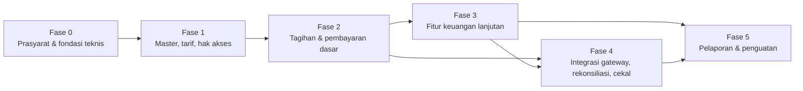
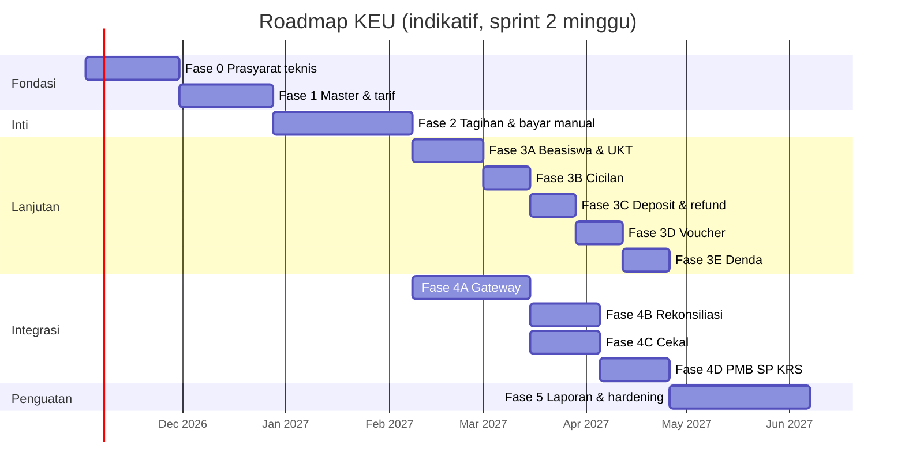

# 28 — Roadmap Implementasi

> **Status:** rancangan. Disusun 2026-10-12; diperbarui 2026-10-13 (dependensi tambahan §4).
> Kembali ke [README](README.md) · Skema: [19](19-rancangan-database-dan-relasi.md) · Aturan: [25](25-business-rules-dan-validasi.md) · Penerimaan: [27](27-acceptance-criteria.md)

Urutan implementasi di bawah ini disusun berdasarkan **dependensi teknis dan risiko**, bukan urutan menu. Prinsipnya ada tiga:

1. Fondasi integritas dibangun lebih dulu: penomoran, idempotensi, outbox, guard pemisahan tugas, dan riwayat status.
2. Uang yang masuk lewat jalur manual harus benar sebelum jalur otomatis (gateway) dibuka.
3. Fitur yang menunggu kebijakan kampus (denda, cekal) dibangun dengan saklar nonaktif sampai kebijakannya ditetapkan.

## Daftar Isi

1. [Kondisi Awal dan Implikasinya](#1-kondisi-awal-dan-implikasinya)
2. [Ringkasan Fase](#2-ringkasan-fase)
3. [Rincian Fase](#3-rincian-fase)
4. [Dependensi Lintas Tim](#4-dependensi-lintas-tim)
5. [Jadwal Indikatif](#5-jadwal-indikatif)
6. [Risiko Implementasi](#6-risiko-implementasi)
7. [Definition of Done Umum](#7-definition-of-done-umum)
8. [Strategi Rilis dan Migrasi Data](#8-strategi-rilis-dan-migrasi-data)

---

## 1. Kondisi Awal dan Implikasinya

| Kondisi repository ([README §3](README.md#3-temuan-repository)) | Implikasi terhadap urutan |
|---|---|
| Modul Finance read-only; `invoices`/`payments` dipakai Dashboard, Report, statistik platform | Fase 0 wajib menjaga kompatibilitas mundur dan menyesuaikan query konsumen ([19 §6.3](19-rancangan-database-dan-relasi.md#63-penyesuaian-konsumen-yang-ada)) |
| `FRONTEND-IMPLEMENTASI.md §5.1` menandai "Keuangan — Tagihan & Pembayaran" sebagai gap **P0** | Fase 2 (tagihan + pembayaran manual) diprioritaskan sebelum fitur lanjutan |
| Tidak ada idempotensi, outbox, maupun Job class; scheduler minimal | Komponen bersama dibangun di Fase 0 |
| ApprovalWorkflow tanpa guard *self-approval* (GAP-05) | Guard SoD KEU dibangun di Fase 0 |
| Scope fakultas/prodi belum ditegakkan (GAP-06) | Akses dekan/kaprodi dibuka setelah `FinanceScope`/`AcademicScope` siap. Sebelum itu, laporan scope tidak diberikan |
| `academic_blocks` belum ada (rancangan `academic-learning` Tahap 2a) | Cekal memakai jalur sementara `FinanceClearanceGuard` ([17 §9](17-rancangan-cekal-keuangan.md)) bila SIAKAD belum siap |
| PMB dan Semester Pendek baru berupa dokumen | Kontrak `postExternalInvoice` disiapkan di Fase 2; integrasi riil menunggu modul tersebut |
| Event Akademik belum ada | Tagihan per SKS memakai billing run terjadwal/manual; konsumsi event ditambahkan saat event tersedia |
| Kanal notifikasi hanya `database` + `mail` | Notifikasi KEU memakai dua kanal ini |

---

## 2. Ringkasan Fase

| Fase | Tema | Hasil utama | Saklar/flag |
|---|---|---|---|
| 0 | Prasyarat & fondasi teknis | Komponen bersama (idempotensi, outbox, sequence, histori, SoD guard), migrasi skema inti + backfill, penyesuaian konsumen | — |
| 1 | Fondasi domain | Komponen biaya, rekening, periode keuangan, golongan UKT, tarif berversi + persetujuan, role & permission KEU | — |
| 2 | Tagihan & pembayaran dasar | Penerbitan individual & massal, pembayaran loket & transfer manual, verifikasi, alokasi, kuitansi, portal mahasiswa | — |
| 3 | Lanjutan | Beasiswa & potongan, penetapan UKT, cicilan, voucher, deposit, koreksi & refund manual, denda | `finance.late_fee.enabled`, `finance.installment.enabled` |
| 4 | Integrasi | Gateway + webhook, rekonsiliasi, integrasi PMB/SP/KRS, cekal keuangan + SIAKAD | `finance.hold.enabled`, kanal `is_active` |
| 5 | Pelaporan & penguatan | Dashboard, 18 laporan, ekspor async, penutupan periode, ekspor akuntansi, uji keamanan & beban | — |

Fase 3 dan Fase 4 dapat berjalan paralel oleh dua tim setelah Fase 2 selesai, dengan satu batasan: subfase 4A (gateway) tidak bergantung pada Fase 3, sedangkan subfase 4C (cekal) idealnya menunggu cicilan (Fase 3) agar evaluasi per termin tersedia.

---

## 3. Rincian Fase

### Fase 0 — Prasyarat dan Fondasi Teknis

| Aspek | Isi |
|---|---|
| **Prasyarat** | Jawaban KEU-Q P1 berikut: [KEU-Q-04](29-glossary-dan-keputusan-bisnis.md#3-pertanyaan-terbuka-keu-q) (urutan perhitungan), [KEU-Q-08](29-glossary-dan-keputusan-bisnis.md#3-pertanyaan-terbuka-keu-q) (penyetuju), [KEU-Q-12](29-glossary-dan-keputusan-bisnis.md#3-pertanyaan-terbuka-keu-q) (dasar SKS). Persetujuan rancangan [19](19-rancangan-database-dan-relasi.md) |
| **Pekerjaan** | 1) Migration F01 (`finance_sequences`, `finance_periods`) dan F03 (`invoices` ubah + konversi status ke `string(20)`), F05–F06 (`payments` ubah, `payment_allocations`). 2) Backfill [19 §6.2](19-rancangan-database-dan-relasi.md#62-backfill-data-lama) + job `finance:verify-integrity`. 3) Komponen bersama: `IdempotencyMiddleware` + `idempotency_keys`, `FinanceSequenceService`, `finance_status_histories` + trait, `finance_outbox_events` + dispatcher, `SegregationOfDutiesGuard`. 4) Penyesuaian `DashboardStatsService`, `ReportService::buildKeuangan`, `PlatformStatisticsController`, Resources, `FinanceSeeder`. 5) Menambah `tenant.access` pada route Finance yang ada. 6) Scheduler & worker antrean berjalan di semua lingkungan ([KEU-A-13](29-glossary-dan-keputusan-bisnis.md#4-asumsi-keu-a)) |
| **Hasil akhir** | Skema inti terpasang, data lama termigrasi tanpa selisih, endpoint lama tetap lulus `FinanceListEndpointsTest`, dashboard tidak menghitung pembayaran yang belum terverifikasi |
| **Dependensi** | Tidak ada dependensi tim lain |
| **Risiko** | Data lama tidak konsisten (`Σ payments ≠ paid_amount`) → daftar tinjauan manual. Konversi enum pada tabel besar → jalankan di jam sepi |
| **Kriteria selesai** | INV-01…INV-09 lulus pada data hasil migrasi. Test kompatibilitas endpoint lama hijau. Idempotensi teruji (permintaan ganda menghasilkan satu sumber daya). Guard SoD teruji |

### Fase 1 — Fondasi Domain (Master, Tarif, Hak Akses)

| Aspek | Isi |
|---|---|
| **Prasyarat** | Fase 0. [KEU-Q-13](29-glossary-dan-keputusan-bisnis.md#3-pertanyaan-terbuka-keu-q) (UKT/SPP). Keputusan kolom `students.admission_path_code` & `study_system_code` dengan tim Akademik ([KEU-A-04](29-glossary-dan-keputusan-bisnis.md#4-asumsi-keu-a)) |
| **Pekerjaan** | Migration F01–F02 (termasuk `fee_component_courses` dan `tariff_rules.free_units`). Role baru (`finance_officer`, `cashier`, `finance_manager`, `integration_administrator`) + katalog permission ([03](03-role-dan-hak-akses.md)) di `RolePermissionSeeder`/`OrganizationalRoleSeeder`. CRUD komponen biaya, rekening, golongan UKT, pengaturan `finance.*` ([04](04-master-data-dan-konfigurasi.md)). Jadwal & aturan tarif: impor, validasi spesifisitas/konflik, workflow `finance_tariff_schedule`, publikasi, `GET /tariffs/resolve` ([05](05-rancangan-tarif-uang-kuliah.md)). Halaman `/keuangan/master/*` |
| **Hasil akhir** | Tarif dapat disusun, disetujui, dipublikasi, dan dipratinjau per mahasiswa |
| **Dependensi** | Tim Akademik (kolom jalur/sistem kuliah — opsional; tarif tetap berjalan tanpa kriteria itu) |
| **Risiko** | Konfigurasi tarif awal salah → wajib uji pratinjau `resolve` untuk sampel mahasiswa per prodi/angkatan sebelum publikasi |
| **Kriteria selesai** | AC area `MST`, `TAR`, `RBAC` di [27](27-acceptance-criteria.md) terpenuhi |

### Fase 2 — Tagihan dan Pembayaran Dasar

| Aspek | Isi |
|---|---|
| **Prasyarat** | Fase 1. [KEU-Q-14](29-glossary-dan-keputusan-bisnis.md#3-pertanyaan-terbuka-keu-q), [KEU-Q-15](29-glossary-dan-keputusan-bisnis.md#3-pertanyaan-terbuka-keu-q), [KEU-Q-27](29-glossary-dan-keputusan-bisnis.md#3-pertanyaan-terbuka-keu-q) |
| **Pekerjaan** | Migration F04, F06 (sisa), F07 (sengketa). Tagihan individual (draft→terbit), tagihan massal (`billing_runs` preview/execute via antrean), tagihan per SKS dari `krs_items`, tagihan tambahan/susulan, pembatalan & koreksi tagihan via `finance_adjustments` (F10 sebagian) ([06](06-rancangan-tagihan-mahasiswa.md)). Pembayaran loket + sesi kas, transfer manual + unggah bukti, antrean verifikasi, alokasi otomatis/manual, dana belum diterapkan, kuitansi PDF + verifikasi publik ([07](07-rancangan-pembayaran.md), [09](09-rancangan-pembayaran-tunai-dan-manual.md)). Reversal pembayaran ([18 §6](18-rancangan-rekonsiliasi-dan-penyesuaian.md)). Portal mahasiswa: ringkasan, tagihan, riwayat, unggah bukti, kuitansi (mengganti `PortalInvoicesPage` mock). Notifikasi inti ([23](23-rancangan-notifikasi.md)). Kontrak `FinanceBillingService::postExternalInvoice` |
| **Hasil akhir** | Kampus dapat menagih dan menerima pembayaran secara manual dengan jejak audit lengkap. Gap P0 tertutup |
| **Dependensi** | Tim Frontend (portal). Modul FileManagement (Ada) |
| **Risiko** | Tagihan massal salah → wajib pratinjau + `issue_mode = draft` sebagai default awal. Verifikasi bukti ganda → `reference_key` + checksum |
| **Kriteria selesai** | AC area `INV`, `PAY`, `MAN` terpenuhi. Uji konkurensi verifikasi dan alokasi lulus. INV-01…INV-09 lulus |

### Fase 3 — Fitur Keuangan Lanjutan

Urutan internal yang disarankan: **3A** beasiswa & potongan + UKT → **3B** cicilan → **3C** deposit + refund manual → **3D** voucher → **3E** denda.

| Aspek | Isi |
|---|---|
| **Prasyarat** | Fase 2. [KEU-Q-05](29-glossary-dan-keputusan-bisnis.md#3-pertanyaan-terbuka-keu-q), [KEU-Q-09](29-glossary-dan-keputusan-bisnis.md#3-pertanyaan-terbuka-keu-q), [KEU-Q-10](29-glossary-dan-keputusan-bisnis.md#3-pertanyaan-terbuka-keu-q), [KEU-Q-22](29-glossary-dan-keputusan-bisnis.md#3-pertanyaan-terbuka-keu-q). Untuk 3E: [KEU-Q-06](29-glossary-dan-keputusan-bisnis.md#3-pertanyaan-terbuka-keu-q) |
| **Pekerjaan** | Migration F07–F10. Skema potongan + penerima + integrasi `scholarship_applications` ([11](11-rancangan-beasiswa-dan-potongan.md)). Penetapan & keberatan UKT ([15](15-rancangan-ukt-dan-validasi-penerima.md)). Cicilan + penjadwalan ulang ([10](10-rancangan-cicilan-tagihan.md)). Ledger deposit, pemakaian, penahanan, refund ([14](14-rancangan-deposit-mahasiswa.md), [18](18-rancangan-rekonsiliasi-dan-penyesuaian.md)). Voucher + reservasi ([12](12-rancangan-voucher-tagihan.md)). Aturan & job denda + pembebasan ([13](13-rancangan-denda.md)) |
| **Hasil akhir** | Seluruh mekanisme pengurang dan penambah kewajiban tersedia, masing-masing dengan persetujuan dan audit |
| **Dependensi** | Modul Scholarship (Ada). PMB (untuk penetapan UKT awal, opsional) |
| **Risiko** | Urutan perhitungan potongan belum disepakati → saklar konfigurasi. Konkurensi deposit/voucher → uji paralel wajib. Denda tanpa kebijakan → tetap nonaktif |
| **Kriteria selesai** | AC area `SCH`, `UKT`, `INS`, `DEP`, `VCH`, `LTF` terpenuhi. Uji konkurensi deposit & voucher lulus. INV-07, INV-10, INV-11, INV-13 lulus |

### Fase 4 — Integrasi

Subfase: **4A** gateway online → **4B** rekonsiliasi → **4C** cekal keuangan → **4D** integrasi PMB/Semester Pendek/event KRS.

| Aspek | Isi |
|---|---|
| **Prasyarat** | Fase 2 (4A, 4B); Fase 3B (4C). Kontrak provider ([KEU-Q-03](29-glossary-dan-keputusan-bisnis.md#3-pertanyaan-terbuka-keu-q)), kuota paket ([KEU-Q-01](29-glossary-dan-keputusan-bisnis.md#3-pertanyaan-terbuka-keu-q), [KEU-Q-02](29-glossary-dan-keputusan-bisnis.md#3-pertanyaan-terbuka-keu-q)), biaya admin ([KEU-Q-25](29-glossary-dan-keputusan-bisnis.md#3-pertanyaan-terbuka-keu-q)), kebijakan cekal ([KEU-Q-07](29-glossary-dan-keputusan-bisnis.md#3-pertanyaan-terbuka-keu-q)) |
| **Pekerjaan** | Migration F11–F12. Adapter `PaymentGatewayContract` untuk provider terpilih (sandbox dulu), akun & kanal, kuota entitlement, transaksi, webhook + dedupe + double-check, polling, kedaluwarsa ([08](08-rancangan-pembayaran-online-dan-gateway.md)). Rekonsiliasi settlement & mutasi bank, refund via gateway bila didukung ([18](18-rancangan-rekonsiliasi-dan-penyesuaian.md)). Kebijakan & evaluasi cekal, pengecualian, outbox → SIAKAD, jalur sementara `FinanceClearanceGuard` ([17](17-rancangan-cekal-keuangan.md)). Konsumen posting PMB/SP & event KRS ([20](20-rancangan-api-dan-integrasi.md)) |
| **Hasil akhir** | Pembayaran online terverifikasi otomatis tanpa pembayaran ganda; selisih teridentifikasi lewat rekonsiliasi; mahasiswa tercekal tidak dapat KRS/ujian sesuai kebijakan, dan cekal dibuka dalam ≤ 60 detik setelah lunas |
| **Dependensi** | Tim SIAKAD (`academic_blocks`, `AcademicBlockGuard`); tim PMB; tim Akademik (event); provider (kredensial sandbox/produksi, URL webhook terdaftar); Super Admin (entitlement) |
| **Risiko** | Perilaku provider berbeda dari dokumentasi → uji kontrak di sandbox + replay payload nyata. Cekal salah blokir → mode simulasi (`/finance-hold-policies/{id}/simulate`) sebelum diaktifkan. `academic_blocks` belum siap → jalur sementara |
| **Kriteria selesai** | AC area `PG`, `REC`, `HLD`, `API` terpenuhi. Uji webhook ganda/tak berurutan/tanda tangan salah lulus. Uji cekal tidak dapat dilewati via frontend lulus |

### Fase 5 — Pelaporan dan Penguatan

| Aspek | Isi |
|---|---|
| **Prasyarat** | Fase 3 & 4 (sebagian laporan dapat dirilis lebih awal sesuai fitur sumbernya) |
| **Pekerjaan** | Dashboard per audiens, 18 laporan + ekspor async ([22](22-rancangan-laporan-dan-dashboard.md)), monitoring piutang + snapshot ([16](16-rancangan-monitoring-piutang.md)), penutupan periode & ekspor akuntansi ([18 §8](18-rancangan-rekonsiliasi-dan-penyesuaian.md)), scope dekan/kaprodi (setelah `AcademicScope`), deteksi anomali ([24 §12](24-keamanan-audit-dan-kontrol-internal.md)), retensi. Uji beban (penerbitan massal 10.000 tagihan, 500 webhook/menit *contoh*), uji keamanan (IDOR, replay, SoD, ekspor) |
| **Hasil akhir** | Pimpinan dan auditor dapat menelusuri setiap angka ke transaksi sumber; periode keuangan dapat ditutup |
| **Dependensi** | Rancangan `AcademicScope` (`academic-learning`) |
| **Risiko** | Query laporan lambat pada data besar → snapshot + indeks + ekspor async |
| **Kriteria selesai** | AC area `AR`, `RPT`, `SEC`, `NTF`, `UI` terpenuhi. Angka dashboard = Σ transaksi sumber pada data uji |

---

## 4. Dependensi Lintas Tim

| Dependensi | Pemilik | Dibutuhkan pada | Status | Mitigasi bila terlambat |
|---|---|---|---|---|
| Kolom `students.admission_path_code`, `study_system_code` | Akademik / PMB | Fase 1 (kriteria tarif jalur/kelas) | Belum ada | Tarif tanpa kriteria tersebut; tambahkan aturan setelah kolom tersedia |
| Event `KrsSubmissionApproved`, `KrsSubmissionLocked`, `KrsItemDropped`, `StudentStatusChanged` | Akademik | Fase 4D | Belum ada | Billing run terjadwal setelah masa KRS; tagihan susulan manual |
| `academic_blocks`, `AcademicBlockGuard` | SIAKAD | Fase 4C | Belum ada | `FinanceClearanceGuard` sementara ([17 §9](17-rancangan-cekal-keuangan.md)) |
| `AcademicScope` (scope fakultas/prodi) | SIAKAD/Platform | Fase 5 | Belum ada | Dekan/Kaprodi belum diberi akses laporan scope |
| Modul PMB (`app/Modules/Admission`) | PMB | Fase 4D | Belum ada | Kontrak `postExternalInvoice` siap; uji dengan *fake* |
| Semester Pendek | Akademik | Fase 4D | Belum ada | Sama dengan di atas |
| `plan_feature_entitlements` / pemetaan paket | Platform (Super Admin) | Fase 4A | Belum ada | Kuota kanal dibaca dari `university_settings` `entitlement.finance.payment_channels` sementara |
| Perbaikan *self-approval* ApprovalWorkflow | Platform | Fase 0 (disarankan) | Belum ada | Guard SoD di KEU (sudah dirancang) |
| Kanal notifikasi WhatsApp/SMS | Notification | Opsional | Belum ada | `database` + `mail` |
| Penanda notifikasi wajib di `NotificationDispatcher` ([KEU-A-17](29-glossary-dan-keputusan-bisnis.md#4-asumsi-keu-a)) | Notification | Fase 2 | Belum ada | Notifikasi wajib dijamin di kanal `database` saja |
| Kunci HMAC `FINANCE_HASH_KEY` di konfigurasi lingkungan ([KEU-A-18](29-glossary-dan-keputusan-bisnis.md#4-asumsi-keu-a)) | DevOps | Fase 0 | Belum ada | — (wajib sebelum tabel bernomor rekening dibuat) |
| Penegakan cekal di service KRS/Ujian (`AcademicBlockGuard` atau `FinanceClearanceGuard`) | Akademik | Fase 4C | Belum ada | Mode `finance.hold.enforcement_mode = direct` ([17 §9](17-rancangan-cekal-keuangan.md#9-jalur-sementara-financeclearanceguard)) |
| Kontrak & kredensial provider | Bisnis + provider | Fase 4A | Belum ada | Rilis Fase 2–3 tanpa gateway |

---

## 5. Jadwal Indikatif

Estimasi berikut bersifat **[R] indikatif** dan mengasumsikan satu tim berisi 2 BE, 1–2 FE, dan 1 QA, dengan sprint 2 minggu. Estimasi ini harus dikalibrasi ulang setelah keputusan P1 dijawab.

---

## 6. Risiko Implementasi

| ID | Risiko | Dampak | Kemungkinan | Mitigasi | Fase |
|---|---|---|---|---|---|
| IMP-01 | Data lama `invoices`/`payments` tidak konsisten | Saldo salah setelah migrasi | Sedang | Backfill + INV checks + daftar tinjauan, tanpa koreksi otomatis | 0 |
| IMP-02 | Keputusan kebijakan P1 terlambat | Fitur tertahan | Tinggi | Saklar konfigurasi; default rancangan aman (nonaktif) | 1–4 |
| IMP-03 | Tarif massal salah konfigurasi | Ribuan tagihan salah | Sedang | Pratinjau wajib, `issue_mode = draft`, persetujuan tarif, pembatalan massal via adjustment | 1–2 |
| IMP-04 | Race condition (deposit, voucher, alokasi) | Saldo negatif / kuota terlampaui | Sedang | Urutan kunci baku, CHECK constraint, uji paralel otomatis | 2–3 |
| IMP-05 | Perilaku gateway berbeda dari asumsi | Pembayaran ganda/terlewat | Sedang | Uji kontrak sandbox, double-check status, rekonsiliasi harian | 4 |
| IMP-06 | Cekal memblokir mahasiswa yang sudah bayar | Keluhan & gangguan layanan akademik | Sedang | Pembukaan berbasis event ≤ 60 detik, simulasi kebijakan, pengecualian cepat, monitoring sync | 4 |
| IMP-07 | Dependensi SIAKAD/PMB belum siap | Integrasi tertunda | Tinggi | Jalur sementara & kontrak *fake* | 4 |
| IMP-08 | Scheduler/worker tidak berjalan di hosting | Denda, kedaluwarsa, outbox macet | Sedang | Pemeriksaan *lazy* + health check scheduler + alarm | 0, 4 |
| IMP-09 | Laporan lambat | Pengalaman buruk pimpinan | Sedang | Snapshot, indeks, ekspor async | 5 |
| IMP-10 | Kebocoran data sensitif lewat ekspor/log | Pelanggaran privasi | Rendah | Masking, audit `exported`, watermark, review log | 5 |

---

## 7. Definition of Done Umum

Sebuah fitur KEU dinyatakan selesai bila **seluruh** butir berikut terpenuhi:

1. Migration, model, enum, service, policy, Form Request, resource, dan route sesuai [19](19-rancangan-database-dan-relasi.md) dan [20](20-rancangan-api-dan-integrasi.md). Tidak ada tabel atau kolom di luar kanon tanpa pembaruan dokumen.
2. Setiap aturan `KEU-BR-*` milik fitur memiliki minimal satu test otomatis (Pest) yang menyebut ID aturan pada nama test.
3. Test case P1 milik area fitur di [26](26-skenario-pengujian.md) lulus. Test konkurensi dijalankan pada MySQL (bukan hanya SQLite).
4. Acceptance criteria area fitur di [27](27-acceptance-criteria.md) terpenuhi, beserta bukti yang diminta.
5. Setiap transisi status menulis `finance_status_histories` dan `audit_logs` dalam transaksi yang sama. Aksi sensitif memiliki alasan.
6. Guard SoD aktif untuk setiap aksi `approve`/`reject` fitur.
7. Endpoint mahasiswa tidak menerima `student_id` dari klien (uji IDOR lulus).
8. Larastan dan Pint bersih. Frontend `npm run build && npm run lint` bersih.
9. Dokumen KEU yang terdampak diperbarui bila implementasi menyimpang dari rancangan.
10. `finance:verify-integrity` tanpa pelanggaran pada data uji fitur.

---

## 8. Strategi Rilis dan Migrasi Data

| Langkah | Keterangan |
|---|---|
| Rilis bertahap per tenant | Fitur di balik feature flag tenant (`university_feature_flags`), mis. `finance.billing_v2`, `finance.gateway`, `finance.holds` [R] |
| Paralel run | Pada tenant pilot, tagihan massal pertama dijalankan dengan `issue_mode = draft`, lalu dibandingkan dengan perhitungan manual bagian keuangan sebelum diterbitkan |
| Migrasi saldo awal | Tunggakan dari sistem lama diimpor sebagai tagihan `semester` dengan komponen `LEGACY` + `source_type = legacy` dan saldo deposit awal sebagai `adjustment_credit` berizin |
| Rollback | Migration Fase 0 dapat dibalik sebelum ada transaksi baru. Setelah transaksi baru berjalan, perbaikan dilakukan maju (*roll-forward*), bukan rollback skema |
| Pemantauan pasca-rilis | Selama 2 minggu: hasil INV harian, antrean outbox, webhook gagal, sync cekal gagal, keluhan mahasiswa |
