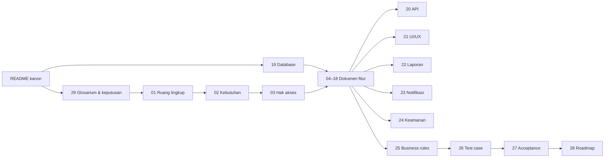

# Rancangan Modul KEU — Administrasi Keuangan Mahasiswa (Civitas One)

> **Status dokumen:** Rancangan sistem. Ini bukan dokumentasi fitur yang sudah jadi. Selama penyusunan dokumen ini, tidak ada kode aplikasi, migration, maupun skema database yang diubah.
> **Disusun:** 2026-10-12, berdasarkan kondisi repository pada commit `bb54756`. **Dilengkapi:** 2026-10-13 (commit `af6deed`): seluruh 30 dokumen tersedia; kanon diperbarui (tabel `fee_component_courses`, status `approved` tarif, `finance_holds.approve`, kode `ACTIVE_TRANSACTION_EXISTS`, INK-06…INK-09, KEU-KD-23…33).
> **Referensi utama:** [SEVIMA_Penjelasan_Modul.md §12](../../docs/SEVIMA_Penjelasan_Modul.md), [SEVIMA_Platform_Proposal.md §1, §3.6](../../docs/SEVIMA_Platform_Proposal.md), [RANCANGAN-APLIKASI.md §3.10, §4.23, §4.24](../../docs/RANCANGAN-APLIKASI.md).
> **Rancangan terkait yang sudah ada:** [academic-learning/](../../docs/academic-learning/README.md) (kontrak cekal SIAKAD), [pmb/](../../docs/RANCANGAN_SISTEM_PENERIMAAN_MAHASISWA_BARU_PMB.md) (pembayaran PMB dan posting ke Finance), [semester-pendek/](../../docs/semester-pendek/README.md) (tagihan SP per SKS).

Dokumen set ini adalah rancangan target modul **KEU — Administrasi Keuangan Mahasiswa**. Rancangan ini **memperluas modul `app/Modules/Finance` yang sudah ada** (tabel `invoices` dan `payments`, read-only), tidak menggantinya. Nama tabel, model, permission, dan endpoint yang sudah ada dipertahankan. Entitas baru mengikuti konvensi kode proyek (lihat [§5](#5-kanon-wajib-diikuti-seluruh-dokumen)).

> **Catatan lokasi folder.** Seluruh dokumen rancangan lain di repository berada di `docs/`. Folder ini dibuat di `doc/keuangan/` sesuai permintaan. Tautan ke dokumen lain memakai `../../docs/...`. Jika tim ingin menyatukan lokasi, folder ini dapat dipindah ke `docs/keuangan/` dengan mengganti awalan `../../docs/` menjadi `../` (lihat [KEU-Q-20](29-glossary-dan-keputusan-bisnis.md#3-pertanyaan-terbuka-keu-q)).

---

## Daftar Isi

1. [Peta Dokumen](#1-peta-dokumen)
2. [Urutan Membaca dan Dependensi](#2-urutan-membaca-dan-dependensi)
3. [Temuan Repository](#3-temuan-repository)
4. [Arsitektur Umum Modul KEU](#4-arsitektur-umum-modul-keu)
5. [Kanon (wajib diikuti seluruh dokumen)](#5-kanon-wajib-diikuti-seluruh-dokumen)
6. [Label dan Penanda](#6-label-dan-penanda)
7. [Ringkasan Keputusan Arsitektur](#7-ringkasan-keputusan-arsitektur)

---

## 1. Peta Dokumen

| No | Dokumen | Isi | Pembaca utama |
|---|---|---|---|
| — | **README.md** (dokumen ini) | Indeks, temuan repository, arsitektur, **kanon** penamaan/status/role/permission/ID | Semua |
| 01 | [01-overview-dan-ruang-lingkup.md](01-overview-dan-ruang-lingkup.md) | Tujuan, ruang lingkup, batas terhadap PMB/Akademik/KRS/Ujian/Wisuda/Akuntansi/Gateway, pemisahan KEU vs akuntansi | PO, SA, semua |
| 02 | [02-analisis-kebutuhan-bisnis.md](02-analisis-kebutuhan-bisnis.md) | Proses bisnis, kebutuhan fungsional & non-fungsional, pemetaan proses → fitur, risiko | PO, SA |
| 03 | [03-role-dan-hak-akses.md](03-role-dan-hak-akses.md) | Role, katalog permission, scope data, matriks hak akses, pemisahan tugas | SA, BE, Security |
| 04 | [04-master-data-dan-konfigurasi.md](04-master-data-dan-konfigurasi.md) | Komponen biaya, rekening, periode keuangan, penomoran, pengaturan tenant `finance.*` | SA, BE |
| 05 | [05-rancangan-tarif-uang-kuliah.md](05-rancangan-tarif-uang-kuliah.md) | Tarif tetap/per SKS, kriteria, prioritas, versi, persetujuan, snapshot, contoh perhitungan | SA, BE, Keuangan |
| 06 | [06-rancangan-tagihan-mahasiswa.md](06-rancangan-tagihan-mahasiswa.md) | Siklus tagihan, tagihan massal, SKS, tambahan/susulan, pembatalan, sengketa, definisi nominal | SA, BE, FE |
| 07 | [07-rancangan-pembayaran.md](07-rancangan-pembayaran.md) | Model pembayaran ↔ alokasi, aturan alokasi, kuitansi, kelebihan bayar | SA, BE |
| 08 | [08-rancangan-pembayaran-online-dan-gateway.md](08-rancangan-pembayaran-online-dan-gateway.md) | Provider, kanal, kuota paket, transaksi, webhook, idempotensi, kegagalan provider | BE, Security |
| 09 | [09-rancangan-pembayaran-tunai-dan-manual.md](09-rancangan-pembayaran-tunai-dan-manual.md) | Loket, transfer manual, bukti bayar, verifikasi, kuitansi, koreksi | SA, BE, FE |
| 10 | [10-rancangan-cicilan-tagihan.md](10-rancangan-cicilan-tagihan.md) | Rencana & termin cicilan, uang muka, penjadwalan ulang, denda per termin | SA, BE |
| 11 | [11-rancangan-beasiswa-dan-potongan.md](11-rancangan-beasiswa-dan-potongan.md) | Skema potongan, penerima beasiswa, urutan perhitungan, pencegahan potongan ganda | SA, BE |
| 12 | [12-rancangan-voucher-tagihan.md](12-rancangan-voucher-tagihan.md) | Voucher, kuota, reservasi, pembatalan, konkurensi | SA, BE |
| 13 | [13-rancangan-denda.md](13-rancangan-denda.md) | Aturan denda, bucket, job terjadwal idempoten, pembebasan | SA, BE |
| 14 | [14-rancangan-deposit-mahasiswa.md](14-rancangan-deposit-mahasiswa.md) | Ledger deposit, pemakaian, pengembalian, konkurensi | SA, BE |
| 15 | [15-rancangan-ukt-dan-validasi-penerima.md](15-rancangan-ukt-dan-validasi-penerima.md) | Golongan UKT, penetapan, keberatan, validasi tarif | SA, BE |
| 16 | [16-rancangan-monitoring-piutang.md](16-rancangan-monitoring-piutang.md) | Indikator piutang, formula, umur piutang, ketertelusuran | SA, BE, Pimpinan |
| 17 | [17-rancangan-cekal-keuangan.md](17-rancangan-cekal-keuangan.md) | Kebijakan cekal, status, sinkronisasi ke SIAKAD, pengecualian | SA, BE |
| 18 | [18-rancangan-rekonsiliasi-dan-penyesuaian.md](18-rancangan-rekonsiliasi-dan-penyesuaian.md) | Rekonsiliasi provider/bank, refund, reversal, koreksi, penutupan periode | SA, BE, Keuangan |
| 19 | [19-rancangan-database-dan-relasi.md](19-rancangan-database-dan-relasi.md) | **Skema acuan**: ERD, data dictionary, strategi integritas & locking, migrasi | BE, DBE |
| 20 | [20-rancangan-api-dan-integrasi.md](20-rancangan-api-dan-integrasi.md) | Endpoint staf/mahasiswa/webhook, event, integrasi antarmodul | BE, FE, Mobile |
| 21 | [21-rancangan-ui-ux-dan-menu.md](21-rancangan-ui-ux-dan-menu.md) | Struktur menu, spesifikasi halaman staf & portal mahasiswa | FE, UI/UX |
| 22 | [22-rancangan-laporan-dan-dashboard.md](22-rancangan-laporan-dan-dashboard.md) | Dashboard, 18 laporan beserta sumber data, rumus, dan hak akses | SA, BE, FE |
| 23 | [23-rancangan-notifikasi.md](23-rancangan-notifikasi.md) | Event notifikasi, penerima, kanal, template | BE |
| 24 | [24-keamanan-audit-dan-kontrol-internal.md](24-keamanan-audit-dan-kontrol-internal.md) | RBAC, SoD, webhook, file, enkripsi, masking, audit, retensi, deteksi anomali | BE, Security, Auditor |
| 25 | [25-business-rules-dan-validasi.md](25-business-rules-dan-validasi.md) | **Katalog aturan bisnis** `KEU-BR-*` | SA, BE, QA |
| 26 | [26-skenario-pengujian.md](26-skenario-pengujian.md) | **Katalog test case** `KEU-TC-*` | QA |
| 27 | [27-acceptance-criteria.md](27-acceptance-criteria.md) | **Katalog acceptance criteria** `KEU-AC-*` dan bukti penerimaan | PO, QA |
| 28 | [28-roadmap-implementasi.md](28-roadmap-implementasi.md) | Fase implementasi, dependensi, risiko, definition of done | PM, Tech Lead |
| 29 | [29-glossary-dan-keputusan-bisnis.md](29-glossary-dan-keputusan-bisnis.md) | Glosarium, keputusan desain `KEU-KD-*`, asumsi `KEU-A-*`, pertanyaan terbuka `KEU-Q-*` | Semua |

## 2. Urutan Membaca dan Dependensi

Urutan baca yang disarankan:

1. README (dokumen ini) → [29](29-glossary-dan-keputusan-bisnis.md) (istilah dan keputusan).
2. [01](01-overview-dan-ruang-lingkup.md) → [02](02-analisis-kebutuhan-bisnis.md) → [03](03-role-dan-hak-akses.md).
3. [19](19-rancangan-database-dan-relasi.md) (skema acuan), lalu dokumen fitur [04](04-master-data-dan-konfigurasi.md)–[18](18-rancangan-rekonsiliasi-dan-penyesuaian.md) sesuai urutan nomor.
4. [20](20-rancangan-api-dan-integrasi.md), [21](21-rancangan-ui-ux-dan-menu.md), [22](22-rancangan-laporan-dan-dashboard.md), [23](23-rancangan-notifikasi.md), [24](24-keamanan-audit-dan-kontrol-internal.md).
5. [25](25-business-rules-dan-validasi.md), [26](26-skenario-pengujian.md), [27](27-acceptance-criteria.md), [28](28-roadmap-implementasi.md).

**Aturan prioritas jika dua dokumen berbeda:**

| Hal | Dokumen yang berlaku |
|---|---|
| Nama tabel, kolom, tipe, constraint | [19](19-rancangan-database-dan-relasi.md) |
| Nama status dan transisinya | §5.4 README ini, dirinci di dokumen fitur terkait |
| Teks dan ID aturan bisnis | [25](25-business-rules-dan-validasi.md) |
| Role dan permission | [03](03-role-dan-hak-akses.md) (turunan §5.5–§5.6) |
| Endpoint | [20](20-rancangan-api-dan-integrasi.md) |
| Istilah | [29](29-glossary-dan-keputusan-bisnis.md) |

---

## 3. Temuan Repository

Hasil pemeriksaan repository per 2026-10-12. Semua klaim di bawah ini sudah diverifikasi ke kode.

### 3.1 Teknologi terverifikasi

| Aspek | Kondisi aktual | Sumber |
|---|---|---|
| Backend | Laravel 13, PHP 8.3, modular `app/Modules/*` (namespace `Modules\`), Pest 4, Larastan, Pint | `composer.json`, `phpunit.xml` |
| Database | MySQL 8 (produksi), SQLite in-memory (test). PK **ULID** (`HasUlids`, `foreignUlid`). `timestampsTz()`. Uang `decimal(14,2)` dengan cast `decimal:2`. Indeks komposit diawali `university_id` | migration `Finance`, `Academic` |
| Waktu | `config/app.php` `timezone = UTC`. Setiap universitas punya `universities.timezone` (default `Asia/Jakarta`), `locale` (`id`), `currency` (`IDR`). `CarbonImmutable` | `create_universities_table` |
| Multi-tenant | Shared DB, kolom `university_id`, trait `TenantScoped` + global scope `BelongsToInstitutionScope`, `TenantContext` di-resolve middleware `tenant.resolve` (header `X-University-ID` → domain → membership default). `tenant.access` mewajibkan membership aktif | `app/Support/Tenancy`, `app/Support/Scoping` |
| RBAC | Kustom (bukan Spatie): `roles`, `permissions`, `role_permissions`, `user_roles` (`scope_type`, `scope_id`, `expires_at`). Slug `resource.action`. Action dibatasi enum `PermissionAction`: `create, read, update, delete, approve, reject, export, import, publish, finalize`. Middleware `permission:a,b` (OR). Bypass `super_admin` | `Modules\UserManagement`, `EnsurePermission` |
| Scope fakultas/prodi | **Belum ditegakkan.** `UniversityInstitutionContextResolver` hanya mengembalikan `university_id`; `user_roles.scope_type/scope_id` tersedia tetapi selalu `null` di seeder | `app/Support/Scoping` |
| API | Prefix `/api/v1`. Envelope `ApiResponse` `{success, message, data, meta}`. `ListQuery` (`search`, `filter[col]=a,b`, `sort=-col`, `per_page` ≤ 100). `ConflictException` → 409 dengan `errors.code` | `app/Support/Http` |
| Idempotensi | **Tidak ada** | — |
| Antrean & jadwal | Redis (predis) untuk queue/cache/session. Belum ada kelas Job. Scheduler hanya `hr:daily-maintenance` 06:00 | `routes/console.php` |
| Audit | `audit_logs` (old/new values, reason, ip, user agent) via trait `Auditable` + `AuditLogService::recordAction()`. `AuditAction` mencakup `approved, rejected, verified, exported, viewed_sensitive, forced_override`, dll. Masking via `$auditMasked`. **Tanpa retensi** | `Modules\AuditLog` |
| Persetujuan | `approval_workflows` / `approval_requests` + `WorkflowSelector`, `ApprovalRequestService::submit()`, event `ApprovalRequestApproved/Rejected`. **Tidak mencegah self-approval** untuk langkah bertipe `role`/`user` | `Modules\ApprovalWorkflow` |
| Notifikasi | `NotificationDispatcher::dispatch($user, $eventKey, $channels, $placeholders)`, template per tenant. Kanal yang **terimplementasi hanya `database` dan `mail`** | `Modules\Notification` |
| Berkas | `file_uploads` (disk `local` privat, sha256 `checksum`, `fileable` morph, soft delete), `FileAttacher`, `VirusScanner` (Null, di belakang flag). MIME `pdf,jpg,jpeg,png,doc,docx,xls,xlsx`, maks `file.max_upload_size_mb` (10). Unduh via stream + policy, tanpa signed URL | `Modules\FileManagement` |
| Pengaturan | `university_settings` (unik `university_id+key`), `feature_flags` + `university_feature_flags`, `FeatureFlagService::isEnabled()` | `Modules\SystemSetting`, `Modules\Tenancy` |
| Paket | `subscription_plans`: **trial / starter / professional / enterprise**; `limits` hanya `max_users`, `max_storage_gb`. `modules` + `university_modules` ada (termasuk modul `finance`), belum ditegakkan. `plan_feature_entitlements` baru ada di dokumen | `TenancySeeder` |
| Frontend | React 19, Vite, Tailwind 3, react-router 7, react-hook-form + zod, zustand, recharts, komponen kustom `frontend/src/components/ui/`. Admin app tanpa i18n (Bahasa Indonesia hardcoded). Menu `frontend/src/constants/nav.ts` | `frontend/` |
| Ekspor | dompdf (PDF), openspout (XLSX/CSV) | `composer.json` |

### 3.2 Inventaris modul Finance yang sudah ada

| Komponen | Kondisi | Catatan untuk KEU |
|---|---|---|
| `invoices` | `student_id` (FK cascade), `period` (string bebas, mis. `2026/2027 Ganjil`), `amount`, `paid_amount` (`decimal(14,2)`), `status` **MySQL enum** `unpaid/partial/paid`, `due_date` | Diperluas (lihat [19 §6](19-rancangan-database-dan-relasi.md#6-strategi-migrasi-dari-skema-yang-ada)) |
| `payments` | `invoice_id` (FK cascade), `amount`, `paid_at` (date), `method` (string bebas: `transfer`, `virtual_account`, `cash`) | Diperluas menjadi "penerimaan dana" + alokasi |
| Endpoint | `GET /invoices`, `GET /invoices/{id}`, `GET /payments` (semua `invoices.read`). **Tanpa endpoint tulis.** Route tanpa `tenant.access` | Dipertahankan; endpoint baru di [20](20-rancangan-api-dan-integrasi.md) |
| Permission | Hanya `invoices.read` (dan `scholarships.read`) | Katalog baru di [03](03-role-dan-hak-akses.md) |
| Role | `finance_administrator` ("Bagian Keuangan"): `approval_requests.read, file_uploads.read, invoices.read, scholarships.read` | Diperluas; role baru diusulkan |
| Konsumen data | `DashboardStatsService` (`unpaid_invoices`, `payment_trend`, `invoice_status`), `ReportService::buildKeuangan()`, `PlatformStatisticsController` | Harus disesuaikan agar tagihan `cancelled` dan pembayaran belum terverifikasi tidak terhitung |
| Frontend | `pages/finance/InvoicesPage`, `InvoiceDetailPage`, `PaymentsPage` (read-only). `PortalInvoicesPage` = **data statis**, tidak terhubung | |
| Beasiswa | Modul `Scholarship`: `scholarships`, `scholarship_applications` (read-only), **tidak terhubung ke tagihan** | Dihubungkan melalui `discount_schemes` |

### 3.3 Modul terkait

| Modul | Kondisi | Dampak ke KEU |
|---|---|---|
| Akademik (`app/Modules/Academic`) | `students` (`admission_year` = angkatan, `study_program_id`, `status`, `user_id`), `study_programs.degree_level` (string), `academic_terms` (`academic_year`, `semester` ganjil/genap, `is_current`), `krs_submissions`/`krs_items`, `courses.credits` | **Belum ada** kolom jalur masuk dan sistem kuliah/kelas (diusulkan PMB: `admission_path_code`, `study_system_code`). Tidak ada event Academic (KRS disetujui, status berubah) |
| KRS & Ujian | `KrsPlanService` dan `ExamService` **tidak memeriksa status keuangan** | Penegakan cekal harus ditambahkan di backend ([17](17-rancangan-cekal-keuangan.md)) |
| Cekal SIAKAD | **Belum ada di kode.** Dirancang di `docs/academic-learning` (`academic_blocks`, `academic_block_rules`, `AcademicBlockGuard`, error `ACADEMIC_BLOCKED`) dengan sumber data Finance | KEU menyesuaikan diri dengan kontrak ini ([KEU-KD-09](29-glossary-dan-keputusan-bisnis.md#2-keputusan-desain-keu-kd)) |
| PMB | **Hanya dokumen** (`docs/pmb`). Tabel `pmb_invoices`, `pmb_payment_transactions`, dll. Posting ke `invoices` dengan `source_type='pmb_invoice'` (KD-03 PMB) | KEU menyediakan kolom `source_type/source_id` dan layanan posting |
| Semester Pendek | **Hanya dokumen** (`docs/semester-pendek`). Biaya = SKS × `academic.short_term.fee_per_credit`, `krs_items.invoice_id`, status `cancelled` | KEU menampung tagihan `invoice_type = short_term` |
| Paket langganan | Matriks SEVIMA (Growth 3, Business 3, Professional 4, Premium 5, Enterprise 6 kanal) **berbeda** dengan kode paket di repo | [KEU-Q-01](29-glossary-dan-keputusan-bisnis.md#3-pertanyaan-terbuka-keu-q) |

### 3.4 Kesenjangan dan inkonsistensi yang ditemukan

| ID | Temuan | Penanganan dalam rancangan |
|---|---|---|
| GAP-01 | `invoices.period` string bebas, tanpa `academic_term_id` (sudah dicatat sebagai *OD-NEW-finance-term-mapping* di `academic-learning`) | Tambah `invoices.academic_term_id`; `period` tetap sebagai label |
| GAP-02 | `payments` langsung ke satu `invoice_id`; tidak bisa membayar banyak tagihan, kelebihan bayar, atau deposit | Pisahkan penerimaan (`payments`) dan penerapan (`payment_allocations`) — [KEU-KD-04](29-glossary-dan-keputusan-bisnis.md#2-keputusan-desain-keu-kd) |
| GAP-03 | Tidak ada status verifikasi pembayaran; semua `payments` dihitung sebagai uang masuk oleh dashboard | `payments.status`; laporan hanya menghitung `verified` |
| GAP-04 | FK `cascadeOnDelete` dari `invoices`/`payments` ke `students`/`invoices` dapat menghapus histori keuangan | Penghapusan induk diblokir di service; FK baru memakai `restrict` |
| GAP-05 | ApprovalWorkflow tidak mencegah penyetuju = pengaju untuk langkah berbasis role | Guard pemisahan tugas di service KEU ([24](24-keamanan-audit-dan-kontrol-internal.md)) + rekomendasi perbaikan ApprovalWorkflow |
| GAP-06 | Scope fakultas/prodi belum ditegakkan | KEU mendefinisikan `FinanceScope` ([03](03-role-dan-hak-akses.md)); bergantung pada `AcademicScope` yang dirancang `academic-learning` |
| GAP-07 | Tidak ada idempotensi, outbox, maupun job terjadwal | Tabel `idempotency_keys`, `finance_outbox_events`, dan command terjadwal ([19](19-rancangan-database-dan-relasi.md)) |
| GAP-08 | Kanal notifikasi WhatsApp/SMS/push belum terimplementasi | Notifikasi KEU default `database` + `mail` ([23](23-rancangan-notifikasi.md)) |
| INK-01 | `academic-learning` memakai `block_type = finance` (07-database-erd) dan `financial` (01-siakad BR-SIA-CKL-04) | KEU memakai `finance` (07 = dokumen skema acuan) |
| INK-02 | `academic-learning` menyebut event `InvoiceStatusChanged` (06) dan `InvoiceUpdated` (01) | KEU memancarkan `InvoiceStatusChanged`; `InvoiceUpdated` tidak dipakai |
| INK-03 | PMB (`pmb/11` §B.2) memposting termin cicilan sebagai **invoice terpisah**; KEU memodelkan termin sebagai jadwal di atas satu tagihan | [KEU-KD-02](29-glossary-dan-keputusan-bisnis.md#2-keputusan-desain-keu-kd), [KEU-Q-11](29-glossary-dan-keputusan-bisnis.md#3-pertanyaan-terbuka-keu-q) |
| INK-04 | `RANCANGAN-SUPER-ADMIN.md §8` dan `MULTI-TENANT-ARCHITECTURE.md §9` menyebut tagihan mahasiswa "belum ada", padahal `invoices` sudah ada | Dicatat. Tidak diubah oleh rancangan ini |
| INK-05 | `RANCANGAN-APLIKASI.md §7` menamai tabel `student_bills`, `student_bill_details` | KEU mempertahankan `invoices` (+ `invoice_items`) — [KEU-KD-01](29-glossary-dan-keputusan-bisnis.md#2-keputusan-desain-keu-kd) |
| INK-06 | `academic-learning` memakai kunci layanan `grade_view` dan daftar 6 layanan (07) tetapi `view_grades` dan daftar 12 layanan (01 A.8) | KEU memakai kunci 07 lewat `finance.hold.available_services`; kunci tambahan dipakai setelah SIAKAD menetapkan ([17 §2](17-rancangan-cekal-keuangan.md#2-konsep-keputusan-di-keu-penegakan-di-siakad)) |
| INK-07 | `academic_block_exemptions` di 07 tidak memiliki kolom layanan, sedangkan 01 A.8 menyebut dispensasi per layanan | Tidak bertentangan bagi KEU: setiap `academic_blocks` sudah satu layanan, sehingga pengecualian KEU diproyeksikan ke baris blok layanan yang bersangkutan ([17 §7](17-rancangan-cekal-keuangan.md#7-sinkronisasi-ke-siakad)) |
| INK-08 | Rancangan Semester Pendek mengusulkan `POST /invoices/{invoice}/payments` dan event `InvoicePaid` | KEU memakai `POST /payments` + alokasi dan event `PaymentVerified`/`InvoiceStatusChanged`; SP menyesuaikan ([20 §9](20-rancangan-api-dan-integrasi.md#9-integrasi-antarmodul)) |
| INK-09 | `PortalInvoicesPage` (data statis) tidak terdaftar di `ROUTES.portal`; `PortalScholarshipPage` juga statis | Diganti halaman portal keuangan ([21 §5](21-rancangan-ui-ux-dan-menu.md#5-struktur-menu-dan-halaman-portal-mahasiswa)) |

---

## 4. Arsitektur Umum Modul KEU

```mermaid
flowchart TB
    subgraph KEU["Modul KEU (app/Modules/Finance, diperluas)"]
        MST["Master & Konfigurasi<br/>fee_components, tariff_*, ukt_groups,<br/>bank_accounts, payment_channels, finance_periods"]
        BIL["Penagihan<br/>billing_runs, invoices, invoice_items,<br/>installment_plans/terms, invoice_disputes"]
        DSC["Pengurang kewajiban<br/>discount_schemes, student_discounts,<br/>vouchers, voucher_redemptions"]
        FIN["Denda<br/>late_fee_rules, late_fee_assessments"]
        PAY["Penerimaan & Penerapan<br/>payment_transactions, payments,<br/>payment_allocations, payment_proofs, receipts"]
        DEP["Deposit<br/>deposit_accounts, deposit_transactions"]
        COR["Koreksi & Refund<br/>finance_adjustments, refunds"]
        REC["Rekonsiliasi<br/>reconciliation_batches/items"]
        HLD["Cekal keuangan<br/>finance_hold_policies, finance_holds,<br/>finance_hold_exemptions"]
        RPT["Monitoring & Laporan<br/>receivable_snapshots"]
        OUT["finance_outbox_events"]
    end
    PG["Payment Gateway<br/>(adapter PaymentGatewayContract)"] <-->|transaksi, webhook, cek status, settlement| PAY
    ACA["Akademik<br/>students, academic_terms, krs_items"] -->|data mahasiswa, SKS| BIL
    PMB["PMB (Admission)"] -->|posting tagihan & pembayaran| BIL
    HLD -->|FinanceHoldChanged| OUT --> SIA["SIAKAD academic_blocks<br/>(penegakan KRS/ujian)"]
    OUT -->|ekspor jurnal| ACC["Sistem Akuntansi<br/>(di luar KEU)"]
    KEU --> APR["ApprovalWorkflow"]
    KEU --> NTF["Notification"]
    KEU --> AUD["AuditLog"]
    KEU --> FILE["FileManagement"]
```

Prinsip arsitektur:

1. **Kewajiban ≠ penerimaan ≠ penerapan.** Tagihan (`invoices` + `invoice_items`) mencatat kewajiban. Pembayaran (`payments`) mencatat uang yang diterima. Alokasi (`payment_allocations`) mencatat penerapan uang ke tagihan. Deposit (`deposit_transactions`) mencatat saldo titipan. Ketiganya tidak pernah dicampur dalam satu kolom.
2. **Append-only untuk data finansial terverifikasi.** Tidak ada `DELETE` atau `UPDATE` nominal pada transaksi terverifikasi. Koreksi dilakukan melalui baris pembalik (reversal) atau `finance_adjustments`.
3. **Status hanya diubah oleh service domain.** Tidak ada endpoint generik `PATCH {status}`. Setiap transisi menulis `finance_status_histories` + `audit_logs` dalam transaksi DB yang sama.
4. **Integrasi lewat outbox.** Event lintas modul ditulis ke `finance_outbox_events` dalam transaksi yang sama, lalu dikirim oleh worker setelah commit. Dengan begitu, rollback tidak meninggalkan event yatim, dan kegagalan pengiriman dapat di-retry.
5. **Penegakan di backend.** Cekal dan hak akses ditegakkan di service/policy backend. Frontend hanya menampilkan.

---

## 5. Kanon (wajib diikuti seluruh dokumen)

### 5.1 Konvensi teknis

| Aspek | Ketentuan |
|---|---|
| Kolom standar tabel tenant | `id` ULID PK, `university_id` ULID FK → `universities` cascade (diisi `TenantScoped`), `created_at`, `updated_at` `timestampTz` |
| Uang | `decimal(14,2)`, cast `decimal:2`, dikirim di API sebagai **string** (`"7500000.00"`). Perhitungan memakai aritmetika desimal (BCMath / `brick/money`), **tidak pernah float** |
| Pembulatan | Hasil potongan/denda persentase dibulatkan ke **rupiah penuh** dengan *round half up* (default `finance.rounding.mode = half_up`, `finance.rounding.scale = 0`) [K] |
| Status | `string(20)` + PHP backed enum di `Modules\Finance\Enums`. Bukan `$table->enum()` |
| Waktu | Disimpan UTC (`timestamptz`). Batas hari (jatuh tempo, denda, laporan harian) dihitung dalam **zona waktu tenant** (`universities.timezone`) |
| Tanggal pembukuan | `posting_date` (`date`, zona waktu tenant) dipakai untuk laporan periodik dan penutupan periode |
| Unique parsial | Generated column `active_key`/`scope_key` (pola `academic-learning` 07 §1.8) |
| Hapus data | Transaksi keuangan **tidak pernah dihapus**. Master: `is_active = false`. Soft delete hanya untuk berkas (`file_uploads`, sudah ada) |
| Penomoran | Tabel `finance_sequences`, dikunci baris (`SELECT … FOR UPDATE`), unik per tenant |

### 5.2 Kanon nama tabel

**Ada** = sudah ada, dipakai apa adanya · **Ubah** = ada, diperluas · **Baru** = belum ada.

| Kelompok | Tabel |
|---|---|
| Referensi (modul lain) | `students` (Ada; kolom `admission_path_code`, `study_system_code` diusulkan PMB), `faculties`, `study_programs`, `academic_terms`, `krs_submissions`, `krs_items`, `courses`, `users`, `file_uploads`, `approval_requests`, `audit_logs`, `university_settings`, `university_feature_flags`, `subscription_plans`, `universities` (Ada) |
| Master & konfigurasi | `fee_components`, `fee_component_courses`, `bank_accounts`, `finance_periods`, `finance_sequences`, `ukt_groups`, `tariff_schedules`, `tariff_rules` (Baru) |
| Tagihan | `invoices` (Ubah), `invoice_items`, `billing_runs`, `billing_run_items`, `installment_plans`, `installment_terms`, `invoice_disputes` (Baru) |
| Pembayaran | `payments` (Ubah), `payment_gateway_accounts`, `payment_channels`, `payment_transactions`, `payment_transaction_items`, `payment_webhook_events`, `payment_allocations`, `payment_proofs`, `receipts`, `cashier_sessions` (Baru) |
| Beasiswa & potongan | `scholarships`, `scholarship_applications` (Ada), `discount_schemes`, `discount_scheme_components`, `student_discounts` (Baru) |
| Voucher | `vouchers`, `voucher_eligibilities`, `voucher_redemptions` (Baru) |
| Denda | `late_fee_rules`, `late_fee_assessments` (Baru) |
| Deposit | `deposit_accounts`, `deposit_transactions` (Baru) |
| UKT | `ukt_groups`, `ukt_determinations`, `ukt_appeals` (Baru) |
| Koreksi & refund | `finance_adjustments`, `refunds` (Baru) |
| Rekonsiliasi | `reconciliation_batches`, `reconciliation_items` (Baru) |
| Piutang | `receivable_snapshots` (Baru) |
| Cekal | `finance_hold_policies`, `finance_holds`, `finance_hold_invoices`, `finance_hold_exemptions` (Baru); proyeksi ke `academic_blocks` milik SIAKAD (Baru, dirancang `academic-learning`) |
| Lintas | `finance_status_histories`, `finance_outbox_events`, `idempotency_keys`, `accounting_export_batches` (Baru) |

### 5.3 Kanon nominal (definisi yang tidak boleh dicampur)

| Istilah | Kolom / rumus | Keterangan |
|---|---|---|
| Nominal bruto tagihan | `invoices.gross_amount` = Σ `invoice_items.amount` dengan `item_type ∈ {charge, late_fee}` | Sebelum potongan |
| Total potongan | `invoices.discount_amount` = −Σ `amount` dengan `item_type ∈ {scholarship, discount, voucher, manual_discount, late_fee_waiver}` | Disimpan positif |
| Total penyesuaian | `invoices.adjustment_amount` = Σ `amount` dengan `item_type = adjustment` | Bertanda (±) |
| **Nominal tagihan (neto)** | `invoices.amount` = Σ seluruh `invoice_items.amount` = `gross_amount − discount_amount + adjustment_amount` | Kolom lama `amount` dipertahankan maknanya: total kewajiban. Selalu ≥ 0 |
| **Nominal pembayaran** | `payments.amount` | Uang yang diterima. Hanya `status = verified` yang dianggap uang masuk |
| **Total alokasi** | `invoices.paid_amount` = Σ `payment_allocations.amount` (bertanda, termasuk baris reversal) untuk tagihan itu | Kolom lama `paid_amount` dipertahankan, kini bermakna total alokasi aktif |
| **Saldo terutang** | `invoices.outstanding_amount` = `amount − paid_amount` | ≥ 0. Untuk tagihan `cancelled` = 0 |
| Dana belum diterapkan | `payments.unapplied_amount` = `amount − allocated_amount − deposited_amount − refunded_amount` | Kelebihan bayar yang **belum** dikonversi ke deposit atau dikembalikan |
| **Saldo deposit** | `deposit_accounts.balance` = Σ kredit − Σ debit `deposit_transactions` | Saldo titipan. Tersedia = `balance − held_amount` |
| **Piutang (saldo piutang aktif)** | Σ `outstanding_amount` untuk `invoices.status ∈ {unpaid, partial}` | Tagihan `draft` dan `cancelled` tidak termasuk |
| **Piutang bersih mahasiswa** | `max(0, piutang − saldo deposit tersedia − Σ unapplied_amount pembayaran verified)` | Indikator informatif, **bukan** saldo pembukuan |

Rumus rinci dan contoh angka ada di [06 §3](06-rancangan-tagihan-mahasiswa.md) dan [16](16-rancangan-monitoring-piutang.md).

### 5.4 Kanon status

| Entitas | Kolom | Nilai |
|---|---|---|
| `tariff_schedules` | `status` | `draft`, `pending_approval`, `approved`, `published`, `rejected`, `archived` |
| `invoices` | `status` | `draft`, `unpaid`, `partial`, `paid`, `cancelled` (nilai lama `unpaid/partial/paid` dipertahankan) |
| `invoices` | turunan (bukan status) | `is_overdue` = `due_date < hari ini (zona tenant) ∧ outstanding_amount > 0 ∧ status ∈ {unpaid, partial}`; `has_open_dispute` (boolean) |
| `invoices` | `invoice_type` | `semester`, `additional`, `supplementary`, `short_term`, `admission`, `late_fee` |
| `invoice_items` | `item_type` | `charge`, `late_fee`, `scholarship`, `discount`, `voucher`, `manual_discount`, `late_fee_waiver`, `adjustment` |
| `billing_runs` | `status` | `draft`, `previewing`, `previewed`, `processing`, `completed`, `completed_with_errors`, `failed`, `cancelled` |
| `billing_run_items` | `result` | `pending`, `created`, `already_billed`, `skipped`, `failed` |
| `installment_plans` | `status` | `draft`, `pending_approval`, `active`, `completed`, `cancelled`, `rejected`, `superseded` |
| `installment_terms` | `status` | `scheduled`, `partial`, `paid`, `cancelled` (terlambat = turunan) |
| `invoice_disputes` | `status` | `open`, `under_review`, `accepted`, `rejected`, `withdrawn` |
| `payment_transactions` | `status` | `created`, `pending`, `paid`, `failed`, `expired`, `cancelled` |
| `payments` | `status` | `pending_verification`, `verified`, `rejected`, `cancelled`, `reversed` |
| `payments` | `source` | `gateway`, `cashier`, `manual_transfer`, `bank_import`, `legacy` |
| `payments` | `purpose` | `invoice_payment`, `deposit_topup` |
| `payment_proofs` | `status` | `submitted`, `approved`, `rejected`, `superseded` |
| `payment_webhook_events` | `processing_status` | `received`, `processing`, `processed`, `duplicate`, `ignored`, `invalid_signature`, `mismatch`, `failed` |
| `receipts` | `status` | `issued`, `voided` |
| `cashier_sessions` | `status` | `open`, `closed`, `verified` |
| `discount_schemes` | `status` | `draft`, `active`, `inactive` |
| `student_discounts` | `status` | `pending_approval`, `active`, `suspended`, `revoked`, `expired`, `rejected` |
| `vouchers` | `status` | `draft`, `pending_approval`, `active`, `inactive`, `rejected` (kedaluwarsa/habis = turunan) |
| `voucher_redemptions` | `status` | `reserved`, `applied`, `released`, `cancelled` |
| `late_fee_assessments` | `status` | `assessed`, `waived`, `reversed` |
| `deposit_accounts` | `status` | `active`, `frozen`, `closed` |
| `ukt_determinations` | `status` | `draft`, `pending_approval`, `active`, `rejected`, `superseded`, `revoked` |
| `ukt_appeals` | `status` | `submitted`, `under_review`, `approved`, `rejected`, `withdrawn` |
| `finance_adjustments` | `status` | `draft`, `pending_approval`, `approved`, `rejected`, `applied`, `failed`, `cancelled` |
| `refunds` | `status` | `draft`, `pending_approval`, `approved`, `processing`, `completed`, `failed`, `rejected`, `cancelled` |
| `reconciliation_batches` | `status` | `draft`, `imported`, `matching`, `in_review`, `closed`, `failed` |
| `reconciliation_items` | `match_status` / `resolution_status` | `matched`, `missing_in_system`, `missing_in_source`, `amount_mismatch`, `duplicate`, `unidentified` / `open`, `resolved`, `ignored` |
| `finance_periods` | `status` | `open`, `closing`, `closed` |
| `finance_holds` | `status` / `sync_status` | `active`, `exempted`, `released` / `pending`, `synced`, `failed` |
| `finance_hold_exemptions` | `status` | `pending_approval`, `active`, `expired`, `revoked`, `rejected` |
| `finance_outbox_events` | `status` | `pending`, `dispatched`, `failed`, `dead` |

**Status tampilan cekal** (permintaan bisnis) diturunkan dari dua kolom: *Tidak dicekal* = tidak ada hold `active/exempted`; *Dicekal* = `active` + `synced`; *Dalam pengecualian* = `exempted`; *Menunggu sinkronisasi* = `sync_status = pending`; *Gagal sinkronisasi* = `sync_status = failed`. Rinciannya ada di [17](17-rancangan-cekal-keuangan.md).

### 5.5 Kanon role

| Role (slug) | Label | Status | Peran utama di KEU |
|---|---|---|---|
| `super_admin` | Super Admin platform | Ada | Lintas tenant, konfigurasi platform & entitlement. Tidak melakukan transaksi tenant sehari-hari |
| `university_owner` / `university_administrator` | Pemilik/Admin Universitas | Ada | Pengaturan tenant, baca ringkasan |
| `finance_administrator` | Bagian Keuangan (Administrator Keuangan) | Ada (diperluas) | Master data, tarif (draf), penerbitan tagihan, kebijakan |
| `finance_officer` | Staf Keuangan | **Baru** | Verifikasi bukti bayar, input pembayaran manual, pengajuan koreksi/refund |
| `cashier` | Petugas Loket | **Baru** | Pembayaran tunai di loket, kuitansi, sesi kas |
| `finance_manager` | Kepala Bagian Keuangan / Bendahara | **Baru** | Penyetuju: tarif, pembatalan, koreksi, refund, pembebasan denda, penutupan periode |
| `integration_administrator` | Administrator Integrasi | **Baru** [K] | Kredensial gateway, kanal, pemantauan webhook/outbox |
| `student` | Mahasiswa | Ada | Melihat tagihan, membayar, unggah bukti, voucher, cicilan, keberatan UKT |
| `academic_administrator` | Bagian Akademik (BAAK) | Ada | Melihat status cekal (tanpa nominal kecuali diizinkan) |
| `academic_advisor`, `lecturer` | Dosen Wali / Dosen | Ada | Melihat status cekal mahasiswa bimbingan (tanpa nominal) |
| `dean`, `head_of_study_program` | Dekan / Kaprodi | Ada | Ringkasan piutang dalam scope fakultas/prodi |
| `rector`, `vice_rector` | Rektor / Wakil Rektor | Ada | Dashboard & laporan seluruh tenant, penyetuju tingkat lanjut sesuai workflow |
| `auditor` | Auditor Internal | Ada | Baca seluruh data & audit, tanpa hak ubah |

### 5.6 Kanon permission (slug `resource.action`)

Action wajib salah satu dari enum `PermissionAction`. Rincian per role ada di [03](03-role-dan-hak-akses.md).

| Resource | Action |
|---|---|
| `fee_components` | read, create, update, delete |
| `tariffs` | read, create, update, delete, approve, reject, publish |
| `ukt_groups` | read, create, update |
| `ukt_determinations` | read, create, update, approve, reject, import, export |
| `ukt_appeals` | read, update, approve, reject |
| `invoices` (Ada: read) | read, create, update, delete, approve, export |
| `billing_runs` | read, create, finalize |
| `installment_plans` | read, create, update, approve, reject |
| `invoice_disputes` | read, update, approve, reject |
| `payments` | read, create, approve, reject, export |
| `receipts` | read, create, update |
| `cashier_sessions` | read, create, update, approve |
| `payment_channels` | read, create, update |
| `payment_gateway_accounts` | read, create, update |
| `discount_schemes` | read, create, update |
| `student_discounts` | read, create, update, approve, reject |
| `vouchers` | read, create, update, approve, reject |
| `late_fee_rules` | read, create, update |
| `deposits` | read, create, update, export |
| `finance_adjustments` | read, create, approve, reject |
| `refunds` | read, create, update, approve, reject |
| `reconciliations` | read, create, import, update, finalize |
| `finance_hold_policies` | read, create, update |
| `finance_holds` | read, create, update, approve, export |
| `finance_hold_exemptions` | read, create, approve, reject |
| `finance_periods` | read, update, finalize |
| `finance_reports` | read, export |
| `finance_dashboard` | read |
| `finance_settings` | read, update |
| `finance_integrations` | read, update |
| `finance_self_service` | read, create, update |

Makna action non-CRUD: `approve` = menyetujui/memverifikasi, `reject` = menolak, `publish` = memberlakukan tarif, `finalize` = menjalankan/mengunci proses (tagihan massal, penutupan periode, penutupan batch rekonsiliasi), `import`/`export` = impor/ekspor berkas.

### 5.7 Kanon skema ID dokumen

| Jenis | Format | Contoh | Didefinisikan di |
|---|---|---|---|
| Aturan bisnis | `KEU-BR-NNN` | `KEU-BR-041` | [25](25-business-rules-dan-validasi.md) (dokumen fitur memakai ID yang sama) |
| Test case | `KEU-TC-<AREA>-NNN` | `KEU-TC-PG-004` | [26](26-skenario-pengujian.md) |
| Acceptance criteria | `KEU-AC-<AREA>-NN` | `KEU-AC-DEP-02` | [27](27-acceptance-criteria.md) |
| Laporan | `KEU-RPT-NN` | `KEU-RPT-04` | [22](22-rancangan-laporan-dan-dashboard.md) |
| Keputusan / asumsi / pertanyaan | `KEU-KD-NN` / `KEU-A-NN` / `KEU-Q-NN` | `KEU-KD-03` | [29](29-glossary-dan-keputusan-bisnis.md) |
| Kebutuhan fungsional / non-fungsional | `KEU-FR-<AREA>-NN` / `KEU-NFR-NN` | `KEU-FR-INV-03` | [02](02-analisis-kebutuhan-bisnis.md) |

**Kode area:** `MST` master & konfigurasi · `TAR` tarif · `INV` tagihan · `PAY` pembayaran umum & alokasi · `PG` gateway online · `MAN` tunai/manual · `INS` cicilan · `SCH` beasiswa & potongan · `VCH` voucher · `LTF` denda · `DEP` deposit · `UKT` UKT · `AR` piutang · `HLD` cekal · `REC` rekonsiliasi, refund, koreksi, periode · `RBAC` hak akses · `API` · `UI` · `RPT` laporan · `NTF` notifikasi · `SEC` keamanan & audit.

**Rentang nomor aturan bisnis:**

| Rentang | Area | Rentang | Area |
|---|---|---|---|
| 001–019 | Umum & lintas fitur | 160–179 | Voucher |
| 020–039 | Master & tarif | 180–199 | Denda |
| 040–069 | Tagihan | 200–219 | Deposit |
| 070–089 | Pembayaran umum & alokasi | 220–239 | UKT |
| 090–109 | Pembayaran online | 240–259 | Piutang & laporan |
| 110–124 | Pembayaran tunai/manual | 260–279 | Cekal |
| 125–139 | Cicilan | 280–299 | Rekonsiliasi, refund, koreksi, periode |
| 140–159 | Beasiswa & potongan | 300–319 | Keamanan & audit |

`KEU-BR-001`…`KEU-BR-008` dipakai persis sesuai permintaan bisnis (lihat [25 §2](25-business-rules-dan-validasi.md)).

### 5.8 Kanon kode error (`errors.code`)

| Kode | HTTP | Arti |
|---|---|---|
| `VALIDATION_FAILED` | 422 | Validasi Form Request (bawaan) |
| `INVALID_STATUS_TRANSITION` | 409 | Transisi status tidak diizinkan |
| `STALE_VERSION` | 409 | `lock_version` tidak cocok (optimistic locking) |
| `IDEMPOTENCY_KEY_REUSED` | 409 | `Idempotency-Key` sama dengan payload berbeda |
| `IDEMPOTENCY_IN_PROGRESS` | 409 | Permintaan dengan kunci sama masih diproses |
| `SELF_APPROVAL_FORBIDDEN` | 403 | Penyetuju = pembuat (pemisahan tugas) |
| `PERIOD_CLOSED` | 409 | `posting_date` jatuh di periode `closed` |
| `TARIFF_NOT_FOUND` | 422 | Tidak ada aturan tarif yang cocok untuk komponen wajib |
| `TARIFF_AMBIGUOUS` | 409 | Dua aturan tarif setara cocok |
| `UKT_GROUP_MISSING` | 422 | Komponen UKT tanpa penetapan golongan aktif |
| `ALREADY_BILLED` | 409 | Tagihan aktif dengan `billing_key` sama sudah ada |
| `INVOICE_NOT_PAYABLE` | 409 | Tagihan `draft`/`cancelled`/`paid` |
| `ACTIVE_TRANSACTION_EXISTS` | 409 | Tagihan sedang berada dalam transaksi online `created`/`pending` |
| `INVOICE_HAS_ALLOCATIONS` | 409 | Pembatalan tagihan yang masih memiliki alokasi aktif |
| `ALLOCATION_EXCEEDS_OUTSTANDING` | 422 | Alokasi > saldo terutang |
| `ALLOCATION_EXCEEDS_AVAILABLE` | 422 | Alokasi > dana belum diterapkan |
| `DUPLICATE_REFERENCE` | 409 | Referensi transaksi/bukti sudah dipakai |
| `AMOUNT_MISMATCH` | 422 | Nominal dari provider/bukti ≠ yang diharapkan |
| `INVALID_SIGNATURE` | 401 | Tanda tangan webhook tidak valid |
| `CHANNEL_LIMIT_EXCEEDED` | 409 | Aktivasi kanal melebihi kuota paket |
| `CHANNEL_UNAVAILABLE` | 409 | Kanal/provider nonaktif atau gangguan |
| `INSTALLMENT_TOTAL_MISMATCH` | 422 | Σ termin ≠ nominal yang dicicil |
| `DISCOUNT_EXCEEDS_LIMIT` | 422 | Potongan melebihi batas komponen |
| `VOUCHER_INVALID` / `VOUCHER_EXPIRED` / `VOUCHER_QUOTA_EXHAUSTED` / `VOUCHER_ALREADY_USED` / `VOUCHER_NOT_ELIGIBLE` | 422/409 | Validasi voucher |
| `DEPOSIT_INSUFFICIENT` | 422 | Saldo deposit tersedia kurang |
| `DEPOSIT_FROZEN` | 409 | Akun deposit dibekukan |
| `HOLD_SYNC_FAILED` | 502 | Sinkronisasi cekal gagal (dipakai internal/monitoring) |
| `ACADEMIC_BLOCKED` | 409 | Milik SIAKAD. Layanan diblokir karena cekal (kontrak `academic-learning` 08) |

### 5.9 Kanon event integrasi

| Event | Pemancar | Konsumen |
|---|---|---|
| `InvoiceIssued` | KEU | Notifikasi, outbox akuntansi |
| `InvoiceStatusChanged` | KEU | Evaluasi cekal (SIAKAD/KEU), Dashboard. Nama dipertahankan sesuai `academic-learning` 06 |
| `InvoiceCancelled` | KEU | Voucher (lepas), Semester Pendek, akuntansi |
| `PaymentVerified` / `PaymentReversed` | KEU | Notifikasi, cekal, akuntansi |
| `PaymentTransactionStatusChanged` | KEU | Portal (status), monitoring |
| `DepositBalanceChanged` | KEU | Notifikasi |
| `FinanceHoldChanged` | KEU | SIAKAD `academic_blocks` (proyeksi) |
| `FinanceHoldExemptionChanged` | KEU | SIAKAD `academic_block_exemptions` (proyeksi) |
| `UktDeterminationActivated` | KEU | Penagihan (re-evaluasi draf) |
| `RefundCompleted`, `FinancePeriodClosed` | KEU | Akuntansi |
| `KrsSubmissionApproved`, `KrsSubmissionLocked`, `KrsItemDropped`, `StudentStatusChanged` | Akademik (**belum ada**, dirancang `academic-learning` 06) | KEU: tagihan per SKS, tagihan susulan, evaluasi cekal |
| Posting PMB (`AdmissionInvoicePosting`) | PMB (**belum ada**) | KEU: tagihan `admission` |

### 5.10 Kanon kunci pengaturan tenant

Pengaturan disimpan di `university_settings` dengan `group = 'finance'`. Daftar lengkap dan nilai contoh ada di [04 §5](04-master-data-dan-konfigurasi.md). Kunci yang dirujuk lintas dokumen: `finance.calculation.sequence`, `finance.discount.percentage_base`, `finance.discount.stacking_policy`, `finance.rounding.mode`, `finance.allocation.strategy`, `finance.overpayment.default_action`, `finance.invoice.default_due_days`, `finance.installment.*`, `finance.late_fee.enabled`, `finance.aging.buckets`, `finance.hold.*` (termasuk `finance.hold.available_services`, `finance.hold.enforcement_mode`), `finance.sod.enabled`, `finance.approval.thresholds`, `finance.proof.max_size_mb`, `finance.manual_transfer.unique_code_enabled`, `finance.deposit.*`, `finance.billing_run.preview_ttl_hours`, `finance.tariff.semester_level_excludes_leave`, `finance.retention.*`.

---

## 6. Label dan Penanda

| Penanda | Arti |
|---|---|
| **Ada** / **Ubah** / **Baru** | Status komponen terhadap repository |
| **[Ref]** | Berasal eksplisit dari dokumen referensi (SEVIMA, RANCANGAN-APLIKASI, permintaan bisnis) |
| **[R]** | Rekomendasi perancang. Dapat diganti tanpa mengubah struktur |
| **[K]** | **Perlu konfirmasi** pemilik kebijakan kampus/produk. Nilai yang tertulis hanya default rancangan, bukan ketentuan final |
| `KEU-A-NN` | Asumsi kerja ([29 §4](29-glossary-dan-keputusan-bisnis.md#4-asumsi-keu-a)) |
| `KEU-Q-NN` | Pertanyaan terbuka ([29 §3](29-glossary-dan-keputusan-bisnis.md#3-pertanyaan-terbuka-keu-q)) |
| *Contoh* | Nilai angka contoh untuk ilustrasi, bukan kebijakan |

---

## 7. Ringkasan Keputusan Arsitektur

Rincian alasan dan alternatif yang ditolak ada di [29 §2](29-glossary-dan-keputusan-bisnis.md#2-keputusan-desain-keu-kd).

| ID | Keputusan |
|---|---|
| KEU-KD-01 | Memperluas `invoices`/`payments` yang ada, tidak membuat `student_bills` baru |
| KEU-KD-02 | Termin cicilan adalah **jadwal** di atas satu tagihan (`installment_terms`), bukan tagihan terpisah |
| KEU-KD-03 | Denda dicatat sebagai **tagihan terpisah** `invoice_type = late_fee` yang berisi item per *bucket* |
| KEU-KD-04 | Penerimaan (`payments`) dipisahkan dari penerapan (`payment_allocations`, append-only, bertanda) |
| KEU-KD-05 | Koreksi melalui reversal/`finance_adjustments`, tanpa menghapus atau menimpa |
| KEU-KD-06 | Deposit memakai ledger append-only + saldo cache yang dikunci baris |
| KEU-KD-07 | Snapshot tarif disimpan per `invoice_items` |
| KEU-KD-08 | Pemilihan tarif berdasarkan skor spesifisitas; konflik setara diblokir saat publikasi |
| KEU-KD-09 | KEU memiliki keputusan cekal keuangan (`finance_holds`); SIAKAD `academic_blocks` adalah proyeksi penegakan |
| KEU-KD-10 | Status transaksi provider (`payment_transactions`) terpisah dari status pembayaran dan status tagihan |
| KEU-KD-11 | Terlambat dan sengketa adalah atribut turunan/ortogonal, bukan nilai `invoices.status` |
| KEU-KD-12 | `invoices.status` dikonversi dari MySQL enum ke `string(20)` |
| KEU-KD-13 | Batas hari memakai zona waktu tenant; penyimpanan UTC |
| KEU-KD-14 | Lapisan gateway (adapter, akun, kanal, webhook) dipakai bersama KEU dan PMB; kuota kanal per tenant |
| KEU-KD-15 | KEU bukan buku besar; integrasi akuntansi melalui ekspor jurnal ringkas |
| KEU-KD-16 | Penutupan periode bulanan berdasarkan `posting_date` |
| KEU-KD-17 | Pemisahan tugas ditegakkan di service KEU (tidak bergantung ApprovalWorkflow) |
| KEU-KD-18 | Penomoran dokumen per tenant per tahun memakai `finance_sequences` |
| KEU-KD-19 | Alokasi tingkat komponen diturunkan secara deterministik (*waterfall*) dari alokasi tingkat tagihan |
| KEU-KD-20 | Potongan dicatat sebagai baris negatif yang menunjuk baris komponen sasaran |
| KEU-KD-21 | Pembayaran yang diterima provider setelah transaksi kedaluwarsa tetap dicatat sebagai penerimaan |
| KEU-KD-22 | Integrasi lintas modul memakai outbox transaksional |
| KEU-KD-23 | Bagian tagihan di luar jadwal cicilan diturunkan (sisa tagihan − Σ sisa termin), diisi lebih dulu oleh alokasi |
| KEU-KD-24 | Perubahan nominal tagihan saat cicilan aktif menghasilkan versi rencana baru secara otomatis |
| KEU-KD-25 | Pembayaran tunai di loket langsung `verified`; kontrolnya adalah penutupan dan verifikasi sesi kas |
| KEU-KD-26 | Dana bank tak teridentifikasi dicatat `pending_verification` tanpa mahasiswa sampai diidentifikasi |
| KEU-KD-27 | Nominal dari provider yang tidak sesuai menghasilkan pembayaran `pending_verification` |
| KEU-KD-28 | Tanggal efektif pembayaran untuk denda adalah tanggal bayar, bukan tanggal verifikasi |
| KEU-KD-29 | Satu tagihan denda terbuka per tagihan dasar |
| KEU-KD-30 | Voucher pada tagihan terbit langsung `applied`; reservasi hanya untuk draf dan PMB |
| KEU-KD-31 | Beasiswa yang disetujui setelah tagihan terbit diterapkan lewat penyesuaian yang disetujui otomatis |
| KEU-KD-32 | Pembukaan cekal manual memerlukan `finance_holds.approve`; cekal otomatis dibuka lewat pengecualian |
| KEU-KD-33 | Mata kuliah berbiaya per MK dipetakan di tabel KEU `fee_component_courses` |
| KEU-KD-34 | Persetujuan dan publikasi tarif adalah dua langkah (status `approved`) |
| KEU-KD-35 | Rentang kriteria yang lebih sempit tidak otomatis menang; rentang beririsan berdimensi sama adalah konflik |
