# Rancangan Modul KEU — Administrasi Keuangan Mahasiswa — CivitasOne

| Atribut | Nilai |
|---|---|
| Versi dokumen | 1.0 (draf untuk review stakeholder) |
| Tanggal | 15 Oktober 2026 |
| Sistem target | CivitasOne (Laravel 13 modular, MySQL, Redis, React 19 SPA, Flutter, multi-tenant `university_id`) |
| Modul | `app/Modules/Finance` (sudah ada, **diperluas**); kode fitur: `keu` |
| Kondisi repository saat disusun | branch `feature/pmb-admission`, commit `24f5684` |
| Dokumen acuan | `SEVIMA_Platform_Proposal.md`, `SEVIMA_Penjelasan_Modul.md`, `RANCANGAN-APLIKASI.md`, `MULTI-TENANT-ARCHITECTURE.md`, `RANCANGAN-SUPER-ADMIN.md`, `RANCANGAN-AKUN-MAHASISWA.md`, `RANCANGAN_SISTEM_PENERIMAAN_MAHASISWA_BARU_PMB.md` + `pmb/`, `manual-book/pmb/`, `academic-learning/`, `semester-pendek/`, serta kode `app/Modules/{Finance,Scholarship,Admission,Academic,UserManagement}` |
| Status | Rancangan. **Tidak ada** kode aplikasi, migrasi, atau dokumen lain yang diubah. Keputusan yang menunggu konfirmasi ada di [§16.2](#162-pertanyaan-yang-memerlukan-konfirmasi). |

> **Cara membaca label** (sama dengan dokumen PMB)
>
> | Label | Arti |
> |---|---|
> | **[E]** | Eksplisit — fitur tertulis di proposal SEVIMA. |
> | **[I]** | Inferensi — disimpulkan dari uraian `SEVIMA_Penjelasan_Modul.md` (yang menyatakan uraiannya tafsiran fungsional) atau dari keterkaitan antarmodul. |
> | **[R]** | Rekomendasi — kebutuhan yang tidak disebut sumber, ditambahkan berdasarkan praktik baik pengelolaan keuangan perguruan tinggi. Bukan klaim fitur SEVIMA. |
> | **[K]** | Perlu konfirmasi pemilik kebijakan (Biro Keuangan/Pimpinan) sebelum diimplementasikan. Nilai yang tertulis hanya **default rancangan**, bukan kebutuhan yang sudah pasti. |
>
> Penanda status terhadap repository: **(Ada)** sudah ada di kode, **(Diperluas)** ada dan ditambah, **(Baru)** belum ada.
>
> Dokumen SEVIMA dipakai sebagai **acuan cakupan fitur**. Seluruh rancangan teknis (status, aturan, data, integrasi) adalah rancangan baru untuk CivitasOne. Semua angka kebijakan (persentase, hari, ambang nominal) adalah **contoh default yang dapat dikonfigurasi**.

---

## Daftar Isi

1. [Gambaran Umum dan Tujuan](#1-gambaran-umum-dan-tujuan)
2. [Ruang Lingkup dan Batasan](#2-ruang-lingkup-dan-batasan)
3. [Dokumen Acuan dan Perbedaan Antardokumen](#3-dokumen-acuan-dan-perbedaan-antardokumen)
4. [Pengguna, Peran, Hak Akses, dan Alur Persetujuan](#4-pengguna-peran-hak-akses-dan-alur-persetujuan)
5. [Struktur Menu dan Navigasi](#5-struktur-menu-dan-navigasi)
6. [Deskripsi Fitur dan Subfitur](#6-deskripsi-fitur-dan-subfitur)
7. [Alur Kerja Operasional](#7-alur-kerja-operasional)
8. [Aturan Bisnis, Status, dan Perhitungan](#8-aturan-bisnis-status-dan-perhitungan)
9. [Rancangan Data dan Hubungan Antardata](#9-rancangan-data-dan-hubungan-antardata)
10. [Integrasi dengan Modul Lain](#10-integrasi-dengan-modul-lain)
11. [Laporan, Dashboard, Monitoring, dan Analitik](#11-laporan-dashboard-monitoring-dan-analitik)
12. [Kondisi Khusus dan Transaksi Tidak Normal](#12-kondisi-khusus-dan-transaksi-tidak-normal)
13. [Keamanan, Audit Trail, dan Pengendalian Akses](#13-keamanan-audit-trail-dan-pengendalian-akses)
14. [Matriks Fitur per Paket](#14-matriks-fitur-per-paket)
15. [Skenario Penggunaan dan Kriteria Penerimaan](#15-skenario-penggunaan-dan-kriteria-penerimaan)
16. [Asumsi, Dependensi, Risiko, dan Rekomendasi](#16-asumsi-dependensi-risiko-dan-rekomendasi)
17. [Glosarium](#17-glosarium)

---

## 1. Gambaran Umum dan Tujuan

### 1.1 Ringkasan

Modul KEU mengelola **siklus piutang mahasiswa** dari hulu ke hilir: komponen biaya dan tarif → penerbitan tagihan → potongan, beasiswa, voucher → cicilan → pembayaran (online, transfer manual, tunai, deposit) → alokasi ke tagihan → rekonsiliasi dengan bank/penyedia → pemantauan piutang dan tunggakan → denda → cekal keuangan di SIAKAD → pelunasan, bebas tanggungan, dan pengembalian dana.

KEU adalah **buku pembantu piutang mahasiswa** (*student receivable subledger*), bukan sistem akuntansi kampus. Jurnal, buku besar, dan laporan keuangan institusi berada di Modul Keuangan Institusi (`RANCANGAN-APLIKASI.md` §21.4) atau add-on Finance Cloud. KEU menyediakan data siap-jurnal untuk keduanya.

Rancangan ini **memperluas** `app/Modules/Finance` yang sudah ada (`invoices`, `payments`, `AdmissionPostingService`) dan tidak menggantinya, sehingga posting PMB, rancangan Semester Pendek, dan rancangan cekal SIAKAD tetap berlaku.

**Ringkasan isi:** 17 fitur (F-01..F-17) dengan 111 kebutuhan fungsional, 74 aturan bisnis, status terpisah untuk tagihan/termin/transaksi/alokasi/rekonsiliasi, 2 tabel yang diperluas dan 47 tabel baru, 21 laporan, 40 kasus tidak normal, 82 kriteria penerimaan, 18 perbedaan antardokumen yang dicatat, serta 32 pertanyaan kebijakan yang menunggu konfirmasi.

**Keputusan desain utama**

| ID | Keputusan | Alasan |
|---|---|---|
| KD-KEU-01 | Memakai dan memperluas tabel `invoices` dan `payments` yang ada, bukan membuat `student_bills` seperti daftar di `RANCANGAN-APLIKASI.md` §7. | Sudah dipakai PMB (`AdmissionPostingService`), rancangan Semester Pendek, dan `FinanceBlockSource` di rancangan SIAKAD. Prinsip kanon `academic-learning/README.md` §5: nama yang sudah ada dipertahankan. |
| KD-KEU-02 | Tiga lapis status dipisah: **status tagihan** (`invoices.status`), **status pembayaran/transaksi** (`payment_transactions.status`), **status rekonsiliasi** (`payment_transactions.reconciliation_status` + status batch). | Daftar status gabungan di `RANCANGAN-APLIKASI.md` §4.23 mencampur ketiganya sehingga kondisi seperti "lunas tetapi belum cocok dengan mutasi bank" tidak dapat dinyatakan. |
| KD-KEU-03 | `payment_transactions` (Baru) mencatat **uang masuk/upaya bayar**; `payments` (Ada) diperlakukan sebagai **alokasi** dana sukses ke satu tagihan atau termin. | Sesuai cara `AdmissionPostingService` memakai `payments` (satu referensi dipecah ke beberapa tagihan) dan kontrak gateway di `semester-pendek/pembayaran-dan-notifikasi.md` §2.7. |
| KD-KEU-04 | Nominal tagihan yang sudah terbit tidak diubah langsung. Semua perubahan melalui **penyesuaian** (`invoice_adjustments`) yang beralasan dan disetujui. | Jejak audit, pencegahan manipulasi, konsisten dengan aturan SP "tagihan yang sudah menerima pembayaran tidak pernah diubah jumlahnya". |
| KD-KEU-05 | Cekal tetap **milik SIAKAD** (`academic_blocks`, rancangan `academic-learning/01-siakad.md` A.8). KEU menjadi sumber data (`FinanceBlockSource`) dan pemberi dispensasi berjenis `financial`. | Satu mesin cekal untuk semua sumber (keuangan, perpustakaan, kehadiran, akademik). |
| KD-KEU-06 | Denda diterbitkan sebagai **tagihan terpisah** (`bill_group = penalty`) yang terkait tagihan pokok, setelah dihitung berjalan (*accrual*). | Nominal tagihan pokok tetap; denda dapat dibebaskan tanpa menyentuh pokok. |
| KD-KEU-07 | Kanal pembayaran adalah **registri per tenant** dengan **kuota per paket** sebagai *feature limit*, dan adapter penyedia generik. | Jumlah kanal 3/3/4/5/6 tidak boleh di-*hardcode*; adapter Midtrans yang ada di PMB dapat digeneralisasi. |
| KD-KEU-08 | Kelebihan bayar **selalu** menjadi saldo deposit. Refund hanya keluar dari saldo deposit atau transaksi yang dinyatakan berlebih, melalui persetujuan. | Tidak ada dana menggantung pada tagihan; satu jalur keluarnya uang. |
| KD-KEU-09 | Seluruh kebijakan (tarif, jatuh tempo, ambang cekal, denda, urutan alokasi, ambang persetujuan) disimpan di konfigurasi tenant (`university_settings` grup `keu`) dan tabel kebijakan. | Kebijakan berbeda antarkampus dan berubah tiap tahun akademik. |
| KD-KEU-10 | `invoices.academic_term_id` ditambahkan; `invoices.period` tetap sebagai label. | Menjawab keputusan terbuka **OD-NEW-finance-term-mapping** di `academic-learning/06-integrasi-arsitektur.md`. |

### 1.2 Tujuan modul

| ID | Tujuan | Indikator keberhasilan (target usulan [R]) |
|---|---|---|
| T-KEU-01 | Tagihan tepat dan dapat ditelusuri | Setiap baris tagihan menyimpan sumber tarif, potongan, dan data mahasiswa saat terbit; 0 tagihan tanpa jejak sumber. |
| T-KEU-02 | Status lunas hanya dari pembayaran sah | 0 tagihan bernilai neto > 0 berstatus lunas tanpa transaksi sukses yang tervalidasi (callback terverifikasi, verifikasi petugas, kuitansi kasir, atau pemakaian deposit). |
| T-KEU-03 | Piutang akurat dan seketika | Saldo piutang per mahasiswa sama dengan kartu piutang; pemeriksaan integritas harian tanpa selisih. |
| T-KEU-04 | Cekal adil dan cepat dicabut | Cekal keuangan hanya terbit dari aturan aktif; dicabut paling lama 5 menit setelah pembayaran yang memenuhi syarat tervalidasi. |
| T-KEU-05 | Rekonsiliasi tepat waktu | 100% transaksi kanal online berstatus `matched`/`resolved` paling lambat H+2 hari kerja. |
| T-KEU-06 | Layanan mandiri | Mahasiswa dapat melihat tagihan, membayar, mengunggah bukti, mengajukan cicilan/dispensasi/refund, dan mengunduh kuitansi tanpa ke loket. |
| T-KEU-07 | Akuntabilitas | Setiap perubahan nominal, pembebasan, refund, dispensasi, dan penghapusan piutang memiliki alasan, penyetuju yang berbeda dari pengaju, dan jejak audit. |
| T-KEU-08 | Informasi pimpinan | Penerimaan, piutang, aging, dan tingkat penagihan tersedia per fakultas, prodi, angkatan, dan semester. |

### 1.3 Konsep dasar dan perbedaan istilah

Istilah berikut dipakai dengan arti yang tetap di seluruh dokumen.

| Istilah | Arti di KEU | Contoh | Pengaruh ke kewajiban mahasiswa | Pengaruh ke kas kampus | Wujud data |
|---|---|---|---|---|---|
| **Komponen biaya** | Jenis biaya yang dapat ditagihkan | SPP/BPP, UKT, DPP/uang pangkal, biaya per SKS, praktikum, wisuda | Belum ada (master) | Tidak ada | `fee_components` |
| **Tarif** | Nominal suatu komponen untuk kombinasi angkatan, prodi, jalur masuk, kelas/sistem kuliah, dan golongan UKT | BPP angkatan 2025 Informatika kelas reguler Rp3.000.000 | Belum ada (aturan) | Tidak ada | `fee_rate_tables`, `fee_rates` |
| **Tagihan** | Kewajiban bayar yang **diterbitkan** untuk mahasiswa pada periode tertentu dengan jatuh tempo | Tagihan registrasi Ganjil 2026/2027 | Menimbulkan kewajiban | Belum ada uang | `invoices`, `invoice_items` |
| **Pembayaran** | Uang yang **benar-benar diterima** kampus (transaksi sukses) lalu **dialokasikan** ke tagihan | VA Rp2.025.000 sukses | Mengurangi sisa tagihan | Kas bertambah | `payment_transactions` (uang masuk) + `payments` (alokasi) |
| **Piutang** | Total sisa tagihan terbit yang belum dibayar, baik belum maupun sudah jatuh tempo | Sisa Rp4.500.000 | Kewajiban berjalan | Hak tagih kampus | Turunan (tidak disimpan sebagai status) |
| **Tunggakan** | Bagian piutang yang sudah melewati jatuh tempo ditambah masa tenggang | Termin 2 lewat 10 hari | Dasar denda dan cekal | Hak tagih yang terlambat | Turunan dari jatuh tempo tagihan/termin |
| **Deposit (saldo titipan)** | Dana milik mahasiswa yang dipegang kampus tanpa tagihan yang dilunasinya | Kelebihan bayar Rp50.000 | Dapat dipakai melunasi tagihan berikutnya | Kewajiban kampus kepada mahasiswa, **bukan pendapatan** | `student_deposit_accounts`, `student_deposit_entries` |
| **Beasiswa** | Bantuan dari penyandang dana (pemerintah, yayasan, perusahaan, kampus) untuk mahasiswa **terpilih** melalui seleksi | Beasiswa prestasi 25% BPP; KIP Kuliah | Mengurangi tagihan bila dibayarkan ke kampus | Bila dari pihak ketiga, kampus menagih ke penyandang dana | Seleksi di modul Beasiswa; efek di `financial_aid_awards` |
| **Subsidi** | Bagian biaya yang ditanggung kampus/yayasan/pemda berdasarkan **kebijakan kelompok**, bukan seleksi individu | Subsidi 50% angkatan pertama prodi baru | Mengurangi tagihan | Ditanggung pemberi subsidi | `discount_policies` (jenis `subsidy`) → `financial_aid_awards` |
| **Potongan (diskon)** | Pengurangan tarif karena kriteria kebijakan kampus | Saudara kandung 10%, anak pegawai | Mengurangi tagihan | Kampus tidak menerima dari pihak lain | `discount_policies` → baris potongan di `invoice_items` |
| **Voucher** | Kode potongan berkuota dan bermasa berlaku yang **ditukarkan oleh pengguna** | Kode `MITRA2026` potongan Rp500.000 | Mengurangi tagihan setelah kode diterapkan | Sama dengan potongan | `vouchers`, `voucher_redemptions` |
| **Pembebasan tagihan** | Penghapusan sebagian/seluruh kewajiban atas keputusan pejabat berwenang sebelum ditagih lebih lanjut | Mahasiswa meninggal, korban bencana | Kewajiban hilang | Tidak ada uang masuk | `invoice_adjustments` jenis `waiver` |
| **Penghapusan piutang** | Keputusan akuntansi menghapus piutang yang dinilai tak tertagih | Mahasiswa DO dengan tunggakan > 2 tahun | Keluar dari aging aktif, tetap tercatat dan dapat ditagih kembali | Kerugian piutang | `invoice_adjustments` jenis `write_off` |
| **Cicilan** | Pembagian **satu** tagihan menjadi beberapa termin dengan jatuh tempo masing-masing | 40%/30%/30% | Total tetap; jadwal jatuh tempo berubah | Penerimaan bertahap | `invoice_installments` |
| **Denda** | Biaya tambahan karena keterlambatan, dihitung dari aturan denda | 0,1%/hari dari pokok terlambat, maks. 10% | Tagihan baru yang terkait tagihan pokok | Penerimaan tambahan | `penalty_accruals` → `invoices` (`bill_group = penalty`) |
| **Pengembalian dana (refund)** | Pengeluaran uang kampus kepada mahasiswa dari saldo deposit atau dari transaksi yang berlebih/ganda/batal | Pembayaran ganda dikembalikan | Tidak mengurangi tagihan (tagihan dikoreksi lebih dulu) | Kas berkurang | `refunds` |
| **Pembatalan** | (a) transaksi `pending` dibatalkan sebelum ada uang; (b) tagihan di-*void* bila belum dibayar; (c) pembalikan (*reversal*) pembayaran sukses karena kesalahan atau *chargeback* | — | (b) kewajiban hilang; (c) kewajiban muncul kembali | (c) kas berkurang | Status transaksi/tagihan + `invoice_adjustments` |
| **Dispensasi** | Pengecualian sementara dari cekal untuk layanan tertentu | Boleh ikut UTS sampai 14 November | **Tidak** mengubah tagihan | Tidak ada | `academic_block_exemptions` (SIAKAD) |
| **Rekonsiliasi** | Pencocokan transaksi sistem dengan mutasi bank atau laporan *settlement* penyedia | VA sukses cocok dengan settlement | Tidak ada | Memastikan kas benar-benar diterima | `reconciliation_batches`, `reconciliation_items` |

**Contoh alur istilah dalam satu semester** (rincian angka di [§8.3.9](#839-contoh-perhitungan-lengkap)):

1. Kampus menerbitkan **tagihan** BPP Rp3.000.000 → **beasiswa** prestasi 25% dan **potongan** saudara kandung 10% diterapkan → tagihan neto Rp2.025.000. **Piutang** bertambah Rp2.025.000.
2. Mahasiswa **membayar** lewat VA → transaksi sukses → **alokasi** ke tagihan → tagihan `paid`.
3. Setelah KRS disetujui, tagihan SKS Rp4.500.000 terbit dan diajukan **cicilan** 3 termin.
4. Termin 2 tidak dibayar sampai lewat jatuh tempo + tenggang → menjadi **tunggakan** → **denda** mulai dihitung → aturan cekal UTS terpenuhi → SIAKAD menerbitkan **cekal** UTS.
5. Bagian Keuangan memberi **dispensasi** UTS 7 hari; tagihan tidak berubah.
6. Mahasiswa mentransfer Rp1.400.000 dan mengunggah bukti → diverifikasi → termin 2 lunas, **denda** dikristalisasi Rp12.150, sisa Rp50.000 menjadi **deposit**, lalu Rp12.150 dari deposit dipakai melunasi denda → **rekonsiliasi** mencocokkan transfer dengan mutasi bank.
7. Deposit Rp37.850 dipakai untuk termin 3, sisanya Rp1.312.150 dibayar lewat VA. Semua tagihan semester lunas → syarat **bebas tanggungan** semester terpenuhi.

### 1.4 Kondisi CivitasOne saat ini

| Komponen | Kondisi | Dampak pada rancangan |
|---|---|---|
| `invoices` (Ada) | `student_id` NOT NULL, `period` (string bebas), `amount`, `paid_amount`, `status` (`unpaid`/`partial`/`paid`), `due_date`, `source_type`/`source_id` (unique, ditambahkan untuk PMB) | Diperluas (§9.2). Tidak ada nomor tagihan, rincian item, relasi ke `academic_terms`, maupun status batal. |
| `payments` (Ada) | `invoice_id`, `amount`, `paid_at` (date), `method`, `reference`, `channel` | Diperlakukan sebagai alokasi (KD-KEU-03); tidak ada status, pencatat, atau relasi ke transaksi. |
| Endpoint Finance (Ada) | Hanya baca: `GET /invoices`, `GET /invoices/{id}`, `GET /payments` dengan `permission:invoices.read` | Seluruh jalur tulis adalah (Baru). |
| `AdmissionPostingService` (Ada) | Posting biaya awal PMB ke `invoices` **satu baris per termin cicilan** (`source_type = pmb_invoice_term_{n}`), idempoten, aritmetika dalam sen | Dipertahankan; ditampilkan berkelompok (INK-KEU-11). |
| Keuangan PMB (Ada, terpisah) | `pmb_invoices`, `pmb_payment_transactions`, `pmb_payment_callbacks`, `pmb_manual_payment_proofs`, `pmb_reconciliation_*`, `pmb_refunds`, `pmb_vouchers`; adapter `MidtransGateway` | Menjadi pola acuan. Adapter Midtrans baru diuji dengan respons tiruan dan belum memiliki kredensial (`pmb/16` §5, `manual-book/pmb/61` E1) — **tidak dianggap tersedia** untuk KEU. |
| Modul Scholarship (Ada) | `scholarships` (`amount`, `quota`, periode pendaftaran), `scholarship_applications` (`submitted`/`under_review`/`approved`/`rejected`) | Tidak ada efek ke tagihan; KEU menambah `financial_aid_awards`. |
| Cekal (Belum) | Dirancang di `academic-learning/01-siakad.md` A.8; `KrsPlanService` belum memeriksa cekal | Cekal keuangan bergantung pada implementasi A.8 (D-KEU-01). |
| Portal mahasiswa | `PortalInvoicesPage.tsx` memakai data statis (`RANCANGAN-AKUN-MAHASISWA.md`) | Endpoint self-service (Baru). |
| Role | `finance_administrator` (Bagian Keuangan) dengan `invoices.read`, `scholarships.read`, dan izin keuangan PMB | Role baru: `finance_manager`, `finance_cashier`, `ukt_verifier` (§4.1). |
| Paket langganan | `subscription_plans`: `trial`/`starter`/`professional`/`enterprise`; entitlement belum ditegakkan | Kuota kanal memerlukan `plan_feature_entitlements` (rancangan `academic-learning/11` §2.2). |
| Rancangan Semester Pendek | Menambah `cancelled` pada `InvoiceStatus`, `krs_items.invoice_id`, dan pencatatan pembayaran manual | Diadopsi; SP menjadi salah satu penerbit tagihan (§10.2). |

---

## 2. Ruang Lingkup dan Batasan

### 2.1 Dalam ruang lingkup

1. Pengaturan dasar keuangan: komponen biaya, kalender tagihan per semester, rekening penerimaan, penomoran dokumen.
2. Tarif uang kuliah berversi berdasarkan angkatan, program studi, jalur masuk, kelas/sistem kuliah, golongan UKT, dan tingkat semester.
3. Penerbitan tagihan wajib (SPP/BPP/UKT/DPP), tagihan per SKS dari KRS, dan tagihan insidental (wisuda, cuti, praktikum, ujian susulan, layanan lain).
4. Pengaturan dan validasi penerima UKT, termasuk peninjauan ulang.
5. Beasiswa (efek finansial), subsidi, potongan, pembebasan, dan penghapusan piutang.
6. Voucher potongan tagihan.
7. Cicilan: skema, pengajuan, jadwal, status per termin, penjadwalan ulang.
8. Denda keterlambatan.
9. Pembayaran online melalui bank dan e-commerce dengan kuota kanal per paket.
10. Pembayaran tunai di loket (sesi kas), transfer manual, unggah bukti, dan verifikasi.
11. Deposit (saldo titipan) mahasiswa.
12. Rekonsiliasi, dana tak teridentifikasi, riwayat transaksi, pembatalan, koreksi, pembalikan, dan pengembalian dana.
13. Cekal keuangan (sebagai sumber data dan pemberi dispensasi) serta surat bebas tanggungan keuangan.
14. Monitoring piutang, tunggakan, aging, penagihan, laporan, dan dashboard.
15. Layanan mandiri mahasiswa dan orang tua/wali.
16. Keamanan, audit, tutup periode, dan ekspor data untuk akuntansi/pelaporan.

### 2.2 Di luar ruang lingkup

| Hal | Ditangani oleh | Batas tanggung jawab KEU |
|---|---|---|
| Jurnal, buku besar, neraca, anggaran (RKAT) | Modul Keuangan Institusi (`RANCANGAN-APLIKASI.md` §21.4) / add-on Finance Cloud | KEU menyediakan ekspor siap-jurnal dan pemetaan akun [R]. |
| Tagihan dan pembayaran **pendaftar** sebelum menjadi mahasiswa | PMB (`pmb_invoices`) | KEU menerima posting saat konversi mahasiswa (Ada). |
| Seleksi penerima beasiswa | Modul Beasiswa / Kemahasiswaan (`app/Modules/Scholarship`) | KEU menerima hasil yang disetujui dan menerapkan efek finansialnya. |
| Penyaluran dana beasiswa tunai ke rekening mahasiswa | Keuangan institusi | Dicatat sebagai `disbursement_outside_keu`, tidak memengaruhi tagihan. |
| Penegakan cekal di titik layanan (KRS, ujian, yudisium) | SIAKAD (`AcademicBlockGuard`) | KEU menyediakan evaluasi sumber dan dispensasi jenis `financial`. |
| Denda perpustakaan | Modul Perpustakaan (`book_loans.fine_amount`) | Tidak ditagih lewat KEU kecuali diputuskan lain (Q-KEU-23). |
| Gaji, honor, remunerasi | Modul SDM | — |
| Tagihan langganan platform (kampus → penyedia CivitasOne) | Super Admin (`RANCANGAN-SUPER-ADMIN.md` §5) | Berbeda domain; tidak memakai tabel KEU. |
| Pelaporan pajak | Keuangan institusi | — |
| Perjanjian teknis dengan bank/penyedia | Tenant | KEU hanya menyediakan adapter dan konfigurasi. |

### 2.3 Batasan

| ID | Batasan |
|---|---|
| B-KEU-01 | Sumber SEVIMA hanya memuat nama fitur dan matriks paket; tidak ada aturan bisnis, status, atau API yang dapat diklaim sebagai perilaku SEVIMA. |
| B-KEU-02 | Belum ada integrasi bank *host-to-host* (H2H) maupun kontrak payment gateway yang terverifikasi. Adapter Midtrans di PMB belum diuji dengan kredensial. Pembayaran online bergantung pada kontrak tenant. |
| B-KEU-03 | Nama paket CivitasOne (`trial/starter/professional/enterprise`) berbeda dari paket acuan; pemetaan menunggu keputusan (INK-KEU-02). |
| B-KEU-04 | Mesin cekal, periode akademik terstruktur (`academic_term_periods`), role `guardian`, dan entitlement paket masih berupa rancangan di dokumen akademik. |
| B-KEU-05 | Ketentuan UKT dan biaya pendidikan ditetapkan pemerintah/pimpinan dan dapat berubah; sistem tidak boleh menyimpan angka regulasi di kode. |
| B-KEU-06 | Lingkungan produksi dapat berupa *shared hosting* tanpa worker antrean; pekerjaan terjadwal mengikuti pola `pmb:tick`/`pmb:daily` (scheduler tiap menit, pemicu malas). |
| B-KEU-07 | Saldo awal piutang dan deposit dari sistem lama harus dimigrasikan; kualitasnya bergantung pada data kampus (paket Growth–Premium: Neofeeder + Excel; Enterprise: termasuk basis data sistem lama). |

---

## 3. Dokumen Acuan dan Perbedaan Antardokumen

### 3.1 Dokumen yang dipelajari

| Dokumen | Yang dipakai |
|---|---|
| `SEVIMA_Platform_Proposal.md` §1, §2, §3.1–3.6, §3.16, §5–§7 | Matriks fitur KEU per paket, kuota kanal (3/3/4/5/6), cekal keuangan di SIAKAD, integrasi Neo Feeder/BIOS/SIMPONI, Finance Cloud, ketentuan "Bank atau e-Commerce" |
| `SEVIMA_Penjelasan_Modul.md` §1, §2, §7.4, §7.5, §12, §13, §14, §25–§28 | Uraian fungsional fitur KEU, pengguna, cekal & dispensasi, login orang tua, beasiswa di Poin Kemahasiswaan, syarat yudisium bebas tunggakan, migrasi data |
| `RANCANGAN-APLIKASI.md` §3.10, §3.13, §4.23, §4.24, §5, §6, §7, §9–§11, §13, §21.4 | Fitur Bagian Keuangan, metode dan status pembayaran, alur persetujuan cuti (pemeriksaan keuangan), daftar tabel keuangan, notifikasi, keamanan, arsitektur modular |
| `MULTI-TENANT-ARCHITECTURE.md` | Isolasi tenant `university_id`, `TenantScoped`, RBAC tenant-aware, `university_settings` |
| `RANCANGAN-SUPER-ADMIN.md` §3, §5, §7 | Katalog modul, paket langganan, kontrak modul bisnis (`tenant.access`) |
| `RANCANGAN-AKUN-MAHASISWA.md` | Halaman tagihan portal masih statis |
| `RANCANGAN_SISTEM_PENERIMAAN_MAHASISWA_BARU_PMB.md`, `pmb/01`, `02`, `05`, `07`, `08`, `09`, `10`, `16` | Pola pembayaran, callback, verifikasi manual, rekonsiliasi, refund, SoD, state machine tagihan/transaksi, posting ke Finance, keputusan implementasi |
| `manual-book/pmb/33`, `60`, `61` | Perilaku keuangan PMB yang sudah berjalan dan kendala yang diketahui |
| `academic-learning/README`, `01-siakad` (A.4, A.8, A.9), `06`, `11`, `12`, `13` | Mesin cekal, adapter `FinanceBlockSource`, event KRS, kanon penamaan, empat lapis otorisasi, entitlement paket |
| `semester-pendek/pembayaran-dan-notifikasi.md` | Tagihan SP, status `cancelled`, kontrak gateway masa depan |
| Kode `app/Modules/Finance`, `Scholarship`, `Admission/Payments`, `Academic` (enum `StudentStatus`, kolom admisi `students`), `UserManagement` (role & permission) | Kondisi aktual (§1.4) |

### 3.2 Inventaris fitur KEU dari sumber

| ID sumber | Fitur (nama sumber) | Paket | Uraian/inferensi | Dipetakan ke |
|---|---|---|---|---|
| SRC-KEU-01 | Modul Keuangan | Semua [E] | Pengguna: bagian keuangan, mahasiswa, pimpinan [I] | Seluruh dokumen |
| SRC-KEU-02 | Pembayaran tagihan kuliah online | 3/3/4/5/6 Channel [E] | "Bayar via bank/e-commerce dan terverifikasi otomatis" [I] | F-09, §14.3 |
| SRC-KEU-03 | Manajemen tarif uang kuliah | Semua, "Lebih Lengkap" [E] | Tarif per angkatan, prodi, jalur, dan kelas [I] | F-02 |
| SRC-KEU-04 | Pembayaran tunai & upload bukti bayar | Semua [E] | Loket atau transfer manual [I] | F-10 |
| SRC-KEU-05 | Monitoring piutang & status pembayaran | Semua [E] | Daftar belum lunas dan total piutang [I] | F-15, §11 |
| SRC-KEU-06 | Tagihan wajib & tagihan per SKS | Semua [E] | Tagihan tetap (SPP) dan variabel per SKS [I] | F-03 |
| SRC-KEU-07 | Beasiswa / potongan | Semua [E] | Potongan untuk penerima beasiswa [I] | F-05 |
| SRC-KEU-08 | Denda | Semua [E] | Keterlambatan pembayaran [I] | F-08 |
| SRC-KEU-09 | Deposit | Semua [E] | Saldo titipan untuk tagihan berikutnya [I] | F-11 |
| SRC-KEU-10 | Voucher tagihan | Semua [E] | Kode potongan, mis. promosi PMB [I] | F-06 |
| SRC-KEU-11 | Pengaturan & validasi penerima UKT | Semua [E] | Penetapan golongan UKT per mahasiswa [I] | F-04 |
| SRC-KEU-12 | Cicilan tagihan kuliah | Semua [E] | Dibayar bertahap [I] | F-07 |
| SRC-SIA-01 | Pencekalan KRS & ujian serta dispensasi; cekal keuangan untuk KRS & ujian | Semua [E] | "Mahasiswa yang belum lunas otomatis tidak bisa KRS/ujian" [I] | F-14 |
| SRC-SIA-02 | Login sebagai orang tua | Semua [E] | Memantau tagihan anak [I] | F-16 |
| SRC-DSH-01 | Smart Dashboard ↳ Monitoring Keuangan Akademik | Semua; Report (Growth, Business), Report & Dashboard (Professional+) [E] | Pemasukan SPP/UKT, tagihan, piutang [I] | §11 |
| SRC-DSH-02 | Prediksi kelulusan (AI) | Semua [E] | Memakai pola pembayaran [I] | §11.5 |
| SRC-NEO-01 | Neo Feeder ↳ integrasi biaya masuk & SPP semester | Semua [E] | — | §10.2 |
| SRC-INT-01 | Integrasi SIMPONI KEMENKEU | Business+ (PTN/kedinasan) [E] | Pembayaran tercatat sebagai PNBP [I] | §10.4 |
| SRC-INT-02 | Integrasi BIOS ↳ pengiriman data keuangan | Professional+ (PTN BLU) [E] | — | §10.4 |
| SRC-INT-03 | Open API | Professional+ [E] | — | §10.5 |
| SRC-INT-04 | Dukungan TTE | Business+, biaya aktivasi terpisah [E] | Pemakaian untuk kuitansi/surat bebas tanggungan [R] | F-14, §16.5 |
| SRC-ADD-01 | Finance Cloud (kontrak terpisah) | Tanpa minimal paket [E] | Akuntansi kampus; "Modul KEU hanya mengurus tagihan mahasiswa" [I] | §2.2, §10.4 |
| SRC-PMB-01 | KIP Kuliah | Semua [E] | Pengelolaan pendaftar penerima KIP-K [I] | F-05 |
| SRC-POI-01 | Poin Kemahasiswaan ↳ Beasiswa mahasiswa | Semua [E] | Pengelolaan penerima beasiswa [I] | F-05, §10.2 |
| SRC-YUD-01 | Periode & syarat yudisium | Semua [E] | Syarat "bebas tunggakan" [I] | F-14 |
| SRC-IMP-01 | Migrasi data awal | Neofeeder + Excel; Enterprise + sistem lama [E] | — | §9.7 |
| SRC-RA-01 | `RANCANGAN-APLIKASI.md` §4.23 | Blueprint internal | Komponen biaya, uang kuliah, uang gedung, praktikum, ujian, wisuda, administrasi, tagihan otomatis/manual, cicilan, denda, potongan, beasiswa, verifikasi, bukti, refund, rekonsiliasi, laporan tunggakan; metode VA, transfer, QRIS, payment gateway, loket, kartu | Seluruh F-xx |

### 3.3 Perbedaan informasi antardokumen

Dokumen sumber **tidak diubah**. Perbedaan dicatat dan diputuskan sebagai berikut.

| ID | Temuan | Lokasi | Keputusan rancangan |
|---|---|---|---|
| INK-KEU-01 | Brief permintaan menyebut urutan paket "Growth, Professional, Business, Premium, Enterprise", sedangkan dokumen sumber menetapkan **Growth → Business → Professional → Premium → Enterprise**. | Brief vs `SEVIMA_Penjelasan_Modul.md` "Cara membaca", Proposal §1 | Ikuti dokumen sumber. Business berada di bawah Professional (Business 3 kanal, Professional 4 kanal). |
| INK-KEU-02 | Paket acuan (Growth…Enterprise) berbeda dari paket CivitasOne (`trial/starter/professional/enterprise`). Usulan pemetaan di `academic-learning/11` §7.3 menggabungkan Business + Professional ke `professional`, padahal kuota kanalnya berbeda (3 vs 4). | `academic-learning/README` §3.3, `11` §7.3 | KEU memakai *feature limit* `keu.payment_channels` per paket di `plan_feature_entitlements`. Nilai untuk paket gabungan diputuskan di Q-KEU-02; default rancangan: nilai paket acuan tertinggi dalam gabungan [K]. |
| INK-KEU-03 | Daftar status pembayaran di `RANCANGAN-APLIKASI.md` §4.23 (Belum dibayar, Dibayar sebagian, Lunas, Menunggu verifikasi, Gagal, Kedaluwarsa, Dikembalikan) mencampur status tagihan dan status transaksi. | `RANCANGAN-APLIKASI.md` §4.23 | Dipisah menjadi tiga lapis (KD-KEU-02). Pemetaan di [§8.2.2](#822-pemetaan-status-lama). |
| INK-KEU-04 | `RANCANGAN-APLIKASI.md` §7 merekomendasikan `student_bills`, `student_bill_details`, `payment_allocations`, `discounts`, `payment_reconciliations`; kode memakai `invoices` dan `payments`. | §7 vs kode | Nama yang ada dipertahankan (KD-KEU-01, KD-KEU-03). |
| INK-KEU-05 | Penjelasan_Modul: "mahasiswa yang belum lunas **otomatis** tidak bisa KRS/ujian". Ini bertentangan dengan kebutuhan cicilan, dispensasi, dan kebijakan kampus. | Penjelasan §12 catatan | Ditafsirkan sebagai cekal berbasis aturan yang dikonfigurasi. Syaratnya tidak harus "lunas"; "otomatis" berarti dievaluasi sistem, bukan larangan mutlak. |
| INK-KEU-06 | Pembayaran online "terverifikasi otomatis". | Penjelasan §12 | Hanya berlaku untuk kanal dengan callback bertanda tangan **dan** pemeriksaan ulang status ke penyedia (sama dengan BR-15 PMB). |
| INK-KEU-07 | Contoh voucher "untuk promosi PMB", sedangkan PMB sudah memiliki `pmb_vouchers`. | Penjelasan §12, kode PMB | Voucher KEU berlaku untuk tagihan **mahasiswa**. Voucher biaya pendaftaran dan biaya awal tetap di PMB sampai konversi. Penyatuan = rekomendasi (§16.5). |
| INK-KEU-08 | Beasiswa muncul di tiga tempat: KEU "Beasiswa/potongan", Poin Kemahasiswaan "Beasiswa mahasiswa", dan Modul Beasiswa `RANCANGAN-APLIKASI.md` §4.24 (modul `Scholarship` sudah ada). | Penjelasan §12, §13; RA §4.24 | Seleksi dan penetapan penerima di Beasiswa/Kemahasiswaan; KEU hanya mengelola efek finansial (`financial_aid_awards`). |
| INK-KEU-09 | Arti "channel" tidak didefinisikan; Proposal §7 hanya menyebut "Bank atau e-Commerce". | Proposal §1, §3.6, §7 | Default: 1 kanal = 1 bank atau 1 e-commerce yang tampil sebagai pilihan bayar online. Tunai dan transfer manual tidak dihitung karena merupakan fitur tersendiri di semua paket [K]. |
| INK-KEU-10 | Kanal pembayaran PMB dikonfigurasi di `pmb.payment.*` (BR-17 PMB), sedangkan kuota kanal adalah fitur KEU. Berisiko ada dua registri. | PMB BR-17 | KEU menyediakan registri tunggal `payment_channels`. Default: kuota dihitung lintas PMB + KEU [K]. Pemindahan PMB ke registri tunggal = rekomendasi; PMB tidak diubah sekarang. |
| INK-KEU-11 | PMB memposting cicilan biaya awal sebagai **satu `invoices` per termin**; KEU merancang cicilan sebagai jadwal (`invoice_installments`) di bawah satu tagihan. | `AdmissionPostingService` | Keduanya didukung. Tagihan posting PMB dikenali dari `source_type = pmb_invoice_term_{n}` dan dikelompokkan berdasarkan `source_id` di tampilan dan laporan. Penyelarasan = rekomendasi Phase 2. |
| INK-KEU-12 | Tarif biaya awal mahasiswa baru dikelola di `pmb_fee_components`, sedangkan KEU juga mengelola tarif. | PMB `10` §3.1 | KEU menjadi sumber tarif tagihan reguler (semester 2 dst., dan semester 1 bila tidak lewat PMB). PMB tetap memakai tarifnya sampai tersedia kontrak `TuitionRateProvider` [R][K]. |
| INK-KEU-13 | Rancangan Semester Pendek menambah `cancelled` pada `InvoiceStatus` dan menyatakan refund "di luar cakupan". | `semester-pendek/pembayaran-dan-notifikasi.md` §2.3, §2.6 | KEU mengadopsi `cancelled` dan menyediakan alur refund umum yang dapat dipakai SP. |
| INK-KEU-14 | Dokumen akademik merujuk `academic-learning/16-open-decisions.md` (OD-01, OD-06, OD-22, dst.), tetapi berkas itu **tidak ada** di repository. | `academic-learning/README` §2 | KEU merujuk ID OD apa adanya dan mencatat keputusan terkait di §16.2. |
| INK-KEU-15 | `RANCANGAN-SUPER-ADMIN.md` §7 menyatakan keuangan universitas "belum ada tabel/modul"; kini `Finance` dan `Scholarship` sudah ada (minimal). | `RANCANGAN-SUPER-ADMIN.md` §7 | Informasi tertinggal; tidak berdampak selain dicatat. |
| INK-KEU-16 | PMB memakai `partially_paid`; Finance memakai `partial`. | PMB SM-04 vs `InvoiceStatus` | Finance tetap `partial`; perbedaan hanya di label tampilan. |
| INK-KEU-17 | `RANCANGAN-APLIKASI.md` §4.23 menyebut kartu kredit/debit; proposal hanya menyebut "Bank atau e-Commerce". | RA §4.23 | Kartu diperlakukan sebagai metode di bawah kanal penyedia; tidak masuk MVP [K]. |
| INK-KEU-18 | `FinanceBlockSource` di rancangan SIAKAD hanya membaca `invoices.status` dan `due_date`, sehingga tidak mengenali jatuh tempo per termin cicilan. | `academic-learning/01-siakad.md` A.8.6 | Kontrak `FinanceBlockSource` diperluas agar membaca `invoice_installments` ([§10.3](#103-kontrak-cekal-keuangan)). |

---

## 4. Pengguna, Peran, Hak Akses, dan Alur Persetujuan

### 4.1 Aktor dan role

Role memakai ulang role template yang ada di `OrganizationalRoleSeeder`. Role baru hanya ditambahkan untuk fungsi yang belum terwakili.

| Role fungsional | Slug implementasi | Status | Tanggung jawab utama | Scope data default |
|---|---|---|---|---|
| Kepala Bagian Keuangan | `finance_manager` | **Baru** | Menyetujui tarif, billing run, penyesuaian, pembebasan, refund, dispensasi di atas batas staf; menutup periode; memverifikasi setoran kas | Seluruh tenant |
| Staf Administrasi Keuangan | `finance_administrator` | Ada | Komponen dan tarif (draf), tagihan, verifikasi bukti, rekonsiliasi, pengajuan refund, cicilan, dispensasi dalam batas | Seluruh tenant |
| Kasir/Petugas Loket | `finance_cashier` | **Baru** | Membuka/menutup sesi kas, mencatat pembayaran tunai, mencetak kuitansi | Sesi kas miliknya |
| Tim Verifikasi UKT | `ukt_verifier` | **Baru** [I] | Memverifikasi data ekonomi, memberi rekomendasi golongan | Seluruh tenant atau fakultas |
| Pengelola Beasiswa | Role tenant pengelola modul Beasiswa (belum ada role kanon; usulan `scholarship_administrator`) | **Baru** [K] | Seleksi dan penetapan penerima beasiswa (di modul Beasiswa) | Seluruh tenant |
| Wakil Rektor bidang Keuangan | `vice_rector` | Ada | Persetujuan di atas ambang (refund besar, penghapusan piutang, pembebasan dan dispensasi massal, tabel tarif) | Seluruh tenant |
| Rektor | `rector` | Ada | Dashboard pimpinan; pengesahan kebijakan bila diatur SK | Seluruh tenant |
| Dekan / Ketua Prodi | `dean` / `head_of_study_program` | Ada | Melihat agregat piutang dan status cekal di unitnya; memberi rekomendasi cicilan/dispensasi [R] | Fakultas / prodi |
| Bagian Akademik (BAAK) | `academic_administrator` | Ada | Melihat status cekal dan bebas tanggungan untuk proses akademik (cuti, yudisium) | Seluruh tenant, tanpa rincian nominal |
| Dosen Wali | `academic_advisor` | Ada | Melihat status cekal mahasiswa perwalian **tanpa nominal** (BR-SIA-CKL-09) | Mahasiswa perwalian |
| Mahasiswa | `student` | Ada | Layanan mandiri keuangan | Data miliknya |
| Orang tua/wali | `guardian` | **Baru** (rancangan akademik) | Melihat ringkasan tagihan dan riwayat bayar; membayar bila diizinkan [K] | Mahasiswa terhubung dengan persetujuan |
| Auditor | `auditor` | Ada | Membaca seluruh data keuangan dan jejak audit | Seluruh tenant, hanya baca |
| Admin Perguruan Tinggi | `university_administrator` | Ada | Konfigurasi teknis kanal dan integrasi; **tidak** bertransaksi | Konfigurasi |
| Super Admin platform | `super_admin` | Ada | Entitlement dan kuota kanal paket; **tidak** bertransaksi | Platform |
| Sistem | — | — | Job terjadwal, webhook, evaluasi cekal, denda, pengingat | — |

### 4.2 Scope data

| Role | Aturan scope |
|---|---|
| `finance_manager`, `finance_administrator`, `auditor` | Seluruh mahasiswa tenant. Opsional dibatasi per fakultas melalui `user_roles.scope_type/scope_id` untuk kampus dengan bagian keuangan fakultas [K]. |
| `finance_cashier` | Dapat mencari mahasiswa mana pun untuk menerima pembayaran, tetapi hanya mengubah transaksi dalam sesi kas miliknya. |
| `dean`, `head_of_study_program` | Agregat dan daftar mahasiswa di fakultas/prodinya. Nominal per mahasiswa hanya bila diberi `finance_reports.read` ber-scope [K]. |
| `academic_administrator`, `academic_advisor` | Status cekal dan bebas tanggungan; tidak melihat nominal. |
| `student` | Di-*resolve* dari `students.user_id` di server; identitas mahasiswa tidak pernah diterima dari input klien. |
| `guardian` | Hanya mahasiswa di `student_guardians` berstatus `verified` dengan `student_consent_status = granted` dan `access_scopes` memuat `invoices`. |

Objek di luar scope menghasilkan **404** (bukan 403) agar keberadaan data tidak bocor.

### 4.3 Katalog permission

Format `resource.action` dengan action dari enum `PermissionAction` (`create`, `read`, `update`, `delete`, `approve`, `reject`, `export`, `import`, `publish`, `finalize`). `invoices.read` sudah ada.

| Resource | Action | Arti |
|---|---|---|
| `fee_components` | read, create, update, delete | Master komponen biaya |
| `fee_rate_tables` | read, create, update, approve, publish | Tabel tarif berversi |
| `invoices` | read (Ada), create, update, export | Tagihan manual/insidental, draf, ekspor |
| `billing_runs` | read, create, approve, finalize | Penerbitan tagihan massal |
| `invoice_adjustments` | read, create, approve | Koreksi, pembebasan, pembatalan, penghapusan piutang |
| `installment_plans` | read, create, update | Skema cicilan |
| `installment_requests` | read, approve, reject | Pengajuan dan penjadwalan ulang cicilan |
| `penalty_rules` | read, create, update, publish | Aturan denda |
| `discount_policies` | read, create, update, approve | Kebijakan potongan dan subsidi |
| `financial_aid_awards` | read, create, approve | Penetapan bantuan pada tagihan |
| `vouchers` | read, create, update, delete | Voucher |
| `ukt_groups` | read, create, update | Golongan dan instrumen UKT |
| `ukt_assessments` | read, update, approve, import | Verifikasi (update), penetapan (approve), impor hasil |
| `payment_channels` | read, update | Aktivasi kanal (dibatasi kuota) |
| `payment_transactions` | read, create, approve, reject, update | Catat tunai (create), verifikasi bukti (approve/reject), cek ulang dan batalkan pending (update) |
| `cashier_sessions` | read, create, finalize, approve | Buka, tutup, verifikasi setoran |
| `reconciliations` | read, create, update, finalize | Batch, resolusi item, tutup batch |
| `refunds` | read, create, approve, finalize | Ajukan, setujui, catat pelaksanaan |
| `student_deposits` | read, create, update | Top-up manual, pemakaian manual |
| `academic_block_exemptions` | create, approve | **Slug SIAKAD** (rancangan akademik); dipakai untuk dispensasi `financial` |
| `finance_clearances` | read, create | Status dan surat bebas tanggungan |
| `finance_periods` | read, finalize | Tutup dan buka kembali periode |
| `finance_reports` | read, export | Laporan dan dashboard |
| `finance_sensitive` | read | Membuka data ekonomi UKT dan rekening refund (tercatat) |
| `finance_settings` | read, update | Konfigurasi `keu.*` |
| `student_finance` | read, create | Layanan mandiri mahasiswa |
| `guardian_portal` | read | Portal orang tua (scope `invoices`) |

### 4.4 Matriks role × permission

✓ = diberikan · S = dengan scope fakultas/prodi · M = hanya miliknya/terkait · ⓐ = hanya sebagai langkah persetujuan di workflow · — = tidak

| Permission | FM | FA | Kasir | UV | WR | Rektor | Dekan/Kaprodi | BAAK | DW | MHS | Ortu | Auditor | Admin PT |
|---|:-:|:-:|:-:|:-:|:-:|:-:|:-:|:-:|:-:|:-:|:-:|:-:|:-:|
| `fee_components.*`, `penalty_rules.create/update`, `installment_plans.*` | ✓ | ✓ | — | — | — | — | — | — | — | — | — | read | — |
| `fee_rate_tables.create/update` | ✓ | ✓ | — | — | — | — | — | — | — | — | — | read | — |
| `fee_rate_tables.approve/publish`, `penalty_rules.publish` | ✓ | — | — | — | ⓐ | — | — | — | — | — | — | — | — |
| `invoices.read` | ✓ | ✓ | ✓ | — | ✓ | ✓ | S | — | — | — | — | ✓ | — |
| `invoices.create/update` | ✓ | ✓ | — | — | — | — | — | — | — | — | — | — | — |
| `billing_runs.create` | ✓ | ✓ | — | — | — | — | — | — | — | — | — | — | — |
| `billing_runs.approve/finalize` | ✓ | — | — | — | ⓐ | — | — | — | — | — | — | — | — |
| `invoice_adjustments.create` | ✓ | ✓ | — | — | — | — | — | — | — | — | — | — | — |
| `invoice_adjustments.approve` | ✓ | — | — | — | ⓐ | ⓐ | — | — | — | — | — | — | — |
| `discount_policies.*`, `vouchers.*` | ✓ | ✓ | — | — | ⓐ | — | — | — | — | — | — | read | — |
| `financial_aid_awards.create` | ✓ | ✓ | — | — | — | — | — | — | — | — | — | — | — |
| `financial_aid_awards.approve` | ✓ | — | — | — | ⓐ | — | — | — | — | — | — | — | — |
| `installment_requests.approve/reject` | ✓ | ✓ | — | — | — | — | — | — | — | — | — | — | — |
| `ukt_groups.*` | ✓ | ✓ | — | read | — | — | — | — | — | — | — | read | — |
| `ukt_assessments.update` (verifikasi) | — | — | — | ✓ | — | — | — | — | — | — | — | — | — |
| `ukt_assessments.approve` (penetapan) | ✓ | — | — | — | ⓐ | — | — | — | — | — | — | — | — |
| `payment_channels.update` | ✓ | — | — | — | — | — | — | — | — | — | — | — | ✓ |
| `payment_transactions.read` | ✓ | ✓ | M | — | — | — | — | — | — | — | — | ✓ | — |
| `payment_transactions.create` (tunai) | — | — | ✓ | — | — | — | — | — | — | — | — | — | — |
| `payment_transactions.approve/reject` (bukti) | ✓ | ✓ | — | — | — | — | — | — | — | — | — | — | — |
| `cashier_sessions.create/finalize` | — | — | ✓ | — | — | — | — | — | — | — | — | — | — |
| `cashier_sessions.approve` (setoran) | ✓ | ✓ | — | — | — | — | — | — | — | — | — | — | — |
| `reconciliations.*` | ✓ | ✓ | — | — | — | — | — | — | — | — | — | read | — |
| `refunds.create` | ✓ | ✓ | — | — | — | — | — | — | — | — | — | — | — |
| `refunds.approve` | ✓ | — | — | — | ⓐ | — | — | — | — | — | — | — | — |
| `refunds.finalize` | ✓ | ✓ | — | — | — | — | — | — | — | — | — | — | — |
| `student_deposits.read` | ✓ | ✓ | ✓ | — | — | — | — | — | — | — | — | ✓ | — |
| `student_deposits.create/update` | ✓ | ✓ | — | — | — | — | — | — | — | — | — | — | — |
| `academic_block_exemptions.create` (financial) | ✓ | ✓ | — | — | — | — | — | — | — | — | — | — | — |
| `academic_block_exemptions.approve` (financial) | ✓ | ✓ ≤ batas | — | — | ⓐ (massal) | — | — | — | — | — | — | — | — |
| `finance_clearances.read` | ✓ | ✓ | — | — | ✓ | — | S | ✓ | M | — | — | ✓ | — |
| `finance_clearances.create` (surat) | ✓ | ✓ | — | — | — | — | — | — | — | — | — | — | — |
| `finance_periods.finalize` | ✓ | — | — | — | ⓐ (buka kembali) | — | — | — | — | — | — | — | — |
| `finance_reports.read` | ✓ | ✓ | — | — | ✓ | ✓ | S | — | — | — | — | ✓ | — |
| `finance_reports.export` | ✓ | ✓ | — | — | ✓ | — | S [K] | — | — | — | — | ✓ | — |
| `finance_sensitive.read` | ✓ | — | — | ✓ | — | — | — | — | — | — | — | ✓ | — |
| `finance_settings.update` | ✓ | — | — | — | — | — | — | — | — | — | — | — | ✓ (teknis) |
| `student_finance.read/create` | — | — | — | — | — | — | — | — | — | ✓ | — | — | — |
| `guardian_portal.read` (invoices) | — | — | — | — | — | — | — | — | — | — | M | — | — |

Singkatan: FM `finance_manager`, FA `finance_administrator`, UV `ukt_verifier`, WR `vice_rector`, DW `academic_advisor`, MHS `student`, Ortu `guardian`, Admin PT `university_administrator`.

### 4.5 Pemisahan tugas (SoD)

Ditegakkan di server melalui kontrak `RequiresDistinctApprover` pada ApprovalWorkflow (sudah ada dari PMB, keputusan D-03) dan pemeriksaan di service. Pelanggaran menghasilkan 409 `SELF_APPROVAL_FORBIDDEN`.

| ID | Pihak A | Tidak boleh menjadi | Pihak B pada objek yang sama |
|---|---|---|---|
| SOD-KEU-01 | Penyusun tabel tarif / aturan denda | → | Penyetuju atau pemublikasi tabel tersebut |
| SOD-KEU-02 | Pembuat billing run | → | Penyetuju posting billing run |
| SOD-KEU-03 | Verifikator bukti bayar atau pencatat tunai | → | Penyetuju refund atas transaksi tersebut (BR-20 PMB) |
| SOD-KEU-04 | Pengaju refund | → | Penyetuju refund |
| SOD-KEU-05 | Kasir pemilik sesi kas | → | Verifikator setoran sesi kas tersebut |
| SOD-KEU-06 | Pengaju penyesuaian, pembebasan, atau penghapusan piutang | → | Penyetujunya |
| SOD-KEU-07 | Verifikator UKT | → | Penetap golongan UKT untuk pengajuan yang sama |
| SOD-KEU-08 | Petugas yang membuat resolusi `manual_match` rekonsiliasi | → | Penutup batch tersebut [R] |
| SOD-KEU-09 | Pengubah kredensial atau aktivasi kanal (`university_administrator`) | → | Pemegang hak verifikasi pembayaran |
| SOD-KEU-10 | Staf yang juga mahasiswa atau orang tua/wali terdaftar | → | Pemroses tagihan, transaksi, dispensasi, atau UKT dirinya/keluarganya (BR-KEU-74) |

### 4.6 Alur persetujuan

Seluruh alur memakai ApprovalWorkflow (`approval_workflows` per tenant) sehingga langkah, pejabat, dan ambang dapat diubah tanpa perubahan kode. Ambang nominal di bawah adalah **contoh** [K].

| Jenis pengajuan | Kunci workflow | Pengaju | Langkah default | Variasi/ambang (contoh) | Efek setelah disetujui |
|---|---|---|---|---|---|
| Publikasi tabel tarif | `keu_fee_rate_table` | FA | FM → WR | — | Tabel `published`, dapat dipakai billing run |
| Publikasi aturan denda | `keu_penalty_rule` | FA | FM → WR | — | Aturan berlaku mulai tanggal efektif |
| Posting billing run | `keu_billing_run` | FA | FM | Total > Rp5 miliar atau > 5.000 mahasiswa → + WR | Tagihan diterbitkan |
| Tagihan manual | `keu_manual_invoice` | FA | Langsung terbit | > Rp10 juta → FM | Tagihan `unpaid` |
| Penyesuaian turun / pembebasan | `keu_invoice_adjustment` | FA atau sistem | FM | > Rp10 juta atau pembebasan penuh → + WR | Item penyesuaian diterapkan; kelebihan → deposit |
| Penyesuaian naik / re-bill | `keu_invoice_adjustment` | FA atau sistem | FM | — | Item penyesuaian diterapkan |
| Penghapusan piutang | `keu_write_off` | FM | WR → Rektor (opsional) | — | Piutang masuk register penghapusan |
| Kebijakan potongan/subsidi | `keu_discount_policy` | FA | FM → WR | — | Kebijakan aktif |
| Penetapan bantuan individual (efek tagihan) | `keu_aid_award` | FA (dari hasil modul Beasiswa) | FM | Bantuan penuh (100%) → + WR | Award `active` |
| Pengajuan cicilan | `keu_installment_request` | MHS | Otomatis bila sesuai skema standar | Di luar skema atau penjadwalan ulang → FA → FM | Jadwal termin dibuat |
| Dispensasi cekal keuangan | `keu_financial_exemption` | MHS, DW, atau FA | FA (≤ 7 hari) | > 7 hari → FM; dispensasi massal → WR | `academic_block_exemptions` aktif |
| Refund | `keu_refund` | MHS (dari deposit) atau FA | FA (verifikasi) → FM | > Rp10 juta → + WR | Refund `approved`, siap dilaksanakan |
| Penetapan UKT (batch) | `keu_ukt_determination` | UV (rekomendasi) | FM → WR (dasar SK) | — | Golongan `determined` |
| Peninjauan ulang UKT | `keu_ukt_review` | MHS | UV → FM | Turun > 2 golongan → + WR | Golongan baru; re-bill bila berlaku |
| Pembalikan alokasi/pembayaran | `keu_payment_reversal` | FA | FM | — | Alokasi `reversed`; status tagihan dihitung ulang |
| Tutup periode bulanan | — | FA | FM (`finance_periods.finalize`) | — | Periode `closed` |
| Buka kembali periode | `keu_period_reopen` | FM | WR | — | Periode `reopened` sementara |

Aturan umum persetujuan: alasan wajib untuk penolakan; pengajuan dapat dikembalikan (`return`) untuk diperbaiki; tenggat persetujuan (SLA) ditampilkan di dashboard; pengajuan yang menunggu lebih dari SLA dieskalasi ke atasan langkah [R].

---

## 5. Struktur Menu dan Navigasi

### 5.1 Menu admin (web)

Menu disembunyikan bila pengguna tidak memiliki permission atau fitur tidak aktif untuk tenant (mis. menu **UKT** hanya muncul bila fitur `keu.ukt` aktif).

```text
Keuangan
├── Dasbor Keuangan
├── Tagihan
│   ├── Daftar Tagihan                    (filter: semester, prodi, angkatan, kelompok, status, jatuh tempo)
│   ├── Penerbitan Tagihan (Billing Run)  (simulasi → persetujuan → posting)
│   ├── Tagihan Manual & Insidental
│   ├── Penyesuaian & Pembebasan
│   └── Cicilan                            (pengajuan, jadwal, penjadwalan ulang)
├── Pembayaran
│   ├── Transaksi                          (online, manual, tunai, deposit)
│   ├── Verifikasi Bukti Transfer          (antrean, angka badge)
│   ├── Loket / Sesi Kas
│   ├── Deposit Mahasiswa
│   └── Pengembalian Dana (Refund)
├── Rekonsiliasi
│   ├── Batch Rekonsiliasi
│   └── Dana Belum Teridentifikasi
├── Piutang & Penagihan
│   ├── Monitoring Piutang & Tunggakan     (aging)
│   ├── Kartu Piutang Mahasiswa
│   ├── Pengingat & Catatan Penagihan
│   └── Denda
├── Cekal & Bebas Tanggungan
│   ├── Status Cekal Keuangan
│   ├── Dispensasi Keuangan
│   └── Surat Bebas Tanggungan Keuangan
├── Beasiswa & Potongan
│   ├── Penerima Bantuan (Award)
│   ├── Kebijakan Potongan & Subsidi
│   ├── Klaim Penyandang Dana
│   └── Voucher
├── UKT
│   ├── Golongan & Instrumen
│   ├── Pengajuan & Verifikasi
│   ├── Penetapan
│   └── Peninjauan Ulang
├── Laporan
└── Pengaturan Keuangan
    ├── Komponen Biaya
    ├── Tabel Tarif
    ├── Kalender Tagihan per Semester
    ├── Kanal Pembayaran                  (kuota paket ditampilkan: "3 dari 4 kanal aktif")
    ├── Aturan Denda
    ├── Skema Cicilan
    ├── Kebijakan Cekal Keuangan          (tautan ke aturan cekal SIAKAD, jenis financial)
    ├── Rekening & Penomoran
    ├── Templat Mutasi Bank
    └── Periode Keuangan (tutup buku)
```

**Detail tagihan** adalah halaman pusat: identitas mahasiswa, rincian item (bruto, potongan, neto), jadwal cicilan, transaksi dan alokasi, penyesuaian, denda berjalan, status cekal terkait, dan linimasa audit.

**Profil keuangan mahasiswa** (dibuka dari pencarian NIM/nama): ringkasan piutang, kartu piutang, deposit, award aktif, golongan UKT, cicilan, dispensasi, refund, catatan penagihan.

### 5.2 Portal mahasiswa (web dan mobile)

```text
Keuangan Saya
├── Ringkasan          (total tagihan, jatuh tempo terdekat, status cekal per layanan, saldo deposit)
├── Tagihan            (daftar per semester → detail → Bayar / Pakai Deposit / Masukkan Voucher / Ajukan Cicilan)
├── Riwayat Pembayaran (transaksi, unduh kuitansi PDF)
├── Kartu Piutang      (unduh PDF)
├── Deposit            (saldo, mutasi, ajukan pengembalian)
├── Cicilan            (jadwal & status termin)
├── UKT                (pengajuan, status, peninjauan ulang)   — bila fitur aktif
├── Bantuan & Potongan (beasiswa/potongan aktif)
├── Dispensasi         (ajukan, status)
├── Pengembalian Dana  (status)
└── Bebas Tanggungan   (status, unduh surat)
```

### 5.3 Portal orang tua/wali

Ringkasan tagihan, jatuh tempo, riwayat pembayaran, dan instruksi pembayaran untuk mahasiswa yang terhubung. Data ekonomi UKT, rekening refund, dan catatan penagihan **tidak** ditampilkan. Hak membuat transaksi pembayaran atas nama mahasiswa bergantung pada Q-KEU-17.

### 5.4 Akses kontekstual dari modul lain

| Tempat | Yang ditampilkan |
|---|---|
| Halaman KRS mahasiswa (SIAKAD) | Panel `blockers[]` dengan jenis cekal, cara menyelesaikan, dan tombol menuju tagihan terkait |
| Daftar mahasiswa perwalian (dosen wali) | Penanda "Cekal keuangan: KRS/UTS/UAS" tanpa nominal |
| Detail mahasiswa (BAAK) | Tab "Keuangan (ringkas)": status bebas tanggungan dan cekal aktif |
| Pengajuan cuti (approval) | Langkah "Bagian keuangan memeriksa kewajiban pembayaran" (`RANCANGAN-APLIKASI.md` §6) menampilkan ringkasan piutang |
| Pendaftaran yudisium/wisuda | Status bebas tanggungan keuangan |
| Smart Dashboard pimpinan | Kartu dan grafik Monitoring Keuangan Akademik |

### 5.5 Aturan navigasi

1. Setiap notifikasi keuangan berisi tautan dalam (*deep link*) ke objeknya (tagihan, transaksi, refund).
2. Tindakan yang mengubah uang (bayar, verifikasi, refund, pembebasan) memakai dialog konfirmasi yang menampilkan nominal dan dampaknya.
3. Tombol yang tidak boleh dipakai karena aturan bisnis tetap ditampilkan dalam keadaan nonaktif dengan alasan (mis. "Voucher tidak dapat dipakai: ada transaksi menunggu pembayaran").
4. Daftar besar memakai paginasi sisi server (`ListQuery`: `search`, `filter[...]`, `sort`, `per_page` ≤ 100).

---

## 6. Deskripsi Fitur dan Subfitur

Setiap fitur dijelaskan dengan tujuan, cara kerja dalam operasional kampus, dan subfitur (FR). Kolom **Fase** merujuk tahapan di [§16.5](#165-rekomendasi-pengembangan-dan-tahapan). Aturan bisnis (BR-KEU-xx) dirinci di [§8.1](#81-aturan-bisnis).

### F-01 Pengaturan Dasar Keuangan

**Tujuan.** Menyediakan data induk dan kebijakan umum yang dipakai semua fitur lain.

**Cara kerja.** Pada awal implementasi, Bagian Keuangan mendaftarkan komponen biaya yang berlaku di kampus, rekening penerimaan, format penomoran, dan kalender tagihan untuk setiap semester. Setiap komponen diberi sifat (wajib atau tidak, dapat dicicil, dapat dipotong, dapat dikembalikan, dihitung untuk cekal) sehingga fitur lain cukup membaca sifat itu dan tidak memakai daftar nama komponen yang ditanam di kode.

| ID | Subfitur | Spesifikasi | Label | Fase |
|---|---|---|---|---|
| FR-CFG-01 | Komponen biaya | `code`, `name`, `category` (`tuition_fixed` SPP/BPP, `ukt`, `development` DPP/uang pangkal/IPI, `credit_fee` per SKS, `practicum`, `exam`, `thesis`, `graduation`, `leave` biaya cuti, `administrative`, `penalty`, `channel_fee`, `other`), `billing_frequency` (`once`, `per_term`, `per_year`, `on_demand`), `is_mandatory`, `installable`, `discountable`, `refundable`, `counts_for_clearance`, `pddikti_category` (`entry_fee`/`term_fee`/`none`), `gl_account_code` (untuk ekspor), `is_active`. Komponen yang sudah dipakai tagihan tidak dapat dihapus, hanya dinonaktifkan. | E (RA §4.23), R | MVP |
| FR-CFG-02 | Kalender tagihan per semester | Per `academic_terms`: tanggal terbit tagihan registrasi, batas bayar registrasi, offset jatuh tempo tagihan SKS, jendela pengajuan cicilan, batas pengurangan SKS (*drop*) yang masih dikreditkan, tanggal acuan cekal per layanan bila `academic_term_periods` belum tersedia. | R | MVP |
| FR-CFG-03 | Rekening penerimaan | Rekening kampus per bank (nama, nomor, atas nama, kegunaan: transfer manual/setoran kas), ditampilkan di instruksi transfer manual; nomor rekening dapat diubah hanya oleh FM dan tercatat. | I | MVP |
| FR-CFG-04 | Penomoran dokumen | Format nomor tagihan, kuitansi, refund, surat bebas tanggungan; sequence per tenant dengan *row lock*, tanpa celah untuk kuitansi. Contoh default di [§9.6](#96-penomoran-dokumen). | R | MVP |
| FR-CFG-05 | Pengaturan umum `keu.*` | Pembulatan, mode kunci tarif, urutan alokasi, mode deposit, ambang persetujuan, masa tenggang, dan lainnya ([§9.5](#95-konfigurasi-tenant-keu)). Perubahan pengaturan berdampak finansial dicatat di audit dengan nilai lama/baru. | R | MVP |

### F-02 Tarif Uang Kuliah

**Tujuan.** Menentukan nominal setiap komponen bagi setiap mahasiswa secara pasti dan dapat diaudit, berdasarkan angkatan, program studi, jalur masuk, kelas/sistem kuliah, dan golongan UKT.

**Cara kerja.**

1. Menjelang tahun akademik baru, staf keuangan membuat **Tabel Tarif** baru (dapat menyalin tabel tahun sebelumnya dengan kenaikan persentase per komponen).
2. Setiap **baris tarif** berisi komponen, nominal, dasar perhitungan, dan dimensi yang boleh kosong (berarti "berlaku untuk semua"): prodi, rentang angkatan, jalur masuk (`students.admission_path_code`), kelas/sistem kuliah (`students.study_system_code`, mis. reguler pagi, karyawan, daring), golongan UKT, rentang tingkat semester (mis. DPP hanya semester 1; semester > 8 memakai tarif perpanjangan studi), dan jenis kewarganegaraan [R].
3. Sistem menjalankan **simulasi**: menghitung tagihan contoh atau seluruh mahasiswa aktif, menampilkan total per prodi, daftar mahasiswa **tanpa tarif** (kesenjangan), dan baris yang **ambigu** (dua baris sama-sama cocok dengan tingkat kekhususan sama).
4. Tabel diajukan, disetujui Kepala Keuangan dan Wakil Rektor, lalu dipublikasikan dengan **term mulai berlaku**. Tabel yang terbit tidak dapat diubah; perubahan berarti versi baru.
5. Saat tagihan dibuat, sistem memilih baris paling spesifik ([§8.3.1](#831-resolusi-tarif)) dan **menyalin** nominal serta identitas baris ke tagihan (snapshot).
6. Mode kunci tarif menentukan tabel mana yang dipakai: `cohort` (tarif mengikuti tabel tahun angkatan masuk sepanjang masa studi, lazim di PTS) atau `current` (tarif mengikuti tabel term berjalan) [K].

| ID | Subfitur | Spesifikasi | Label | Fase |
|---|---|---|---|---|
| FR-TRF-01 | Tabel tarif berversi | Status `draft` → `pending_approval` → `published` → `archived`; `effective_term_id`; versi; tabel `published` *immutable*. | R | MVP |
| FR-TRF-02 | Baris tarif berdimensi | Dimensi: prodi, angkatan (dari–sampai), jalur masuk, kelas/sistem kuliah, golongan UKT, tingkat semester (dari–sampai), kewarganegaraan [R]. Dasar perhitungan: `flat`, `per_credit` (dengan `min_credits`/`max_credits` dan opsi tarif paket bila SKS ≥ ambang), `per_course` (untuk kategori mata kuliah, mis. praktikum). | E (angkatan, prodi, jalur, kelas) [I], R | MVP |
| FR-TRF-03 | Resolusi spesifik | Baris dengan skor kekhususan tertinggi dipilih; ambiguitas memblokir publikasi (BR-KEU-02). | R | MVP |
| FR-TRF-04 | Simulasi & laporan kesenjangan | Pratinjau total per prodi/angkatan, daftar mahasiswa tanpa tarif, daftar konflik; dapat diekspor. | R | MVP |
| FR-TRF-05 | Salin & naikkan | Membuat draf dari tabel lama dengan kenaikan persentase per komponen dan pembulatan. | R | MVP |
| FR-TRF-06 | Impor/ekspor Excel | Impor baris tarif dengan validasi per baris (laporan galat); ekspor untuk review pimpinan. | R | MVP |
| FR-TRF-07 | Tarif individual | Penimpaan tarif untuk mahasiswa tertentu (mis. mahasiswa kerja sama institusi) dengan alasan, dokumen, dan persetujuan; berlaku untuk rentang term. | R | P2 |
| FR-TRF-08 | Informasi tarif publik | Ringkasan tarif per prodi/jalur untuk website PMB (hanya baca, tabel `published`). | I (SRC-PMB-04) | P2 |

### F-03 Tagihan Wajib, Per SKS, dan Insidental

**Tujuan.** Menerbitkan kewajiban bayar yang benar, tepat waktu, dan tanpa duplikasi.

**Cara kerja operasional.**

1. **Tagihan wajib semester** (SPP/BPP tetap atau UKT, serta komponen per term lainnya) diterbitkan sekitar satu bulan sebelum periode KRS melalui **Billing Run**:
   1. Staf memilih semester, komponen, dan cakupan (prodi, angkatan, status mahasiswa).
   2. Sistem membuat **simulasi**: jumlah mahasiswa, total bruto/potongan/neto, dan **daftar pengecualian** (tanpa tarif, sudah ditagih, status tidak memenuhi, UKT belum ditetapkan).
   3. Kepala Keuangan menyetujui. Posting berjalan bertahap (per 500 mahasiswa) dan idempoten; kegagalan per mahasiswa dicatat tanpa menghentikan batch.
   4. Mahasiswa menerima notifikasi tagihan baru.
2. **Tagihan per SKS** diterbitkan otomatis setelah KRS disetujui dosen wali (default) atau setelah KRS dikunci, dengan jatuh tempo sebelum UTS. Jumlah SKS dihitung dari `krs_items` berstatus `enrolled` × `courses.credits`. Perubahan saat *add/drop* menghasilkan penyesuaian otomatis: tambah SKS → tambahan tagihan; kurang SKS sebelum batas → pengurangan (bila sudah dibayar, selisih masuk deposit); setelah batas → tidak ada pengurangan.
3. **Mengapa tagihan SKS dipisah dari tagihan registrasi:** cekal KRS harus dapat dievaluasi **sebelum** KRS diisi. Karena itu syarat KRS memakai tagihan registrasi (dan tunggakan lama), sedangkan tagihan SKS menjadi syarat ujian. Ini menghindari kondisi "tidak dapat KRS karena belum bayar biaya SKS yang belum bisa dihitung".
4. **Tagihan insidental** (wisuda, ujian susulan, remedial, praktikum khusus, biaya cuti, layanan lain) dibuat manual atau lewat impor, atau diterbitkan modul lain melalui kontrak `InvoiceIssuer` (Semester Pendek, Wisuda, PMB).
5. **Status mahasiswa** menentukan penagihan: hanya status yang termasuk `keu.billing.eligible_statuses` (default `active`) yang menerima tagihan wajib. Mahasiswa `leave` (cuti) hanya menerima komponen kategori `leave` bila kebijakan menetapkan biaya cuti. Mahasiswa `dropped_out`, `resigned`, `graduated`, dan `inactive` tidak menerima tagihan baru.
6. **Pengelompokan:** default satu tagihan per (mahasiswa, semester, kelompok tagihan). Kelompok: `registration` (wajib semester), `credit` (per SKS), `incidental`, `penalty`, `admission` (posting PMB), `short_term` (SP), `graduation`, `opening_balance` (migrasi). Cicilan dan cekal bekerja per kelompok.

| ID | Subfitur | Spesifikasi | Label | Fase |
|---|---|---|---|---|
| FR-TAG-01 | Billing run tagihan wajib | Simulasi → persetujuan → posting bertahap; status run ([§8.2.10](#8210-billing-run)); idempoten per (mahasiswa, term, komponen, sumber). | E (tagihan wajib), R | MVP |
| FR-TAG-02 | Tagihan per SKS dari KRS | Pemicu `keu.credit_fee.trigger` (`krs_approved`/`krs_locked`); dasar `per_credit`/`per_course`; event `KrsSubmissionApproved`, `KrsSubmissionLocked`, `KrsItemDropped`. | E (per SKS), R | MVP |
| FR-TAG-03 | Penyesuaian otomatis add/drop | Delta SKS → penyesuaian naik/turun sesuai batas `keu.credit_fee.drop_credit_deadline`; setelah batas tidak ada pengurangan. | R | MVP |
| FR-TAG-04 | Tagihan manual/insidental | Pilih mahasiswa (atau impor), komponen, nominal (dari tarif atau manual dengan alasan), jatuh tempo; draf sebelum terbit; persetujuan di atas ambang. | E (RA tagihan manual) | MVP |
| FR-TAG-05 | Penerbit dari modul lain | Kontrak `InvoiceIssuer::issue(student, term, group, items, source_type, source_id)` idempoten melalui unique (`source_type`, `source_id`) yang sudah ada. | R | MVP |
| FR-TAG-06 | Re-bill (tagih ulang delta) | Billing run mode `rebill_delta` setelah koreksi tarif/UKT: menghitung selisih per mahasiswa dan membuat penyesuaian (bukan mengubah tagihan), dengan persetujuan. | R | P2 |
| FR-TAG-07 | Dokumen tagihan | PDF tagihan (nomor, rincian, potongan, jadwal cicilan, kanal bayar) dan tautan pembayaran. | R | MVP |
| FR-TAG-08 | Tindak lanjut perubahan status | Saat `StudentStatusChanged` ke status keluar, tagihan terbuka masuk daftar tinjauan; pembatalan otomatis hanya bila `keu.billing.auto_cancel_on_exit = true` [K]. Cuti yang disetujui sebelum pembayaran mengganti tagihan registrasi dengan biaya cuti melalui penyesuaian. | R | MVP |

### F-04 Pengaturan dan Validasi Penerima UKT

**Tujuan.** Menetapkan golongan Uang Kuliah Tunggal setiap mahasiswa berdasarkan kemampuan ekonomi secara terdokumentasi, terverifikasi, dan dapat ditinjau ulang.

**Konteks.** UKT adalah biaya kuliah tunggal per semester yang besarnya bergantung pada golongan. Skema ini wajib bagi PTN dan PTKIN sesuai ketentuan kementerian, dan dapat diadopsi PTS sebagai kebijakan internal. Jumlah golongan, nominal per prodi, kriteria, dan ketentuan khusus (mis. iuran pengembangan untuk jalur tertentu) ditetapkan pemerintah atau pimpinan dan **berubah dari waktu ke waktu**, sehingga seluruhnya dikonfigurasi dan tidak ada angka regulasi di kode. Fitur ini hanya diaktifkan untuk tenant yang memakai skema UKT [I].

**Cara kerja operasional.**

1. **Konfigurasi.** Bagian Keuangan mendefinisikan daftar golongan (mis. I–VIII). Nominal per golongan per prodi/angkatan diisi sebagai baris tarif berdimensi golongan UKT (F-02). Tim UKT menyusun **instrumen penilaian**: indikator (penghasilan orang tua, jumlah tanggungan, daya listrik, status rumah, kepemilikan kendaraan, dll.), skala skor, bobot, dan rentang skor → golongan rekomendasi.
2. **Pengajuan.** Mahasiswa baru mengisi data ekonomi dan mengunggah dokumen pendukung (slip gaji/surat keterangan penghasilan, rekening listrik, KK, foto rumah, SKTM bila ada). Untuk mahasiswa baru, pengisian dapat dilakukan saat daftar ulang PMB; data diteruskan ke KEU saat konversi [K]. Penerima KIP Kuliah atau afirmasi ditandai dan mengikuti ketentuan programnya.
3. **Verifikasi.** Tim Verifikasi UKT memeriksa keabsahan dokumen, dapat meminta perbaikan, dan dapat mencatat hasil wawancara atau kunjungan. Skor dihitung otomatis dari instrumen; verifikator dapat mengubah golongan rekomendasi dengan alasan wajib.
4. **Penetapan.** Golongan hasil verifikasi diajukan sebagai batch penetapan (dasar SK). Kepala Keuangan dan Wakil Rektor menyetujui. Penetapan menghasilkan riwayat golongan berlaku mulai term tertentu.
5. **Publikasi dan penagihan.** Mahasiswa melihat golongannya. Billing run memakai golongan **final**. Mahasiswa tanpa penetapan final tidak ditagih UKT dan masuk daftar pengecualian, bukan otomatis golongan tertinggi.
6. **Peninjauan ulang.** Pada periode yang dibuka, mahasiswa dapat mengajukan peninjauan karena perubahan kondisi ekonomi (orang tua meninggal, PHK, bencana). Hasilnya berlaku mulai term berikutnya (default). Bila tagihan term berjalan belum dibayar dan kebijakan mengizinkan, sistem membuat re-bill delta.
7. **Validasi penerima.** Sistem menandai anomali (mis. golongan rendah tetapi indikator aset tinggi, dokumen sama dipakai beberapa mahasiswa) dan mendukung audit sampel.

| ID | Subfitur | Spesifikasi | Label | Fase |
|---|---|---|---|---|
| FR-UKT-01 | Golongan & nominal | Master golongan; nominal melalui tarif berdimensi golongan per prodi/angkatan. | E | P2 (MVP bila tenant PTN [K]) |
| FR-UKT-02 | Instrumen penilaian | Indikator, skala, bobot, rentang skor → golongan; berversi; perubahan tidak memengaruhi penilaian yang sudah final. | R | P2 |
| FR-UKT-03 | Pengajuan data ekonomi | Form + dokumen (FileManagement); data sensitif terenkripsi; subjek `pmb_application` atau `student`. | E (pengaturan), R | P2 |
| FR-UKT-04 | Verifikasi & rekomendasi | Status pengajuan ([§8.2.9](#829-penilaian-ukt)); minta perbaikan; skor otomatis; perubahan golongan beralasan. | E (validasi) | P2 |
| FR-UKT-05 | Penetapan batch & SK | Approval `keu_ukt_determination`; nomor SK; publikasi ke mahasiswa. | R | P2 |
| FR-UKT-06 | Peninjauan ulang | Periode pengajuan; alasan & dokumen; hasil berlaku term berikutnya atau re-bill. | R | P2 |
| FR-UKT-07 | Riwayat golongan | `student_ukt_assignments` per rentang term; tidak ada tumpang tindih. | R | P2 |
| FR-UKT-08 | Deteksi anomali & audit | Aturan anomali, daftar sampel audit, catatan hasil audit. | R | P3 |
| FR-UKT-09 | Impor penetapan eksternal | Impor hasil penetapan dari sistem/keputusan di luar CivitasOne dengan validasi. | R | P2 |

### F-05 Beasiswa, Subsidi, Potongan, dan Pembebasan

**Tujuan.** Menerapkan seluruh bentuk keringanan biaya secara konsisten, dengan sumber dan dasar keputusan yang jelas, serta membedakan siapa yang menanggung biaya.

**Cara kerja operasional.**

1. **Beasiswa** diseleksi di modul Beasiswa/Kemahasiswaan. Saat aplikasi beasiswa disetujui, KEU menerima usulan **award** (bantuan) berisi cakupan per komponen (persentase, nominal, atau penuh), rentang term, syarat lanjutan (mis. IPK minimal, status aktif), penyandang dana, dan **mode penyelesaian**:
   - `reduce_invoice` — bantuan dibayarkan ke kampus atau ditanggung kampus; tagihan mahasiswa langsung berkurang.
   - `third_party_payment` — penyandang dana pihak ketiga (mis. perusahaan, pemda, program KIP Kuliah) membayar ke kampus kemudian. Tagihan mahasiswa berkurang sebesar bagian yang ditanggung, dan KEU mencatat **klaim penyandang dana** sebagai piutang terpisah, sehingga mahasiswa tidak tercekal karena keterlambatan pencairan pihak ketiga.
   - `disbursement_outside_keu` — dana diberikan langsung ke mahasiswa; tidak memengaruhi tagihan dan hanya dicatat untuk laporan.
   Bagian Keuangan memvalidasi efek finansialnya (komponen dan nominal), lalu award aktif dan diterapkan pada tagihan berikutnya.
2. **Subsidi** dibuat sebagai kebijakan kelompok (mis. seluruh angkatan pertama prodi baru mendapat 50% BPP) dengan pemberi subsidi tercatat. Sistem membuat award untuk setiap mahasiswa yang memenuhi kriteria.
3. **Potongan** (diskon kebijakan) memiliki kriteria otomatis (data saudara kandung terdaftar, anak pegawai, alumni) atau penugasan manual dengan bukti. Setiap kebijakan menyatakan komponen yang dipotong, jenis perhitungan, batas, dapat digabung atau tidak, dan prioritas.
4. Saat tagihan dibuat, semua keringanan diterapkan **berurutan** pada setiap komponen ([§8.3.3](#833-potongan-bertingkat)) dan dicatat sebagai baris negatif di tagihan dengan sumbernya. Mahasiswa melihat rincian potongan.
5. **Pembebasan** dilakukan atas tagihan yang sudah terbit melalui penyesuaian jenis `waiver` dengan kode alasan (`DECEASED`, `DISASTER`, `LEAVE_POLICY`, `DECREE`, `ADMIN_ERROR`, `OTHER`), dokumen pendukung, dan persetujuan berjenjang. Pembebasan penuh tanpa pembayaran mengubah status tagihan menjadi `waived`.
6. **Perubahan di tengah jalan.** Pencabutan beasiswa (mis. IPK turun, sanksi) berlaku mulai term berikutnya; pencabutan retroaktif hanya melalui penyesuaian naik yang disetujui. Award baru untuk tagihan yang sudah terbit diterapkan melalui penyesuaian turun (kelebihan bayar → deposit).

| ID | Subfitur | Spesifikasi | Label | Fase |
|---|---|---|---|---|
| FR-BSW-01 | Award bantuan | Jenis (`scholarship`, `kip_kuliah`, `subsidy`, `discount`, `manual`), sumber (aplikasi beasiswa/kebijakan), cakupan per komponen, rentang term, syarat, mode penyelesaian, status ([§8.2.11](#8211-award-bantuan)). | E (beasiswa/potongan) | MVP |
| FR-BSW-02 | Kebijakan potongan & subsidi | Kriteria otomatis/manual, jenis hitung (persen/nominal), batas, `stackable`, prioritas, masa berlaku; persetujuan kebijakan. | E (potongan), I (subsidi) | MVP |
| FR-BSW-03 | Penerapan bertingkat | Urutan dan mode `sequential`/`parallel`; baris negatif bersumber di `invoice_items`. | R | MVP |
| FR-BSW-04 | Klaim penyandang dana | Klaim per award per tagihan; status `open` → `claimed` → `partially_settled` → `settled`; pencocokan pembayaran sponsor (sering transfer massal). | R | P2 |
| FR-BSW-05 | Pembebasan tagihan | Penyesuaian `waiver` dengan alasan, dokumen, persetujuan; parsial atau penuh. | E (RA), R | MVP |
| FR-BSW-06 | Penghapusan piutang | Penyesuaian `write_off` untuk mahasiswa nonaktif dengan umur piutang minimal; register penghapusan; penerimaan atas piutang dihapus tetap dapat dicatat. | R | P2 |
| FR-BSW-07 | Evaluasi syarat per term | Sebelum billing run, award bersyarat dievaluasi (status, IPK dari SIAKAD); yang tidak memenuhi ditandai `suspended` dan masuk daftar tinjauan. | R | P2 |

### F-06 Voucher Tagihan

**Tujuan.** Memberikan potongan berbasis kode untuk program tertentu (kerja sama sekolah/instansi, promosi, acara) dengan kuota dan masa berlaku yang terkendali.

**Cara kerja operasional.**

1. Staf keuangan membuat voucher: kode tunggal bersama (mis. `MITRA2026`) atau sekumpulan kode unik acak (≥ 8 karakter) untuk dibagikan per orang; jenis potongan (persen/nominal), potongan maksimum, komponen atau kelompok tagihan yang berlaku, cakupan (prodi, angkatan, jalur, semester), kuota total, batas per mahasiswa (default 1), masa berlaku, nilai tagihan minimum, dan apakah dapat digabung dengan potongan lain (default tidak).
2. Mahasiswa memasukkan kode pada detail tagihan yang masih `unpaid` dan belum memiliki transaksi menunggu pembayaran. Sistem memvalidasi, mengunci baris voucher, mencatat penukaran, dan menerapkan potongan sebagai penyesuaian yang sudah disetujui oleh kebijakan voucher.
3. Petugas loket dapat menerapkan voucher atas permintaan mahasiswa (tercatat sebagai penukaran oleh petugas).
4. Penukaran dapat dibatalkan selama tagihan belum menerima pembayaran; kuota dikembalikan.
5. Percobaan kode yang salah dibatasi untuk mencegah tebak-tebakan kode.

| ID | Subfitur | Spesifikasi | Label | Fase |
|---|---|---|---|---|
| FR-VCR-01 | Pengelolaan voucher | Atribut di atas; status `draft`/`active`/`paused`/`expired`/`exhausted`/`archived`. | E | P2 |
| FR-VCR-02 | Kode massal | Generator kode unik, ekspor daftar kode, penandaan kode terdistribusi. | R | P2 |
| FR-VCR-03 | Penukaran | Validasi scope, masa berlaku, kuota (lock), batas per mahasiswa, status tagihan, tidak ada transaksi pending (BR-KEU-27). | E, R | P2 |
| FR-VCR-04 | Pembatalan penukaran | Hanya sebelum ada pembayaran; kuota kembali. | R | P2 |
| FR-VCR-05 | Pembatasan percobaan | Maks. 5 kode gagal per 10 menit per pengguna. | R | P2 |
| FR-VCR-06 | Laporan pemakaian | Penukaran, total potongan, sisa kuota per voucher. | R | P2 |

### F-07 Cicilan Tagihan

**Tujuan.** Memungkinkan mahasiswa melunasi tagihan secara bertahap dengan jadwal yang jelas, tanpa mengubah total kewajiban, dan menjadikan jadwal itu dasar cekal dan denda.

**Cara kerja operasional.**

1. Bagian Keuangan menetapkan **skema cicilan** (mis. "3 termin 40/30/30"): komponen/kelompok tagihan yang boleh dicicil, jumlah termin, persentase per termin, jatuh tempo per termin (tanggal tetap per semester atau selisih hari dari terbit), pembayaran pertama minimal, syarat (status aktif, tidak ada tunggakan semester lalu, maksimal satu cicilan aktif per kelompok), biaya administrasi (opsional, sebagai komponen tersendiri), dan apakah disetujui otomatis.
2. Mahasiswa mengajukan cicilan dari detail tagihan dalam jendela pengajuan, memilih skema, dan menyetujui surat pernyataan (versi dicatat).
3. Bila sesuai skema standar dan syarat terpenuhi, pengajuan disetujui otomatis. Di luar itu (jumlah termin lebih banyak, persentase berbeda) melalui persetujuan staf lalu Kepala Keuangan.
4. Sistem membuat **jadwal termin** (`invoice_installments`). Termin-1 jatuh tempo paling lambat pada batas pembayaran registrasi agar syarat KRS jelas.
5. Mahasiswa membayar per termin (VA dengan nominal tepat per termin) atau melunasi lebih cepat. Pembayaran dialokasikan ke termin terbuka dengan jatuh tempo paling awal.
6. Termin yang melewati jatuh tempo + tenggang menjadi **terlambat**, memicu pengingat, denda (bila aktif), dan evaluasi cekal sesuai tonggak layanan (mis. UTS mensyaratkan termin yang jatuh tempo sebelum UTS sudah lunas).
7. **Penjadwalan ulang** (mis. karena musibah) membuat jadwal versi baru dengan persetujuan; termin yang sudah dibayar tidak berubah dan jadwal lama tetap tersimpan.
8. Cicilan biaya awal hasil posting PMB (satu tagihan per termin) ditampilkan dengan tampilan jadwal yang sama (INK-KEU-11).

| ID | Subfitur | Spesifikasi | Label | Fase |
|---|---|---|---|---|
| FR-CCL-01 | Skema cicilan | Atribut di atas; berlaku per semester; skema dinonaktifkan tidak memengaruhi jadwal yang berjalan. | E | MVP |
| FR-CCL-02 | Pengajuan | Jendela pengajuan, pernyataan berversi, persetujuan otomatis/berjenjang. | E, R | MVP |
| FR-CCL-03 | Jadwal & status termin | Status termin ([§8.2.4](#824-termin-cicilan)); nominal dengan pembulatan, selisih ke termin terakhir (BR-KEU-31). | E (jadwal & status) | MVP |
| FR-CCL-04 | Alokasi per termin | Termin terdekat lebih dulu; percepatan pelunasan diizinkan. | R | MVP |
| FR-CCL-05 | Penjadwalan ulang | Versi jadwal; persetujuan; riwayat. | R | P2 |
| FR-CCL-06 | Gagal bayar | Termin terlambat > `keu.installment.default_after_days` → rencana `defaulted`; sisa jatuh tempo seketika bila `keu.installment.accelerate_on_default = true` [K]. | R | P2 |
| FR-CCL-07 | Pengingat termin | H-7, H-3, H-1, hari H, H+1 (konfigurasi). | R | MVP |

### F-08 Denda Keterlambatan

**Tujuan.** Mengenakan denda keterlambatan sesuai peraturan kampus secara transparan, adil terhadap keterlambatan teknis, dan dapat dibebaskan secara terkendali.

**Cara kerja operasional.**

1. Bagian Keuangan membuat **aturan denda** berdasarkan SK kampus: kelompok/komponen yang dikenai, masa tenggang, jenis (`flat_once`, `percent_once`, `flat_per_period`, `percent_per_period`, dengan periode harian/mingguan/bulanan), dasar (sisa pokok yang terlambat), batas (nominal atau persentase pokok), jumlah periode maksimum, dan kondisi berhenti. Aturan dipublikasikan melalui persetujuan dan berlaku mulai tanggal efektif. **Default: tidak ada aturan denda aktif** sampai kampus menetapkan [K].
2. Job harian menghitung **denda berjalan** (*accrual*) untuk setiap tagihan/termin yang terlambat dan menampilkannya kepada mahasiswa sebagai estimasi beserta rumus perhitungannya.
3. Saat pokok dilunasi, perhitungan berhenti pada **tanggal bayar efektif** (waktu bayar dari penyedia, tanggal transfer pada bukti yang disetujui, atau tanggal kuitansi tunai), bukan waktu verifikasi, sehingga keterlambatan verifikasi tidak merugikan mahasiswa. Denda lalu **dikristalisasi** menjadi tagihan denda (`bill_group = penalty`) yang terkait tagihan pokok.
4. Bila pokok belum lunas sampai akhir semester (cut-off), denda berjalan dikristalisasi pada cut-off, dan perhitungan berikutnya dimulai lagi dari cut-off sampai batas maksimum tercapai.
5. Pengurangan atau penghapusan denda (individual atau massal, mis. karena gangguan sistem bank) dilakukan melalui penyesuaian `penalty_waiver` dengan alasan dan persetujuan.
6. Default: denda tidak dihitung untuk syarat cekal KRS/ujian (`include_penalties = false`), tetapi dihitung untuk bebas tanggungan (yudisium/wisuda).

| ID | Subfitur | Spesifikasi | Label | Fase |
|---|---|---|---|---|
| FR-DND-01 | Aturan denda | Atribut di atas; berversi; persetujuan; `pause_during_dispensation` [K]. | E | P2 |
| FR-DND-02 | Accrual harian | `penalty_accruals` per tagihan/termin; idempoten per tanggal hitung. | R | P2 |
| FR-DND-03 | Kristalisasi | Saat pokok lunas atau cut-off; tagihan denda dengan rincian hari/periode dan tarif. | R | P2 |
| FR-DND-04 | Transparansi | Mahasiswa melihat aturan, rumus, hari terlambat, dan estimasi. | R | P2 |
| FR-DND-05 | Pembebasan denda | Individual/massal via `penalty_waiver` + approval. | R | P2 |

### F-09 Pembayaran Online melalui Bank dan e-Commerce

**Tujuan.** Menyediakan pembayaran online yang terverifikasi otomatis melalui sejumlah kanal sesuai paket langganan.

**Cara kerja operasional.**

1. **Registri kanal.** Admin PT dan Kepala Keuangan mengaktifkan kanal sesuai kontrak kampus. Setiap kanal memiliki kategori (`bank` atau `ecommerce`), penyedia/adapter, metode (VA, QRIS, e-wallet, gerai ritel, tagihan bank/H2H), mode nominal (`closed_amount` nominal tepat atau `open_amount`), biaya kanal dan penanggungnya (kampus/mahasiswa), masa berlaku transaksi, urutan tampil, kelompok tagihan yang boleh dibayar, dan lingkungan (`sandbox`/`production`). Jumlah kanal online aktif dibatasi kuota paket ([§14.3](#143-kuota-kanal-pembayaran)).
2. **Membayar.** Mahasiswa membuka tagihan atau termin → memilih kanal → server menghitung nominal (sisa target + biaya kanal bila ditanggung mahasiswa) → membuat transaksi `created` dengan `Idempotency-Key` → memanggil adapter → menyimpan nomor VA/QR/URL dan batas waktu → transaksi `pending` → instruksi bayar ditampilkan.
3. **Konfirmasi.** Penyedia mengirim callback → endpoint memverifikasi tanda tangan dan menyimpan callback → worker **memeriksa ulang status ke API penyedia** → mencocokkan nominal dan target → transaksi `success` → alokasi → status tagihan dihitung ulang → event dikirim (cekal dievaluasi ulang, notifikasi, kuitansi).
4. **Jaring pengaman.** Polling berkala untuk transaksi `pending` yang lama, kedaluwarsa otomatis, dan rekonsiliasi harian dengan laporan settlement (F-12).
5. **Satu transaksi pending per target.** Membuat transaksi baru untuk target yang sama (kanal lain) membatalkan transaksi lama di penyedia bila didukung.
6. **Model integrasi yang didukung (adapter):**
   - **Agregator/payment gateway**: VA dinamis per transaksi, QRIS, e-wallet. Adapter Midtrans sudah ada di modul PMB dan direkomendasikan digeneralisasi menjadi infrastruktur bersama ([§16.5](#165-rekomendasi-pengembangan-dan-tahapan)); belum terverifikasi dengan kredensial.
   - **Tagihan bank (biller/H2H)**: mahasiswa membayar di teller/ATM/mobile banking memakai NIM atau nomor tagihan; bank memanggil endpoint *inquiry* dan *payment* KEU. **Belum ada kontrak maupun spesifikasi bank** sehingga hanya kontrak adapter yang dirancang [K].
   - **e-Commerce/gerai**: biasanya melalui agregator atau biller; memakai kontrak yang sama.
7. **Kuitansi elektronik** bernomor dengan kode QR verifikasi publik terbit otomatis untuk transaksi sukses.

| ID | Subfitur | Spesifikasi | Label | Fase |
|---|---|---|---|---|
| FR-PON-01 | Registri kanal & kuota | Atribut di atas; aktivasi melebihi kuota → 409 `CHANNEL_QUOTA_EXCEEDED`; kanal `maintenance` disembunyikan sementara. | E (kanal per paket) | MVP |
| FR-PON-02 | Pembuatan transaksi | `Idempotency-Key` (24 jam), satu `pending` per target, nominal tepat, biaya kanal terpisah (BR-KEU-48). | E, R | MVP |
| FR-PON-03 | Callback aman | Verifikasi tanda tangan, dedupe, pemeriksaan ulang status ke penyedia, transisi hanya maju (BR-KEU-41, 44). | E ("terverifikasi otomatis") [I], R | MVP |
| FR-PON-04 | Polling & kedaluwarsa | Job tiap 10 menit untuk `pending` > 15 menit; transaksi lewat `expires_at` → `expired`. | R | MVP |
| FR-PON-05 | Kontrak adapter | `PaymentGatewayContract` (charge, status, cancel, refund opsional, parse webhook) dan `BillerContract` (inquiry, payment, reversal). | R | MVP (gateway), P2 (biller) |
| FR-PON-06 | Bayar beberapa tagihan sekaligus | Satu transaksi dengan beberapa target; alokasi sesuai daftar. | R | P2 |
| FR-PON-07 | Kuitansi elektronik | Nomor kuitansi, QR verifikasi publik dengan informasi minimal. | R | MVP |

### F-10 Pembayaran Tunai, Transfer Manual, Unggah Bukti, dan Verifikasi

**Tujuan.** Menerima pembayaran di luar kanal online dengan kontrol yang setara: setiap rupiah tercatat, terverifikasi, dan dapat dicocokkan dengan kas atau mutasi bank.

**Cara kerja operasional — tunai di loket.**

1. Kasir membuka **sesi kas** (saldo awal/uang kembalian).
2. Kasir mencari mahasiswa (NIM/nama), melihat tagihan dan termin terbuka, memasukkan nominal yang diterima dan target alokasi, lalu menyimpan. Transaksi langsung `success` (uang sudah di tangan), kuitansi bernomor dicetak.
3. Kesalahan pada hari yang sama: kuitansi dibatalkan oleh kasir dengan persetujuan Kepala Keuangan; setelah sesi ditutup hanya melalui pembalikan.
4. Di akhir hari kasir menutup sesi: sistem menghitung total, kasir memasukkan hasil hitung fisik, **selisih** dicatat (tidak mengubah transaksi). Kasir menyetor ke bank dan mengunggah bukti setoran. Staf/Kepala Keuangan memverifikasi setoran; rekonsiliasi mencocokkan setoran dengan mutasi bank. Sampai saat itu transaksi tunai berstatus rekonsiliasi `pending_deposit`.

**Cara kerja operasional — transfer manual dan unggah bukti.**

1. Mahasiswa memilih "Transfer manual", melihat rekening kampus dan **kode unik** opsional (3 digit ditambahkan ke nominal untuk memudahkan pencocokan).
2. Setelah mentransfer, mahasiswa mengunggah bukti (JPG/PNG/PDF ≤ 2 MB), tanggal transfer, bank dan nama pengirim, serta nominal → transaksi `awaiting_verification`.
3. Petugas membuka antrean verifikasi (tertua lebih dulu), mencocokkan dengan mutasi rekening (impor mutasi memberi saran pencocokan otomatis), lalu:
   - **Setujui** → transaksi `success` dengan nominal yang benar-benar diterima → alokasi; kelebihan → deposit; kekurangan → tagihan `partial` (bila kelompok tagihan mengizinkan pembayaran sebagian).
   - **Tolak** dengan alasan (`NOT_FOUND_IN_STATEMENT`, `AMOUNT_MISMATCH`, `UNREADABLE`, `DUPLICATE_PROOF`, `WRONG_ACCOUNT`, `OTHER`) → transaksi `failed`; mahasiswa dapat mengunggah ulang.
4. Bukti dengan *checksum* sama dengan bukti lain ditandai kemungkinan duplikat. Persetujuan tanpa mutasi yang tersedia (mis. mutasi belum diunduh) wajib alasan dan persetujuan tingkat kedua [R].
5. Target layanan: keputusan ≤ 1 hari kerja (indikator dashboard).

| ID | Subfitur | Spesifikasi | Label | Fase |
|---|---|---|---|---|
| FR-PMN-01 | Sesi kas | Buka (saldo awal), transaksi, tutup (hitung fisik, selisih), setoran (bukti), verifikasi; status ([§8.2.12](#8212-sesi-kas)). | E (tunai), R | MVP |
| FR-PMN-02 | Pencatatan tunai | Hanya dalam sesi `open`; kuitansi tanpa celah nomor; batas nominal tunai per transaksi `keu.cash.max_per_transaction` [R]. | E | MVP |
| FR-PMN-03 | Transfer manual + bukti | Rekening, kode unik opsional, unggah bukti, satu bukti aktif per transaksi. | E | MVP |
| FR-PMN-04 | Antrean verifikasi | Filter (tanggal transfer, nominal, bank, status, umur), penampil bukti, saran pencocokan dari mutasi, keputusan beralasan, optimistic lock. | E (verifikasi), R | MVP |
| FR-PMN-05 | Deteksi duplikat | Checksum berkas, referensi/nominal/tanggal sama → peringatan. | R | MVP |
| FR-PMN-06 | Pembayar pihak ketiga | Nama pembayar (orang tua, perusahaan) tercatat; transfer massal sponsor diproses lewat impor alokasi berpersetujuan. | R | P2 |

### F-11 Deposit (Saldo Titipan)

**Tujuan.** Menyimpan dana mahasiswa yang belum atau tidak lagi terkait tagihan secara aman dan dapat ditelusuri, serta memakainya untuk tagihan berikutnya atau mengembalikannya.

**Cara kerja operasional.**

1. **Dana masuk ke deposit** dari: kelebihan bayar (otomatis), titipan atau top-up yang disengaja (mahasiswa membayar ke target "deposit"), penyesuaian turun atas tagihan yang sudah dibayar (mis. drop SKS, award susulan, cuti), pembayaran untuk tagihan yang dibatalkan, dan refund yang gagal atau ditolak.
2. **Dana keluar dari deposit** melalui: pemakaian untuk tagihan (dipilih mahasiswa/petugas, atau otomatis saat tagihan terbit bila `keu.deposit.mode = auto_on_issue`), dan refund melalui persetujuan.
3. Setiap mutasi dicatat sebagai entri buku besar yang tidak dapat diubah (*append-only*) dengan saldo setelah transaksi. Saldo tidak pernah negatif. Dana yang sedang diajukan refund ditahan (*hold*) agar tidak terpakai ganda.
4. Pemakaian deposit tercatat sebagai transaksi internal (`method = deposit`) dan alokasi biasa, tetapi **bukan penerimaan kas baru** di laporan penerimaan.
5. Mahasiswa yang lulus/keluar dengan saldo tersisa masuk daftar tindak lanjut pengembalian. Kebijakan saldo yang tidak diklaim setelah jangka waktu tertentu ditetapkan kampus [K].
6. Pemindahan saldo antarmahasiswa (mis. ke saudara kandung) **tidak diizinkan** secara default [K].

| ID | Subfitur | Spesifikasi | Label | Fase |
|---|---|---|---|---|
| FR-DEP-01 | Akun & ledger deposit | Satu akun per mahasiswa; entri bertipe; saldo dan dana ditahan; lock baris. | E | MVP |
| FR-DEP-02 | Kredit otomatis | Kelebihan bayar, penyesuaian turun atas tagihan dibayar, pembayaran untuk tagihan batal. | E, R | MVP |
| FR-DEP-03 | Pemakaian | Manual oleh mahasiswa/petugas atau otomatis (`keu.deposit.mode`). | E ("dipakai untuk tagihan berikutnya") | MVP |
| FR-DEP-04 | Top-up | Pembayaran dengan target deposit lewat kanal/transfer/tunai; dapat dinonaktifkan. | R | P2 |
| FR-DEP-05 | Penarikan | Melalui refund (F-13). | R | MVP |
| FR-DEP-06 | Laporan deposit | Saldo per mahasiswa, total kewajiban deposit, mutasi, saldo mahasiswa nonaktif. | R | MVP |

### F-12 Rekonsiliasi Pembayaran

**Tujuan.** Memastikan setiap transaksi sukses di sistem benar-benar diterima di rekening kampus, dan setiap dana masuk di rekening tercatat di sistem.

**Cara kerja operasional.**

1. Setiap hari kerja dibuat **batch rekonsiliasi** per sumber dan tanggal: laporan *settlement* penyedia (ditarik lewat API/SFTP bila penyedia mendukung, atau diunggah), mutasi rekening bank (CSV/XLSX dengan templat kolom per bank), dan setoran kas.
2. Sistem mencocokkan secara berlapis: (1) referensi penyedia; (2) nomor VA + nominal + tanggal; (3) nominal berkode unik + tanggal ±1 hari untuk transfer manual; (4) total setoran sesi kas dengan baris setoran di mutasi.
3. Hasil per item: `matched`, `missing_in_system` (ada di bank/penyedia, tidak sukses di sistem), `missing_in_statement` (sukses di sistem, tidak ada di bank/penyedia), `amount_mismatch`, `duplicate`, `unidentified` (dana masuk tanpa identitas).
4. Petugas menyelesaikan setiap pengecualian:
   - `missing_in_system` → sistem memeriksa ulang ke penyedia; bila sah, transaksi disukseskan dan dialokasikan (kasus callback hilang).
   - `missing_in_statement` → eskalasi ke penyedia/bank; transaksi diberi tanda.
   - `amount_mismatch` → penyesuaian alokasi, penagihan kekurangan, atau kelebihan ke deposit.
   - `duplicate` → kelebihan ke deposit dan tawarkan refund.
   - `unidentified` → masuk **dana belum teridentifikasi** sampai mahasiswa mengklaim dengan bukti, atau dikembalikan ke pengirim.
5. Biaya penyedia (MDR) dicatat per transaksi bila laporan settlement menyediakan nilai bruto/neto [R].
6. Batch ditutup setelah semua item diselesaikan; batch tertutup tidak dapat diubah dan dibuka kembali hanya dengan persetujuan Kepala Keuangan.

| ID | Subfitur | Spesifikasi | Label | Fase |
|---|---|---|---|---|
| FR-REK-01 | Batch & impor | Sumber, tanggal, berkas, templat kolom per bank; status batch ([§8.2.7](#827-rekonsiliasi)). | E (RA rekonsiliasi), R | MVP |
| FR-REK-02 | Pencocokan berlapis | Empat lapis di atas; hasil per item. | R | MVP |
| FR-REK-03 | Resolusi pengecualian | Jenis resolusi per hasil; catatan wajib; empat mata untuk `manual_match` [R]. | R | MVP |
| FR-REK-04 | Dana belum teridentifikasi | Register, klaim mahasiswa (bukti), alokasi atau pengembalian. | R | MVP |
| FR-REK-05 | Tarik settlement otomatis | Bergantung penyedia (API/SFTP). | R | P2 |
| FR-REK-06 | Ringkasan harian | Total sistem vs bank per kanal dan metode; selisih. | R | MVP |

### F-13 Riwayat Transaksi, Pembatalan, Koreksi, dan Pengembalian Dana

**Tujuan.** Menyediakan riwayat lengkap dan mekanisme koreksi yang aman, tanpa menghapus atau menimpa data keuangan.

**Cara kerja operasional.**

1. **Kartu piutang mahasiswa** (riwayat): kronologis seluruh peristiwa — tagihan terbit (+), potongan dan pembebasan (−), pembayaran (−), denda (+), penyesuaian, pembalikan, refund, serta mutasi deposit — dengan saldo berjalan. Dapat diunduh mahasiswa dan petugas.
2. **Pembatalan transaksi `pending`** oleh mahasiswa atau petugas: dibatalkan di penyedia bila didukung.
3. **Pembatalan tagihan (void)**: hanya bila belum ada pembayaran dan tidak ada transaksi menunggu; alasan wajib; persetujuan bila tagihan sudah terbit lebih dari `keu.void.approval_after_days` hari atau di atas ambang nominal.
4. **Koreksi tagihan**: penyesuaian naik/turun dengan alasan dan persetujuan; penyesuaian turun atas tagihan yang sudah dibayar menghasilkan kredit deposit.
5. **Pembalikan (reversal)**:
   - Salah alokasi (mis. pembayaran dialokasikan ke mahasiswa lain): alokasi dibalik dan dialokasikan ulang (pembuat ≠ penyetuju); kedua mahasiswa dinotifikasi.
   - Pembatalan oleh bank/penyedia setelah sukses (*chargeback*, transaksi dibatalkan bank): transaksi `reversed`, alokasi dibalik, tagihan terbuka kembali, cekal dievaluasi ulang, mahasiswa dinotifikasi.
6. **Pengembalian dana (refund)**:
   1. Diajukan mahasiswa dari saldo deposit, atau oleh staf dari transaksi tertentu (pembayaran ganda, kelas dibatalkan, kebijakan pengunduran diri).
   2. Rekening tujuan atas nama mahasiswa atau orang tua/wali terdaftar; nama berbeda memerlukan surat kuasa dan persetujuan tambahan.
   3. Dana ditahan saat diajukan → verifikasi staf → persetujuan Kepala Keuangan (dan Wakil Rektor di atas ambang).
   4. Pelaksanaan: transfer bank di luar sistem (default) atau API refund penyedia bila didukung; bukti transfer diunggah → `completed`.
   5. Gagal (rekening salah) → `failed`, dana kembali ke saldo, mahasiswa memperbaiki data.
   6. Matriks kebijakan refund per alasan dikonfigurasi (mis. pembayaran ganda 100%; kelebihan bayar 100%; mengundurkan diri sebelum perkuliahan sesuai persentase SK, DPP tidak dapat dikembalikan) [K].
7. **Periode tertutup**: data pada bulan yang sudah ditutup tidak dapat diubah; koreksi dicatat sebagai entri baru pada periode terbuka yang merujuk entri asal.

| ID | Subfitur | Spesifikasi | Label | Fase |
|---|---|---|---|---|
| FR-RFD-01 | Kartu piutang | Ledger turunan dari tagihan, penyesuaian, alokasi, deposit; ekspor PDF/Excel. | E (riwayat transaksi) [I] | MVP |
| FR-RFD-02 | Pembatalan pending & void tagihan | BR-KEU-12; alasan; persetujuan bersyarat. | E (RA), R | MVP |
| FR-RFD-03 | Penyesuaian tagihan | Jenis `increase`, `decrease`, `waiver`, `penalty_waiver`, `void`, `write_off`, `rebill`; status ([§8.2.8](#828-penyesuaian-tagihan)). | R | MVP |
| FR-RFD-04 | Pembalikan alokasi/pembayaran | Maker-checker; perhitungan ulang status, denda, cekal. | R | MVP |
| FR-RFD-05 | Refund | Alur di atas; status ([§8.2.6](#826-refund)); kebijakan per alasan. | E (RA refund) | MVP |
| FR-RFD-06 | Refund via API penyedia | Bila adapter mendukung. | R | P3 |
| FR-RFD-07 | Tutup periode | Harian (sesi kas, rekap kanal) dan bulanan (kunci); pembukaan kembali via persetujuan. | R | P2 |

### F-14 Cekal Keuangan, Dispensasi, dan Bebas Tanggungan

**Tujuan.** Membatasi layanan akademik bagi mahasiswa yang belum memenuhi kewajiban keuangan sesuai kebijakan kampus, dengan pengecualian yang sah, pemberi izin yang berwenang, dan pencabutan otomatis setelah kewajiban dipenuhi.

**Pembagian peran.** Aturan cekal dan penegakannya di SIAKAD (`academic_block_rules`, `academic_blocks`, `AcademicBlockGuard`). KEU menyediakan: (a) evaluasi `FinanceBlockSource` dengan parameter keuangan ([§10.3](#103-kontrak-cekal-keuangan)); (b) event perubahan kewajiban; (c) layar dan alur dispensasi untuk cekal jenis `financial`; (d) status dan surat bebas tanggungan keuangan.

**Kebijakan tonggak per layanan (default rancangan, dapat diubah per kampus dan per prodi) [K]:**

| Layanan (`service`) | Syarat keuangan default | Tanggal acuan |
|---|---|---|
| `krs` | Tagihan kelompok `registration` semester berjalan lunas **atau** termin-1 lunas (bila cicilan disetujui), **dan** tidak ada tunggakan semester sebelumnya ≥ ambang | Batas pembayaran registrasi |
| `krs_change` | Sama dengan `krs` | Awal periode add/drop |
| `exam_midterm` | Semua termin/tagihan semester berjalan (termasuk SKS) yang jatuh tempo sebelum tanggal acuan sudah lunas | H-7 UTS |
| `exam_final` | Seluruh tagihan semester berjalan lunas, kecuali termin cicilan yang jatuh tempo setelah tanggal acuan | H-7 UAS |
| `view_grades`, `transcript` | Opsional: tidak ada tunggakan | Saat permintaan |
| `yudisium`, `graduation` | **Bebas tanggungan**: piutang 0 di semua semester, termasuk denda terkristalisasi dan estimasi denda berjalan, serta biaya wisuda; tidak ada transaksi menunggu verifikasi | Saat pengajuan |

**Pengecualian yang diizinkan:**

1. **Cicilan yang disetujui** — dievaluasi terhadap jadwal termin, bukan total tagihan.
2. **Bantuan pihak ketiga yang belum cair** — bagian yang ditanggung sudah dikurangkan dari tagihan mahasiswa (F-05), sehingga tidak menimbulkan cekal.
3. **Bukti transfer menunggu verifikasi** — dianggap memenuhi selama `keu.clearance.pending_proof_grace_hours` (default 0 = tidak) [K].
4. **Dispensasi** per layanan dengan batas waktu, alasan, dan pemberi yang berwenang.
5. **Dispensasi massal** (bencana, gangguan sistem bank, kebijakan pimpinan) melalui persetujuan Wakil Rektor.
6. **Pengecualian per aturan** — aturan cekal dapat dibatasi per prodi atau dikecualikan untuk kelompok tertentu (mis. mahasiswa tingkat akhir yang hanya menempuh tugas akhir) melalui `academic_block_rules`.

**Alur dispensasi.** Mahasiswa (atau dosen wali, atau staf keuangan) mengajukan dispensasi dengan alasan, layanan yang diminta, janji tanggal dan nominal bayar, serta bukti pendukung → persetujuan sesuai batas (staf ≤ 7 hari; Kepala Keuangan > 7 hari; Wakil Rektor untuk massal) → `academic_block_exemptions` aktif untuk layanan itu sampai `valid_until` → saat berakhir dan kewajiban belum dipenuhi, cekal kembali aktif dan mahasiswa dinotifikasi. Janji bayar yang tidak ditepati dicatat dan dapat membatasi dispensasi berikutnya [R].

**Bebas tanggungan keuangan.** Status dihitung seketika (BR-KEU-70). Surat bebas tanggungan bernomor dengan QR verifikasi dapat diterbitkan untuk yudisium, wisuda, pindah kampus, atau pengunduran diri [R].

| ID | Subfitur | Spesifikasi | Label | Fase |
|---|---|---|---|---|
| FR-CKL-01 | Sumber cekal keuangan | `FinanceBlockSource::evaluate()` dengan skema `condition` KEU; event-driven + job harian + on-demand. | E | MVP |
| FR-CKL-02 | Kebijakan tonggak per layanan | Konfigurasi di aturan cekal SIAKAD jenis `financial`; simulasi sebelum diaktifkan (dry run). | E (cekal KRS & ujian), R | MVP |
| FR-CKL-03 | Pencabutan otomatis | ≤ 5 menit setelah pembayaran memenuhi syarat (BR-KEU-66). | R | MVP |
| FR-CKL-04 | Dispensasi keuangan | Pengajuan, persetujuan berjenjang, per layanan, berbatas waktu, notifikasi. | E (dispensasi) | MVP |
| FR-CKL-05 | Janji bayar | `payment_promises` terkait dispensasi; status `pending`/`kept`/`broken`. | R | P2 |
| FR-CKL-06 | Status bebas tanggungan | Endpoint status untuk SIAKAD/yudisium/TU. | I (SRC-YUD-01) | MVP |
| FR-CKL-07 | Surat bebas tanggungan | Nomor, QR verifikasi publik, masa berlaku, pencabutan bila ada tagihan baru. | R | P2 |
| FR-CKL-08 | Visibilitas | Mahasiswa melihat alasan + nominal + cara menyelesaikan; dosen wali/BAAK hanya status tanpa nominal. | R (BR-SIA-CKL-09) | MVP |

### F-15 Monitoring Piutang, Tunggakan, dan Penagihan

**Tujuan.** Memberi gambaran piutang yang seketika dan alat penagihan yang sistematis.

**Cara kerja operasional.**

1. Piutang dan tunggakan dihitung dari tagihan dan termin (tidak disimpan sebagai status), sehingga selalu sesuai data terbaru. Untuk kinerja, sistem memelihara ringkasan harian (`finance_daily_stats`) dan penanda `is_overdue`/`overdue_since` yang diperbarui job harian.
2. Daftar piutang dapat difilter per fakultas, prodi, angkatan, semester asal, kelompok tagihan, status mahasiswa, bucket umur, dan ada/tidaknya cicilan atau dispensasi.
3. **Pengingat otomatis** dikirim pada H-7, H-3, H-1 sebelum jatuh tempo dan H+1, H+7, H+30 setelahnya (konfigurasi), melalui kanal yang aktif di tenant.
4. **Catatan penagihan**: staf mencatat kontak (telepon, email, tatap muka), hasil, dan janji bayar per mahasiswa.
5. **Eskalasi** [R]: ringkasan status (tanpa nominal) ke dosen wali; ringkasan tagihan ke orang tua bila persetujuan mahasiswa memuat `invoices`.
6. **Piutang mahasiswa tidak aktif** (DO, mengundurkan diri, lulus dengan tunggakan) dipisahkan dan menjadi kandidat usulan penghapusan setelah umur minimum.

| ID | Subfitur | Spesifikasi | Label | Fase |
|---|---|---|---|---|
| FR-PTG-01 | Monitoring piutang & status pembayaran | Daftar & agregat seketika, filter di atas, ekspor berizin. | E | MVP |
| FR-PTG-02 | Aging | Bucket: belum jatuh tempo, 1–30, 31–60, 61–90, 91–180, > 180 hari; per semester asal. | R | MVP |
| FR-PTG-03 | Pengingat otomatis | Jadwal konfigurasi, kanal tenant, tanpa nominal di SMS bila kebijakan privasi mensyaratkan [R]. | R | MVP |
| FR-PTG-04 | Catatan penagihan | Log kontak dan janji bayar. | R | P2 |
| FR-PTG-05 | Piutang mahasiswa tidak aktif | Daftar terpisah, usulan penghapusan. | R | P2 |

### F-16 Layanan Mandiri Mahasiswa dan Orang Tua

**Tujuan.** Mengurangi antrean loket dan pertanyaan berulang dengan informasi keuangan yang lengkap dan dapat ditindaklanjuti langsung.

| ID | Subfitur | Spesifikasi | Label | Fase |
|---|---|---|---|---|
| FR-PRT-01 | Ringkasan keuangan | Total tagihan, jatuh tempo terdekat, status cekal per layanan, saldo deposit, tindakan yang disarankan. | R | MVP |
| FR-PRT-02 | Tagihan & bayar | Daftar dan detail tagihan (rincian potongan, jadwal termin), pilih kanal, instruksi, status real-time, pakai deposit, masukkan voucher. | E | MVP |
| FR-PRT-03 | Unggah bukti transfer | Formulir bukti, status verifikasi, alasan penolakan, unggah ulang. | E | MVP |
| FR-PRT-04 | Riwayat & kuitansi | Riwayat transaksi, kuitansi PDF, kartu piutang PDF. | R | MVP |
| FR-PRT-05 | Pengajuan | Cicilan, dispensasi, refund, UKT/peninjauan ulang; status dan riwayat. | E (cicilan, UKT), R | MVP / P2 |
| FR-PRT-06 | Portal orang tua | Ringkasan tagihan dan riwayat bayar untuk mahasiswa terhubung dengan persetujuan. | E (login orang tua) | P2 |
| FR-PRT-07 | Aplikasi mobile | Ringkasan, tagihan, bayar, kuitansi, notifikasi push di Flutter (fitur mahasiswa belum ada di aplikasi mobile saat ini). | R | P2 |

### F-17 Tutup Periode dan Ekspor Data

| ID | Subfitur | Spesifikasi | Label | Fase |
|---|---|---|---|---|
| FR-TUT-01 | Tutup harian | Rekap per kanal dan metode, sesi kas tertutup, batch rekonsiliasi H-1 dibuat. | R | MVP |
| FR-TUT-02 | Tutup bulanan | Periode `closed` mengunci perubahan dengan tanggal efektif di periode itu (BR-KEU-62). | R | P2 |
| FR-TUT-03 | Ekspor siap-jurnal | Ringkasan tagihan terbit, potongan, penerimaan per kanal, deposit, refund, denda, penghapusan per periode dengan kode akun komponen; format untuk Finance Cloud/sistem akuntansi [K]. | R (SRC-ADD-01) | P3 |
| FR-TUT-04 | Data PDDikti | Penyediaan data biaya masuk dan biaya per semester per mahasiswa untuk Neo Feeder; pemetaan kolom mengikuti spesifikasi Feeder [K]. | E (SRC-NEO-01) | P3 |

---

## 7. Alur Kerja Operasional

### 7.1 Kalender siklus semester

Jadwal berikut adalah **contoh** untuk semester reguler; seluruh tanggal dikonfigurasi di kalender tagihan per semester (FR-CFG-02) dan periode akademik SIAKAD.

| Waktu (relatif awal perkuliahan) | Kegiatan | Aktor | Keluaran |
|---|---|---|---|
| H-90 s.d. H-60 (sekali setahun) | Menyusun, mensimulasikan, dan mempublikasikan tabel tarif tahun akademik baru | FA → FM → WR | Tabel tarif `published` |
| H-60 s.d. H-45 | Penetapan UKT mahasiswa baru; periode peninjauan ulang UKT mahasiswa lama | UV → FM → WR | Golongan UKT `determined` |
| H-45 | Evaluasi syarat award bersyarat (IPK, status) | Sistem, FA | Award aktif/ditangguhkan |
| H-35 | Billing run tagihan registrasi: simulasi → persetujuan → posting | FA → FM | Tagihan `unpaid`, notifikasi |
| H-35 s.d. batas registrasi | Pembayaran; pengajuan cicilan (jendela); penukaran voucher; dispensasi | MHS, FA | Transaksi, jadwal termin |
| Batas pembayaran registrasi (± H-15) | Evaluasi cekal `krs` | Sistem (SIAKAD + KEU) | Cekal aktif bagi yang belum memenuhi |
| Periode KRS | KRS diisi; KRS disetujui → tagihan SKS terbit | MHS, DW, Sistem | Tagihan kelompok `credit` |
| Periode add/drop | Penyesuaian SKS otomatis | Sistem | Penyesuaian naik/turun |
| H-7 UTS | Evaluasi cekal `exam_midterm`; pengingat termin | Sistem | Cekal/dispensasi UTS |
| H-7 UAS | Evaluasi cekal `exam_final` | Sistem | Cekal/dispensasi UAS |
| Akhir semester | Kristalisasi denda pada cut-off; tunggakan terbawa sebagai piutang semester lama; laporan piutang semester | Sistem, FA | Tagihan denda, laporan |
| Setiap hari kerja | Verifikasi bukti; tutup sesi kas; rekonsiliasi H-1; job denda, pengingat, evaluasi cekal | FA, Kasir, Sistem | Antrean kosong, batch tertutup |
| Setiap akhir bulan | Tutup periode keuangan | FA → FM | Periode `closed` |

### 7.2 Alur end-to-end: dari tarif hingga pelunasan

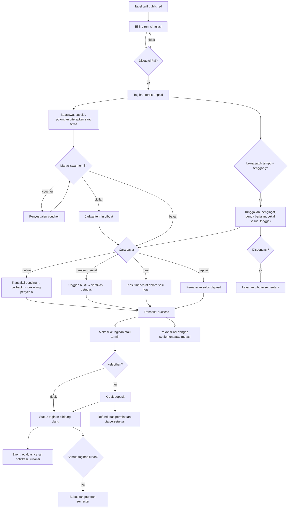

### 7.3 Penerbitan tagihan semester (billing run)

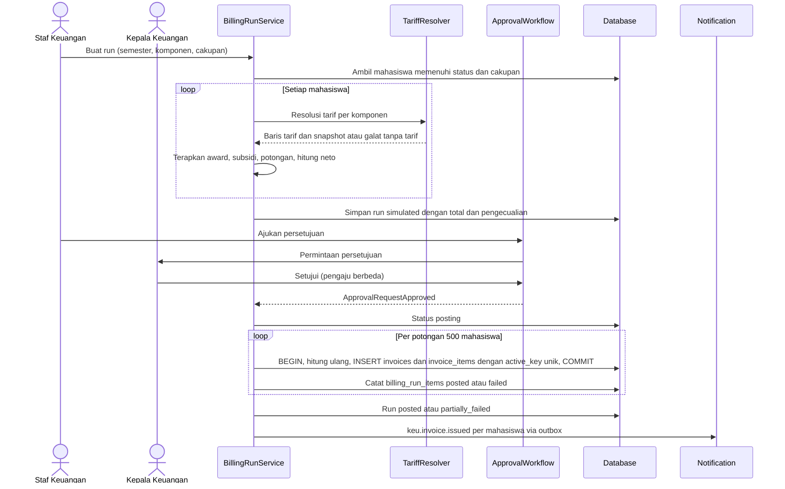

Catatan: perhitungan diulang saat posting (bukan memakai angka simulasi) agar perubahan award atau status mahasiswa antara simulasi dan posting tetap tercermin; selisih total terhadap simulasi dilaporkan di ringkasan run.

### 7.4 Pembayaran online

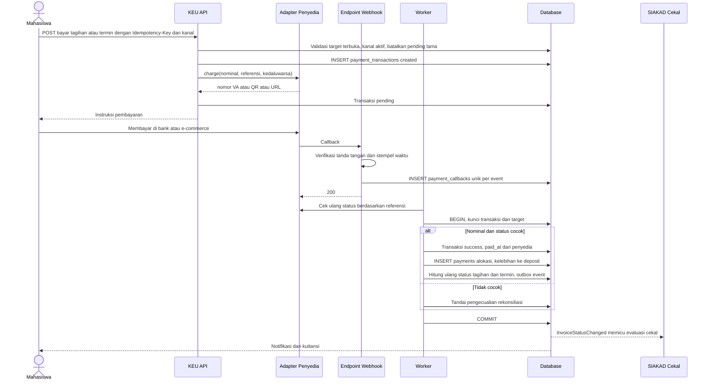

### 7.5 Transfer manual dan pembayaran tunai

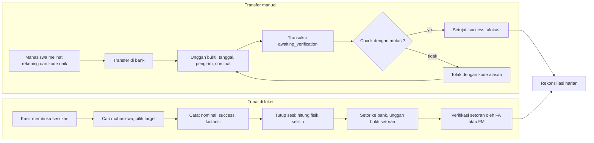

### 7.6 Cicilan, keterlambatan, dan dispensasi

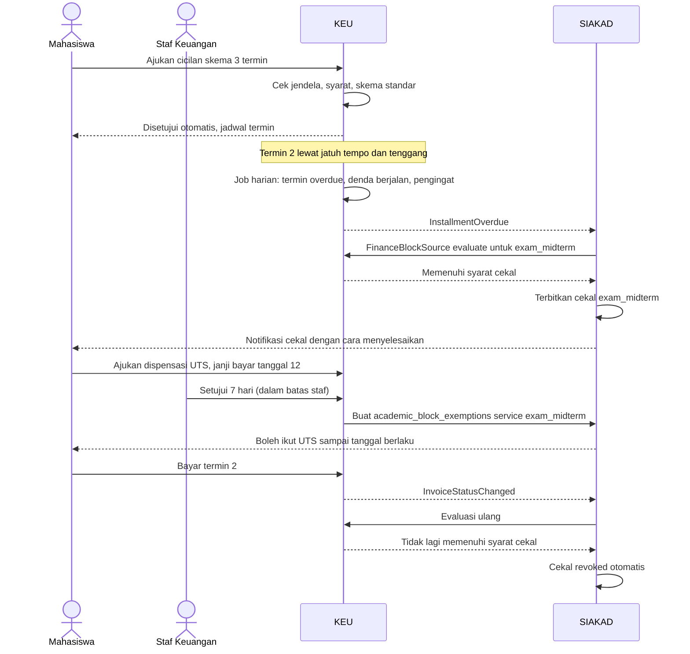

### 7.7 Penetapan dan peninjauan UKT

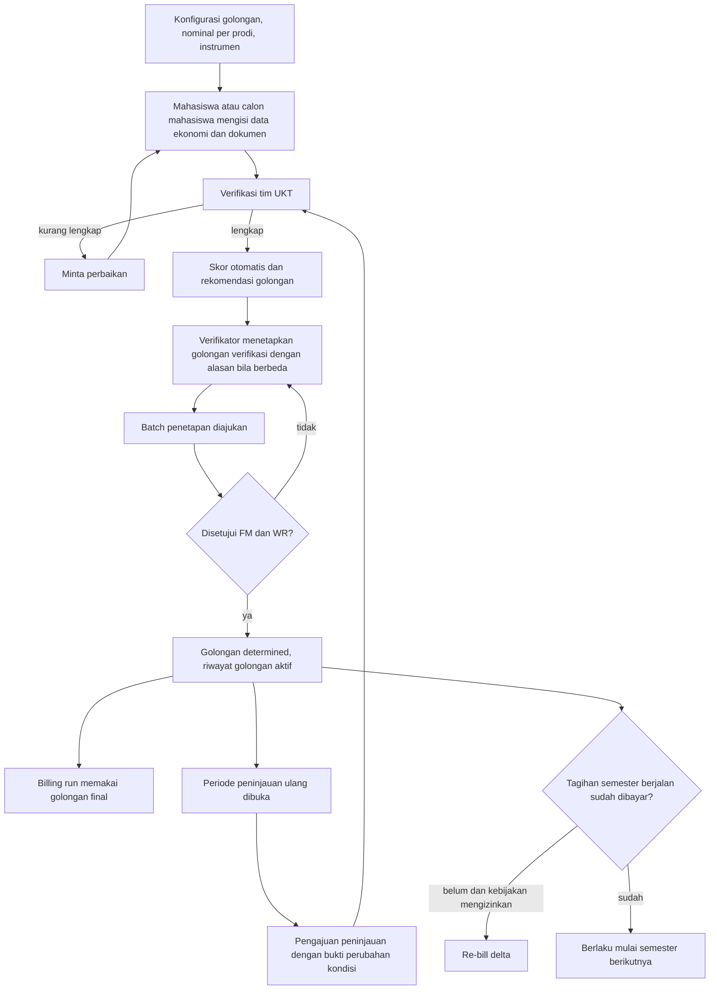

### 7.8 Pengembalian dana

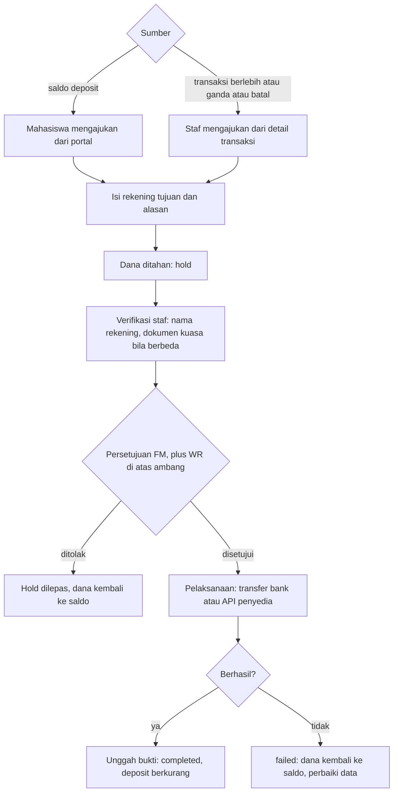

### 7.9 Tutup harian dan bulanan

| Langkah | Harian | Bulanan |
|---|---|---|
| 1 | Semua sesi kas hari itu ditutup dan setoran diunggah | Semua batch rekonsiliasi bulan itu tertutup |
| 2 | Batch rekonsiliasi H-1 dibuat per kanal dan rekening | Tidak ada transaksi `awaiting_verification` bertanggal bulan itu, atau sudah diberi catatan |
| 3 | Ringkasan penerimaan per kanal/metode diperiksa terhadap mutasi | Pemeriksaan integritas (BR-KEU-09, BR-KEU-51) tanpa selisih |
| 4 | Pengecualian dicatat dan ditugaskan | Laporan bulanan dibuat dan diarsipkan (PDF) |
| 5 | — | FM menutup periode; perubahan berikutnya hanya sebagai entri periode terbuka |

---

## 8. Aturan Bisnis, Status, dan Perhitungan

### 8.1 Aturan bisnis

Setiap aturan dapat diuji. Nilai dalam tanda kurung miring adalah konfigurasi *(default)*.

#### 8.1.1 Tarif

| ID | Aturan | Label |
|---|---|---|
| BR-KEU-01 | Tarif hanya diambil dari tabel tarif berstatus `published`. Tabel `published` tidak dapat diubah; perubahan dibuat sebagai versi baru dengan `effective_term_id`. | R |
| BR-KEU-02 | Untuk setiap (mahasiswa, komponen, semester), dipilih baris tarif cocok dengan skor kekhususan tertinggi ([§8.3.1](#831-resolusi-tarif)). Dua baris dengan himpunan dimensi sama dan rentang yang beririsan adalah **konflik**; tabel yang memuat konflik tidak dapat dipublikasikan. | R |
| BR-KEU-03 | Tabel yang dipakai ditentukan `keu.rate_lock_mode` *(cohort)*: `cohort` = tabel yang berlaku pada tahun angkatan masuk mahasiswa; `current` = tabel yang berlaku pada semester tagihan. | R, K |
| BR-KEU-04 | Nominal tarif ≥ 0. Tarif 0 sah dan berarti komponen tidak ditagihkan (item tidak dibuat). | R |
| BR-KEU-05 | Tagihan menyimpan snapshot tarif (id baris, nominal, dasar hitung, dimensi mahasiswa saat terbit). Perubahan tarif atau data mahasiswa sesudahnya tidak mengubah tagihan secara otomatis. | R |

#### 8.1.2 Tagihan

| ID | Aturan | Label |
|---|---|---|
| BR-KEU-06 | Tagihan wajib hanya diterbitkan untuk mahasiswa berstatus dalam `keu.billing.eligible_statuses` *(["active"])*. Mahasiswa `leave` hanya menerima komponen kategori `leave` bila kebijakan menetapkan biaya cuti. | R, K |
| BR-KEU-07 | Satu item aktif per (mahasiswa, semester, komponen, sumber) melalui `invoice_items.active_key` unik; billing run ulang atau retry tidak menggandakan tagihan. | R |
| BR-KEU-08 | Nominal dan item tagihan yang sudah terbit tidak dapat diubah langsung; perubahan hanya melalui `invoice_adjustments` yang disetujui. Tagihan berstatus `draft` boleh diubah. | R |
| BR-KEU-09 | `invoices.paid_amount` = Σ alokasi `posted`; `invoices.amount` = Σ item (bruto − potongan ± penyesuaian). `invoices.status` dihitung ulang dalam transaksi basis data yang sama dengan setiap alokasi, pembalikan, atau penyesuaian. Tidak ada endpoint yang menetapkan status secara langsung. | R (konsisten SP §2.3) |
| BR-KEU-10 | Tagihan per SKS diterbitkan pada pemicu `keu.credit_fee.trigger` *(krs_approved)*. SKS = Σ `courses.credits` dari `krs_items` berstatus `enrolled`. Komponen `per_course` dihitung dari mata kuliah yang kategorinya cocok. | E (per SKS), R |
| BR-KEU-11 | Perubahan SKS setelah tagihan SKS terbit menghasilkan penyesuaian delta: tambah → penyesuaian naik; kurang sebelum `keu.credit_fee.drop_credit_deadline` → penyesuaian turun (bila sudah dibayar → kredit deposit); kurang setelah batas → tidak ada pengurangan. | R, K |
| BR-KEU-12 | Tagihan hanya dapat dibatalkan (*void*) bila `paid_amount = 0` dan tidak ada transaksi `pending`/`awaiting_verification`. Selain itu gunakan penyesuaian turun dan kredit deposit. | R |
| BR-KEU-13 | Jatuh tempo ≥ tanggal terbit. Tagihan tanpa jatuh tempo tidak dapat diterbitkan. | R |
| BR-KEU-14 | Saat mahasiswa berubah ke `dropped_out`, `resigned`, `graduated`, atau `inactive`, tidak ada tagihan baru yang terbit; tagihan terbuka masuk daftar tinjauan. Pembatalan otomatis hanya bila `keu.billing.auto_cancel_on_exit` *(false)*. | R, K |
| BR-KEU-15 | Cuti yang disetujui sebelum tagihan registrasi semester itu dibayar → tagihan diganti biaya cuti melalui penyesuaian. Bila sudah dibayar → selisih menjadi deposit *(default)* atau refund atas permintaan. | R, K |

#### 8.1.3 UKT

| ID | Aturan | Label |
|---|---|---|
| BR-KEU-16 | Satu penetapan golongan UKT aktif per mahasiswa per rentang semester; rentang tidak boleh tumpang tindih. Hanya penetapan `determined` yang dipakai resolusi tarif. | R |
| BR-KEU-17 | Skor dan rekomendasi otomatis tidak pernah langsung menjadi penetapan; penetapan memerlukan verifikasi dan persetujuan oleh pihak berbeda (SOD-KEU-07). | R |
| BR-KEU-18 | Mahasiswa yang wajib UKT tetapi belum memiliki penetapan final saat billing run tidak ditagih UKT dan masuk daftar pengecualian, kecuali `keu.ukt.default_group_when_missing` diisi kebijakan. | R, K |
| BR-KEU-19 | Peninjauan ulang hanya pada periode yang dibuka; hasil berlaku mulai `effective_term` *(semester berikutnya)*. Bila tagihan semester berjalan belum dibayar dan `keu.ukt.rebill_current_term` *(false)*, sistem membuat re-bill delta. | R, K |
| BR-KEU-20 | Data ekonomi dan dokumen UKT adalah data pribadi sensitif (BR-KEU-72); hanya pemegang `finance_sensitive.read` dan verifikator yang ditugaskan yang dapat membukanya. | R (UU PDP) |

#### 8.1.4 Beasiswa, subsidi, potongan, pembebasan

| ID | Aturan | Label |
|---|---|---|
| BR-KEU-21 | Urutan penerapan per komponen: (1) pembebasan yang berlaku saat terbit, (2) bantuan/beasiswa, (3) subsidi, (4) potongan kebijakan, (5) voucher. Mode `keu.discount.stacking_mode` *(sequential)*: `sequential` menghitung atas sisa setelah langkah sebelumnya; `parallel` menghitung atas bruto. | R, K |
| BR-KEU-22 | Σ potongan per komponen ≤ bruto komponen; neto tidak pernah negatif. Komponen `discountable = false` hanya dapat dikurangi oleh pembebasan atau award yang secara eksplisit mencakup komponen itu. Tagihan yang neto-nya 0 **karena keringanan saat terbit** (mis. beasiswa penuh, KIP Kuliah) tetap diterbitkan sebagai bukti keringanan dan langsung berstatus `paid` tanpa transaksi; ini satu-satunya kondisi `paid` tanpa transaksi. | R |
| BR-KEU-23 | Kebijakan potongan `stackable = false` tidak digabung dengan potongan kebijakan lain; bila beberapa memenuhi, dipilih yang memberi potongan terbesar *(default)*. | R |
| BR-KEU-24 | Award bersyarat hanya diterapkan bila syaratnya terpenuhi saat tagihan dibuat. Pencabutan award berlaku mulai semester berikutnya, kecuali disetujui retroaktif melalui penyesuaian naik. | R |
| BR-KEU-25 | Award `third_party_payment` membuat klaim penyandang dana sebesar bagian yang ditanggung; tagihan mahasiswa hanya memuat bagian mahasiswa. | R |
| BR-KEU-26 | Pembebasan wajib kode alasan, dokumen bila disyaratkan, dan persetujuan sesuai ambang. Pembebasan penuh atas tagihan tanpa pembayaran mengubah status menjadi `waived`. | E (RA), R |

#### 8.1.5 Voucher

| ID | Aturan | Label |
|---|---|---|
| BR-KEU-27 | Voucher hanya dapat ditukarkan pada tagihan `unpaid` yang tidak memiliki transaksi `pending`/`awaiting_verification`, sebelum `due_date` (kecuali voucher mengizinkan), dan memenuhi cakupan, masa berlaku, kuota (dengan *row lock*), serta batas per mahasiswa. | R |
| BR-KEU-28 | Penukaran tidak dapat dibatalkan setelah tagihan menerima pembayaran. | R |
| BR-KEU-29 | Lebih dari 5 kode gagal dalam 10 menit per pengguna → penukaran dikunci sementara 30 menit. | R |

#### 8.1.6 Cicilan

| ID | Aturan | Label |
|---|---|---|
| BR-KEU-30 | Cicilan hanya untuk komponen `installable`, diajukan dalam jendela pengajuan, oleh mahasiswa tanpa tunggakan semester sebelumnya *(kecuali kebijakan)*, dan maksimal satu rencana aktif per tagihan. | E, R, K |
| BR-KEU-31 | Σ nominal termin = sisa neto tagihan saat jadwal dibuat. Nominal per termin dibulatkan ke `keu.rounding.unit`; selisih pembulatan masuk termin terakhir. | R |
| BR-KEU-32 | Termin-1 jatuh tempo paling lambat pada batas pembayaran registrasi semester tersebut. | R |
| BR-KEU-33 | Pembayaran untuk tagihan bercicilan dialokasikan ke termin terbuka dengan jatuh tempo paling awal; kelebihan diteruskan ke termin berikutnya; pelunasan dipercepat diizinkan. | R |
| BR-KEU-34 | Penjadwalan ulang membuat jadwal versi baru; termin yang sudah dibayar tidak berubah; jadwal lama ditandai `superseded` dan tetap tersimpan. | R |
| BR-KEU-35 | Termin dengan `today > due_date + grace_days` dan sisa > 0 dianggap terlambat (status tampilan `overdue`) dan menjadi dasar denda dan cekal. | R |

#### 8.1.7 Denda

| ID | Aturan | Label |
|---|---|---|
| BR-KEU-36 | Denda hanya dihitung dari aturan denda `published` yang berlaku untuk komponen/kelompok tagihan. Denda tidak dihitung atas denda (tidak majemuk). | E (denda), R |
| BR-KEU-37 | Hari terlambat = tanggal bayar efektif − (`due_date` + `grace_days`). Tanggal bayar efektif = `paid_at` dari penyedia, tanggal transfer pada bukti yang disetujui, atau tanggal kuitansi tunai — **bukan** waktu verifikasi. Seluruh tanggal memakai zona waktu tenant. | R |
| BR-KEU-38 | Denda dibatasi `cap_amount`/`cap_percent` dan `max_periods`; berhenti saat pokok lunas atau mahasiswa keluar; dijeda selama dispensasi aktif bila `pause_during_dispensation` *(false)*. | R, K |
| BR-KEU-39 | Denda dikristalisasi menjadi tagihan `penalty` saat pokok lunas atau pada cut-off `keu.penalty.crystallize_at` *(akhir semester)*. Sebelum itu denda ditampilkan sebagai estimasi dan tidak dapat dibayar terpisah. | R |
| BR-KEU-40 | Pengurangan atau penghapusan denda hanya melalui penyesuaian `penalty_waiver` beralasan dan disetujui; penghapusan massal memerlukan keputusan pejabat berwenang. | R |

#### 8.1.8 Pembayaran

| ID | Aturan | Label |
|---|---|---|
| BR-KEU-41 | Transaksi menjadi `success` hanya melalui: (a) callback bertanda tangan valid **dan** pemeriksaan ulang status ke API penyedia; (b) persetujuan bukti manual oleh petugas berwenang; (c) pencatatan tunai oleh kasir dalam sesi kas `open`; (d) pemakaian saldo deposit oleh sistem atau petugas. Status dari front-end atau halaman *redirect* hanya memicu pengecekan ulang ke server. | E (online), R |
| BR-KEU-42 | Nominal transaksi `closed_amount` = sisa target + biaya kanal (bila ditanggung mahasiswa). Nominal diterima ≠ nominal transaksi → tidak dialokasikan otomatis; menjadi pengecualian `amount_mismatch`. | R |
| BR-KEU-43 | Satu transaksi `pending` aktif per target (tagihan atau termin) lintas kanal; membuat transaksi baru membatalkan yang lama di penyedia bila didukung, atau mencatat bahwa pembatalan tidak didukung. | R (PMB F4) |
| BR-KEU-44 | Callback idempoten dengan unik (`provider`, `provider_event_id`); bila penyedia tidak memberi id event, dipakai hash (`provider_reference` + status + waktu bayar). Transisi status hanya maju; callback `failed` setelah `success` diabaikan dan dicatat. | R |
| BR-KEU-45 | Dana untuk target tertentu dialokasikan ke target itu. Sisa dana dan dana tanpa target diperlakukan sesuai `keu.allocation.overflow` *(deposit)*: `deposit` atau `auto` (urutan [§8.3.7](#837-alokasi-pembayaran)). | R, K |
| BR-KEU-46 | Kelebihan bayar selalu dikreditkan ke deposit mahasiswa; tidak ada saldo lebih yang dibiarkan pada tagihan. | E (deposit) [I], R |
| BR-KEU-47 | Pembayaran untuk tagihan `cancelled`/`waived`, atau untuk mahasiswa yang sudah keluar, tetap dicatat `success`, dikreditkan ke deposit, dan ditandai `needs_resolution`. | R |
| BR-KEU-48 | Biaya kanal dicatat terpisah di transaksi (`channel_fee`) dan tidak menambah piutang tagihan. | R |
| BR-KEU-49 | Pembayaran tunai hanya dalam sesi kas `open` milik kasir. Nomor kuitansi berurutan tanpa celah per tenant. Pembatalan kuitansi tunai pada hari yang sama oleh kasir dengan persetujuan FM; setelah sesi ditutup hanya melalui pembalikan. | R |
| BR-KEU-50 | Satu bukti aktif per transaksi manual. Bukti dengan checksum sama dengan bukti lain memicu peringatan duplikat. Persetujuan bukti tanpa pencocokan mutasi wajib alasan dan persetujuan tingkat kedua. | R |

#### 8.1.9 Deposit

| ID | Aturan | Label |
|---|---|---|
| BR-KEU-51 | Saldo deposit = Σ entri ledger; ledger *append-only*; saldo tersedia (saldo − ditahan) tidak pernah negatif (dijaga *row lock* akun). | R |
| BR-KEU-52 | Pemakaian deposit membuat transaksi internal (`method = deposit`, `reconciliation_status = not_required`) dan alokasi biasa, tetapi tidak dihitung sebagai penerimaan kas di laporan penerimaan. | R |
| BR-KEU-53 | Penarikan deposit hanya melalui refund berpersetujuan. Pemindahan saldo antarmahasiswa tidak diizinkan kecuali `keu.deposit.allow_transfer` *(false)*. | R, K |

#### 8.1.10 Rekonsiliasi

| ID | Aturan | Label |
|---|---|---|
| BR-KEU-54 | Setiap transaksi `success` non-internal memiliki `reconciliation_status`; transaksi kanal online wajib `matched` atau `resolved` paling lambat H+`keu.reconciliation.sla_days` *(2 hari kerja)*. | R |
| BR-KEU-55 | Batch rekonsiliasi hanya dapat ditutup bila semua item terselesaikan; batch tertutup tidak dapat diubah dan dibuka kembali hanya dengan persetujuan FM. | R |
| BR-KEU-56 | Transaksi yang ada di settlement penyedia tetapi tidak `success` di sistem diperiksa ulang ke API penyedia sebelum disukseskan. | R |
| BR-KEU-57 | Dana tak teridentifikasi disimpan di register `unidentified_receipts` (bukan deposit mahasiswa mana pun) sampai diklaim dan diverifikasi, atau dikembalikan. | R |

#### 8.1.11 Koreksi, refund, dan periode

| ID | Aturan | Label |
|---|---|---|
| BR-KEU-58 | Refund hanya bersumber dari saldo deposit atau transaksi `success` yang dinyatakan berlebih/ganda/batal; nominal ≤ dana tersedia; dana ditahan sejak diajukan. | R |
| BR-KEU-59 | Rekening tujuan refund atas nama mahasiswa atau orang tua/wali terdaftar; nama berbeda memerlukan surat kuasa dan persetujuan tambahan. | R |
| BR-KEU-60 | Refund `completed` hanya dengan bukti transfer atau referensi refund penyedia. Refund `failed` melepas dana kembali ke saldo. | R |
| BR-KEU-61 | Pembalikan alokasi atau pembayaran wajib alasan dan persetujuan (pembuat ≠ penyetuju), lalu memicu perhitungan ulang status tagihan/termin, denda, dan evaluasi cekal. | R |
| BR-KEU-62 | Data dengan tanggal efektif di periode `closed` tidak dapat diubah; koreksi dicatat sebagai entri baru bertanggal periode terbuka yang merujuk entri asal. | R |
| BR-KEU-63 | Penghapusan piutang hanya untuk mahasiswa berstatus keluar/nonaktif dengan umur piutang ≥ `keu.write_off.min_age_days` *(730)*, melalui persetujuan WR. Piutang yang dihapus tercatat di register dan dapat menerima pembayaran kemudian. | R, K |

#### 8.1.12 Cekal keuangan

| ID | Aturan | Label |
|---|---|---|
| BR-KEU-64 | KEU tidak menegakkan cekal. KEU menyediakan evaluasi `FinanceBlockSource` sesuai `condition` aturan cekal SIAKAD dan memancarkan event perubahan kewajiban. | R (A.8) |
| BR-KEU-65 | Evaluasi memperhitungkan: kelompok/komponen dengan `counts_for_clearance`, tagihan dan termin yang jatuh tempo sebelum tanggal acuan layanan, `grace_days`, ambang `min_outstanding_amount`, opsi denda, dan transaksi `awaiting_verification` sesuai `pending_proof_grace_hours`. | E (cekal keuangan), R |
| BR-KEU-66 | Pembayaran sukses yang membuat syarat terpenuhi memicu evaluasi ulang dan pencabutan otomatis paling lama 5 menit. | R |
| BR-KEU-67 | Dispensasi keuangan bersifat per layanan, beralasan, berbatas waktu (≤ `academic.blocks.exemption_max_days`), dan diberikan pemegang `academic_block_exemptions.approve` sesuai batas (`keu.dispensation.staff_max_days` *(7)*). Dispensasi massal hanya melalui persetujuan WR. | E (dispensasi), R |
| BR-KEU-68 | Bila sumber KEU tidak tersedia (modul nonaktif atau gagal), evaluasi menghasilkan "tidak diketahui" dan tidak menerbitkan cekal (BR-SIA-CKL-08); kegagalan dicatat untuk pemantauan. | R |
| BR-KEU-69 | Pesan cekal kepada dosen wali, dosen, dan BAAK tidak menampilkan nominal (BR-SIA-CKL-09). | R |
| BR-KEU-70 | Bebas tanggungan keuangan = tidak ada piutang di semua semester (termasuk tagihan denda dan estimasi denda berjalan) dan tidak ada transaksi `awaiting_verification`. Saldo deposit tidak menghalangi bebas tanggungan. | I (yudisium), R |

#### 8.1.13 Data dan keamanan

| ID | Aturan | Label |
|---|---|---|
| BR-KEU-71 | Nominal disimpan `decimal(14,2)` IDR. Perhitungan dilakukan dalam satuan sen (integer), seperti `AdmissionPostingService`. Pembulatan per item ke `keu.rounding.unit` *(1)* dengan metode *half-up*. | R |
| BR-KEU-72 | Data ekonomi UKT, nomor rekening refund, dan dokumen identitas terenkripsi di kolom, disamarkan di daftar, dan setiap pembukaan nilai asli dicatat. | R (UU PDP) |
| BR-KEU-73 | Ekspor data keuangan per mahasiswa hanya oleh role berizin, wajib alasan, dibatasi kolom, dan dicatat (siapa, kapan, filter, jumlah baris). | R |
| BR-KEU-74 | Staf tidak dapat memproses tagihan, transaksi, dispensasi, refund, atau UKT untuk dirinya sendiri atau mahasiswa yang terhubung dengannya sebagai orang tua/wali. | R |

### 8.2 Status

#### 8.2.1 Tiga lapis status yang berbeda

| Lapis | Pertanyaan yang dijawab | Entitas dan kolom | Nilai | Diubah oleh |
|---|---|---|---|---|
| **Status tagihan** | "Berapa kewajiban yang tersisa dan apakah tagihan masih berlaku?" | `invoices.status` (+ turunan `is_overdue`) | `draft`, `unpaid`, `partial`, `paid`, `cancelled`, `waived` | Sistem saja, sebagai turunan dari item, penyesuaian, dan alokasi |
| **Status termin** | "Bagaimana kemajuan pembayaran per jadwal?" | `invoice_installments.status` | `scheduled`, `partial`, `paid`, `superseded`, `waived` (+ tampilan `due`, `overdue`) | Sistem |
| **Status pembayaran (transaksi)** | "Apa yang terjadi dengan upaya bayar atau uang masuk ini?" | `payment_transactions.status` | `created`, `pending`, `awaiting_verification`, `success`, `failed`, `expired`, `cancelled`, `reversed`, `refunded` | Sistem (callback, job), petugas (verifikasi, tunai), mahasiswa (batal pending) |
| **Status alokasi** | "Apakah dana ini masih mengurangi tagihan tertentu?" | `payments.status` | `posted`, `reversed` | Sistem, petugas melalui pembalikan |
| **Status rekonsiliasi** | "Apakah uang ini sudah terbukti diterima di rekening kampus?" | `payment_transactions.reconciliation_status` | `not_required`, `unreconciled`, `pending_deposit`, `matched`, `exception`, `resolved` | Proses rekonsiliasi |

Contoh kombinasi yang sah dan artinya:

| Tagihan | Transaksi | Rekonsiliasi | Arti |
|---|---|---|---|
| `unpaid` | `pending` | `unreconciled` | VA sudah dibuat, belum dibayar |
| `unpaid` | `awaiting_verification` | `unreconciled` | Bukti transfer menunggu diperiksa; tagihan belum berkurang |
| `paid` | `success` | `unreconciled` | Lunas berdasarkan callback terverifikasi, settlement H-1 belum diproses |
| `paid` | `success` | `matched` | Lunas dan sudah cocok dengan settlement/mutasi |
| `paid` | `success` (tunai) | `pending_deposit` | Lunas di loket, uang belum disetor ke bank |
| `partial` | `success` | `exception` | Nominal diterima berbeda; sedang diselesaikan |
| `unpaid` | `reversed` | `resolved` | Pembayaran dibatalkan bank setelah sukses; tagihan terbuka kembali |
| `waived` | — | — | Dibebaskan penuh tanpa pembayaran |

#### 8.2.2 Pemetaan status lama

| Status di `RANCANGAN-APLIKASI.md` §4.23 | Lapis dan nilai di KEU |
|---|---|
| Belum dibayar | Tagihan `unpaid` |
| Dibayar sebagian | Tagihan `partial` |
| Lunas | Tagihan `paid` |
| Menunggu verifikasi | Transaksi `awaiting_verification` (tagihan tetap `unpaid`/`partial`, tampil penanda "ada pembayaran menunggu verifikasi") |
| Gagal | Transaksi `failed` |
| Kedaluwarsa | Transaksi `expired`. Tagihan tidak kedaluwarsa; tagihan lewat jatuh tempo = tunggakan (`is_overdue`) |
| Dikembalikan | Transaksi `refunded` atau refund `completed` |

Status `pmb_invoices` (PMB SM-04) tetap milik PMB. Setelah konversi, tagihan hasil posting memakai status `invoices` di atas.

#### 8.2.3 Tagihan (`invoices.status`)

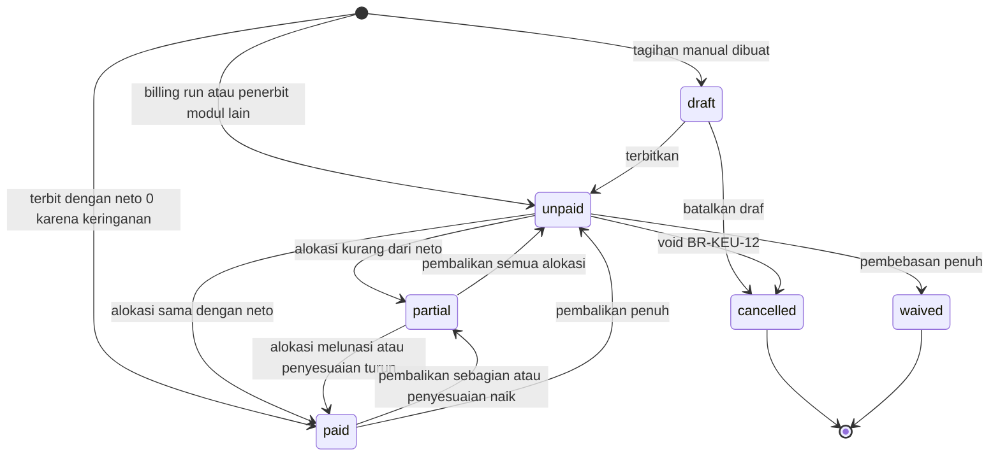

| Status | Arti | Masuk dari | Keluar ke | Efek samping |
|---|---|---|---|---|
| `draft` | Disiapkan, belum menjadi kewajiban | — | `unpaid`, `cancelled` | Tidak dihitung sebagai piutang |
| `unpaid` | Terbit, belum ada alokasi | `draft`, penerbitan | `partial`, `paid`, `cancelled`, `waived` | Piutang bertambah; notifikasi `keu.invoice.issued` |
| `partial` | Sebagian terbayar | `unpaid`, `paid` | `paid`, `unpaid` | — |
| `paid` | Lunas (`paid_amount ≥ amount`) | `unpaid`, `partial`, penerbitan dengan neto 0 (BR-KEU-22) | `partial`, `unpaid` (hanya karena pembalikan/penyesuaian naik) | Event `InvoiceStatusChanged`; evaluasi cekal; kristalisasi denda |
| `cancelled` | Dibatalkan sebelum ada pembayaran | `draft`, `unpaid` | — (terminal) | Transaksi pending dibatalkan; keluar dari piutang |
| `waived` | Dibebaskan penuh tanpa pembayaran | `unpaid` | — (terminal) | Keluar dari piutang; tercatat di laporan pembebasan |

Atribut turunan: `is_overdue` = sisa > 0 dan (`due_date` + `grace_days` < hari ini, atau ada termin terlambat); `overdue_since`. Penghapusan piutang (`write_off`) tidak mengubah status menjadi `paid`; tagihan tetap `unpaid`/`partial` dengan penanda `written_off_at` dan keluar dari aging aktif.

#### 8.2.4 Termin cicilan

| Status | Arti | Transisi |
|---|---|---|
| `scheduled` | Belum ada pembayaran | → `partial`, `paid`, `superseded`, `waived` |
| `partial` | Terbayar sebagian | → `paid`, `superseded` |
| `paid` | Lunas | → `partial` (pembalikan) |
| `superseded` | Diganti jadwal baru (penjadwalan ulang) | Terminal |
| `waived` | Dibebaskan | Terminal |
| *(tampilan)* `due` | `today ≥ due_date` dan sisa > 0 | Turunan |
| *(tampilan)* `overdue` | `today > due_date + grace_days` dan sisa > 0 | Turunan |

Rencana cicilan (`installment_requests.plan_status`): `active` → `completed` | `superseded` | `defaulted` | `cancelled`.

#### 8.2.5 Transaksi pembayaran dan alokasi

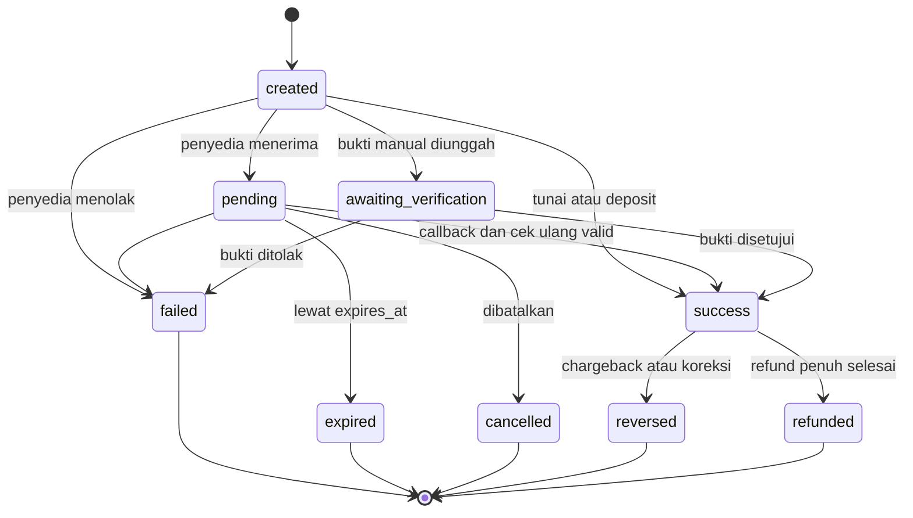

| Status | Arti | Aktor | Efek pada tagihan |
|---|---|---|---|
| `created` | Dibuat, belum ada respons penyedia/bukti | Sistem | — |
| `pending` | Menunggu pembayaran di penyedia | Sistem | Tampil "menunggu pembayaran" |
| `awaiting_verification` | Bukti transfer menunggu diperiksa | Mahasiswa → petugas | Tampil "menunggu verifikasi"; tidak mengurangi sisa |
| `success` | Uang diterima dan tervalidasi | Sistem/petugas/kasir | Alokasi `posted`; status tagihan dihitung ulang |
| `failed` | Gagal atau bukti ditolak | Sistem/petugas | — |
| `expired` | Lewat batas waktu tanpa dibayar | Sistem | — |
| `cancelled` | Dibatalkan sebelum dibayar | Mahasiswa/petugas/sistem | — |
| `reversed` | Uang ditarik kembali bank/penyedia atau koreksi kesalahan | Sistem/petugas (maker-checker) | Alokasi `reversed`; tagihan terbuka kembali |
| `refunded` | Seluruh nominal sudah dikembalikan | Sistem dari refund `completed` | — (tagihan sudah dikoreksi sebelumnya) |

Refund sebagian tidak mengubah status `success`; nominalnya tercatat di `refunded_amount`.

#### 8.2.6 Refund

`draft` → `submitted` → `pending_approval` → `approved` | `rejected` → `processing` → `completed` | `failed`; `cancelled` dari `draft`/`submitted`/`pending_approval`. Dana ditahan pada `submitted` dan dilepas pada `rejected`, `cancelled`, atau `failed`.

#### 8.2.7 Rekonsiliasi

| Objek | Status/hasil |
|---|---|
| Batch (`reconciliation_batches.status`) | `open` → `matching` → `in_review` → `closed`; `closed` → `in_review` hanya melalui pembukaan kembali berpersetujuan |
| Item (`reconciliation_items.result`) | `matched`, `missing_in_system`, `missing_in_statement`, `amount_mismatch`, `duplicate`, `unidentified` |
| Resolusi item (`resolution`) | `auto_matched`, `manual_match`, `transaction_created`, `escalated_to_provider`, `credited_to_deposit`, `refund_requested`, `moved_to_unidentified`, `returned_to_sender`, `ignored_with_reason` |
| Transaksi (`reconciliation_status`) | `not_required` (deposit), `unreconciled`, `pending_deposit` (tunai), `matched`, `exception`, `resolved` |
| Dana tak teridentifikasi | `open` → `claimed` → `allocated` | `returned` |

#### 8.2.8 Penyesuaian tagihan

`draft` → `pending_approval` → `applied` | `rejected`; `cancelled` sebelum disetujui. Jenis: `increase`, `decrease`, `waiver`, `penalty_waiver`, `void`, `write_off`, `rebill`, `voucher` (disetujui oleh kebijakan voucher), `aid_retroactive`.

#### 8.2.9 Penilaian UKT

| Status | Arti | Transisi |
|---|---|---|
| `draft` | Diisi mahasiswa | → `submitted` |
| `submitted` | Dikirim | → `in_verification` |
| `in_verification` | Diperiksa verifikator | → `revision_requested`, `verified` |
| `revision_requested` | Perlu perbaikan | → `submitted`, `cancelled` (lewat batas) |
| `verified` | Skor dan golongan verifikasi ditetapkan verifikator | → `pending_determination` |
| `pending_determination` | Masuk batch penetapan | → `determined`, `verified` (dikembalikan) |
| `determined` | Ditetapkan (final) | → `superseded` (oleh peninjauan ulang) |
| `superseded` | Digantikan penetapan baru | Terminal |
| `cancelled` | Dibatalkan | Terminal |

Peninjauan ulang adalah penilaian baru (`type = review`) yang merujuk penetapan sebelumnya.

#### 8.2.10 Billing run

`draft` → `simulated` → `pending_approval` → `approved` → `posting` → `posted` | `partially_failed` | `failed`; `cancelled` sebelum `posting`. Item run: `pending`, `posted`, `skipped` (dengan kode alasan: `NO_RATE`, `ALREADY_BILLED`, `INELIGIBLE_STATUS`, `UKT_MISSING`, `ZERO_AMOUNT`), `failed`.

#### 8.2.11 Award bantuan

`proposed` → `active` | `rejected`; `active` → `suspended` (syarat tidak terpenuhi) → `active`; `active` → `ended` (rentang selesai) | `revoked` (dicabut).

#### 8.2.12 Sesi kas

`open` → `closed` (hitung fisik, selisih tercatat) → `deposited` (bukti setoran) → `verified` | `discrepancy` (selisih setoran perlu tindak lanjut) → `verified`.

#### 8.2.13 Status lain

| Objek | Status |
|---|---|
| Tabel tarif, aturan denda, kebijakan potongan | `draft`, `pending_approval`, `published`/`active`, `archived` |
| Voucher | `draft`, `active`, `paused`, `expired`, `exhausted`, `archived`; penukaran `applied`, `reversed` |
| Pengajuan cicilan | `submitted`, `approved`, `rejected`, `cancelled` |
| Denda berjalan (`penalty_accruals`) | `accruing`, `stopped`, `crystallized`, `waived` |
| Klaim penyandang dana | `open`, `claimed`, `partially_settled`, `settled`, `cancelled` |
| Janji bayar | `pending`, `kept`, `broken` |
| Periode keuangan | `open`, `closed`, `reopened` |
| Cekal (milik SIAKAD) | `active`, `exempted`, `revoked`, `expired` |

### 8.3 Perhitungan

#### 8.3.1 Resolusi tarif

Untuk mahasiswa *m*, komponen *k*, semester *t*:

1. Pilih tabel tarif sesuai `keu.rate_lock_mode` (tabel tahun angkatan atau tabel semester berjalan).
2. Kandidat = baris untuk komponen *k* yang setiap dimensi non-kosongnya cocok dengan data *m* (prodi, jalur, kelas/sistem kuliah, golongan UKT aktif, tingkat semester *m* pada *t*, angkatan, kewarganegaraan).
3. Skor kekhususan = Σ bobot dimensi non-kosong: prodi 64, golongan UKT 32, jalur masuk 16, kelas/sistem kuliah 8, tingkat semester 4, angkatan 2, kewarganegaraan 1 [R].
4. Pilih skor tertinggi. Karena bobot berupa pangkat dua, skor sama hanya terjadi pada himpunan dimensi yang identik; itu adalah konflik yang sudah ditolak saat publikasi (BR-KEU-02).
5. Tidak ada kandidat → mahasiswa masuk pengecualian `NO_RATE` (bukan nominal 0).

Tingkat semester mahasiswa = jumlah semester reguler sejak semester masuk, dikurangi semester cuti bila `keu.semester_level.exclude_leave` *(true)* [K].

#### 8.3.2 Bruto per komponen

| Dasar | Rumus |
|---|---|
| `flat` | `bruto = tarif` |
| `per_credit` | `sks = Σ courses.credits (krs_items enrolled)`; `sks_tagih = min(max(sks, min_credits), max_credits)`; `bruto = tarif × sks_tagih`. Bila tarif paket diatur dan `sks ≥ package_threshold`, `bruto = package_amount`. |
| `per_course` | `bruto = tarif × jumlah mata kuliah berkategori cocok` (mis. praktikum) |

#### 8.3.3 Potongan bertingkat

Untuk setiap komponen, keringanan diurutkan sesuai BR-KEU-21 lalu dihitung:

```text
sisa_0 = bruto
untuk setiap keringanan d (urut prioritas):
    dasar_d = (mode == sequential) ? sisa_{d-1} : bruto
    pot_d   = jenis persen  ? bulat(dasar_d × persen_d)
            : jenis nominal ? nominal_d
            : jenis penuh   ? sisa_{d-1}
    pot_d   = min(pot_d, batas_maks_d, sisa_{d-1})      // tidak pernah membuat neto negatif
    sisa_d  = sisa_{d-1} − pot_d
neto_komponen = sisa_n
neto_tagihan  = Σ neto_komponen
```

Setiap `pot_d` disimpan sebagai baris negatif `invoice_items` dengan `source_type` (`aid_award`, `discount_policy`, `voucher_redemption`, `adjustment`) dan `source_id`.

#### 8.3.4 Pembulatan

`bulat(x)` = pembulatan *half-up* ke kelipatan `keu.rounding.unit` *(Rp1)*. Pembulatan dilakukan per baris item, bukan pada total, agar rincian selalu berjumlah sama dengan total.

#### 8.3.5 Cicilan

```text
untuk i = 1 .. n−1:  termin_i = bulat(neto × persen_i)
termin_n = neto − Σ termin_1..n−1          // menyerap selisih pembulatan
jatuh_tempo_i = tanggal tetap skema untuk semester itu, atau tanggal terbit + offset_i
```

#### 8.3.6 Denda

Untuk setiap tagihan atau termin terlambat dengan pokok terlambat *P* (sisa pokok pada hari itu):

| Jenis | Rumus |
|---|---|
| `flat_once` | `denda = nominal` sekali saat pertama terlambat |
| `percent_once` | `denda = bulat(P × persen)` sekali |
| `flat_per_period` | `denda = nominal × periode_terlambat` |
| `percent_per_period` | `denda = Σ per periode bulat(P_periode × persen)` (P dapat turun bila ada pembayaran sebagian) |

`hari_terlambat = tanggal_bayar_efektif − (due_date + grace_days)` (BR-KEU-37); `periode_terlambat = ceil(hari_terlambat ÷ panjang_periode)`, dibatasi `max_periods`; `denda = min(denda, cap_amount, bulat(P_awal × cap_percent))`.

#### 8.3.7 Alokasi pembayaran

```text
alokasikan(transaksi T, dana A):
    jika T memiliki target:
        isi target; untuk tagihan bercicilan isi termin terbuka paling awal lebih dulu
        A = A − terpakai
    jika A > 0:
        jika keu.allocation.overflow == "deposit":
            kredit deposit sebesar A
        jika "auto":
            1. tagihan/termin terlambat, urut due_date naik (pokok sebelum denda pada tanggal sama)
            2. tagihan denda terkristalisasi
            3. tagihan/termin jatuh tempo dalam keu.allocation.lookahead_days (7)
            4. termin berikutnya bila keu.allocation.prepay_future = true (false)
            sisa → kredit deposit
```

Seluruh alokasi satu transaksi dilakukan dalam satu transaksi basis data dengan *row lock* pada tagihan dan termin yang tersentuh, diurutkan berdasarkan id untuk mencegah *deadlock*.

#### 8.3.8 Piutang, tunggakan, dan aging

```text
sisa(tagihan)      = amount − paid_amount        (untuk status unpaid/partial, tidak dihapus)
piutang(m)         = Σ sisa(tagihan milik m)
tunggakan(m, d)    = Σ sisa tagihan/termin dengan due_date + grace_days < d
umur(item, d)      = d − due_date                  (aging memakai due_date tanpa tenggang)
bucket             = belum jatuh tempo | 1–30 | 31–60 | 61–90 | 91–180 | > 180 hari
```

Piutang penyandang dana (klaim) dan saldo deposit dilaporkan terpisah, tidak di-*net*-kan dengan piutang mahasiswa.

#### 8.3.9 Contoh perhitungan lengkap

Mahasiswa PTS angkatan 2026, Prodi Informatika, jalur reguler, kelas pagi, semester Ganjil 2026/2027. Konfigurasi contoh: tenggang 3 hari, denda 0,1% per hari dari pokok terlambat dengan batas 10%, mode potongan `sequential`, `overflow = deposit`.

**Tagihan registrasi (BPP)**

| Langkah | Perhitungan | Nominal (Rp) |
|---|---|---:|
| Bruto BPP | tarif flat | 3.000.000 |
| Beasiswa prestasi 25% (prioritas 2) | 25% × 3.000.000 | −750.000 |
| Sisa | | 2.250.000 |
| Potongan saudara kandung 10% (prioritas 4) | 10% × 2.250.000 | −225.000 |
| **Neto tagihan registrasi** | jatuh tempo 31 Agustus 2026 | **2.025.000** |

Dengan mode `parallel`, potongan saudara dihitung dari bruto (300.000) sehingga neto menjadi 1.950.000. Perbedaan ini alasan mode harus ditetapkan kebijakan (Q-KEU-09).

**Tagihan SKS** (KRS disetujui 5 September: 20 SKS, 2 mata kuliah praktikum; komponen tidak dapat dipotong)

| Item | Perhitungan | Nominal (Rp) |
|---|---|---:|
| Biaya SKS | 20 × 200.000 | 4.000.000 |
| Praktikum | 2 × 250.000 | 500.000 |
| **Neto tagihan SKS** | | **4.500.000** |
| Termin 1 (40%), jatuh tempo 30 Sep | bulat(4.500.000 × 40%) | 1.800.000 |
| Termin 2 (30%), jatuh tempo 31 Okt | bulat(4.500.000 × 30%) | 1.350.000 |
| Termin 3 (sisa), jatuh tempo 30 Nov | 4.500.000 − 1.800.000 − 1.350.000 | 1.350.000 |

**Peristiwa dan saldo**

| Tanggal | Peristiwa | Piutang | Tunggakan | Deposit |
|---|---|---:|---:|---:|
| 1 Agu | Tagihan registrasi terbit | 2.025.000 | 0 | 0 |
| 28 Agu | VA 2.025.000 sukses → registrasi `paid`; cekal KRS tidak terbit | 0 | 0 | 0 |
| 5 Sep | Tagihan SKS terbit, cicilan 3 termin disetujui | 4.500.000 | 0 | 0 |
| 2 Okt | Termin 1 dibayar (masih dalam tenggang s.d. 3 Okt) → tanpa denda | 2.700.000 | 0 | 0 |
| 4 Nov | Termin 2 terlambat (31 Okt + 3 hari tenggang) | 2.700.000 | 1.350.000 | 0 |
| 7 Nov | Acuan cekal UTS: termin 2 terlambat → cekal `exam_midterm`. Estimasi denda 4 hari × 1.350 = 5.400. Dispensasi UTS s.d. 14 Nov disetujui staf | 2.700.000 | 1.350.000 | 0 |
| 12 Nov | Mahasiswa mentransfer 1.400.000, unggah bukti (`awaiting_verification`) | 2.700.000 | 1.350.000 | 0 |
| 13 Nov | Bukti disetujui. Tanggal bayar efektif 12 Nov → 9 hari terlambat. Termin 2 `paid`; denda dikristalisasi 9 × 1.350 = **12.150**; sisa 50.000 → deposit; cekal UTS dicabut | 1.362.150 | 0 | 50.000 |
| 13 Nov | Mahasiswa memakai deposit 12.150 untuk tagihan denda | 1.350.000 | 0 | 37.850 |
| 14 Nov | Rekonsiliasi: transfer 12 Nov cocok dengan mutasi bank (`matched`) | 1.350.000 | 0 | 37.850 |
| 28 Nov | Termin 3: deposit 37.850 + VA 1.312.150 | 0 | 0 | 0 |

Pada 28 November mahasiswa memenuhi syarat `exam_final` dan bebas tanggungan semester.

### 8.4 Validasi input

| Objek | Validasi |
|---|---|
| Nominal (tarif, tagihan manual, penyesuaian, pembayaran tunai) | Numerik, ≥ 0 (tarif) atau > 0 (transaksi), maksimal 2 desimal, ≤ 999.999.999.999,99; tidak boleh melebihi sisa target untuk alokasi manual |
| Tanggal | Format ISO; jatuh tempo ≥ tanggal terbit; tanggal transfer ≤ hari ini dan ≥ tanggal terbit tagihan − 30 hari; tanggal efektif tidak pada periode `closed` |
| Mahasiswa | Ada di tenant aktif; status memenuhi aturan jenis tagihan |
| Komponen dan tarif | Kode unik per tenant; rentang angkatan dan tingkat semester valid (dari ≤ sampai); dimensi merujuk data yang ada (prodi, golongan UKT, kode jalur, kode sistem kuliah) |
| Persentase | 0 < persen ≤ 100; Σ persen termin skema = 100 |
| Berkas bukti dan dokumen | JPG/PNG/PDF, ≤ 2 MB (bukti) atau ≤ 5 MB (dokumen UKT), MIME terdeteksi dari isi (`finfo`), pemindaian virus, checksum dicatat |
| Rekening refund | Kode bank terdaftar, nomor 6–20 digit, nama pemilik wajib; nama berbeda → surat kuasa wajib |
| Kode voucher | 4–30 karakter alfanumerik dan tanda hubung, tidak peka huruf besar/kecil |
| Kanal | Kanal aktif, mendukung kelompok tagihan target, belum melewati kuota saat diaktifkan |
| `Idempotency-Key` | Wajib untuk POST pembayaran, verifikasi, refund, billing run; kunci sama dengan isi berbeda → 422 |
| Alasan | Wajib (≥ 10 karakter) untuk penolakan, pembatalan, penyesuaian, pembebasan, pembalikan, dispensasi, ekspor data pribadi, pembukaan data sensitif |

---

## 9. Rancangan Data dan Hubungan Antardata

### 9.1 Konvensi

Mengikuti konvensi yang sudah dipakai modul Finance, PMB, dan Akademik:

| Aspek | Konvensi |
|---|---|
| Primary key | `id` ULID |
| Tenant | `university_id` ULID NOT NULL FK `universities`; model memakai `TenantScoped`; indeks komposit diawali `university_id`. Tidak pernah diambil dari input klien. |
| Status | `string(20–30)` + PHP backed enum; transisi hanya lewat service. Kolom `enum` MySQL yang ada (`invoices.status`) dimigrasikan ke `string` seperti pola terbaru CivitasOne (KD-10 PMB). |
| Uang | `decimal(14,2)`, IDR; `currency char(3)` hanya pada tabel transaksi; aritmetika dalam sen (BR-KEU-71) |
| Waktu | `timestampTz` (UTC) untuk kejadian; `date` untuk jatuh tempo dan tanggal efektif; tampilan dan perhitungan hari memakai zona waktu tenant |
| Data sensitif | Kolom `text` dengan cast `encrypted`; pencarian melalui kolom hash terpisah bila diperlukan |
| Penghapusan | Data transaksi (tagihan, item, alokasi, transaksi, ledger deposit, refund, penyesuaian) **tidak pernah dihapus**; memakai status terminal atau entri pembalik. *Soft delete* hanya untuk master (komponen, voucher, kebijakan) yang belum direferensikan. |
| Konkurensi | `lock_version` (optimistic lock) pada tagihan, termin, akun deposit, sesi kas, batch rekonsiliasi; *row lock* (`SELECT … FOR UPDATE`) saat alokasi, penukaran voucher, dan penomoran |
| Jejak | `created_by`/`updated_by` pada tabel konfigurasi dan keputusan; perubahan rinci di `audit_logs` |
| Lintas modul | FK ke `students`, `academic_terms`, `file_uploads`, `users` memakai nama tabel (pola yang sudah ada `invoices → students`). Tanpa FK keras ke tabel `pmb_*` agar Finance tidak bergantung pada Admission. |

### 9.2 Perluasan tabel yang sudah ada

**`invoices` (Ada, Diperluas)** — kolom lama tetap dengan arti yang sama agar `AdmissionPostingService` dan rancangan `FinanceBlockSource` tetap berlaku.

| Kolom | Tipe | Keterangan |
|---|---|---|
| `student_id`, `period`, `due_date`, `source_type`, `source_id` | (Ada) | Tidak berubah. `period` tetap label tampilan. |
| `amount` | (Ada) | **Neto kewajiban saat ini** = `gross_amount − discount_amount + adjustment_amount` |
| `paid_amount` | (Ada) | Σ alokasi `posted` |
| `status` | (Ada, Diperluas) | + `draft`, `cancelled`, `waived`; tipe `enum` → `string(20)` |
| `invoice_number` | string(40), nullable | Unik (`university_id`, `invoice_number`); data lama diisi saat migrasi |
| `academic_term_id` | ULID FK `academic_terms`, nullable | KD-KEU-10; data lama dipetakan dari `period` bila memungkinkan |
| `bill_group` | string(30) | `registration`, `credit`, `incidental`, `penalty`, `admission`, `short_term`, `graduation`, `opening_balance` |
| `parent_invoice_id` | ULID FK `invoices`, nullable | Tagihan denda → tagihan pokok |
| `gross_amount`, `discount_amount`, `adjustment_amount` | decimal(14,2) default 0 | Rincian pembentuk `amount` |
| `issued_at`, `settled_at`, `cancelled_at` | timestampTz, nullable | `settled_at` = saat menjadi `paid` |
| `cancel_reason` | string(255), nullable | — |
| `is_overdue`, `overdue_since` | boolean default false, date nullable | Diperbarui job harian dan saat alokasi |
| `written_off_at` | timestampTz, nullable | Penghapusan piutang |
| `rate_snapshot` | json, nullable | Versi tabel tarif, dimensi mahasiswa saat terbit |
| `billing_run_id` | ULID FK `billing_runs`, nullable | — |
| `needs_resolution` | boolean default false | BR-KEU-47 |
| `lock_version` | unsignedInteger default 0 | — |
| `created_by` | ULID FK `users`, nullable | — |
| Indeks baru | | (`university_id`, `academic_term_id`, `bill_group`), (`university_id`, `status`, `due_date`), (`university_id`, `is_overdue`) |

**`payments` (Ada, Diperluas)** — diperlakukan sebagai **alokasi**.

| Kolom | Tipe | Keterangan |
|---|---|---|
| `invoice_id`, `amount`, `paid_at`, `method`, `reference`, `channel` | (Ada) | Tidak berubah. Baris lama hasil posting PMB tetap sah tanpa transaksi. |
| `payment_transaction_id` | ULID FK `payment_transactions`, nullable | Nullable untuk data lama/posting PMB |
| `invoice_installment_id` | ULID FK `invoice_installments`, nullable | Termin yang dilunasi |
| `allocation_type` | string(20) default `payment` | `payment`, `deposit_usage` |
| `status` | string(20) default `posted` | `posted`, `reversed` |
| `effective_at` | timestampTz, nullable | Waktu bayar efektif (BR-KEU-37); `paid_at` (date) dipertahankan |
| `reversed_at`, `reversed_by`, `reversal_reason` | — | Pembalikan |
| `recorded_by` | ULID FK `users`, nullable | Petugas/sistem |

**Tidak diubah oleh KEU:** `students` (dibaca: `study_program_id`, `admission_year`, `admission_path_code`, `study_system_code`, `status`), `academic_terms`, `krs_items`, `courses`, `scholarships`, `scholarship_applications`. Rancangan Semester Pendek menambah `krs_items.invoice_id`; KEU tidak bergantung pada kolom itu karena sumber item tercatat di `invoice_items.source_type/source_id`.

### 9.3 Tabel baru

#### 9.3.1 Konfigurasi dan tarif

| Tabel | Fungsi | Kolom kunci | Constraint penting |
|---|---|---|---|
| `fee_components` | Komponen biaya | `code`, `name`, `category`, `billing_frequency`, `is_mandatory`, `installable`, `discountable`, `refundable`, `counts_for_clearance`, `pddikti_category`, `gl_account_code`, `is_active` | Unik (`university_id`, `code`); soft delete |
| `billing_term_settings` | Kalender tagihan per semester | `academic_term_id`, `registration_issue_date`, `registration_due_date`, `credit_fee_due_offset_days`, `drop_credit_deadline`, `installment_window_start/end`, `clearance_reference_dates` (json, cadangan bila `academic_term_periods` belum ada) | Unik (`university_id`, `academic_term_id`) |
| `fee_rate_tables` | Header tabel tarif | `code`, `name`, `academic_year`, `effective_term_id`, `version`, `status`, `approval_request_id`, `published_at`, `published_by` | Unik (`university_id`, `code`, `version`) |
| `fee_rates` | Baris tarif | `fee_rate_table_id`, `fee_component_id`, `study_program_id`?, `admission_year_from/to`?, `admission_path_code`?, `study_system_code`?, `ukt_group_id`?, `semester_level_from/to`?, `nationality_type`?, `calc_basis`, `amount`, `min_credits`?, `max_credits`?, `package_threshold`?, `package_amount`?, `course_category`?, `specificity_score` | Indeks (`fee_rate_table_id`, `fee_component_id`); validasi konflik saat publikasi |
| `payment_channels` | Registri kanal | `code`, `display_name`, `category` (`bank`/`ecommerce`/`offline`), `provider`, `methods` (json), `amount_mode`, `fee_amount`, `fee_bearer`, `expiry_minutes`, `allowed_bill_groups` (json), `counts_toward_quota`, `environment`, `status` (`active`/`inactive`/`maintenance`/`suspended_by_plan`), `sort_order`, `credentials` (encrypted json) | Unik (`university_id`, `code`) |
| `bank_accounts` | Rekening penerimaan | `bank_code`, `account_number`, `account_name`, `purpose`, `is_active` | — |
| `bank_statement_templates` | Pemetaan kolom mutasi per bank | `bank_code`, `column_map` (json), `date_format`, `amount_format` | — |
| `penalty_rules` | Aturan denda | `code`, `bill_groups`/`fee_component_ids` (json), `grace_days`, `type`, `period_unit`, `rate_percent`?, `flat_amount`?, `cap_amount`?, `cap_percent`?, `max_periods`?, `pause_during_dispensation`, `effective_from`, `status`, `decree_reference` | — |
| `installment_plans` | Skema cicilan | `code`, `name`, `academic_term_id`?, `bill_groups` (json), `terms` (json: `seq`, `percent`, `due_date` atau `offset_days`), `min_first_payment`?, `eligibility` (json), `admin_fee_component_id`?, `auto_approve`, `is_active` | — |
| `discount_policies` | Kebijakan potongan & subsidi | `code`, `name`, `kind` (`discount`/`subsidy`), `funder_name`?, `criteria` (json), `assignment` (`automatic`/`manual`), `calc_type`, `value`, `max_amount`?, `fee_component_ids` (json), `stackable`, `priority`, `valid_from_term_id`, `valid_until_term_id`?, `status` | — |
| `vouchers` | Voucher | `code`, `name`, `discount_type`, `discount_value`, `max_discount`?, `scope` (json), `bill_groups` (json), `quota_total`?, `quota_used`, `per_student_limit`, `min_invoice_amount`?, `stackable`, `valid_from`, `valid_until`, `allow_after_due`, `status`, `batch_code`? | Unik (`university_id`, `code`) |
| `finance_sequences` | Penomoran ber-lock | `scope`, `key`, `next_value` | Unik (`university_id`, `scope`, `key`) |
| `finance_periods` | Periode tutup buku | `period_month` (date), `status`, `closed_by`, `closed_at`, `reopened_by`, `reopen_reason` | Unik (`university_id`, `period_month`) |

`?` = nullable (dimensi kosong berarti "semua").

#### 9.3.2 Tagihan, cicilan, penyesuaian, denda

| Tabel | Fungsi | Kolom kunci | Constraint penting |
|---|---|---|---|
| `billing_runs` | Penerbitan massal | `run_number`, `academic_term_id`, `bill_group`, `fee_component_ids` (json), `scope` (json), `mode` (`new`/`rebill_delta`), `status`, `simulated_totals` (json), `posted_totals` (json), `approval_request_id`, `created_by` | — |
| `billing_run_items` | Hasil per mahasiswa | `billing_run_id`, `student_id`, `status`, `skip_reason`?, `invoice_id`?, `error_message`? | Unik (`billing_run_id`, `student_id`) |
| `invoice_items` | Rincian tagihan | `invoice_id`, `line_type` (`charge`, `aid`, `subsidy`, `discount`, `voucher`, `waiver`, `penalty`, `adjustment`), `fee_component_id`?, `description`, `quantity`, `unit_amount`, `amount` (bertanda), `source_type`, `source_id`?, `active_key`?, `sort_order` | Unik `active_key` (BR-KEU-07) |
| `invoice_installments` | Jadwal termin | `invoice_id`, `installment_request_id`, `seq`, `schedule_version`, `amount`, `paid_amount`, `due_date`, `status`, `superseded_at`?, `lock_version` | Unik (`invoice_id`, `schedule_version`, `seq`) |
| `installment_requests` | Pengajuan & rencana cicilan | `student_id`, `invoice_id`, `installment_plan_id`?, `custom_terms` (json)?, `status`, `plan_status`, `statement_version`, `reason`?, `approval_request_id`?, `decided_by`? | Satu rencana `active` per tagihan |
| `invoice_adjustments` | Penyesuaian | `adjustment_number`, `invoice_id`, `type`, `amount` (bertanda), `reason_code`, `reason_note`, `evidence_file_id`?, `status`, `approval_request_id`?, `applied_at`?, `effective_date`, `created_by` | — |
| `penalty_accruals` | Denda berjalan | `invoice_id`, `invoice_installment_id`?, `penalty_rule_id`, `overdue_from`, `last_calculated_on`, `periods_counted`, `accrued_amount`, `status`, `penalty_invoice_id`? | Unik (`invoice_id`, `invoice_installment_id`, `penalty_rule_id`, `overdue_from`) |
| `collection_notes` | Catatan penagihan | `student_id`, `channel`, `note`, `promise_amount`?, `promise_date`?, `created_by` | — |

#### 9.3.3 Bantuan, voucher, UKT

| Tabel | Fungsi | Kolom kunci | Constraint penting |
|---|---|---|---|
| `financial_aid_awards` | Bantuan pada tagihan | `student_id`, `aid_type`, `scholarship_application_id`?, `discount_policy_id`?, `funder_name`, `settlement_mode`, `coverage` (json per komponen: `percent`/`amount`/`full`), `start_term_id`, `end_term_id`?, `conditions` (json), `status`, `approval_request_id`?, `evidence_file_id`? | Indeks (`university_id`, `student_id`, `status`) |
| `sponsor_claims` | Klaim penyandang dana | `financial_aid_award_id`, `invoice_id`, `funder_name`, `amount`, `settled_amount`, `status`, `claimed_at`?, `claim_reference`? | — |
| `voucher_redemptions` | Penukaran | `voucher_id`, `student_id`, `invoice_id`, `discount_amount`, `status`, `redeemed_by`, `reversed_at`? | Indeks (`voucher_id`, `student_id`) |
| `ukt_groups` | Golongan UKT | `code`, `name`, `level`, `is_active` | Unik (`university_id`, `code`) |
| `ukt_criteria_sets` | Instrumen penilaian berversi | `version`, `indicators` (json: kode, label, skala, bobot), `score_bands` (json: rentang → `ukt_group_id`), `status` | — |
| `ukt_assessments` | Pengajuan & penilaian | `subject_type` (`pmb_application`/`student`), `subject_id`, `student_id`?, `type` (`initial`/`review`), `effective_term_id`, `criteria_set_id`, `economic_data` (encrypted json), `score`, `recommended_group_id`, `verified_group_id`?, `determined_group_id`?, `status`, `verifier_id`?, `verification_note`?, `decision_batch_id`?, `decree_number`?, `previous_assessment_id`? | Satu penilaian terbuka per subjek per `effective_term_id` |
| `ukt_decision_batches` | Batch penetapan (SK) | `batch_number`, `effective_term_id`, `status`, `approval_request_id`, `decree_number`, `decree_file_id`? | — |
| `student_ukt_assignments` | Riwayat golongan | `student_id`, `ukt_group_id`, `effective_from_term_id`, `effective_until_term_id`?, `source_assessment_id`, `status` (`active`/`superseded`) | Tidak tumpang tindih (BR-KEU-16) |

Dokumen UKT dan bukti lain disimpan di `file_uploads` (polymorphic `fileable`) dengan path per tenant.

#### 9.3.4 Pembayaran, kas, deposit, rekonsiliasi, refund

| Tabel | Fungsi | Kolom kunci | Constraint penting |
|---|---|---|---|
| `payment_transactions` | Uang masuk / upaya bayar | `transaction_number`, `student_id`, `payer_name`?, `payment_channel_id`?, `provider`, `method` (`va`, `qris`, `ewallet`, `retail`, `biller`, `manual_transfer`, `cash`, `deposit`, `migration`), `target_type` (`invoice`/`installment`/`deposit`/`multi`), `target_id`?, `amount`, `channel_fee`, `currency`, `status`, `idempotency_key`, `provider_reference`?, `va_number`?, `qr_string`?, `redirect_url`?, `instructions` (json)?, `unique_code`?, `expires_at`?, `paid_at`?, `cashier_session_id`?, `recorded_by`?, `verified_by`?, `reconciliation_status`, `reconciled_at`?, `provider_fee`?, `refunded_amount`, `failure_reason`?, `needs_resolution`, `recheck_attempts`, `next_recheck_at`?, `lock_version` | Unik (`university_id`, `idempotency_key`); unik (`provider`, `provider_reference`); indeks (`university_id`, `status`, `created_at`), (`status`, `expires_at`) |
| `payment_transaction_targets` | Target ganda | `payment_transaction_id`, `target_type`, `target_id`, `amount` | Phase 2 |
| `payment_callbacks` | Callback mentah | `provider`, `provider_event_id`, `payment_transaction_id`?, `university_id`? (diketahui setelah transaksi ditemukan), `signature_valid`, `headers` (json), `payload` (json), `received_at`, `processed_at`?, `processing_result`?, `error_message`?, `attempts` | Unik (`provider`, `provider_event_id`) |
| `payment_proofs` | Bukti transfer | `payment_transaction_id`, `file_upload_id`, `sender_bank`, `sender_name`, `transfer_date`, `transferred_amount`, `checksum`, `status`, `reason_code`?, `note`?, `duplicate_warning`, `reviewed_by`?, `reviewed_at`?, `second_approver_id`? | Satu bukti aktif per transaksi |
| `cashier_sessions` | Sesi kas | `session_number`, `cashier_id`, `opened_at`, `opening_float`, `closed_at`?, `system_total`, `counted_total`?, `difference`?, `deposit_reference`?, `deposit_file_id`?, `status`, `verified_by`?, `verified_at`? | Satu sesi `open` per kasir |
| `receipts` | Kuitansi | `receipt_number`, `payment_transaction_id`, `issued_at`, `voided_at`?, `void_reason`?, `verification_token` | Unik (`university_id`, `receipt_number`); token unik |
| `student_deposit_accounts` | Akun deposit | `student_id`, `balance`, `held_amount`, `lock_version` | Unik (`university_id`, `student_id`); CHECK `balance − held_amount ≥ 0` |
| `student_deposit_entries` | Ledger deposit | `account_id`, `entry_type` (`overpayment`, `top_up`, `adjustment_credit`, `cancelled_invoice_credit`, `allocation`, `refund_hold`, `refund_release`, `refund_payout`, `reversal`, `migration_opening`), `amount` (bertanda), `balance_after`, `reference_type`, `reference_id`, `note`?, `created_by`? | *Append-only* |
| `reconciliation_batches` | Batch | `batch_number`, `source` (`provider_settlement`/`bank_statement`/`cash_deposit`), `payment_channel_id`?, `bank_account_id`?, `statement_date`, `source_file_id`?, `status`, `totals` (json), `created_by`, `closed_by`?, `closed_at`? | Unik (`university_id`, `source`, `payment_channel_id`, `bank_account_id`, `statement_date`) |
| `reconciliation_items` | Baris pencocokan | `batch_id`, `payment_transaction_id`?, `external_reference`?, `external_amount`?, `external_date`?, `external_description`?, `provider_fee`?, `result`, `resolution`?, `resolution_note`?, `resolved_by`?, `resolved_at`? | Indeks (`batch_id`, `result`) |
| `unidentified_receipts` | Dana tak teridentifikasi | `reconciliation_item_id`, `amount`, `received_date`, `description`, `status`, `claimed_student_id`?, `claim_file_id`?, `payment_transaction_id`?, `resolved_by`? | — |
| `refunds` | Pengembalian dana | `refund_number`, `student_id`, `source_type` (`deposit`/`transaction`), `source_id`, `amount`, `reason_code`, `reason_note`, `beneficiary_bank`, `beneficiary_account` (encrypted), `beneficiary_name` (encrypted), `beneficiary_relation`, `power_of_attorney_file_id`?, `status`, `approval_request_id`?, `requested_by`, `executed_by`?, `executed_at`?, `execution_method`, `provider_refund_reference`?, `proof_file_id`?, `failure_reason`? | — |

#### 9.3.5 Cekal, bebas tanggungan, dan pendukung

| Tabel | Fungsi | Kolom kunci |
|---|---|---|
| `academic_block_rules`, `academic_blocks`, `academic_block_exemptions`, `academic_block_histories` | **Milik SIAKAD** (rancangan A.8); KEU memakai | Lihat `academic-learning/01-siakad.md` A.8.8 |
| `payment_promises` | Janji bayar terkait dispensasi | `student_id`, `academic_block_exemption_id`, `promised_amount`, `promised_date`, `status` |
| `finance_clearance_letters` | Surat bebas tanggungan | `letter_number`, `student_id`, `purpose`, `issued_at`, `valid_until`?, `verification_token`, `revoked_at`?, `revoke_reason`? |
| `finance_outbox_events` | Efek samping andal (notifikasi, event cekal, ekspor) | `event_type`, `payload`, `status`, `attempts`, `next_attempt_at` (pola `pmb_outbox_events`) |
| `finance_daily_stats` | Ringkasan harian untuk dashboard | `stat_date`, `dimension` (json: prodi, angkatan, kanal), `metrics` (json) |
| `finance_sensitive_access_logs` | Log pembukaan data sensitif | `user_id`, `subject_type`, `subject_id`, `field`, `purpose`, `accessed_at` |
| `finance_export_logs` | Log ekspor data pribadi | `user_id`, `report_type`, `filters` (json), `row_count`, `reason`, `file_id`, `expires_at` |

Tabel lintas modul yang dipakai ulang tanpa perubahan: `approval_workflows`/`approval_requests`/`approval_request_steps`, `file_uploads`, `audit_logs`, `activity_logs`, `notification_templates`/`notification_logs`, `university_settings`.

### 9.4 ERD

**Tarif, tagihan, dan keringanan**

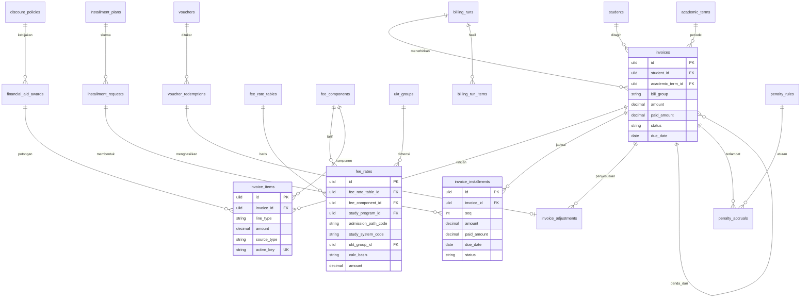

**Pembayaran, deposit, rekonsiliasi, refund**

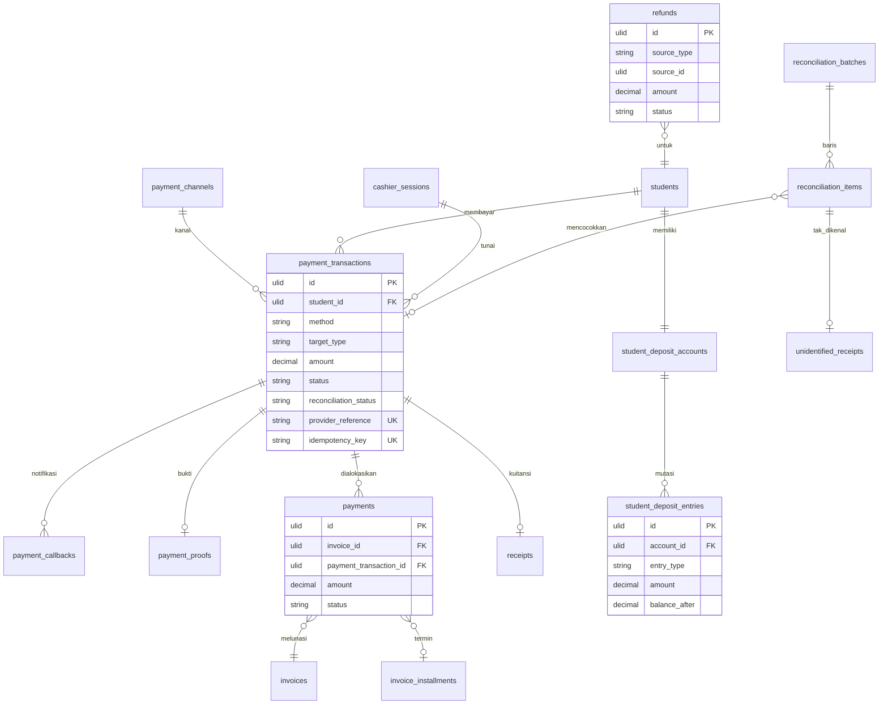

**UKT, bantuan, dan cekal (lintas modul)**

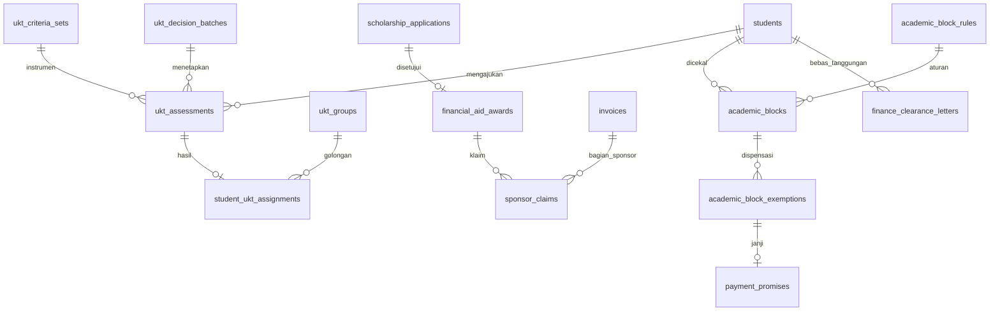

### 9.5 Konfigurasi tenant (`keu.*`)

Disimpan di `university_settings` grup `keu`. Nilai adalah **default rancangan** [K].

| Key | Default | Keterangan |
|---|---|---|
| `keu.rate_lock_mode` | `cohort` | BR-KEU-03 |
| `keu.rounding.unit` | `1` | Rupiah; pembulatan per item |
| `keu.billing.eligible_statuses` | `["active"]` | BR-KEU-06 |
| `keu.billing.auto_cancel_on_exit` | `false` | BR-KEU-14 |
| `keu.billing.chunk_size` | `500` | Posting billing run |
| `keu.credit_fee.trigger` | `krs_approved` | `krs_approved` / `krs_locked` |
| `keu.discount.stacking_mode` | `sequential` | BR-KEU-21 |
| `keu.allocation.overflow` | `deposit` | `deposit` / `auto` |
| `keu.allocation.lookahead_days` | `7` | Untuk mode `auto` |
| `keu.allocation.prepay_future` | `false` | Untuk mode `auto` |
| `keu.deposit.mode` | `manual` | `manual` / `auto_on_issue` |
| `keu.deposit.allow_top_up` | `true` | — |
| `keu.deposit.allow_transfer` | `false` | BR-KEU-53 |
| `keu.overdue.grace_days` | `3` | Tenggang tampilan tunggakan dan default aturan; aturan cekal dan denda dapat menimpanya |
| `keu.installment.default_after_days` | `30` | FR-CCL-06 |
| `keu.installment.accelerate_on_default` | `false` | FR-CCL-06 |
| `keu.penalty.crystallize_at` | `term_end` | BR-KEU-39 |
| `keu.penalty.due_days` | `7` | Jatuh tempo tagihan denda |
| `keu.manual_transfer.unique_code` | `true` | Kode unik 3 digit |
| `keu.cash.max_per_transaction` | `null` | Batas tunai per transaksi |
| `keu.payment.pending_ttl_minutes` | `1440` | Bila kanal tidak menentukan |
| `keu.payment.recheck_after_minutes` | `15` | Polling cadangan |
| `keu.reconciliation.sla_days` | `2` | Hari kerja |
| `keu.clearance.pending_proof_grace_hours` | `0` | BR-KEU-65 |
| `keu.dispensation.staff_max_days` | `7` | BR-KEU-67 |
| `keu.approval.manual_invoice_threshold` | `10000000` | §4.6 |
| `keu.approval.adjustment_wr_threshold` | `10000000` | §4.6 |
| `keu.approval.refund_wr_threshold` | `10000000` | §4.6 |
| `keu.void.approval_after_days` | `7` | FR-RFD-02 |
| `keu.write_off.min_age_days` | `730` | BR-KEU-63 |
| `keu.ukt.default_group_when_missing` | `null` | BR-KEU-18 |
| `keu.ukt.rebill_current_term` | `false` | BR-KEU-19 |
| `keu.semester_level.exclude_leave` | `true` | §8.3.1 |
| `keu.reminders.offsets_days` | `[-7,-3,-1,1,7,30]` | FR-PTG-03 |
| `keu.reminders.channels` | `["database","mail"]` | Mengikuti kanal aktif tenant |
| `keu.voucher.max_failed_attempts` | `5` per 10 menit | BR-KEU-29 |
| `keu.retention.financial_years` | `10` | Mengikuti default PMB BR-41 |
| `keu.retention.ukt_documents_years` | `5` | Setelah mahasiswa lulus/keluar [K] |

### 9.6 Penomoran dokumen

| Dokumen | Format default | Contoh | Catatan |
|---|---|---|---|
| Tagihan | `TGH-{YYYY}{S}-{SEQ:7}` | `TGH-20261-0000123` | `S`: 1 ganjil, 2 genap, 3 pendek. Berbeda dari prefiks PMB `INV-` agar tidak tertukar. |
| Kuitansi | `KWT-{YYYYMM}-{SEQ:6}` | `KWT-202611-000045` | Berurutan tanpa celah per bulan (BR-KEU-49) |
| Transaksi | `TRX-{YYYYMMDD}-{SEQ:6}` | `TRX-20261112-000310` | — |
| Penyesuaian | `ADJ-{YYYY}-{SEQ:6}` | `ADJ-2026-000017` | — |
| Refund | `RFD-{YYYY}-{SEQ:5}` | `RFD-2026-00009` | — |
| Billing run | `BR-{YYYY}{S}-{SEQ:3}` | `BR-20261-002` | — |
| Surat bebas tanggungan | `SBT-{YYYY}-{SEQ:5}` | `SBT-2026-00102` | — |

Penomoran memakai `finance_sequences` dengan *row lock* di dalam transaksi pembuatan dokumen, sehingga rollback tidak menghabiskan nomor.

### 9.7 Migrasi data awal

| Langkah | Isi | Kontrol |
|---|---|---|
| 1. Master | Komponen, tabel tarif semua angkatan aktif (diperlukan untuk re-bill dan mode `cohort`), golongan UKT, kanal | Persetujuan tabel tarif seperti biasa |
| 2. Saldo awal piutang | Tagihan `bill_group = opening_balance` per mahasiswa per semester asal, dengan jatuh tempo asli agar aging benar; `source_type = migration` | Σ per mahasiswa dan total dicocokkan dengan sistem lama per tanggal *cut-over*; laporan selisih; persetujuan FM |
| 3. Saldo awal deposit | Entri `migration_opening` | Sama dengan langkah 2 |
| 4. Riwayat pembayaran (opsional) | Transaksi `method = migration`, `reconciliation_status = not_required` untuk kesinambungan kartu piutang | Ditandai sebagai data migrasi, tidak masuk laporan penerimaan periode berjalan |
| 5. Keadaan berjalan | Award aktif, golongan UKT aktif, cicilan berjalan dengan termin tersisa | Validasi jumlah termin = sisa tagihan |
| 6. Pembayaran di masa transisi | Pembayaran antara *cut-over* dan *go-live* diimpor sebagai transaksi | Rekonsiliasi khusus masa transisi |
| 7. Uji cekal | Simulasi (*dry run*) aturan cekal dengan saldo hasil migrasi sebelum diaktifkan | Daftar mahasiswa yang akan tercekal ditinjau FM dan BAAK |

Sumber migrasi mengikuti paket: Growth–Premium memakai templat Excel yang disiapkan kampus; Enterprise dapat menarik langsung dari basis data sistem lama (Proposal §4).

### 9.8 Retensi data

Catatan transaksi keuangan (tagihan, transaksi, alokasi, ledger, refund, penyesuaian, kuitansi) disimpan selama `keu.retention.financial_years` *(10 tahun)* dan tidak dianonimkan selama masa itu karena merupakan bukti keuangan. Dokumen pribadi pendukung (dokumen ekonomi UKT, bukti identitas penerima refund) dihapus setelah `keu.retention.ukt_documents_years`; data ringkas (golongan, skor) tetap disimpan. Masa retensi wajib dikonfirmasi dengan kebijakan kearsipan dan penasihat hukum kampus [K].

---

## 10. Integrasi dengan Modul Lain

### 10.1 Peta integrasi

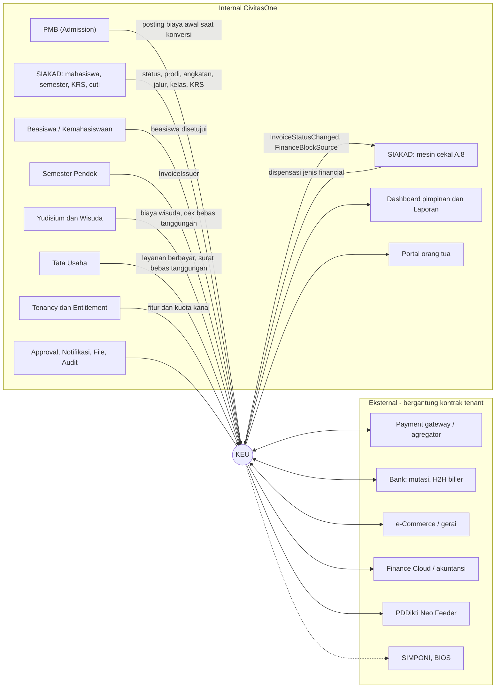

### 10.2 Integrasi internal

| Modul | Arah | Data / peristiwa | Mekanisme | Pemilik data | Ketersediaan saat ini |
|---|---|---|---|---|---|
| **PMB** | PMB → KEU | Tagihan dan pembayaran biaya awal saat konversi mahasiswa | `AdmissionPostingService` (Ada), idempoten per (`source_type`, `source_id`) | PMB hingga konversi, KEU sesudahnya | Ada |
| PMB | PMB → KEU | Beasiswa jalur masuk/KIP-K pendaftar yang diterima | Diteruskan sebagai usulan award saat konversi | Beasiswa/KEU | Baru [R] |
| PMB | PMB → KEU | Data ekonomi UKT calon mahasiswa (bila dikumpulkan saat daftar ulang) | `ukt_assessments.subject_type = pmb_application`, dialihkan ke `student` saat konversi | KEU | Baru [K] |
| PMB | KEU → PMB | Ringkasan tarif publik; registri kanal bersama | Endpoint baca; registri `payment_channels` | KEU | Baru [R][K] |
| **SIAKAD — mahasiswa** | SIAKAD → KEU | `students` (prodi, angkatan, jalur, sistem kuliah, status); `StudentStatusChanged` | FK + event | SIAKAD | Ada (data), event Baru |
| SIAKAD — semester | SIAKAD → KEU | `academic_terms`; `academic_term_periods` (tanggal KRS/UTS/UAS) sebagai tanggal acuan cekal | FK; cadangan `billing_term_settings` bila periode belum ada | SIAKAD | `academic_terms` Ada; periode Baru |
| SIAKAD — KRS | SIAKAD → KEU | `KrsSubmissionApproved`, `KrsSubmissionLocked`, `KrsItemDropped`; `krs_items` + `courses.credits` | Event + baca FK | SIAKAD | Data Ada; event Baru (rancangan `academic-learning/06`) |
| SIAKAD — cuti | Dua arah | Langkah persetujuan cuti "Bagian keuangan memeriksa kewajiban" membaca ringkasan piutang; cuti disetujui → penyesuaian biaya cuti | Langkah ApprovalWorkflow + listener `SyncStudentRequestDecision` | SIAKAD (cuti), KEU (tagihan) | Cuti Ada; integrasi Baru |
| **SIAKAD — cekal** | KEU → SIAKAD | Event kewajiban; evaluasi `FinanceBlockSource` | Kontrak [§10.3](#103-kontrak-cekal-keuangan) | SIAKAD (cekal), KEU (data) | Baru |
| SIAKAD — cekal | SIAKAD → KEU | Dispensasi jenis `financial` dibuat/disetujui dari layar KEU | Service `AcademicBlockExemptionService` (SIAKAD) | SIAKAD | Baru |
| SIAKAD — perwalian | KEU → SIAKAD | Penanda risiko dari pola pembayaran (informasi, tidak memblokir) | Event/ringkasan | SIAKAD | Baru [R] |
| **Beasiswa / Kemahasiswaan** | Beasiswa → KEU | `ScholarshipApplicationApproved` (event Baru) → usulan award | Event + validasi FM | Beasiswa (seleksi), KEU (efek) | Modul Ada; event Baru |
| **Semester Pendek** | SP → KEU | Tagihan SP via `InvoiceIssuer`; pembayaran/refund via KEU | Kontrak penerbit; status `cancelled` | KEU | Rancangan SP |
| **Yudisium & Wisuda** | Dua arah | Tagihan biaya wisuda; pengecekan `yudisium`/`graduation` (bebas tanggungan) | `InvoiceIssuer`; cekal layanan | KEU (tagihan), SIAKAD (cekal) | Modul belum ada |
| **Tata Usaha** | Dua arah | Surat bebas tanggungan; layanan berbayar sebagai tagihan insidental [K] | Endpoint status; `InvoiceIssuer` | KEU | Baru |
| **Perpustakaan** | — | Denda perpustakaan tetap di Perpustakaan; cekal perpustakaan terpisah | — | Perpustakaan | Q-KEU-23 |
| **Portal orang tua** | KEU → Ortu | Ringkasan tagihan dan riwayat bayar | `guardian_portal.read`, `access_scopes` memuat `invoices` | KEU | Role `guardian` Baru |
| **Dashboard & Laporan** | KEU → Dashboard | Agregat penerimaan, piutang, aging | `finance_daily_stats`; `ReportService` tipe `keuangan` (Ada, parsial) | KEU | Parsial |
| **Tenancy / Entitlement** | Tenancy → KEU | Feature key `keu.*`, limit `keu.payment_channels` | `FeatureEntitlementService` (rancangan akademik) | Platform | Baru |
| **ApprovalWorkflow** | Dua arah | Workflow §4.6; SoD | `ApprovalRequestService`, `RequiresDistinctApprover`, listener sinkronisasi keputusan | — | Ada |
| **Notification** | KEU → Notifikasi | Katalog [§10.7](#107-notifikasi) | `NotificationDispatcher` + template per tenant, dikirim setelah *commit* | — | Ada |
| **FileManagement** | — | Bukti transfer, dokumen UKT, bukti setoran, bukti refund, kuitansi PDF | `file_uploads` + URL bertanda tangan berumur pendek | — | Ada |
| **AuditLog** | — | Aksi sensitif [§13.6](#136-audit-trail) | `AuditLogService::recordAction()` | — | Ada |

### 10.3 Kontrak cekal keuangan

KEU mengimplementasikan adapter `FinanceBlockSource` pada kontrak SIAKAD `BlockSource::evaluate(Student, AcademicTerm, array $condition): BlockDecision` (A.8.6). Skema `condition` untuk aturan berjenis `financial`:

```json
{
  "bill_groups": ["registration", "credit"],
  "terms": "current_and_previous",
  "requirement": "due_items_paid",
  "reference": "service_date",
  "grace_days": 3,
  "min_outstanding_amount": 1,
  "min_paid_percent": null,
  "include_penalties": false,
  "pending_proof_grace_hours": 0
}
```

| Parameter | Nilai | Arti |
|---|---|---|
| `bill_groups` | daftar kelompok | Kelompok tagihan yang dievaluasi; hanya item dengan komponen `counts_for_clearance = true` |
| `terms` | `current`, `previous`, `current_and_previous`, `all` | Semester tagihan yang dievaluasi |
| `requirement` | `fully_paid`, `due_items_paid`, `first_installment_paid`, `min_paid_percent` | Syarat kelulusan dari cekal |
| `reference` | `service_date`, `evaluation_date` | Tanggal acuan: tanggal layanan dari periode akademik, atau tanggal evaluasi |
| `grace_days` | angka | Tenggang setelah jatuh tempo |
| `min_outstanding_amount` | nominal | Kekurangan di bawah ambang tidak menimbulkan cekal |
| `include_penalties` | boolean | Ikut memperhitungkan tagihan denda terkristalisasi |
| `pending_proof_grace_hours` | angka | Bukti transfer menunggu verifikasi dianggap memenuhi selama X jam sejak diunggah |

```text
evaluate(m, t, c):
    jika modul KEU nonaktif atau gagal → return unknown            // BR-KEU-68
    items = tagihan dan termin milik m pada c.bill_groups dan c.terms,
            status unpaid/partial, belum dihapus (write-off)
    acuan = c.reference == service_date ? tanggal layanan : hari ini
    kurang = match c.requirement:
        fully_paid            → Σ sisa(items)
        due_items_paid        → Σ sisa(item) untuk item dengan due_date + c.grace_days < acuan
        first_installment_paid→ sisa termin 1, atau sisa tagihan bila tanpa cicilan
        min_paid_percent      → max(0, c.min_paid_percent × neto − dibayar)
    jika c.include_penalties: kurang += Σ sisa tagihan penalty terkait
    kurang −= Σ transaksi awaiting_verification dalam c.pending_proof_grace_hours
    return blocked(kurang ≥ c.min_outstanding_amount),
           reason_for_student (dengan nominal), reason_for_staff (tanpa nominal),
           source_refs = id tagihan/termin
```

**Aturan default yang disarankan** (dibuat sebagai baris `academic_block_rules`, `block_type = financial`, `source = finance`, `auto_revoke = true`):

| Kode aturan | `restricted_services` | `requirement` | `bill_groups` | `terms` | Acuan |
|---|---|---|---|---|---|
| `KEU-KRS` | `krs`, `krs_change` | `first_installment_paid` | `registration` | `current` | Batas registrasi |
| `KEU-ARREARS` | `krs` | `fully_paid` | semua | `previous` | Evaluasi |
| `KEU-UTS` | `exam_midterm` | `due_items_paid` | `registration`, `credit` | `current` | H-7 UTS |
| `KEU-UAS` | `exam_final` | `due_items_paid` | `registration`, `credit` | `current` | H-7 UAS |
| `KEU-YUDISIUM` | `yudisium`, `graduation` | `fully_paid` + `include_penalties = true` | semua | `all` | Saat pengajuan |

**Pemicu evaluasi:** event KEU (`InvoiceStatusChanged`, `InstallmentOverdue`, `PaymentAllocated`, `PaymentReversed`, `FinancialAidAwardChanged`, `InvoiceAdjusted`), job harian `EvaluateAcademicBlocksJob` (SIAKAD), dan evaluasi *on-demand* saat mahasiswa membuka KRS/ujian.

### 10.4 Integrasi eksternal

| Sistem | Kegunaan | Paket acuan | Status di CivitasOne | Yang dibutuhkan |
|---|---|---|---|---|
| Payment gateway/agregator | VA, QRIS, e-wallet; callback; status; settlement | Semua (kuota kanal) | Adapter Midtrans di PMB, diuji dengan respons tiruan | Generalisasi adapter; kontrak, kredensial sandbox/produksi, uji sandbox |
| Bank H2H/biller | Pembayaran via teller/ATM/mobile banking dengan NIM | Semua (dihitung kanal) | **Belum ada** | Kontrak dan spesifikasi API bank [K] |
| e-Commerce/gerai | Pembayaran di aplikasi marketplace/minimarket | Semua (dihitung kanal) | **Belum ada** | Biasanya melalui agregator/biller [K] |
| Mutasi bank | Rekonsiliasi transfer manual dan setoran kas | — | Impor CSV/XLSX ada di PMB | Contoh mutasi tiap bank untuk templat |
| Finance Cloud / sistem akuntansi | Jurnal dan buku besar | Add-on kontrak terpisah | Belum ada | Bagan akun dan format impor [K] |
| PDDikti Neo Feeder | Biaya masuk dan biaya per semester | Semua | Modul integrasi Feeder belum ada | Pemetaan kolom Feeder [K] |
| SIMPONI (Kemenkeu) | Pembayaran tercatat sebagai PNBP | Business+, hanya PTN/kedinasan | Belum ada | Akses resmi dan spesifikasi [K] |
| BIOS (Kemenkeu) | Pengiriman data keuangan BLU | Professional+, hanya PTN BLU | Belum ada | Akses resmi dan spesifikasi [K] |
| SIM KIP Kuliah | Data penerima dan pencairan | — | Belum ada | Untuk sementara impor manual [K] |
| Email/SMS/WhatsApp | Notifikasi dan pengingat | Semua | Email ada; SMS/WA driver generik | Kontrak penyedia SMS/WA |
| Penyedia TTE | Kuitansi atau surat bebas tanggungan bertanda tangan elektronik | Business+ (aktivasi terpisah) | Belum ada | Penyedia TTE tersertifikasi [K] |

Prinsip: KEU **tidak mengasumsikan** integrasi eksternal mana pun tersedia. Setiap integrasi diakses melalui kontrak adapter; bila adapter tidak dikonfigurasi, fitur yang bergantung padanya disembunyikan dan alur manual tetap berjalan.

### 10.5 Ringkasan API

Semua endpoint di bawah `/api/v1`, `tenant.resolve`, `auth:sanctum`, `tenant.access` (kontrak `RANCANGAN-SUPER-ADMIN.md` §7), dan `permission:`. Respons memakai `ApiResponse`; daftar memakai `ListQuery`; konflik aturan bisnis 409 (`ConflictException`); POST yang memindahkan uang mewajibkan header `Idempotency-Key`. Endpoint yang sudah ada (`GET /invoices`, `GET /invoices/{id}`, `GET /payments`) tidak diubah.

| Kelompok | Contoh endpoint |
|---|---|
| Pengaturan | `GET/POST /fee-components`, `GET/POST /fee-rate-tables`, `POST /fee-rate-tables/{id}/simulate`, `POST /fee-rate-tables/{id}/submit`, `GET/PUT /payment-channels/{id}`, `GET/POST /installment-plans`, `GET/POST /penalty-rules`, `GET/PUT /finance-settings` |
| Tagihan | `POST /billing-runs`, `POST /billing-runs/{id}/simulate`, `POST /billing-runs/{id}/submit`, `POST /invoices` (manual), `POST /invoices/{id}/issue`, `POST /invoices/{id}/adjustments`, `GET /invoices/{id}/ledger` |
| Keringanan | `GET/POST /discount-policies`, `GET/POST /financial-aid-awards`, `GET/POST /vouchers`, `GET/POST /sponsor-claims` |
| UKT | `GET/POST /ukt-groups`, `GET /ukt-assessments`, `POST /ukt-assessments/{id}/verify`, `POST /ukt-decision-batches` |
| Pembayaran | `GET /payment-transactions`, `POST /payment-transactions/{id}/recheck`, `POST /payment-proofs/{id}/decision`, `POST /cashier-sessions`, `POST /cashier-sessions/{id}/payments`, `POST /cashier-sessions/{id}/close`, `POST /payments/{id}/reverse` |
| Deposit & refund | `GET /student-deposits/{studentId}`, `POST /student-deposits/{studentId}/apply`, `GET/POST /refunds`, `POST /refunds/{id}/complete` |
| Rekonsiliasi | `POST /reconciliation-batches`, `POST /reconciliation-batches/{id}/import`, `POST /reconciliation-items/{id}/resolve`, `POST /reconciliation-batches/{id}/close`, `GET /unidentified-receipts` |
| Cekal & bebas tanggungan | `GET /finance-clearances/{studentId}`, `POST /finance-clearance-letters`, dispensasi melalui `/academic-blocks/{id}/exemptions` (SIAKAD) |
| Laporan | `GET /finance-reports/{type}`, `POST /finance-reports/{type}/export`, `POST /finance-periods/{month}/close` |
| Mahasiswa | `GET /student/finance/summary`, `GET /student/finance/invoices`, `POST /student/finance/invoices/{id}/payments`, `POST /student/finance/transactions/{id}/proof`, `POST /student/finance/invoices/{id}/voucher`, `POST /student/finance/installment-requests`, `POST /student/finance/deposit/apply`, `POST /student/finance/refunds`, `GET/POST /student/finance/ukt`, `GET /student/finance/receipts/{id}` |
| Orang tua | `GET /guardian/students/{id}/invoices`, `GET /guardian/students/{id}/payments` |
| Publik (tanpa login) | `POST /finance/webhooks/payments/{provider}` (tanda tangan), `GET /public/receipts/{token}`, `GET /public/finance-clearances/{token}` (informasi minimal) |
| Biller bank [K] | `POST /finance/biller/{bank}/inquiry`, `POST /finance/biller/{bank}/payment`, `POST /finance/biller/{bank}/reversal` (autentikasi mutual sesuai bank) |
| Open API (Professional+) | Baca status tagihan dan bebas tanggungan untuk aplikasi kampus, dengan API key ber-scope [R] |

Mahasiswa tidak pernah mengirim `student_id`; identitas diambil dari `students.user_id`. Objek milik mahasiswa lain menghasilkan 404.

### 10.6 Event domain

| Event | Pemancar | Konsumen | Payload ringkas |
|---|---|---|---|
| `InvoiceIssued` | KEU | Notifikasi, dashboard | `invoice_id`, `student_id`, `term_id`, `bill_group`, `amount`, `due_date` |
| `InvoiceStatusChanged` | KEU (nama sesuai `academic-learning/06`) | Cekal SIAKAD, notifikasi | `invoice_id`, `student_id`, `from`, `to`, `period`, `academic_term_id` |
| `InvoiceAdjusted` | KEU | Cekal, notifikasi | `invoice_id`, `adjustment_id`, `type`, `amount` |
| `InstallmentOverdue` | KEU (job harian) | Cekal, denda, pengingat | `installment_id`, `invoice_id`, `student_id`, `due_date` |
| `PaymentSucceeded` | KEU | Kuitansi, notifikasi, rekonsiliasi | `transaction_id`, `student_id`, `amount`, `method`, `paid_at` |
| `PaymentAllocated` / `PaymentReversed` | KEU | Status tagihan, cekal, denda | `transaction_id`, `allocations[]` |
| `DepositChanged` | KEU | Notifikasi | `account_id`, `entry_type`, `amount`, `balance_after` |
| `RefundCompleted` | KEU | Notifikasi, SP | `refund_id`, `student_id`, `amount` |
| `FinancialAidAwardChanged` | KEU | Cekal, billing | `award_id`, `student_id`, `status` |
| `UktDetermined` | KEU | Billing, notifikasi | `student_id`, `ukt_group_id`, `effective_term_id` |
| `PenaltyCrystallized` | KEU | Notifikasi | `penalty_invoice_id`, `parent_invoice_id`, `amount` |
| `BillingRunPosted` | KEU | Dashboard, notifikasi FA | `billing_run_id`, `posted`, `skipped`, `failed` |
| Dikonsumsi: `StudentStatusChanged`, `KrsSubmissionApproved`, `KrsSubmissionLocked`, `KrsItemDropped`, `ApprovalRequestApproved/Rejected/Returned`, `ScholarshipApplicationApproved` (Baru), konversi PMB | SIAKAD, ApprovalWorkflow, Beasiswa, PMB | KEU | — |

Event yang memicu efek penting (notifikasi wajib, evaluasi cekal) ditulis ke `finance_outbox_events` dalam transaksi yang sama dengan perubahan datanya, lalu diproses oleh scheduler/worker dengan *retry* eksponensial.

### 10.7 Notifikasi

Kanal default: **D** = in-app (`database`), **M** = email, **P** = push, **S/W** = SMS/WhatsApp bila aktif di tenant. "Wajib" = tidak dapat dimatikan pengguna.

| Event key | Penerima | Pemicu | Kanal default |
|---|---|---|---|
| `keu.invoice.issued` | Mahasiswa | Tagihan terbit | D, M (wajib) |
| `keu.invoice.due_reminder` | Mahasiswa (orang tua bila disetujui) | H-7, H-3, H-1 | D, M, P |
| `keu.invoice.overdue` | Mahasiswa (orang tua bila disetujui) | H+1, H+7, H+30 | D, M, S/W |
| `keu.payment.instructions` | Mahasiswa | Transaksi `pending` dibuat | D, M |
| `keu.payment.succeeded` | Mahasiswa | Transaksi `success` (dengan tautan kuitansi) | D, M (wajib) |
| `keu.payment.failed` / `keu.payment.expired` | Mahasiswa | Transaksi gagal/kedaluwarsa | D |
| `keu.payment_proof.rejected` | Mahasiswa | Bukti ditolak (dengan alasan) | D, M |
| `keu.payment.reversed` | Mahasiswa | Pembalikan | D, M (wajib) |
| `keu.deposit.credited` | Mahasiswa | Kredit deposit | D, M |
| `keu.installment.decided` | Mahasiswa | Cicilan disetujui/ditolak | D, M |
| `keu.penalty.crystallized` | Mahasiswa | Tagihan denda terbit | D, M |
| `keu.aid.changed` | Mahasiswa | Award diterapkan, ditangguhkan, dicabut | D, M |
| `keu.ukt.status_changed` | Mahasiswa | Perlu perbaikan, ditetapkan, hasil peninjauan | D, M |
| `keu.refund.status_changed` | Mahasiswa | Disetujui, ditolak, selesai, gagal | D, M |
| `keu.billing_run.posted` | Staf keuangan | Run selesai | D |
| `keu.proof_queue.sla_breach` | Staf keuangan | Bukti menunggu > 1 hari kerja | D |
| `keu.reconciliation.exception` | Staf keuangan | Ada pengecualian baru | D, M |
| `keu.cashier.discrepancy` | Kepala keuangan | Selisih kas/setoran | D, M |
| `keu.integration.alert` | Kepala keuangan, Admin PT | Lonjakan tanda tangan callback invalid, adapter gagal | D, M |

Notifikasi cekal, dispensasi, dan pencabutan dikirim oleh SIAKAD (A.8.5) dengan tautan ke tagihan terkait di KEU. Persetujuan dikirim oleh ApprovalWorkflow (`SendApprovalNotification`, Ada). Isi SMS/WhatsApp tidak memuat rincian potongan atau data sensitif; penyertaan nominal mengikuti kebijakan tenant [K].

---

## 11. Laporan, Dashboard, Monitoring, dan Analitik

### 11.1 Definisi angka yang dipakai bersama

Definisi berikut dipakai semua laporan agar angka antarlaporan tidak berbeda.

| Istilah laporan | Definisi |
|---|---|
| Tagihan terbit | Σ `amount` tagihan berstatus selain `draft`/`cancelled` pada periode/semester, setelah potongan saat terbit |
| Penerimaan (kas) | Σ transaksi `success` dengan metode selain `deposit` dan `migration`, menurut `paid_at`, dikurangi transaksi `reversed` |
| Pemakaian deposit | Σ transaksi `method = deposit`; dilaporkan terpisah, **bukan** penerimaan |
| Piutang | Σ sisa tagihan `unpaid`/`partial` yang tidak dihapus pada tanggal acuan |
| Tunggakan | Bagian piutang dengan `due_date + grace_days` < tanggal acuan |
| Keringanan | Σ baris potongan (`aid`, `subsidy`, `discount`, `voucher`, `waiver`) per sumber |
| Tingkat penagihan semester *t* | Σ alokasi `posted` atas tagihan semester *t* ÷ Σ `amount` tagihan semester *t*, pada tanggal acuan |

KEU tidak menghitung **pendapatan** secara akuntansi (pengakuan pendapatan per periode layanan); angka itu milik sistem akuntansi.

### 11.2 Dashboard per role

| Dashboard | Pengguna | Isi utama | Paket acuan |
|---|---|---|---|
| **Dasbor Keuangan** | FM, FA | Kartu: tagihan terbit semester, penerimaan hari ini/bulan ini, piutang, tunggakan, tingkat penagihan, total deposit, bukti menunggu verifikasi (jumlah dan umur tertua), transaksi `pending` > 24 jam, pengecualian rekonsiliasi terbuka, refund berjalan, mahasiswa tercekal keuangan per layanan, dispensasi berakhir minggu ini. Grafik: penerimaan harian per kanal, aging, tingkat penagihan per prodi. Daftar peringatan. | Semua (monitoring piutang & status [E]) |
| **Dasbor Kasir** | Kasir | Sesi kas aktif, total hari ini per metode, kuitansi terbit, kuitansi dibatalkan | Semua |
| **Monitoring Keuangan Akademik** (Smart Dashboard) | Rektor, WR, FM | Penerimaan vs tagihan per semester, piutang dan aging, tingkat penagihan per fakultas/prodi/angkatan beserta tren, total keringanan per jenis dan penyandang dana, proyeksi penerimaan dari jadwal cicilan [R] | Growth & Business: **Report** (laporan tabel/PDF); Professional+: **Report & Dashboard** (visual interaktif, *drill-down*) [E] |
| **Dasbor Fakultas/Prodi** | Dekan, Kaprodi | Agregat piutang dan tingkat penagihan unitnya; jumlah mahasiswa tercekal per layanan (status) | Semua |
| **Ringkasan Mahasiswa** | Mahasiswa | Lihat FR-PRT-01 | Semua |
| **Ringkasan Orang Tua** | Orang tua | Tagihan aktif, jatuh tempo, pembayaran terakhir | Semua |

### 11.3 Katalog laporan

| ID | Laporan | Tujuan | Filter | Kolom/isi utama | Pengguna |
|---|---|---|---|---|---|
| RPT-KEU-01 | Rekap tagihan terbit | Volume dan nilai tagihan | Semester, prodi, angkatan, kelompok, komponen | Jumlah mahasiswa, bruto, keringanan, neto | FM, FA, Pimpinan |
| RPT-KEU-02 | Penerimaan harian/bulanan | Arus kas masuk | Rentang tanggal, kanal, metode, kasir | Jumlah transaksi, nominal, biaya kanal, neto settlement | FM, FA |
| RPT-KEU-03 | Kartu piutang mahasiswa | Riwayat per mahasiswa | Mahasiswa, rentang | Ledger kronologis, saldo berjalan | FA, mahasiswa (miliknya) |
| RPT-KEU-04 | Daftar piutang & tunggakan | Penagihan | Prodi, angkatan, semester asal, bucket, status mahasiswa, cicilan, dispensasi | NIM, nama, piutang, tunggakan, umur, kontak terakhir | FA, FM, Kaprodi (S) |
| RPT-KEU-05 | Aging piutang | Kualitas piutang | Tanggal acuan, prodi | Nilai per bucket, tren | FM, Pimpinan |
| RPT-KEU-06 | Tingkat penagihan | Kinerja penagihan | Semester, prodi, angkatan | Tagihan, terbayar, %, perbandingan antarsemester | Pimpinan |
| RPT-KEU-07 | Keringanan | Beasiswa, subsidi, potongan, voucher, pembebasan | Jenis, penyandang dana, kebijakan | Penerima, nilai, % terhadap bruto | FM, Pimpinan, Beasiswa |
| RPT-KEU-08 | Klaim penyandang dana | Piutang sponsor | Penyandang dana, status | Nilai klaim, terbayar, umur | FM |
| RPT-KEU-09 | Denda | Penerapan denda | Semester, aturan | Berjalan, terkristalisasi, terbayar, dibebaskan | FM |
| RPT-KEU-10 | Cicilan | Pemantauan rencana cicilan | Semester, status | Rencana aktif, termin jatuh tempo, terlambat, gagal bayar | FA |
| RPT-KEU-11 | Deposit | Kewajiban kepada mahasiswa | Tanggal acuan, status mahasiswa | Saldo, ditahan, mutasi, saldo mahasiswa nonaktif | FM, Auditor |
| RPT-KEU-12 | Rekonsiliasi | Kecocokan kas | Batch, sumber, tanggal | Cocok, pengecualian per jenis, dana tak teridentifikasi, SLA | FM, FA, Auditor |
| RPT-KEU-13 | Refund | Pengembalian dana | Status, alasan, rentang | Nilai, waktu proses, penyetuju | FM, Auditor |
| RPT-KEU-14 | Penyesuaian & pembebasan | Pengawasan perubahan nominal | Jenis, pengaju, penyetuju, rentang | Nilai, alasan, dokumen | FM, WR, Auditor |
| RPT-KEU-15 | Register penghapusan piutang | Piutang dihapus | Tahun | Nilai, umur, SK, penerimaan kemudian | WR, Auditor |
| RPT-KEU-16 | Cekal & dispensasi keuangan | Dampak akademik | Semester, layanan, prodi | Tercekal, dispensasi aktif/berakhir, janji bayar ditepati/tidak | FM, BAAK (tanpa nominal) |
| RPT-KEU-17 | Sebaran UKT | Keadilan penetapan | Angkatan, prodi | Jumlah per golongan, hasil peninjauan, anomali | FM, WR |
| RPT-KEU-18 | Kinerja verifikasi | Layanan | Petugas, rentang | Jumlah diputuskan, rata-rata waktu, % ditolak per alasan | FM |
| RPT-KEU-19 | Sesi kas & selisih | Kontrol kas | Kasir, rentang | Total, hitung fisik, selisih, setoran | FM, Auditor |
| RPT-KEU-20 | Data biaya untuk PDDikti | Pelaporan | Semester | Biaya masuk mahasiswa baru, biaya per semester per mahasiswa | Operator Feeder |
| RPT-KEU-21 | Ekspor siap-jurnal | Akuntansi | Bulan | Ringkasan per akun komponen | Akuntansi |

### 11.4 KPI dan rumus

| KPI | Rumus | Catatan |
|---|---|---|
| Tingkat penagihan | lihat §11.1 | Per semester, per tanggal acuan (mis. H+30 setelah jatuh tempo) |
| Rasio tunggakan | tunggakan ÷ piutang | — |
| *Days Sales Outstanding* (hari) | (rata-rata piutang periode ÷ tagihan terbit periode) × jumlah hari periode | Indikator kecepatan penagihan |
| Rasio pembayaran online | transaksi kanal online ÷ seluruh transaksi kas | Keberhasilan layanan mandiri |
| Waktu verifikasi bukti | rata-rata (`reviewed_at` − waktu unggah) | Target ≤ 1 hari kerja |
| Ketepatan rekonsiliasi | transaksi online `matched/resolved` ≤ SLA ÷ transaksi online | Target 100% |
| Mahasiswa tercekal keuangan | mahasiswa dengan cekal `financial` aktif ÷ mahasiswa aktif | Per layanan |
| Keringanan terhadap bruto | Σ keringanan ÷ Σ bruto | Per jenis/penyandang dana |
| Biaya kanal | Σ `provider_fee` + Σ `channel_fee` ditanggung kampus | Per kanal |

### 11.5 Monitoring operasional dan analitik

**Monitoring operasional (peringatan otomatis):** lonjakan callback bertanda tangan tidak valid; transaksi `pending` jauh di atas rata-rata; kegagalan adapter per kanal; job yang gagal (billing run, denda, pengingat, evaluasi cekal); antrean outbox menumpuk; pelanggaran SLA verifikasi dan rekonsiliasi; pemakaian kuota kanal; pola anomali (refund berulang untuk mahasiswa sama, penyesuaian bernilai besar, transaksi kasir di luar jam kerja, pembalikan berulang oleh petugas sama).

**Analitik [R, Phase 3]:**

1. Segmentasi perilaku bayar (tepat waktu, cicilan rutin, sering terlambat).
2. Peringatan dini: pola tunggakan sebagai salah satu masukan prediksi risiko putus studi (Smart Dashboard "Prediksi Kelulusan" menyebut pola pembayaran [I]); hasilnya hanya informasi untuk perwalian, tidak memblokir layanan.
3. Proyeksi arus kas dari jadwal cicilan dan pola historis.
4. Efektivitas pengingat (pembayaran dalam X hari setelah pengingat).
5. Analisis keadilan sebaran UKT per prodi dan angkatan.

### 11.6 Ekspor dan hak akses laporan

Laporan agregat dapat diekspor Excel/PDF oleh pemegang `finance_reports.export`. Laporan berisi data per mahasiswa mengikuti BR-KEU-73 (alasan wajib, kolom dibatasi role, tercatat di `finance_export_logs`, berkas kedaluwarsa 24 jam, kolom CSV yang diawali `= + - @` dinetralkan seperti di PMB). Pimpinan menerima agregat; daftar nominal per mahasiswa hanya untuk Bagian Keuangan dan auditor.

---

## 12. Kondisi Khusus dan Transaksi Tidak Normal

| ID | Kondisi | Deteksi | Penanganan sistem | Tindak lanjut petugas | Hasil akhir |
|---|---|---|---|---|---|
| EC-KEU-01 | Callback ganda untuk transaksi yang sama | Unik (`provider`, `provider_event_id`) | Callback kedua dicatat `duplicate_noop` | — | Tidak ada efek ganda |
| EC-KEU-02 | Callback datang setelah transaksi `expired`, dana benar-benar masuk | Cek ulang status ke penyedia | Transaksi `success`; dialokasikan bila target masih terbuka, selain itu ke deposit + `needs_resolution` | Tinjau, tawarkan pemakaian atau refund | Dana tercatat, tidak hilang |
| EC-KEU-03 | Callback hilang | Polling transaksi `pending`; settlement H-1 | Cek ulang → disukseskan | — | Status benar paling lambat saat rekonsiliasi |
| EC-KEU-04 | Pembayaran ganda lewat dua kanal untuk target yang sama | Transaksi sukses kedua untuk target sudah lunas | Kelebihan ke deposit; notifikasi | Tawarkan refund (`DUPLICATE_PAYMENT`) | Tagihan `paid`, deposit bertambah |
| EC-KEU-05 | Nominal transfer manual kurang dari tagihan | Verifikasi bukti | Disetujui sebesar yang diterima bila kelompok tagihan mengizinkan pembayaran sebagian, selain itu ditolak `AMOUNT_MISMATCH` | Informasikan kekurangan | `partial` atau tetap `unpaid` |
| EC-KEU-06 | Nominal transfer manual lebih | Verifikasi bukti | Alokasi penuh, kelebihan ke deposit | — | `paid` + deposit |
| EC-KEU-07 | Dana masuk rekening tanpa identitas | Rekonsiliasi `unidentified` | Masuk `unidentified_receipts` | Umumkan/hubungi; klaim dengan bukti → alokasi; atau kembalikan | Tidak tercampur ke deposit mahasiswa mana pun |
| EC-KEU-08 | Bukti palsu atau dipakai ulang | Checksum sama, tidak ada di mutasi | Peringatan duplikat; ditolak | Catat; berulang → eskalasi disiplin sesuai kebijakan | Transaksi `failed`, jejak audit |
| EC-KEU-09 | Pembayaran dialokasikan ke mahasiswa yang salah | Laporan mahasiswa/petugas | Pembalikan alokasi + alokasi ulang (maker-checker), evaluasi cekal kedua mahasiswa | Notifikasi kedua mahasiswa | Kartu piutang keduanya benar |
| EC-KEU-10 | Bank/penyedia membatalkan transaksi setelah sukses (*chargeback*, koreksi bank) | Callback pembatalan / rekonsiliasi | Transaksi `reversed`, alokasi dibalik, tagihan terbuka, denda dan cekal dievaluasi ulang | Hubungi mahasiswa | Tagihan `unpaid`/`partial` |
| EC-KEU-11 | Kanal gangguan | Kegagalan adapter beruntun | Kanal `maintenance` (disembunyikan), transaksi pending tetap dipantau | Umumkan kanal alternatif; pertimbangkan dispensasi/penghapusan denda massal | Layanan tetap via kanal lain |
| EC-KEU-12 | Paket diturunkan sehingga kanal aktif melebihi kuota | Perubahan entitlement | Admin memilih kanal yang dipertahankan; sisanya `suspended_by_plan` setelah masa tenggang 30 hari [R][K]; transaksi pending pada kanal itu tetap diproses | — | Kanal aktif ≤ kuota |
| EC-KEU-13 | Tarif ternyata salah setelah tagihan terbit | Laporan/keluhan | Tabel tarif versi koreksi → billing run `rebill_delta` → penyesuaian per mahasiswa; kelebihan bayar ke deposit | Persetujuan FM (dan WR bila di atas ambang) | Tagihan benar tanpa diubah langsung |
| EC-KEU-14 | Mahasiswa pindah prodi di tengah semester | `StudentStatusChanged`/data prodi | Tagihan semester berjalan tetap; semester berikutnya memakai tarif prodi baru; re-bill bila kebijakan menetapkan [K] | — | — |
| EC-KEU-15 | Mahasiswa DO/mengundurkan diri dengan tagihan terbuka | `StudentStatusChanged` | Tidak ada tagihan baru; tagihan terbuka masuk daftar tinjauan | Putuskan: tetap ditagih, dibebaskan, atau usulan penghapusan setelah umur minimum | Keputusan tercatat |
| EC-KEU-16 | Mahasiswa meninggal dunia | Data status/laporan keluarga | — | Pembebasan penuh tagihan terbuka; refund deposit kepada ahli waris dengan dokumen | `waived`, deposit 0 |
| EC-KEU-17 | Cuti disetujui setelah tagihan registrasi dibayar | Event cuti | Penyesuaian ke biaya cuti; selisih ke deposit | Refund bila mahasiswa meminta | Deposit untuk semester berikutnya |
| EC-KEU-18 | KRS dibatalkan atau mata kuliah di-drop setelah tagihan SKS terbit | `KrsItemDropped` | Penyesuaian turun bila sebelum batas drop; setelah batas tidak ada pengurangan | — | Sesuai BR-KEU-11 |
| EC-KEU-19 | Kelas (mis. Semester Pendek) dibatalkan setelah dibayar | Event pembatalan kelas | Penyesuaian turun → deposit; refund atas permintaan | — | Mahasiswa tidak dirugikan |
| EC-KEU-20 | Pembayaran tercatat setelah periode ditutup | Tanggal efektif di periode `closed` | Dicatat sebagai entri periode terbuka yang merujuk tanggal asal | — | Laporan periode tertutup tidak berubah |
| EC-KEU-21 | Pembayaran tepat di batas waktu (beda zona waktu atau keterlambatan callback) | `paid_at` dari penyedia | Ketepatan waktu dinilai dari `paid_at` penyedia dalam zona waktu tenant, bukan waktu callback | — | Tidak ada denda/cekal yang keliru |
| EC-KEU-22 | Bukti transfer menunggu verifikasi saat batas KRS | Transaksi `awaiting_verification` | Berlaku `pending_proof_grace_hours`; bila 0, mahasiswa tetap tercekal | Prioritaskan antrean menjelang batas; dispensasi singkat bila perlu | — |
| EC-KEU-23 | Dua mahasiswa memperebutkan kuota voucher terakhir | Lock baris voucher | Satu berhasil, lainnya 409 `VOUCHER_EXHAUSTED` | — | Kuota tidak terlampaui |
| EC-KEU-24 | Dua petugas memutuskan bukti yang sama bersamaan | `lock_version` | Petugas kedua 409 | — | Satu keputusan |
| EC-KEU-25 | Billing run gagal sebagian | `billing_run_items.failed` | Run `partially_failed`; retry hanya item gagal (idempoten) | Perbaiki data penyebab | Tidak ada duplikat |
| EC-KEU-26 | Posting billing run dipicu dua kali | Status run + `active_key` | Permintaan kedua ditolak; item tidak ganda | — | — |
| EC-KEU-27 | Selisih kas saat tutup sesi | Hitung fisik ≠ sistem | Selisih dicatat; transaksi tidak diubah | Investigasi; persetujuan FM | Sesi `verified` dengan catatan |
| EC-KEU-28 | Kuitansi tunai salah cetak | Laporan kasir | Pembatalan hari yang sama (persetujuan FM), cetak ulang dengan nomor baru; nomor batal tetap tercatat | — | Nomor tanpa celah |
| EC-KEU-29 | Refund gagal (rekening salah/ditutup) | Laporan bank | Refund `failed`, dana kembali ke saldo | Mahasiswa memperbarui rekening | Ajukan ulang |
| EC-KEU-30 | Mahasiswa memiliki deposit tetapi tercekal | Evaluasi cekal | Notifikasi menyarankan pemakaian deposit; otomatis bila `deposit.mode = auto_on_issue` | — | — |
| EC-KEU-31 | Penyandang dana terlambat mencairkan | Umur klaim | Mahasiswa tidak tercekal (bagian sponsor sudah dikurangkan) | Tagih penyandang dana | Klaim tercatat |
| EC-KEU-32 | Beasiswa dicabut di tengah semester | `FinancialAidAwardChanged` | Berlaku semester berikutnya; retroaktif hanya via penyesuaian naik berpersetujuan | — | — |
| EC-KEU-33 | Golongan UKT berubah setelah tagihan terbit | `UktDetermined` | Re-bill delta bila kebijakan mengizinkan, selain itu berlaku semester berikutnya | — | — |
| EC-KEU-34 | Mahasiswa tanpa tarif yang cocok | Simulasi billing run | Pengecualian `NO_RATE`; tidak ditagih 0 | Lengkapi tabel tarif atau tarif individual | — |
| EC-KEU-35 | Mahasiswa dengan dua NIM (gelar ganda) | — | Dua akun keuangan terpisah per `students` | Kebijakan penggabungan [K] | — |
| EC-KEU-36 | Perusahaan membayar sekaligus untuk banyak mahasiswa | Transfer besar dengan daftar | Impor alokasi massal berpersetujuan; sisa ke dana tak teridentifikasi | Cocokkan daftar | — |
| EC-KEU-37 | Mahasiswa asing dengan mata uang lain | — | Di luar MVP: tagihan tetap IDR [K] | — | — |
| EC-KEU-38 | Tanda tangan callback tidak valid | Verifikasi tanda tangan | 401, disimpan `signature_valid = false`, tidak diproses | Lonjakan → peringatan keamanan | Tidak ada perubahan status |
| EC-KEU-39 | Tenant disuspensi saat masih ada transaksi berjalan | Status tenant | Callback tetap diterima dan dicatat karena uang nyata; akses portal mengikuti status tenant [R] | — | Dana tidak hilang |
| EC-KEU-40 | Sumber data KEU tidak tersedia saat evaluasi cekal | Galat adapter | Evaluasi `unknown`, tidak menerbitkan cekal (BR-KEU-68) | Pemantauan | Mahasiswa tidak tercekal keliru |

---

## 13. Keamanan, Audit Trail, dan Pengendalian Akses

### 13.1 Empat lapis otorisasi

KEU mengikuti empat lapis yang dirancang di `academic-learning/11-roles-permissions.md` §2:

| Lapis | Contoh di KEU | Gagal → |
|---|---|---|
| L1 — Fitur ada di paket | `keu.ukt`, `keu.online_payment`, limit `keu.payment_channels` | 403 `not_in_plan` |
| L2 — Fitur aktif untuk tenant | UKT dinonaktifkan untuk PTS yang tidak memakai UKT | 403 `disabled` |
| L3 — Permission dan scope | `refunds.approve`, scope prodi untuk Kaprodi, kepemilikan untuk mahasiswa | 403 / 404 |
| L4 — Keadaan data | Tagihan sudah dibayar tidak dapat di-*void*; periode tertutup; SoD | 409 / 422 |

### 13.2 Isolasi tenant

1. Seluruh model KEU memakai `TenantScoped`; `university_id` diambil dari `TenantContext`.
2. Endpoint webhook publik tidak memercayai header tenant. Tenant diketahui dari transaksi yang ditemukan melalui `provider_reference` setelah tanda tangan valid (pola `pmb_payment_callbacks.university_id` nullable).
3. Kredensial kanal disimpan terenkripsi per tenant dan tidak pernah dikirim ke front-end.
4. Cache (entitlement, dashboard, ringkasan) memakai kunci yang memuat `tenant:{id}` dan berisi **array biasa**, bukan `Collection`, untuk menghindari kerusakan serialisasi saat dibaca dari Redis (keputusan D-07 PMB).

### 13.3 Data sensitif dan privasi (UU PDP)

| Data | Klasifikasi | Kontrol |
|---|---|---|
| Data ekonomi dan dokumen UKT (penghasilan, aset, foto rumah, KK) | Sangat sensitif | Enkripsi kolom/berkas, hanya verifikator ditugaskan dan `finance_sensitive.read`, setiap pembukaan dicatat dengan tujuan, retensi terbatas |
| Rekening penerima refund, surat kuasa | Sensitif | Enkripsi, tersamar (`****1234`), pembukaan dicatat |
| Bukti transfer | Pribadi | Akses via URL bertanda tangan berumur pendek, hanya pemilik dan petugas keuangan |
| Nominal tagihan dan riwayat bayar per mahasiswa | Pribadi | Hanya mahasiswa, orang tua dengan persetujuan, Bagian Keuangan, auditor; tidak ditampilkan ke dosen wali/BAAK |
| Agregat keuangan | Internal | Pimpinan, Dekan/Kaprodi sesuai scope |

Persetujuan mahasiswa untuk akses orang tua dicatat (`student_consent_status`) dan dapat dicabut. Tujuan pemrosesan data ekonomi (penetapan UKT) dicantumkan pada formulir pengajuan.

### 13.4 Integritas transaksi

1. Setiap perubahan uang (alokasi, pembalikan, penyesuaian, ledger deposit, penomoran) dilakukan dalam satu transaksi basis data dengan *row lock* pada baris yang tersentuh, diurutkan untuk mencegah *deadlock*.
2. `Idempotency-Key` disimpan 24 jam: permintaan identik mengembalikan hasil yang sama; kunci sama dengan isi berbeda → 422.
3. Status tagihan adalah turunan (BR-KEU-09); tidak ada endpoint pengubah status langsung.
4. Ledger deposit, alokasi, kuitansi, dan riwayat bersifat *append-only*; koreksi selalu sebagai entri pembalik.
5. Periode tertutup mengunci perubahan (BR-KEU-62).
6. **Pemeriksaan integritas harian** (hasil ke dashboard dan peringatan):
   - `invoices.paid_amount` = Σ `payments.amount` berstatus `posted` per tagihan;
   - `invoices.amount` = Σ `invoice_items.amount`;
   - saldo akun deposit = Σ entri ledger;
   - setiap transaksi `success` non-internal memiliki alokasi dan/atau entri deposit sebesar nominalnya;
   - Σ termin = `amount` tagihan bercicilan (versi jadwal aktif).

### 13.5 Kontrol internal

| Kontrol | Penerapan |
|---|---|
| Pemisahan tugas | SOD-KEU-01..10 ([§4.5](#45-pemisahan-tugas-sod)) |
| Maker-checker | Tarif, aturan denda, billing run, penyesuaian, pembebasan, penghapusan, refund, pembalikan, buka periode |
| Ambang nominal | Persetujuan bertingkat berdasarkan `keu.approval.*` |
| Kontrol kas | Sesi kas per kasir, kuitansi tanpa celah, hitung fisik, setoran diverifikasi pihak lain |
| Perubahan konfigurasi | Rekening penerimaan dan kredensial kanal hanya oleh role tertentu, tercatat, dengan notifikasi ke FM |
| Laporan pengecualian | Penyesuaian besar, refund berulang, pembalikan, transaksi di luar jam kerja ditinjau mingguan |
| Konflik kepentingan | BR-KEU-74 |

### 13.6 Audit trail

Dicatat di `audit_logs` (pengguna, waktu, data sebelum/sesudah, alasan, IP, perangkat — `RANCANGAN-APLIKASI.md` §10) dan riwayat domain.

| Kelompok | Aksi yang wajib diaudit |
|---|---|
| Konfigurasi | Komponen, tarif (buat, ajukan, setujui, publikasi), aturan denda, skema cicilan, kebijakan potongan, voucher, kanal (aktivasi, kredensial), rekening, pengaturan `keu.*` |
| Tagihan | Billing run (simulasi, persetujuan, posting), tagihan manual, terbit, *void*, penyesuaian (semua jenis), penghapusan piutang, re-bill |
| Keringanan | Award (usul, setujui, tangguhkan, cabut), penukaran dan pembatalan voucher, penetapan dan peninjauan UKT |
| Pembayaran | Pencatatan tunai, keputusan bukti, pembatalan pending, cek ulang manual, pembalikan, alokasi ulang, pemakaian deposit manual, pembatalan kuitansi |
| Kas & rekonsiliasi | Buka/tutup sesi, setoran, verifikasi, resolusi item, tutup/buka batch, klaim dana tak teridentifikasi |
| Refund | Setiap transisi status, perubahan rekening tujuan |
| Cekal | Dispensasi (beri, cabut), janji bayar, penerbitan surat bebas tanggungan |
| Akses | Pembukaan data sensitif, ekspor data pribadi, tutup/buka periode |

### 13.7 Keamanan integrasi pembayaran

1. Tanda tangan callback diverifikasi sesuai penyedia (mis. HMAC/SHA-512) dengan toleransi stempel waktu bila tersedia; IP *allowlist* bila penyedia menyediakannya.
2. Status selalu diperiksa ulang ke API penyedia sebelum `success` (BR-KEU-41).
3. Endpoint webhook hanya memvalidasi dan menyimpan, merespons cepat (< 1 detik); pemrosesan di worker.
4. Pemisahan lingkungan `sandbox`/`production` per kanal; transaksi sandbox tidak pernah mengubah tagihan produksi.
5. Rotasi kredensial tanpa henti layanan (dua kredensial aktif sementara).
6. Pembatasan laju (*rate limit*) pembuatan transaksi per mahasiswa dan penukaran voucher.
7. Endpoint biller bank (bila ada) memakai autentikasi mutual sesuai spesifikasi bank dan daftar IP bank.

### 13.8 Kebutuhan nonfungsional

Target berikut adalah usulan [R] dengan asumsi volume hingga 30.000 mahasiswa per tenant (kapasitas Enterprise acuan).

| Aspek | Target |
|---|---|
| Kinerja portal | Ringkasan dan daftar tagihan p95 < 1 detik |
| Pembuatan transaksi | p95 < 3 detik di luar waktu respons penyedia |
| Webhook | Respons < 1 detik |
| Billing run | 10.000 mahasiswa < 15 menit, tanpa mengunci tabel untuk pengguna lain |
| Evaluasi cekal setelah bayar | ≤ 5 menit |
| Ketersediaan | Perhatian khusus pada minggu batas pembayaran dan KRS (puncak); uji beban sebelum semester pertama |
| Ketahanan | Outbox + *retry* eksponensial; job idempoten; berjalan tanpa worker antrean (scheduler tiap menit) |
| Observabilitas | Log terstruktur per transaksi (id korelasi), metrik per kanal, peringatan §11.5 |
| Cadangan | Mengikuti kebijakan backup platform; data keuangan termasuk prioritas pemulihan tertinggi |

---

## 14. Matriks Fitur per Paket

### 14.1 Sumber dan cara membaca

Matriks diturunkan dari `SEVIMA_Platform_Proposal.md` §1, §3.1, §3.2, §3.5, §3.6, §3.16, §5–§7 dan `SEVIMA_Penjelasan_Modul.md` §12. Urutan paket mengikuti dokumen sumber: **Growth → Business → Professional → Premium → Enterprise** (INK-KEU-01). Nama paket adalah paket **acuan**, bukan `subscription_plans` CivitasOne (INK-KEU-02, [§14.4](#144-pemetaan-ke-paket-civitasone)).

Kode memeriksa *feature key*, tidak pernah nama paket (prinsip `academic-learning/11` §1.6). Pemetaan ini hanya mengisi `plan_feature_entitlements`.

✓ = tersedia · — = tidak tersedia · angka = kuota

### 14.2 Matriks fitur

| Feature key | Fitur | Growth | Business | Professional | Premium | Enterprise | Label |
|---|---|:-:|:-:|:-:|:-:|:-:|---|
| `keu` | Modul Keuangan Mahasiswa | ✓ | ✓ | ✓ | ✓ | ✓ | E |
| `keu.online_payment` | Pembayaran tagihan kuliah online (bank/e-commerce) | ✓ | ✓ | ✓ | ✓ | ✓ | E |
| `keu.payment_channels` *(limit)* | Jumlah kanal pembayaran online aktif | **3** | **3** | **4** | **5** | **6** | E |
| `keu.fee_rates` | Manajemen tarif uang kuliah ("Lebih Lengkap"): angkatan, prodi, jalur, kelas, golongan UKT | ✓ | ✓ | ✓ | ✓ | ✓ | E; dimensi I |
| `keu.manual_payment` | Pembayaran tunai & unggah bukti bayar, verifikasi | ✓ | ✓ | ✓ | ✓ | ✓ | E |
| `keu.receivables` | Monitoring piutang & status pembayaran | ✓ | ✓ | ✓ | ✓ | ✓ | E |
| `keu.billing` | Tagihan wajib & tagihan per SKS | ✓ | ✓ | ✓ | ✓ | ✓ | E |
| `keu.aid` | Beasiswa / potongan (termasuk subsidi dan pembebasan) | ✓ | ✓ | ✓ | ✓ | ✓ | E; subsidi & pembebasan I |
| `keu.penalty` | Denda | ✓ | ✓ | ✓ | ✓ | ✓ | E |
| `keu.deposit` | Deposit | ✓ | ✓ | ✓ | ✓ | ✓ | E |
| `keu.voucher` | Voucher tagihan | ✓ | ✓ | ✓ | ✓ | ✓ | E |
| `keu.ukt` | Pengaturan & validasi penerima UKT (diaktifkan sesuai jenis PT) | ✓ | ✓ | ✓ | ✓ | ✓ | E; aktivasi I |
| `keu.installment` | Cicilan tagihan kuliah | ✓ | ✓ | ✓ | ✓ | ✓ | E |
| `siakad.blocks.financial` | Cekal keuangan untuk KRS & ujian, dispensasi (SIAKAD) | ✓ | ✓ | ✓ | ✓ | ✓ | E |
| `keu.reconciliation` | Rekonsiliasi pembayaran | ✓ | ✓ | ✓ | ✓ | ✓ | R (bagian manajemen administrasi keuangan, tidak tertulis eksplisit) |
| `keu.refund` | Pembatalan, koreksi, pengembalian dana | ✓ | ✓ | ✓ | ✓ | ✓ | R |
| `keu.audit` | Riwayat transaksi & audit | ✓ | ✓ | ✓ | ✓ | ✓ | R |
| `siakad.guardian` | Login orang tua (melihat tagihan) | ✓ | ✓ | ✓ | ✓ | ✓ | E |
| `dashboard.finance` | Monitoring Keuangan Akademik (Smart Dashboard) | Report | Report | Report & Dashboard | Report & Dashboard | Report & Dashboard | E |
| `neo_feeder.finance` | Integrasi biaya masuk & SPP semester ke Neo Feeder | ✓ | ✓ | ✓ | ✓ | ✓ | E |
| `integration.simponi` | Integrasi SIMPONI (PTN/kedinasan) | — | ✓ | ✓ | ✓ | ✓ | E |
| `integration.bios` | Integrasi BIOS ↳ pengiriman data keuangan (PTN BLU) | — | — | ✓ | ✓ | ✓ | E |
| `open_api` | Open API (mis. status tagihan untuk aplikasi kampus) | — | — | ✓ | ✓ | ✓ | E; pemakaian KEU R |
| `tte` | TTE untuk kuitansi/surat bebas tanggungan (biaya aktivasi terpisah) | — | ✓ | ✓ | ✓ | ✓ | E (TTE); pemakaian KEU R |
| `finance_cloud` | Akuntansi terintegrasi (add-on kontrak terpisah, tanpa minimal paket) | Add-on | Add-on | Add-on | Add-on | Add-on | E |
| — | Migrasi data awal (saldo piutang/deposit) | Neofeeder + Excel | Neofeeder + Excel | Neofeeder + Excel | Neofeeder + Excel | + basis data sistem lama | E |

**Kesimpulan penting:** seluruh fitur fungsional KEU tersedia di **semua** paket acuan. Pembeda antarpaket yang menyentuh keuangan hanya: (1) jumlah kanal pembayaran online; (2) bentuk dashboard pimpinan (Report vs Report & Dashboard); (3) integrasi SIMPONI, BIOS, Open API, TTE; (4) sumber migrasi data. Karena itu tidak ada aturan bisnis KEU yang boleh bercabang berdasarkan paket selain empat hal tersebut.

### 14.3 Kuota kanal pembayaran

**Definisi (default, [K] — Q-KEU-03):**

1. Satu **kanal** = satu bank atau satu e-commerce yang tampil kepada mahasiswa sebagai pilihan pembayaran online (Proposal §7: "Bank atau e-Commerce"), terlepas dari penyedia teknis di belakangnya. Contoh: VA Bank A dan VA Bank B melalui agregator yang sama = 2 kanal; QRIS = 1 kanal kategori e-commerce/pembayaran digital.
2. Kanal **offline** (tunai di loket, transfer manual dengan unggah bukti) **tidak dihitung**, karena merupakan fitur tersendiri yang tersedia di semua paket.
3. Kanal berstatus `sandbox` **tidak dihitung** [R].
4. Kuota berlaku **per tenant, gabungan PMB dan KEU**, karena kanal mencerminkan kerja sama dengan bank/penyedia, bukan modul [K].

| Paket acuan | Kuota kanal online | Contoh konfigurasi | Selalu tersedia tambahan |
|---|:-:|---|---|
| Growth | 3 | VA Bank A, VA Bank B, QRIS | Tunai, transfer manual |
| Business | 3 | VA Bank A, VA Bank B, gerai ritel | Tunai, transfer manual |
| Professional | 4 | + H2H/biller Bank C | Tunai, transfer manual |
| Premium | 5 | + e-wallet | Tunai, transfer manual |
| Enterprise | 6 | + marketplace | Tunai, transfer manual |

**Penegakan:**

| Situasi | Perilaku |
|---|---|
| Aktivasi kanal ke-(kuota + 1) | 409 `CHANNEL_QUOTA_EXCEEDED`; layar menampilkan "N dari kuota M kanal aktif" |
| Kanal dinonaktifkan | Slot kuota kembali; transaksi `pending` pada kanal itu tetap diproses sampai final |
| Paket naik | Kuota bertambah seketika setelah entitlement diperbarui |
| Paket turun dan kanal aktif > kuota | Admin memilih kanal yang dipertahankan; kanal lain menjadi `suspended_by_plan` setelah masa tenggang (default 30 hari) [R][K]; transaksi berjalan tetap diproses |
| Kanal `maintenance` | Tetap dihitung kuota (masih terkontrak), hanya disembunyikan |
| Entitlement belum diimplementasikan | Kuota sementara dibaca dari `university_settings` yang hanya dapat diubah Super Admin (D-KEU-04) |

### 14.4 Pemetaan ke paket CivitasOne

`subscription_plans` CivitasOne saat ini: `trial`, `starter`, `professional`, `enterprise`. Usulan pemetaan dari `academic-learning/11` §7.3 dan implikasinya bagi KEU:

| Paket CivitasOne | Usulan setara acuan (dokumen akademik) | Kuota kanal bila memakai nilai tertinggi | Kuota bila memakai nilai terendah | Catatan |
|---|---|:-:|:-:|---|
| `trial` | Growth, berbatas waktu | 3 | 3 | Disarankan hanya kanal `sandbox` selama trial [R] |
| `starter` | Growth | 3 | 3 | — |
| `professional` | Business + Professional | 4 | 3 | Konflik INK-KEU-02 |
| `enterprise` | Premium + Enterprise | 6 | 5 | Konflik INK-KEU-02 |

Keputusan berada pada pemilik produk (OD-01 di dokumen akademik; Q-KEU-02). Karena kuota adalah nilai `plan_feature_entitlements`, perubahan keputusan tidak memerlukan perubahan kode.

---

## 15. Skenario Penggunaan dan Kriteria Penerimaan

### 15.1 Skenario penggunaan utama

| ID | Aktor | Skenario | Alur ringkas | Fitur |
|---|---|---|---|---|
| UC-KEU-01 | Mahasiswa | Membayar tagihan registrasi lewat VA | Notifikasi → buka tagihan → pilih kanal → bayar di mobile banking → status lunas, kuitansi | F-03, F-09, F-16 |
| UC-KEU-02 | Mahasiswa | Mencicil tagihan SKS dan meminta dispensasi UTS | Ajukan cicilan → termin 2 terlambat → cekal UTS → ajukan dispensasi → bayar → cekal dicabut | F-07, F-08, F-14 |
| UC-KEU-03 | Mahasiswa | Transfer manual dan unggah bukti | Pilih transfer manual → transfer dengan kode unik → unggah bukti → diverifikasi → lunas | F-10 |
| UC-KEU-04 | Kasir | Melayani pembayaran tunai satu hari | Buka sesi → catat pembayaran → cetak kuitansi → tutup sesi → setor → unggah bukti setoran | F-10 |
| UC-KEU-05 | Staf keuangan | Menerbitkan tagihan semester | Simulasi billing run → tinjau pengecualian → ajukan → posting setelah disetujui | F-02, F-03 |
| UC-KEU-06 | Staf keuangan | Rekonsiliasi harian | Buat batch → impor mutasi → tinjau pengecualian → selesaikan → tutup batch | F-12 |
| UC-KEU-07 | Kepala keuangan | Menyetujui refund pembayaran ganda | Tinjau pengajuan, cek riwayat transaksi → setujui → staf mentransfer → catat selesai | F-13 |
| UC-KEU-08 | Tim UKT | Menetapkan UKT mahasiswa baru | Verifikasi dokumen → skor → golongan verifikasi → batch penetapan → persetujuan → publikasi | F-04 |
| UC-KEU-09 | Pengelola beasiswa → Keuangan | Menerapkan beasiswa perusahaan | Beasiswa disetujui → usulan award (pihak ketiga) → validasi FM → tagihan berkurang → klaim ke perusahaan | F-05 |
| UC-KEU-10 | Wakil Rektor | Memantau piutang | Buka Monitoring Keuangan Akademik → aging per prodi → *drill-down* (Professional+) atau unduh laporan (Growth/Business) | §11 |
| UC-KEU-11 | Orang tua | Memantau tagihan anak | Login → ringkasan tagihan → instruksi pembayaran | F-16 |
| UC-KEU-12 | Mahasiswa tingkat akhir | Mengurus bebas tanggungan untuk yudisium | Cek status → lunasi denda → unduh surat bebas tanggungan | F-14 |

### 15.2 Kriteria penerimaan

Format: **Diberikan** (kondisi) · **Ketika** (aksi) · **Maka** (hasil yang dapat diverifikasi).

#### Tarif (F-02)

| ID | Diberikan | Ketika | Maka |
|---|---|---|---|
| AC-TRF-01 | Draf tabel memuat dua baris BPP prodi Informatika dengan rentang angkatan 2024–2026 dan 2025–2027 tanpa dimensi lain | Staf mengajukan tabel | 422 dengan daftar konflik; status tetap `draft` |
| AC-TRF-02 | Tabel `published`: BPP semua prodi Rp2.800.000 dan BPP Informatika Rp3.000.000 | Tagihan dibuat untuk mahasiswa Informatika | Nominal Rp3.000.000; `rate_snapshot` menyimpan id baris Informatika |
| AC-TRF-03 | Tabel `published` | Staf mengubah sebuah baris | 409 `RATE_TABLE_IMMUTABLE` |
| AC-TRF-04 | 12 mahasiswa aktif tidak memiliki baris tarif yang cocok | Simulasi billing run | 12 mahasiswa tercantum dengan alasan `NO_RATE`; posting melewati mereka |
| AC-TRF-05 | `rate_lock_mode = cohort`; mahasiswa angkatan 2024; tabel 2026 menaikkan BPP | Billing run semester Ganjil 2026/2027 | Mahasiswa ditagih sesuai tabel angkatan 2024 |
| AC-TRF-06 | Tabel diajukan oleh staf A | Staf A mencoba menyetujui | 409 `SELF_APPROVAL_FORBIDDEN` |

#### Tagihan (F-03)

| ID | Diberikan | Ketika | Maka |
|---|---|---|---|
| AC-TAG-01 | Billing run sudah `posted` | Posting dipicu ulang | Permintaan ditolak; jumlah `invoice_items` tidak berubah |
| AC-TAG-02 | Run `simulated` | Run diposting tanpa persetujuan | 409; tidak ada tagihan terbit |
| AC-TAG-03 | Tarif Rp200.000/SKS; KRS 20 SKS disetujui | Event `KrsSubmissionApproved` diproses | Tagihan kelompok `credit` Rp4.000.000 terbit dengan jatuh tempo sesuai kalender |
| AC-TAG-04 | Tagihan SKS sudah `paid`; drop 3 SKS sebelum batas | Event `KrsItemDropped` | Penyesuaian −Rp600.000 `applied`; deposit +Rp600.000; tagihan tetap `paid` |
| AC-TAG-05 | Batas drop sudah lewat | Mahasiswa drop 3 SKS | Tidak ada penyesuaian |
| AC-TAG-06 | Tagihan dengan `paid_amount` > 0 | Staf melakukan *void* | 409 `INVOICE_HAS_PAYMENTS` |
| AC-TAG-07 | Tagihan mana pun | Klien mengirim perubahan `status` langsung | Ditolak; status hanya berubah sebagai turunan alokasi/penyesuaian |
| AC-TAG-08 | Mahasiswa berstatus `leave`; komponen biaya cuti dikonfigurasi | Billing run registrasi | Mahasiswa hanya menerima komponen biaya cuti |

#### UKT (F-04)

| ID | Diberikan | Ketika | Maka |
|---|---|---|---|
| AC-UKT-01 | Penilaian dengan skor dan rekomendasi golongan III | Billing run dijalankan sebelum penetapan | Mahasiswa dilewati dengan `UKT_MISSING` |
| AC-UKT-02 | Verifikator V memverifikasi penilaian | V mencoba menyetujui batch penetapan yang memuatnya | 409 `SELF_APPROVAL_FORBIDDEN` |
| AC-UKT-03 | Peninjauan ulang disetujui (golongan V → III) untuk semester berikutnya | Billing run semester berikutnya | Tarif golongan III dipakai; tagihan semester berjalan tidak berubah |
| AC-UKT-04 | `keu.ukt.rebill_current_term = true`; tagihan semester berjalan belum dibayar | Peninjauan ditetapkan | Penyesuaian delta dibuat dan menunggu persetujuan |
| AC-UKT-05 | Staf tanpa `finance_sensitive.read` | Membuka detail pengajuan | Data ekonomi tersamar; dengan izin, nilai tampil dan tercatat di log akses sensitif |

#### Beasiswa, subsidi, potongan, pembebasan (F-05)

| ID | Diberikan | Ketika | Maka |
|---|---|---|---|
| AC-BSW-01 | BPP Rp3.000.000; award 25% (prioritas 2); potongan saudara 10% (prioritas 4); mode `sequential` | Tagihan dibuat | Baris −750.000 dan −225.000; neto Rp2.025.000 |
| AC-BSW-02 | Kebijakan potongan 10% semua komponen; komponen SKS `discountable = false` | Tagihan SKS dibuat | Tidak ada potongan pada komponen SKS |
| AC-BSW-03 | Award pihak ketiga 50% BPP Rp3.000.000 | Tagihan dibuat | Tagihan mahasiswa Rp1.500.000; klaim penyandang dana Rp1.500.000 `open` |
| AC-BSW-04 | Award penuh (100%) | Tagihan dibuat | Tagihan neto 0 terbit sebagai bukti keringanan dan langsung `paid` tanpa transaksi (BR-KEU-22) |
| AC-BSW-05 | Pengajuan pembebasan penuh Rp7.500.000 | Hanya FM yang menyetujui | Status tetap `pending_approval` sampai WR menyetujui; setelah itu tagihan `waived` |

#### Voucher (F-06)

| ID | Diberikan | Ketika | Maka |
|---|---|---|---|
| AC-VCR-01 | Sisa kuota voucher 1 | Dua mahasiswa menukarkan bersamaan | Satu berhasil, satu 409 `VOUCHER_EXHAUSTED`; `quota_used = quota_total` |
| AC-VCR-02 | Tagihan memiliki transaksi `pending` | Mahasiswa menukarkan voucher | 409 `PENDING_TRANSACTION_EXISTS` |
| AC-VCR-03 | Lima kode salah dalam 10 menit | Percobaan keenam | 429; penukaran dikunci 30 menit |
| AC-VCR-04 | Tagihan dengan voucher sudah menerima pembayaran | Pembatalan penukaran | 409 |

#### Cicilan (F-07)

| ID | Diberikan | Ketika | Maka |
|---|---|---|---|
| AC-CCL-01 | Neto Rp4.500.000, skema 40/30/30 | Jadwal dibuat | 1.800.000 / 1.350.000 / 1.350.000; jumlah = neto |
| AC-CCL-02 | Termin 1 belum dibayar | Pembayaran Rp2.000.000 untuk tagihan itu | Termin 1 `paid`; termin 2 `partial` Rp200.000 |
| AC-CCL-03 | Aturan `KEU-KRS` (`first_installment_paid`); termin 1 lunas, termin 2–3 belum jatuh tempo | Evaluasi cekal KRS | Tidak ada cekal KRS |
| AC-CCL-04 | Termin 1 lunas | Penjadwalan ulang disetujui | Jadwal v2 dibuat; termin 1 tetap lunas; jadwal v1 `superseded` dan masih dapat dilihat |
| AC-CCL-05 | Jendela pengajuan sudah tutup | Mahasiswa mengajukan cicilan | 422 `INSTALLMENT_WINDOW_CLOSED` |

#### Denda (F-08)

| ID | Diberikan | Ketika | Maka |
|---|---|---|---|
| AC-DND-01 | Termin Rp1.350.000 jatuh tempo 31 Okt, tenggang 3 hari, denda 0,1%/hari | Bukti transfer bertanggal 12 Nov disetujui 13 Nov | Denda dikristalisasi 9 hari × Rp1.350 = Rp12.150 |
| AC-DND-02 | Batas denda 10% pokok | Keterlambatan 200 hari | Denda Rp135.000 (tidak melebihi batas) |
| AC-DND-03 | Pokok belum lunas | Mahasiswa mencoba membayar denda berjalan | Tidak tersedia; ditampilkan sebagai estimasi |
| AC-DND-04 | Tagihan denda Rp12.150 | Penghapusan denda diajukan dan disetujui | Penyesuaian `penalty_waiver` −12.150; tagihan denda `waived` |
| AC-DND-05 | Tidak ada aturan denda `published` | Tagihan terlambat | Tidak ada denda berjalan |

#### Pembayaran online (F-09)

| ID | Diberikan | Ketika | Maka |
|---|---|---|---|
| AC-PON-01 | Limit kanal 3, sudah 3 kanal online aktif, plus tunai dan transfer manual | Admin mengaktifkan kanal online ke-4 | 409 `CHANNEL_QUOTA_EXCEEDED`; kanal offline tidak dihitung |
| AC-PON-02 | Transaksi `pending` | Front-end melaporkan "sukses" dari halaman redirect tanpa callback | Status tidak berubah; hanya memicu cek ulang ke penyedia |
| AC-PON-03 | Callback valid sudah diproses | Callback sama dikirim ulang | `duplicate_noop`; tidak ada alokasi kedua |
| AC-PON-04 | Transaksi Rp2.025.000 | Penyedia mengonfirmasi Rp2.000.000 | Tidak ada alokasi; pengecualian `amount_mismatch` |
| AC-PON-05 | VA Bank A `pending` untuk termin 2 | Mahasiswa membuat transaksi QRIS untuk termin 2 | VA Bank A dibatalkan (atau dicatat tidak dapat dibatalkan); hanya satu `pending` aktif |
| AC-PON-06 | Callback bertanda tangan tidak valid | Diterima endpoint | 401; disimpan `signature_valid = false`; status tidak berubah |
| AC-PON-07 | Transaksi `expired`, tagihan sudah lunas lewat kanal lain | Callback sukses terlambat dan cek ulang valid | Transaksi `success`; dana ke deposit; `needs_resolution = true` |

#### Tunai, transfer manual, verifikasi (F-10)

| ID | Diberikan | Ketika | Maka |
|---|---|---|---|
| AC-PMN-01 | Bukti Rp1.400.000 bertanggal 12 Nov untuk termin Rp1.350.000 | Petugas menyetujui | Termin `paid`; deposit +Rp50.000; tanggal bayar efektif 12 Nov |
| AC-PMN-02 | Bukti tidak ada di mutasi | Petugas menolak `NOT_FOUND_IN_STATEMENT` | Transaksi `failed`; mahasiswa dinotifikasi dengan alasan dan dapat mengunggah ulang |
| AC-PMN-03 | Berkas bukti dengan checksum sama dengan bukti lain | Antrean dibuka | Bukti ditandai kemungkinan duplikat |
| AC-PMN-04 | Kasir tanpa sesi `open` | Mencatat pembayaran tunai | 409 `CASHIER_SESSION_REQUIRED` |
| AC-PMN-05 | Sistem Rp10.000.000, hitung fisik Rp9.950.000 | Sesi ditutup | Selisih −Rp50.000 tercatat; transaksi tidak berubah; kasir tidak dapat memverifikasi setorannya sendiri |
| AC-PMN-06 | Dua petugas membuka bukti yang sama | Keduanya memutuskan | Keputusan kedua 409 |
| AC-PMN-07 | Kuitansi `KWT-202611-000045` dibatalkan hari yang sama | Kuitansi baru dicetak | Nomor 000045 tetap tercatat `voided`; kuitansi baru 000046 |

#### Deposit (F-11)

| ID | Diberikan | Ketika | Maka |
|---|---|---|---|
| AC-DEP-01 | Kelebihan bayar Rp50.000 | Alokasi selesai | Entri `overpayment` +50.000 dengan `balance_after` benar |
| AC-DEP-02 | Pemakaian deposit Rp37.850 | Laporan penerimaan bulan itu | Pemakaian tidak terhitung sebagai penerimaan; tampil di pemakaian deposit |
| AC-DEP-03 | Saldo Rp37.850 | Dua pemakaian Rp37.850 bersamaan untuk dua tagihan | Satu berhasil, satu 409 `INSUFFICIENT_DEPOSIT`; saldo tidak negatif |
| AC-DEP-04 | Refund Rp30.000 diajukan dari saldo Rp37.850 | Mahasiswa memakai deposit Rp20.000 | Ditolak; saldo tersedia hanya Rp7.850 |

#### Rekonsiliasi (F-12)

| ID | Diberikan | Ketika | Maka |
|---|---|---|---|
| AC-REK-01 | Baris settlement dengan referensi transaksi `success` | Batch diproses | Item `matched`; transaksi `matched` |
| AC-REK-02 | Baris settlement untuk transaksi yang masih `pending` di sistem | Batch diproses | Cek ulang ke penyedia → transaksi `success` dan dialokasikan; resolusi `transaction_created` |
| AC-REK-03 | Masih ada item belum diselesaikan | Penutupan batch | 409 |
| AC-REK-04 | Dana Rp500.000 tak teridentifikasi | Mahasiswa mengklaim dengan bukti dan petugas memverifikasi | Status `allocated`; transaksi dibuat dan dialokasikan |
| AC-REK-05 | Sesi kas `deposited` | Baris setoran di mutasi cocok | Transaksi tunai sesi itu berubah dari `pending_deposit` ke `matched` |

#### Koreksi dan refund (F-13)

| ID | Diberikan | Ketika | Maka |
|---|---|---|---|
| AC-RFD-01 | Petugas P memverifikasi bukti transaksi T | P menyetujui refund atas T | 409 `SELF_APPROVAL_FORBIDDEN` |
| AC-RFD-02 | Refund `approved` | Transfer gagal dan dicatat `failed` | Dana ditahan dilepas; saldo kembali |
| AC-RFD-03 | Tagihan `paid` dari satu transaksi | Pembalikan disetujui | Tagihan `unpaid`; cekal dievaluasi ulang dan dapat terbit kembali |
| AC-RFD-04 | Periode Oktober `closed` | Penyesuaian dengan tanggal efektif Oktober | 409 `PERIOD_CLOSED`; koreksi dibuat bertanggal periode terbuka |
| AC-RFD-05 | Rekening tujuan atas nama pihak lain tanpa surat kuasa | Refund diajukan | 422 |

#### Cekal keuangan (F-14)

| ID | Diberikan | Ketika | Maka |
|---|---|---|---|
| AC-CKL-01 | Cekal `krs` aktif karena termin 1 belum dibayar | Pembayaran VA termin 1 sukses | Cekal `revoked` ≤ 5 menit; KRS dapat diisi |
| AC-CKL-02 | Cekal keuangan membatasi `krs` dan `exam_midterm`; dispensasi hanya `exam_midterm` | Mahasiswa memulai UTS dan membuka KRS | UTS diizinkan; KRS tetap 409 `ACADEMIC_BLOCKED` |
| AC-CKL-03 | Mahasiswa perwalian tercekal | Dosen wali membuka daftar perwalian | Penanda "Cekal keuangan" tanpa nominal |
| AC-CKL-04 | Adapter KEU gagal saat evaluasi | Job evaluasi berjalan | Tidak ada cekal baru; kegagalan tercatat |
| AC-CKL-05 | Dispensasi berakhir, kewajiban belum dipenuhi | Job harian | Cekal kembali `active`; mahasiswa dinotifikasi |
| AC-CKL-06 | Piutang 0 tetapi ada estimasi denda berjalan | Cek bebas tanggungan | Belum bebas tanggungan; setelah denda dikristalisasi dan dilunasi → bebas tanggungan |
| AC-CKL-07 | Dispensasi diajukan 10 hari | Staf menyetujui | Ditolak karena di atas `staff_max_days`; perlu FM |

#### Piutang, laporan, portal, integritas

| ID | Diberikan | Ketika | Maka |
|---|---|---|---|
| AC-PTG-01 | Tagihan jatuh tempo 40 hari lalu | Laporan aging | Masuk bucket 31–60 hari |
| AC-PTG-02 | Kelebihan bayar Rp50.000 di bulan Nov, dipakai di bulan Des | Laporan penerimaan Nov dan Des | Rp50.000 terhitung sekali sebagai penerimaan (Nov); pemakaian Des tidak terhitung penerimaan |
| AC-PTG-03 | Kaprodi Informatika | Meminta daftar piutang prodi lain | Data di luar scope tidak tampil (404 untuk objek) |
| AC-PTG-04 | Ekspor daftar piutang per mahasiswa | Tanpa alasan | 422; dengan alasan → berkas dibuat dan tercatat di log ekspor |
| AC-PRT-01 | Mahasiswa A | Membuka id tagihan milik mahasiswa B | 404 |
| AC-PRT-02 | Orang tua tanpa persetujuan mahasiswa (`invoices` tidak ada di `access_scopes`) | Membuka ringkasan tagihan | Tidak dapat diakses; dengan persetujuan → ringkasan tampil tanpa data UKT |
| AC-PRT-03 | Kuitansi terbit | QR dipindai publik | Tampil nomor, tanggal, nominal, nama kampus, nama tersamar; tanpa NIM penuh |
| AC-INT-01 | Satu tagihan dengan `paid_amount` ≠ Σ alokasi `posted` (data rusak) | Pemeriksaan integritas harian | Peringatan ke FM dan Admin PT dengan id tagihan |
| AC-ENT-01 | Fitur `keu.ukt` tidak aktif untuk tenant | Pengguna membuka menu/endpoint UKT | Menu tidak tampil; endpoint 403 `disabled` |

### 15.3 Keterlacakan cakupan fitur wajib

| Kebutuhan wajib (brief) | Fitur | Aturan | Kriteria penerimaan | Bagian lain |
|---|---|---|---|---|
| Tagihan SPP/UKT dan biaya per SKS | F-03, F-04 | BR-KEU-06..15 | AC-TAG-*, AC-UKT-* | §7.3, §8.3.2 |
| Tarif per angkatan, prodi, jalur, kelas, golongan UKT | F-02 | BR-KEU-01..05 | AC-TRF-* | §8.3.1, §9.3.1 |
| Pembayaran online bank/e-commerce, kanal per paket | F-09 | BR-KEU-41..48 | AC-PON-* | §7.4, §14.3 |
| Tunai, transfer manual, unggah bukti, verifikasi | F-10 | BR-KEU-41, 49, 50 | AC-PMN-* | §7.5 |
| Monitoring piutang, tunggakan, status, laporan | F-15, §11 | BR-KEU-09, §8.3.8 | AC-PTG-* | §11.3 |
| Beasiswa, subsidi, potongan, pembebasan | F-05 | BR-KEU-21..26 | AC-BSW-* | §8.3.3 |
| Denda keterlambatan | F-08 | BR-KEU-36..40 | AC-DND-* | §8.3.6 |
| Deposit / saldo titipan | F-11 | BR-KEU-46, 51..53 | AC-DEP-* | §1.3 |
| Voucher | F-06 | BR-KEU-27..29 | AC-VCR-* | — |
| Pengaturan dan validasi penerima UKT | F-04 | BR-KEU-16..20 | AC-UKT-* | §7.7 |
| Cicilan dengan jadwal dan status | F-07 | BR-KEU-30..35 | AC-CCL-* | §8.2.4, §8.3.5 |
| Cekal SIAKAD (KRS dan ujian), pengecualian, petugas berwenang | F-14 | BR-KEU-64..70 | AC-CKL-* | §7.6, §10.3 |
| Rekonsiliasi, riwayat, pembatalan, refund, audit | F-12, F-13, §13 | BR-KEU-54..63, 71..74 | AC-REK-*, AC-RFD-*, AC-INT-01 | §8.2, §13.6 |

| Struktur yang diminta | Bagian dokumen |
|---|---|
| 1. Gambaran umum dan tujuan | §1 |
| 2. Ruang lingkup dan batasan | §2 |
| 3. Pengguna, peran, hak akses, alur persetujuan | §4 |
| 4. Struktur menu dan navigasi | §5 |
| 5. Deskripsi fitur dan subfitur | §6 |
| 6. Alur kerja dari tagihan hingga pelunasan | §7 |
| 7. Aturan bisnis, validasi, status, perhitungan | §8 |
| 8. Rancangan data | §9 |
| 9. Integrasi | §10 |
| 10. Laporan, dashboard, monitoring, analitik | §11 |
| 11. Kondisi khusus dan transaksi tidak normal | §12 |
| 12. Keamanan, audit, pengendalian akses | §13 |
| 13. Matriks paket | §14 |
| 14. Skenario dan kriteria penerimaan | §15 |
| 15. Asumsi, dependensi, risiko, rekomendasi | §16 (perbedaan antardokumen di §3.3) |

---

## 16. Asumsi, Dependensi, Risiko, dan Rekomendasi

### 16.1 Asumsi

Asumsi berlaku sampai dikonfirmasi atau dibatalkan. Asumsi **bukan** kebutuhan yang sudah dipastikan.

| ID | Asumsi | Dasar | Dampak bila salah |
|---|---|---|---|
| A-KEU-01 | KEU dibangun dengan memperluas `app/Modules/Finance`; SEVIMA hanya acuan cakupan. | Kode dan dokumen CivitasOne | Rancangan data/API tidak berlaku |
| A-KEU-02 | Satu tenant = satu PT; seluruh tagihan dalam IDR. | MULTI-TENANT, PMB A-06 | Multi-mata uang (Q-KEU-28) |
| A-KEU-03 | Subjek tagihan KEU adalah `students`; pendaftar ditangani PMB sampai konversi. | KD-03 PMB | Perlu subjek tagihan non-mahasiswa |
| A-KEU-04 | Periode tagihan = `academic_terms` (ganjil, genap, pendek). | Kode Academic | Periode tagihan bulanan/tahunan perlu dimensi baru |
| A-KEU-05 | Default satu tagihan per (mahasiswa, semester, kelompok). | Praktik umum | Pengelompokan per komponen |
| A-KEU-06 | Default mode tarif `cohort` (tarif terkunci per angkatan). | Praktik PTS | Q-KEU-10 |
| A-KEU-07 | Tagihan SKS terpisah dari tagihan registrasi agar cekal KRS dapat dievaluasi sebelum KRS. | Analisis alur | Kebijakan cekal KRS harus diubah |
| A-KEU-08 | Belum ada kontrak gateway/bank yang terverifikasi; tunai dan transfer manual selalu tersedia. | `pmb/16` §5, `manual-book/pmb/61` | Jadwal pembayaran online |
| A-KEU-09 | 1 kanal = 1 bank/1 e-commerce; kanal offline dan sandbox tidak dihitung; kuota gabungan PMB + KEU. | INK-KEU-09, INK-KEU-10 | Perhitungan kuota (Q-KEU-03) |
| A-KEU-10 | Kebijakan cekal default seperti F-14. | Praktik umum, INK-KEU-05 | Aturan `academic_block_rules` berbeda (Q-KEU-05) |
| A-KEU-11 | Denda nonaktif sampai kampus menetapkan aturan berdasar SK. | Kehati-hatian | — |
| A-KEU-12 | Kelebihan bayar menjadi deposit; pemakaian deposit manual. | SEVIMA "bisa dipakai" | Q-KEU-19 |
| A-KEU-13 | Fitur UKT hanya aktif bagi tenant yang memakai skema UKT. | Penjelasan_Modul, regulasi | — |
| A-KEU-14 | Seleksi beasiswa tetap di modul Beasiswa; KEU menerima hasil disetujui. | INK-KEU-08 | Batas modul |
| A-KEU-15 | Refund dieksekusi lewat transfer bank di luar sistem dan dicatat dengan bukti. | PMB F.7 | API refund (Phase 3) |
| A-KEU-16 | ApprovalWorkflow dan `RequiresDistinctApprover` dapat dipakai lintas modul. | `pmb/16` D-03 | Implementasi SoD tersendiri |
| A-KEU-17 | Server menjalankan scheduler tiap menit; worker antrean opsional. | `pmb/16` §4 | Notifikasi/evaluasi tertunda |
| A-KEU-18 | Tanggal jatuh tempo, denda, dan cekal memakai zona waktu tenant. | Tenancy | — |
| A-KEU-19 | Pembulatan Rp1 *half-up* per item. | PMB A-06 | Q-KEU-09 terkait |
| A-KEU-20 | Retensi data keuangan 10 tahun; dokumen UKT 5 tahun setelah keluar. | PMB BR-41 | Q-KEU-26 |
| A-KEU-21 | Volume hingga 30.000 mahasiswa per tenant. | Kapasitas Enterprise acuan | Target NFR |
| A-KEU-22 | Orang tua dapat melihat ringkasan dan membayar tagihan anak dengan persetujuan mahasiswa. | SEVIMA login orang tua | Q-KEU-17 |
| A-KEU-23 | Akuntansi (jurnal, buku besar) di luar KEU. | Penjelasan §27.2, RA §21.4 | Ruang lingkup |
| A-KEU-24 | Bagian Keuangan terpusat di tingkat universitas (tidak per fakultas). | Praktik umum | Scope `faculty` (Q-KEU-32) |

### 16.2 Pertanyaan yang memerlukan konfirmasi

Prioritas: **P1** memblokir implementasi inti; **P2** dibutuhkan sebelum fitur terkait; **P3** dapat diputuskan kemudian.

| ID | Pertanyaan | Prioritas | Default rancangan |
|---|---|---|---|
| Q-KEU-01 | Jenis PT dan skema biaya: UKT, atau SPP/BPP + SKS + DPP? Komponen apa saja yang berlaku? | P1 | PTS: BPP tetap + SKS + praktikum + DPP (dari PMB); UKT nonaktif |
| Q-KEU-02 | Pemetaan paket CivitasOne ↔ paket acuan, dan kuota kanal untuk paket gabungan (`professional`, `enterprise`)? | P1 | Nilai tertinggi dalam gabungan (4 dan 6) |
| Q-KEU-03 | Arti "channel"; apakah kuota dibagi PMB + KEU; apakah sandbox dihitung? | P1 | 1 bank/1 e-commerce; dibagi; sandbox tidak |
| Q-KEU-04 | Penyedia gateway/bank, status kontrak, VA dinamis/statis, kebutuhan H2H? | P1 | Satu agregator (VA + QRIS), VA dinamis |
| Q-KEU-05 | Kebijakan cekal per layanan, tanggal acuan, dan prodi/kelompok yang dikecualikan? | P1 | Tabel F-14 |
| Q-KEU-06 | Skema cicilan: jumlah termin, persentase, syarat, biaya admin, perlakuan gagal bayar? | P1 | 3 termin 40/30/30, otomatis, tanpa biaya admin |
| Q-KEU-07 | Apakah ada denda? Jenis, besaran, batas, dasar SK, dijeda saat dispensasi? | P1 | Tidak ada denda aktif |
| Q-KEU-08 | Kebijakan refund per alasan (ganda, kelebihan, mengundurkan diri, cuti, meninggal); DPP dapat dikembalikan? | P1 | Ganda/kelebihan 100%; lainnya sesuai SK; DPP tidak |
| Q-KEU-09 | Mode penerapan potongan (`sequential`/`parallel`), urutan prioritas, dan potongan yang boleh digabung? | P1 | `sequential`, urutan BR-KEU-21, kebijakan tidak digabung |
| Q-KEU-10 | Tarif terkunci per angkatan atau mengikuti tahun berjalan? | P1 | `cohort` |
| Q-KEU-11 | Pemicu tagihan SKS (disetujui/dikunci) dan batas drop yang masih dikreditkan? | P1 | KRS disetujui; batas = akhir add/drop |
| Q-KEU-12 | Ambang nominal dan pejabat untuk setiap persetujuan? | P1 | §4.6 |
| Q-KEU-13 | Biaya cuti dan perlakuan pembayaran sebelum cuti? | P2 | Komponen biaya cuti; selisih ke deposit |
| Q-KEU-14 | UKT: jumlah golongan, instrumen dan bobot, dokumen, jadwal, pejabat penetap (SK)? | P1 bila UKT | Seluruhnya dikonfigurasi |
| Q-KEU-15 | Data ekonomi UKT mahasiswa baru dikumpulkan PMB saat daftar ulang atau KEU setelah konversi? | P2 | PMB mengumpulkan, KEU menilai |
| Q-KEU-16 | Mahasiswa keluar: batalkan tagihan terbuka otomatis? Kebijakan dan umur minimum penghapusan piutang? | P2 | Tidak otomatis; 730 hari |
| Q-KEU-17 | Orang tua: melihat rincian atau ringkasan, membuat transaksi, menerima pengingat? | P2 | Ringkasan, boleh membayar, pengingat bila disetujui mahasiswa |
| Q-KEU-18 | Bukti transfer menunggu verifikasi dianggap memenuhi syarat cekal? Berapa jam? | P2 | Tidak (0 jam) |
| Q-KEU-19 | Deposit: otomatis dipakai saat tagihan terbit? Top-up? Pindah antarmahasiswa? Saldo tak diklaim? | P2 | Manual; top-up ya; pindah tidak |
| Q-KEU-20 | Sistem akuntansi tujuan (Finance Cloud/lainnya) dan bagan akun? | P3 | Ekspor generik per akun komponen |
| Q-KEU-21 | Apakah SIMPONI/BIOS relevan (PTN, BLU, kedinasan)? | P2 | Tidak relevan untuk PTS |
| Q-KEU-22 | Rekening penerimaan dan format mutasi masing-masing bank? | P2 | Templat CSV generik |
| Q-KEU-23 | Denda perpustakaan ditagih lewat KEU? | P3 | Tidak |
| Q-KEU-24 | Penyelarasan tarif biaya awal, voucher, dan registri kanal PMB dengan KEU? | P2 | Bertahap (§16.5) |
| Q-KEU-25 | Pemetaan data biaya ke Neo Feeder (biaya masuk, biaya per semester)? | P2 | Mengikuti spesifikasi Feeder terbaru |
| Q-KEU-26 | Masa retensi data keuangan dan dokumen UKT? | P2 | 10 tahun / 5 tahun |
| Q-KEU-27 | Kuitansi elektronik memerlukan TTE atau e-meterai? | P3 | Tidak; QR verifikasi |
| Q-KEU-28 | Mahasiswa asing dengan mata uang lain? | P3 | Tidak didukung (IDR) |
| Q-KEU-29 | Masa tenggang kanal di atas kuota saat paket turun? | P2 | 30 hari |
| Q-KEU-30 | Pengelola beasiswa dan tim UKT memakai role baru atau permission pada role yang ada? | P2 | Role baru `scholarship_administrator`, `ukt_verifier` |
| Q-KEU-31 | Batas nominal tunai per transaksi dan jam layanan loket? | P3 | Tanpa batas |
| Q-KEU-32 | Apakah ada bagian keuangan per fakultas (scope data)? | P3 | Tidak |

### 16.3 Dependensi

| ID | Dependensi | Dibutuhkan untuk | Status | Dampak bila belum tersedia / langkah sementara |
|---|---|---|---|---|
| D-KEU-01 | Mesin cekal SIAKAD A.8 (`academic_block_*`, `AcademicBlockGuard`, evaluator) | F-14 | Belum (rancangan) | Cekal keuangan tidak dapat ditegakkan. Sementara: laporan RPT-KEU-16 untuk tindakan manual BAAK. |
| D-KEU-02 | `academic_term_periods` (tanggal KRS/UTS/UAS) | Tanggal acuan cekal | Belum (rancangan) | Pakai `billing_term_settings.clearance_reference_dates` |
| D-KEU-03 | Event `KrsSubmissionApproved/Locked`, `KrsItemDropped`, `StudentStatusChanged` | Tagihan SKS, status | Belum (rancangan `academic-learning/06`) | Job berkala membaca `krs_items` dan riwayat status |
| D-KEU-04 | `plan_feature_entitlements` + `FeatureEntitlementService` | Kuota kanal, L1/L2 | Belum (rancangan) | Kuota sementara di `university_settings` yang hanya diubah Super Admin |
| D-KEU-05 | Kontrak dan kredensial penyedia pembayaran | F-09 | Eksternal | Hanya tunai dan transfer manual |
| D-KEU-06 | Generalisasi adapter gateway dari modul Admission | F-09 | Rekomendasi | Tanpa ini terjadi duplikasi kode PMB/KEU |
| D-KEU-07 | ApprovalWorkflow + `RequiresDistinctApprover` | §4.5, §4.6 | Ada | — |
| D-KEU-08 | Notification, FileManagement, AuditLog | Seluruh fitur | Ada | — |
| D-KEU-09 | Role `guardian` + `student_guardians` | Portal orang tua | Belum (rancangan) | FR-PRT-06 tertunda |
| D-KEU-10 | Event `ScholarshipApplicationApproved` | F-05 | Belum | Staf membuat award manual yang merujuk aplikasi beasiswa |
| D-KEU-11 | Cron scheduler di server | Job harian, polling, pengingat | Operasional | Pemicu malas sebagai cadangan |
| D-KEU-12 | Modul integrasi Neo Feeder | FR-TUT-04 | Belum | Ekspor data manual |
| D-KEU-13 | Fitur mahasiswa di aplikasi mobile | FR-PRT-07 | Belum (mobile baru auth/dashboard/exam) | Portal web responsif |
| D-KEU-14 | Keputusan P1 di §16.2 | Konfigurasi default | Menunggu | Implementasi memakai default rancangan yang dapat diubah |
| D-KEU-15 | Berkas `academic-learning/16-open-decisions.md` | Rujukan OD-01, OD-NEW | Tidak ada di repository | Keputusan dicatat ulang di §16.2 |

### 16.4 Risiko

| ID | Risiko | Dampak | Kemungkinan | Mitigasi |
|---|---|---|---|---|
| R-KEU-01 | Kebijakan keuangan kampus belum pasti saat pengembangan | Pengerjaan ulang | Tinggi | Seluruh kebijakan sebagai konfigurasi; lokakarya dengan Biro Keuangan untuk Q-KEU P1 sebelum sprint pertama |
| R-KEU-02 | Kontrak gateway/bank terlambat | Pembayaran online tertunda | Sedang | Rilis bertahap: tunai + transfer manual dulu; adapter terabstraksi |
| R-KEU-03 | Saldo awal hasil migrasi salah | Cekal dan penagihan keliru | Sedang | Validasi per mahasiswa, persetujuan saldo awal, *parallel run* satu semester, simulasi cekal sebelum aktif |
| R-KEU-04 | Callback hilang atau salah | Status lunas keliru | Sedang | Cek ulang ke penyedia, polling, rekonsiliasi harian, pemeriksaan integritas |
| R-KEU-05 | Cekal keliru menghalangi KRS massal | Gangguan akademik dan reputasi | Sedang | Simulasi aturan (*dry run*), evaluasi `unknown` tidak menerbitkan cekal, prosedur dispensasi massal darurat, pemantauan jumlah tercekal |
| R-KEU-06 | Kecurangan internal (pembebasan, refund, alokasi ulang) | Kerugian finansial | Rendah–Sedang | SoD, ambang bertingkat, audit trail, laporan pengecualian mingguan |
| R-KEU-07 | Kebocoran data ekonomi UKT | Pelanggaran UU PDP | Rendah | Enkripsi, akses minimum, log akses, retensi |
| R-KEU-08 | Dua sumber tarif (PMB dan KEU) tidak sinkron | Tagihan mahasiswa baru berbeda dari informasi PMB | Sedang | INK-KEU-12; kontrak `TuitionRateProvider` di Phase 2 |
| R-KEU-09 | Arti kuota kanal disengketakan | Konflik komersial | Sedang | Definisi tertulis (Q-KEU-03) dan ditampilkan di layar kanal |
| R-KEU-10 | Beban puncak di minggu pembayaran/KRS | Lambat atau gagal | Sedang | Indeks, ringkasan harian, antrean, uji beban, cache array biasa |
| R-KEU-11 | Regulasi UKT atau biaya berubah | Perubahan aturan | Sedang | Golongan, instrumen, nominal sebagai data |
| R-KEU-12 | Ruang lingkup melebar ke akuntansi | Proyek molor | Sedang | Batas tegas §2.2; ekspor siap-jurnal saja |
| R-KEU-13 | Perubahan tabel `invoices`/`payments` memengaruhi PMB dan rancangan SP | Regresi | Sedang | Migrasi aditif dan nullable; arti kolom lama dipertahankan; uji regresi `AdmissionPostingService` |

### 16.5 Rekomendasi pengembangan dan tahapan

**Tahapan.** Fase menunjukkan urutan implementasi, bukan pembagian paket (semua fitur fungsional ada di semua paket acuan).

| Fase | Cakupan | Hasil |
|---|---|---|
| **MVP** | F-01; F-02; F-03 (wajib, SKS, manual, `InvoiceIssuer`); F-05 dasar (award, kebijakan potongan, pembebasan); F-07 (cicilan standar); F-09 dengan satu penyedia setelah kredensial tersedia; F-10 (sesi kas, transfer manual, verifikasi); F-11 (kredit otomatis, pemakaian manual); F-12 dasar (impor mutasi, settlement); F-13 (kartu piutang, void, penyesuaian, pembalikan, refund berpersetujuan); F-14 (sumber cekal, dispensasi, status bebas tanggungan); F-15 dasar (monitoring, aging, pengingat); F-16 (portal mahasiswa web); laporan RPT-KEU-01..07, 10..14, 16; audit; pemeriksaan integritas | Satu semester dapat ditagih, dibayar, direkonsiliasi, dan dicekal dengan benar |
| **Phase 2** | F-04 UKT (dimajukan ke MVP bila tenant PTN); F-06 voucher; F-08 denda; FR-TAG-06 re-bill; FR-BSW-04 klaim penyandang dana; FR-CCL-05/06; FR-PON-05 biller H2H; FR-PON-06 multi-tagihan; FR-REK-05 settlement otomatis; FR-RFD-07 tutup periode; FR-CKL-05/07; FR-PTG-04/05; portal orang tua; aplikasi mobile; registri kanal tunggal PMB + KEU; `TuitionRateProvider` untuk PMB | Kebijakan lengkap dan otomasi |
| **Phase 3** | Ekspor siap-jurnal/Finance Cloud; data Neo Feeder; SIMPONI/BIOS bila relevan; API refund penyedia; TTE kuitansi/surat; analitik §11.5; FR-UKT-08 deteksi anomali | Integrasi lanjut dan analitik |

**Rekomendasi teknis**

1. **Generalisasi adapter pembayaran.** Pindahkan `PaymentGatewayContract`, `PaymentGatewayManager`, dan `MidtransGateway` dari `app/Modules/Admission/Payments` ke infrastruktur bersama (mis. `app/Modules/Finance/Payments` atau `app/Support/Payments`). PMB memakai melalui *shim* agar perilaku PMB tidak berubah.
2. **Registri kanal tunggal.** `payment_channels` dipakai PMB dan KEU agar kuota paket dihitung sekali (INK-KEU-10).
3. **Kontrak `InvoiceIssuer`** untuk modul penerbit tagihan (SP, wisuda, TU, PMB) dengan idempotensi `source_type`/`source_id` yang sudah ada.
4. **Perluas `FinanceBlockSource`** agar membaca termin cicilan (INK-KEU-18) dan memakai skema `condition` §10.3.
5. **Aritmetika uang dalam sen** — gunakan ulang helper `cents()`/`money()` dari `AdmissionPostingService` sebagai utilitas bersama.
6. **Cache hanya berisi array biasa**, bukan `Collection` (D-07 PMB), dengan kunci memuat tenant.
7. **Migrasi aditif.** Perluasan `invoices`/`payments` dilakukan dengan kolom nullable dan default; `enum` status diubah ke `string` dengan migrasi yang dapat di-*rollback* selama data baru belum ada (pola migrasi Finance PMB).
8. **Pusatkan keputusan terbuka.** Buat berkas keputusan terbuka (mis. `academic-learning/16-open-decisions.md` yang dirujuk tetapi belum ada) atau log keputusan lintas modul, agar Q-KEU dan OD akademik tidak tersebar.
9. **Lokakarya kebijakan** dengan Biro Keuangan, BAAK, dan Wakil Rektor untuk seluruh pertanyaan P1 sebelum implementasi.
10. **Parallel run** satu semester dengan sistem lama dan simulasi cekal sebelum cekal keuangan diaktifkan.
11. **Harmonisasi dokumen sumber di kemudian hari** (tanpa mengubahnya sekarang): status gabungan di `RANCANGAN-APLIKASI.md` §4.23 dan daftar tabel §7 dapat diperbarui merujuk dokumen ini setelah disetujui.

---

## 17. Glosarium

| Istilah | Arti |
|---|---|
| Agregator / payment gateway | Penyedia yang menghubungkan kampus ke banyak metode bayar (VA berbagai bank, QRIS, e-wallet) |
| Aging | Pengelompokan piutang berdasarkan lama lewat jatuh tempo |
| Alokasi | Penerapan dana dari transaksi sukses ke tagihan atau termin tertentu (`payments`) |
| Award | Penetapan bantuan (beasiswa, subsidi, potongan) yang memengaruhi tagihan seorang mahasiswa |
| Bebas tanggungan keuangan | Kondisi tanpa piutang (termasuk denda) dan tanpa transaksi menunggu verifikasi |
| Billing run | Proses penerbitan tagihan massal dengan simulasi dan persetujuan |
| BLU | Badan Layanan Umum, pola pengelolaan keuangan PTN tertentu |
| BPP / SPP | Biaya Penyelenggaraan Pendidikan / Sumbangan Pembinaan Pendidikan; biaya kuliah tetap per semester |
| Callback / webhook | Pemberitahuan otomatis dari penyedia pembayaran ke sistem kampus |
| Cekal | Pembatasan layanan akademik (KRS, ujian, yudisium) karena syarat belum terpenuhi |
| Chargeback | Pembatalan transaksi oleh bank/penyedia setelah dinyatakan sukses |
| Cicilan / termin | Pembagian satu tagihan menjadi beberapa pembayaran berjadwal |
| Deposit (saldo titipan) | Dana milik mahasiswa yang dipegang kampus |
| Dispensasi | Pengecualian sementara dari cekal untuk layanan tertentu |
| DPP / uang pangkal | Dana Pengembangan Pendidikan; biaya sekali saat masuk |
| DSO | *Days Sales Outstanding*, indikator lamanya piutang tertagih |
| H2H / biller | *Host-to-host*: bank memanggil sistem kampus untuk *inquiry* dan pembayaran memakai NIM/nomor tagihan |
| Idempotensi | Sifat operasi yang aman diulang tanpa efek ganda |
| IPI | Iuran Pengembangan Institusi; contoh komponen sekali bayar pada jalur tertentu di PTN |
| KIP Kuliah | Kartu Indonesia Pintar Kuliah, bantuan biaya pendidikan dari pemerintah |
| Kristalisasi denda | Penetapan denda berjalan menjadi tagihan denda yang dapat dibayar |
| Kuitansi | Bukti penerimaan pembayaran bernomor |
| Maker-checker | Pembuat dan penyetuju suatu tindakan adalah orang berbeda |
| MDR | *Merchant Discount Rate*, biaya yang dipotong penyedia dari setiap transaksi |
| Neo Feeder | Aplikasi pelaporan data ke PDDikti |
| Pembebasan | Penghapusan kewajiban atas keputusan berwenang |
| Penghapusan piutang (write-off) | Keputusan menghapus piutang tak tertagih dari pembukuan aktif |
| Piutang | Sisa tagihan terbit yang belum dibayar |
| PNBP | Penerimaan Negara Bukan Pajak |
| QRIS | *Quick Response Code Indonesian Standard* |
| Rekonsiliasi | Pencocokan transaksi sistem dengan mutasi bank atau *settlement* penyedia |
| Re-bill | Penagihan selisih akibat koreksi tarif atau golongan, melalui penyesuaian |
| Sesi kas | Periode kerja kasir dari buka hingga tutup, dengan hitung fisik dan setoran |
| Settlement | Laporan dan penyetoran dana dari penyedia pembayaran ke rekening kampus |
| SIMPONI | Sistem Informasi PNBP Online (Kemenkeu) |
| BIOS | Sistem pelaporan BLU dari Kemenkeu |
| SKS | Satuan Kredit Semester |
| SoD | *Separation of Duties*, pemisahan tugas |
| Subsidi | Bagian biaya yang ditanggung pihak lain berdasarkan kebijakan kelompok |
| Tunggakan | Piutang yang telah melewati jatuh tempo dan tenggang |
| UKT | Uang Kuliah Tunggal; biaya kuliah per semester berdasarkan golongan kemampuan ekonomi |
| VA | *Virtual Account*, nomor rekening virtual untuk pembayaran tagihan |
| Voucher | Kode potongan berkuota dan bermasa berlaku |
