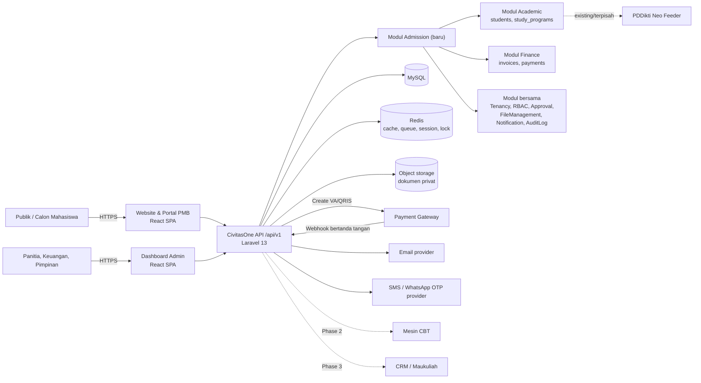
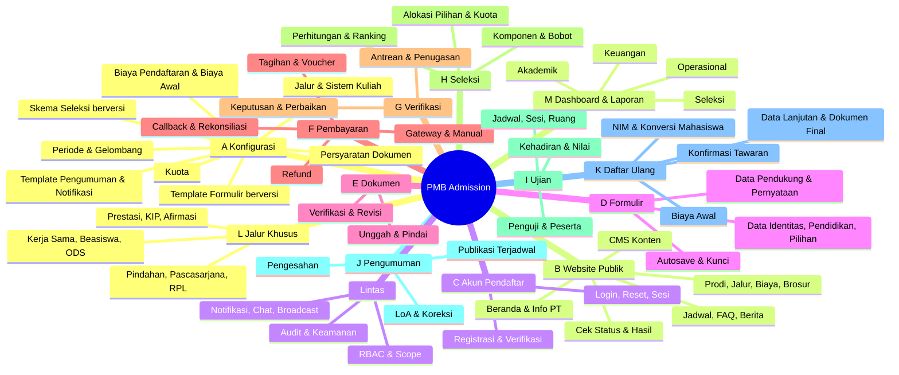
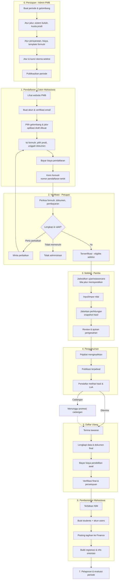
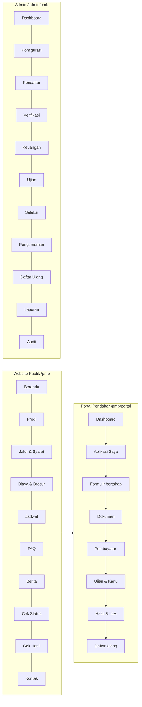
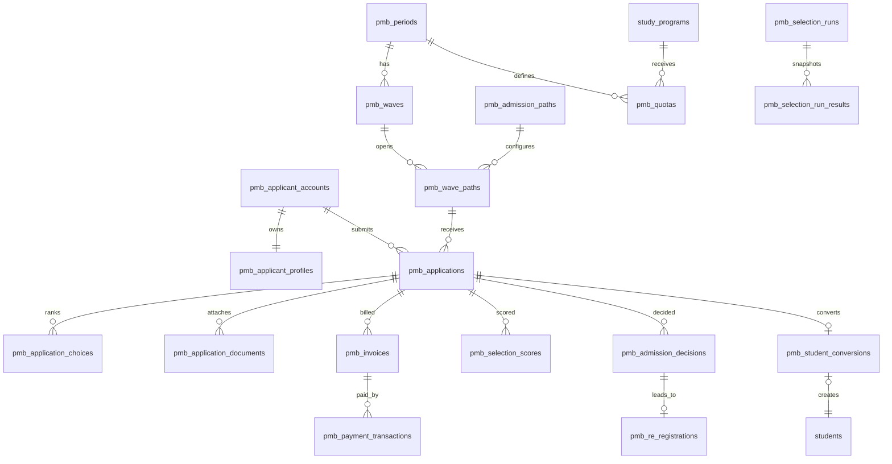

# Rancangan Sistem Penerimaan Mahasiswa Baru (PMB) — CivitasOne

| Atribut | Nilai |
|---|---|
| Versi dokumen | 1.0 (draf untuk review stakeholder) |
| Tanggal | 10 Oktober 2026 |
| Sistem target | CivitasOne (Laravel 13 modular, MySQL, Redis, React 19 SPA, multi-tenant `university_id`) |
| Modul baru | `app/Modules/Admission` (kode modul: `pmb`) |
| Dokumen sumber | `docs/SEVIMA_Platform_Proposal.md`, `docs/SEVIMA_Penjelasan_Modul.md`, PDF `[14092026] WEBSITE Proposal Penawaran SEVIMA Platform.pdf`, kode & dokumen CivitasOne yang sudah ada |
| Status | Menunggu konfirmasi keputusan di [02 — Asumsi & Keputusan](pmb/02-asumsi-keputusan-pertanyaan.md) |

> **Cara membaca label keterlacakan** (dipakai di seluruh dokumen)
>
> | Label | Arti |
> |---|---|
> | **[E]** | Eksplisit — fitur tertulis di dokumen proposal SEVIMA (Markdown dan PDF sama isinya). |
> | **[I]** | Inferensi — disimpulkan dari keterkaitan antarmodul SEVIMA atau dari uraian `SEVIMA_Penjelasan_Modul.md` (yang sendiri menyatakan uraiannya adalah tafsiran fungsional, bukan spesifikasi resmi). |
> | **[R]** | Rekomendasi — kebutuhan sistem PMB yang tidak disebut sumber, ditambahkan berdasarkan praktik baik. Bukan klaim fitur SEVIMA. |
> | **[K]** | Perlu konfirmasi stakeholder sebelum diimplementasikan. |
>
> Dokumen SEVIMA dipakai sebagai **acuan cakupan fitur (benchmark)**. Seluruh rancangan teknis (database, API, status, aturan) adalah rancangan baru untuk CivitasOne, bukan deskripsi cara kerja SEVIMA.

---

## Daftar Isi

**Dokumen utama (file ini)**

1. [Ringkasan Eksekutif](#1-ringkasan-eksekutif)
2. [Latar Belakang](#2-latar-belakang)
3. [Tujuan Sistem](#3-tujuan-sistem)
4. [Ruang Lingkup](#4-ruang-lingkup)
5. [Referensi dan Analisis Dokumen Sumber](#5-referensi-dan-analisis-dokumen-sumber)
6. [Asumsi, Batasan, dan Hal yang Perlu Dikonfirmasi](#6-asumsi-batasan-dan-hal-yang-perlu-dikonfirmasi)
7. [Stakeholder dan Role Pengguna](#7-stakeholder-dan-role-pengguna)
8. [Gambaran Arsitektur Sistem](#8-gambaran-arsitektur-sistem)
9. [Peta Modul dan Submodul](#9-peta-modul-dan-submodul)
10. [Proses Bisnis End-to-End](#10-proses-bisnis-end-to-end)
11. [Detail Spesifikasi Setiap Modul](#11-detail-spesifikasi-setiap-modul)
12. [Business Rules](#12-business-rules)
13. [Workflow dan State Machine](#13-workflow-dan-state-machine)
14. [Sitemap dan Rancangan UI/UX](#14-sitemap-dan-rancangan-uiux)
15. [Rancangan Database](#15-rancangan-database)
16. [Data Dictionary](#16-data-dictionary)
17. [ERD](#17-erd)
18. [Rancangan API](#18-rancangan-api)
19. [Integrasi Sistem](#19-integrasi-sistem)
20. [Notifikasi](#20-notifikasi)
21. [Keamanan dan Audit](#21-keamanan-dan-audit)
22. [Kebutuhan Nonfungsional](#22-kebutuhan-nonfungsional)
23. [Error Handling dan Edge Cases](#23-error-handling-dan-edge-cases)
24. [Strategi Testing](#24-strategi-testing)
25. [Acceptance Criteria](#25-acceptance-criteria)
26. [Prioritas Implementasi](#26-prioritas-implementasi)
27. [Dependensi dan Risiko](#27-dependensi-dan-risiko)
28. [Matriks Keterlacakan Kebutuhan](#28-matriks-keterlacakan-kebutuhan)
29. [Checklist Implementasi](#29-checklist-implementasi)
30. [Glosarium](#30-glosarium)

**Dokumen rinci (`docs/pmb/`)**

| No | File | Isi |
|---|---|---|
| 01 | [01-analisis-dokumen-sumber.md](pmb/01-analisis-dokumen-sumber.md) | Inventaris modul & fitur sumber, keterkaitan dengan PMB, inkonsistensi, analisis kode CivitasOne yang ada |
| 02 | [02-asumsi-keputusan-pertanyaan.md](pmb/02-asumsi-keputusan-pertanyaan.md) | Asumsi, batasan, keputusan desain, pertanyaan untuk stakeholder |
| 03 | [03-spesifikasi-konfigurasi-dan-website.md](pmb/03-spesifikasi-konfigurasi-dan-website.md) | Modul A (Konfigurasi PMB) & B (Website publik) |
| 04 | [04-spesifikasi-akun-formulir-dokumen.md](pmb/04-spesifikasi-akun-formulir-dokumen.md) | Modul C (Akun), D (Formulir), E (Dokumen) |
| 05 | [05-spesifikasi-pembayaran-dan-verifikasi.md](pmb/05-spesifikasi-pembayaran-dan-verifikasi.md) | Modul F (Pembayaran pendaftaran) & G (Verifikasi administrasi) |
| 06 | [06-spesifikasi-seleksi-ujian-pengumuman.md](pmb/06-spesifikasi-seleksi-ujian-pengumuman.md) | Modul H (Seleksi), I (Ujian), J (Pengumuman) |
| 07 | [07-spesifikasi-daftar-ulang-jalur-khusus-pelaporan.md](pmb/07-spesifikasi-daftar-ulang-jalur-khusus-pelaporan.md) | Modul K (Daftar ulang & pembentukan mahasiswa), L (Jalur khusus & beasiswa), M (Dashboard & pelaporan) |
| 08 | [08-rbac.md](pmb/08-rbac.md) | Matriks RBAC, scope data, separation of duties |
| 09 | [09-workflow-dan-state-machine.md](pmb/09-workflow-dan-state-machine.md) | Diagram alur Mermaid & definisi state machine per siklus hidup |
| 10 | [10-database-erd-data-dictionary.md](pmb/10-database-erd-data-dictionary.md) | ERD, tabel, data dictionary, SQL contoh, migrasi, duplikasi, backup |
| 11 | [11-api-dan-integrasi.md](pmb/11-api-dan-integrasi.md) | Rancangan REST API & strategi integrasi |
| 12 | [12-ui-ux-sitemap.md](pmb/12-ui-ux-sitemap.md) | Sitemap, inventaris halaman, wireframe teks |
| 13 | [13-notifikasi-keamanan-nonfungsional.md](pmb/13-notifikasi-keamanan-nonfungsional.md) | Notifikasi, keamanan & privasi, audit, kebutuhan nonfungsional |
| 14 | [14-edge-cases-testing-acceptance.md](pmb/14-edge-cases-testing-acceptance.md) | Edge cases, strategi testing, acceptance criteria Given–When–Then |
| 15 | [15-prioritas-risiko-traceability-checklist.md](pmb/15-prioritas-risiko-traceability-checklist.md) | Prioritas MVP/Phase 2/Phase 3, risiko, matriks keterlacakan lengkap, checklist |

---

## 1. Ringkasan Eksekutif

CivitasOne saat ini sudah memiliki fondasi multi-tenant, RBAC, approval workflow, file upload, notifikasi, audit log, serta modul akademik (fakultas, program studi, mahasiswa, KRS, ujian kelas) dan keuangan dasar. **Belum ada modul PMB** — dokumen `RANCANGAN-APLIKASI.md §4.2` hanya berisi daftar fitur dan satu daftar status gabungan.

Dokumen ini merancang modul **PMB (`Admission`)** yang menangani siklus penuh: konfigurasi periode/gelombang/jalur/kuota → website publik → akun calon mahasiswa → formulir & dokumen → pembayaran pendaftaran → verifikasi → ujian & seleksi → pengesahan & pengumuman → daftar ulang & pembayaran biaya awal → penerbitan NIM → pembentukan data `students` di modul Akademik → pelaporan.

Cakupan fitur diturunkan dari proposal SEVIMA (19 fitur PMB eksplisit, ditambah fitur terkait di modul Smart Dashboard, KEU, CBT, CRM, RPL, Neo Feeder, Tata Usaha). Hasil analisis: **125 kebutuhan fungsional** (FR; 42 eksplisit, 17 inferensi, 66 rekomendasi), **42 business rules** (BR), **11 state machine terpisah**, **66 tabel baru** berprefiks `pmb_`, **lebih dari 170 endpoint API**, **80 halaman** UI, **28 skenario edge case**, dan **21 kelompok acceptance criteria**.

**Keputusan desain utama** (detail & alasan di [02](pmb/02-asumsi-keputusan-pertanyaan.md#3-keputusan-desain)):

| # | Keputusan | Alasan singkat |
|---|---|---|
| KD-01 | Akun calon mahasiswa memakai tabel tenant-scoped `pmb_applicant_accounts` dengan guard Sanctum terpisah, **bukan** tabel `users`. | `users.email` unik global lintas universitas; calon mahasiswa yang mendaftar ke dua kampus tidak boleh bocor/bentrok. Akun `users` baru dibuat saat konversi menjadi mahasiswa. |
| KD-02 | Status disimpan per siklus hidup (form, verifikasi, pembayaran, seleksi, keputusan, daftar ulang, konversi) — bukan satu kolom status generik. | Diminta brief; setiap siklus punya aktor dan transisi berbeda. Status gabungan di `RANCANGAN-APLIKASI.md §4.2` digantikan. |
| KD-03 | Tagihan PMB memakai tabel sendiri (`pmb_invoices`, `pmb_payment_transactions`), lalu diposting ke `invoices`/`payments` Finance saat konversi. | `invoices.student_id` NOT NULL — pendaftar belum menjadi mahasiswa. |
| KD-04 | Hasil seleksi dihitung sebagai **snapshot immutable** (`pmb_selection_runs`) terhadap **versi skema seleksi yang terkunci**. | Mengubah bobot setelah penilaian tidak boleh mengubah hasil secara diam-diam. |
| KD-05 | Publikasi hasil wajib melalui approval engine yang sudah ada (`approval_workflows`) dan dipublikasikan oleh job terjadwal yang membaca snapshot yang disetujui. | Pemisahan tugas (penyusun ≠ pengesah ≠ publisher), anti-bocor. |
| KD-06 | Pembentukan mahasiswa memakai pola **outbox + idempotency key** (`pmb_student_conversions`, unik per aplikasi) dan sequence NIM ber-lock. | Mencegah NIM ganda & mahasiswa ganda saat retry/timeout. |
| KD-07 | Ujian CBT PMB **tidak** memakai tabel `exams` yang ada pada MVP (terikat `class_section_id`/`krs_item_id`). MVP: ujian luring/wawancara + input/impor nilai. Phase 2: generalisasi mesin ujian. | Menghindari refactor besar modul ujian akademik di MVP. |

**MVP** menghasilkan alur end-to-end yang dapat berjalan untuk jalur reguler dan prestasi (tanpa CBT terintegrasi, pembayaran via 1 payment gateway + transfer manual). **Phase 2** menambah CBT, ODS, otomasi, chat, KIP, voucher/cicilan. **Phase 3** menambah integrasi lanjut (CRM, Neo Feeder, TTE LoA, RPL penuh) dan analitik.

---

## 2. Latar Belakang

1. Perguruan tinggi tenant CivitasOne membutuhkan PMB online yang terhubung langsung ke data akademik, karena pendaftar yang lolos harus menjadi mahasiswa tanpa input ulang. Kebutuhan ini juga ditegaskan proposal SEVIMA ("Setting NIM & ekspor menjadi mahasiswa" **[E]**).
2. Proses PMB manual/terpisah menimbulkan masalah tipikal: rekap pendaftar manual, verifikasi pembayaran berbasis tangkapan layar, hasil seleksi di spreadsheet yang rawan diubah, dan NIM dibuat tanpa kontrol duplikasi.
3. Proposal SEVIMA menunjukkan cakupan yang diharapkan pasar untuk PMB (website ber-branding kampus, jalur & gelombang, LoA, ujian & ruang, pembayaran online, KIP Kuliah, ODS, CBT, quick chat, email & SMS, laporan sumber informasi). Dokumen ini memakainya sebagai benchmark cakupan.
4. CivitasOne sudah memiliki fondasi yang dapat dipakai ulang (lihat [01 §5](pmb/01-analisis-dokumen-sumber.md#5-analisis-kode-civitasone-yang-sudah-ada)): `TenantScoped`, `PermissionRegistry` dengan scope, `ApprovalWorkflow` (multi-step, return, contextual approver), `FileUpload` (checksum, status scanning), `NotificationTemplate`/`NotificationLog`, `AuditLog`, serta `students`/`study_programs`/`faculties`/`academic_terms`.

---

## 3. Tujuan Sistem

| Kode | Tujuan | Ukuran keberhasilan (usulan, perlu divalidasi) |
|---|---|---|
| T-01 | Seluruh pendaftaran dilakukan online, dari akun hingga daftar ulang. | ≥ 95% pendaftar menyelesaikan pendaftaran tanpa bantuan loket. |
| T-02 | Konfigurasi PMB (periode, gelombang, jalur, kuota, biaya, persyaratan, skema seleksi) dapat dikelola admin tanpa developer. | Periode baru dapat dibuka < 1 hari kerja oleh Admin PMB. |
| T-03 | Pembayaran diverifikasi berdasarkan bukti transaksi sah (callback bertanda tangan atau verifikasi petugas), bukan status dari antarmuka. | 0 kasus pembayaran "lunas" tanpa transaksi tervalidasi. |
| T-04 | Seleksi transparan, dapat diaudit, dan hasilnya tidak berubah tanpa jejak. | 100% perubahan nilai/keputusan memiliki audit log & alasan. |
| T-05 | Pengumuman hanya terbit setelah disahkan pejabat berwenang dan pada waktu terjadwal. | 0 kebocoran hasil sebelum waktu publikasi. |
| T-06 | Pendaftar yang menyelesaikan daftar ulang menjadi mahasiswa dengan NIM unik, otomatis, idempoten. | 0 NIM ganda; ≥ 99% konversi sukses tanpa intervensi manual. |
| T-07 | Pimpinan dan panitia memantau corong (funnel) PMB secara real time. | Dashboard menampilkan data maksimal tertunda 5 menit. |
| T-08 | Data pribadi pendaftar dilindungi sesuai UU No. 27 Tahun 2022 tentang Pelindungan Data Pribadi. | Akses data sensitif terbatas role & tercatat. |

---

## 4. Ruang Lingkup

### 4.1 Dalam ruang lingkup

| Area | Ringkasan | Detail |
|---|---|---|
| A. Konfigurasi PMB | Periode, gelombang, jalur, sistem kuliah, kuota, persyaratan, biaya, skema seleksi, template formulir/pengumuman/notifikasi | [03](pmb/03-spesifikasi-konfigurasi-dan-website.md#a-konfigurasi-dan-manajemen-pmb) |
| B. Website PMB | Halaman publik ber-branding tenant, info prodi, biaya, brosur, jadwal, FAQ, berita, cek status & hasil, CMS | [03](pmb/03-spesifikasi-konfigurasi-dan-website.md#b-website-pmb-dan-informasi-publik) |
| C. Akun calon mahasiswa | Registrasi, verifikasi email/OTP, login, reset, sesi, anti-duplikat | [04](pmb/04-spesifikasi-akun-formulir-dokumen.md#c-registrasi-dan-akun-calon-mahasiswa) |
| D. Formulir | Formulir dinamis berversi per jalur, autosave, kunci setelah kirim | [04](pmb/04-spesifikasi-akun-formulir-dokumen.md#d-formulir-pendaftaran) |
| E. Dokumen | Unggah, pemindaian, verifikasi, revisi, kunci, retensi | [04](pmb/04-spesifikasi-akun-formulir-dokumen.md#e-pengelolaan-dokumen-persyaratan) |
| F. Pembayaran pendaftaran | Tagihan, payment gateway, manual transfer, callback idempoten, rekonsiliasi, refund | [05](pmb/05-spesifikasi-pembayaran-dan-verifikasi.md#f-pembayaran-biaya-pendaftaran) |
| G. Verifikasi administrasi | Antrean, penugasan, keputusan, permintaan perbaikan | [05](pmb/05-spesifikasi-pembayaran-dan-verifikasi.md#g-verifikasi-administrasi) |
| H. Seleksi | Skema berbobot berversi, perhitungan, alokasi pilihan, ranking, tie-break, pengesahan | [06](pmb/06-spesifikasi-seleksi-ujian-pengumuman.md#h-seleksi-calon-mahasiswa) |
| I. Ujian | Jadwal, sesi, ruang, penguji, kartu peserta, kehadiran, nilai | [06](pmb/06-spesifikasi-seleksi-ujian-pengumuman.md#i-jadwal-dan-pelaksanaan-ujian) |
| J. Pengumuman | Approval, publikasi terjadwal, LoA, koreksi berversi | [06](pmb/06-spesifikasi-seleksi-ujian-pengumuman.md#j-pengumuman-hasil-seleksi) |
| K. Daftar ulang | Konfirmasi tawaran, data lanjutan, biaya awal, verifikasi final, NIM, pembentukan mahasiswa | [07](pmb/07-spesifikasi-daftar-ulang-jalur-khusus-pelaporan.md#k-daftar-ulang-mahasiswa-baru) |
| L. Jalur khusus | Prestasi, KIP Kuliah/afirmasi, pindahan, pascasarjana, RPL, beasiswa, kerja sama, ODS | [07](pmb/07-spesifikasi-daftar-ulang-jalur-khusus-pelaporan.md#l-manajemen-beasiswa-dan-jalur-khusus) |
| M. Dashboard & laporan | KPI operasional, keuangan, seleksi, akademik; ekspor | [07](pmb/07-spesifikasi-daftar-ulang-jalur-khusus-pelaporan.md#m-dashboard-dan-pelaporan) |
| Lintas | RBAC, notifikasi, quick chat, broadcast, audit, keamanan, NFR | [08](pmb/08-rbac.md), [13](pmb/13-notifikasi-keamanan-nonfungsional.md) |

### 4.2 Di luar ruang lingkup (atau ditangani modul lain)

| Item | Alasan / pemilik |
|---|---|
| CRM peminat (lead scoring, pipeline follow-up, landing page kampanye) | Modul CRM tersendiri **[E]** (Business+). PMB hanya menyediakan antarmuka penerimaan lead & pelaporan "sumber informasi". |
| Asesmen RPL (rekognisi mata kuliah, distribusi asesor) | Modul RPL tersendiri **[E]** (Professional+/add-on). PMB menangani pendaftaran jalur RPL dan meneruskan data. |
| Konversi nilai mahasiswa pindahan | Fitur SIAKAD "Transfer mahasiswa" **[E]**. PMB meneruskan data asal PT. |
| Akuntansi kampus (jurnal, buku besar) | Finance Cloud (add-on SEVIMA) / modul Finance CivitasOne. PMB hanya memposting tagihan & pembayaran. |
| Pelaporan PDDikti (Neo Feeder) | Integrasi akademik. PMB memastikan data mahasiswa baru memenuhi field wajib PDDikti (lihat [11 §B.6](pmb/11-api-dan-integrasi.md#b6-pddikti-neo-feeder)). |
| Penerbitan KTM fisik, orientasi (PKKMB) detail | Hanya notifikasi/tautan informasi dari PMB **[R]**. |
| Tes potensi & try out (Maukuliah) | Layanan eksternal SEVIMA; tidak dibangun. |

---

## 5. Referensi dan Analisis Dokumen Sumber

Ringkasan; analisis lengkap di [01-analisis-dokumen-sumber.md](pmb/01-analisis-dokumen-sumber.md).

### 5.1 Dokumen yang dianalisis

| Dokumen | Sifat | Catatan |
|---|---|---|
| `SEVIMA_Platform_Proposal.md` | Matriks fitur & harga per paket | Sumber utama label **[E]**. |
| PDF `[14092026] WEBSITE Proposal Penawaran SEVIMA Platform.pdf` (13 halaman) | Versi asli proposal | Sudah dibandingkan baris per baris untuk bagian PMB, RPL, CRM, KEU, ketentuan. **Isi PMB identik** dengan Markdown; tidak ada tabel/diagram tambahan. |
| `SEVIMA_Penjelasan_Modul.md` | Uraian fungsional per fitur | Menyatakan sendiri bahwa uraian adalah tafsiran dari nama fitur; dipakai sebagai **[I]**, bukan **[E]**. |
| Kode CivitasOne (`app/Modules/*`, migrasi) & dokumen `docs/*.md` | Sistem target | Menentukan entitas yang dipakai ulang dan batasan teknis. |

### 5.2 Fitur PMB eksplisit di sumber (semua paket kecuali disebut)

| ID | Fitur sumber | Diturunkan menjadi |
|---|---|---|
| SRC-PMB-01 | Website PMB sesuai branding kampus (ac.id) | FR-WEB-01..10 |
| SRC-PMB-02 | Portal pendaftaran sesuai jalur & gelombang | FR-CFG-02..04, FR-FRM-01 |
| SRC-PMB-03 | Manajemen detail informasi program studi | FR-WEB-03, FR-CFG-05 |
| SRC-PMB-04 | Manajemen informasi biaya kuliah & brosur | FR-WEB-05, FR-CFG-09 |
| SRC-PMB-05 | Penerbitan Letter of Acceptance (LoA) | FR-ANN-05 |
| SRC-PMB-06 | Manajemen jalur, gelombang, prasyarat & sistem kuliah | FR-CFG-02, -03, -06, -08 |
| SRC-PMB-07 | Manajemen ujian seleksi, ruang ujian & rekomendasi kelulusan | FR-EXM-01..02, FR-SEL-04, FR-CFG-07 |
| SRC-PMB-08 | Pengumuman jadwal ujian | FR-EXM-05, FR-NTF-01 |
| SRC-PMB-09 | Manajemen formulir & tagihan pendaftaran ("Lebih Lengkap") | FR-FRM-01, FR-CFG-10, FR-PAY-01 |
| SRC-PMB-10 | Setting NIM & ekspor menjadi mahasiswa | FR-REG-08..09, FR-INT-01 |
| SRC-PMB-11 | Laporan rekap pendaftar, pembayaran & sumber informasi | FR-RPT-02..04, FR-FRM-08 |
| SRC-PMB-12 | Pembayaran tagihan pendaftaran online | FR-PAY-02, FR-INT-04 |
| SRC-PMB-13 | Form pendaftaran online & upload berkas | FR-FRM-01, FR-DOC-01, FR-ACC-01 |
| SRC-PMB-14 | Integrasi SEVIMA CRM (MauKuliah) | FR-INT-03 |
| SRC-PMB-15 | Dukungan jalur pindahan, pascasarjana, RPL | FR-SPC-03..05 |
| SRC-PMB-16 | Pembagian ruangan, penguji & peserta sesuai jadwal ujian | FR-EXM-03..04 |
| SRC-PMB-17 | Pendaftaran & pengelolaan KIP Kuliah | FR-SPC-02 |
| SRC-PMB-18 | One Day Service (ODS); seleksi terintegrasi CBT (Business+) | FR-SPC-07, FR-EXM-09, FR-INT-05 |
| SRC-PMB-19 | Penyebaran informasi: quick chat, notifikasi email, email & SMS | FR-COM-01..02, FR-NTF-01, FR-ANN-04 |

Fitur terkait dari modul lain (SRC-DSH, SRC-KEU, SRC-CBT, SRC-CRM, SRC-RPL, SRC-NEO, SRC-TU, SRC-API, SRC-TTE, SRC-SIM, SRC-EMIS) tercantum di [01 §2](pmb/01-analisis-dokumen-sumber.md#2-inventaris-modul-dan-fitur-sumber).

### 5.3 Inkonsistensi penting yang memengaruhi rancangan

| ID | Temuan | Dampak pada rancangan |
|---|---|---|
| INK-01 | "Integrasi SEVIMA CRM (MauKuliah)" ada di PMB semua paket, tetapi modul CRM CAMABA baru tersedia di Business+. | Integrasi CRM di PMB dibatasi pada **penerimaan data peminat/lead** dan atribusi sumber; fitur CRM penuh di luar lingkup PMB. |
| INK-02 | "Dukungan jalur RPL" ada di PMB semua paket, tetapi modul RPL Professional+ / add-on. | PMB mendukung **pendaftaran** jalur RPL (jalur kategori `rpl`); asesmen RPL diserahkan ke modul RPL (Phase 3). |
| INK-03 | ODS tersedia semua paket, tetapi "seleksi terintegrasi CBT" hanya Business+; CBT module hanya Business+, padahal "manajemen ujian seleksi" semua paket. | Ujian harus dapat berjalan **tanpa CBT** (luring + input/impor nilai). CBT adalah komponen seleksi opsional. |
| INK-04 | "Manajemen formulir & tagihan pendaftaran: Lebih Lengkap" tanpa definisi. | Tidak dapat dijadikan dasar spesifikasi; rancangan formulir dinamis & tagihan dibuat sebagai **[R]**. |
| INK-05 | Penjelasan_Modul menulis pendaftar "otomatis mendapat NIM dan dipindahkan ke SIAKAD sebagai mahasiswa aktif" dan pembayaran "terverifikasi otomatis". | Ditolak sebagai aturan: status mahasiswa aktif hanya setelah persetujuan final daftar ulang (BR-33); "otomatis" hanya untuk kanal dengan callback bertanda tangan. |
| INK-06 | Jumlah kanal pembayaran dibatasi paket (3–6). | Kanal pembayaran dikonfigurasi per tenant, tidak di-hardcode (BR-17). |
| GAP-09 | (Dokumen internal, bukan SEVIMA) `RANCANGAN-APLIKASI.md §4.2` CivitasOne memakai satu daftar status gabungan (Draft…Menjadi mahasiswa). | Digantikan oleh 11 state machine terpisah di [09](pmb/09-workflow-dan-state-machine.md). |

Daftar lengkap (INK-01..10 dan kesenjangan kode GAP-01..10): [01 §4–5](pmb/01-analisis-dokumen-sumber.md#4-inkonsistensi-dan-ambiguitas-sumber).

---

## 6. Asumsi, Batasan, dan Hal yang Perlu Dikonfirmasi

Daftar lengkap (24 asumsi, 9 batasan, 12 keputusan desain, 37 pertanyaan stakeholder — 24 di antaranya prioritas P1) di [02-asumsi-keputusan-pertanyaan.md](pmb/02-asumsi-keputusan-pertanyaan.md). Yang paling menentukan:

| ID | Asumsi | Jika salah |
|---|---|---|
| A-01 | Sistem dibangun di dalam CivitasOne sebagai modul `Admission`, bukan membeli/mengintegrasikan SEVIMA. | Bila SEVIMA dipakai, dokumen ini menjadi dokumen kebutuhan/evaluasi vendor; bagian DB & API tidak berlaku. |
| A-02 | Satu tenant = satu perguruan tinggi; data PMB tidak dibagi antartenant. | Perlu desain PMB bersama (konsorsium) — di luar lingkup. |
| A-03 | Identitas utama WNI = NIK; WNA = nomor paspor. | Aturan anti-duplikat (BR-04) perlu diubah. |
| A-05 | MVP memakai satu payment gateway yang mendukung Virtual Account & QRIS dengan callback bertanda tangan + transfer manual. | Integrasi spesifik (Midtrans/Xendit/bank H2H) dipilih stakeholder — lihat Q-PAY-01. |
| A-08 | Mahasiswa baru berstatus `active` di `students` pada awal semester masuk, setelah persetujuan final daftar ulang. | Status awal bisa berbeda (mis. `pending_activation`) — Q-REG-03. |

Pertanyaan prioritas tertinggi: kebijakan pilihan prodi ganda (Q-SEL-01), metode alokasi multi-pilihan (Q-SEL-02), kebijakan refund (Q-PAY-04), format NIM per tenant (Q-REG-01), pejabat pengesah hasil (Q-ANN-01), field wajib PDDikti yang harus dikumpulkan di daftar ulang (Q-REG-05).

---

## 7. Stakeholder dan Role Pengguna

| Kode role | Nama | Deskripsi singkat | Scope data |
|---|---|---|---|
| `super_admin` | Super Admin | Operator platform CivitasOne; aktivasi modul PMB per tenant | Lintas tenant (sudah ada) |
| `pmb_admin` | Administrator PMB | Ketua/sekretariat panitia; mengelola konfigurasi & operasional | Seluruh tenant |
| `leadership` | Pimpinan PT | Rektor/WR; melihat dashboard; dapat menjadi pengesah | Seluruh tenant, baca |
| `pmb_approver` | Pejabat Pengesah | Pejabat yang mengesahkan hasil seleksi (biasanya Rektor/WR I) | Sesuai penetapan |
| `faculty_admin` | Admin Fakultas | Melihat/menilai pendaftar fakultasnya | `scope_type=faculty` |
| `program_admin` | Admin Program Studi | Info prodi, review pendaftar prodinya | `scope_type=study_program` |
| `pmb_verifier` | Petugas Verifikasi | Memeriksa formulir & dokumen | Penugasan / filter jalur |
| `finance_officer` | Petugas Keuangan | Verifikasi pembayaran manual, rekonsiliasi, refund | Data keuangan PMB |
| `selection_committee` | Panitia Seleksi | Kelola skema seleksi, nilai, ranking | Seluruh tenant / per jalur |
| `examiner` | Penguji/Pewawancara | Input nilai peserta yang ditugaskan | Hanya peserta sesi yang ditugaskan |
| `re_registration_officer` | Petugas Daftar Ulang | Verifikasi dokumen final, persetujuan daftar ulang | Pendaftar diterima |
| `auditor` | Auditor/Pengawas | Baca-saja seluruh data & log | Seluruh tenant, baca |
| `applicant` | Calon Mahasiswa | Pemilik akun pendaftar (guard terpisah) | Data miliknya sendiri |
| — | Publik | Pengunjung website | Konten publik |

Kode role di atas adalah **nama fungsional**. Implementasinya memakai ulang role template yang sudah ada di `OrganizationalRoleSeeder` bila fungsinya sama (`rector`, `vice_rector`, `dean`, `head_of_study_program`, `finance_administrator`, `lecturer`, `auditor`, `student`), dan hanya menambah role baru untuk fungsi khusus PMB (`admission_administrator`, `admission_verifier`, `admission_selection_committee`, `admission_approver`, `admission_registrar`). Pemetaan lengkap: [08 — pemetaan role](pmb/08-rbac.md).

Stakeholder non-pengguna: Biro Akademik/BAAK (penerima data mahasiswa), Biro Keuangan, Humas/Marketing (konten & sumber informasi), DPO/Pejabat Pelindungan Data, Tim IT tenant, penyedia payment gateway, penyedia email/SMS.

Matriks hak akses rinci: [08-rbac.md](pmb/08-rbac.md).

---

## 8. Gambaran Arsitektur Sistem

### 8.1 Konteks

### 8.2 Prinsip arsitektur

| Prinsip | Penerapan |
|---|---|
| Modular monolith | Modul baru `app/Modules/Admission` mengikuti konvensi modul yang ada (Controllers, Services, Models, Policies, Requests, Resources, Routes/api.php, Database/Migrations, Enums, Tests). Rute otomatis dimuat oleh `routes/api.php`. |
| Isolasi tenant | Semua tabel `pmb_*` membawa `university_id` + trait `TenantScoped`. `university_id` tidak pernah diterima dari body client. |
| Domain service + state machine | Transisi status hanya melalui service (mis. `ApplicationVerificationService::approve()`), yang memeriksa transisi yang diizinkan, policy, lalu mencatat history & audit dalam satu transaksi DB. Controller tidak boleh meng-update kolom status langsung. |
| Event-driven samping | Efek samping (notifikasi, posting Finance, konversi mahasiswa) dipicu domain event → listener ber-queue (Redis). Event ditulis ke outbox di transaksi yang sama bila efeknya kritikal (konversi, posting keuangan). |
| Idempotensi | Endpoint transaksi menerima header `Idempotency-Key`; webhook di-dedupe dengan `provider_event_id`; konversi mahasiswa unik per aplikasi. |
| Konfigurasi berversi | Template formulir & skema seleksi berversi dan dikunci saat dipakai; aplikasi menyimpan referensi versi + snapshot konfigurasi penting. |
| Pemakaian ulang | `file_uploads`, `approval_*`, `notification_templates/logs`, `audit_logs`, `roles/permissions/user_roles`, `universities/university_settings`, `faculties`, `study_programs`, `academic_terms`, `students`, `student_status_histories`, `invoices`, `payments`. |

### 8.3 Lapisan front-end

| Aplikasi | Lokasi | Catatan |
|---|---|---|
| Website publik + portal pendaftar | `frontend/src/pages/pmb/public/*`, `frontend/src/pages/pmb/portal/*` | Rute publik dapat di-prerender/SSR ringan untuk SEO (lihat [12 §2.3](pmb/12-ui-ux-sitemap.md#23-seo-dan-performa-halaman-publik)). Branding dari `universities` (logo, warna). |
| Dashboard admin PMB | `frontend/src/pages/pmb/admin/*` | Memakai layout & komponen tabel/filter yang ada; guard permission. |

---

## 9. Peta Modul dan Submodul

| Submodul | Kode FR | Prioritas dominan |
|---|---|---|
| Konfigurasi | FR-CFG-01..12 | MVP |
| Website publik | FR-WEB-01..10 | MVP (CMS penuh Phase 2) |
| Akun | FR-ACC-01..08 | MVP |
| Formulir | FR-FRM-01..08 | MVP |
| Dokumen | FR-DOC-01..07 | MVP |
| Pembayaran | FR-PAY-01..10 | MVP (refund & voucher Phase 2) |
| Verifikasi | FR-VER-01..06 | MVP |
| Seleksi | FR-SEL-01..08 | MVP |
| Ujian | FR-EXM-01..09 | MVP luring; CBT Phase 2 |
| Pengumuman | FR-ANN-01..06 | MVP |
| Daftar ulang | FR-REG-01..12 | MVP |
| Jalur khusus | FR-SPC-01..08 | Phase 2/3 |
| Pelaporan | FR-RPT-01..08 | MVP dasar; analitik Phase 3 |
| Komunikasi & notifikasi | FR-COM-01..03, FR-NTF-01..04 | MVP email; SMS/chat Phase 2 |
| Integrasi | FR-INT-01..06 | Bertahap |

---

## 10. Proses Bisnis End-to-End

Catatan urutan pembayaran vs pengiriman formulir: urutan default adalah **bayar → kirim**, karena verifikasi petugas hanya dilakukan untuk pendaftar yang sudah membayar (mengurangi beban verifikasi pendaftar fiktif). Urutan **kirim → bayar** dapat dipilih per gelombang-jalur (`payment_timing = before_submit | after_submit`), mis. untuk jalur KIP yang bebas biaya (biaya 0 → langkah bayar dilewati). Lihat BR-14.

Alur rinci per tahap (registrasi akun, formulir, dokumen, pembayaran, seleksi, pengumuman, daftar ulang, pembentukan mahasiswa, kegagalan pembayaran & integrasi): [09-workflow-dan-state-machine.md §1](pmb/09-workflow-dan-state-machine.md#1-diagram-alur).

---

## 11. Detail Spesifikasi Setiap Modul

Setiap modul dirinci dengan struktur: tujuan, aktor, kebutuhan fungsional (FR), alur, validasi, aturan bisnis terkait, status, hasil yang diharapkan.

| Modul | Dokumen |
|---|---|
| A. Konfigurasi & Manajemen PMB | [03 §A](pmb/03-spesifikasi-konfigurasi-dan-website.md#a-konfigurasi-dan-manajemen-pmb) |
| B. Website PMB & Informasi Publik | [03 §B](pmb/03-spesifikasi-konfigurasi-dan-website.md#b-website-pmb-dan-informasi-publik) |
| C. Registrasi & Akun | [04 §C](pmb/04-spesifikasi-akun-formulir-dokumen.md#c-registrasi-dan-akun-calon-mahasiswa) |
| D. Formulir Pendaftaran | [04 §D](pmb/04-spesifikasi-akun-formulir-dokumen.md#d-formulir-pendaftaran) |
| E. Dokumen Persyaratan | [04 §E](pmb/04-spesifikasi-akun-formulir-dokumen.md#e-pengelolaan-dokumen-persyaratan) |
| F. Pembayaran Biaya Pendaftaran | [05 §F](pmb/05-spesifikasi-pembayaran-dan-verifikasi.md#f-pembayaran-biaya-pendaftaran) |
| G. Verifikasi Administrasi | [05 §G](pmb/05-spesifikasi-pembayaran-dan-verifikasi.md#g-verifikasi-administrasi) |
| H. Seleksi | [06 §H](pmb/06-spesifikasi-seleksi-ujian-pengumuman.md#h-seleksi-calon-mahasiswa) |
| I. Jadwal & Pelaksanaan Ujian | [06 §I](pmb/06-spesifikasi-seleksi-ujian-pengumuman.md#i-jadwal-dan-pelaksanaan-ujian) |
| J. Pengumuman | [06 §J](pmb/06-spesifikasi-seleksi-ujian-pengumuman.md#j-pengumuman-hasil-seleksi) |
| K. Daftar Ulang | [07 §K](pmb/07-spesifikasi-daftar-ulang-jalur-khusus-pelaporan.md#k-daftar-ulang-mahasiswa-baru) |
| L. Beasiswa & Jalur Khusus | [07 §L](pmb/07-spesifikasi-daftar-ulang-jalur-khusus-pelaporan.md#l-manajemen-beasiswa-dan-jalur-khusus) |
| M. Dashboard & Pelaporan | [07 §M](pmb/07-spesifikasi-daftar-ulang-jalur-khusus-pelaporan.md#m-dashboard-dan-pelaporan) |

---

## 12. Business Rules

Aturan bisnis kanonik. Dokumen rinci merujuk ke ID ini; bila ada perbedaan, **tabel ini yang berlaku**. Nilai yang ditandai *(konfigurasi)* adalah default yang dapat diubah per tenant.

### 12.1 Konfigurasi

| ID | Aturan | Label |
|---|---|---|
| BR-01 | Periode PMB terikat pada satu tahun akademik masuk (`entry_academic_term_id`). Data pendaftar tidak pernah dipindahkan antarperiode; mendaftar di periode lain = aplikasi baru. | R |
| BR-02 | Rentang waktu gelombang dalam satu periode tidak boleh tumpang tindih **untuk jalur yang sama**. Gelombang berbeda jalur boleh paralel. Tanggal dalam gelombang harus berurutan: buka ≤ tutup ≤ batas bayar ≤ ujian ≤ pengumuman ≤ buka daftar ulang ≤ tutup daftar ulang. | R |
| BR-03 | Setelah gelombang memiliki ≥ 1 aplikasi `submitted`, perubahan konfigurasi yang memengaruhi pendaftar (biaya, persyaratan wajib, skema seleksi, template formulir, kuota turun di bawah jumlah yang sudah diterima) **ditolak**; perubahan tanggal penutupan hanya boleh **memperpanjang** dan wajib alasan. Pendaftar yang sudah ada tetap memakai snapshot/versi yang tercatat di aplikasinya. | R |
| BR-04 | Satu orang (identitas = hash NIK untuk WNI, atau paspor+negara untuk WNA) hanya boleh memiliki **satu aplikasi aktif per gelombang-jalur**, dan maksimal *N* aplikasi aktif per periode *(konfigurasi, default 1)*. Aplikasi di jalur lain dalam periode yang sama diperbolehkan bila `allow_multi_path_per_period = true`. | R, K |
| BR-05 | Kuota didefinisikan per (periode, jalur, prodi, sistem kuliah). Jumlah penerimaan yang dipublikasikan tidak boleh melebihi `capacity`; pendaftar dengan keputusan `waitlisted` tidak memakan kuota hingga dipromosikan. | E (kuota tersirat), R |
| BR-06 | Template formulir dan skema seleksi yang sudah `published`/`locked` tidak dapat diedit; perubahan = versi baru. | R |

### 12.2 Akun & formulir

| ID | Aturan | Label |
|---|---|---|
| BR-07 | Email akun unik per tenant (case-insensitive, setelah normalisasi trim+lowercase). Nomor HP unik per tenant bila dipakai sebagai login. | R |
| BR-08 | Akun harus terverifikasi (email atau OTP HP, sesuai konfigurasi) sebelum dapat membuat aplikasi. | R |
| BR-09 | Persetujuan Kebijakan Privasi & Ketentuan Pendaftaran wajib dicatat (versi dokumen, waktu, IP) saat registrasi; persetujuan pemrosesan data pribadi untuk tujuan PMB dicatat kembali saat kirim formulir. | R (UU PDP) |
| BR-10 | Formulir dapat disimpan sebagai draft kapan saja selama gelombang terbuka; draft tidak memerlukan field wajib lengkap. | R |
| BR-11 | Kirim formulir hanya bila: gelombang `open` dan `now < registration_closes_at`, seluruh field wajib valid di server, seluruh dokumen wajib tahap pendaftaran terunggah, pernyataan dicentang, dan (bila `payment_timing = before_submit`) tagihan pendaftaran `paid`. | R |
| BR-12 | Setelah `submitted`, data formulir terkunci bagi pendaftar kecuali petugas mengubah status menjadi `revision_requested` (hanya field/dokumen yang ditandai yang dapat diubah). | R |
| BR-13 | Pilihan prodi hanya dapat diubah sebelum `submitted`. Setelah itu hanya oleh Admin PMB dengan alasan, selama status seleksi belum `ranked`, dan tercatat di audit. | R |

### 12.3 Pembayaran

| ID | Aturan | Label |
|---|---|---|
| BR-14 | `payment_timing` per gelombang-jalur: `before_submit` (default) atau `after_submit`. Jika biaya = 0, tagihan tidak dibuat dan syarat pembayaran dianggap terpenuhi. | R |
| BR-15 | Status tagihan menjadi `paid` **hanya** melalui: (a) webhook gateway dengan tanda tangan valid **dan** verifikasi status ke API gateway (*double-check*), atau (b) verifikasi bukti manual oleh `finance_officer`. Status dari front-end tidak pernah dipercaya. | E (online), R |
| BR-16 | Satu tagihan hanya boleh memiliki satu transaksi `pending` aktif per kanal; membuat transaksi baru membatalkan yang lama di gateway bila didukung. Nominal transaksi harus sama persis dengan `amount_net` tagihan. | R |
| BR-17 | Kanal pembayaran aktif dikonfigurasi per tenant (`university_settings` grup `pmb.payment.*`); jumlah kanal mengikuti paket langganan. | E (kanal per paket) |
| BR-18 | Pembayaran yang diterima untuk tagihan `expired`/`cancelled` tetap dicatat (`pmb_payment_transactions.status = success`) dan ditandai `needs_resolution` untuk rekonsiliasi; tidak otomatis mengaktifkan kembali aplikasi. | R |
| BR-19 | Refund hanya melalui pengajuan dengan approval (`finance_officer` → pejabat keuangan) sesuai kebijakan tenant; biaya pendaftaran default **tidak dapat dikembalikan** *(konfigurasi)*. | R, K |
| BR-20 | Petugas yang memverifikasi bukti bayar manual tidak boleh menyetujui refund transaksi yang sama. | R (SoD) |

### 12.4 Verifikasi & dokumen

| ID | Aturan | Label |
|---|---|---|
| BR-21 | Dokumen yang sudah `approved` terkunci; penggantian oleh pendaftar hanya bila petugas membuka kembali (status `revision_requested`). Setiap penggantian membuat versi baru; versi lama tidak dihapus selama masa retensi. | R |
| BR-22 | Keputusan verifikasi `verified` mensyaratkan: semua dokumen wajib `approved`, pembayaran pendaftaran terpenuhi (BR-14/15), dan tidak ada flag duplikat terbuka. | R |
| BR-23 | Penolakan administrasi (`rejected`) dan permintaan perbaikan wajib memilih kode alasan dan catatan untuk pendaftar. Penolakan administrasi bersifat final kecuali dibatalkan Admin PMB dengan alasan. | R |
| BR-24 | Batas perbaikan dokumen *(konfigurasi, default 3×24 jam)*, tidak melewati `form_lock_at` gelombang. Lewat batas → aplikasi tetap `revision_requested` dan otomatis `rejected` oleh job dengan alasan `REVISION_EXPIRED` setelah `form_lock_at`. | R, K |

### 12.5 Seleksi & pengumuman

| ID | Aturan | Label |
|---|---|---|
| BR-25 | Hanya aplikasi `verification_status = verified` yang masuk seleksi. | R |
| BR-26 | Nilai komponen hanya dapat diinput oleh penguji yang ditugaskan (atau impor oleh `selection_committee`). Nilai terkunci setelah `selection_run` disetujui; koreksi setelahnya memerlukan proses koreksi berversi (BR-31). | E (penguji), R |
| BR-27 | Perhitungan selalu memakai versi skema `locked` yang direferensikan gelombang-jalur. Hasil perhitungan disimpan sebagai snapshot; perubahan skema/nilai sesudahnya tidak mengubah snapshot. | R |
| BR-28 | Alokasi multi-pilihan: pendaftar diproses berurutan berdasarkan skor akhir (desc, tie-break), lalu ditempatkan pada pilihan prioritas tertinggi yang masih berkuota dan memenuhi ambang minimal prodi tersebut. Pendaftar ditempatkan di maksimal satu prodi. | R, K |
| BR-29 | Tie-break: urutan aturan dikonfigurasi pada skema (default: skor komponen prioritas 1 → skor komponen prioritas 2 → waktu verifikasi lebih awal → keputusan panitia manual tercatat). Usia, jenis kelamin, agama, dan atribut sensitif lain **tidak boleh** dipakai sebagai tie-break. | R |
| BR-30 | Hasil hanya dapat dipublikasikan bila `selection_run.status = approved` melalui approval engine oleh role `pmb_approver`, dan pengaju ≠ pengesah. Publikasi terjadi pada `scheduled_publish_at` oleh job; sebelum itu endpoint pendaftar tidak mengembalikan keputusan. | R |
| BR-31 | Koreksi hasil setelah publikasi membuat versi keputusan baru (`decision_version + 1`), wajib alasan dan approval ulang, dan memicu notifikasi ke pendaftar terdampak. Versi lama tetap tersimpan. | R |
| BR-32 | Kuota yang kosong (tawaran ditolak/kedaluwarsa) dapat diisi dengan promosi `waitlisted` sesuai urutan ranking pada snapshot, melalui aksi Admin PMB yang tercatat (tidak otomatis) *(konfigurasi: dapat otomatis di Phase 2)*. | R, K |

### 12.6 Daftar ulang & pembentukan mahasiswa

| ID | Aturan | Label |
|---|---|---|
| BR-33 | Status "diterima" **tidak** sama dengan mahasiswa. Mahasiswa terbentuk hanya bila: tawaran diterima, data lanjutan lengkap, dokumen final `approved`, tagihan biaya awal memenuhi minimum *(konfigurasi: lunas atau cicilan pertama)*, dan persetujuan final oleh `re_registration_officer`. | R (koreksi INK-05) |
| BR-34 | Batas daftar ulang = `re_registration_closes_at` gelombang (atau `deadline_at` individual hasil promosi cadangan). Perpanjangan individual hanya oleh Admin PMB dengan alasan, maksimal *(konfigurasi, default 7 hari)*. | R |
| BR-35 | Lewat batas tanpa menyelesaikan → `expired` oleh job harian; kuota dibebaskan (BR-32). Pembayaran yang sudah masuk diproses sesuai kebijakan refund. | R |
| BR-36 | NIM dibangkitkan hanya sekali per aplikasi, dari sequence per (tenant, prodi, tahun masuk[, jalur]) dengan row lock; format dikonfigurasi (`{YY}{PRODI}{SEQ:4}` default). NIM unik per tenant (constraint `students.university_id,nim` yang sudah ada). | E (setting NIM), R |
| BR-37 | Konversi ke `students` idempoten: satu `pmb_student_conversions` per aplikasi (unique), satu `students` per konversi; retry tidak membuat NIM/mahasiswa baru. | R |
| BR-38 | Bila email pendaftar sudah ada di `users` (global), sistem **tidak** menautkan otomatis; akun mahasiswa memakai email institusi/alternatif atau ditautkan setelah verifikasi kepemilikan. | R, K |
| BR-39 | Pembatalan penerimaan setelah menjadi mahasiswa bukan wewenang PMB; dilakukan melalui proses status mahasiswa di Akademik (`resigned`). | R |

### 12.7 Data & keamanan

| ID | Aturan | Label |
|---|---|---|
| BR-40 | NIK, nomor KK, data kesehatan/disabilitas, dan data penghasilan orang tua dikategorikan **data sensitif**: terenkripsi di kolom (Laravel `encrypted` cast), dimasking di daftar, hanya dibuka role dengan permission `pmb_sensitive.read`, setiap pembukaan tercatat. | R (UU PDP) |
| BR-41 | Data pendaftar yang tidak menjadi mahasiswa dihapus/dianonimkan setelah masa retensi *(konfigurasi, default 2 tahun setelah periode ditutup)*; data keuangan mengikuti retensi dokumen keuangan *(default 10 tahun)*. | R, K |
| BR-42 | Ekspor data pribadi massal hanya untuk role berizin, wajib alasan, dibatasi kolom sesuai role, dan dicatat (siapa, kapan, filter, jumlah baris). | R |

---

## 13. Workflow dan State Machine

Diagram dan tabel transisi lengkap: [09-workflow-dan-state-machine.md](pmb/09-workflow-dan-state-machine.md).

Ringkasan state machine (setiap baris = kolom/tabel terpisah):

| # | Siklus hidup | Disimpan di | Status |
|---|---|---|---|
| SM-01 | Akun pendaftar | `pmb_applicant_accounts.status` | `unverified`, `active`, `locked`, `suspended`, `deactivated` |
| SM-02 | Formulir | `pmb_applications.form_status` | `draft`, `submitted`, `revision_requested`, `locked`, `withdrawn`, `void` |
| SM-03 | Dokumen | `pmb_application_documents.status` | `missing`, `uploaded`, `in_review`, `approved`, `rejected`, `revision_requested` |
| SM-04 | Tagihan | `pmb_invoices.status` | `unpaid`, `pending`, `partially_paid`, `paid`, `expired`, `cancelled`, `refund_pending`, `refunded` |
| SM-05 | Transaksi pembayaran | `pmb_payment_transactions.status` | `created`, `pending`, `success`, `failed`, `expired`, `cancelled`, `refunded` |
| SM-06 | Verifikasi administrasi | `pmb_applications.verification_status` | `not_started`, `in_review`, `revision_requested`, `verified`, `rejected` |
| SM-07 | Seleksi peserta | `pmb_applications.selection_status` | `not_eligible`, `eligible`, `scheduled`, `assessed`, `ranked`, `absent`, `disqualified` |
| SM-08 | Proses seleksi (batch) | `pmb_selection_runs.status` | `draft`, `computed`, `under_review`, `pending_approval`, `approved`, `published`, `superseded`, `rejected` |
| SM-09 | Keputusan penerimaan | `pmb_admission_decisions.decision` + `publication_status` | `accepted`, `waitlisted`, `rejected`, `withdrawn` / `unpublished`, `published`, `superseded` |
| SM-10 | Daftar ulang | `pmb_re_registrations.status` | `awaiting_confirmation`, `confirmed`, `in_progress`, `submitted`, `revision_requested`, `approved`, `enrolled`, `declined`, `expired`, `cancelled` |
| SM-11 | Konversi mahasiswa | `pmb_student_conversions.status` | `pending`, `processing`, `succeeded`, `failed`, `manual_intervention` |

Status ringkas yang ditampilkan ke pendaftar (`current_stage`) **diturunkan** dari kombinasi di atas oleh `ApplicationStageResolver`, tidak disimpan sebagai sumber kebenaran.

---

## 14. Sitemap dan Rancangan UI/UX

Sitemap, inventaris 80 halaman (14 publik, 5 autentikasi, 12 portal pendaftar, 49 admin) beserta komponen, kolom, filter, validasi, aksi, modal, dan state: [12-ui-ux-sitemap.md](pmb/12-ui-ux-sitemap.md).

---

## 15. Rancangan Database

Rancangan lengkap: [10-database-erd-data-dictionary.md](pmb/10-database-erd-data-dictionary.md). Ringkasan:

* Konvensi mengikuti kode yang ada: PK `ulid`, `university_id` FK ke `universities` (cascade), `timestampsTz`, enum disimpan sebagai `string` + PHP backed enum (pola migrasi terbaru CivitasOne yang mengubah enum DB → `string`).
* Prefiks `pmb_` untuk semua tabel baru agar tidak bentrok dengan tabel yang ada (`exams`, `payments`, `invoices`, `announcements`).
* Tabel kandidat di brief dievaluasi satu per satu; keputusan (dipakai/diganti/digabung/tidak dibuat) di [10 §1](pmb/10-database-erd-data-dictionary.md#1-evaluasi-entitas-kandidat).

| Domain | Tabel baru |
|---|---|
| Konfigurasi | `pmb_periods`, `pmb_waves`, `pmb_admission_paths`, `pmb_study_systems`, `pmb_wave_paths`, `pmb_quotas`, `pmb_document_types`, `pmb_document_requirements`, `pmb_form_templates`, `pmb_form_fields`, `pmb_fee_components`, `pmb_selection_schemes`, `pmb_selection_components`, `pmb_program_profiles`, `pmb_contents` |
| Akun & profil | `pmb_applicant_accounts`, `pmb_account_consents`, `pmb_otp_challenges`, `pmb_applicant_profiles`, `pmb_applicant_guardians`, `pmb_applicant_educations`, `pmb_report_scores`, `pmb_applicant_achievements` |
| Aplikasi | `pmb_applications`, `pmb_application_choices`, `pmb_application_answers`, `pmb_application_status_histories`, `pmb_duplicate_flags` |
| Dokumen | `pmb_application_documents`, `pmb_document_versions`, `pmb_document_reviews` |
| Verifikasi | `pmb_verification_assignments`, `pmb_review_notes` |
| Keuangan | `pmb_invoices`, `pmb_invoice_items`, `pmb_vouchers`, `pmb_payment_transactions`, `pmb_payment_callbacks`, `pmb_manual_payment_proofs`, `pmb_reconciliation_batches`, `pmb_reconciliation_items`, `pmb_refunds` |
| Ujian | `pmb_exam_venues`, `pmb_exam_rooms`, `pmb_exam_schedules`, `pmb_exam_sessions`, `pmb_exam_session_examiners`, `pmb_exam_participants` |
| Seleksi | `pmb_selection_scores`, `pmb_score_revisions`, `pmb_selection_runs`, `pmb_selection_run_results` |
| Keputusan | `pmb_admission_decisions`, `pmb_announcement_batches`, `pmb_acceptance_letters` |
| Daftar ulang & konversi | `pmb_re_registrations`, `pmb_re_registration_checks`, `pmb_sequences` (penomoran ber-lock: pendaftaran, tagihan, peserta, LoA, kuitansi, NIM), `pmb_student_conversions` |
| Komunikasi | `pmb_broadcasts`, `pmb_chat_threads`, `pmb_chat_messages` |
| Lintas | `pmb_export_logs`, `pmb_sensitive_access_logs`, `pmb_outbox_events`, `pmb_daily_stats` |

Total: **66 tabel baru**.

Perubahan pada tabel yang ada (additive): kolom sumber di `invoices` (`source_type`, `source_id`) dan `students` (`admission_application_id`, field identitas PDDikti) — rinci di [10 §6](pmb/10-database-erd-data-dictionary.md#6-perubahan-pada-tabel-yang-sudah-ada).

---

## 16. Data Dictionary

Data dictionary per tabel (kolom, tipe, null, default, PK/FK, index, unique, keterangan, aturan integritas): [10 §4](pmb/10-database-erd-data-dictionary.md#4-data-dictionary).

---

## 17. ERD

ERD Mermaid per domain (konfigurasi, aplikasi & dokumen, keuangan, ujian & seleksi, keputusan & daftar ulang) dan ERD ringkas lintas domain: [10 §3](pmb/10-database-erd-data-dictionary.md#3-erd).

---

## 18. Rancangan API

Rancangan lengkap lebih dari 170 endpoint (method, URL, tujuan, role/permission, parameter, body, response, error, validasi, pagination, idempotency, audit): [11-api-dan-integrasi.md](pmb/11-api-dan-integrasi.md).

> Seluruh endpoint di bawah adalah **rancangan baru untuk CivitasOne**. Tidak ada klaim bahwa endpoint ini ada di SEVIMA. Open API SEVIMA **[E]** (Professional+) tidak didokumentasikan publik di sumber sehingga integrasi dengannya harus diverifikasi terpisah.

| Prefiks | Konsumen | Auth |
|---|---|---|
| `/api/v1/pmb/public/*` | Website publik | Tanpa auth, rate limited, tenant dari domain |
| `/api/v1/pmb/applicant/*` | Portal pendaftar | Sanctum token, tokenable `PmbApplicantAccount`, ability `applicant` |
| `/api/v1/pmb/admin/*` | Dashboard staf | `auth:sanctum` (`users`) + `permission:*` + policy scope |
| `/api/v1/pmb/webhooks/*` | Payment gateway / CBT | Signature HMAC + allowlist IP (bila tersedia) |
| `/api/v1/pmb/integrations/*` | Sistem eksternal (CRM, CBT) | Token klien (service account), scope terbatas |

---

## 19. Integrasi Sistem

Strategi rinci di [11 §B](pmb/11-api-dan-integrasi.md#b-strategi-integrasi).

| Integrasi | Arah | Mekanisme | Fase |
|---|---|---|---|
| Modul Academic (`students`, `users`, `student_status_histories`) | PMB → Akademik | Panggilan service in-process dalam transaksi + outbox; idempoten | MVP |
| Modul Finance (`invoices`, `payments`) | PMB → Finance | Posting tagihan biaya awal saat konversi via outbox | MVP |
| Payment gateway (VA, QRIS, e-wallet/e-commerce) | Dua arah | REST create charge + webhook bertanda tangan + polling status + rekonsiliasi harian | MVP |
| Email | PMB → provider | Queue + `NotificationTemplate` | MVP |
| SMS/WhatsApp OTP | PMB → provider | Queue, rate limit | Phase 2 (MVP opsional) |
| Mesin CBT | Dua arah | Generalisasi `exams` internal atau API eksternal: kirim peserta, terima nilai | Phase 2 |
| CRM / Maukuliah | Masuk | Endpoint integrasi lead, atribusi sumber | Phase 3 |
| PDDikti Neo Feeder | Akademik → PDDikti | Di luar PMB; PMB memastikan kelengkapan data | Phase 3 (kelengkapan data: MVP) |
| TTE untuk LoA | PMB → penyedia TTE | Penandatanganan dokumen PDF | Phase 3 |
| SIMPONI (PTN) / EMIS (PTKI) | Sesuai jenis PT | Kanal bayar PNBP / pelaporan | Phase 3, kondisional |

---

## 20. Notifikasi

Rincian event, kanal, template, penerima, prioritas, retry, dan riwayat: [13 §A](pmb/13-notifikasi-keamanan-nonfungsional.md#a-notifikasi-dan-komunikasi). Memakai tabel `notification_templates` (per tenant, per `event_key` + `channel`) dan `notification_logs` yang sudah ada. Prinsip: notifikasi tidak memuat NIK, nilai rinci, atau tautan dokumen langsung — hanya ajakan login ke portal.

---

## 21. Keamanan dan Audit

Rincian: [13 §B](pmb/13-notifikasi-keamanan-nonfungsional.md#b-keamanan-privasi-dan-audit). Pokok: guard terpisah untuk pendaftar, RBAC + scope fakultas/prodi, SoD pada pengesahan/refund/koreksi, enkripsi kolom sensitif, file privat dengan URL bertanda tangan berumur pendek, pemindaian malware, rate limit login/OTP/registrasi/webhook, audit log pada setiap transisi status, log akses data sensitif, kepatuhan UU PDP (dasar pemrosesan, hak subjek data, retensi, notifikasi insiden 3×24 jam).

---

## 22. Kebutuhan Nonfungsional

Rincian dengan indikator terukur: [13 §C](pmb/13-notifikasi-keamanan-nonfungsional.md#c-kebutuhan-nonfungsional). Semua angka adalah **target awal usulan** yang wajib divalidasi dengan data volume aktual tenant.

---

## 23. Error Handling dan Edge Cases

28 skenario (penyebab, dampak, pencegahan, pemulihan, hasil yang diharapkan): [14 §A](pmb/14-edge-cases-testing-acceptance.md#a-error-handling-dan-edge-cases).

---

## 24. Strategi Testing

Unit, integration, API, UI, E2E, security, performance, UAT, regression — mengikuti pola test modul yang ada (`app/Modules/*/Tests`, PHPUnit): [14 §B](pmb/14-edge-cases-testing-acceptance.md#b-strategi-testing).

---

## 25. Acceptance Criteria

Given–When–Then untuk fitur utama, termasuk skenario gagal: [14 §C](pmb/14-edge-cases-testing-acceptance.md#c-acceptance-criteria).

---

## 26. Prioritas Implementasi

Rincian per fitur (alasan, dependensi, risiko, indikator): [15 §A](pmb/15-prioritas-risiko-traceability-checklist.md#a-prioritas-implementasi).

| Fase | Isi | Hasil |
|---|---|---|
| **MVP** | Konfigurasi inti, website publik dasar, akun email, formulir berversi, dokumen + verifikasi, 1 payment gateway + transfer manual + rekonsiliasi dasar, ujian luring/wawancara + input/impor nilai, skema seleksi berbobot + snapshot, pengesahan & publikasi terjadwal, LoA PDF, daftar ulang + biaya awal (lunas/cicilan pertama), NIM + konversi mahasiswa idempoten, dashboard & laporan rekap, notifikasi email, audit | PMB jalur reguler & prestasi berjalan end-to-end |
| **Phase 2** | CBT terintegrasi, ODS, OTP SMS/WA, quick chat, broadcast, KIP Kuliah, voucher, cicilan lanjut, refund via approval, promosi cadangan otomatis, CMS penuh, verifikasi massal, kartu ujian QR, multi-gateway | Efisiensi & otomasi |
| **Phase 3** | Integrasi CRM/Maukuliah, RPL penuh, TTE LoA, Neo Feeder readiness check, SIMPONI/EMIS kondisional, analitik lanjutan & perbandingan antarperiode, prediksi konversi | Integrasi & analitik |

---

## 27. Dependensi dan Risiko

Rincian: [15 §B](pmb/15-prioritas-risiko-traceability-checklist.md#b-dependensi-dan-risiko). Risiko teratas:

| ID | Risiko | Mitigasi |
|---|---|---|
| RSK-01 | Kebijakan seleksi (multi-pilihan, tie-break, ambang) belum diputuskan → rework mesin seleksi | Mesin seleksi berbasis konfigurasi; keputusan Q-SEL-01..05 sebelum sprint seleksi |
| RSK-02 | Kontrak & sandbox payment gateway terlambat | Mulai dengan transfer manual + verifikasi petugas; adapter gateway terisolasi |
| RSK-03 | Lonjakan trafik di hari terakhir pendaftaran/pengumuman | Uji beban, cache konten publik, antrean job, pengumuman berbasis snapshot statis |
| RSK-04 | Data PDDikti mahasiswa baru tidak lengkap | Field wajib PDDikti dikumpulkan di daftar ulang (Q-REG-05) |
| RSK-05 | Kebocoran data pribadi | Enkripsi kolom, masking, RBAC scope, log akses, DPIA sebelum go-live |

---

## 28. Matriks Keterlacakan Kebutuhan

Matriks lengkap fitur sumber ↔ kebutuhan ↔ bagian dokumen ↔ fase: [15 §C](pmb/15-prioritas-risiko-traceability-checklist.md#c-matriks-keterlacakan-kebutuhan). Ringkasan cakupan:

| Kategori | Jumlah FR | [E] | [I] | [R] | MVP | Phase 2 | Phase 3 |
|---|---:|---:|---:|---:|---:|---:|---:|
| Konfigurasi (CFG) | 12 | 6 | 2 | 4 | 12 | 0 | 0 |
| Website (WEB) | 10 | 5 | 1 | 4 | 9 | 1 | 0 |
| Akun (ACC) | 8 | 0 | 1 | 7 | 8 | 0 | 0 |
| Formulir (FRM) | 8 | 2 | 0 | 6 | 8 | 0 | 0 |
| Dokumen (DOC) | 7 | 1 | 0 | 6 | 7 | 0 | 0 |
| Pembayaran (PAY) | 10 | 2 | 3 | 5 | 8 | 2 | 0 |
| Verifikasi (VER) | 6 | 0 | 0 | 6 | 5 | 1 | 0 |
| Seleksi (SEL) | 8 | 1 | 1 | 6 | 8 | 0 | 0 |
| Ujian (EXM) | 9 | 6 | 0 | 3 | 8 | 1 | 0 |
| Pengumuman (ANN) | 6 | 1 | 1 | 4 | 6 | 0 | 0 |
| Daftar ulang (REG) | 12 | 2 | 2 | 8 | 12 | 0 | 0 |
| Jalur khusus (SPC) | 8 | 5 | 2 | 1 | 1 | 5 | 2 |
| Pelaporan (RPT) | 8 | 4 | 1 | 3 | 6 | 1 | 1 |
| Komunikasi & notifikasi (COM/NTF) | 7 | 3 | 1 | 3 | 4 | 2 | 1 |
| Integrasi (INT) | 6 | 4 | 2 | 0 | 3 | 1 | 2 |
| **Total** | **125** | **42** | **17** | **66** | **105** | **14** | **6** |

Lebih dari separuh kebutuhan berlabel [R]: sumber SEVIMA adalah daftar fitur komersial, sehingga hampir semua aturan integritas (idempotensi, snapshot, SoD, audit, privasi) harus ditambahkan sebagai rekomendasi.

---

## 29. Checklist Implementasi

Checklist per fase dan per lapisan (DB, backend, API, frontend, test, ops): [15 §D](pmb/15-prioritas-risiko-traceability-checklist.md#d-checklist-implementasi).

Checklist prasyarat sebelum sprint pertama:

- [ ] Konfirmasi A-01 (bangun di CivitasOne) dan keputusan KD-01..KD-07.
- [ ] Jawaban Q-SEL-01..05, Q-PAY-01..04, Q-REG-01..05, Q-ANN-01.
- [ ] Penetapan DPO/penanggung jawab data pribadi tenant & kebijakan retensi.
- [ ] Pemilihan payment gateway & akun sandbox.
- [ ] Pemilihan penyedia email (dan SMS/WA bila MVP).
- [ ] Penambahan modul `pmb` ke katalog `modules` & paket langganan.
- [ ] Role & permission PMB ditambahkan ke seeder RBAC.

---

## 30. Glosarium

| Istilah | Arti |
|---|---|
| Aplikasi (application) | Satu pendaftaran oleh satu akun pada satu gelombang-jalur. Satu akun dapat memiliki beberapa aplikasi (lintas gelombang/jalur sesuai BR-04). |
| Calon mahasiswa / pendaftar / CAMABA | Pemilik akun PMB. |
| Gelombang (wave) | Rentang waktu pendaftaran dalam satu periode dengan jadwal sendiri. |
| Gelombang-jalur (wave path) | Kombinasi gelombang × jalur yang dibuka, membawa biaya, template formulir, persyaratan, dan skema seleksi. |
| Jalur (admission path) | Mekanisme masuk: reguler, prestasi, KIP/afirmasi, pindahan, pascasarjana, RPL, beasiswa, kerja sama, lainnya. |
| Kuota | Kapasitas penerimaan per periode × jalur × prodi × sistem kuliah. |
| Sistem kuliah (study system) | Reguler / karyawan / daring, dsb. **[E]** "sistem kuliah". |
| Skema seleksi | Kumpulan komponen penilaian berbobot, ambang, dan aturan tie-break; berversi. |
| Selection run | Satu kali perhitungan hasil seleksi yang menghasilkan snapshot immutable. |
| Keputusan (decision) | Hasil penerimaan per aplikasi: diterima, cadangan, tidak diterima, mengundurkan diri; berversi. |
| LoA | Letter of Acceptance — surat penerimaan **[E]**. |
| Daftar ulang | Proses dari menerima tawaran hingga disetujui menjadi mahasiswa. |
| Konversi | Pembentukan record `students` (dan `users`) dari aplikasi yang daftar ulangnya disetujui. |
| NIM | Nomor Induk Mahasiswa. |
| ODS | One Day Service — daftar, tes, dan pengumuman dalam satu hari **[E]**. |
| KIP Kuliah | Kartu Indonesia Pintar Kuliah — bantuan pemerintah **[E]**. |
| RPL | Rekognisi Pembelajaran Lampau **[E]**. |
| CBT | Computer Based Test **[E]**. |
| Payment gateway | Penyedia layanan pembayaran (VA, QRIS, e-wallet) dengan callback. |
| VA | Virtual Account. |
| Webhook/callback | Notifikasi server-ke-server dari gateway tentang status transaksi. |
| Idempotency key | Kunci unik dari klien agar request berulang tidak menghasilkan efek ganda. |
| Outbox | Tabel event yang ditulis dalam transaksi yang sama dengan perubahan data, lalu diproses worker; menjamin efek samping tidak hilang. |
| Snapshot | Salinan data/konfigurasi pada satu waktu yang tidak berubah setelahnya. |
| SoD | Separation of Duties — pemisahan tugas. |
| UU PDP | Undang-Undang No. 27 Tahun 2022 tentang Pelindungan Data Pribadi. |
| DPO | Pejabat/petugas pelindungan data pribadi. |
| Tenant | Satu perguruan tinggi di CivitasOne (`universities`). |
| PDDikti / Neo Feeder | Pangkalan Data Pendidikan Tinggi / aplikasi pelaporannya. |
| SIMPONI | Sistem Informasi PNBP Online (Kemenkeu). |
| EMIS | Education Management Information System (Kemenag). |
| TTE | Tanda Tangan Elektronik. |
