# 01 — Rancangan Fungsional SIAKAD (A.1–A.10)

> **Status:** rancangan (bukan dokumentasi fitur jadi).
> **Disusun:** 2026-10-11, berdasarkan repository commit `ab81cc7`.
> Kembali ke [README](README.md) · Kanon penamaan: [README §5](README.md#5-kanon-penamaan-wajib-diikuti-seluruh-dokumen) · Label klasifikasi: [README §6](README.md#6-label-klasifikasi-fitur)

Dokumen ini merinci rancangan fungsional modul **SIAKAD** Civitas One. Rancangan ini memperluas implementasi yang sudah ada di `app/Modules/Academic`, `app/Modules/Thesis`, dan `app/Modules/Internship`, dan tidak menggantinya. Setiap angka kebijakan yang muncul di dokumen ini adalah **contoh**. Nilai sebenarnya disimpan sebagai konfigurasi tenant di `university_settings` grup `academic` dengan key `academic.*`.

## Daftar Isi

- [0. Pengantar](#0-pengantar)
- [A.1 Data Master](#a1-data-master)
- [A.2 Kurikulum dan Mata Kuliah](#a2-kurikulum-dan-mata-kuliah)
- [A.3 Kelas, Jadwal, dan Dosen Pengajar](#a3-kelas-jadwal-dan-dosen-pengajar)
- [A.4 KRS Online](#a4-krs-online)
- [A.5 Presensi dan Jurnal Mengajar](#a5-presensi-dan-jurnal-mengajar)
- [A.6 Penilaian dan Hasil Studi](#a6-penilaian-dan-hasil-studi)
- [A.7 Perwalian](#a7-perwalian)
- [A.8 Pencekalan Otomatis](#a8-pencekalan-otomatis)
- [A.9 Layanan Akademik Lain](#a9-layanan-akademik-lain)
- [A.10 MBKM](#a10-mbkm)
- [Lampiran A — Ringkasan Konfigurasi `academic.*`](#lampiran-a--ringkasan-konfigurasi-academic)
- [Lampiran B — Ringkasan ID Aturan Bisnis](#lampiran-b--ringkasan-id-aturan-bisnis)

---

## 0. Pengantar

### 0.1 Cara membaca

Setiap subbagian A.1–A.10 disusun dengan pola yang sama:

1. **Tujuan.**
2. **Fitur**: label klasifikasi ([Referensi]/[Rekomendasi]/[Konfirmasi]) dan status implementasi (Ada)/(Parsial)/(Baru) sesuai [README §3.2](README.md#32-inventaris-fitur-akademik-yang-sudah-ada).
3. **Aktor.**
4. **Alur utama.**
5. **Alur alternatif.**
6. **Aturan validasi** dengan ID `BR-SIA-<AREA>-NN` (MBKM memakai `BR-MBK-<AREA>-NN`). Daftar resmi dan state machine lengkap dikelola di [10-business-rules.md](10-business-rules.md).
7. **Data terlibat.** Nama tabel mengikuti kanon. Detail kolom ada di [07-database-erd.md](07-database-erd.md).
8. **Konfigurasi `academic.*`** dengan contoh nilai.
9. **Hak akses ringkas.** Matriks lengkap ada di [11-roles-permissions.md](11-roles-permissions.md).
10. **Integrasi.** Detail pemilik data, sinkronisasi, dan retry ada di [06-integrasi-arsitektur.md](06-integrasi-arsitektur.md).
11. **Keputusan terbuka (OD)** terkait.

### 0.2 Prinsip rancangan SIAKAD

| No | Prinsip | Konsekuensi teknis |
|---|---|---|
| P1 | SIAKAD adalah sumber kebenaran mahasiswa, dosen, kelas, KRS, presensi, dan nilai akhir | LMS, CBT, OBE, dan EDOM hanya mereferensikan data melalui FK ([06](06-integrasi-arsitektur.md)) |
| P2 | Kebijakan adalah konfigurasi | `LetterGrade` dan `SKS_LIMIT_TIERS` yang masih hardcoded dipindahkan ke `grade_scales` dan `academic.krs.max_sks_tiers` |
| P3 | Data transaksi akademik tidak dihapus | Pembatalan memakai status (`cancelled`, `dropped`, `revoked`). Koreksi memakai entitas revisi (`attendance_corrections`, `grade_revisions`) |
| P4 | Transisi status hanya lewat service | Pola `KrsPlanService` (transaksi DB, `lockForUpdate`, `ConflictException` 409) dipakai untuk semua proses baru |
| P5 | Aksi sensitif tercatat di audit | `AuditLogService::recordAction()` untuk ubah nilai, dispensasi cekal, persetujuan KRS, ubah kurikulum, dan koreksi presensi |
| P6 | Periode mengikat proses | Proses yang dibatasi waktu (KRS, add/drop, input nilai, EDOM) membaca `academic_term_periods`, bukan `academic_calendar_events` |

### 0.3 Ketergantungan antarsubbagian

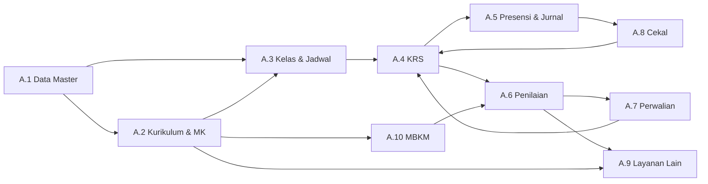

---

## A.1 Data Master

### A.1.1 Tujuan

Menyediakan data induk yang konsisten dan menjadi acuan seluruh proses akademik: mahasiswa, dosen, struktur organisasi akademik (fakultas dan prodi), tahun akademik dan semester, mata kuliah, kelas perkuliahan, ruang kuliah, serta kalender akademik. Data master tidak boleh diubah dengan cara yang merusak riwayat transaksi yang sudah merujuknya.

### A.1.2 Fitur

| Fitur | Label | Status | Keterangan |
|---|---|---|---|
| Data mahasiswa (biodata & identitas) | [Referensi] | (Parsial) | `students` sudah memuat NIM, nama, kontak, alamat, tanggal/tempat lahir, jenis kelamin, angkatan, foto. Belum ada NIK, data orang tua/wali (`student_guardians`), atau jalur masuk |
| Status & riwayat akademik mahasiswa | [Referensi] | (Ada) | `students.status` + `student_status_histories` melalui `StudentObserver` |
| Aktivitas mahasiswa (ringkasan per semester: status, SKS, IPS, IPK) | [Referensi] | (Parsial) | Dapat diturunkan dari `krs_items` + `grades`. Tabel ringkasan per semester belum ada. Lihat catatan PDDikti di [06](06-integrasi-arsitektur.md) |
| Data dosen | [Referensi] | (Ada) | `lecturers` (NIDN/NIDK/NIP, jabatan fungsional, pendidikan, serdos) |
| Homebase dosen per prodi | [Referensi] | (Ada) | `lecturers.study_program_id` |
| Riwayat mengajar dosen | [Referensi] | (Parsial) | Saat ini hanya dari `class_sections.lecturer_id`. Target: `class_section_lecturers` + realisasi `lecture_sessions` |
| Fakultas, prodi, unit akademik | [Referensi] | (Parsial) | `faculties`, `study_programs` ada (baca saja). Endpoint tulis (Baru) |
| Tahun akademik & semester | [Referensi] | (Parsial) | `academic_terms` diperluas dengan `term_type` (regular/short) |
| Periode akademik yang mengikat proses | [Rekomendasi] | (Baru) | `academic_term_periods` (KRS, add/drop, perkuliahan, UTS, UAS, input nilai, EDOM) |
| Mata kuliah | [Referensi] | (Parsial) | `courses`. Detail di A.2 |
| Kelas perkuliahan | [Referensi] | (Parsial) | `class_sections`. Detail di A.3 |
| Ruang kuliah | [Referensi] | (Baru) | `rooms`, menggantikan `class_schedules.room` (teks bebas) |
| Kalender akademik | [Referensi] | (Ada) | `academic_calendar_events` untuk tampilan. Sumber periode yang mengikat ada di `academic_term_periods` |
| Impor massal mahasiswa/dosen/MK dari berkas | [Rekomendasi] | (Baru) | Validasi per baris dan laporan galat sebelum commit |
| Penggabungan data ganda (deduplikasi) | [Rekomendasi] | (Baru) | Deteksi NIK/NIM/NIDN ganda di dalam tenant |

### A.1.3 Aktor

| Aktor | Role kanon | Peran |
|---|---|---|
| BAAK | `academic_administrator` | Pemilik operasional seluruh data master akademik |
| Admin PT | `university_administrator` | Struktur fakultas/prodi dan pengaturan tenant |
| Admin fakultas / prodi | `faculty_administrator`, `study_program_administrator` | Kelola data dalam scope-nya (mata kuliah, kelas, ruang milik unit) |
| Admin SDM | `hr_administrator` | Pemilik data kepegawaian dosen (modul HumanResource). SIAKAD membaca |
| Mahasiswa | `student` | Melihat dan mengajukan perubahan biodata (`student_requests` type `data_change`) |
| Dosen | `lecturer` | Melihat profil dan riwayat mengajarnya sendiri |

### A.1.4 Hubungan antardata

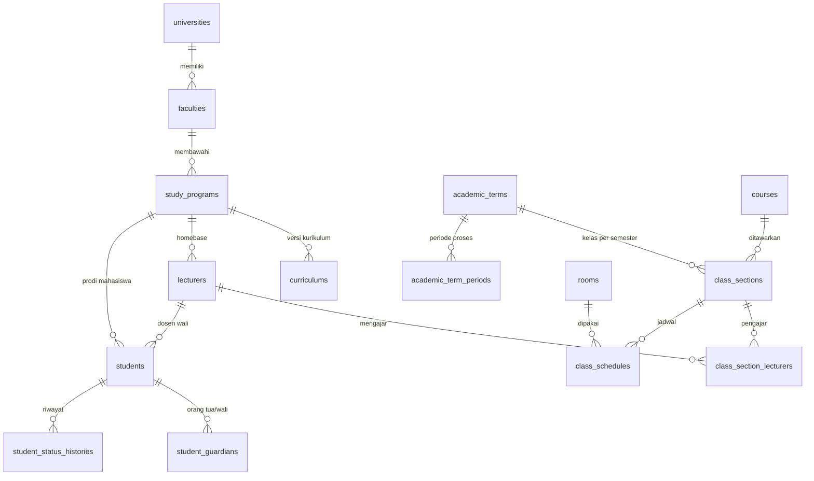

### A.1.5 Ketergantungan data master terhadap proses lain

| Data master | Dipakai oleh proses | Dampak bila tidak valid/tidak lengkap |
|---|---|---|
| `students.status` | KRS (A.4), presensi, ujian, EDOM, cekal, MBKM, layanan | Mahasiswa non-aktif tidak dapat KRS (`KrsPlanService::assertCanEdit` sudah menegakkan) |
| `students.academic_advisor_id` | Persetujuan KRS (A.4 langkah 10), perwalian (A.7) | KRS tidak punya penyetuju. Pengajuan KRS ditolak sampai dosen wali ditetapkan (BR-SIA-MST-06) |
| `students.study_program_id` + `admission_year` | Penentuan versi kurikulum (`curriculum_cohorts`), paket KRS, penawaran kelas | Salah prodi/angkatan → salah kurikulum dan salah prasyarat |
| `lecturers.is_active`, homebase | Penugasan pengajar (A.3), dosen wali, pembimbing TA/MBKM, EDOM | Dosen non-aktif tidak boleh ditugaskan baru |
| `academic_terms.is_current` | KRS, kelas aktif, dashboard, presensi | Tepat satu semester `is_current` per tenant per `term_type` |
| `academic_term_periods` | Pembukaan KRS, add/drop, input nilai, EDOM, ujian | Proses berbatas waktu tidak dapat dibuka tanpa periode |
| `courses` (SKS, aktif) | Kurikulum, kelas, KRS (batas SKS), IPS/IPK | Perubahan SKS setelah ada nilai merusak IPK → dilarang (BR-SIA-MST-04) |
| `rooms` | Validasi bentrok ruang (A.3), utilitas ruang | Tanpa `room_id`, bentrok ruang tidak bisa dideteksi |
| `faculties` / `study_programs` | Scope RBAC Dekan/Kaprodi/admin unit, laporan | Prodi non-aktif tidak dapat membuka kelas baru |

### A.1.6 Alur utama

1. Admin PT membuat fakultas dan prodi (endpoint tulis baru: `POST /faculties`, `POST /study-programs`).
2. BAAK membuat `academic_terms` beserta `academic_term_periods`. Penetapan `is_current` dilakukan melalui aksi khusus, yang otomatis menonaktifkan semester lain dengan `term_type` yang sama.
3. Admin SDM/BAAK mendaftarkan dosen (atau sinkron dari `employees`) dan menetapkan homebase.
4. BAAK membuat atau mengimpor data mahasiswa. Data mahasiswa baru umumnya berasal dari PMB (di luar ruang lingkup, titik integrasi di [06](06-integrasi-arsitektur.md)). Akun `users` dibuat dan dosen wali ditetapkan (endpoint yang ada: `PATCH /students/{id}/academic-advisor`).
5. BAAK atau admin unit mendaftarkan ruang (`rooms`).
6. Perubahan status mahasiswa (cuti, aktif kembali, lulus, DO, mengundurkan diri) **tidak** dilakukan dengan edit langsung, tetapi lewat layanan (A.9) atau aksi berotorisasi. `StudentObserver` mencatat `student_status_histories`.

### A.1.7 Alur alternatif

| Kondisi | Respons sistem |
|---|---|
| Impor berisi NIM ganda dalam tenant | Baris ditolak. Laporan impor memuat nomor baris dan alasan. Baris valid lain tetap dapat di-commit jika pengguna memilih mode "sebagian" |
| Menghapus mata kuliah/ruang/dosen yang sudah direferensikan | Ditolak (409). Sistem menawarkan penonaktifan (`is_active = false`) |
| Mengubah prodi mahasiswa yang sudah punya nilai | Ditolak lewat edit biasa. Harus melalui layanan transfer internal (`student_transfers`, A.9) |
| Dua semester `is_current` | Dicegah oleh service (transaksi + lock). Constraint unik parsial bersifat opsional per DBMS |
| Periode tumpang tindih dengan tipe yang sama dalam satu semester | Ditolak kecuali berbeda `study_program_id` (periode khusus prodi) |

### A.1.8 Aturan validasi

| ID | Aturan |
|---|---|
| BR-SIA-MST-01 | `students.nim` unik per tenant. `lecturers.nidn` unik per tenant bila diisi (sudah ada). `rooms.code` unik per tenant |
| BR-SIA-MST-02 | Perubahan `students.status` hanya melalui service status/layanan dan selalu menghasilkan baris `student_status_histories` dengan `reason` dan `changed_by` |
| BR-SIA-MST-03 | Data master yang sudah direferensikan transaksi tidak dihapus permanen. Penghapusan diganti penonaktifan |
| BR-SIA-MST-04 | `courses.credits` tidak dapat diubah bila mata kuliah sudah memiliki `grades`. Perubahan SKS dilakukan dengan membuat mata kuliah baru pada versi kurikulum baru dan menautkan ekuivalensi (A.2) |
| BR-SIA-MST-05 | Tepat satu `academic_terms.is_current = true` per tenant per `term_type` |
| BR-SIA-MST-06 | Mahasiswa aktif wajib memiliki `academic_advisor_id` yang menunjuk dosen aktif sebelum dapat mengajukan KRS (aturan ini hanya berlaku bila `academic.krs.require_advisor_approval = true`) |
| BR-SIA-MST-07 | `academic_term_periods.start_at < end_at` dan seluruh periode berada di dalam rentang `academic_terms.start_date`–`end_date`, kecuali periode KRS yang boleh dimulai sebelum semester |
| BR-SIA-MST-08 | Dosen yang dinonaktifkan tidak dapat ditugaskan ke kelas, perwalian, atau bimbingan baru. Penugasan berjalan tetap tercatat dan dialihkan melalui aksi BAAK |
| BR-SIA-MST-09 | Perubahan biodata oleh mahasiswa sendiri hanya untuk field yang diizinkan (`academic.student_profile.self_editable_fields`). Field identitas (nama, NIK, tanggal lahir) memerlukan `student_requests` type `data_change` beserta dokumen pendukung |

### A.1.9 Data terlibat

`faculties`, `study_programs`, `academic_terms` (+ `term_type`), `academic_term_periods` (Baru: `academic_term_id`, `study_program_id` nullable, `period_type`, `start_at`, `end_at`), `students`, `student_status_histories`, `student_guardians` (Baru), `lecturers`, `rooms` (Baru: `code`, `name`, `building`, `floor`, `capacity`, `room_type`, `faculty_id` nullable, `is_active`), `academic_calendar_events`. Lihat [07-database-erd.md](07-database-erd.md) bagian SIAKAD — Master.

Nilai `academic_term_periods.period_type`: `krs`, `add_drop`, `lecture`, `midterm_exam`, `final_exam`, `grade_entry`, `edom`, `thesis_registration`, `mbkm_registration`.

### A.1.10 Konfigurasi

| Key | Contoh nilai | Fungsi |
|---|---|---|
| `academic.student_profile.self_editable_fields` | `["phone","email","address"]` | Field biodata yang boleh diubah langsung oleh mahasiswa |
| `academic.term.calendar_sync` | `true` | Saat `academic_term_periods` disimpan, sistem membuat/memperbarui `academic_calendar_events` padanannya agar tampil di kalender |
| `academic.import.partial_commit` | `false` | Mode impor: semua-atau-tidak sama sekali vs sebagian |

### A.1.11 Hak akses ringkas

| Data | Baca | Tulis |
|---|---|---|
| Fakultas/prodi | Semua staf akademik dalam tenant | `university_administrator` |
| Semester & periode | Semua pengguna akademik | `academic_administrator` (`academic_terms.*`) |
| Mahasiswa | BAAK (semua), Dekan/admin fakultas (fakultas), Kaprodi/admin prodi (prodi), dosen wali (mahasiswa perwaliannya), dosen (peserta kelasnya, field terbatas) | BAAK, admin prodi dalam scope |
| Dosen | Staf akademik | BAAK, `hr_administrator` |
| Ruang | Staf akademik, dosen | BAAK, admin fakultas (ruang fakultasnya) |

Detail di [11-roles-permissions.md](11-roles-permissions.md).

### A.1.12 Integrasi

- **SDM** (`app/Modules/HumanResource`): `lecturers.employee_id` → `employees`. SDM adalah pemilik data kepegawaian, SIAKAD pemilik penugasan akademik.
- **PMB**: membuat `students` saat registrasi ulang (di luar ruang lingkup).
- **LMS/CBT/EDOM**: membaca mahasiswa, dosen, dan kelas lewat FK.
- **PDDikti**: ringkasan aktivitas per semester sebagai sumber pelaporan (di luar ruang lingkup).

Lihat [06-integrasi-arsitektur.md](06-integrasi-arsitektur.md).

### A.1.13 Keputusan terbuka

- [OD-21](16-open-decisions.md#od-21): verifikasi orang tua/wali dan persetujuan mahasiswa.
- [OD-23](16-open-decisions.md#od-23): bentuk data double degree.

---

## A.2 Kurikulum dan Mata Kuliah

### A.2.1 Tujuan

Mengelola struktur kurikulum per prodi dalam bentuk **versi**. Setiap angkatan terikat ke satu versi kurikulum sehingga perubahan kurikulum tidak mengubah riwayat mahasiswa angkatan lama. Bagian ini juga menyediakan prasyarat, paket mata kuliah, ekuivalensi antarversi, konversi nilai mahasiswa pindahan, dan penentuan mata kuliah yang ditawarkan pada semester berjalan.

### A.2.2 Fitur

| Fitur | Label | Status | Keterangan |
|---|---|---|---|
| Struktur kurikulum per prodi | [Referensi] | (Parsial) | `curriculums` (prodi, nama, tahun, aktif) |
| Kurikulum per angkatan | [Referensi] | (Baru) | `curriculum_cohorts` |
| MK wajib & pilihan, semester rekomendasi per versi | [Referensi] | (Baru) | `curriculum_courses` (`course_category`, `recommended_semester`) |
| Kode, nama, SKS, deskripsi MK | [Referensi] | (Parsial) | `courses` sudah memuat kode, nama, SKS, `semester_level`. Ditambah `description`, rincian SKS (teori/praktikum/lapangan) |
| Prasyarat | [Referensi] | (Ada) | `course_prerequisites` + `min_letter_grade`. Diperluas dengan `prerequisite_type` |
| Paket mata kuliah | [Referensi] | (Baru) | `course_packages`, `course_package_items` |
| Ekuivalensi antarversi kurikulum | [Referensi] | (Baru) | `course_equivalencies` |
| Konversi nilai mahasiswa pindahan | [Referensi] | (Baru) | `credit_conversions` (`source_type = transfer`) + `credit_conversion_items` |
| Riwayat perubahan kurikulum | [Referensi] | (Baru) | Status versi + `audit_logs` |
| Penentuan MK ditawarkan semester berjalan | [Referensi] | (Parsial) | Saat ini implisit dari keberadaan `class_sections`. Target: rencana penawaran dari `curriculum_courses` |
| Ringkasan struktur (total SKS wajib/pilihan per semester) | [Rekomendasi] | (Baru) | Validasi total SKS kelulusan terhadap konfigurasi prodi |

### A.2.3 Aktor

Admin prodi (`study_program_administrator`) menyusun kurikulum. Kaprodi (`head_of_study_program`) mengajukan dan mengesahkan. BAAK (`academic_administrator`) menetapkan angkatan pemakai dan menyusun konversi. Dekan (`dean`) mengesahkan bila kebijakan kampus mensyaratkan. Mahasiswa melihat kurikulumnya sendiri.

### A.2.4 Model versi kurikulum

Kunci rancangan versi adalah memisahkan **mata kuliah** (entitas yang stabil) dari **keanggotaannya dalam kurikulum** (yang berbeda per versi).

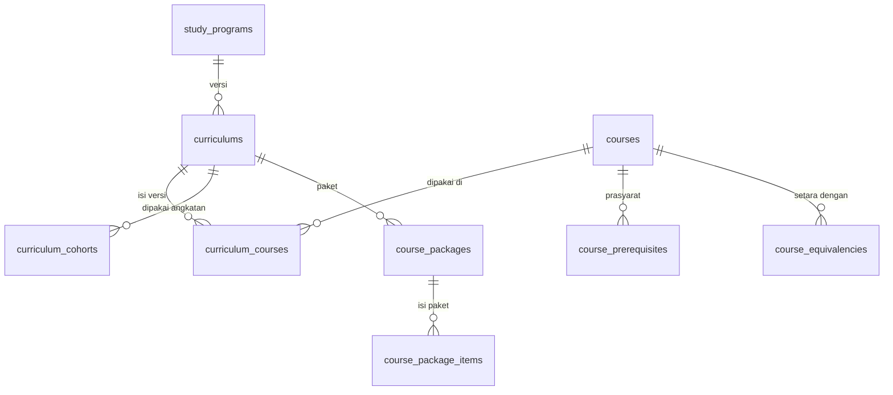

| Tabel | Isi kunci | Peran dalam versi |
|---|---|---|
| `curriculums` | `study_program_id`, `name`, `academic_year`, `status` (`draft`, `in_review`, `ratified`, `superseded`), `effective_from_term_id`, `total_credits_required` | Satu baris = satu versi kurikulum. Setelah `ratified`, isi versi dibekukan |
| `curriculum_courses` | `curriculum_id`, `course_id`, `course_category` (`mandatory`/`elective`), `recommended_semester`, `elective_group` (opsional) | Mata kuliah yang sama boleh muncul di beberapa versi dengan semester/kategori berbeda |
| `curriculum_cohorts` | `curriculum_id`, `study_program_id`, `admission_year` | Menetapkan angkatan mana yang memakai versi ini. Unik per (`study_program_id`, `admission_year`) |
| `courses` | `code`, `name`, `credits`, `description`, `is_active` | Identitas MK. Kolom `curriculum_id` lama dipertahankan sementara untuk kompatibilitas ([OD-03](16-open-decisions.md#od-03)) |

**Bagaimana riwayat tetap utuh:**

1. Mahasiswa → versi kurikulum ditentukan lewat `curriculum_cohorts` berdasarkan (`students.study_program_id`, `students.admission_year`). Mahasiswa pindahan atau pengecualian dapat diberi override per mahasiswa (kolom baru `students.curriculum_id`, nullable, diisi melalui layanan transfer).
2. Nilai yang sudah ada (`grades` → `krs_items` → `class_sections` → `courses`) **tidak menunjuk ke kurikulum**, tetapi ke mata kuliah. Mengganti versi kurikulum tidak mengubah satu baris nilai pun.
3. Versi yang sudah `ratified` tidak dapat diedit. Perubahan dilakukan dengan **menduplikasi** versi menjadi `draft` baru. Setelah versi baru disahkan, versi lama tidak otomatis `superseded`. Versi lama menjadi `superseded` hanya jika tidak ada lagi angkatan aktif yang memakainya.
4. Kelulusan dan kelengkapan studi dievaluasi terhadap versi kurikulum milik mahasiswa, dengan ekuivalensi sebagai jembatan bila mahasiswa mengambil MK versi lain.

**Migrasi dari kondisi saat ini** ([OD-03](16-open-decisions.md#od-03)): untuk setiap `courses` dengan `curriculum_id` terisi, buat `curriculum_courses` (kategori default `mandatory`, `recommended_semester = courses.semester_level`). Untuk setiap `curriculums`, buat `curriculum_cohorts` berdasarkan angkatan mahasiswa prodi tersebut yang ada. BAAK memverifikasinya sebelum versi diberi status `ratified`.

### A.2.5 Ekuivalensi, konversi, dan riwayat

**Ekuivalensi** (`course_equivalencies`): `curriculum_id` sumber (opsional), `course_id` lama, `equivalent_course_id` baru, `equivalence_type` (`one_to_one`, `many_to_one`, `one_to_many`), `group_key` (mengelompokkan relasi banyak-ke-satu), `notes`, `is_active`.

Pemakaian ekuivalensi:

| Proses | Pemakaian |
|---|---|
| Prasyarat (A.4 langkah 3) | Prasyarat MK X dianggap terpenuhi bila mahasiswa lulus MK X atau MK yang setara dengannya |
| Larangan mengulang MK yang sudah lulus | Berlaku juga pada MK setara (mencegah SKS ganda) |
| Transkrip & IPK | Nilai MK lama ditampilkan dengan nama aslinya. Status pemenuhan kurikulum dihitung lewat ekuivalensi. **IPK tidak menghitung ganda** MK yang setara: berlaku aturan pengulangan (A.6) di dalam satu `group_key` |
| Many-to-one | Dua MK lama (mis. 2 + 2 SKS) setara satu MK baru 3 SKS. Pemenuhan ditandai bila seluruh MK lama dalam grup lulus. Nilai yang dipakai mengikuti `academic.curriculum.equivalence_grade_rule` |

**Konversi nilai mahasiswa pindahan** (`credit_conversions` dengan `source_type = transfer`): dokumen konversi per mahasiswa yang memuat baris `credit_conversion_items` (MK asal: nama/kode/SKS/nilai asal → `course_id` tujuan, nilai huruf hasil konversi, SKS diakui). Alur status ada di A.9.1. Setelah disetujui, item diterapkan sebagai nilai yang diakui (`grades` dengan sumber konversi, tanpa `class_section`). Keputusan bentuk teknis penyimpanan nilai konversi dicatat sebagai OD-NEW-nilai-konversi (lihat A.9.1).

**Riwayat perubahan kurikulum:** setiap perubahan pada `curriculums`, `curriculum_courses`, `course_prerequisites`, `course_equivalencies`, dan `course_packages` direkam di `audit_logs` (trait `Auditable`) dengan `old_values`/`new_values`. Transisi status versi (`draft` → `in_review` → `ratified` → `superseded`) juga dicatat sebagai aksi audit `approved`/`rejected`. Pembanding antarversi (diff) ditampilkan di UI ([09](09-ui-ux-specification.md)).

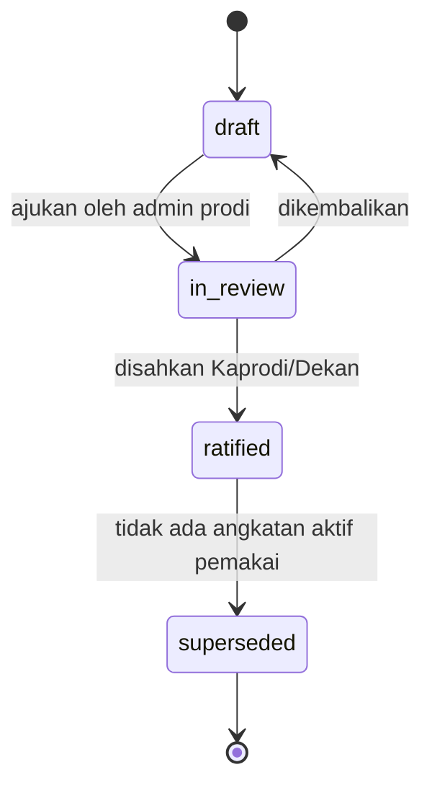

### A.2.6 Penentuan MK yang ditawarkan semester berjalan

1. Sistem menyusun **rencana penawaran** untuk semester target. Untuk setiap versi kurikulum yang dipakai angkatan aktif, ambil `curriculum_courses` dengan `recommended_semester` yang cocok dengan semester berjalan angkatan tersebut (ganjil/genap), ditambah MK pilihan dan MK yang sering diulang.
2. Rencana menampilkan estimasi peminat: jumlah mahasiswa aktif per angkatan, ditambah mahasiswa yang belum lulus MK tersebut.
3. Admin prodi menandai MK yang akan dibuka. Penandaan ini menghasilkan `class_sections` berstatus `planned` (A.3).
4. Hanya MK yang termasuk versi kurikulum mahasiswa, setara dengannya, atau terbuka sebagai MK lintas prodi/MBKM yang muncul di penawaran KRS mahasiswa (A.4).

### A.2.7 Alur alternatif

| Kondisi | Respons sistem |
|---|---|
| Mengedit versi `ratified` | Ditolak (409). Pengguna diarahkan ke "Duplikasi sebagai draf" |
| Prasyarat membentuk siklus (A→B→A) | Ditolak saat simpan (deteksi siklus graf) |
| Angkatan sudah terikat ke versi lain | Ditolak kecuali BAAK melakukan pemindahan versi angkatan secara eksplisit, dengan alasan dan audit, sebelum ada KRS angkatan itu pada versi lama |
| Paket berisi MK yang tidak ada di versi kurikulum | Ditolak |
| Ekuivalensi menunjuk MK yang sama | Ditolak |

### A.2.8 Aturan validasi

| ID | Aturan |
|---|---|
| BR-SIA-KUR-01 | Versi kurikulum berstatus `ratified` atau `superseded` bersifat read-only, termasuk `curriculum_courses`, paket, dan prasyarat yang terikat versi |
| BR-SIA-KUR-02 | Pasangan (`study_program_id`, `admission_year`) hanya boleh terikat ke satu versi melalui `curriculum_cohorts` |
| BR-SIA-KUR-03 | Satu `course_id` hanya muncul sekali per `curriculum_id` di `curriculum_courses` |
| BR-SIA-KUR-04 | Graf prasyarat harus asiklik. `min_letter_grade` harus ada di skala nilai yang berlaku (A.6) |
| BR-SIA-KUR-05 | Total SKS wajib + minimum SKS pilihan pada versi ≥ `curriculums.total_credits_required` sebelum dapat diajukan `in_review` |
| BR-SIA-KUR-06 | Prasyarat terpenuhi bila nilai terbaik mahasiswa pada MK prasyarat **atau MK setaranya** ≥ `min_letter_grade` (default: huruf lulus minimum dari skala) |
| BR-SIA-KUR-07 | MK yang sudah lulus, atau MK setaranya yang sudah lulus, tidak dapat diambil ulang kecuali `academic.krs.allow_retake_passed = true` (perbaikan nilai, [OD-08](16-open-decisions.md#od-08)) |
| BR-SIA-KUR-08 | Pengesahan (`ratified`) dan pemindahan versi angkatan wajib tercatat di `audit_logs` beserta aktor dan alasan |

### A.2.9 Data terlibat

`curriculums`, `curriculum_courses`, `curriculum_cohorts`, `courses`, `course_prerequisites` (+ `prerequisite_type`: `passed` / `taken` / `concurrent`), `course_equivalencies`, `course_packages` (`curriculum_id`, `name`, `semester_number`, `package_type` = `first_term` / `regular`, `status`), `course_package_items` (`course_package_id`, `course_id`), `credit_conversions`, `credit_conversion_items`. Lihat [07-database-erd.md](07-database-erd.md) bagian Kurikulum.

### A.2.10 Konfigurasi

| Key | Contoh nilai | Fungsi |
|---|---|---|
| `academic.curriculum.require_dean_ratification` | `false` | Pengesahan cukup Kaprodi atau harus juga Dekan |
| `academic.curriculum.equivalence_grade_rule` | `"weighted_average"` (alternatif `best`, `lowest`) | Nilai untuk ekuivalensi many-to-one |
| `academic.krs.allow_retake_passed` | `false` | Boleh mengulang MK yang sudah lulus untuk perbaikan nilai |

### A.2.11 Hak akses ringkas

`curriculums.create/update` untuk admin prodi (scope prodi). `curriculums.approve` untuk Kaprodi (dan Dekan jika dikonfigurasi). `course_equivalencies.*` untuk admin prodi/BAAK. `credit_conversions.approve` untuk Kaprodi. `course_packages.*` untuk admin prodi. Mahasiswa: baca kurikulumnya sendiri via `student_portal.read`. Lihat [11](11-roles-permissions.md).

### A.2.12 Integrasi

- **OBE** ([04-obe.md](04-obe.md)): `course_plo_mappings` dan `lesson_plans` menunjuk `courses`. CPL dimiliki OBE, struktur MK dimiliki SIAKAD.
- **MBKM** (A.10): konversi MBKM memakai `credit_conversions` yang sama dengan `source_type = mbkm`.
- Lihat [06](06-integrasi-arsitektur.md).

### A.2.13 Keputusan terbuka

[OD-03](16-open-decisions.md#od-03) (migrasi `courses.curriculum_id`), [OD-08](16-open-decisions.md#od-08) (mengulang MK yang sudah lulus).

---
## A.3 Kelas, Jadwal, dan Dosen Pengajar

### A.3.1 Tujuan

Membuka kelas perkuliahan per semester, menetapkan kapasitas dan dosen pengajar (termasuk team teaching), menyusun jadwal hari/waktu/ruang untuk berbagai jenis pertemuan, mencegah bentrok dosen, ruang, dan kelompok mahasiswa, lalu mempublikasikan jadwal serta mengelola perubahannya beserta notifikasi.

### A.3.2 Fitur

| Fitur | Label | Status | Keterangan |
|---|---|---|---|
| Pembukaan kelas per semester | [Referensi] | (Parsial) | `class_sections` ada. Ditambah `status` (`planned`, `open`, `running`, `completed`, `cancelled`) |
| Kapasitas kelas | [Referensi] | (Ada) | `class_sections.capacity` (default 40). Sudah ditegakkan di KRS |
| Penugasan dosen | [Referensi] | (Parsial) | Satu `lecturer_id`. Target: `class_section_lecturers` (team teaching). `lecturer_id` = koordinator |
| Jadwal hari, waktu, ruang | [Referensi] | (Parsial) | `class_schedules` (`room` teks bebas). Ditambah `room_id` |
| Jenis jadwal teori/praktikum/tutorial/kelompok | [Referensi] | (Baru) | `class_schedules.schedule_type`: `theory`, `practicum`, `tutorial`, `field`, `group` |
| Penjadwalan kelas kelompok | [Referensi] | (Baru) | `class_schedules.group_label` + `krs_items.group_label` |
| Validasi bentrok dosen/ruang/kelas | [Referensi] | (Parsial) | Hanya bentrok jadwal per mahasiswa saat KRS (`KrsPlanService::scheduleConflicts`). Bentrok dosen dan ruang (Baru) |
| Utilitas ruang kuliah | [Referensi] | (Baru) | Persentase jam terpakai per ruang per minggu |
| Publikasi jadwal | [Referensi] | (Baru) | `class_schedules.status`: `draft` → `in_review` → `published` |
| Perubahan jadwal & notifikasi | [Referensi] | (Baru) | Revisi atas `published` dicatat di `audit_logs` + notifikasi peserta dan pengajar |
| Saran slot kosong otomatis | [Rekomendasi] | (Baru) | Menampilkan slot ruang/waktu bebas untuk dosen dan ruang terpilih |
| Salin kelas & jadwal dari semester sebelumnya | [Rekomendasi] | (Baru) | Duplikasi ke status `planned`/`draft` |

### A.3.3 Aktor

Admin prodi (menyusun kelas & jadwal prodinya), BAAK (ruang lintas prodi, publikasi, perubahan setelah publikasi), Kaprodi (meninjau penugasan dosen, opsional), dosen (melihat jadwal mengajar), mahasiswa (melihat jadwal kuliah setelah KRS disetujui).

### A.3.4 Alur utama

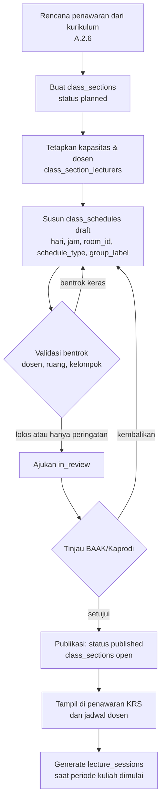

Langkah rinci:

1. Admin prodi membuat `class_sections` (`planned`) dari rencana penawaran. Kode kelas unik per (MK, semester).
2. Penugasan dosen: satu baris `class_section_lecturers` per dosen dengan `role` (`coordinator`, `member`, `assistant`), `planned_meetings` (jumlah pertemuan rencana), dan opsional `schedule_id` (dosen hanya mengajar jadwal tertentu, misalnya praktikum). Koordinator juga disalin ke `class_sections.lecturer_id` agar `ClassSectionAccess` yang ada tetap berfungsi.
3. Penyusunan jadwal: satu kelas boleh punya beberapa `class_schedules` (mis. teori Senin + praktikum Kamis kelompok A dan B).
4. Validasi bentrok dijalankan setiap kali jadwal disimpan dan diulang secara massal sebelum publikasi.
5. Publikasi: `class_schedules.status = published`, `class_sections.status = open`. Hanya kelas `open` yang tampil di KRS.
6. Saat periode `lecture` dimulai, kelas berpindah ke `running` dan sistem membangkitkan `lecture_sessions` (A.5).

### A.3.5 Aturan deteksi bentrok

Dua slot jadwal **a** dan **b** dianggap tumpang tindih bila:

```
hari_a = hari_b
AND start_a < end_b
AND start_b < end_a
AND rentang_tanggal_a ∩ rentang_tanggal_b ≠ ∅
```

- `rentang_tanggal` untuk jadwal mingguan = periode `lecture` semester (atau `effective_from`/`effective_until` jadwal bila diisi, kolom Baru untuk jadwal blok/separuh semester).
- Untuk sesi pengganti (`lecture_sessions` dengan tanggal spesifik), perbandingan dilakukan pada **tanggal yang sama**: `tanggal_a = tanggal_b AND start_a < end_b AND start_b < end_a`, dan juga terhadap jadwal mingguan yang jatuh pada tanggal tersebut.
- Perbandingan memakai operator ketat (`<`) sehingga jadwal yang bersambung (selesai 10.00, berikutnya mulai 10.00) **tidak** bentrok. Jeda minimum opsional diatur `academic.schedule.min_gap_minutes`. Bila jeda > 0, rumus menjadi `start_a < end_b + gap AND start_b < end_a + gap`.
- Hanya jadwal dengan status selain `cancelled` di semester yang sama yang dibandingkan.

| Dimensi | Kunci pembanding | Sumber | Kebijakan default |
|---|---|---|---|
| Dosen | `lecturer_id` di `class_section_lecturers` (termasuk koordinator) yang terkait jadwal | A.3 | Blokir |
| Ruang | `class_schedules.room_id` (abaikan jadwal daring tanpa ruang) | A.3 | Blokir |
| Kelompok mahasiswa (rombel/angkatan) | Kelas yang ditujukan untuk angkatan + semester rekomendasi yang sama dalam prodi (MK wajib satu paket), dibedakan `group_label` | A.2 paket, A.3 | Peringatan |
| Sub-kelompok dalam satu kelas | `class_schedules.group_label` berbeda dalam satu `class_section` tidak saling bentrok. Label yang sama atau kosong (berlaku semua peserta) dibandingkan | A.3 | Blokir |
| Mahasiswa | Seluruh `krs_items` mahasiswa berstatus `draft`/`pending`/`enrolled` | A.4 (sudah ada di `KrsPlanService`) | Blokir |
| Kapasitas ruang | `rooms.capacity < class_sections.capacity` | A.3 | Peringatan |

### A.3.6 Skenario konflik dan respons sistem

| No | Skenario | Respons sistem |
|---|---|---|
| K1 | Dosen D mengajar kelas X Senin 08.00–10.00 dan dijadwalkan di kelas Y Senin 09.00–11.00 | Simpan ditolak (409, kode `SCHEDULE_CONFLICT`). `errors.conflicts[]` memuat dimensi `lecturer`, kelas lawan, dan slot. UI menawarkan slot alternatif |
| K2 | Ruang R101 dipakai X Selasa 10.00–12.00, Y dijadwalkan di R101 Selasa 11.00–13.00 | Ditolak (dimensi `room`) |
| K3 | X selesai 10.00, Y mulai 10.00 di ruang yang sama | Diterima (bukan bentrok, operator ketat) kecuali `min_gap_minutes > 0` |
| K4 | Praktikum kelompok A dan B dari kelas yang sama di jam yang sama, ruang berbeda, asisten berbeda | Diterima (sub-kelompok berbeda) |
| K5 | Praktikum kelompok A dan B di jam yang sama dengan dosen yang sama | Ditolak (dimensi `lecturer`) |
| K6 | Dua MK wajib semester 3 angkatan 2025 di jam yang sama | Peringatan (dimensi `cohort`). Publikasi tetap boleh jika BAAK mengonfirmasi dengan alasan (tercatat audit) |
| K7 | Kapasitas ruang 30, kapasitas kelas 40 | Peringatan. BAAK dapat menurunkan kapasitas kelas atau mengganti ruang |
| K8 | Perubahan jadwal setelah `published` menimbulkan bentrok bagi mahasiswa yang sudah KRS | Perubahan ditolak bila kebijakan `student` = blokir. Sistem menampilkan daftar mahasiswa terdampak agar BAAK memilih slot lain |
| K9 | Sesi pengganti tanggal 12 Nov bentrok dengan jadwal mingguan dosen pada tanggal itu | Ditolak (pemeriksaan per tanggal) |
| K10 | Dosen ditugaskan saat dinonaktifkan | Ditolak (BR-SIA-MST-08) |

### A.3.7 Publikasi dan perubahan jadwal

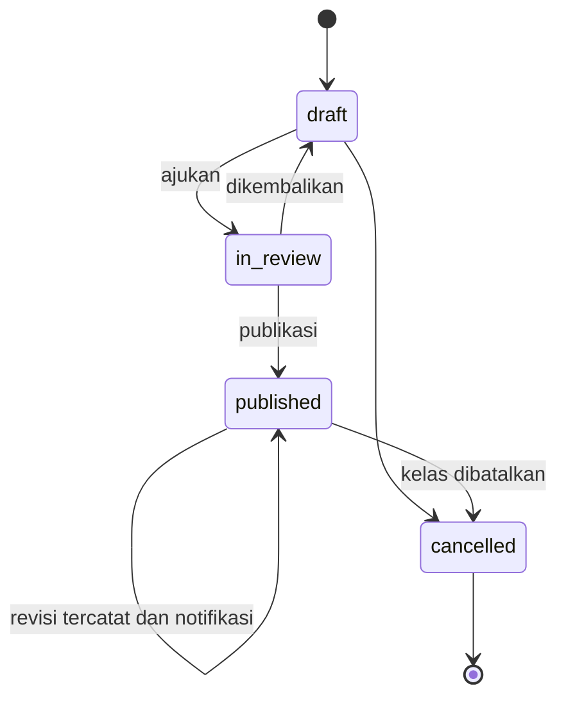

- **Revisi atas `published`** (ganti jam, ruang, atau dosen) memerlukan `reason`. Perubahan dicatat di `audit_logs` (`old_values`/`new_values`), divalidasi ulang terhadap semua dimensi bentrok, dan memicu notifikasi `academic.schedule_changed` melalui `NotificationDispatcher` ke peserta kelas (`krs_items` aktif) dan seluruh pengajar. Kanal default: database + push, opsional email.
- **Pembatalan kelas** setelah KRS: kelas `cancelled`, `krs_items` terkait menjadi `dropped` dengan alasan sistem, mahasiswa dinotifikasi, dan diberi hak add/drop khusus (A.4).
- Perubahan setelah `lecture_sessions` dibangkitkan juga memperbarui sesi mendatang yang belum `held`. Sesi yang sudah `held` tidak berubah.

### A.3.8 Aturan validasi

| ID | Aturan |
|---|---|
| BR-SIA-JDW-01 | Dua slot bentrok bila hari/tanggal sama dan `start_a < end_b AND start_b < end_a` dengan irisan rentang tanggal tidak kosong |
| BR-SIA-JDW-02 | Bentrok dosen dan ruang memblokir penyimpanan, kecuali kebijakan dimensi diubah ke `warn` di `academic.schedule.conflict_policy` |
| BR-SIA-JDW-03 | `start_time < end_time`. Durasi slot konsisten dengan SKS sesuai `academic.schedule.minutes_per_credit` (peringatan bila menyimpang) |
| BR-SIA-JDW-04 | Hanya jadwal `published` dari kelas `open`/`running` yang muncul di penawaran KRS dan jadwal mahasiswa |
| BR-SIA-JDW-05 | Revisi jadwal `published` wajib berisi alasan, menghasilkan entri audit, dan mengirim notifikasi ke seluruh peserta dan pengajar |
| BR-SIA-JDW-06 | Tepat satu `class_section_lecturers.role = coordinator` per kelas, dan nilainya sama dengan `class_sections.lecturer_id` |
| BR-SIA-JDW-07 | `class_sections.capacity` tidak boleh diturunkan di bawah jumlah kursi terisi (`KrsItemStatus::seatHolding()`) |
| BR-SIA-JDW-08 | Kelas `cancelled` tidak dapat diaktifkan kembali bila sudah ada `krs_items` yang di-drop karenanya. Buat kelas baru |

### A.3.9 Data terlibat

`class_sections` (+ `status`), `class_section_lecturers` (`class_section_id`, `lecturer_id`, `role`, `planned_meetings`, `class_schedule_id` nullable), `class_schedules` (+ `room_id`, `schedule_type`, `group_label`, `status`, `effective_from`, `effective_until`), `rooms`, `krs_items` (+ `group_label`). Lihat [07-database-erd.md](07-database-erd.md) bagian Kelas & Jadwal.

### A.3.10 Konfigurasi

| Key | Contoh nilai | Fungsi |
|---|---|---|
| `academic.schedule.conflict_policy` | `{"lecturer":"block","room":"block","cohort":"warn","student":"block","room_capacity":"warn"}` | Kebijakan per dimensi |
| `academic.schedule.min_gap_minutes` | `0` | Jeda minimum antarjadwal |
| `academic.schedule.minutes_per_credit` | `50` | Acuan durasi per SKS (contoh) |
| `academic.schedule.require_review` | `true` | Publikasi wajib melewati `in_review` |
| `academic.schedule.change_notification_channels` | `["database","push","mail"]` | Kanal notifikasi perubahan |

### A.3.11 Hak akses ringkas

`classes.create/update` (admin prodi dalam scope, BAAK), `class_schedules.create/update` (admin prodi, BAAK), `class_schedules.publish` (BAAK, atau Kaprodi bila dikonfigurasi), `rooms.*` (BAAK, admin fakultas). Dosen membaca jadwal sendiri lewat `/teaching/classes` (ada). Lihat [11](11-roles-permissions.md).

### A.3.12 Integrasi

- **LMS** ([02](02-edlink-lms.md)): kelas `open` memicu pembuatan `lms_classes` (`class_type = academic`). Pengajar LMS = `class_section_lecturers`.
- **EDOM** ([05](05-edom.md)): target evaluasi per (kelas × dosen) dari `class_section_lecturers`.
- **Notifikasi**: `NotificationDispatcher`.

### A.3.13 Keputusan terbuka

Tidak ada OD khusus. Kebijakan dimensi bentrok sepenuhnya berupa konfigurasi.

---

## A.4 KRS Online

### A.4.1 Tujuan

Memungkinkan mahasiswa menyusun rencana studi per semester secara mandiri dengan validasi otomatis (status, prasyarat, batas SKS, bentrok, kapasitas, cekal), memperoleh persetujuan dosen wali, mengunci KRS, mengelola perubahan melalui mekanisme yang diizinkan, dan menyimpan riwayat lengkap.

### A.4.2 Fitur dan pemetaan ke implementasi yang ada

`KrsPlanService` sudah menangani sebagian besar siklus. Tabel berikut memetakan 13 langkah brief ke kode saat ini.

| No | Langkah | Label | Status | Implementasi saat ini → yang ditambahkan |
|---|---|---|---|---|
| 1 | Pembukaan periode | [Referensi] | (Parsial) | `academic_terms.krs_start_date/krs_end_date` + `PATCH /academic-terms/{id}/krs-period`. → `academic_term_periods` `krs` (dapat per prodi/angkatan) |
| 2 | Cek status akademik | [Referensi] | (Ada) | `assertCanEdit`: hanya `students.status = active` |
| 3 | Cek prasyarat | [Referensi] | (Ada) | `prerequisiteSatisfied` + `min_letter_grade`. → ekuivalensi, `prerequisite_type`, skala nilai konfigurasi |
| 4 | Batas maksimum SKS | [Referensi] | (Parsial) | `AcademicRecordService::maxSksForTerm` memakai IPS semester terakhir + `SKS_LIMIT_TIERS` hardcoded. → `academic.krs.max_sks_tiers` ([OD-05](16-open-decisions.md#od-05)) |
| 5 | Pilih MK & kelas | [Referensi] | (Ada) | `offerings()`, `addItem()`. Dibatasi prodi sendiri. → MK lintas prodi via MBKM (A.10) |
| 6 | Bentrok jadwal | [Referensi] | (Ada) | `scheduleConflicts()` saat tambah dan saat ajukan. → memperhitungkan `group_label` |
| 7 | Kapasitas | [Referensi] | (Ada) | `seatsTaken() >= capacity` dengan `lockForUpdate` |
| 8 | Cekal keuangan & akademik | [Referensi] | **(Baru)** | Tidak ada. → `AcademicBlockGuard::assertAllowed($student, 'krs')` (A.8) |
| 9 | Pengajuan | [Referensi] | (Ada) | `submit()` (status `submitted`, item `pending`) dan `cancelSubmission()` |
| 10 | Persetujuan/revisi dosen wali | [Referensi] | (Parsial) | `approve()`/`reject()`. → status `revision_requested` menggantikan `rejected`, catatan per item |
| 11 | Penguncian | [Referensi] | (Parsial) | `approved` diperlakukan terkunci. → status eksplisit `locked` |
| 12 | Perubahan KRS via mekanisme diizinkan | [Referensi] | (Parsial) | Hanya admin `PATCH /krs-items/{id}/drop`. → periode `add_drop` ([OD-09](16-open-decisions.md#od-09)) |
| 13 | Riwayat persetujuan & perubahan | [Referensi] | (Parsial) | `decided_at/decided_by/decision_note` (hanya keputusan terakhir) + `history()`. → `krs_submission_events` |
| — | Paket KRS otomatis semester awal | [Referensi] | (Baru) | `course_packages` `package_type = first_term` |
| — | Penjelasan alasan penolakan per baris di UI | [Rekomendasi] | (Parsial) | `offerings()` sudah mengembalikan `conflicts`. Diperluas dengan `blockers[]` |

### A.4.3 Aktor

Mahasiswa (`krs_self_service.*`), dosen wali (`krs_advising.*`, `academic_advisor`), BAAK (`krs.*`, `krs.approve`: membuka periode, intervensi, add/drop administratif), Kaprodi (memantau rekap KRS prodi), sistem (penguncian otomatis, paket otomatis, evaluasi cekal).

### A.4.4 Urutan pemeriksaan

Pemeriksaan dibagi menjadi **gerbang masuk** (sekali saat membuka/mengubah KRS), **pemeriksaan per baris** (setiap `addItem`), dan **pemeriksaan ulang saat pengajuan** (seluruh baris). Urutan menentukan pesan galat pertama yang diterima pengguna. Urutan berikut adalah urutan yang dirancang. Urutan ini konsisten dengan `KrsPlanService::addItem` yang ada, dengan cekal disisipkan di gerbang.

| Urutan | Langkah brief | Titik eksekusi | Pemeriksaan | Galat (409) |
|---|---|---|---|---|
| G1 | 1 | Gerbang | Ada semester `is_current` dan sekarang di dalam periode `krs` (atau `add_drop` untuk perubahan) yang berlaku untuk prodi/angkatan mahasiswa | `KRS_PERIOD_CLOSED` |
| G2 | 2 | Gerbang | `students.status = active` | `STUDENT_NOT_ACTIVE` |
| G3 | 8 | Gerbang | Tidak ada cekal aktif (tanpa dispensasi) yang membatasi layanan `krs` | `ACADEMIC_BLOCKED` + daftar cekal |
| G4 | 10 (prasyarat) | Gerbang | Dosen wali ditetapkan (bila persetujuan wajib) | `ADVISOR_NOT_ASSIGNED` |
| G5 | 11 | Gerbang | Status KRS dapat diubah: `draft` atau `revision_requested` (atau `locked` dalam periode `add_drop`) | `KRS_NOT_EDITABLE` |
| R1 | 5 | Per baris | Kelas `open`, semester berjalan, termasuk penawaran untuk mahasiswa (prodi/kurikulum/MBKM) | `CLASS_NOT_OFFERED` |
| R2 | 5 | Per baris | MK belum ada di KRS (kelas lain dari MK sama) | `COURSE_ALREADY_IN_PLAN` |
| R3 | 3 | Per baris | MK (atau setaranya) belum lulus, kecuali pengulangan diizinkan | `COURSE_ALREADY_PASSED` |
| R4 | 3 | Per baris | Prasyarat terpenuhi (BR-SIA-KUR-06) | `PREREQUISITE_UNMET` |
| R5 | 7 | Per baris | Kursi tersedia (dengan lock baris kelas) | `CLASS_FULL` |
| R6 | 4 | Per baris | Total SKS + SKS MK ≤ batas maksimum | `CREDIT_LIMIT_EXCEEDED` |
| R7 | 6 | Per baris | Tidak bentrok jadwal dengan baris lain (memperhitungkan `group_label`) | `SCHEDULE_CONFLICT` |
| S1 | 9 | Pengajuan | Minimal satu baris. Ulang G1–G5, R4, R6, R7 untuk seluruh baris (data dapat berubah sejak baris ditambah) | sesuai kode di atas |
| S2 | 9 | Pengajuan | SKS minimum bila dikonfigurasi (`academic.krs.min_sks`) | `CREDIT_BELOW_MINIMUM` |

Cekal sengaja diletakkan di gerbang (G3), bukan setelah kapasitas seperti urutan narasi brief, agar mahasiswa yang dicekal tidak menahan kursi kelas. Pada saat pengajuan (S1) dan persetujuan (langkah 10), cekal diperiksa ulang karena cekal dapat terbit di tengah periode.

### A.4.5 Alur utama

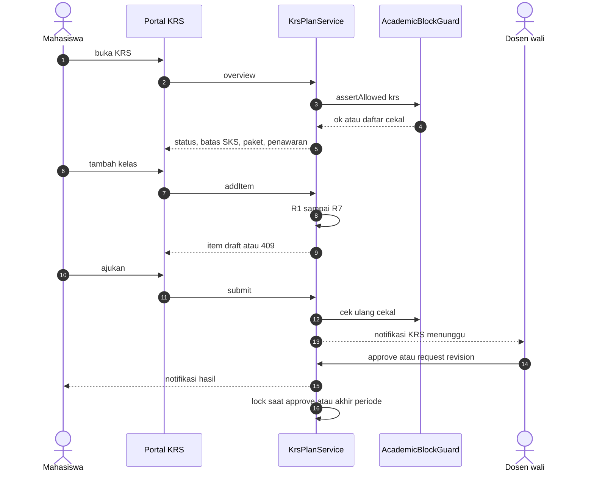

Langkah rinci:

1. **Pembukaan periode** (langkah 1): BAAK membuat `academic_term_periods` `period_type = krs`. Periode dapat dibuat berbeda per prodi atau angkatan (kolom opsional `study_program_id`, `admission_year`) untuk KRS bergelombang. Pembukaan memicu notifikasi massal ke mahasiswa aktif.
2. **Gerbang** (G1–G5): dijalankan saat `GET /student/krs`. Hasilnya ditampilkan sebagai `blockers[]` sehingga mahasiswa tahu alasan sebelum mencoba.
3. **Paket otomatis**: bila mahasiswa berada di semester yang tercantum di `academic.krs.package_semesters` dan memiliki versi kurikulum dengan `course_packages` `first_term` untuk semester itu, sistem membuat `krs_items` `draft` untuk setiap MK paket. Kelas dipilih berdasarkan `group_label` rombel mahasiswa, atau kelas dengan sisa kursi terbanyak, dan setiap baris tetap melalui R1–R7. Mode `academic.krs.package_mode`:
   - `prefill`: paket hanya sebagai draf yang dapat diubah.
   - `locked_package`: mahasiswa tidak dapat menghapus MK paket.
   - `auto_approve`: paket langsung `approved` tanpa dosen wali. Mode ini cocok untuk mahasiswa baru yang belum memiliki dosen wali aktif.
4. **Pemilihan & validasi baris** (R1–R7): setiap penambahan menulis `krs_submission_events` `item_added`.
5. **Pengajuan** (langkah 9): S1–S2. Status menjadi `submitted`, item `pending`, dan dosen wali dinotifikasi.
6. **Persetujuan dosen wali** (langkah 10):
   - **Setujui**: item → `enrolled`, KRS → `approved`.
   - **Minta revisi**: KRS → `revision_requested`, item kembali `draft` (kursi tetap dipegang, sesuai perilaku saat ini), dan catatan umum serta catatan per item disimpan di event.
7. **Penguncian** (langkah 11): `approved` → `locked` menurut `academic.krs.lock_on`:
   - `on_approval`: langsung terkunci saat disetujui.
   - `period_end`: terkunci otomatis oleh job terjadwal saat periode `krs` berakhir.
   KRS `submitted` yang belum diputuskan saat periode berakhir diproses sesuai `academic.krs.unprocessed_at_close` (`auto_approve`, `escalate_to_baak`, atau `cancel`).
8. **Perubahan** (langkah 12): lihat A.4.7.
9. **Riwayat** (langkah 13): setiap transisi dan perubahan baris menghasilkan `krs_submission_events`. Endpoint `GET /student/krs/history` (ada) diperluas untuk menampilkan event.

### A.4.6 State machine KRS

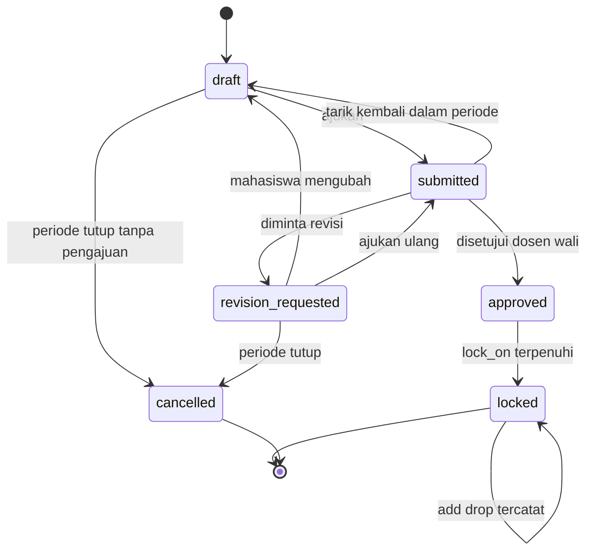

Nilai lama `rejected` dimigrasikan menjadi `revision_requested`. Sebab perilaku `reject()` saat ini sudah mengembalikan item ke `draft` agar mahasiswa merevisi, secara semantik ia memang "minta revisi". Endpoint `POST /krs-submissions/{id}/reject` (ada) dipertahankan sebagai alias dari `POST /advising/krs-submissions/{id}/request-revision` (Baru).

### A.4.7 Perubahan setelah dikunci (add/drop)

Mekanisme perubahan setelah penguncian merupakan keputusan kampus ([OD-09](16-open-decisions.md#od-09)). Rancangan menyediakan tiga mode melalui `academic.krs.change_mode`:

| Mode | Perilaku |
|---|---|
| `none` | Tidak ada perubahan oleh mahasiswa. Hanya BAAK melalui `PATCH /krs-items/{id}/drop` (ada) dan `POST /krs-items` (ada) dengan alasan wajib |
| `add_drop_period` (default rancangan) | Selama periode `add_drop`, mahasiswa membuka "pengajuan perubahan". KRS tetap `locked`, tetapi perubahan baris dibuat sebagai item `draft` (tambah) atau penanda drop. Seluruh pemeriksaan R1–R7 dan cekal berlaku. Perubahan disetujui dosen wali (bila `academic.krs.add_drop.require_approval = true`), lalu diterapkan atomik. Batas jumlah perubahan `academic.krs.add_drop.max_changes` |
| `request_based` | Perubahan diajukan sebagai `student_requests` (type `other`, payload perubahan KRS) melalui ApprovalWorkflow, lalu dieksekusi BAAK |

Aturan drop setelah perkuliahan berjalan: baris yang di-drop setelah `academic.krs.drop_deadline_week` tetap tercatat `dropped` dan tidak menghapus presensi. Penanda "W" (withdrawn) pada transkrip bersifat opsional melalui `academic.krs.show_withdrawn_on_transcript`.

### A.4.8 Alur alternatif

| Kondisi | Respons sistem | Langkah pemulihan |
|---|---|---|
| **KRS diminta revisi** (`revision_requested`) | Mahasiswa dinotifikasi (`student.krs_rejected`, ada, diganti nama tampil "KRS perlu revisi") berisi catatan. Item kembali `draft`, kursi tetap dipegang | Mahasiswa mengubah lalu mengajukan ulang selama periode. Bila periode tutup, berlaku `unprocessed_at_close` |
| **Dicekal** (G3) | `GET /student/krs` mengembalikan `blockers[]` berisi jenis cekal, alasan, unit penanggung jawab, dan cara menyelesaikan. Tombol tambah/ajukan dinonaktifkan | Selesaikan sumber cekal (mis. pelunasan → cekal dicabut otomatis) atau ajukan dispensasi (A.8) |
| Cekal terbit setelah pengajuan | Saat dosen wali menyetujui, guard memeriksa ulang. Persetujuan ditolak dengan `ACADEMIC_BLOCKED` dan dosen wali melihat penanda | Sama seperti di atas |
| **Kelas penuh** (R5) | 409 `CLASS_FULL`. UI menampilkan kelas lain untuk MK yang sama yang masih ada kursi | Pilih kelas lain. Daftar tunggu adalah [Rekomendasi] (Baru), dengan promosi otomatis saat ada drop dan notifikasi |
| **Periode ditutup** (G1) | 409 `KRS_PERIOD_CLOSED` dengan tanggal periode (pesan `periodMessage` yang ada). Tarik kembali pengajuan juga ditolak | KRS susulan melalui BAAK (aksi berotorisasi + audit) atau `student_requests` |
| Prasyarat tidak terpenuhi | 409 `PREREQUISITE_UNMET` dengan daftar MK prasyarat dan nilai minimum | Tidak dapat dilewati oleh mahasiswa. Override per mahasiswa oleh Kaprodi dicatat audit ([Rekomendasi]) |
| SKS melebihi batas | 409 `CREDIT_LIMIT_EXCEEDED` dengan batas, SKS saat ini, dan SKS MK | Kurangi MK |
| Dua tab mengirim bersamaan | `lockStudent()` (ada) menyerialkan perubahan per mahasiswa | — |

### A.4.9 Aturan validasi

| ID | Aturan |
|---|---|
| BR-SIA-KRS-01 | Perubahan isi KRS oleh mahasiswa hanya di dalam periode `krs` (atau `add_drop` untuk mode perubahan) yang berlaku untuk prodi/angkatannya |
| BR-SIA-KRS-02 | Hanya mahasiswa `status = active` yang dapat menyusun KRS |
| BR-SIA-KRS-03 | Prasyarat dievaluasi dengan nilai terbaik dan ekuivalensi (BR-SIA-KUR-06) |
| BR-SIA-KRS-04 | Total SKS (`draft` + `pending` + `enrolled`) ≤ batas maksimum. Batas = tier dari `academic.krs.max_sks_tiers` berdasarkan `academic.krs.max_sks_basis` (IPS semester terakhir yang bernilai, atau IPK). Mahasiswa tanpa riwayat nilai memakai `academic.krs.default_max_sks` |
| BR-SIA-KRS-05 | Satu MK hanya satu kelas per semester per mahasiswa |
| BR-SIA-KRS-06 | Kursi terisi dihitung dari `krs_items` berstatus `draft`/`pending`/`enrolled` dan diperiksa di bawah `lockForUpdate` baris kelas |
| BR-SIA-KRS-07 | Bentrok jadwal per mahasiswa memakai rumus BR-SIA-JDW-01 dan memperhitungkan `group_label` |
| BR-SIA-KRS-08 | KRS tidak dapat disusun, diajukan, atau disetujui bila terdapat cekal aktif tanpa dispensasi untuk layanan `krs` |
| BR-SIA-KRS-09 | Persetujuan hanya oleh dosen wali mahasiswa tersebut (`students.academic_advisor_id`) atau pemegang `krs.approve` dalam scope. Permintaan revisi wajib berisi catatan |
| BR-SIA-KRS-10 | KRS `locked` tidak berubah kecuali melalui mekanisme `academic.krs.change_mode`. Setiap perubahan menghasilkan `krs_submission_events` |
| BR-SIA-KRS-11 | Setiap transisi status KRS dan setiap tambah/hapus baris menghasilkan tepat satu `krs_submission_events` (aktor, waktu, status asal & tujuan, catatan, snapshot SKS) |
| BR-SIA-KRS-12 | Paket otomatis hanya untuk semester ke-n yang tercantum di `academic.krs.package_semesters`. Setiap baris paket tetap melalui R1–R7. Baris yang gagal dilaporkan, bukan dipaksakan |
| BR-SIA-KRS-13 | Intervensi BAAK (tambah/drop/ubah status di luar periode) wajib berisi alasan dan tercatat di `audit_logs` dengan aksi `forced_override` |

### A.4.10 Data terlibat

`krs_submissions` (status kanon), `krs_items`, `krs_submission_events` (Baru: `krs_submission_id`, `event_type` = `created` / `item_added` / `item_removed` / `submitted` / `withdrawn` / `approved` / `revision_requested` / `locked` / `change_applied` / `cancelled` / `admin_override`, `from_status`, `to_status`, `krs_item_id` nullable, `actor_id`, `note`, `payload` json), `academic_term_periods`, `course_packages`, `course_package_items`, `academic_blocks`, `class_sections`, `class_schedules`, `grades`. Lihat [07-database-erd.md](07-database-erd.md) bagian KRS.

### A.4.11 Konfigurasi

| Key | Contoh nilai | Fungsi |
|---|---|---|
| `academic.krs.max_sks_tiers` | `[{"min_ip":3.00,"max_sks":24},{"min_ip":2.50,"max_sks":22},{"min_ip":2.00,"max_sks":20},{"min_ip":0,"max_sks":18}]` | Migrasi dari `SKS_LIMIT_TIERS` ([OD-05](16-open-decisions.md#od-05)) |
| `academic.krs.max_sks_basis` | `"previous_ips"` (alternatif `ipk`) | Dasar IP untuk tier |
| `academic.krs.default_max_sks` | `24` | Mahasiswa tanpa riwayat nilai |
| `academic.krs.min_sks` | `0` | SKS minimum pengajuan |
| `academic.krs.require_advisor_approval` | `true` | Persetujuan dosen wali wajib |
| `academic.krs.lock_on` | `"period_end"` | `on_approval` / `period_end` |
| `academic.krs.unprocessed_at_close` | `"escalate_to_baak"` | Nasib KRS `submitted` saat periode tutup |
| `academic.krs.package_semesters` | `[1, 2]` | Semester yang memakai paket otomatis |
| `academic.krs.package_mode` | `"locked_package"` | `prefill` / `locked_package` / `auto_approve` |
| `academic.krs.change_mode` | `"add_drop_period"` | `none` / `add_drop_period` / `request_based` ([OD-09](16-open-decisions.md#od-09)) |
| `academic.krs.add_drop.max_changes` | `2` | Batas jumlah perubahan |
| `academic.krs.add_drop.require_approval` | `true` | Perubahan disetujui dosen wali |
| `academic.krs.drop_deadline_week` | `4` | Minggu terakhir drop tanpa penanda |
| `academic.krs.show_withdrawn_on_transcript` | `false` | Penanda W pada transkrip |
| `academic.krs.waitlist_enabled` | `false` | Daftar tunggu ([Rekomendasi]) |

### A.4.12 Hak akses ringkas

| Aksi | Permission | Scope |
|---|---|---|
| Susun & ajukan KRS sendiri | `krs_self_service.read/create/update` (ada) | Diri sendiri |
| Setujui / minta revisi | `krs_advising.read/approve` (ada) | Mahasiswa perwalian |
| Kelola KRS administratif | `krs.read/create/update/approve` (ada) | BAAK: tenant. Admin prodi: prodi |
| Buka periode | `academic_terms.update` (Baru), saat ini `krs.update` | BAAK |

### A.4.13 Integrasi

Cekal (A.8, sumber Keuangan), notifikasi (`StudentNotificationService`), LMS (enrolment kelas akademik = `krs_items` `enrolled`, tanpa salinan), CBT (peserta ujian dari `krs_items`), EDOM (kelayakan peserta). Lihat [06](06-integrasi-arsitektur.md).

### A.4.14 Keputusan terbuka

[OD-05](16-open-decisions.md#od-05), [OD-09](16-open-decisions.md#od-09), [OD-08](16-open-decisions.md#od-08).

---
## A.5 Presensi dan Jurnal Mengajar

### A.5.1 Tujuan

Mencatat setiap pertemuan perkuliahan sebagai **sesi** yang sekaligus menjadi jurnal mengajar dan Berita Acara Perkuliahan (BAP), mencatat kehadiran mahasiswa per sesi, menghubungkan realisasi pertemuan dengan rencana RPS, menyediakan koreksi presensi berotorisasi dengan riwayat, serta menghitung persentase kehadiran untuk syarat ujian.

### A.5.2 Fitur

| Fitur | Label | Status | Keterangan |
|---|---|---|---|
| Presensi per pertemuan | [Referensi] | (Parsial) | `attendances` per `krs_item` × `meeting_number`. Ditambah `lecture_session_id`, `method`, `recorded_by` |
| Daftar peserta | [Referensi] | (Ada) | Dari `krs_items` `enrolled` per kelas |
| Rekap per mahasiswa | [Referensi] | (Ada) | `GET /student/attendance` (ada), `StudentAttendanceService` |
| Rekap per kelas | [Referensi] | (Parsial) | `GET /attendances` (ada). Ditambah matriks mahasiswa × sesi dan persentase |
| Jurnal mengajar | [Referensi] | (Baru) | `lecture_sessions` (topik, ringkasan, metode, waktu aktual, pengajar) |
| Materi tiap pertemuan | [Referensi] | (Parsial) | `course_materials.meeting_number` (ada). Ditambah pivot `lecture_session_materials` |
| Hubungan jurnal–RPS | [Referensi] | (Baru) | `lecture_sessions.lesson_plan_meeting_id` → `lesson_plan_meetings` (OBE) |
| Pemantauan realisasi perkuliahan | [Referensi] | (Baru) | Sesi `held` vs rencana, kesesuaian topik dengan RPS |
| Koreksi presensi berotorisasi | [Referensi] | (Baru) | `attendance_corrections` |
| Riwayat perubahan presensi | [Referensi] | (Baru) | `attendance_corrections` + `audit_logs` |
| Persentase kehadiran | [Referensi] | (Parsial) | Dihitung di service. Status yang dihitung dapat dikonfigurasi |
| Cek batas minimal kehadiran ujian | [Referensi] | (Baru) | Menjadi sumber cekal `attendance` (A.8) |
| Presensi QR | [Referensi] (EDLINK) | (Baru) | Dirancang di [02-edlink-lms.md](02-edlink-lms.md) B.3. Hasilnya menulis ke `attendances` yang sama |
| Tanda tangan/konfirmasi BAP oleh perwakilan mahasiswa | [Rekomendasi] | (Baru) | `lecture_sessions.confirmed_by_student_id` |

### A.5.3 Aktor

Dosen pengajar (membuka sesi, mengisi jurnal dan presensi), mahasiswa (presensi mandiri lewat QR bila diaktifkan, melihat rekap), BAAK (koreksi, pemantauan), Kaprodi (memantau realisasi perkuliahan dan kesesuaian RPS), sistem (membangkitkan sesi, menghitung persentase, menerbitkan cekal kehadiran).

### A.5.4 Model sesi (jurnal mengajar + BAP)

`lecture_sessions` menyatukan konsep "sesi presensi", "jurnal mengajar", dan "BAP" dalam satu entitas agar tidak terjadi duplikasi.

| Kelompok kolom | Kolom |
|---|---|
| Identitas | `class_section_id`, `class_schedule_id` (nullable untuk sesi tambahan), `meeting_number`, `group_label` |
| Rencana | `scheduled_date`, `scheduled_start`, `scheduled_end`, `room_id`, `delivery_mode` (`offline`/`online`/`hybrid`), `lesson_plan_meeting_id` |
| Realisasi (jurnal/BAP) | `actual_start_at`, `actual_end_at`, `lecturer_id` (pengajar aktual), `topic`, `summary`, `learning_method`, `notes`, `held_at` |
| Status | `status` (`scheduled`, `ongoing`, `held`, `cancelled`, `rescheduled`), `rescheduled_to_id`, `cancel_reason` |
| Kunci | `attendance_locked_at` (presensi terkunci setelah batas input), `confirmed_by_student_id` |

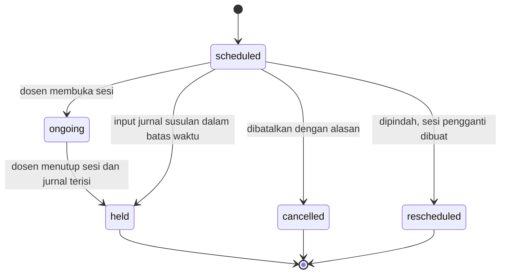

**Hubungan dengan RPS:** saat sesi dibangkitkan, `lesson_plan_meeting_id` diisi otomatis dari `lesson_plan_meetings` RPS yang `ratified` untuk MK tersebut, dicocokkan berdasarkan `meeting_number`. Dosen dapat memilih pertemuan RPS lain bila urutannya berubah. Pemantauan realisasi membandingkan:

- **Realisasi jumlah**: `count(held)` / jumlah pertemuan rencana (`class_section_lecturers.planned_meetings` atau jumlah `lesson_plan_meetings`).
- **Kesesuaian topik**: proporsi sesi `held` yang memiliki `lesson_plan_meeting_id`. Sesi tanpa padanan RPS ditandai "di luar rencana".
- **Ketepatan waktu**: `actual_start_at` − `scheduled_start`.

Detail rumus realisasi RPS untuk akreditasi ada di [04-obe.md](04-obe.md) D.4.

### A.5.5 Alur utama

1. Saat kelas berstatus `running`, sistem membangkitkan `lecture_sessions` untuk setiap `class_schedules` `published` sepanjang periode `lecture`. Tanggal libur dari `academic_calendar_events` kategori `holiday` dilewati, dan jumlah pertemuan mengikuti `academic.attendance.meetings_per_term`.
2. Dosen membuka sesi (`ongoing`). Daftar peserta diambil dari `krs_items` `enrolled` (memperhatikan `group_label`).
3. Presensi dicatat oleh dosen (massal: default `present`, lalu ubah pengecualian), atau oleh mahasiswa lewat QR ([02](02-edlink-lms.md) B.3), atau impor. Setiap baris `attendances` menyimpan `method` (`manual`, `qr`, `import`, `ai`) dan `recorded_by`. Endpoint yang ada `POST /class-sections/{id}/attendances` tetap berfungsi dan menautkan ke sesi yang cocok berdasarkan `meeting_number`.
4. Dosen mengisi jurnal (topik, ringkasan, metode) dan menautkan materi (`lecture_session_materials` → `course_materials`), lalu menutup sesi (`held`).
5. Setelah `academic.attendance.lecturer_edit_window_hours` sejak sesi berakhir, presensi terkunci (`attendance_locked_at`). Perubahan setelahnya hanya melalui koreksi.
6. Sistem menghitung ulang persentase kehadiran mahasiswa (event `AttendanceRecorded`) dan mengevaluasi aturan cekal kehadiran (A.8).

### A.5.6 Koreksi presensi berotorisasi

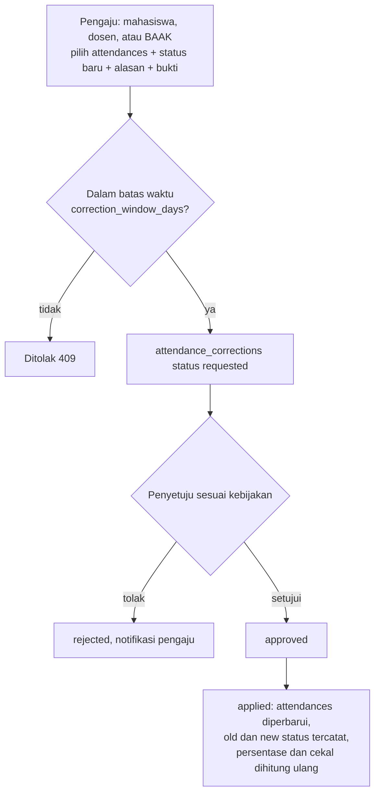

- `attendance_corrections`: `attendance_id`, `requested_by`, `old_status`, `new_status`, `reason`, `evidence_file_id` (mis. surat sakit lewat `file_uploads`), `status` (`requested`, `approved`, `rejected`, `applied`), `decided_by`, `decided_at`, `decision_note`.
- Penyetuju default:
  - Koreksi oleh dosen pengampu pada kelasnya sendiri setelah presensi terkunci → disetujui BAAK.
  - Pengajuan oleh mahasiswa (mis. izin sakit) → disetujui dosen pengampu.
  - Koreksi oleh BAAK sendiri → langsung `applied` dengan alasan wajib (aksi `forced_override` di audit).
  Pemetaan ini dapat dikonfigurasi lewat `academic.attendance.correction_approver`.
- Riwayat: seluruh `attendance_corrections` per baris presensi tampil kronologis. Nilai asal tidak pernah ditimpa tanpa jejak.

### A.5.7 Rumus persentase kehadiran

```
persen_hadir(m, k) = jumlah attendances(m, k) dengan status ∈ counted_statuses
                     ÷ penyebut(k) × 100
```

| Komponen | Definisi | Konfigurasi |
|---|---|---|
| `m`, `k` | Mahasiswa (`krs_item`) dan kelas | — |
| `counted_statuses` | Status yang dihitung hadir. Contoh `["present"]` atau `["present","permitted","sick"]` | `academic.attendance.counted_statuses` ([OD-06](16-open-decisions.md#od-06)) |
| `penyebut` | `held_sessions`: jumlah `lecture_sessions` berstatus `held` untuk kelas dan `group_label` mahasiswa sampai tanggal acuan. Atau `planned_meetings`: jumlah pertemuan rencana | `academic.attendance.denominator` |
| Tanggal acuan | Untuk syarat UTS: sesi `held` sebelum mulai periode `midterm_exam`. Untuk UAS: semua sesi sebelum periode `final_exam` | `academic.attendance.exam_cutoff` |
| Status `excused_from_count` (opsional) | Status yang dikeluarkan dari pembilang **dan** penyebut (mis. dispensasi tugas resmi kampus) | `academic.attendance.excluded_statuses` |

Contoh: `counted_statuses = ["present"]`, 14 sesi `held`, 11 hadir, 1 sakit, 2 alpa → 11 ÷ 14 × 100 = 78,57%. Bila sakit dihitung hadir → 12 ÷ 14 = 85,71%. Pembulatan untuk tampilan mengikuti 2 desimal. Perbandingan dengan ambang memakai nilai tanpa pembulatan.

**Cek batas minimal kehadiran ujian:** mahasiswa memenuhi syarat ujian kelas `k` bila `persen_hadir(m, k) ≥ academic.attendance.min_exam_percentage` (contoh **75**, bukan ketentuan). Bila tidak terpenuhi pada tanggal acuan, sistem membuat `academic_blocks` dengan `block_type = attendance`, layanan `exam`, dan cakupan kelas `k` (A.8). Cekal ini dapat diberi dispensasi.

### A.5.8 Alur alternatif

| Kondisi | Respons sistem |
|---|---|
| Dosen berhalangan, sesi dibatalkan | `cancelled` dengan alasan. Sesi tidak masuk penyebut `held_sessions`. Notifikasi ke peserta |
| Sesi dipindah | `rescheduled` + sesi pengganti baru (tanggal spesifik) dengan validasi bentrok per tanggal (A.3, K9) |
| Dosen lupa mengisi jurnal | Pengingat otomatis H+1. Setelah batas `academic.attendance.journal_late_days`, sesi ditandai terlambat di laporan realisasi. Input susulan tetap mungkin sampai batas koreksi |
| Team teaching | Pengajar aktual dipilih dari `class_section_lecturers`. Rekap riwayat mengajar dosen dihitung dari `lecture_sessions.lecturer_id` |
| Mahasiswa drop setelah beberapa sesi | Presensi tetap tersimpan. Tidak dihitung dalam rekap kelas aktif |
| Presensi via endpoint lama tanpa sesi | Sistem membuat atau menautkan `lecture_sessions` berdasarkan `meeting_number` (kompatibilitas) |

### A.5.9 Aturan validasi

| ID | Aturan |
|---|---|
| BR-SIA-PRS-01 | Satu baris `attendances` per (`krs_item_id`, `meeting_number`) (sudah ada). Bila `lecture_session_id` terisi, unik per (`krs_item_id`, `lecture_session_id`) |
| BR-SIA-PRS-02 | Presensi hanya untuk `krs_items` `enrolled` di kelas sesi tersebut, dan untuk `group_label` yang sesuai bila sesi berkelompok |
| BR-SIA-PRS-03 | Hanya pengajar kelas (`class_section_lecturers`) atau BAAK yang dapat mencatat presensi (perluasan `ClassSectionAccess::canWriteTeaching`) |
| BR-SIA-PRS-04 | Sesi hanya dapat ditandai `held` bila `topic` terisi |
| BR-SIA-PRS-05 | Setelah `attendance_locked_at`, perubahan presensi hanya melalui `attendance_corrections` yang disetujui |
| BR-SIA-PRS-06 | Koreksi wajib berisi alasan. Koreksi melewati `academic.attendance.correction_window_days` sejak sesi ditolak, kecuali oleh BAAK dengan `forced_override` |
| BR-SIA-PRS-07 | Persentase kehadiran dihitung dengan rumus A.5.7 dan konfigurasi tenant. Ambang tidak boleh di-hardcode |
| BR-SIA-PRS-08 | Penerapan koreksi memicu perhitungan ulang persentase dan evaluasi ulang cekal kehadiran, sehingga dapat mencabut cekal secara otomatis |

### A.5.10 Data terlibat

`lecture_sessions`, `lecture_session_materials`, `attendances` (+ `lecture_session_id`, `method`, `recorded_by`), `attendance_corrections`, `attendance_qr_tokens` ([02](02-edlink-lms.md)), `course_materials`, `lesson_plan_meetings` ([04](04-obe.md)), `academic_blocks`. Lihat [07-database-erd.md](07-database-erd.md) bagian Presensi.

### A.5.11 Konfigurasi

| Key | Contoh nilai |
|---|---|
| `academic.attendance.meetings_per_term` | `16` (termasuk UTS dan UAS) |
| `academic.attendance.counted_statuses` | `["present"]` |
| `academic.attendance.excluded_statuses` | `[]` |
| `academic.attendance.denominator` | `"held_sessions"` |
| `academic.attendance.min_exam_percentage` | `75` (contoh) |
| `academic.attendance.exam_cutoff` | `{"midterm":"before_midterm_period","final":"before_final_period"}` |
| `academic.attendance.lecturer_edit_window_hours` | `48` |
| `academic.attendance.correction_window_days` | `14` |
| `academic.attendance.correction_approver` | `{"lecturer":"academic_administrator","student":"lecturer"}` |
| `academic.attendance.journal_late_days` | `3` |

### A.5.12 Hak akses ringkas

`lecture_sessions.read/create/update` (dosen kelasnya sendiri, BAAK), `attendance.create/update` (ada), `attendance_corrections.create` (mahasiswa untuk dirinya, dosen untuk kelasnya), `attendance_corrections.approve` (sesuai `correction_approver`). Kaprodi: baca realisasi dalam prodi. Orang tua: baca rekap anaknya (A.9). Lihat [11](11-roles-permissions.md).

### A.5.13 Integrasi

- **LMS**: presensi QR menulis ke `attendances` + `lecture_sessions` ([02](02-edlink-lms.md) B.3). Materi pertemuan memakai `course_materials` yang sama.
- **OBE**: realisasi RPS ([04](04-obe.md) D.4).
- **Cekal**: sumber `attendance` (A.8).
- **CBT**: syarat ikut ujian membaca hasil cekal, bukan menghitung sendiri ([03](03-cbt-cbt-ai.md) C.5).
- **SDM**: rekap mengajar untuk beban kerja dosen (di luar ruang lingkup).

### A.5.14 Keputusan terbuka

[OD-06](16-open-decisions.md#od-06) (ambang default & status izin/sakit), [OD-18](16-open-decisions.md#od-18) (presensi AI).

---

## A.6 Penilaian dan Hasil Studi

### A.6.1 Tujuan

Mengelola komponen dan bobot penilaian per kelas, input nilai komponen oleh dosen, validasi kelengkapan, perhitungan nilai akhir dan konversi ke huruf berdasarkan skala yang dapat dikonfigurasi, alur publikasi beserta persetujuan, perhitungan IPS/IPK, transkrip, serta perubahan nilai setelah publikasi (koreksi dan pemutihan) dengan riwayat lengkap.

### A.6.2 Fitur

| Fitur | Label | Status | Keterangan |
|---|---|---|---|
| Komponen nilai (tugas, kuis, UTS, UAS, praktik, lainnya) | [Referensi] | (Baru) | `assessment_components` per kelas. Jenis dapat dikonfigurasi |
| Bobot komponen | [Referensi] | (Baru) | `assessment_components.weight` |
| Input nilai oleh dosen | [Referensi] | (Parsial) | `PUT /krs-items/{id}/grade` (ada) menyimpan skor akhir + huruf. Target: nilai per komponen (`assessment_scores`) |
| Validasi kelengkapan | [Referensi] | (Baru) | Kebijakan nilai kosong |
| Konversi angka → huruf | [Referensi] | (Parsial) | `LetterGrade` hardcoded. Target: `grade_scales` + `grade_scale_items` |
| Skala nilai per MK atau kebijakan | [Referensi] | (Baru) | Skala default tenant/prodi. Override per MK hanya bila diizinkan ([OD-04](16-open-decisions.md#od-04)) |
| Nilai akhir | [Referensi] | (Parsial) | `grades.score`. Ditambah `final_score`, `grade_scale_item_id`, `grade_point`, `is_published` |
| Rekap nilai kelas | [Referensi] | (Parsial) | `GET /grades` (ada). Ditambah distribusi dan statistik |
| Publikasi nilai | [Referensi] | (Baru) | `grade_submissions` |
| Persetujuan nilai bila diperlukan | [Referensi] | (Baru) | Langkah `in_review` opsional ([OD-07](16-open-decisions.md#od-07)) |
| Riwayat perubahan nilai | [Referensi] | (Baru) | `grade_revisions` + `audit_logs` |
| IPS & IPK | [Referensi] | (Ada) | `AcademicRecordService`, nilai terbaik untuk MK yang diulang |
| Transkrip | [Referensi] | (Ada) | `GET /students/{id}/transcript`, portal Transkrip |
| Pemutihan/perbaikan nilai | [Referensi] | (Baru) | `grade_revisions.revision_type = remediation` |
| Impor nilai komponen dari LMS/CBT | [Referensi] (integrasi) | (Baru) | Melalui `assessment_scores.source` setelah validasi dosen |
| Nilai tertunda (incomplete) | [Rekomendasi] | (Baru) | Penanda sementara dengan batas waktu |

### A.6.3 Aktor

Dosen pengampu/koordinator (menyusun komponen, menginput, mengajukan), Kaprodi (meninjau/menyetujui bila dikonfigurasi, menyetujui revisi), BAAK (publikasi, membuka kembali, skala nilai, transkrip), mahasiswa (melihat nilai terpublikasi, KHS, transkrip, mengajukan keberatan), sistem (menghitung nilai akhir, IPS/IPK).

### A.6.4 Komponen, bobot, dan rumus nilai akhir

`assessment_components` per `class_section`: `name`, `component_type` (nilai dari `academic.grading.component_types`, contoh `assignment`, `quiz`, `midterm`, `final`, `practicum`, `participation`, `project`), `weight` (desimal), `max_score` (default 100), `is_required`, `source_type` (`manual`, `lms_assignment`, `lms_quiz`, `cbt_exam`), `source_id`, `order_index`. Template komponen dapat diwarisi dari RPS ([04](04-obe.md)) atau dari pengaturan prodi.

Setiap skor komponen dinormalisasi ke skala 0–100:

```
s_i = raw_score_i ÷ max_score_i × 100
```

Nilai akhir:

```
final_score = Σ (s_i × w_i) ÷ Σ w_i
```

Penjumlahan dilakukan atas komponen yang **diikutkan** menurut kebijakan nilai kosong. Dengan membagi Σw_i, bobot tidak harus berjumlah 100. Meski demikian, BR-SIA-NIL-02 mewajibkan Σw = 100 pada saat komponen dikunci, agar mudah dipahami. Normalisasi tetap berlaku untuk kebijakan `exclude_and_renormalize`.

**Pembulatan** ([OD-29](16-open-decisions.md#od-29)), `academic.grading.rounding`:

| Parameter | Pilihan | Contoh |
|---|---|---|
| `mode` | `half_up` (default rancangan), `half_even`, `floor`, `ceil`, `none` | `half_up` |
| `precision` | Jumlah desimal sebelum konversi huruf | `2` |
| `apply_at` | `final_only` (bulatkan sekali di akhir) atau `each_component` | `final_only` |

Contoh: komponen tugas 82,5 (w 20), kuis 70 (w 10), UTS 68 (w 30), UAS 74,4 (w 40) → (1650 + 700 + 2040 + 2976) ÷ 100 = 73,66. Bila `precision = 0` dengan `half_up` → 74. Huruf ditentukan dari angka yang sudah dibulatkan.

**Kebijakan nilai kosong**, `academic.grading.missing_score_policy`:

| Nilai | Perilaku | Konsekuensi |
|---|---|---|
| `block_submission` | Lembar nilai tidak dapat diajukan selama ada komponen `is_required` yang kosong | Paling aman, tetapi dapat menunda publikasi |
| `treat_as_zero` | Kosong dihitung 0 | Mahasiswa yang tidak mengumpulkan mendapat 0. Dosen harus sadar akan dampaknya |
| `exclude_and_renormalize` | Komponen kosong dikeluarkan, lalu Σw dihitung ulang | Menguntungkan mahasiswa yang tidak ikut komponen. Gunakan hanya untuk komponen opsional |
| `mark_incomplete` | Nilai akhir tidak dihitung. `grades` ditandai tertunda (huruf sementara sesuai skala, mis. "T" bila skala memilikinya) dengan batas `academic.grading.incomplete_deadline_days`. Lewat batas → diproses dengan `treat_as_zero` | Memerlukan job pengingat |

Kebijakan dapat ditimpa per komponen (`assessment_components.missing_policy`, nullable).

### A.6.5 Skala nilai

`grade_scales`: `name`, `scope_type` (`university`, `study_program`, `course`), `scope_id`, `effective_from_term_id`, `is_active`. `grade_scale_items`: `letter`, `min_score` (inklusif), `max_score` (inklusif hingga presisi pembulatan), `grade_point`, `is_passing`, `counts_in_gpa`, `order_index`.

Resolusi skala untuk satu kelas: skala `course` (bila diizinkan [OD-04](16-open-decisions.md#od-04)) → skala `study_program` → skala `university`, yang berlaku pada semester kelas. Skala dicatat di `grade_submissions.grade_scale_id` saat diajukan sehingga perubahan skala di kemudian hari **tidak** mengubah nilai yang sudah terbit.

Konversi: cari item dengan `min_score ≤ final_score_dibulatkan ≤ max_score`. Rentang item harus kontinu tanpa celah dan tanpa tumpang tindih pada presisi yang dipakai (BR-SIA-NIL-05).

Migrasi `LetterGrade`: seeder membuat skala default tenant dengan item A (4,00; ≥85), AB (3,50; 75–84), B (3,00; 65–74), BC (2,50; 55–64), C (2,00; 45–54), D (1,00; 35–44), E (0; <35), dengan C sebagai huruf lulus minimum. Ini hanya **nilai awal yang sama dengan perilaku saat ini**, bukan kebijakan yang direkomendasikan. Kampus wajib meninjaunya. Kolom `grades.letter_grade` tetap ada (string) untuk kompatibilitas.

### A.6.6 Alur publikasi nilai

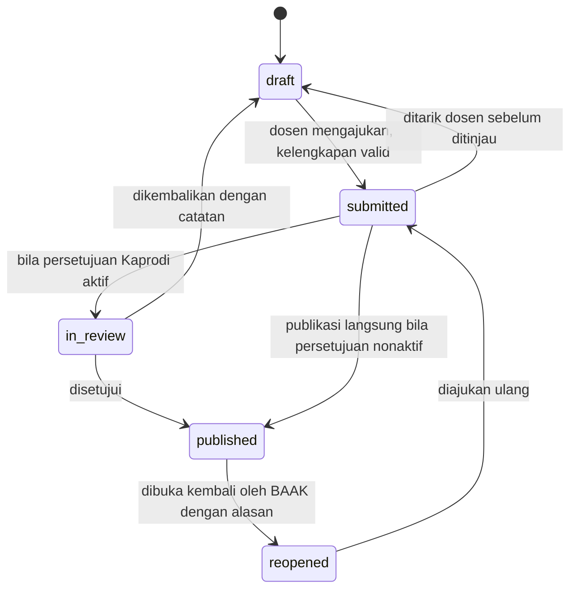

1. Dosen menyusun komponen (dikunci setelah ada skor pertama, kecuali dibuka BAAK).
2. Dosen menginput `assessment_scores` per mahasiswa × komponen, baik manual maupun impor dari LMS/CBT. Skor impor berstatus `imported` dan harus dikonfirmasi dosen (`validated`) agar ikut dihitung ([06](06-integrasi-arsitektur.md)).
3. Sistem menghitung `final_score` dan huruf secara langsung (pratinjau) dan menampilkan rekap kelas (distribusi huruf, rata-rata, jumlah tidak lulus).
4. Pengajuan → `submitted`. Validasi kelengkapan sesuai kebijakan nilai kosong dan dilakukan dalam periode `grade_entry`.
5. Bila `academic.grading.require_approval = true` ([OD-07](16-open-decisions.md#od-07)) → `in_review` oleh Kaprodi.
6. Publikasi → `published`: `grades.is_published = true`, `published_at` terisi, IPS/IPK dihitung ulang, mahasiswa dinotifikasi. Syarat EDOM sebelum melihat nilai dapat diterapkan ([OD-10](16-open-decisions.md#od-10), [05](05-edom.md)).

### A.6.7 Perubahan setelah publikasi

Setelah `published`, nilai **tidak dapat diubah langsung** melalui `PUT /krs-items/{id}/grade`. Endpoint tersebut menolak dengan 409 `GRADE_PUBLISHED`. Semua perubahan melalui `grade_revisions`:

| `revision_type` | Pemicu | Penyetuju default |
|---|---|---|
| `correction` | Salah input, keberatan mahasiswa yang dikabulkan, komponen terlewat | Kaprodi |
| `remediation` (pemutihan) | Program perbaikan nilai/remedial/pemutihan sesuai kebijakan kampus | Kaprodi + BAAK (konfigurasi) |

`grade_revisions`: `grade_id`, `revision_type`, `old_score`, `old_letter`, `old_grade_point`, `new_score`, `new_letter`, `new_grade_point`, `reason`, `evidence_file_id`, `requested_by`, `status` (`requested`, `approved`, `rejected`, `applied`), `approval_request_id` (ApprovalWorkflow), `applied_at`.

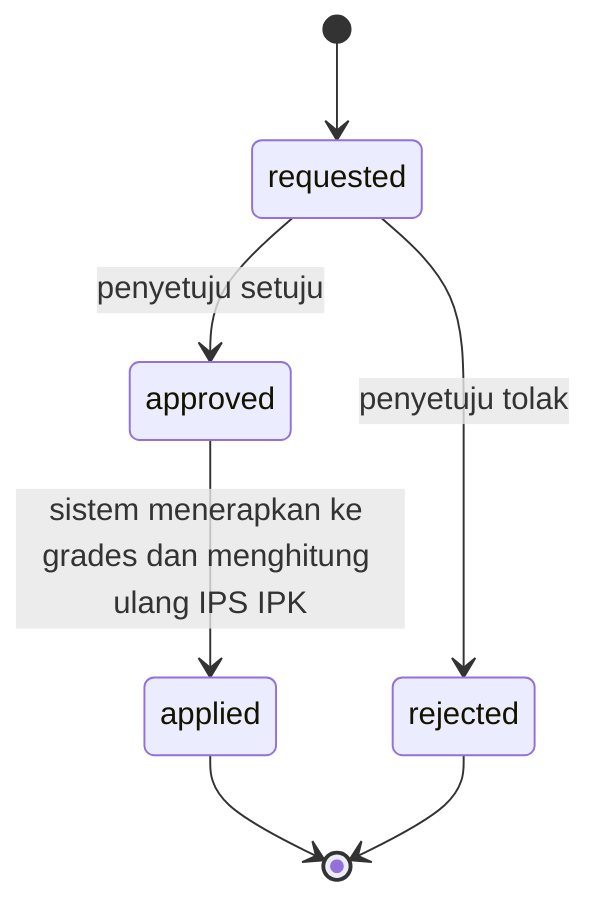

Pembatasan:
- Revisi `correction` hanya dalam `academic.grading.revision_window_days` sejak publikasi. Setelah itu hanya BAAK dengan `forced_override`.
- `remediation` hanya untuk huruf ≤ `academic.grading.remediation_max_letter`, maksimum `academic.grading.remediation_max_per_course` kali per MK. Nilai hasil pemutihan tidak boleh melebihi `academic.grading.remediation_cap_letter` bila kebijakan kampus membatasi ([OD-08](16-open-decisions.md#od-08)).
- Transkrip resmi yang sudah dicetak/diterbitkan tidak berubah. Penerbitan ulang menyebut versi.

### A.6.8 IPS, IPK, dan transkrip

```
IPS(t) = Σ_{j ∈ MK semester t} (sks_j × bobot_j) ÷ Σ_{j} sks_j
IPK    = Σ_{c ∈ MK unik} (sks_c × bobot_terpilih_c) ÷ Σ_{c} sks_c
```

- Hanya nilai `is_published = true` dan item skala `counts_in_gpa = true` yang dihitung.
- **MK diulang** ([OD-08](16-open-decisions.md#od-08)): `academic.grading.repeat_policy`:
  - `best`: perilaku saat ini di `StudentGradeService`/`AcademicRecordService::bestAttempts`.
  - `latest`: percobaan terakhir.
  Satu MK hanya dihitung sekali dalam IPK. IPS tetap memakai nilai semester itu.
- **MK setara** (A.2.5) diperlakukan sebagai satu MK dalam IPK.
- **Nilai konversi** (transfer/MBKM) masuk IPK sesuai `academic.grading.conversion_counts_in_gpa`.
- Pembulatan IPS/IPK: `academic.grading.gpa_precision` (contoh 2 desimal, `half_up`). Perhitungan memakai nilai penuh, pembulatan hanya untuk tampilan dan tier SKS.
- Transkrip: daftar MK unik dengan nilai terpilih, SKS total, IPK, versi kurikulum, dan penanda sumber (reguler/konversi/MBKM). Transkrip sementara tersedia di portal. Transkrip resmi berupa dokumen bernomor, disimpan di `file_uploads` dengan checksum.

### A.6.9 Aturan validasi

| ID | Aturan |
|---|---|
| BR-SIA-NIL-01 | Nilai akhir = Σ(s_i × w_i) ÷ Σw_i atas komponen yang diikutkan sesuai kebijakan nilai kosong. Skor dinormalisasi ke 0–100 |
| BR-SIA-NIL-02 | Σw komponen kelas = 100 sebelum skor pertama diinput. Komponen terkunci setelah ada skor |
| BR-SIA-NIL-03 | Pembulatan mengikuti `academic.grading.rounding` dan dilakukan sebelum konversi huruf |
| BR-SIA-NIL-04 | Skala yang dipakai dicatat di `grade_submissions.grade_scale_id` saat pengajuan dan tidak berubah oleh perubahan skala berikutnya |
| BR-SIA-NIL-05 | Item skala tidak boleh tumpang tindih atau bercelah pada presisi yang berlaku. Tepat satu himpunan item "lulus" yang kontigu di bagian atas |
| BR-SIA-NIL-06 | Skor impor LMS/CBT tidak ikut dihitung sebelum divalidasi dosen |
| BR-SIA-NIL-07 | Pengajuan lembar nilai hanya di dalam periode `grade_entry`, oleh pengajar kelas yang berhak (koordinator atau sesuai `academic.grading.submitter_role`) |
| BR-SIA-NIL-08 | Nilai `published` tidak dapat diubah langsung. Perubahan hanya melalui `grade_revisions` yang `approved` lalu `applied` |
| BR-SIA-NIL-09 | Setiap perubahan `grades` (input, publikasi, revisi) tercatat di `audit_logs` beserta nilai lama dan baru |
| BR-SIA-NIL-10 | IPS/IPK hanya menghitung nilai terpublikasi. MK diulang dan MK setara dihitung sekali sesuai `repeat_policy` |
| BR-SIA-NIL-11 | Pemutihan dibatasi oleh `remediation_max_letter`, `remediation_max_per_course`, dan `remediation_cap_letter` |
| BR-SIA-NIL-12 | Penerapan revisi memicu hitung ulang IPS/IPK, evaluasi ulang batas SKS semester berjalan (bila KRS belum dikunci), dan pengukuran OBE yang terdampak |

### A.6.10 Data terlibat

`assessment_components`, `assessment_scores` (`krs_item_id`, `assessment_component_id`, `raw_score`, `normalized_score`, `source`, `status` = `draft` / `imported` / `validated`, `entered_by`), `grade_submissions` (`class_section_id`, `grade_scale_id`, `status`, `submitted_by`, `reviewed_by`, `published_by`, `published_at`, `reopen_reason`), `grades` (diperluas), `grade_scales`, `grade_scale_items`, `grade_revisions`, `assessment_component_outcomes` ([04](04-obe.md)). Lihat [07-database-erd.md](07-database-erd.md) bagian Penilaian.

### A.6.11 Konfigurasi

| Key | Contoh nilai |
|---|---|
| `academic.grading.component_types` | `["assignment","quiz","midterm","final","practicum","participation","project"]` |
| `academic.grading.default_grade_scale_id` | ULID skala default |
| `academic.grading.allow_course_scale` | `false` ([OD-04](16-open-decisions.md#od-04)) |
| `academic.grading.rounding` | `{"mode":"half_up","precision":2,"apply_at":"final_only"}` ([OD-29](16-open-decisions.md#od-29)) |
| `academic.grading.missing_score_policy` | `"block_submission"` |
| `academic.grading.incomplete_deadline_days` | `30` |
| `academic.grading.require_approval` | `false` ([OD-07](16-open-decisions.md#od-07)) |
| `academic.grading.submitter_role` | `"coordinator"` |
| `academic.grading.repeat_policy` | `"best"` ([OD-08](16-open-decisions.md#od-08)) |
| `academic.grading.revision_window_days` | `30` |
| `academic.grading.remediation_max_letter` | `"D"` |
| `academic.grading.remediation_max_per_course` | `1` |
| `academic.grading.remediation_cap_letter` | `null` (tidak dibatasi) |
| `academic.grading.conversion_counts_in_gpa` | `true` |
| `academic.grading.gpa_precision` | `2` |

### A.6.12 Hak akses ringkas

`assessment_components.*` dan `grades.create/update` (dosen kelasnya, saat `draft`), `grade_submissions.approve` (Kaprodi), `grade_submissions.publish` (BAAK atau Kaprodi), `grade_revisions.create` (dosen, mahasiswa untuk keberatan), `grade_revisions.approve` (Kaprodi/BAAK), `grade_scales.*` (BAAK, Admin PT). Dosen wali melihat nilai akhir mahasiswa perwalian, sedangkan akses ke nilai komponen bergantung pada [OD-28](16-open-decisions.md#od-28). Lihat [11](11-roles-permissions.md).

### A.6.13 Integrasi

LMS dan CBT mengirim skor ke `assessment_scores` (status `imported`). OBE membaca `assessment_scores` × `assessment_component_outcomes` untuk capaian CPMK. EDOM dapat menjadi syarat melihat nilai. Transkrip menjadi sumber yudisium (di luar ruang lingkup). Lihat [06](06-integrasi-arsitektur.md).

### A.6.14 Keputusan terbuka

[OD-04](16-open-decisions.md#od-04), [OD-07](16-open-decisions.md#od-07), [OD-08](16-open-decisions.md#od-08), [OD-10](16-open-decisions.md#od-10), [OD-28](16-open-decisions.md#od-28), [OD-29](16-open-decisions.md#od-29).

---
## A.7 Perwalian

### A.7.1 Tujuan

Menetapkan dosen wali, memberi dosen wali alat untuk menyetujui atau meminta revisi KRS, mencatat konsultasi dan riwayat bimbingan akademik, memantau perkembangan studi (IPS, IPK, SKS, kehadiran), serta mengidentifikasi mahasiswa yang membutuhkan pendampingan.

### A.7.2 Fitur

| Fitur | Label | Status | Keterangan |
|---|---|---|---|
| Penetapan dosen wali | [Referensi] | (Ada) | `PATCH /students/{id}/academic-advisor`. Ditambah penetapan massal dan pengalihan |
| Daftar mahasiswa per dosen wali | [Referensi] | (Parsial) | Antrean persetujuan KRS ada. `GET /advising/students` (Baru) |
| Persetujuan & revisi KRS | [Referensi] | (Ada) | `POST /krs-submissions/{id}/approve` dan `/reject` (ada) → A.4 |
| Catatan konsultasi | [Referensi] | (Baru) | `advising_records` |
| Riwayat bimbingan | [Referensi] | (Baru) | Daftar `advising_records` lintas semester + riwayat dosen wali (audit) |
| Pemantauan IPS/IPK/perkembangan | [Referensi] | (Parsial) | Data tersedia (`AcademicRecordService`). Dashboard dosen wali (Baru) |
| Identifikasi mahasiswa butuh pendampingan | [Referensi] | (Baru) | Aturan risiko yang dapat dikonfigurasi |
| Janji temu perwalian | [Rekomendasi] | (Baru) | `advising_records.scheduled_at` + notifikasi |

### A.7.3 Aktor dan alur

Aktor: dosen wali (`academic_advisor`), mahasiswa, Kaprodi, BAAK.

1. BAAK/admin prodi menetapkan dosen wali, baik satu per satu maupun massal per angkatan. Batas beban `academic.advising.max_students_per_advisor` hanya menghasilkan peringatan. Pergantian dosen wali tercatat di `audit_logs`, dan KRS yang sedang `submitted` dialihkan ke dosen wali baru.
2. Dosen wali membuka daftar mahasiswa perwalian. Daftar menampilkan status, semester, SKS lulus, IPS terakhir, IPK, persentase kehadiran rata-rata, status KRS, cekal aktif, dan penanda risiko.
3. Dosen wali/mahasiswa mencatat konsultasi (`advising_records`: `student_id`, `lecturer_id`, `academic_term_id`, `record_type` (`krs`, `academic`, `personal`, `career`, `other`), `summary`, `follow_up`, `visibility` (`shared` / `advisor_only`), `scheduled_at`, `held_at`). Catatan bertipe `advisor_only` tidak terlihat oleh mahasiswa.
4. Sistem menjalankan evaluasi risiko setelah publikasi nilai dan secara berkala untuk kehadiran.

### A.7.4 Identifikasi mahasiswa berisiko

Aturan disimpan di `academic.advising.at_risk_rules`. Setiap aturan berdiri sendiri, sehingga mahasiswa dapat memenuhi lebih dari satu kriteria. Semua ambang adalah **contoh**.

| Kriteria | Parameter contoh | Sumber data |
|---|---|---|
| IPS rendah | IPS semester terakhir < 2,00 | `grades` |
| IPK rendah | IPK < 2,00 | `grades` |
| IPS turun tajam | penurunan ≥ 0,75 dari semester sebelumnya | `grades` |
| Tertinggal SKS | SKS lulus < (semester berjalan − 1) × 18 | `krs_items`, `grades` |
| Kehadiran rendah | rata-rata kehadiran < ambang ujian + 5 poin | `attendances` |
| Tidak KRS | tidak mengajukan KRS hingga H-3 akhir periode | `krs_submissions` |
| Banyak MK tidak lulus | ≥ 2 MK huruf tidak lulus di semester terakhir | `grades` |
| Masa studi | semester ke-n ≥ batas masa studi − 2 | `students.admission_year` |

Hasil evaluasi berupa daftar penanda (`risk_flags`) yang dihitung (bukan disimpan permanen). Tingkat `low`/`medium`/`high` ditentukan dari jumlah atau bobot kriteria (`academic.advising.risk_levels`). Penanda ditampilkan ke dosen wali dan Kaprodi dan **bukan** label yang terlihat oleh mahasiswa lain. Penanda adalah alat bantu, bukan keputusan akademik.

### A.7.5 Matriks akses informasi

| Informasi | Mahasiswa | Dosen wali | Prodi (Kaprodi/admin prodi) | BAAK |
|---|---|---|---|---|
| Biodata | Diri sendiri | Mahasiswa perwalian (tanpa data sensitif: NIK disamarkan) | Mahasiswa prodi | Semua |
| KRS & riwayat KRS | Diri sendiri | Mahasiswa perwalian | Prodi | Semua |
| Nilai akhir, IPS, IPK, transkrip | Diri sendiri (terpublikasi) | Mahasiswa perwalian | Prodi | Semua |
| Nilai per komponen | Diri sendiri (bila dosen membukanya) | Bergantung [OD-28](16-open-decisions.md#od-28) | Prodi | Semua |
| Kehadiran | Diri sendiri | Mahasiswa perwalian | Prodi | Semua |
| Catatan konsultasi `shared` | Miliknya | Yang ia tulis + catatan dosen wali sebelumnya untuk mahasiswa yang sama | Prodi (baca) | Semua (baca) |
| Catatan konsultasi `advisor_only` | Tidak | Ya | Kaprodi (baca) | Tidak, kecuali `auditor` |
| Penanda risiko | Tidak (ditampilkan sebagai saran bimbingan netral) | Mahasiswa perwalian | Prodi | Semua |
| Cekal aktif | Miliknya | Mahasiswa perwalian | Prodi | Semua |
| Tagihan keuangan | Miliknya | Hanya status cekal, bukan nominal | Tidak | Hanya status cekal |

### A.7.6 Aturan validasi

| ID | Aturan |
|---|---|
| BR-SIA-WAL-01 | Dosen wali harus dosen aktif. Pengalihan wajib berisi alasan dan tercatat di audit |
| BR-SIA-WAL-02 | Dosen wali hanya mengakses data mahasiswa yang `academic_advisor_id`-nya menunjuk dirinya (scope data, bukan hanya permission) |
| BR-SIA-WAL-03 | Catatan konsultasi hanya dapat diubah penulisnya dalam `academic.advising.record_edit_window_hours`. Setelah itu catatan bersifat append-only (tambah catatan lanjutan) |
| BR-SIA-WAL-04 | Penanda risiko dihitung dari aturan konfigurasi dan tidak boleh memblokir layanan apa pun. Pemblokiran hanya melalui cekal (A.8) |

### A.7.7 Data, konfigurasi, akses, integrasi, OD

- **Data:** `students.academic_advisor_id`, `advising_records`, `krs_submissions`, `grades`, `attendances`. Lihat [07-database-erd.md](07-database-erd.md).
- **Konfigurasi:**
  - `academic.advising.max_students_per_advisor` (contoh `40`).
  - `academic.advising.at_risk_rules` (contoh: `[{"rule":"ips_below","value":2.0},{"rule":"attendance_below_offset","value":5}]`).
  - `academic.advising.risk_levels` (contoh `{"medium":2,"high":3}`).
  - `academic.advising.record_edit_window_hours` (contoh `24`).
  - `academic.advising.can_view_component_scores` (contoh `false`, [OD-28](16-open-decisions.md#od-28)).
- **Hak akses:** `advising_records.create/read/update` (dosen wali scope perwalian, mahasiswa untuk dirinya), `krs_advising.*` (ada). Endpoint `/advising/...`. Lihat [11](11-roles-permissions.md).
- **Integrasi:** notifikasi KRS menunggu, nilai terbit, penanda risiko baru. Dashboard dosen wali ([09](09-ui-ux-specification.md), [12](12-reports-analytics.md)).
- **OD:** [OD-28](16-open-decisions.md#od-28).

---

## A.8 Pencekalan Otomatis

### A.8.1 Tujuan

Memblokir layanan tertentu bagi mahasiswa yang belum memenuhi syarat secara otomatis dan konsisten berdasarkan aturan yang dikonfigurasi. Bagian ini juga mendukung dispensasi beralasan dengan masa berlaku, mencatat siapa yang menetapkan, mencabut, dan memberi dispensasi, menyimpan riwayat status, serta memberi notifikasi.

### A.8.2 Fitur

| Fitur | Label | Status |
|---|---|---|
| Cekal keuangan untuk KRS & ujian | [Referensi] | (Baru), sumber data Keuangan (Ada) |
| Cekal akademik untuk KRS | [Referensi] | (Baru) |
| Cekal kemahasiswaan untuk yudisium | [Referensi] | (Baru), sumber data belum tersedia ([OD-22](16-open-decisions.md#od-22)) |
| Cekal perpustakaan untuk yudisium | [Referensi] | (Baru), sumber data Perpustakaan (Ada: `book_loans`) |
| Cekal minimal kehadiran untuk ujian | [Referensi] | (Baru), sumber A.5 |
| Dispensasi | [Referensi] | (Baru) |
| Masa berlaku, alasan, penetap/pencabut, riwayat, notifikasi | [Referensi] | (Baru) |
| Cekal manual oleh unit | [Rekomendasi] | (Baru) |
| Simulasi aturan sebelum diaktifkan (dry run) | [Rekomendasi] | (Baru) |

Seluruh pencekalan **belum ada** di repository. `KrsPlanService` tidak memeriksa cekal.

### A.8.3 Model mesin aturan

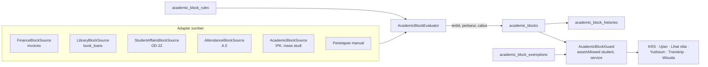

**`academic_block_rules`** (per tenant):

| Kolom | Isi |
|---|---|
| `code`, `name`, `description` | Identitas aturan |
| `block_type` | `financial`, `academic`, `student_affairs`, `library`, `attendance`, `administrative` |
| `source` | `finance`, `library`, `student_affairs`, `attendance`, `academic`, `manual` |
| `restricted_services` | json array dari daftar layanan di bawah |
| `condition` | json parameter adapter, misalnya `{"min_outstanding_amount":1,"overdue_days":0,"invoice_periods":["current"]}` |
| `scope` | `term` (berlaku untuk semester) atau `until_resolved` |
| `study_program_id` | nullable (aturan khusus prodi) |
| `auto_revoke` | Cabut otomatis saat kondisi sumber tidak lagi terpenuhi |
| `is_active`, `effective_from`, `effective_until` | Masa aktif aturan |

**Daftar layanan yang dapat dibatasi** (`service` key): `krs`, `krs_change` (add/drop), `exam` (seluruh ujian), `exam_midterm`, `exam_final`, `view_grades`, `transcript`, `thesis_defense`, `yudisium`, `graduation`, `mbkm_registration`, `academic_letter`. Cekal kehadiran memiliki **cakupan kelas** (`academic_blocks.class_section_id`), sehingga hanya ujian kelas tersebut yang diblokir.

**Aturan default yang disarankan** (seluruhnya contoh dan dapat diubah):

| Aturan | `block_type` | `source` | `restricted_services` |
|---|---|---|---|
| Tunggakan semester berjalan | `financial` | `finance` | `krs`, `exam` |
| Akademik (mis. IPK di bawah ambang, melewati masa studi) | `academic` | `academic` | `krs` |
| Poin/pelanggaran kemahasiswaan | `student_affairs` | `student_affairs` | `yudisium` |
| Pinjaman/denda perpustakaan | `library` | `library` | `yudisium` |
| Kehadiran di bawah minimum | `attendance` | `attendance` | `exam` (per kelas) |

Catatan: "belum lulus prasyarat" dan "batas SKS" (contoh cekal akademik di referensi) ditegakkan sebagai validasi KRS per baris (A.4 R4, R6), bukan sebagai cekal tingkat mahasiswa, karena keduanya berlaku per mata kuliah. Cekal akademik dipakai untuk kondisi tingkat mahasiswa.

### A.8.4 Evaluasi beberapa cekal sekaligus

Seorang mahasiswa dapat memiliki beberapa `academic_blocks` aktif sekaligus. Keputusan per layanan:

```
allowed(student, service, context) =
  NOT EXISTS block b WHERE
      b.student_id = student
  AND b.status = 'active'
  AND service ∈ b.restricted_services
  AND (b.class_section_id IS NULL OR b.class_section_id = context.class_section_id)
  AND now ∈ [b.effective_from, b.expires_at)
  AND NOT EXISTS exemption e WHERE
          e.academic_block_id = b.id
      AND e.service = service
      AND e.status = 'active'
      AND now ∈ [e.valid_from, e.valid_until)
```

Artinya, layanan diizinkan **hanya jika tidak ada satu pun cekal aktif yang membatasi layanan itu tanpa dispensasi yang berlaku untuk layanan itu**. Dispensasi bersifat per cekal dan per layanan. Contoh: mahasiswa dengan cekal keuangan (`krs`, `exam`) dan cekal perpustakaan (`yudisium`) yang mendapat dispensasi keuangan untuk `exam` tetap tidak dapat KRS dan tetap tidak dapat yudisium.

Respons `AcademicBlockGuard` saat ditolak: 409 `ACADEMIC_BLOCKED` dengan `errors.blocks[]` berisi `block_type`, `reason`, unit penanggung jawab, `since`, dan instruksi penyelesaian. Data nominal keuangan tidak ditampilkan kepada pihak di luar mahasiswa dan Keuangan.

### A.8.5 Status, dispensasi, dan masa berlaku

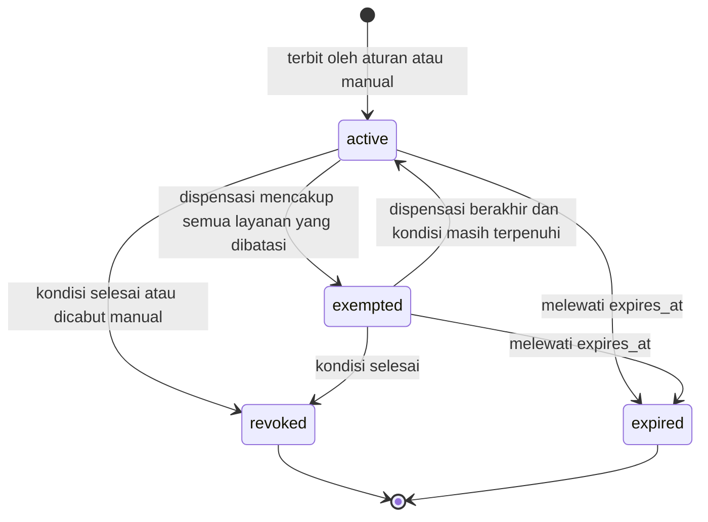

- **Terbit**: oleh evaluator (terjadwal, atau oleh event sumber seperti `InvoiceUpdated`, `AttendanceRecorded`, `GradesPublished`) atau manual (`imposed_by`, `reason` wajib). Penerbitan bersifat idempoten: satu cekal aktif per (`student_id`, `academic_block_rule_id`, `academic_term_id`, `class_section_id`).
- **Dispensasi** (`academic_block_exemptions`): `academic_block_id`, `service`, `valid_from`, `valid_until` (wajib, maksimum `academic.blocks.exemption_max_days`), `reason` (wajib), `granted_by`, `approval_request_id` (bila dispensasi melalui ApprovalWorkflow, mis. pengajuan mahasiswa → Keuangan/Kaprodi), `evidence_file_id`, `status` (`active`, `revoked`, `expired`). Setiap pemberian dan pencabutan dispensasi dicatat di `audit_logs` (aksi `approved`/`forced_override`) dan `academic_block_histories`.
- Bila dispensasi aktif mencakup **semua** `restricted_services`, cekal berstatus `exempted`. Bila hanya sebagian, cekal tetap `active` dan evaluasi per layanan berlaku.
- **Pencabutan**: otomatis bila `auto_revoke` dan kondisi sumber hilang (mis. tagihan lunas), atau manual (`revoked_by`, `reason`).
- **Kedaluwarsa**: job harian menandai `expired` untuk cekal dengan `expires_at` lewat (mis. cekal `scope = term` di akhir semester) dan dispensasi yang lewat `valid_until`. Bila dispensasi berakhir dan cekal masih ada, status kembali `active` dan mahasiswa dinotifikasi.
- **Riwayat** (`academic_block_histories`): `academic_block_id`, `action` (`imposed`, `exempted`, `exemption_revoked`, `exemption_expired`, `reactivated`, `revoked`, `expired`), `from_status`, `to_status`, `actor_id` (null = sistem), `reason`, `payload`. Append-only.
- **Notifikasi**: mahasiswa saat cekal terbit, dispensasi diberikan/berakhir, dan cekal dicabut. Dosen wali menerima ringkasan. Unit sumber menerima laporan harian.

### A.8.6 Adapter sumber

| Adapter | Status sumber | Kondisi (contoh, dapat dikonfigurasi) | Pemicu |
|---|---|---|---|
| `FinanceBlockSource` | **Ada**: `invoices` (`amount`, `paid_amount`, `status` unpaid/partial/paid, `due_date`) di `app/Modules/Finance` | Ada invoice periode relevan dengan `status ≠ paid` dan `due_date + grace_days < hari ini` dan sisa ≥ `min_outstanding_amount` | Event pembayaran + job harian |
| `LibraryBlockSource` | **Ada**: `book_loans` (`status` dipinjam/dikembalikan/terlambat, `fine_amount`) di `app/Modules/Library` | Ada pinjaman berstatus `dipinjam`/`terlambat`, atau `fine_amount > 0` belum lunas. Status pelunasan denda belum terstruktur ([OD-22](16-open-decisions.md#od-22)) | Job harian + saat pengajuan yudisium |
| `StudentAffairsBlockSource` | **Belum ada** modul poin kemahasiswaan ([OD-22](16-open-decisions.md#od-22)) | Sementara: cekal manual oleh unit kemahasiswaan (`source = manual`, `block_type = student_affairs`) atau impor. Adapter otomatis menyusul saat modul tersedia | Manual/impor |
| `AttendanceBlockSource` | Internal (A.5) | `persen_hadir < min_exam_percentage` pada tanggal acuan, per kelas | Event presensi + menjelang periode ujian |
| `AcademicBlockSource` | Internal | Contoh: IPK < ambang, melewati batas masa studi, status administrasi belum lengkap | Setelah publikasi nilai, awal periode KRS |

Adapter mengimplementasikan kontrak `BlockSource::evaluate(Student, AcademicTerm, array $condition): BlockDecision`. Bila sumber tidak tersedia (modul nonaktif), evaluasi menghasilkan "tidak diketahui" dan **tidak** menerbitkan cekal. Kegagalan dicatat untuk pemantauan ([06](06-integrasi-arsitektur.md)).

### A.8.7 Aturan validasi

| ID | Aturan |
|---|---|
| BR-SIA-CKL-01 | Layanan `s` diizinkan bila dan hanya bila tidak ada cekal `active` yang mencakup `s` (dan kelas konteks) tanpa dispensasi `active` untuk `s` |
| BR-SIA-CKL-02 | Penerbitan cekal otomatis idempoten per (mahasiswa, aturan, semester, kelas) |
| BR-SIA-CKL-03 | Cekal manual dan pencabutan manual wajib berisi alasan dan tercatat di audit dan riwayat |
| BR-SIA-CKL-04 | Dispensasi wajib per layanan, beralasan, memiliki `valid_until` ≤ `valid_from` + `academic.blocks.exemption_max_days`, dan diberikan oleh pemegang `academic_block_exemptions.approve` yang berwenang atas `block_type` tersebut (mis. Keuangan untuk `financial`) |
| BR-SIA-CKL-05 | Cekal dengan `auto_revoke` dicabut otomatis saat evaluasi sumber tidak lagi terpenuhi |
| BR-SIA-CKL-06 | Dispensasi yang berakhir mengembalikan cekal ke `active` bila kondisi masih terpenuhi, dan mengirim notifikasi |
| BR-SIA-CKL-07 | Guard diperiksa di server pada setiap titik layanan (KRS: gerbang, pengajuan, persetujuan; ujian: mulai attempt; nilai: endpoint lihat nilai; yudisium: pengajuan). UI hanya menampilkan |
| BR-SIA-CKL-08 | Sumber yang tidak tersedia tidak boleh menghasilkan cekal |
| BR-SIA-CKL-09 | Informasi nominal tagihan tidak ditampilkan dalam pesan cekal kepada dosen wali/dosen pengajar |

### A.8.8 Data, konfigurasi, akses, integrasi, OD

- **Data:** `academic_block_rules`, `academic_blocks` (`student_id`, `academic_block_rule_id` nullable, `academic_term_id`, `class_section_id` nullable, `block_type`, `source`, `restricted_services` snapshot, `reason`, `source_reference_type/id`, `status`, `effective_from`, `expires_at`, `imposed_by`, `revoked_by`, `revoked_at`), `academic_block_exemptions`, `academic_block_histories`. Lihat [07-database-erd.md](07-database-erd.md) bagian Cekal.
- **Konfigurasi:**

| Key | Contoh |
|---|---|
| `academic.blocks.enabled_sources` | `["finance","library","attendance","academic","manual"]` |
| `academic.blocks.finance.grace_days` | `7` |
| `academic.blocks.finance.min_outstanding_amount` | `1` |
| `academic.blocks.exemption_max_days` | `30` |
| `academic.blocks.evaluation_time` | `"02:00"` |
| `academic.blocks.notify_channels` | `["database","mail"]` |

- **Hak akses:**
  - `academic_block_rules.*`: BAAK, Admin PT.
  - `academic_blocks.create/update` (manual): BAAK dan unit sesuai `block_type` (Keuangan `finance_administrator`, Perpustakaan `library_administrator`).
  - `academic_block_exemptions.create/approve`: per `block_type`, wajib audit.
  - `academic_blocks.read`: mahasiswa (miliknya), dosen wali (perwalian, tanpa nominal), Kaprodi (prodi).
  - Lihat [11](11-roles-permissions.md).
- **Integrasi:** Finance, Library, modul Kemahasiswaan (belum ada), CBT (guard `exam` saat mulai attempt), yudisium (di luar ruang lingkup). Lihat [06](06-integrasi-arsitektur.md).
- **OD:** [OD-22](16-open-decisions.md#od-22), [OD-06](16-open-decisions.md#od-06).

---
## A.9 Layanan Akademik Lain

### A.9.0 Pola umum layanan

Seluruh layanan berbasis pengajuan memakai pola yang sama dengan `StudentRequestService` yang sudah ada:

1. Entitas layanan menyimpan data bisnis dan `status`.
2. Persetujuan dijalankan oleh **ApprovalWorkflow** (`ApprovalRequestService::submit()`, `WorkflowSelector` memilih workflow per jenis layanan/prodi, `ApprovalActionService` untuk approve/reject/return).
3. Listener (seperti `SyncStudentRequestDecision`) menyinkronkan keputusan akhir ke status entitas.
4. Dokumen pendukung diunggah lewat `POST /file-uploads` dan ditautkan dengan `FileAttacher` (polymorphic `fileable`).
5. Riwayat = `approval_histories` + `audit_logs` + histori khusus layanan bila ada.
6. Notifikasi lewat `StudentNotificationService`.

| Layanan | Label | Status | Entitas | Workflow |
|---|---|---|---|---|
| Transfer mahasiswa & konversi nilai | [Referensi] | (Baru) | `student_transfers`, `credit_conversions` | Ya |
| Double degree | [Referensi] | (Baru) | `double_degree_enrollments` | Ya |
| Proposal TA & pengajuan judul | [Referensi] | (Parsial) | `theses` | Ya |
| Penetapan pembimbing | [Referensi] | (Parsial) | `thesis_supervisors` | Ya |
| Seminar proposal & sidang | [Referensi] | (Parsial) | `thesis_examinations`, `thesis_examiners` | Penjadwalan |
| Bimbingan TA | [Referensi] | (Baru) | `thesis_guidance_records` | Validasi pembimbing |
| Cuti studi | [Referensi] | (Ada) | `student_requests` type `leave` | Ya (ada) |
| Aktif kembali | [Rekomendasi] | (Ada) | `student_requests` type `reactivation` | Ya (ada) |
| Kalender akademik | [Referensi] | (Ada) | `academic_calendar_events` + `academic_term_periods` | — |
| Pemutihan nilai | [Referensi] | (Baru) | `grade_revisions` `remediation` (A.6.7) | Ya |
| Pengumuman massal email & SMS | [Referensi] | (Parsial) | Modul `Announcement` (ada) + `NotificationDispatcher` | Opsional |
| Akses orang tua (nilai, kehadiran, tagihan) | [Referensi] | (Baru) | `student_guardians`, role `guardian` | Verifikasi |

### A.9.1 Transfer mahasiswa dan konversi nilai

**Jenis:** `incoming_external` (pindahan dari PT lain), `internal_program` (pindah prodi dalam PT), `outgoing` (keluar ke PT lain). Disimpan di `student_transfers.transfer_type`.

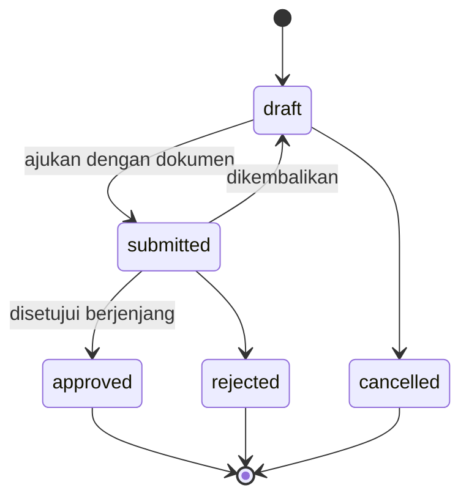

Status `student_transfers` memakai himpunan yang sama dengan `student_requests` (`draft`, `submitted`, `approved`, `rejected`, `cancelled`).

| Tahap | Rincian |
|---|---|
| Dokumen pendukung | Transkrip asal, surat keterangan pindah, surat keterangan bebas tanggungan, akreditasi prodi asal (eksternal), surat persetujuan Kaprodi asal (internal) |
| Persetujuan default | Kaprodi tujuan → Dekan → BAAK (dikonfigurasi di ApprovalWorkflow) |
| Konversi | Setelah disetujui, Kaprodi tujuan menyusun `credit_conversions` (`source_type = transfer`, `student_id`, `status`: `draft` → `submitted` → `approved` → `applied`, atau `rejected`). Setiap `credit_conversion_items`: MK asal (kode, nama, SKS, nilai asal) → `course_id` tujuan, huruf hasil konversi (dari skala tujuan), SKS diakui, catatan |
| Penerapan | `applied` membuat nilai yang diakui (`grades` bersumber konversi), mengisi `students.curriculum_id` bila perlu, dan untuk `internal_program` memindahkan `students.study_program_id` dengan riwayat status. Nilai lama tetap tersimpan |
| Riwayat | `approval_histories`, `audit_logs` atas `students`, `student_status_histories` |

Batas SKS yang dapat diakui: `academic.transfer.max_recognized_credits` (contoh dan perlu kebijakan kampus). Bentuk penyimpanan nilai konversi (baris `grades` tanpa `krs_item` vs entitas sendiri) dicatat sebagai **OD-NEW-nilai-konversi**, karena `grades.krs_item_id` saat ini unik dan wajib.

### A.9.2 Double degree

`double_degree_enrollments`: `student_id`, `program_type` (`internal` dua prodi dalam PT / `partner` dengan PT mitra), `second_study_program_id` atau `partner_institution` (→ `mbkm_partners` bila mitra sama), `curriculum_id` program kedua, `status` (`proposed`, `active`, `completed`, `withdrawn`), `agreement_file_id`. Alur: pengajuan mahasiswa → persetujuan kedua Kaprodi (workflow) → `active`. KRS mahasiswa dapat memuat MK dari kurikulum kedua (offering diperluas di A.4 R1). Pengakuan MK bersama memakai `credit_conversions`. Bentuk transkrip (satu atau dua transkrip, MK bersama) bergantung pada [OD-23](16-open-decisions.md#od-23).

### A.9.3 Tugas akhir: proposal, judul, pembimbing, seminar, sidang, bimbingan

Saat ini `theses` (modul `Thesis`) hanya memiliki satu `supervisor_lecturer_id`, status ringkas, dan endpoint index/show. Rancangan memperluasnya.

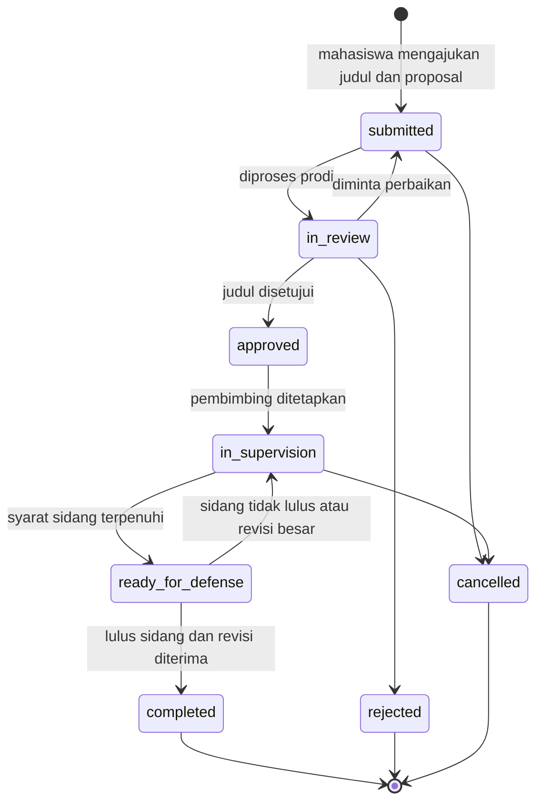

**Pemetaan enum lama → kanon** (migrasi data `theses.status`):

| Nilai lama | Nilai kanon | Catatan |
|---|---|---|
| `proposal` | `submitted` | Bila sudah ada pembimbing (`supervisor_lecturer_id` terisi) → `in_supervision` |
| `bimbingan` | `in_supervision` | |
| `seminar_proposal` | `in_supervision` | Dibuat `thesis_examinations` `exam_type = proposal_seminar` (status sesuai data) |
| `penelitian` | `in_supervision` | |
| `sidang` | `ready_for_defense` | Dibuat `thesis_examinations` `exam_type = final_defense` |
| `selesai` | `completed` | |

`theses.supervisor_lecturer_id` dimigrasikan menjadi `thesis_supervisors` (`role = primary`) dan dipertahankan sebagai kolom kompatibel.

| Sub-layanan | Entitas & rincian | Persetujuan | Dokumen |
|---|---|---|---|
| Pengajuan judul & proposal | `theses` (`title`, `abstract`, `thesis_type`, `topic_area`, `proposed_supervisor_ids`), syarat SKS lulus minimum `academic.thesis.min_credits_to_apply` dan periode `thesis_registration` | Workflow: Kaprodi/komisi TA | Draf proposal (PDF) |
| Penetapan pembimbing | `thesis_supervisors` (`lecturer_id`, `role` = `primary`/`co`, `assigned_by`, `assigned_at`, `ended_at`). Maksimum `academic.thesis.max_supervisors`. Beban pembimbing per dosen dipantau `academic.thesis.max_students_per_supervisor` | Kaprodi, dengan SK opsional | SK pembimbing |
| Bimbingan | `thesis_guidance_records` (`thesis_id`, `lecturer_id`, `meeting_at`, `topic`, `student_notes`, `supervisor_feedback`, `status` = `submitted`/`acknowledged`, lampiran). Hanya `acknowledged` oleh pembimbing yang dihitung | Pembimbing mengonfirmasi | Draf bab |
| Seminar proposal & sidang | `thesis_examinations` (`exam_type` = `proposal_seminar`/`final_defense`, `scheduled_at`, `room_id`, `status` = `scheduled`/`held`/`cancelled`/`rescheduled`, `result` = `pass`/`pass_with_revision`/`fail`, `revision_deadline`), `thesis_examiners` (`lecturer_id`, `role` = `chair`/`examiner`/`secretary`, `score`). Syarat daftar sidang: minimal `academic.thesis.min_guidance_before_defense` bimbingan `acknowledged`, persetujuan semua pembimbing, tidak ada cekal `thesis_defense`. Penjadwalan memakai validasi bentrok dosen & ruang (A.3) | Kaprodi menetapkan penguji | Naskah, lembar persetujuan, bukti bebas plagiasi (opsional) |
| Nilai TA | Nilai sidang dikonversi ke `grades` MK tugas akhir di KRS mahasiswa melalui `assessment_components` kelas TA | Alur A.6 | Berita acara sidang |

Riwayat: `approval_histories`, `audit_logs` atas `theses`/`thesis_supervisors`, daftar `thesis_guidance_records` dan `thesis_examinations`.

### A.9.4 Cuti studi dan aktif kembali

Sudah ada: `student_requests` type `leave`/`reactivation` dengan status `draft` → `submitted` → `approved`/`rejected`/`cancelled`, persetujuan via ApprovalWorkflow, dan listener `SyncStudentRequestDecision`. Penambahan rancangan:

- Validasi batas cuti: `academic.leave.max_terms_total` dan `academic.leave.max_consecutive_terms` (contoh 2 dan 2).
- Tidak ada cekal `academic_letter`/keuangan sesuai kebijakan.
- Pengajuan hanya dalam periode tertentu.
- Saat `approved`, `students.status = leave` untuk semester terkait, tercatat di `student_status_histories`. KRS semester itu dibatalkan (`cancelled`) bila masih draft. Aktif kembali mengembalikan status `active` mulai semester berikutnya.
- Dokumen: surat permohonan, bukti pendukung (mis. surat keterangan).

### A.9.5 Kalender akademik

`academic_calendar_events` (ada) tetap untuk tampilan. Proses yang mengikat membaca `academic_term_periods` (A.1), dan dengan `academic.term.calendar_sync = true` periode otomatis tampil di kalender. Kategori `holiday` dipakai untuk melewati tanggal saat membangkitkan `lecture_sessions` (A.5).

### A.9.6 Pemutihan nilai

Dijalankan sebagai `grade_revisions` `revision_type = remediation` (A.6.7). Pola program pemutihan massal: BAAK membuka periode, mahasiswa memilih MK yang memenuhi syarat, lalu dosen/Kaprodi mengusulkan nilai baru dan persetujuan berjalan per revisi. Aturan: BR-SIA-NIL-11, [OD-08](16-open-decisions.md#od-08).

### A.9.7 Pengumuman massal email dan SMS

Modul `Announcement` sudah ada (`announcements`: `target_scope` universitas/fakultas/program_studi, `audience`, `target_admission_year`, `target_semester`, `published_at`) untuk pengumuman di portal. Rancangan menambahkan **pengiriman multi-kanal**:

1. Penyusun memilih target berdasarkan scope, prodi, angkatan, semester, status mahasiswa, kelas tertentu, atau mahasiswa tercekal.
2. Penyusun memilih kanal `database`/`push`/`mail`/`sms`/`whatsapp` dan template `notification_templates`.
3. Sistem menampilkan pratinjau jumlah penerima (dan estimasi biaya SMS).
4. Pengiriman dilakukan via antrean dalam batch melalui `NotificationDispatcher`. Status per penerima mengikuti log notifikasi.

| Aturan | Isi |
|---|---|
| BR-SIA-LYN-01 | Pengumuman massal ke > `academic.announcement.approval_threshold` penerima, atau yang memakai SMS, memerlukan persetujuan (workflow) |
| BR-SIA-LYN-02 | SMS hanya bila `academic.announcement.sms_enabled = true` dan penyedia dikonfigurasi ([OD-24](16-open-decisions.md#od-24)). Kuota/biaya dipantau per tenant |
| BR-SIA-LYN-03 | Pengiriman idempoten per (pengumuman, penerima, kanal). Pengiriman ulang hanya untuk yang gagal |

### A.9.8 Akses orang tua/wali

Orang tua login sebagai pengguna dengan role `guardian` dan relasi `student_guardians` (`user_id`, `student_id`, `relationship` = `father`/`mother`/`guardian`, `verification_status` = `pending`/`verified`/`rejected`, `verified_by`, `student_consent_status` = `pending`/`granted`/`revoked`, `consented_at`, `access_scopes` json, misalnya `["grades","attendance","invoices"]`).

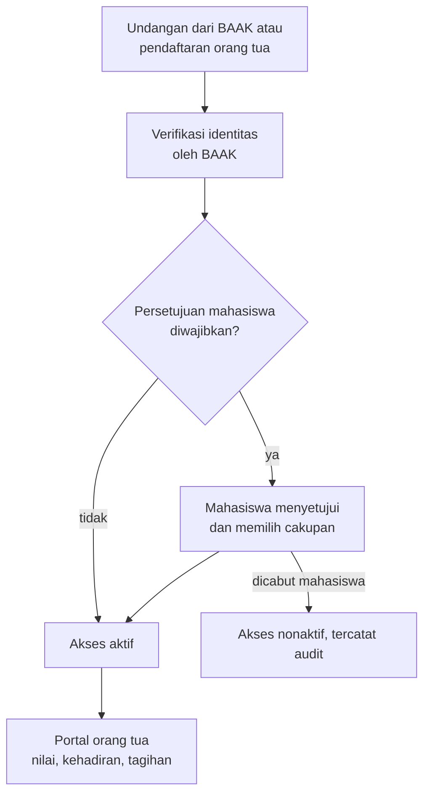

| Aturan | Isi |
|---|---|
| BR-SIA-LYN-04 | Orang tua hanya melihat mahasiswa yang terhubung dengan `verification_status = verified` dan, bila `academic.guardian.require_student_consent = true`, `student_consent_status = granted` ([OD-21](16-open-decisions.md#od-21)) |
| BR-SIA-LYN-05 | Cakupan terbatas `access_scopes`: nilai terpublikasi (bukan komponen), rekap kehadiran, ringkasan tagihan (dari Keuangan). Tidak ada akses ke catatan konsultasi, cekal non-keuangan secara rinci, atau dokumen pribadi |
| BR-SIA-LYN-06 | Akses orang tua bersifat read-only. Setiap tampilan data sensitif dicatat (`viewed_sensitive`) |

### A.9.9 Konfigurasi, akses, integrasi, OD

- **Konfigurasi:** `academic.transfer.max_recognized_credits`, `academic.thesis.min_credits_to_apply` (contoh `110`), `academic.thesis.max_supervisors` (`2`), `academic.thesis.max_students_per_supervisor` (`10`), `academic.thesis.min_guidance_before_defense` (`8`), `academic.leave.max_terms_total` (`2`), `academic.leave.max_consecutive_terms` (`2`), `academic.announcement.approval_threshold` (`500`), `academic.announcement.sms_enabled` (`false`), `academic.guardian.require_student_consent` (`true`).
- **Hak akses:** `student_transfers.*`, `credit_conversions.*` (Kaprodi/BAAK), `theses.*` (mahasiswa miliknya, pembimbing, Kaprodi), `student_requests.*` (ada), `academic_calendar.*` (ada), `guardian_portal.read` (orang tua). Lihat [11](11-roles-permissions.md).
- **Integrasi:** ApprovalWorkflow, Notification, FileManagement, Finance (tagihan untuk orang tua dan bebas tanggungan), Announcement. Lihat [06](06-integrasi-arsitektur.md).
- **OD:** [OD-21](16-open-decisions.md#od-21), [OD-23](16-open-decisions.md#od-23), [OD-24](16-open-decisions.md#od-24), [OD-08](16-open-decisions.md#od-08), OD-NEW-nilai-konversi.

---
## A.10 MBKM

### A.10.1 Tujuan

Mengelola program Merdeka Belajar Kampus Merdeka dari penawaran sampai konversi: pertukaran pelajar antarprodi (internal dan dengan PT eksternal), delapan bentuk kegiatan, pengelolaan mitra, pendaftaran dan seleksi, penetapan pembimbing, logbook, evaluasi, konversi ke SKS/MK, serta rekap kontribusi IKU (paket Enterprise). MBKM menjadi modul `app/Modules/Mbkm` yang bergantung pada `Academic` ([README §4](README.md#4-arsitektur-umum)).

### A.10.2 Fitur dan pemisahan paket

| Fitur | Label | Status | Feature key | Paket referensi |
|---|---|---|---|---|
| Pertukaran pelajar antarprodi (internal) | [Referensi] | (Baru) | `siakad.mbkm` | Growth (standar) |
| Pertukaran dengan PT eksternal (keluar & masuk) | [Referensi] | (Baru) | `siakad.mbkm` | Growth (standar) |
| 8 aktivitas kampus merdeka | [Referensi] | (Parsial) | `siakad.mbkm` | Growth (standar) |
| Penawaran aktivitas MBKM | [Referensi] | (Baru) | `siakad.mbkm` | Growth (standar) |
| Mitra PT & instansi | [Referensi] | (Baru) | `siakad.mbkm` | Growth (standar) |
| Pengajuan & seleksi | [Referensi] | (Baru) | `siakad.mbkm` | Growth (standar) |
| Penetapan pembimbing | [Referensi] | (Baru) | `siakad.mbkm` | Growth (standar) |
| Logbook & evaluasi | [Referensi] | (Baru) | `siakad.mbkm` | Growth (standar) |
| Konversi ke SKS/MK | [Referensi] | (Parsial) | `siakad.mbkm` | Growth (standar). Saat ini hanya `internships.sks_converted` (angka) |
| **Perhitungan pencapaian IKU otomatis** | [Referensi] | (Baru) | `siakad.mbkm.iku` | **Enterprise** |
| Rekap MBKM manual (laporan jumlah peserta per aktivitas) | [Rekomendasi] | (Baru) | `siakad.mbkm` | Standar, tanpa perhitungan IKU |

Pemetaan Growth/Enterprise ke paket Civitas One mengikuti [OD-01](16-open-decisions.md#od-01). Tanpa `siakad.mbkm.iku`, menu IKU tidak tampil dan endpoint `/mbkm/iku-*` mengembalikan 403 (lapis entitlement, [11](11-roles-permissions.md)).

### A.10.3 Jenis aktivitas

`mbkm_programs.activity_type`:

| Kode | Aktivitas | Catatan khusus |
|---|---|---|
| `student_exchange` | Pertukaran pelajar | Subtipe `exchange_scope`: `internal_inter_program` (antarprodi dalam PT), `external_outbound` (mahasiswa kita ke PT lain), `external_inbound` (mahasiswa PT lain ke kampus ini) |
| `internship` | Magang/praktik kerja | Relasi dengan modul `Internship`, lihat A.10.8 |
| `teaching_assistance` | Asistensi mengajar di satuan pendidikan | Mitra: sekolah |
| `research` | Penelitian/riset | Mitra: lembaga riset, dapat internal |
| `humanitarian_project` | Proyek kemanusiaan | |
| `entrepreneurship` | Kegiatan wirausaha | |
| `independent_study` | Studi/proyek independen | |
| `village_development` | Membangun desa/KKN tematik | Relasi dengan `internships.program_type = kkn` |

### A.10.4 Entitas

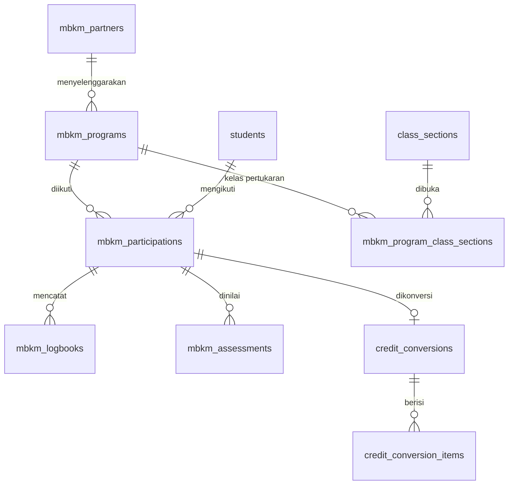

| Tabel | Kolom kunci |
|---|---|
| `mbkm_partners` | `name`, `partner_type` (`university`, `company`, `government`, `school`, `ngo`, `village`, `research_institution`), `country`, `contact_person`, `agreement_number`, `agreement_file_id`, `agreement_valid_from/until`, `is_active` |
| `mbkm_programs` | `activity_type`, `exchange_scope`, `mbkm_partner_id`, `organizer_study_program_id`, `academic_term_id`, `title`, `description`, `quota`, `max_credits`, `eligibility` json (semester minimum, IPK minimum, prodi yang boleh), `registration_start_at/end_at`, `start_date`, `end_date`, `logbook_frequency`, `status` (kanon) |
| `mbkm_program_class_sections` | Pivot program `student_exchange` ↔ `class_sections` yang dibuka untuk peserta (Baru, di luar kanon, lihat laporan) |
| `mbkm_participations` | `mbkm_program_id`, `student_id` (nullable untuk peserta inbound sebelum dibuatkan identitas), `external_participant` json (inbound), `status` (kanon), `academic_supervisor_id` (→ `lecturers`), `field_supervisor_name/contact`, `selection_score`, `selection_note`, `final_score`, `decided_by` |
| `mbkm_logbooks` | `mbkm_participation_id`, `entry_date` atau `week_number`, `activity`, `output`, `hours`, `attachment_file_id`, `status` (`draft`, `submitted`, `approved`, `revision_requested`), `reviewed_by`, `feedback` |
| `mbkm_assessments` | `mbkm_participation_id`, `assessor_type` (`academic_supervisor`, `field_supervisor`), `component`, `weight`, `score`, `assessed_by`, `assessed_at` |
| `credit_conversions` (`source_type = mbkm`) | `mbkm_participation_id`, item ke `course_id` dengan huruf & SKS |
| `iku_snapshots` (Enterprise) | `academic_term_id`/tahun, `indicator_code`, `numerator`, `denominator`, `value`, `calculation_version`, `calculated_at`, `detail` json |

### A.10.5 Alur utama

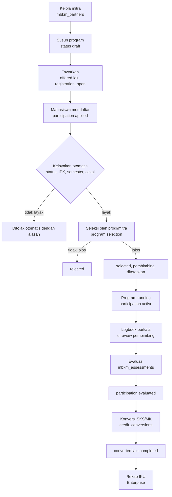

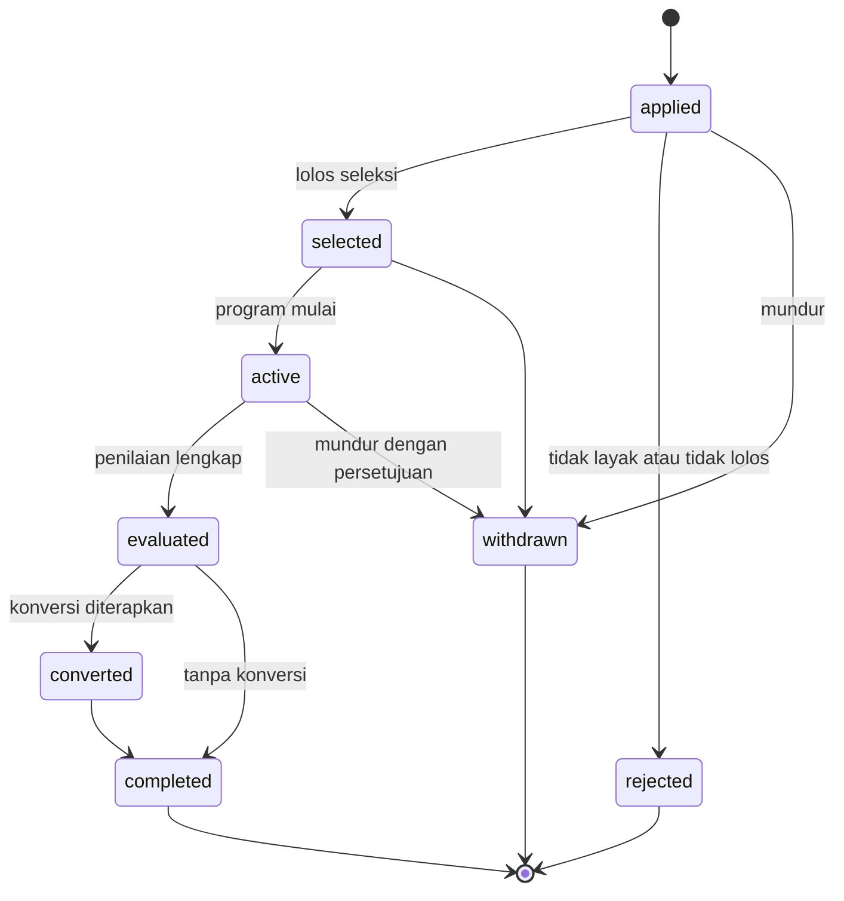

Langkah rinci:

1. **Mitra:** BAAK/unit kerja sama mengelola `mbkm_partners` beserta dokumen kerja sama. Program hanya boleh menunjuk mitra yang kerja samanya berlaku pada periode program.
2. **Penawaran:** prodi penyelenggara menyusun program, kuota, kelayakan, dan rencana konversi (daftar MK yang dapat dikonversi beserta SKS maksimum). Program dipublikasikan (`offered`), lalu pendaftaran dibuka (`registration_open`) sesuai periode `mbkm_registration`.
3. **Pendaftaran & seleksi:** mahasiswa mendaftar dengan dokumen. Sistem memeriksa kelayakan (status aktif, `eligibility`, tidak ada cekal `mbkm_registration`, batas total semester/SKS MBKM). Seleksi dilakukan prodi dan/atau mitra (skor, catatan), lalu hasil diumumkan.
4. **Pembimbing:** dosen pembimbing akademik (`academic_supervisor_id`) ditetapkan Kaprodi. Pembimbing lapangan dicatat dari mitra.
5. **Pelaksanaan & logbook:** peserta mengisi logbook sesuai `logbook_frequency`. Pembimbing menyetujui atau meminta revisi. Kepatuhan logbook (persentase entri tepat waktu) tampil di dashboard.
6. **Evaluasi:** penilaian pembimbing akademik dan lapangan dengan komponen dan bobot. Nilai akhir memakai rumus yang sama dengan A.6.4 dan skala A.6.5.
7. **Konversi:** Kaprodi menyusun `credit_conversions` (`source_type = mbkm`). Konversi dapat berupa MK spesifik di kurikulum mahasiswa atau MK pilihan MBKM dengan SKS setara, lalu disetujui (workflow) dan diterapkan sebagai nilai yang diakui (A.9.1, OD-NEW-nilai-konversi).
8. **Pertukaran antarprodi internal:** peserta `selected` dapat mengambil kelas dari `mbkm_program_class_sections` lewat KRS biasa. A.4 R1 diperluas: kelas prodi lain diizinkan bila mahasiswa memiliki partisipasi `active`/`selected` di program yang membuka kelas tersebut. Nilai kelas tersebut dicatat normal, lalu dikonversi ke MK kurikulum asal bila berbeda.
9. **Pertukaran eksternal:**
   - Outbound: nilai dari PT tujuan dimasukkan sebagai `credit_conversion_items` (MK asal di PT mitra → MK tujuan).
   - Inbound: peserta luar perlu identitas untuk KRS dan LMS. Rancangan: buat `students` dengan penanda peserta non-reguler. Keputusan bentuknya adalah **OD-NEW-mbkm-inbound**.

### A.10.6 Aturan validasi

| ID | Aturan |
|---|---|
| BR-MBK-PRG-01 | Program hanya dapat `registration_open` bila mitra aktif dan kerja sama berlaku sepanjang `start_date`–`end_date` |
| BR-MBK-PRG-02 | Jumlah peserta `selected` + `active` ≤ `quota` |
| BR-MBK-PAR-01 | Pendaftar harus `students.status = active`, memenuhi `eligibility`, dan tidak dicekal untuk layanan `mbkm_registration` |
| BR-MBK-PAR-02 | Total keikutsertaan MBKM di luar prodi per mahasiswa ≤ `academic.mbkm.max_terms_outside_program` semester dan SKS konversi per semester ≤ `academic.mbkm.max_credits_per_term` (angka contoh, kebijakan kampus) |
| BR-MBK-PAR-03 | Seorang mahasiswa tidak boleh memiliki dua partisipasi `active` dengan periode tumpang tindih kecuali `academic.mbkm.allow_concurrent = true` |
| BR-MBK-LOG-01 | Logbook hanya dapat diisi saat partisipasi `active`. Entri `approved` tidak dapat diubah |
| BR-MBK-EVA-01 | Partisipasi menjadi `evaluated` hanya bila seluruh komponen penilaian berbobot terisi dan logbook memenuhi `academic.mbkm.min_logbook_compliance` |
| BR-MBK-KNV-01 | Total SKS diakui ≤ `mbkm_programs.max_credits`. Setiap MK tujuan tidak boleh sudah lulus dengan nilai lebih baik kecuali kebijakan pengulangan mengizinkan |
| BR-MBK-KNV-02 | Konversi `applied` hanya setelah persetujuan, tercatat audit, dan memicu hitung ulang IPK |
| BR-MBK-IKU-01 | Perhitungan IKU hanya berjalan bila `siakad.mbkm.iku` aktif. Hasil disimpan sebagai `iku_snapshots` berversi, bukan ditimpa |

### A.10.7 Rekap IKU (Enterprise)

- **Standar (semua paket dengan `siakad.mbkm`):** laporan jumlah peserta per aktivitas, per prodi, per mitra, SKS terkonversi, dan status. Tanpa label IKU.
- **Enterprise (`siakad.mbkm.iku`):** job menghitung indikator IKU yang terkait kegiatan di luar kampus berdasarkan definisi yang dikonfigurasi `academic.mbkm.iku_definitions` (indikator, pembilang, penyebut, filter aktivitas, minimum SKS diakui). Hasil disimpan di `iku_snapshots` dengan `calculation_version` dan rincian mahasiswa terhitung, untuk ditelusuri.

Definisi indikator, ambang SKS yang diakui, dan sumber data penyebut **tidak** ditetapkan dalam rancangan ini. Semuanya bergantung pada [OD-13](16-open-decisions.md#od-13). Dashboard IKU institusi di luar ruang lingkup.

### A.10.8 Relasi dengan modul `Internship`

`internships` (ada) mencatat magang/KKN/MBKM secara sederhana (`program_type`, `sks_converted` angka, status `terdaftar`/`berlangsung`/`selesai`/`dibatalkan`). Rancangan:

| Opsi ([OD-14](16-open-decisions.md#od-14)) | Konsekuensi |
|---|---|
| A. `internships` dipertahankan untuk magang non-MBKM (wajib kurikulum), MBKM memakai entitas baru | Dua tempat data magang. Laporan harus menggabungkan |
| B. Migrasi seluruh `internships` ke `mbkm_participations` (`activity_type = internship`/`village_development`) lalu `internships` read-only | Satu sumber. Butuh migrasi status: `terdaftar` → `selected`, `berlangsung` → `active`, `selesai` → `completed` (tanpa konversi bila `sks_converted` tidak dapat dipetakan ke MK), `dibatalkan` → `withdrawn` |

Sebelum OD-14 diputuskan, entri baru MBKM tidak lagi dibuat di `internships.program_type = mbkm`.

### A.10.9 Konfigurasi, akses, integrasi, OD

- **Konfigurasi:**

| Key | Contoh |
|---|---|
| `academic.mbkm.max_terms_outside_program` | `3` |
| `academic.mbkm.max_credits_per_term` | `20` |
| `academic.mbkm.allow_concurrent` | `false` |
| `academic.mbkm.min_logbook_compliance` | `80` (persen) |
| `academic.mbkm.default_logbook_frequency` | `"weekly"` |
| `academic.mbkm.iku_definitions` | daftar definisi (Enterprise, [OD-13](16-open-decisions.md#od-13)) |

- **Hak akses:**
  - `mbkm_partners.*`, `mbkm_programs.*`: BAAK, admin prodi penyelenggara.
  - `mbkm_participations.create`: mahasiswa.
  - `mbkm_participations.approve` (seleksi, pembimbing): Kaprodi.
  - `mbkm_logbooks.*`: peserta (tulis), pembimbing (setujui).
  - `credit_conversions.approve`: Kaprodi.
  - `iku_reports.read`: pimpinan, LPM (Enterprise).
  - Endpoint di bawah `/mbkm/...`. Lihat [11](11-roles-permissions.md).
- **Integrasi:** konversi ke nilai SIAKAD (A.6, A.9.1), KRS lintas prodi (A.4), cekal (A.8), LMS untuk kelas pertukaran ([02](02-edlink-lms.md)), Internship ([OD-14](16-open-decisions.md#od-14)). Lihat [06](06-integrasi-arsitektur.md).
- **OD:** [OD-01](16-open-decisions.md#od-01), [OD-13](16-open-decisions.md#od-13), [OD-14](16-open-decisions.md#od-14), OD-NEW-mbkm-inbound, OD-NEW-nilai-konversi.

---

## Lampiran A — Ringkasan Konfigurasi `academic.*`

Semua key disimpan di `university_settings` (`group = 'academic'`). Nilai di dokumen ini adalah contoh. Nilai default produk ditetapkan saat implementasi dan dapat diubah per tenant.

| Prefix | Bagian | Keputusan terbuka |
|---|---|---|
| `academic.student_profile.*`, `academic.term.*`, `academic.import.*` | A.1 | — |
| `academic.curriculum.*` | A.2 | OD-03 |
| `academic.schedule.*` | A.3 | — |
| `academic.krs.*` | A.4 | OD-05, OD-08, OD-09 |
| `academic.attendance.*` | A.5 | OD-06 |
| `academic.grading.*` | A.6 | OD-04, OD-07, OD-08, OD-29 |
| `academic.advising.*` | A.7 | OD-28 |
| `academic.blocks.*` | A.8 | OD-22 |
| `academic.transfer.*`, `academic.thesis.*`, `academic.leave.*`, `academic.announcement.*`, `academic.guardian.*` | A.9 | OD-21, OD-23, OD-24 |
| `academic.mbkm.*` | A.10 | OD-13, OD-14 |

## Lampiran B — Ringkasan ID Aturan Bisnis

| Prefix | Area | Rentang |
|---|---|---|
| `BR-SIA-MST` | Data master | 01–09 |
| `BR-SIA-KUR` | Kurikulum | 01–08 |
| `BR-SIA-JDW` | Jadwal | 01–08 |
| `BR-SIA-KRS` | KRS | 01–13 |
| `BR-SIA-PRS` | Presensi | 01–08 |
| `BR-SIA-NIL` | Penilaian | 01–12 |
| `BR-SIA-WAL` | Perwalian | 01–04 |
| `BR-SIA-CKL` | Cekal | 01–09 |
| `BR-SIA-LYN` | Layanan lain | 01–06 |
| `BR-MBK-PRG`, `PAR`, `LOG`, `EVA`, `KNV`, `IKU` | MBKM | lihat A.10.6 |

Daftar resmi, state machine, dan skenario uji terkait ada di [10-business-rules.md](10-business-rules.md) dan [14-test-scenarios.md](14-test-scenarios.md).
