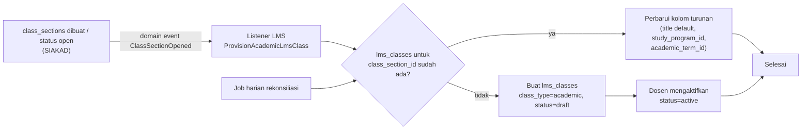
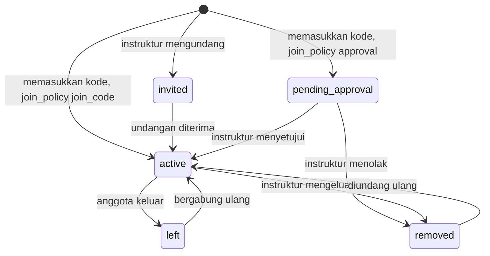
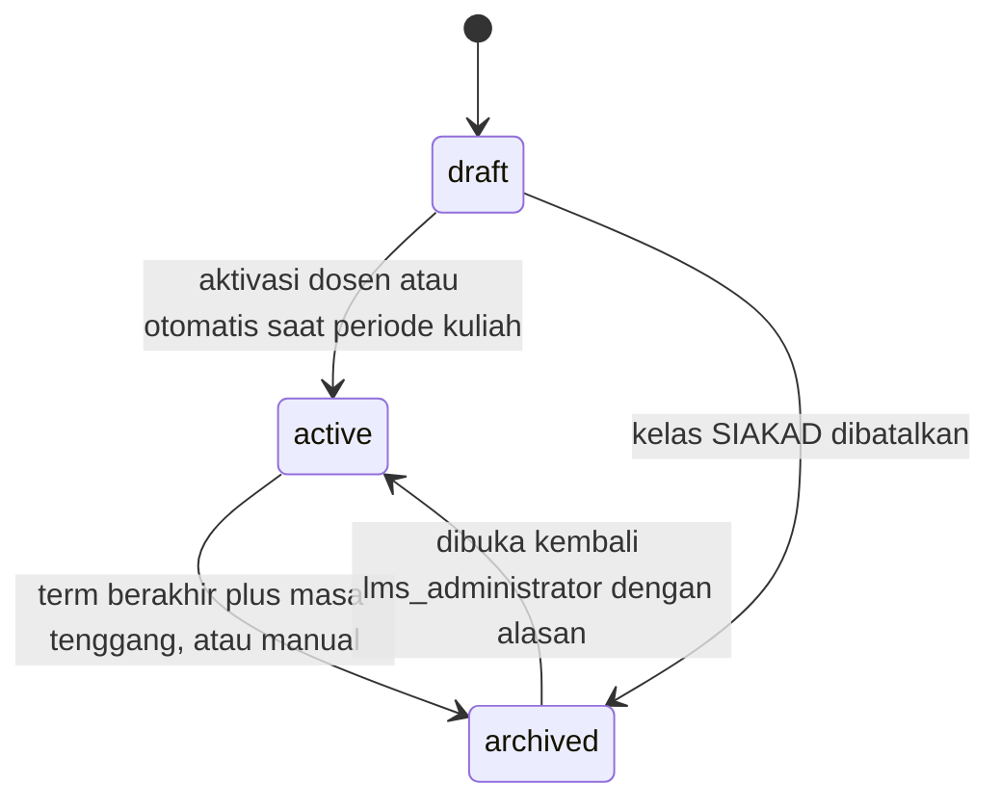
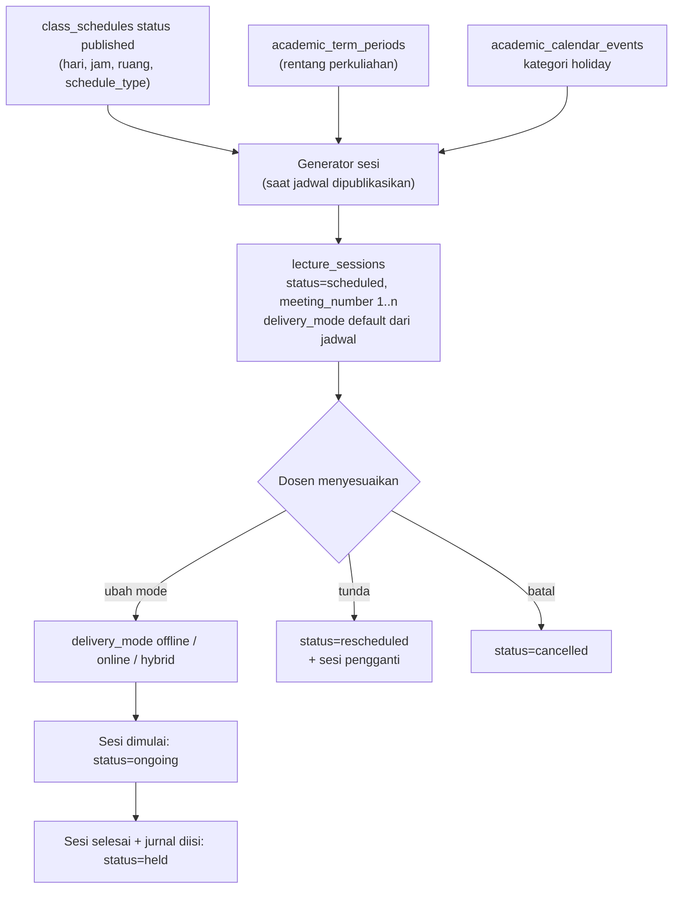
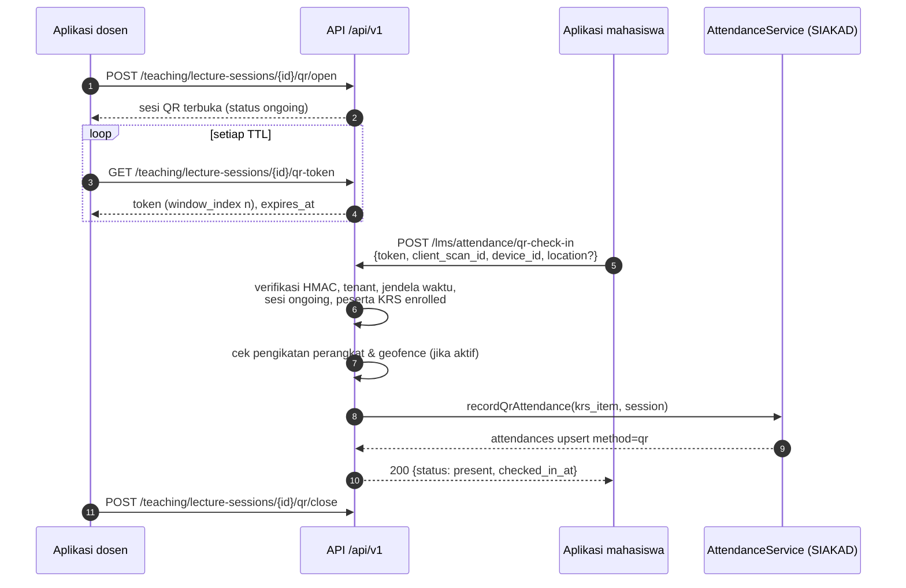
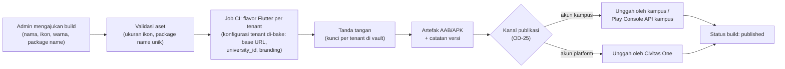

# 02 — EDLINK/LMS: Rancangan Fungsional (B.1–B.6)

> **Status:** rancangan (bukan dokumentasi fitur jadi). Tidak ada kode atau skema yang diubah.
> **Disusun:** 2026-10-11, berdasarkan repository pada commit `ab81cc7`.
> Kembali ke [README](README.md) · Kanon penamaan: [README §5](README.md#5-kanon-penamaan-wajib-diikuti-seluruh-dokumen) · Label: [README §6](README.md#6-label-klasifikasi-fitur)
> **Referensi:** [SEVIMA_Penjelasan_Modul.md §8](../SEVIMA_Penjelasan_Modul.md) dan [SEVIMA_Platform_Proposal.md §3.7](../SEVIMA_Platform_Proposal.md).

## Daftar Isi

1. [Ringkasan dan Posisi Modul](#1-ringkasan-dan-posisi-modul)
2. [B.1 Manajemen Kelas](#2-b1-manajemen-kelas)
3. [B.2 Materi dan Aktivitas Pembelajaran](#3-b2-materi-dan-aktivitas-pembelajaran)
4. [B.3 Perkuliahan Hybrid dan Presensi QR](#4-b3-perkuliahan-hybrid-dan-presensi-qr)
5. [B.4 Dashboard dan Definisi Metrik](#5-b4-dashboard-dan-definisi-metrik)
6. [B.5 Fitur Lanjutan per Paket](#6-b5-fitur-lanjutan-per-paket)
7. [B.6 Storage, Kuota Kelas Umum, dan Whitelabel](#7-b6-storage-kuota-kelas-umum-dan-whitelabel)
8. [Ringkasan Entitas](#8-ringkasan-entitas)
9. [Ringkasan Endpoint](#9-ringkasan-endpoint)
10. [Hak Akses](#10-hak-akses)
11. [Daftar Aturan Bisnis BR-LMS](#11-daftar-aturan-bisnis-br-lms)
12. [Risiko dan Keputusan Terbuka](#12-risiko-dan-keputusan-terbuka)

---

## 1. Ringkasan dan Posisi Modul

EDLINK adalah LMS Civitas One: ruang kelas digital tempat dosen membagikan materi, tugas, dan kuis, serta tempat perkuliahan tatap muka, daring, dan hybrid dikelola. LMS **tidak menjadi sumber kebenaran** data mahasiswa, dosen, kelas, KRS, presensi, atau nilai akhir. Semua data itu dimiliki SIAKAD ([01-siakad.md](01-siakad.md)) dan hanya direferensikan dengan foreign key.

### 1.1 Kondisi repository vs rancangan

| Area | Status | Yang sudah ada | Yang dirancang di dokumen ini |
|---|---|---|---|
| Materi kelas | (Parsial) | `course_materials` (terikat `class_section_id`, `meeting_number`, `type` file/link/video/text, `is_published`). Endpoint `GET/POST /class-sections/{id}/materials`, `PUT/DELETE /course-materials/{id}`, `GET /student/materials` | `lms_class_id`, `topic`, versi (`course_material_versions`), progres (`lms_material_progress`), duplikasi |
| Tugas | (Parsial) | `assignments`, `assignment_submissions` (unik per `assignment_id` × `krs_item_id`, `is_late`, `submission_count`, `score`, `feedback`). Endpoint `/class-sections/{id}/assignments`, `/assignments/{id}/submissions`, `/assignment-submissions/{id}/grade`, `/student/assignments/...` | Dukungan kelas umum (`lms_class_member_id`), riwayat pengumpulan, pengiriman nilai ke `assessment_scores` |
| Kelas LMS | (Baru) | Tidak ada. LMS saat ini memakai `class_sections` langsung | `lms_classes` (`class_type` academic/general), `lms_class_members` |
| Forum, pengumuman kelas | (Baru) | Tidak ada. Modul `Announcement` hanya pengumuman institusi | `lms_discussion_threads`, `lms_discussion_posts`, `lms_class_announcements` |
| Kuis | (Parsial) | Mesin ujian di modul `Academic` (`exams` dan turunannya). Halaman portal `Quizzes` masih mock | Kuis LMS = `exams.exam_type = quiz` (lihat §3.5) |
| Sesi perkuliahan & QR | (Baru) | `attendances` per `krs_item` × `meeting_number`. Tidak ada sesi, BAP, atau QR | `lecture_sessions`, `lecture_session_materials`, `attendance_qr_tokens`, `attendances.method` |
| Log aktivitas, dashboard, skor | (Baru) | Tidak ada | `lms_activity_events`, `lms_engagement_scores`, `lms_lecture_performance_scores` |
| Storage & whitelabel | (Parsial) | `file_uploads.size_bytes`, `subscription_plans.limits.max_storage_gb`, `universities.logo_file_id/primary_color/secondary_color`, `university_domains` | `storage_usage_snapshots`, path disk per tenant, pipeline APK |

### 1.2 Prinsip desain LMS

1. **Tidak menyalin data SIAKAD.** Kelas akademik mereferensikan `class_sections`. Peserta dan pengajarnya diturunkan saat query dari `krs_items` dan `class_section_lecturers`, bukan disalin ke tabel LMS.
2. **Satu jalur tulis per data.** Presensi QR menulis ke `attendances` (milik SIAKAD) melalui service SIAKAD. Nilai tugas/kuis masuk ke `assessment_scores` hanya setelah divalidasi dosen.
3. **Aktivitas bukan bukti pemahaman.** Log akses, login, dan durasi tampil materi hanya indikator keterlibatan. Dashboard tidak boleh menyajikannya sebagai ukuran pemahaman (§5.4).
4. **Kebijakan sebagai konfigurasi.** Angka seperti TTL QR, ambang kuota, dan bobot skor disimpan di `university_settings` grup `academic` dengan key `academic.lms.*`. Semua angka dalam dokumen ini adalah **contoh**.
5. **Entitlement empat lapis** ([11-roles-permissions.md](11-roles-permissions.md)): fitur ada di paket (feature key §6) → diaktifkan untuk tenant → pengguna punya permission & scope → data memenuhi syarat.

### 1.3 Modul kode

LMS ditempatkan sebagai modul `app/Modules/Lms` **[Rekomendasi]** yang bergantung pada `Academic`. Tabel `course_materials`, `assignments`, dan `assignment_submissions` tetap di modul `Academic` agar endpoint yang ada tidak berubah. Modul `Lms` menambahkan kolom dan tabel baru melalui migrasi miliknya. Endpoint lama (`/teaching/...`, `/class-sections/{id}/materials`, `/student/...`) **dipertahankan**, dan endpoint baru memakai prefix `/lms/...`.

---

## 2. B.1 Manajemen Kelas

### 2.1 Kelas akademik vs kelas umum

| Aspek | Kelas akademik (`class_type = academic`) | Kelas umum (`class_type = general`) |
|---|---|---|
| Label | [Referensi] "kelas yang berasal dari jadwal SIAKAD" | [Referensi] "kelas non-akademik, misalnya pelatihan atau komunitas" |
| Sumber | 1:1 dengan `class_sections` (`lms_classes.class_section_id` wajib) | Dibuat manual di LMS (`class_section_id` = null) |
| Peserta | **Diturunkan** dari `krs_items` (`class_section_id` sama, `status = enrolled`) | Disimpan eksplisit di `lms_class_members` |
| Pengajar | **Diturunkan** dari `class_section_lecturers` + `class_sections.lecturer_id` (koordinator) | `lms_class_members.member_role = instructor` |
| Periode | `academic_term_id` = term `class_sections` | `academic_term_id` wajib (untuk kuota per semester), `starts_on`/`ends_on` opsional |
| Kuota | Tidak dibatasi ([Referensi] "unlimited") | `lms.general_classes_per_term` (contoh 10/semester, [OD-27](16-open-decisions.md#od-27)) |
| Nilai | Dapat dikirim ke `assessment_scores` | **Tidak** pernah masuk nilai SIAKAD |
| Presensi | Melalui `lecture_sessions` → `attendances` | Tidak memakai `attendances`. Kehadiran kegiatan kelas umum cukup dicatat di `lms_activity_events` **[Rekomendasi]** |
| Siapa membuat | Otomatis (sinkronisasi) atau aktivasi oleh dosen | Dosen/pegawai berizin `lms_classes.create`, atau `lms_administrator` |

### 2.2 Entitas `lms_classes` (Baru)

| Kolom | Tipe | Keterangan |
|---|---|---|
| `id` | ULID | PK |
| `university_id` | ULID FK → `universities` | Tenant |
| `class_type` | string(20) | `academic` / `general` |
| `class_section_id` | ULID FK → `class_sections`, nullable | Wajib jika academic, null jika general |
| `academic_term_id` | ULID FK → `academic_terms` | Wajib untuk kedua tipe |
| `study_program_id` | ULID FK → `study_programs`, nullable | Disalin dari `class_sections` hanya sebagai kolom filter **turunan** yang diperbarui oleh sinkronisasi. Untuk kelas umum, opsional (penyelenggara) |
| `title` | string | Kelas akademik: default `{courses.name} — {class_sections.class_code}`, boleh diberi judul tampilan |
| `description` | text, nullable | |
| `cover_file_id` | ULID FK → `file_uploads`, nullable | |
| `owner_user_id` | ULID FK → `users`, nullable | Pembuat/penanggung jawab kelas umum |
| `join_policy` | string(20), nullable | Kelas umum: `invite_only` / `join_code` / `approval` |
| `join_code_hash` | string, nullable | Hash kode gabung kelas umum. Kode mentah hanya ditampilkan sekali saat dibuat atau diganti |
| `max_members` | int, nullable | Batas peserta kelas umum (opsional) |
| `visibility` | string(20) | `members` (default) / `institution` / `public` (MOOC, [OD-30](16-open-decisions.md#od-30)) |
| `status` | string(20) | `draft` / `active` / `archived` |
| `source_lms_class_id` | ULID FK → `lms_classes`, nullable | Asal duplikasi (§2.7) |
| `settings` | jsonb | Toggle per kelas: forum aktif, mahasiswa boleh membuat thread, tampilkan progres ke mahasiswa, gamification |
| `activated_at`, `archived_at` | timestamptz | |
| `archived_by` | ULID FK → `users`, nullable | |
| `created_by` | ULID FK → `users` | |
| timestamps | timestampsTz | Tanpa soft delete. Penghapusan = arsip |

Indeks dan constraint:

- `unique (university_id, class_section_id)`: satu kelas LMS per kelas SIAKAD (parsial, hanya jika `class_section_id` tidak null).
- `index (university_id, academic_term_id, class_type, status)`.
- `check`: `class_type = 'academic'` ⇔ `class_section_id IS NOT NULL`.

### 2.3 Pembentukan kelas akademik

Kelas akademik dibentuk dari `class_sections` dengan pola **provisioning idempoten**:



Aturan:

- **BR-LMS-CLS-01** — Untuk setiap `class_sections` dengan `status` `open` atau `running` pada term berjalan, sistem memastikan tepat satu `lms_classes` academic. Provisioning bersifat idempoten (upsert berdasarkan `university_id + class_section_id`).
- **BR-LMS-CLS-02** — Kelas akademik dibuat dengan `status = draft`. Kelas otomatis menjadi `active` saat term memasuki periode perkuliahan (`academic_term_periods` tipe perkuliahan), atau lebih awal jika dosen pengampu mengaktifkannya. Pilihan auto-aktif diatur `academic.lms.auto_activate_academic_classes` (contoh: `true`).
- **BR-LMS-CLS-03** — Jika `class_sections.status` menjadi `cancelled`, kelas LMS terkait otomatis `archived` dengan alasan "kelas dibatalkan di SIAKAD". Materi tetap tersimpan dan dapat diduplikasi.
- **BR-LMS-CLS-04** — Perubahan kode kelas, mata kuliah, atau dosen di SIAKAD **tidak** disalin ke LMS. Karena peserta dan pengajar diturunkan saat query, perubahan langsung terlihat.
- **Rekonsiliasi:** job harian membandingkan `class_sections` aktif dengan `lms_classes`, membuat yang hilang, dan mencatat anomali (misalnya kelas LMS academic yang `class_sections`-nya sudah dibatalkan) ke log integrasi ([06-integrasi-arsitektur.md](06-integrasi-arsitektur.md)).

### 2.4 Keanggotaan kelas akademik (diturunkan, tidak disalin)

| Peran dalam kelas | Sumber kebenaran | Kondisi |
|---|---|---|
| Peserta (mahasiswa) | `krs_items` | `krs_items.class_section_id = lms_classes.class_section_id` dan `krs_items.status = enrolled` |
| Peserta sementara (masa add/drop) | `krs_items` | `status = pending` **[Konfirmasi]** apakah boleh membaca materi sebelum KRS disetujui. Default rancangan: tidak boleh ([OD-NEW-lms-pending-krs-access](16-open-decisions.md)) |
| Dosen koordinator | `class_sections.lecturer_id` | Selalu pengajar |
| Dosen tim (team teaching) | `class_section_lecturers` | Semua baris aktif untuk kelas itu |
| Asisten | `class_section_lecturers` dengan peran asisten **[Konfirmasi]** | Bergantung desain `class_section_lecturers` di [01-siakad.md](01-siakad.md). LMS **tidak** memakai `lms_class_members` untuk kelas akademik |
| Pengamat (Kaprodi, pimpinan) | `user_roles` + scope `study_program`/`faculty` | Hanya baca agregat, bukan anggota |

- **BR-LMS-MBR-01** — `lms_class_members` **tidak boleh** berisi baris untuk `lms_classes` bertipe academic. Validasi ini ditegakkan di service dan diuji.
- **BR-LMS-MBR-02** — Mahasiswa yang KRS-nya menjadi `dropped` kehilangan akses tulis ke kelas sejak saat itu. Riwayat pengumpulan dan aktivitasnya tetap tersimpan, tetapi tidak muncul di daftar peserta aktif.
- **BR-LMS-MBR-03** — Akses dosen ke kelas akademik memakai helper yang sudah ada, `ClassSectionAccess::canWriteTeaching` / `restrictToOwnClasses`, yang diperluas untuk membaca `class_section_lecturers`.

Contoh query peserta (pseudo-SQL) untuk menunjukkan bahwa tidak ada tabel salinan:

```sql
SELECT s.id, s.nim, s.name, ki.id AS krs_item_id
FROM lms_classes lc
JOIN krs_items ki ON ki.class_section_id = lc.class_section_id
                 AND ki.university_id = lc.university_id
                 AND ki.status = 'enrolled'
JOIN students s ON s.id = ki.student_id
WHERE lc.id = :lms_class_id AND lc.university_id = :tenant;
```

### 2.5 Kelas umum

[Referensi] Kelas umum dipakai untuk pelatihan dan komunitas.

**Entitas `lms_class_members` (Baru):**

| Kolom | Tipe | Keterangan |
|---|---|---|
| `id`, `university_id` | ULID | |
| `lms_class_id` | ULID FK → `lms_classes` | Hanya kelas `general` |
| `user_id` | ULID FK → `users` | Anggota harus punya akun di tenant (`user_universities`). Peserta publik non-sivitas dibahas pada MOOC ([OD-30](16-open-decisions.md#od-30)) |
| `member_role` | string(20) | `instructor` / `assistant` / `participant` |
| `status` | string(20) | `invited` / `pending_approval` / `active` / `removed` / `left` |
| `invited_by`, `approved_by` | ULID FK → `users`, nullable | |
| `joined_at`, `removed_at` | timestamptz, nullable | |
| `removal_reason` | string, nullable | |

`unique (lms_class_id, user_id)`.

**Alur bergabung:**



Aturan:

- **BR-LMS-CLS-05** — Pembuatan kelas umum ditolak (409) jika jumlah kelas umum tenant pada `academic_term_id` yang sama sudah mencapai limit `lms.general_classes_per_term` (contoh 10). Yang dihitung adalah kelas dengan `status` `draft` atau `active`. Apakah kelas yang diarsipkan mengembalikan kuota adalah [OD-27](16-open-decisions.md#od-27). Default rancangan: kelas yang pernah `active` tetap dihitung, sedangkan `draft` yang dihapus tidak dihitung.
- **BR-LMS-CLS-06** — Kuota dihitung **per tenant** per term, bukan per dosen ([Konfirmasi] OD-27). `lms_administrator` dapat membagi kuota ke unit melalui konfigurasi `academic.lms.general_class_unit_allocation` **[Rekomendasi]**.
- **BR-LMS-CLS-07** — Kelas umum minimal punya satu anggota `instructor` aktif. Instruktur terakhir tidak dapat keluar sebelum menunjuk pengganti.
- **BR-LMS-CLS-08** — Kode gabung disimpan sebagai hash, dapat dirotasi, dan percobaan memasukkan kode dibatasi (contoh: 10 percobaan per menit per pengguna).

### 2.6 Periode, aktivasi, dan pengarsipan



| Transisi | Aktor | Prasyarat | Efek samping |
|---|---|---|---|
| `draft → active` | Dosen pengampu / instruktur / sistem | Academic: `class_sections` tidak `cancelled`. General: kuota term belum penuh | Notifikasi ke peserta: "Kelas tersedia" |
| `active → archived` (otomatis) | Sistem | `academic_terms.end_date` + `academic.lms.archive_grace_days` (contoh 30 hari) terlewati | Kelas menjadi read-only. Tugas tertutup. Forum terkunci. Snapshot metrik akhir disimpan |
| `active → archived` (manual) | Dosen koordinator / `lms_administrator` | Untuk kelas academic: tidak ada tugas yang masih menunggu penilaian, atau dikonfirmasi pengguna | Sama seperti di atas. `archived_by` dan alasan dicatat di audit |
| `archived → active` | `lms_administrator` | Alasan wajib | Audit `forced_override`. Untuk kelas general, kuota dicek ulang |

- **BR-LMS-CLS-09** — Kelas `archived` bersifat read-only untuk semua peran kecuali `lms_administrator`. Peserta tetap dapat membaca materi selama kebijakan retensi mengizinkan ([OD-20](16-open-decisions.md#od-20)).

### 2.7 Duplikasi kelas dan bahan ajar ke semester berikutnya

[Referensi] "Manajemen & duplikasi bahan ajar (*)": materi bisa disalin ke kelas/semester lain tanpa upload ulang. Feature key `lms.material_duplication`. Fitur ini ditandai *dalam pengembangan* di referensi.

**Yang disalin dan yang tidak:**

| Objek | Disalin? | Cara |
|---|---|---|
| Struktur topik/pertemuan | Ya | `topic`, `meeting_number`, urutan |
| `course_materials` | Ya | Baris baru, `status` tidak dipublikasikan (`is_published = false`) |
| File materi | **Tidak diunggah ulang** | Versi baru menunjuk `file_upload_id` yang sama (referensi bersama, §7.3) |
| `assignments` | Ya, opsional | Tanpa `due_at` (wajib diisi ulang), `is_published = false` |
| Kuis (`exams` exam_type quiz) | Ya, opsional | Soal disalin sebagai snapshot. Jadwal dikosongkan |
| Pengumpulan, nilai, forum, progres, aktivitas | **Tidak** | Data ini milik mahasiswa dan term asal |
| Peserta | **Tidak** | Kelas academic tujuan menurunkan peserta dari KRS term baru |

**Alur:**

1. Dosen membuka kelas tujuan (term baru) → "Impor dari kelas sebelumnya".
2. Sistem menampilkan kelas sumber yang boleh dipilih: kelas yang diajar dosen itu (riwayat `class_section_lecturers`) **atau** kelas lain dengan `courses.id` yang sama di prodi yang sama jika dosen punya izin `lms_classes.update` dalam scope prodi.
3. Dosen memilih objek (materi/tugas/kuis) dan opsi "pertahankan nomor pertemuan".
4. Proses berjalan sebagai job antre. Hasilnya dicatat sebagai `lms_activity_events` `class.duplicated`, dan `lms_classes.source_lms_class_id` diisi bila seluruh kelas disalin.

Aturan:

- **BR-LMS-DUP-01** — Duplikasi tidak pernah menyalin data milik mahasiswa (pengumpulan, nilai, progres, posting forum).
- **BR-LMS-DUP-02** — Semua objek hasil duplikasi berstatus belum dipublikasikan. Tanggal tenggat dan jadwal kuis wajib diisi ulang sebelum publikasi.
- **BR-LMS-DUP-03** — Duplikasi bersifat idempoten per permintaan (`Idempotency-Key`). Mengulang permintaan yang sama tidak menghasilkan salinan ganda.
- **BR-LMS-DUP-04** — Duplikasi lintas tenant dilarang.
- **BR-LMS-DUP-05** — Jika materi sumber memakai file yang kemudian dihapus permanen oleh retensi, salinan menampilkan status "file tidak tersedia" dan tidak menyebabkan error.

### 2.8 Hak akses manajemen kelas

| Aksi | Dosen pengampu | Instruktur kelas umum | Mahasiswa | Kaprodi | `lms_administrator` |
|---|---|---|---|---|---|
| Lihat kelas | Kelas sendiri | Kelas sendiri | Kelas yang diikuti | Kelas di prodinya (baca) | Semua dalam tenant |
| Aktivasi | Ya | Ya | — | — | Ya |
| Buat kelas umum | Jika `lms_classes.create` | Ya | — | Ya (scope prodi) | Ya |
| Kelola anggota kelas umum | — | Ya | — | — | Ya |
| Duplikasi | Kelas sendiri | Kelas sendiri | — | — | Ya |
| Arsip / buka arsip | Arsip | Arsip | — | — | Arsip & buka arsip |

---

## 3. B.2 Materi dan Aktivitas Pembelajaran

### 3.1 Materi (`course_materials`, diperluas)

[Referensi] Unggah & kelola materi: dokumen, presentasi, video, dan berkas.

Kolom yang **sudah ada** dipertahankan: `class_section_id`, `meeting_number`, `title`, `description`, `type` (file/link/video/text), `url`, `file_upload_id`, `is_published`, `published_at`, `created_by`.

Kolom **baru**:

| Kolom | Tipe | Keterangan |
|---|---|---|
| `lms_class_id` | ULID FK → `lms_classes` | Wajib untuk data baru. Backfill dari `class_section_id` melalui `lms_classes`. `class_section_id` menjadi nullable untuk kelas umum |
| `topic` | string, nullable | Pengelompokan per topik (selain per pertemuan) |
| `sort_order` | int | Urutan dalam topik/pertemuan |
| `current_version_id` | ULID FK → `course_material_versions`, nullable | Versi yang tampil |
| `available_from`, `available_until` | timestamptz, nullable | Jendela tampil (materi pra-kelas dapat dibuka lebih awal) |
| `completion_rule` | string(20) | `view` / `download` / `mark_done` / `video_percent` **[Rekomendasi]** (definisi penyelesaian, §3.3) |
| `completion_threshold` | smallint, nullable | Untuk `video_percent` (contoh 80) |

**Organisasi:** materi dapat ditampilkan **per pertemuan** (`meeting_number`, yang selaras dengan `lecture_sessions` dan RPS `lesson_plan_meetings` di [04-obe.md](04-obe.md)) atau **per topik** (`topic`). Kelas umum biasanya memakai topik. Kelas academic default per pertemuan.

**Validasi file:** ekstensi dan ukuran diatur di `academic.lms.material_allowed_extensions` dan `academic.lms.material_max_file_mb` (contoh 200 MB untuk video, 50 MB untuk dokumen). File melalui `POST /file-uploads` (Ada) dengan status pemindaian virus. Materi tidak dapat dipublikasikan selama file belum `clean` (**BR-LMS-MAT-01**).

### 3.2 Versi materi (`course_material_versions`, Baru)

[Rekomendasi] Referensi tidak menyebut versi materi secara eksplisit. Versi diperlukan agar pembaruan materi tidak menghapus jejak materi yang sudah dibaca mahasiswa.

| Kolom | Keterangan |
|---|---|
| `course_material_id` | FK |
| `version_number` | int, `unique (course_material_id, version_number)` |
| `file_upload_id` / `url` / `body` | Isi versi sesuai `type` |
| `change_note` | Catatan perubahan, wajib untuk versi ≥ 2 |
| `created_by`, `created_at` | |

Aturan:

- **BR-LMS-MAT-02** — Mengganti file atau isi materi membuat versi baru, sedangkan versi lama tidak diubah. Mengubah judul atau deskripsi saja tidak membuat versi baru.
- **BR-LMS-MAT-03** — `lms_material_progress` mencatat versi yang dibuka. Penyelesaian versi lama tetap dihitung selesai, kecuali dosen menandai perubahan sebagai "wajib baca ulang" (`requires_reread = true` pada versi).
- **BR-LMS-MAT-04** — Menghapus materi yang sudah pernah dipublikasikan hanya menyembunyikannya (`is_published = false` + arsip). Penghapusan fisik hanya untuk materi yang belum pernah dipublikasikan.

### 3.3 Progres dan monitoring penyelesaian materi

`lms_material_progress` (Baru): `lms_class_id`, `course_material_id`, `course_material_version_id`, `user_id`, `first_opened_at`, `last_opened_at`, `open_count`, `progress_percent` (video), `completed_at`. `unique (course_material_id, user_id)`.

**Definisi selesai** mengikuti `completion_rule` materi:

| `completion_rule` | Selesai bila | Catatan |
|---|---|---|
| `view` | Materi dibuka minimal satu kali | Paling lemah. Hanya menunjukkan akses |
| `download` | File diunduh | |
| `mark_done` | Mahasiswa menandai "sudah dipelajari" | Deklarasi mandiri |
| `video_percent` | Pemutaran mencapai `completion_threshold` % durasi | Dilaporkan klien secara berkala dan dibatasi agar tidak melompat (lihat BR-LMS-MAT-05) |

- **BR-LMS-MAT-05** — Progres video dilaporkan klien sebagai segmen yang ditonton. Server menolak kenaikan progres yang lebih cepat dari durasi nyata yang mungkin ditonton sejak laporan sebelumnya (dengan toleransi kecepatan putar maksimal, contoh 2×).
- **BR-LMS-MAT-06** — Status "selesai" materi adalah **indikator akses**, bukan bukti pemahaman. Label UI wajib "Materi diakses/diselesaikan", bukan "Materi dipahami".

### 3.4 Tugas dan pengumpulan

[Referensi] Tugas dan pengumpulan, tenggat. Sudah ada (Parsial): `assignments` (`due_at`, `allow_late_submission`, `allow_resubmission`, `max_file_size_mb`, `allowed_extensions`, `max_score`, `is_published`) dan `assignment_submissions`.

Perluasan:

| Kolom | Tabel | Keterangan |
|---|---|---|
| `lms_class_id` | `assignments` | Wajib untuk data baru (backfill) |
| `lms_class_member_id` | `assignment_submissions` | Untuk kelas umum. `check`: tepat satu dari `krs_item_id` / `lms_class_member_id` terisi |
| `late_until` | `assignments` | Batas akhir pengumpulan terlambat (opsional) |
| `max_submissions` | `assignments` | Batas pengumpulan ulang (null = tidak dibatasi bila `allow_resubmission`) |
| `assessment_component_id` | `assignments`, nullable | Komponen nilai SIAKAD tujuan (hanya kelas academic) |
| `feedback_file_id` | `assignment_submissions` | File umpan balik/anotasi (lihat PDF annotation §6) |
| `returned_at` | `assignment_submissions` | Waktu nilai & umpan balik dirilis ke mahasiswa |

Riwayat pengumpulan ulang **[Rekomendasi]** tidak memerlukan tabel baru. Setiap file yang dikirim tetap tersimpan di `file_uploads` (polymorphic ke submission), sedangkan `submission_count` dan `lms_activity_events` (`assignment.submitted`) mencatat urutannya.

Aturan:

- **BR-LMS-ASG-01** — Pengumpulan setelah `due_at` ditolak jika `allow_late_submission = false`. Jika diizinkan, pengumpulan diterima sampai `late_until` dan ditandai `is_late = true`. Waktu yang berlaku adalah waktu server saat request diterima.
- **BR-LMS-ASG-02** — Pengumpulan ulang hanya diperbolehkan bila `allow_resubmission = true`, sebelum tugas dinilai, dan `submission_count < max_submissions` (jika diisi).
- **BR-LMS-ASG-03** — Hanya peserta aktif kelas (KRS `enrolled` atau anggota `active`) yang dapat mengumpulkan tugas.
- **BR-LMS-ASG-04** — Nilai tugas tidak otomatis menjadi nilai SIAKAD. Dosen menjalankan "Kirim ke komponen nilai" yang menulis `assessment_scores` secara idempoten (kunci `assessment_component_id + krs_item_id + source`). Tugas yang belum dinilai dilaporkan sebagai "kosong", bukan nol ([01-siakad.md](01-siakad.md) A.6).
- **BR-LMS-ASG-05** — Kebijakan pengurangan nilai terlambat **tidak** di-hardcode. Bila diperlukan, diatur per tugas (`late_penalty_rule` jsonb, contoh "−10% per hari") **[Rekomendasi]** dan ditampilkan ke mahasiswa sebelum mengumpulkan.

### 3.5 Kuis LMS

[Referensi] Penjelasan Modul §8 menyebut EDLINK sebagai tempat dosen membagikan "materi, tugas, dan kuis" (paket Growth). Di sisi lain, "Integrasi CBT" ("ujian di EDLINK memakai mesin CBT") baru tersedia di paket Business (`lms.cbt_integration`), dan modul CBT sendiri juga Business+.

**Keputusan rancangan:** Kuis LMS **memakai mesin ujian yang sama** (`exams` dan turunannya), dengan `exams.exam_type = quiz` dan `exams.context_type = lms_class`. LMS tidak memiliki mesin kuis kedua. Detail mesin ada di [03-cbt-cbt-ai.md](03-cbt-cbt-ai.md).

Pembagian kemampuan per feature key:

| Kemampuan | `lms` (Growth) | + `lms.cbt_integration` (Business) |
|---|---|---|
| Membuat kuis pilihan ganda langsung di kelas (soal ditulis di kuis) | Ya **[Konfirmasi]** | Ya |
| Timer, acak soal/opsi, batas percobaan, autosave, auto-submit | Ya (bawaan mesin) | Ya |
| Penilaian otomatis & umpan balik | Ya | Ya |
| Mengambil soal dari bank soal CBT (`question_banks`, status `published`) | — | Ya |
| UTS/UAS (`exam_type` midterm/final) diselenggarakan di dalam kelas LMS | — | Ya |
| Jenis soal non-pilihan-ganda (OD-26) | — | Ya, setelah tersedia |
| Draf soal AI (`cbt.ai`) | — | Ya, jika `cbt.ai` aktif |
| Proctoring kamera | — | Butuh `lms.proctoring` (Professional) |

**[Konfirmasi]** Referensi tidak tegas menyatakan apakah kuis sederhana tanpa bank soal termasuk paket Growth. Rancangan memasukkannya ke `lms` agar kuis di referensi Growth tetap terpenuhi, sementara fitur CBT penuh dikunci ke `lms.cbt_integration`. Keputusan dicatat sebagai [OD-NEW-lms-quiz-entitlement](16-open-decisions.md). Jika diputuskan sebaliknya, kuis di Growth dinonaktifkan tanpa perubahan skema.

Aturan:

- **BR-LMS-QZ-01** — Kuis kelas academic hanya diikuti peserta turunan KRS (`exam_participants` disinkronkan dari `krs_items`, lihat 03 §C.2). Kuis kelas umum diikuti `lms_class_members` aktif. `exam_participants` untuk kuis kelas umum memakai `participant_type = lms_member` (lihat 03).
- **BR-LMS-QZ-02** — Nilai kuis mengikuti BR-LMS-ASG-04: masuk `assessment_scores` hanya setelah validasi dosen.
- **BR-LMS-QZ-03** — Kuis yang dibuat di LMS muncul di daftar ujian mahasiswa (`/student/exams`, Ada) dengan label "Kuis" dan juga di linimasa kelas.

### 3.6 Forum diskusi

[Rekomendasi] Referensi EDLINK tidak menyebut forum secara eksplisit, tetapi brief B.2 memintanya. Permission resource: `lms_discussions`.

| Tabel | Kolom utama |
|---|---|
| `lms_discussion_threads` | `lms_class_id`, `course_material_id` (nullable, diskusi per materi), `meeting_number` (nullable), `title`, `body`, `author_user_id`, `is_pinned`, `is_locked`, `is_hidden`, `hidden_reason`, `last_posted_at`, `post_count` |
| `lms_discussion_posts` | `lms_discussion_thread_id`, `parent_post_id` (balasan satu tingkat), `author_user_id`, `body`, `is_hidden`, `hidden_by`, `hidden_reason`, `edited_at`, `is_instructor_answer` |

Aturan:

- **BR-LMS-FRM-01** — Hanya anggota kelas (turunan atau eksplisit) yang dapat membaca dan menulis. Pembuatan thread oleh mahasiswa mengikuti `lms_classes.settings.students_can_create_threads`.
- **BR-LMS-FRM-02** — Pengajar dapat menyembunyikan posting dengan alasan wajib. Posting tidak dihapus fisik dan disimpan untuk audit. Penulis dapat menyunting posting dalam batas waktu (contoh 30 menit), dan riwayat suntingan ditandai `edited_at`.
- **BR-LMS-FRM-03** — Thread di kelas `archived` otomatis terkunci.
- **BR-LMS-FRM-04** — Lampiran forum memakai `file_uploads` dan dihitung ke kuota storage.
- Notifikasi: pengajar menerima ringkasan posting baru (digest, contoh harian). Penulis thread menerima notifikasi balasan.

### 3.7 Pengumuman kelas

`lms_class_announcements` (Baru): `lms_class_id`, `title`, `body`, `is_pinned`, `scheduled_at`, `published_at`, `notify_channels` (jsonb, subset `database/mail/push`), `created_by`.

- **BR-LMS-ANN-01** — Pengumuman terjadwal dipublikasikan oleh job pada `scheduled_at`. Notifikasi dikirim melalui `NotificationDispatcher` (Ada) ke peserta aktif saat publikasi, bukan saat dibuat.
- **BR-LMS-ANN-02** — Pengumuman kelas berbeda dengan modul `Announcement` (pengumuman institusi, Ada). Keduanya tidak saling menyalin.
- Status baca memakai `lms_activity_events` (`announcement.read`). Tabel baca tersendiri tidak diperlukan.

### 3.8 Umpan balik dosen

| Objek | Mekanisme | Status |
|---|---|---|
| Tugas | `assignment_submissions.feedback` (teks) + `feedback_file_id` | Ada (teks), Baru (file) |
| Anotasi PDF | Lihat §6 `lms.pdf_annotation` | Baru, Professional |
| Kuis/ujian | Umpan balik per jawaban manual (`exam_attempt_answers`, lihat 03) dan pembahasan soal | Baru |
| Forum | `is_instructor_answer` menandai jawaban resmi | Baru |
| Rubrik penilaian | [Rekomendasi] `assignments.rubric` jsonb (kriteria, level, skor) | Baru |

- **BR-LMS-FB-01** — Nilai dan umpan balik tugas dapat ditahan (`returned_at` null) sampai dosen merilisnya secara massal. Mahasiswa tidak melihat nilai sebelum rilis.

### 3.9 Riwayat aktivitas (`lms_activity_events`, append-only)

| Kolom | Keterangan |
|---|---|
| `id` | ULID (terurut waktu) |
| `university_id` | Tenant |
| `lms_class_id` | nullable (aktivitas tingkat platform, misalnya login aplikasi) |
| `actor_user_id` | Pengguna |
| `event_type` | string(50), daftar tertutup di bawah |
| `subject_type`, `subject_id` | Objek (materi, tugas, thread, kuis, sesi) |
| `occurred_at` | Waktu kejadian menurut klien (untuk sinkronisasi offline) |
| `received_at` | Waktu server, **dipakai untuk semua perhitungan kebijakan** |
| `client` | `web` / `android` / `ios` |
| `client_event_id` | ULID dari klien untuk idempotensi, `unique (university_id, client_event_id)` |
| `metadata` | jsonb (tanpa data pribadi sensitif dan tanpa token) |

Katalog `event_type` (awal): `class.viewed`, `material.opened`, `material.downloaded`, `material.completed`, `video.progress`, `assignment.viewed`, `assignment.submitted`, `assignment.graded`, `quiz.started`, `quiz.submitted`, `forum.thread_created`, `forum.posted`, `announcement.read`, `session.joined_online`, `session.qr_checked_in`, `class.duplicated`, `badge.awarded`.

Aturan:

- **BR-LMS-ACT-01** — Tabel append-only: tidak ada endpoint ubah/hapus, dan role database aplikasi hanya diberi hak `INSERT/SELECT` **[Rekomendasi]**. Koreksi dilakukan dengan event baru, bukan dengan mengubah event lama.
- **BR-LMS-ACT-02** — Event dari klien ditulis melalui endpoint batch dengan `client_event_id`. Duplikat diabaikan dan tetap merespons sukses.
- **BR-LMS-ACT-03** — Retensi event mentah diatur `academic.lms.activity_retention_months` (contoh 24 bulan). Setelah itu event diagregasi ke ringkasan harian dan yang mentah dihapus oleh job ([13-security-audit.md](13-security-audit.md)).
- **BR-LMS-ACT-04** — Event dipartisi per bulan **[Rekomendasi]** karena volumenya tinggi. Indeks `(university_id, lms_class_id, occurred_at)` dan `(university_id, actor_user_id, occurred_at)`.
- `lms_activity_events` **berbeda** dengan `audit_logs`. Audit untuk aksi administratif dan sensitif, sedangkan activity events untuk analitik pembelajaran.

---

## 4. B.3 Perkuliahan Hybrid dan Presensi QR

### 4.1 Pembentukan sesi dari jadwal

`lecture_sessions` dimiliki SIAKAD (lihat [01-siakad.md](01-siakad.md) A.5, yang menyatukan sesi presensi dan jurnal mengajar/BAP). LMS memakai entitas yang sama, tidak membuat entitas sesi sendiri.



Perluasan kolom `lecture_sessions` untuk kebutuhan LMS (pemilik skema tetap SIAKAD, lihat 07):

| Kolom | Keterangan |
|---|---|
| `delivery_mode` | `offline` (tatap muka) / `online` (daring) / `hybrid` |
| `online_meeting_url` | Tautan konferensi (Zoom/Meet/lainnya). Tidak disimpan di log aktivitas |
| `online_meeting_provider` | Teks bebas atau enum konfigurasi |
| `qr_enabled` | bool, default dari `academic.lms.qr_default_enabled` |
| `geofence` | jsonb nullable `{lat, lng, radius_m}` **[Rekomendasi]** |
| `started_at`, `ended_at` | Waktu nyata mulai/selesai |

- **BR-LMS-SES-01** — Generator sesi tidak membuat sesi pada tanggal libur (`academic_calendar_events` kategori `holiday`). Tanggal libur dilaporkan ke dosen sebagai "perlu pengganti".
- **BR-LMS-SES-02** — Jumlah pertemuan target per kelas diambil dari `academic.lecture.meetings_per_term` (contoh 16, termasuk UTS/UAS sesuai kebijakan) atau dari RPS (`lesson_plan_meetings`) bila tersedia.
- **BR-LMS-SES-03** — Regenerasi sesi akibat perubahan jadwal hanya memengaruhi sesi `scheduled` di masa depan. Sesi `held` tidak pernah diubah.
- **BR-LMS-SES-04** — `delivery_mode = online` atau `hybrid` mewajibkan `online_meeting_url` paling lambat saat sesi dimulai, atau dosen menandai bahwa perkuliahan daring berlangsung asinkron di LMS.

### 4.2 Materi pra-kelas dan pasca-kelas

`lecture_session_materials` (pivot sesi ↔ `course_materials`) ditambah kolom `phase`: `pre` / `in_class` / `post`.

- Materi `pre` otomatis terlihat mulai `available_from` (default: H-n sebelum sesi, contoh 3 hari).
- Materi `post` terlihat setelah sesi `held` atau mulai `available_from`.
- Jurnal mengajar (`lecture_sessions`) menampilkan materi terkait sebagai realisasi yang dibandingkan dengan rencana RPS ([04-obe.md](04-obe.md) D.4).

### 4.3 Presensi QR

[Referensi] "Mahasiswa memindai QR yang ditampilkan dosen untuk absen." Status (Baru).

#### 4.3.1 Desain token berputar

`attendance_qr_tokens` (Baru):

| Kolom | Keterangan |
|---|---|
| `id`, `university_id` | |
| `lecture_session_id` | FK, token selalu terikat satu sesi |
| `window_index` | int, nomor jendela waktu sejak sesi QR dibuka |
| `token_hash` | SHA-256 dari token. Token mentah tidak disimpan |
| `issued_at`, `expires_at` | TTL `academic.lms.qr_token_ttl_seconds` (contoh 30–60 detik) |
| `issued_by` | Dosen/perangkat yang menampilkan |
| `revoked_at` | Diisi saat dosen menutup presensi atau me-reset |
| `scan_count` | Jumlah pemindaian sukses (untuk deteksi anomali) |

Format token (dibentuk server):

```
payload = base64url( university_id | lecture_session_id | window_index | issued_at | nonce )
sig     = HMAC-SHA256( key = K_session, msg = payload )
token   = payload + "." + base64url(sig)
K_session = HKDF( master_key_tenant, info = "qr:" + lecture_session_id )
```

- Kunci master per tenant disimpan terenkripsi (Laravel encrypter / KMS) dan tidak pernah dikirim ke klien mahasiswa.
- Layar dosen meminta token baru setiap TTL (`GET /teaching/lecture-sessions/{id}/qr-token`). QR berisi URL deep link `civitas://attend?t=<token>` atau URL web `/lms/attend?t=<token>`.
- Server menerima token dari jendela berjalan **dan satu jendela sebelumnya** untuk menoleransi latensi pindai (**BR-LMS-QR-02**).

#### 4.3.2 Alur check-in



**Urutan validasi server** (gagal pada langkah mana pun → respons 409/422 dengan kode alasan, dan dicatat sebagai `lms_activity_events` `session.qr_rejected` dengan alasan):

1. Format token dan tanda tangan HMAC valid.
2. `university_id` dalam token = tenant terautentikasi.
3. `window_index` ∈ {jendela sekarang, jendela sebelumnya}, dan token tidak `revoked`.
4. `lecture_sessions.status = ongoing` dan presensi QR terbuka.
5. Pengguna adalah mahasiswa dengan `krs_items.status = enrolled` pada `class_section_id` sesi tersebut.
6. Mahasiswa belum tercatat check-in QR pada sesi ini (**sekali pakai per mahasiswa per sesi**). Pengulangan dijawab idempoten dengan hasil yang sama.
7. Opsional: perangkat terikat dan lokasi dalam geofence.

#### 4.3.3 Penulisan ke `attendances`

`attendances` (Ada) diperluas dengan `lecture_session_id`, `method` (`manual` / `qr` / `ai_face` / `import`), dan `recorded_by` (lihat 01).

- **BR-LMS-QR-01** — Check-in QR yang valid melakukan upsert `attendances` berdasarkan kunci `(krs_item_id, meeting_number)` (unik, Ada) dengan `status = present`, `method = qr`, `lecture_session_id`, dan `recorded_by` = user mahasiswa.
- **BR-LMS-QR-03** — QR **tidak menimpa** status yang sudah ditetapkan dosen secara manual (`permitted`, `sick`, atau `present` manual). Perubahan atas status manual hanya melalui `attendance_corrections`.
- **BR-LMS-QR-04** — Keterlambatan (check-in setelah `academic.lms.qr_late_after_minutes`, contoh 15 menit dari `started_at`) tidak membuat status baru. Keterlambatan dicatat di metadata event dan ditampilkan ke dosen. Apakah terlambat dihitung hadir adalah kebijakan kampus ([OD-06](16-open-decisions.md#od-06)).
- **BR-LMS-QR-05** — Saat dosen menutup presensi, mahasiswa yang belum tercatat **tidak** otomatis ditulis `absent` oleh QR. Status akhir ditetapkan saat dosen menyimpan jurnal sesi (`held`). Pada saat itu, peserta tanpa catatan diusulkan `absent` dan dikonfirmasi dosen.
- **BR-LMS-QR-06** — Presensi QR hanya untuk kelas academic. Kelas umum tidak menulis `attendances`.

#### 4.3.4 Pencegahan penyalahgunaan

| Ancaman | Mitigasi | Label |
|---|---|---|
| QR difoto dan dikirim ke teman di luar kelas | TTL pendek (contoh 30–60 detik) dan token berputar | [Rekomendasi] (mekanisme), [Referensi] (QR) |
| Replay token lama | HMAC + `window_index` + `expires_at`. Token di luar dua jendela ditolak | [Rekomendasi] |
| Satu mahasiswa check-in berkali-kali | Unik per mahasiswa per sesi. Pengulangan idempoten | [Rekomendasi] |
| Satu perangkat dipakai untuk check-in beberapa mahasiswa (titip absen) | **Pengikatan perangkat** opsional: `device_id` aplikasi (ID instalasi, bukan IMEI) didaftarkan per akun. Satu perangkat hanya boleh check-in untuk satu mahasiswa per sesi. Pergantian perangkat dibatasi (contoh 1× per 7 hari) dan dicatat | [Rekomendasi] |
| Check-in dari luar ruang | **Geofence** opsional dengan radius dari `rooms` atau `lecture_sessions.geofence`. Lokasi bisa dipalsukan (fake GPS), sehingga geofence hanya penyaring tambahan, bukan bukti | [Rekomendasi] |
| Menebak token | Ruang tanda tangan 256-bit dan rate limit per pengguna (contoh 10 percobaan/menit) | [Rekomendasi] |
| Lintas tenant | `university_id` di payload ditandatangani dan dicocokkan dengan tenant | [Rekomendasi] |
| Dosen membuka QR di luar jadwal | QR hanya bisa dibuka saat sesi `ongoing` dalam jendela jadwal ± toleransi (contoh 30 menit). Pembukaan di luar jendela memerlukan alasan dan tercatat di audit | [Rekomendasi] |
| Pola anomali | Laporan untuk dosen: banyak check-in dari satu perangkat, lonjakan check-in setelah token dibagikan, atau lokasi di luar geofence. Ini adalah **indikasi** yang perlu ditinjau, bukan bukti kecurangan | [Rekomendasi] |

Pengaturan pengikatan perangkat dan geofence: `academic.lms.qr_device_binding` (off/warn/enforce) dan `academic.lms.qr_geofence` (off/warn/enforce). Default rancangan: `warn` (dicatat dan ditandai, tetapi tidak ditolak). Data lokasi hanya diproses saat check-in dan tidak dilacak terus-menerus. Data perangkat dan lokasi termasuk data pribadi dan diatur di [13-security-audit.md](13-security-audit.md).

#### 4.3.5 Sinkronisasi offline dan idempotensi

| Skenario | Perilaku |
|---|---|
| Mahasiswa memindai saat tanpa koneksi | Aplikasi menyimpan `{token, client_scan_id, scanned_at_device, device_id, location}` di antrean lokal dan mengirimnya saat online. Server memverifikasi HMAC dan memastikan `window_index` token valid dalam rentang sesi. Waktu yang dipercaya adalah `issued_at` di token, **bukan** jam perangkat. Pengiriman diterima sampai `academic.lms.qr_offline_sync_minutes` setelah sesi ditutup (contoh 30 menit), dan hasilnya ditandai `offline_synced` di metadata untuk ditinjau dosen |
| Pengiriman ulang karena timeout | Header `Idempotency-Key` = `client_scan_id`. Server menyimpan hasil per kunci selama 24 jam dan mengembalikan respons yang sama |
| Perangkat dosen tanpa koneksi | **[Rekomendasi]** Saat sesi dibuka secara online, aplikasi dosen menerima `K_session` turunan yang berlaku hanya untuk sesi itu dan dapat membuat token secara lokal dengan format yang sama. Server tetap memverifikasi saat check-in diterima. Jika perangkat dosen tidak pernah online saat sesi, presensi dicatat manual |
| Konflik dengan input manual dosen | BR-LMS-QR-03 berlaku. Input manual menang, dan konflik dicatat |
| Sesi sudah `held` saat sinkronisasi tiba | Ditolak setelah batas sinkronisasi. Sebelum batas, check-in diterima sebagai **usulan** yang memerlukan konfirmasi dosen |

### 4.4 Integrasi jurnal mengajar SIAKAD

- Satu `lecture_sessions` = satu baris jurnal/BAP. Dosen mengisi topik realisasi, metode, materi (dari `lecture_session_materials`), dan catatan. Rekap kehadiran dihitung dari `attendances` sesi.
- LMS menampilkan formulir jurnal di halaman sesi. Penyimpanannya tetap melalui endpoint SIAKAD `/teaching/lecture-sessions/{id}` ([08-api-specification.md](08-api-specification.md)).
- Realisasi pertemuan (jumlah sesi `held` dibanding target) dipakai dashboard §5 dan pelaporan OBE.

### 4.5 Rekap aktivitas dan pemantauan perkuliahan daring

[Referensi] "Smart dashboard monitoring perkuliahan online": pimpinan memantau keterlaksanaan perkuliahan daring.

Indikator keterlaksanaan per sesi daring/hybrid:

| Indikator | Definisi | Sumber |
|---|---|---|
| Sesi terlaksana | `lecture_sessions.status = held` | SIAKAD |
| Tepat waktu | `started_at` ≤ jadwal + toleransi (contoh 15 menit) | `lecture_sessions` |
| Jurnal terisi | Topik realisasi tidak kosong saat `held` | `lecture_sessions` |
| Materi tersedia | Minimal satu `lecture_session_materials` | LMS |
| Kehadiran tercatat | Ada `attendances` untuk sesi | SIAKAD |
| Partisipasi daring | Jumlah peserta unik dengan event `session.joined_online` (klik tautan dari LMS) atau check-in QR | `lms_activity_events` |

Catatan: klik tautan konferensi hanya menunjukkan bahwa peserta membuka tautan, bukan durasi atau keterlibatan dalam konferensi. Integrasi laporan kehadiran penyedia konferensi adalah **[Rekomendasi]** tahap lanjut.

---

## 5. B.4 Dashboard dan Definisi Metrik

### 5.1 Definisi metrik

Semua metrik dihitung dari data berstatus resmi dan dibatasi tenant serta scope peran. Periode default = term berjalan.

| Kode metrik | Nama | Rumus/definisi | Sumber | Granularitas |
|---|---|---|---|---|
| `M-LMS-01` | Kelas aktif | Jumlah `lms_classes.status = active` | `lms_classes` | Tenant/fakultas/prodi |
| `M-LMS-02` | Kelas belum diaktifkan | Kelas academic `draft` setelah periode kuliah dimulai | `lms_classes` + `academic_term_periods` | Prodi |
| `M-LMS-03` | Materi diunggah | Jumlah `course_materials` dipublikasikan dalam periode | `course_materials` | Kelas/dosen/prodi |
| `M-LMS-04` | Kelengkapan materi per pertemuan | Pertemuan (1..target) yang punya ≥1 materi dipublikasikan ÷ target pertemuan | `course_materials` / `lecture_session_materials` | Kelas |
| `M-LMS-05` | Hari aktif mahasiswa | Jumlah hari berbeda dengan ≥1 event belajar (bukan sekadar `class.viewed`) dalam 7/30 hari | `lms_activity_events` | Mahasiswa/kelas |
| `M-LMS-06` | Rasio akses materi | Pasangan (mahasiswa, materi wajib) yang `completed_at` terisi ÷ total pasangan | `lms_material_progress` | Kelas/mahasiswa |
| `M-LMS-07` | Penyelesaian tugas | Pengumpulan ÷ (peserta aktif × tugas dipublikasikan yang tenggatnya lewat) | `assignment_submissions` | Kelas/mahasiswa |
| `M-LMS-08` | Ketepatan waktu tugas | Pengumpulan `is_late = false` ÷ total pengumpulan | `assignment_submissions` | Kelas |
| `M-LMS-09` | Kehadiran | Hadir ÷ sesi `held` (definisi hadir mengikuti [OD-06](16-open-decisions.md#od-06)) | `attendances` | Mahasiswa/kelas |
| `M-LMS-10` | Realisasi pertemuan | Sesi `held` ÷ target pertemuan sampai tanggal ini | `lecture_sessions` | Kelas/dosen/prodi |
| `M-LMS-11` | Partisipasi forum | Peserta unik yang memposting ÷ peserta aktif | `lms_discussion_posts` | Kelas |
| `M-LMS-12` | Waktu tanggap dosen | Median selang waktu dari pengumpulan sampai `returned_at`, dan dari pertanyaan forum sampai jawaban pengajar pertama | `assignment_submissions`, forum | Dosen/kelas |
| `M-LMS-13` | Student Engagement Score | Lihat §6.4 (hanya bila `lms.engagement_score` aktif) | `lms_engagement_scores` | Mahasiswa/kelas |
| `M-LMS-14` | Lecture Performance Score | Lihat §6.5 (hanya bila `lms.lecture_performance_score` aktif) | `lms_lecture_performance_scores` | Dosen/kelas |
| `M-LMS-15` | Pemakaian storage | `SUM(file_uploads.size_bytes)` LMS ÷ kuota | `storage_usage_snapshots` | Tenant |
| `M-LMS-16` | Kuota kelas umum terpakai | Kelas umum terhitung (BR-LMS-CLS-05) ÷ limit | `lms_classes` | Tenant/term |

### 5.2 Dashboard per peran

| Dashboard | Pengguna | Isi utama | Tindakan cepat |
|---|---|---|---|
| **Dosen** | `lecturer` | Daftar kelas (status, sesi berikutnya, M-LMS-04/07/10), tugas menunggu penilaian, posting forum belum dijawab, mahasiswa dengan keaktifan rendah (M-LMS-05/06/07 di bawah ambang konfigurasi), sesi hari ini dengan tombol "Buka QR" | Buka sesi & QR, unggah materi, nilai tugas, kirim pengumuman |
| **Mahasiswa** | `student` | Kelas yang diikuti, tenggat 7 hari, kuis terjadwal, materi baru, progres pribadi (M-LMS-06/07/09), pengumuman kelas, SES pribadi (jika aktif dan diizinkan tampil) | Pindai QR, kumpulkan tugas, buka materi |
| **Kaprodi** | `head_of_study_program` (scope prodi) | Kelas prodi: aktif vs belum aktif (M-LMS-01/02), realisasi pertemuan per dosen (M-LMS-10), kelengkapan materi (M-LMS-04), kelas dengan keterlibatan rendah, LPS per dosen (jika aktif) | Ekspor rekap, kirim pengingat ke dosen |
| **Pimpinan akademik** | `rector`, `vice_rector`, `dean` (scope fakultas) | Agregat fakultas/prodi: keterlaksanaan perkuliahan daring (§4.5), tren keaktifan, distribusi SES/LPS (jika aktif). Tanpa data individu mahasiswa secara default | Telusur ke prodi |
| **Admin LMS** | `lms_administrator` | Pemakaian storage & tren (M-LMS-15), kuota kelas umum (M-LMS-16), status sinkronisasi kelas academic (anomali rekonsiliasi), antrean job (duplikasi, build APK), konfigurasi fitur aktif per paket | Kelola kuota, arsip massal, buka arsip |

Detail tata letak di [09-ui-ux-specification.md](09-ui-ux-specification.md). Laporan analitik dan ekspor di [12-reports-analytics.md](12-reports-analytics.md).

### 5.3 Aturan dashboard

- **BR-LMS-DSH-01** — Data individu mahasiswa hanya terlihat oleh pengajar kelasnya, dosen wali (ringkasan), dan mahasiswa itu sendiri. Kaprodi dan pimpinan melihat agregat. Telusur ke individu memerlukan permission `lms_analytics.read` dengan scope yang sesuai dan tercatat sebagai `viewed_sensitive` bila mencakup skor individu.
- **BR-LMS-DSH-02** — Metrik dihitung dari snapshot terjadwal (contoh setiap jam untuk dashboard, harian untuk skor). Waktu pembaruan terakhir ditampilkan.
- **BR-LMS-DSH-03** — Ambang "keaktifan rendah" adalah konfigurasi (`academic.lms.low_engagement_thresholds`), bukan angka tetap.

### 5.4 Login bukan pemahaman

**BR-LMS-DSH-04** — Dashboard dan laporan **tidak boleh** memakai frekuensi login, jumlah klik, atau durasi halaman terbuka sebagai ukuran pemahaman atau capaian belajar. Ketentuan yang ditegakkan:

1. Metrik aktivitas (M-LMS-05/06/11) diberi label "keaktifan/akses", bukan "pemahaman" atau "penguasaan".
2. Login aplikasi **tidak** dihitung sebagai aktivitas belajar di M-LMS-05.
3. Capaian belajar hanya diukur dari asesmen yang dinilai (tugas, kuis, ujian) dan pengukuran CPMK di [04-obe.md](04-obe.md).
4. SES dan LPS ditampilkan bersama komponen penyusunnya dan catatan keterbatasan. Keduanya tidak dipakai otomatis untuk nilai akademik atau evaluasi kinerja formal (BR-LMS-ADV-03).

---

## 6. B.5 Fitur Lanjutan per Paket

Paket referensi adalah penawaran SEVIMA. Pemetaan ke paket Civitas One (trial/starter/professional/enterprise) adalah [OD-01](16-open-decisions.md#od-01) dan dikelola melalui `plan_feature_entitlements`.

### 6.1 Tabel fitur

| Fitur | Feature key | Paket referensi | Label | Status | Desain singkat |
|---|---|---|---|---|---|
| Perkuliahan hybrid (Web & Android) | `lms` | Growth | [Referensi] | (Baru) | §4 |
| Dashboard aktivitas pembelajaran | `lms` | Growth | [Referensi] | (Baru) | §5 |
| Aplikasi mobile Android | `lms` | Growth | [Referensi] | (Parsial: Flutter baru auth/dashboard/exam) | §6.2 |
| Presensi QR Code | `lms` | Growth | [Referensi] | (Baru) | §4.3 |
| Integrasi SPADA | `lms` | Growth | [Referensi] | (Baru) | §6.3 |
| Smart dashboard monitoring perkuliahan online | `lms` | Growth | [Referensi] | (Baru) | §4.5, §5 |
| Manajemen & duplikasi bahan ajar (*) | `lms.material_duplication` | Growth | [Referensi], dalam pengembangan di referensi | (Baru) | §2.7 |
| MOOC | `lms` | Growth | [Referensi] | (Baru) | §6.3 |
| Gamification (*) | `lms.gamification` | Growth | [Referensi], dalam pengembangan di referensi | (Baru) | §6.6 |
| Student Engagement Score | `lms.engagement_score` | Business | [Referensi] | (Baru) | §6.4 |
| Integrasi CBT | `lms.cbt_integration` | Business | [Referensi] | (Parsial: mesin ujian ada) | §3.5 |
| Presensi pegawai | `lms.employee_attendance` | Business | [Referensi] | (Baru) | §6.7 |
| Lecture Performance Score | `lms.lecture_performance_score` | Business | [Referensi] | (Baru) | §6.5 |
| Proctoring | `lms.proctoring` | Professional | [Referensi] | (Parsial: deteksi pindah tab ada) | [03 §C.4](03-cbt-cbt-ai.md) |
| Penilaian dokumen PDF | `lms.pdf_annotation` | Professional | [Referensi] | (Baru) | §6.8 |
| Aplikasi mobile iOS | `lms.ios_app` | Professional | [Referensi] | (Baru) | §6.2 |
| Presensi AI (wajah) | `lms.ai_attendance` | Premium | [Referensi] | (Baru) | §6.9 |
| Video interaktif | `lms.interactive_video` | Premium | [Referensi] | (Baru) | §6.10 |
| Whitelabel Web & APK | `lms.whitelabel` | Premium | [Referensi] | (Parsial: logo/warna/domain tenant ada) | §7.6 |

- **BR-LMS-ADV-01** — Setiap endpoint fitur lanjutan dilindungi middleware `EnsureFeatureEntitled:<feature_key>` (Baru, lihat [11-roles-permissions.md](11-roles-permissions.md)). Fitur yang tidak berhak disembunyikan dari menu dan dijawab 403 dengan `errors.code = feature_not_entitled`.
- **BR-LMS-ADV-02** — Saat paket turun, data fitur yang tidak lagi berhak **tidak dihapus**. Data menjadi read-only atau tersembunyi sampai paket kembali naik. Skor yang sudah terhitung tetap dapat diekspor oleh admin.

### 6.2 Aplikasi Android dan iOS

- Aplikasi Flutter (`mobile/`) diperluas dengan fitur `lms` (kelas, materi, tugas, kuis, forum, QR, notifikasi push). Satu codebase menghasilkan Android (`lms`) dan iOS (`lms.ios_app`).
- **BR-LMS-ADV-04** — Login iOS untuk tenant tanpa `lms.ios_app` ditolak setelah autentikasi dengan pesan bahwa fitur tidak termasuk paket. Penegakan dilakukan di server berdasarkan header `X-Client-Platform` dan pemeriksaan entitlement, bukan hanya di toko aplikasi.
- Mode offline terbatas: materi yang diunduh dapat dibuka offline, sedangkan event aktivitas dan scan QR diantrekan (§3.9, §4.3.5).

### 6.3 SPADA dan MOOC

| Aspek | SPADA | MOOC |
|---|---|---|
| Referensi | "Terhubung ke SPADA Indonesia" | "Kursus online terbuka yang bisa diikuti publik" |
| Desain | Ekspor/impor kursus (struktur, materi, aktivitas) dan, bila tersedia, sinkronisasi peserta dan nilai kelas daring lintas PT. Adaptor terpisah `SpadaConnector` dengan log sinkronisasi | Kelas umum dengan `visibility = public`, katalog publik, pendaftaran mandiri, dan sertifikat penyelesaian **[Rekomendasi]** |
| Ketergantungan | Protokol/format resmi SPADA belum diverifikasi ([OD-17](16-open-decisions.md#od-17)) | Registrasi peserta non-sivitas, verifikasi email, dan perlindungan data publik ([OD-30](16-open-decisions.md#od-30)) |
| Kuota | Tidak memengaruhi kuota | **[Konfirmasi]** apakah kelas MOOC dihitung dalam kuota 10 kelas umum (OD-27/OD-30) |
| Risiko | Format berubah, autentikasi pihak ketiga | Spam, beban storage, akun publik di tenant |

### 6.4 Student Engagement Score (`lms.engagement_score`, Business)

**Definisi:** skor 0–100 per mahasiswa per kelas per minggu yang merangkum **keterlibatan** (bukan pemahaman).

```
SES = Σ (w_i × n_i) / Σ w_i × 100
n_i = komponen ternormalisasi 0..1
```

| Komponen | Normalisasi (contoh) | Bobot contoh |
|---|---|---|
| Kehadiran (M-LMS-09) | rasio | 0,30 |
| Penyelesaian tugas tepat waktu (M-LMS-07 × M-LMS-08) | rasio | 0,30 |
| Akses materi wajib (M-LMS-06) | rasio | 0,20 |
| Partisipasi forum | min(1, posting ÷ target_posting) | 0,10 |
| Keteraturan (hari aktif ÷ hari kuliah) | rasio | 0,10 |

- Bobot dan target dikonfigurasi di `academic.lms.engagement_weights`. Angka di atas hanya contoh.
- Hasil disimpan di `lms_engagement_scores` (`lms_class_id`, `student_id`/`user_id`, `period_start`, `score`, `components` jsonb, `formula_version`).
- **BR-LMS-ADV-03** — SES dan LPS bersifat **informatif**: tidak memengaruhi nilai akademik, tidak menjadi syarat cekal, dan tidak menjadi satu-satunya dasar evaluasi kinerja. Setiap skor ditampilkan bersama komponennya.
- **BR-LMS-ADV-05** — Perubahan rumus menaikkan `formula_version`. Skor lama tidak dihitung ulang diam-diam.

### 6.5 Lecture Performance Score (`lms.lecture_performance_score`, Business)

[Referensi] "Skor kinerja dosen dalam mengajar online (keaktifan, kelengkapan materi)."

| Komponen | Sumber | Bobot contoh |
|---|---|---|
| Realisasi pertemuan (M-LMS-10) | `lecture_sessions` | 0,30 |
| Kelengkapan materi (M-LMS-04) | `course_materials` | 0,25 |
| Jurnal terisi tepat waktu | `lecture_sessions` | 0,15 |
| Waktu tanggap penilaian & forum (M-LMS-12, dibalik) | tugas, forum | 0,20 |
| Pengumuman/umpan balik terkirim | LMS | 0,10 |

Disimpan di `lms_lecture_performance_scores`. Hanya terlihat oleh dosen bersangkutan, Kaprodi (scope prodi), dan pimpinan. **Tidak sama** dengan EDOM ([05-edom.md](05-edom.md)) dan tidak menggantikan BKD. BR-LMS-ADV-03 berlaku.

### 6.6 Gamification (`lms.gamification`, Growth, dalam pengembangan di referensi)

| Tabel | Fungsi |
|---|---|
| `lms_point_ledgers` | Buku poin append-only: `user_id`, `lms_class_id`, `points` (+/−), `reason_code`, `source_type/source_id`, `occurred_at`. Saldo = SUM |
| `lms_badges` | Definisi lencana per tenant/kelas: kode, nama, ikon, kriteria (jsonb) |
| `lms_badge_awards` | Pemberian lencana: `lms_badge_id`, `user_id`, `awarded_at`, `source` (otomatis/manual) |

- Aturan poin dikonfigurasi (contoh: tugas tepat waktu +10, posting forum +2 dengan batas harian). Sumber poin harus aktivitas bermakna, bukan login.
- Leaderboard per kelas. **BR-LMS-ADV-06** — Mahasiswa dapat memilih tidak tampil di leaderboard (opt-out). Leaderboard hanya menampilkan peserta kelas yang sama, dan poin tidak memengaruhi nilai.
- Koreksi poin dilakukan dengan entri negatif, bukan dengan mengubah entri lama.

### 6.7 Presensi pegawai (`lms.employee_attendance`, Business)

[Referensi] "Absensi pegawai lewat aplikasi." Data kepegawaian dimiliki modul SDM (`app/Modules/HumanResource`), yang saat ini belum memiliki tabel presensi pegawai. Rancangan LMS hanya menyediakan **kanal aplikasi** (check-in/out dengan QR lokasi kantor atau geofence, memakai mekanisme token §4.3). Entitas presensi pegawai, jam kerja, dan rekap menjadi milik modul SDM dan **di luar cakupan** dokumen ini ([OD-NEW-employee-attendance-owner](16-open-decisions.md)).

### 6.8 Penilaian dokumen PDF (`lms.pdf_annotation`, Professional)

- Dosen membuka PDF pengumpulan di penampil web dan menambahkan anotasi (sorotan, komentar, coretan).
- Anotasi disimpan sebagai lapisan terpisah (jsonb, misalnya format XFDF/JSON) pada submission. PDF asli **tidak diubah**. Ekspor "PDF beranotasi" dihasilkan sebagai file baru di `feedback_file_id`.
- **BR-LMS-ADV-07** — Anotasi dan file hasil hanya dapat dilihat mahasiswa setelah `returned_at` diisi.

### 6.9 Presensi AI (`lms.ai_attendance`, Premium)

- Pengenalan wajah untuk check-in sesi. `attendances.method = ai_face`.
- Data wajah adalah **data biometrik**. Dibutuhkan persetujuan eksplisit, alternatif non-biometrik (QR/manual) untuk yang menolak, penyimpanan template terenkripsi, dan penyedia yang ditetapkan ([OD-18](16-open-decisions.md#od-18)). Keputusan pengenalan wajah bukan bukti mutlak: kegagalan pengenalan jatuh ke verifikasi dosen.

### 6.10 Video interaktif (`lms.interactive_video`, Premium)

- Materi `type = video` dapat diberi **titik interaksi** (timestamp → pertanyaan pilihan ganda/refleksi). Video berhenti di titik tersebut sampai pertanyaan dijawab.
- Pertanyaan disimpan sebagai kuis mini (`exams` dengan `exam_type = quiz`, `context_type = lms_class`, ditautkan ke materi) agar penilaian memakai mesin yang sama. Apakah jawabannya dinilai atau hanya formatif diatur per video.
- Progres `video_percent` (§3.3) tetap berlaku.

---

## 7. B.6 Storage, Kuota Kelas Umum, dan Whitelabel

### 7.1 Kuota per paket

| Paket referensi | Storage EDLINK | Kelas akademik | Kelas umum |
|---|---|---|---|
| Growth | 50 GB | Unlimited | 10/semester |
| Business | 100 GB | Unlimited | 10/semester |
| Professional | 200 GB | Unlimited | 10/semester |
| Premium | 400 GB | Unlimited | 10/semester |
| Enterprise | 750 GB | Unlimited | 10/semester |

[Referensi] Angka di atas berasal dari penawaran SEVIMA. Di Civitas One, nilainya adalah limit `lms.storage_gb` dan `lms.general_classes_per_term` di `plan_feature_entitlements` (OD-01). Tenant dapat diberi override oleh platform. Hubungan dengan `subscription_plans.limits.max_storage_gb` (Ada, mencakup seluruh file tenant) adalah **[Konfirmasi]** ([OD-NEW-storage-scope](16-open-decisions.md)). Usulan rancangan: `lms.storage_gb` khusus file LMS, sedangkan `max_storage_gb` untuk seluruh file non-LMS.

### 7.2 Perhitungan pemakaian

**Sumber hitung:** `file_uploads.size_bytes` (Ada).

File dihitung sebagai storage LMS jika `fileable_type` termasuk salah satu entitas LMS berikut: `course_materials`, `course_material_versions`, `assignments`, `assignment_submissions`, `lms_discussion_posts`, `lms_discussion_threads`, `lms_class_announcements`, `lms_classes` (cover), dan bukti `proctoring_snapshots` dari ujian di kelas LMS.

```sql
SELECT university_id, fileable_type, SUM(size_bytes) AS bytes, COUNT(*) AS files
FROM file_uploads
WHERE university_id = :tenant
  AND fileable_type IN (:lms_types)
  AND (deleted_at IS NULL OR purged_at IS NULL)   -- soft-deleted tetap dihitung sampai dihapus fisik
GROUP BY university_id, fileable_type;
```

- **Deduplikasi:** file yang direferensikan bersama oleh salinan (duplikasi §2.7) dihitung **satu kali** karena hanya satu baris `file_uploads`. Deduplikasi berdasarkan `checksum` untuk unggahan identik adalah **[Rekomendasi]** tahap lanjut.
- **`storage_usage_snapshots`** (Baru): `university_id`, `snapshot_at`, `scope` (`lms` / `total`), `used_bytes`, `quota_bytes`, `used_percent`, `breakdown` jsonb (per `fileable_type` dan per fakultas/prodi bila dapat diturunkan), `file_count`. Dibuat oleh job (contoh setiap jam) dan saat ambang terlampaui.
- **Penegakan real-time:** saat unggah, server memakai penghitung berjalan (cache per tenant, misalnya Redis `INCRBY` saat unggah dan `DECRBY` saat hapus fisik) yang direkonsiliasi ke snapshot setiap jam. Pemeriksaan kuota tidak bergantung pada SUM penuh di setiap request.
- **Celah yang perlu dicatat:** `file_uploads` belum punya kolom `purged_at`. Saat ini hanya ada `deleted_at` (soft delete). Kolom tersebut perlu ditambahkan agar pemakaian berkurang hanya setelah file fisik benar-benar dihapus.

### 7.3 Pemantauan dan peringatan

| Ambang (contoh, konfigurasi `academic.lms.storage_alert_thresholds`) | Perilaku |
|---|---|
| 80% | Notifikasi ke `lms_administrator` dan `university_administrator`. Banner di dashboard admin |
| 90% | Notifikasi ulang + banner untuk dosen saat mengunggah ("kuota hampir penuh"). Saran arsip/hapus |
| 100% | **Kuota penuh**, lihat §7.4 |

- **BR-LMS-STO-01** — Notifikasi per ambang dikirim sekali per siklus naik. Notifikasi dikirim lagi hanya setelah pemakaian turun di bawah ambang lalu melewatinya kembali.

### 7.4 Perilaku saat kuota penuh

| Jenis unggahan | Perilaku default rancangan | Label |
|---|---|---|
| Materi, versi materi, cover, lampiran forum/pengumuman | **Ditolak** (409, `errors.code = storage_quota_exceeded`) | [Rekomendasi] |
| Pengumpulan tugas mahasiswa | **Tetap diterima** sampai batas keras (contoh 105% kuota) agar mahasiswa tidak dirugikan menjelang tenggat. Di atas batas keras, ditolak dengan pesan yang jelas | [Konfirmasi] [OD-20](16-open-decisions.md#od-20) |
| Bukti proctoring ujian berlangsung | Tetap diterima sampai batas keras (integritas ujian) | [Konfirmasi] OD-20 |
| Membaca/mengunduh file | Tidak terpengaruh | — |

- **BR-LMS-STO-02** — Pemeriksaan kuota dilakukan **sebelum** file disimpan berdasarkan ukuran yang dideklarasikan, lalu diverifikasi dengan ukuran sebenarnya setelah unggah. Jika ukuran sebenarnya melampaui batas, file dihapus dan request ditolak.
- **BR-LMS-STO-03** — Kenaikan kuota dilakukan dengan perubahan paket/override oleh platform, yang tercatat di audit.

### 7.5 Kebijakan arsip dan penghapusan

Status: [Konfirmasi] [OD-20](16-open-decisions.md#od-20). Usulan default:

| Objek | Kebijakan usulan |
|---|---|
| Materi kelas `archived` | Tetap disimpan. Opsi pindah ke storage dingin **[Rekomendasi]** setelah n term (contoh 4) dan tetap dihitung kuota kecuali kebijakan menyatakan lain |
| Pengumpulan tugas kelas academic | Disimpan sesuai retensi bukti penilaian (mengikuti retensi nilai di [13-security-audit.md](13-security-audit.md)). **Tidak dihapus** selama nilai terkait masih dapat direvisi |
| Versi materi lama | Dapat dibersihkan oleh dosen/admin jika tidak direferensikan sesi atau salinan lain |
| File yatim (tidak punya `fileable`) | Dibersihkan job setelah n hari (contoh 7) |
| Penghapusan oleh admin | Soft delete → masa pemulihan (contoh 30 hari) → hapus fisik + `purged_at`. Kuota berkurang setelah hapus fisik |

- **BR-LMS-STO-04** — Penghapusan massal oleh `lms_administrator` memerlukan pratinjau (jumlah file, ukuran, kelas terdampak), alasan, dan tercatat di audit. File yang menjadi bukti nilai atau bukti proctoring dalam peninjauan dikunci dari penghapusan.

### 7.6 Isolasi antar-PT

- Semua tabel LMS memakai `university_id` + `TenantScoped`. Token QR menandatangani `university_id` (§4.3.1).
- **Celah saat ini:** `FileUploadService::store()` menyimpan file di `uploads/{uploader_id}` tanpa awalan tenant. Isolasi file saat ini hanya bergantung pada baris `file_uploads.university_id` dan policy.
- **Rancangan path per tenant:** `tenants/{university_id}/{module}/{yyyy}/{mm}/{ulid}.{ext}`, misalnya `tenants/01J.../lms/2026/10/01J....pdf`.
  - Path dibentuk server dan tidak menerima nama file dari klien. `original_name` hanya metadata.
  - Akses file privat hanya melalui URL bertanda tangan berumur pendek (contoh 5 menit) yang memeriksa tenant dan policy.
  - Migrasi file lama dilakukan dengan job salin-verifikasi (checksum)-perbarui-hapus, yang idempoten dan dapat dilanjutkan.
  - Opsi bucket/prefix terpisah per tenant di object storage **[Rekomendasi]** mempermudah ekspor dan penghapusan data saat tenant berhenti berlangganan.
- **BR-LMS-STO-05** — Pengujian isolasi wajib: pengguna tenant A tidak dapat mengakses file, kelas, materi, token QR, atau metrik tenant B melalui ID langsung, URL bertanda tangan, maupun parameter filter ([14-test-scenarios.md](14-test-scenarios.md)).

### 7.7 Whitelabel (`lms.whitelabel`, Premium & Enterprise)

[Referensi] "Whitelabel Web & APK: web dan aplikasi Android memakai nama dan logo kampus sendiri."

| Elemen | Sumber data | Status |
|---|---|---|
| Nama aplikasi/portal | `universities.name`, `short_name` + `university_settings` group `branding` key `branding.app_name` | Ada (nama), Baru (key) |
| Logo | `universities.logo_file_id` | Ada |
| Warna | `universities.primary_color`, `secondary_color` | Ada |
| Favicon, gambar login, ikon aplikasi | `university_settings` `branding.favicon_file_id`, `branding.login_background_file_id`, `branding.app_icon_file_id` | Baru |
| Domain kustom | `university_domains` (`domain`, `is_primary`, `verified_at`) | Ada |
| Nama pengirim email & templat | `notification_templates` per tenant + `branding.mail_from_name` | Parsial |
| Aplikasi Android kampus | Pipeline build (§7.8) | Baru |

**Domain kustom:**

1. Admin menambahkan domain → sistem memberi rekaman DNS verifikasi (TXT) dan target CNAME.
2. Job memverifikasi DNS → `verified_at` diisi → sertifikat TLS diterbitkan otomatis (misalnya ACME).
3. `ResolveUniversityMiddleware` (Ada) sudah me-resolve tenant dari domain.

- **BR-LMS-WL-01** — Domain yang belum `verified_at` tidak dipakai untuk resolusi tenant.
- **BR-LMS-WL-02** — Elemen whitelabel diterapkan hanya bila `lms.whitelabel` berhak. Tanpa hak, tampilan memakai merek Civitas One, sementara logo kampus tetap boleh tampil sebagai identitas institusi di dalam halaman.
- Validasi kontras warna: warna primer harus memenuhi kontras minimal WCAG AA terhadap teks tombol. Jika tidak, sistem menyesuaikan warna teks dan memberi peringatan.

### 7.8 Pipeline APK Android kampus

[Konfirmasi] [OD-25](16-open-decisions.md#od-25): siapa pemilik akun Google Play Developer (kampus atau Civitas One), kepemilikan kunci penandatanganan, dan proses publikasi.



- Riwayat build dicatat di `whitelabel_app_builds` **[Rekomendasi]** (`university_id`, `platform`, `version_name`, `version_code`, `package_name`, `status` `requested/building/signed/failed/published`, `artifact_file_id`, `requested_by`, `log_url`).
- **BR-LMS-WL-03** — `package_name` unik secara global dan tidak dapat diubah setelah publikasi pertama, sesuai aturan toko aplikasi.
- **BR-LMS-WL-04** — Kunci tanda tangan tidak pernah disimpan di repository atau `university_settings`. Kunci disimpan di vault/KMS dan diakses hanya oleh pipeline.
- **BR-LMS-WL-05** — Aplikasi whitelabel tetap memakai backend yang sama dan memaksa tenant melalui konfigurasi yang di-bake. Header `X-University-ID` yang berbeda dari tenant aplikasi ditolak.
- iOS whitelabel tidak disebut di referensi dan menjadi **[Konfirmasi]** (OD-25).

---

## 8. Ringkasan Entitas

| Tabel | Status | Pemilik | Catatan |
|---|---|---|---|
| `lms_classes` | Baru | LMS | §2.2 |
| `lms_class_members` | Baru | LMS | Hanya kelas umum |
| `course_materials` | Ada, diperluas | Academic (dipakai LMS) | + `lms_class_id`, `topic`, `current_version_id`, `sort_order`, `available_from/until`, `completion_rule`, `completion_threshold` |
| `course_material_versions` | Baru | LMS | |
| `lms_material_progress` | Baru | LMS | |
| `assignments`, `assignment_submissions` | Ada, diperluas | Academic (dipakai LMS) | + `lms_class_id`, `lms_class_member_id`, `late_until`, `max_submissions`, `assessment_component_id`, `feedback_file_id`, `returned_at`, `rubric`, `late_penalty_rule` |
| `lms_discussion_threads`, `lms_discussion_posts` | Baru | LMS | |
| `lms_class_announcements` | Baru | LMS | |
| `lms_activity_events` | Baru | LMS | Append-only |
| `lms_engagement_scores`, `lms_lecture_performance_scores` | Baru | LMS | Business+ |
| `lms_point_ledgers`, `lms_badges`, `lms_badge_awards` | Baru | LMS | Gamification |
| `lecture_sessions`, `lecture_session_materials` | Baru | SIAKAD | + `delivery_mode`, `online_meeting_url`, `qr_enabled`, `geofence`, `phase` |
| `attendance_qr_tokens` | Baru | SIAKAD (dipakai LMS) | |
| `attendances` | Ada, diperluas | SIAKAD | + `lecture_session_id`, `method`, `recorded_by` |
| `storage_usage_snapshots` | Baru | LMS/platform | |
| `exams` (kuis) | Ada, diperluas | CBT | `exam_type = quiz`, `context_type = lms_class` |
| `whitelabel_app_builds` | Baru [Rekomendasi] | Platform | Nama di luar kanon, lihat 07 |

Skema lengkap, indeks, dan ERD ada di [07-database-erd.md](07-database-erd.md).

---

## 9. Ringkasan Endpoint

Semua endpoint di bawah `/api/v1`, `auth:sanctum`, `tenant.resolve`, dan memakai envelope `ApiResponse` (`{success, message, data, meta}`). Detail kontrak ada di [08-api-specification.md](08-api-specification.md).

| Method | Path | Fungsi | Permission | Status |
|---|---|---|---|---|
| GET | `/lms/classes` | Daftar kelas sesuai peran (filter `class_type`, `academic_term_id`, `status`) | `lms_classes.read` | Baru |
| POST | `/lms/classes` | Buat kelas umum (cek kuota) | `lms_classes.create` | Baru |
| GET | `/lms/classes/{id}` | Detail kelas + peserta turunan/eksplisit | `lms_classes.read` | Baru |
| PATCH | `/lms/classes/{id}/activate` · `/archive` · `/unarchive` | Transisi status | `lms_classes.update` (`unarchive`: `lms_administrator`) | Baru |
| POST | `/lms/classes/{id}/duplicate-from` | Impor materi/tugas/kuis dari kelas sumber (job, `Idempotency-Key`) | `lms_classes.update` + `lms.material_duplication` | Baru |
| GET/POST/DELETE | `/lms/classes/{id}/members` | Anggota kelas umum | `lms_classes.update` | Baru |
| POST | `/lms/classes/join` | Bergabung dengan kode | `lms_classes.read` | Baru |
| GET/POST | `/lms/classes/{id}/materials` | Materi per kelas LMS | `course_materials.read/create` | Baru (yang lama tetap) |
| POST | `/lms/materials/{id}/versions` | Versi baru | `course_materials.update` | Baru |
| POST | `/lms/materials/{id}/progress` | Laporan progres | `student_portal.read` / anggota | Baru |
| GET/POST | `/lms/classes/{id}/assignments` | Tugas per kelas LMS | `assignments.*` | Baru (yang lama tetap) |
| POST | `/lms/assignments/{id}/send-to-grades` | Kirim nilai ke `assessment_scores` | `assignments.update` + `grades.update` | Baru |
| GET/POST | `/lms/classes/{id}/threads`, `/lms/threads/{id}/posts` | Forum | `lms_discussions.read/create` | Baru |
| PATCH | `/lms/posts/{id}/hide` | Moderasi | `lms_discussions.update` | Baru |
| GET/POST | `/lms/classes/{id}/announcements` | Pengumuman kelas | `lms_classes.update` (tulis) | Baru |
| POST | `/lms/activity-events/batch` | Kirim event klien (idempoten) | terautentikasi | Baru |
| POST | `/teaching/lecture-sessions/{id}/qr/open` · `/qr/close` | Buka/tutup presensi QR | `lecture_sessions.update` | Baru |
| GET | `/teaching/lecture-sessions/{id}/qr-token` | Token berputar | `lecture_sessions.update` | Baru |
| POST | `/lms/attendance/qr-check-in` | Check-in mahasiswa (`Idempotency-Key`) | `attendance.create` (diberikan ke `student` khusus endpoint ini) | Baru |
| GET | `/lms/analytics/dashboard` | Dashboard per peran | `lms_analytics.read` | Baru |
| GET | `/lms/storage/usage` | Pemakaian & histori | `lms_storage.read` | Baru |
| PUT | `/lms/branding` | Pengaturan whitelabel | `lms_storage.update` atau permission branding admin + `lms.whitelabel` | Baru |
| POST | `/lms/branding/app-builds` | Minta build APK | admin tenant + `lms.whitelabel` | Baru |

Contoh respons check-in QR:

```json
{
  "success": true,
  "message": "Presensi tercatat.",
  "data": {
    "lecture_session_id": "01JABCDXYZ0000000000000001",
    "meeting_number": 5,
    "status": "present",
    "method": "qr",
    "checked_in_at": "2026-10-12T08:07:31+07:00",
    "flags": ["late"]
  },
  "meta": {}
}
```

Contoh penolakan:

```json
{
  "success": false,
  "message": "Kode QR sudah kedaluwarsa. Pindai ulang kode yang sedang ditampilkan.",
  "errors": { "code": ["qr_token_expired"] }
}
```

---

## 10. Hak Akses

Ringkasan permission LMS (matriks lengkap di [11-roles-permissions.md](11-roles-permissions.md)):

| Permission | `lecturer` | `student` | `head_of_study_program` | `dean`/`rector`/`vice_rector` | `lms_administrator` | `university_administrator` |
|---|---|---|---|---|---|---|
| `lms_classes.read` | Kelas sendiri | Kelas diikuti | Scope prodi | Scope fakultas/semua | Semua | Semua |
| `lms_classes.create` | Ya (kelas umum) | — | Ya | — | Ya | Ya |
| `lms_classes.update` | Kelas sendiri | — | — | — | Ya | — |
| `course_materials.*` | Kelas sendiri | read | read | — | read | — |
| `assignments.*` | Kelas sendiri | read | read | — | read | — |
| `assignment_submissions.create` | — | Milik sendiri | — | — | — | — |
| `lms_discussions.*` | Moderasi kelas sendiri | read/create | read | — | Moderasi | — |
| `lecture_sessions.update` | Kelas sendiri | — | — | — | — | — |
| `lms_analytics.read` | Kelas sendiri | Diri sendiri | Scope prodi | Agregat scope | Semua | Semua |
| `lms_storage.read/update` | — | — | — | — | Ya | Ya |

Aksi sensitif yang dicatat di `audit_logs`: buka arsip kelas, penghapusan massal file, override kuota, koreksi presensi, rilis nilai tugas, perubahan bobot SES/LPS, perubahan branding/domain, dan permintaan build APK.

---

## 11. Daftar Aturan Bisnis BR-LMS

Dokumen [10-business-rules.md](10-business-rules.md) adalah pemilik resmi daftar BR. Aturan berikut didefinisikan di dokumen ini:

| Area | ID |
|---|---|
| Kelas | BR-LMS-CLS-01 s.d. 09 |
| Keanggotaan | BR-LMS-MBR-01 s.d. 03 |
| Duplikasi | BR-LMS-DUP-01 s.d. 05 |
| Materi | BR-LMS-MAT-01 s.d. 06 |
| Tugas | BR-LMS-ASG-01 s.d. 05 |
| Kuis | BR-LMS-QZ-01 s.d. 03 |
| Forum | BR-LMS-FRM-01 s.d. 04 |
| Pengumuman | BR-LMS-ANN-01 s.d. 02 |
| Umpan balik | BR-LMS-FB-01 |
| Aktivitas | BR-LMS-ACT-01 s.d. 04 |
| Sesi | BR-LMS-SES-01 s.d. 04 |
| QR | BR-LMS-QR-01 s.d. 06 |
| Dashboard | BR-LMS-DSH-01 s.d. 04 |
| Fitur lanjutan | BR-LMS-ADV-01 s.d. 07 |
| Storage | BR-LMS-STO-01 s.d. 05 |
| Whitelabel | BR-LMS-WL-01 s.d. 05 |

Contoh skenario uji kunci (detail di [14-test-scenarios.md](14-test-scenarios.md)):

| Skenario | Hasil yang diharapkan |
|---|---|
| Kelas SIAKAD dibuka | Tepat satu `lms_classes` academic dibuat. Pemanggilan ulang provisioning tidak membuat duplikat (BR-LMS-CLS-01) |
| Mahasiswa men-drop KRS | Mahasiswa hilang dari daftar peserta tanpa ada baris yang dihapus di LMS (BR-LMS-MBR-02) |
| Membuat kelas umum ke-11 dalam satu term (limit 10) | 409 `general_class_quota_exceeded` (BR-LMS-CLS-05) |
| Memindai QR yang berumur > 2 jendela | Ditolak `qr_token_expired`, dan `attendances` tidak berubah (BR-LMS-QR-02) |
| Memindai dua kali | Respons kedua identik, dan hanya satu baris `attendances` (QR-01, langkah 6) |
| Satu perangkat check-in untuk dua mahasiswa dengan `qr_device_binding = enforce` | Check-in kedua ditolak `device_already_used` |
| Dosen sudah menandai `sick`, lalu mahasiswa memindai QR | Status tetap `sick` dan konflik dicatat (BR-LMS-QR-03) |
| Kuota storage 100%, dosen mengunggah materi | 409 `storage_quota_exceeded` (BR-LMS-STO-02) |
| Pengguna tenant A meminta URL file tenant B | 404/403 dan tidak ada URL bertanda tangan yang diterbitkan (BR-LMS-STO-05) |

---

## 12. Risiko dan Keputusan Terbuka

| Risiko | Dampak | Mitigasi |
|---|---|---|
| Volume `lms_activity_events` sangat besar | Query dashboard lambat | Partisi bulanan, agregasi harian, dan retensi (BR-LMS-ACT-03/04) |
| Backfill `lms_class_id` pada materi/tugas yang ada | Data lama tidak tampil di LMS baru | Migrasi bertahap: buat `lms_classes` untuk semua `class_sections` yang punya materi, isi `lms_class_id`, dan pertahankan endpoint lama |
| Path file belum per tenant | Risiko kebocoran jika policy keliru | §7.6, dijadikan prasyarat sebelum kuota diaktifkan |
| Penyalahgunaan QR (titip absen) | Data presensi tidak akurat | §4.3.4. Presensi tetap dapat dikoreksi dosen |
| Skor SES/LPS disalahgunakan sebagai penilaian | Ketidakadilan | BR-LMS-ADV-03, BR-LMS-DSH-04 |
| Ketergantungan pada `class_section_lecturers` dan `lecture_sessions` (Tahap 2 SIAKAD) | LMS tertunda | Urutan roadmap [15-implementation-roadmap.md](15-implementation-roadmap.md): LMS dimulai setelah sesi & presensi SIAKAD |

| ID | Keputusan |
|---|---|
| [OD-01](16-open-decisions.md#od-01) | Pemetaan paket referensi ke paket Civitas One |
| [OD-06](16-open-decisions.md#od-06) | Definisi hadir (izin/sakit/terlambat) |
| [OD-17](16-open-decisions.md#od-17) | Protokol SPADA |
| [OD-18](16-open-decisions.md#od-18) | Presensi AI dan data biometrik |
| [OD-20](16-open-decisions.md#od-20) | Retensi file LMS dan perilaku kuota penuh |
| [OD-25](16-open-decisions.md#od-25) | Proses build dan publikasi APK whitelabel |
| [OD-27](16-open-decisions.md#od-27) | Kuota kelas umum per tenant dan efek arsip |
| [OD-30](16-open-decisions.md#od-30) | Peserta MOOC non-sivitas |
| OD-NEW-lms-quiz-entitlement | Apakah kuis sederhana (tanpa bank soal) termasuk `lms` (Growth) atau memerlukan `lms.cbt_integration` (Business) |
| OD-NEW-lms-pending-krs-access | Akses kelas LMS untuk KRS `pending` selama masa add/drop |
| OD-NEW-storage-scope | Hubungan `lms.storage_gb` dengan `subscription_plans.limits.max_storage_gb` |
| OD-NEW-employee-attendance-owner | Kepemilikan entitas presensi pegawai (modul SDM) dan kanal aplikasi LMS |
