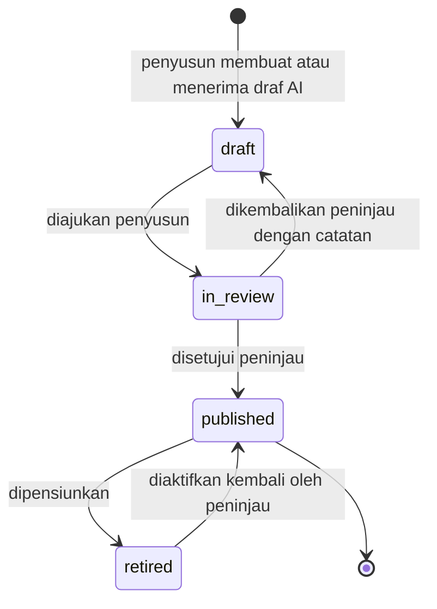
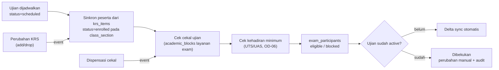
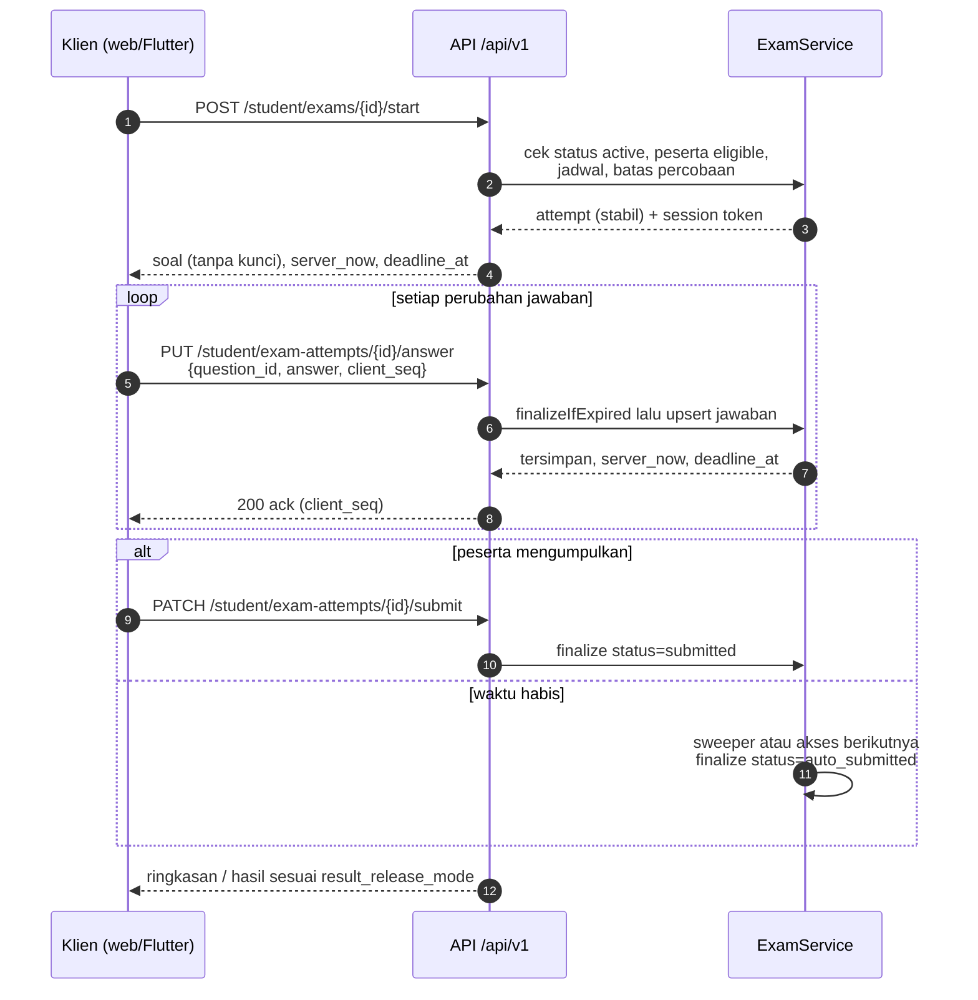
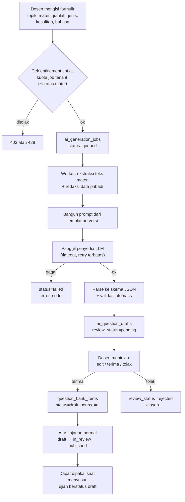
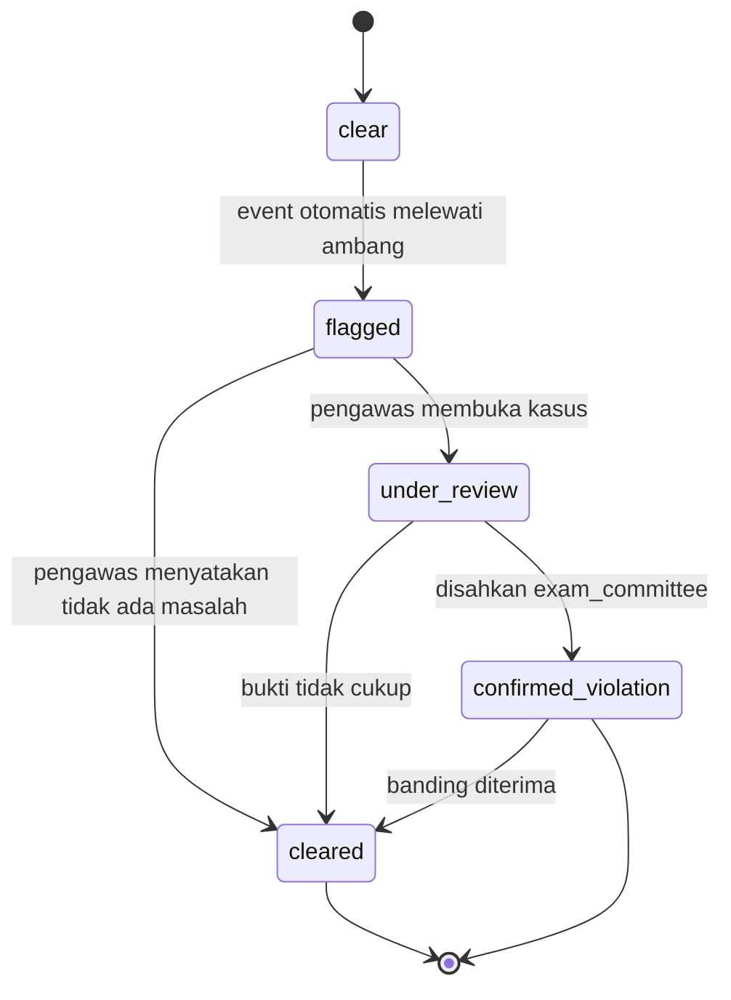
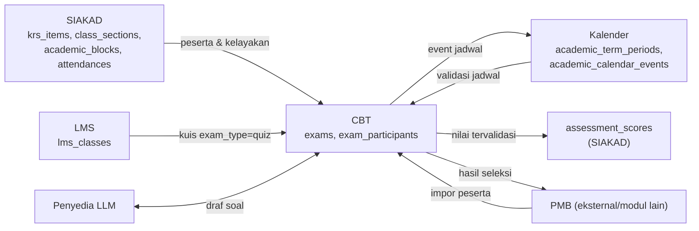
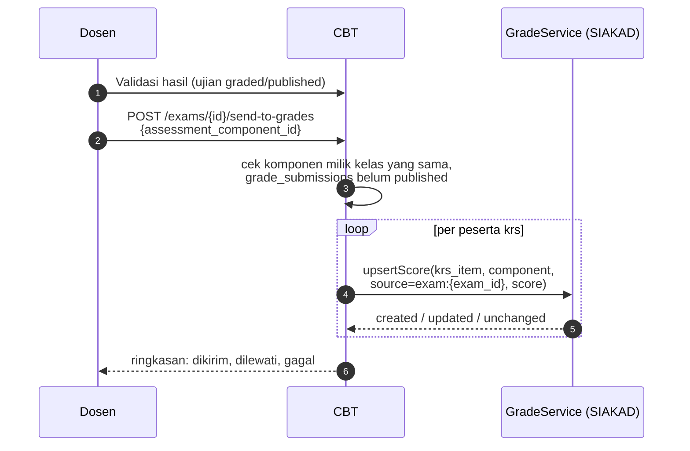
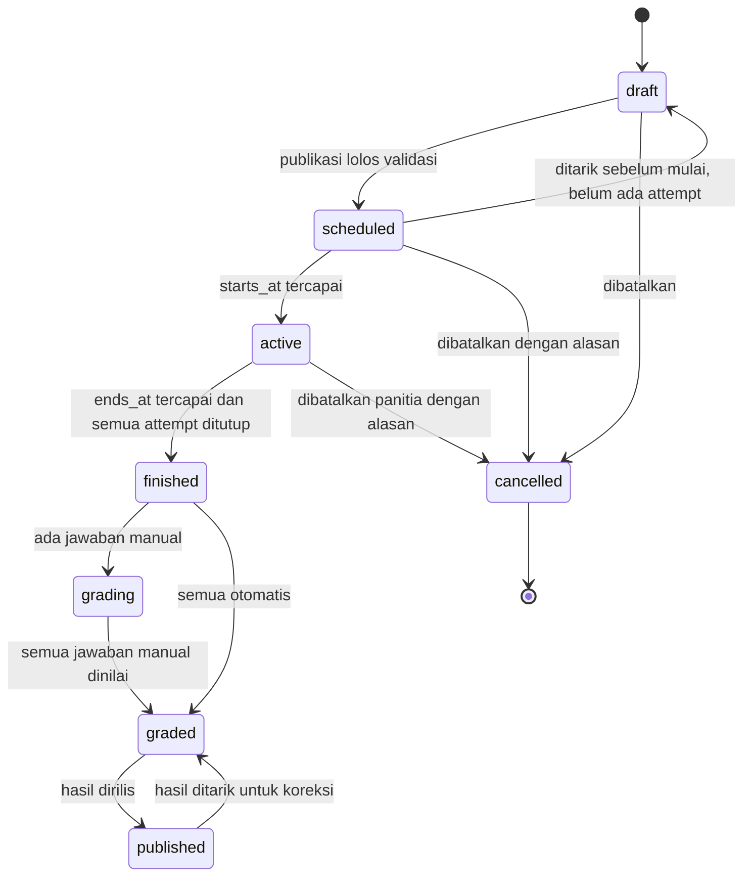
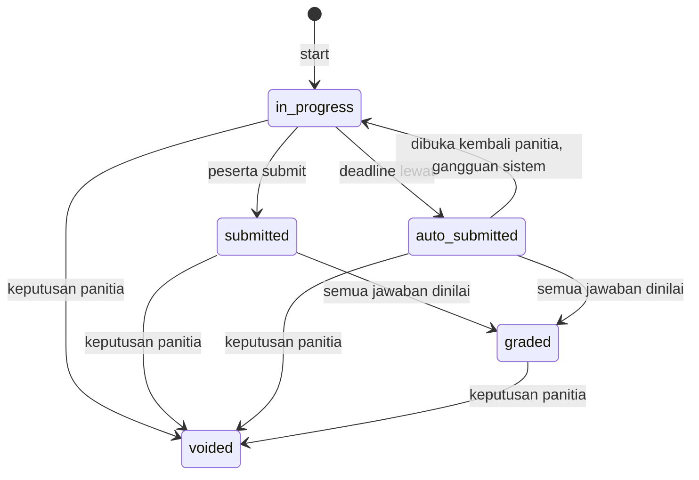
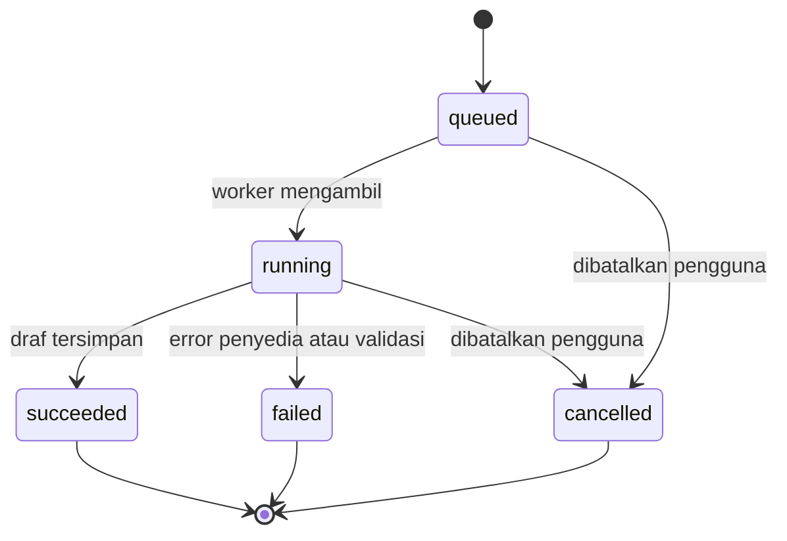

# 03 — CBT & CBT AI: Rancangan Fungsional (C.1–C.5)

> **Status:** rancangan (bukan dokumentasi fitur jadi). Tidak ada kode atau skema yang diubah.
> **Disusun:** 2026-10-11, berdasarkan repository pada commit `ab81cc7`.
> Kembali ke [README](README.md) · Kanon penamaan: [README §5](README.md#5-kanon-penamaan-wajib-diikuti-seluruh-dokumen) · Label: [README §6](README.md#6-label-klasifikasi-fitur)
> **Referensi:** [SEVIMA_Penjelasan_Modul.md §9](../SEVIMA_Penjelasan_Modul.md), [SEVIMA_Platform_Proposal.md §3.8](../SEVIMA_Platform_Proposal.md) dan §2 (Business: "Generator Soal CBT", "Seleksi calon mahasiswa terintegrasi CBT").
> **Dokumen teknis yang sudah ada:** [EXAM_MODULE.md](../EXAM_MODULE.md), [EXAM_RANDOMIZATION.md](../EXAM_RANDOMIZATION.md).

## Daftar Isi

1. [Ringkasan, Paket, dan Peran](#1-ringkasan-paket-dan-peran)
2. [Mesin Ujian yang Sudah Ada vs Rancangan Baru](#2-mesin-ujian-yang-sudah-ada-vs-rancangan-baru)
3. [C.1 Bank Soal](#3-c1-bank-soal)
4. [C.2 Pengaturan Ujian](#4-c2-pengaturan-ujian)
5. [C.2 Pengerjaan, Timer, Autosave, dan Gangguan Jaringan](#5-c2-pengerjaan-timer-autosave-dan-gangguan-jaringan)
6. [C.2 Penilaian Otomatis dan Manual](#6-c2-penilaian-otomatis-dan-manual)
7. [C.3 CBT AI](#7-c3-cbt-ai)
8. [C.4 Proctoring](#8-c4-proctoring)
9. [C.5 Integrasi](#9-c5-integrasi)
10. [State Machine](#10-state-machine)
11. [Ringkasan Entitas dan Endpoint](#11-ringkasan-entitas-dan-endpoint)
12. [Hak Akses](#12-hak-akses)
13. [Daftar Aturan Bisnis BR-CBT dan Skenario Uji](#13-daftar-aturan-bisnis-br-cbt-dan-skenario-uji)
14. [Risiko dan Keputusan Terbuka](#14-risiko-dan-keputusan-terbuka)

---

## 1. Ringkasan, Paket, dan Peran

CBT (Computer Based Test) mencakup bank soal, penjadwalan ujian, pengerjaan daring, dan penilaian. CBT dipakai untuk **UTS, UAS, kuis, dan seleksi PMB** [Referensi]. CBT AI menambahkan pembuatan **draf** soal dengan AI yang wajib ditinjau manusia [Referensi].

### 1.1 Entitlement

| Kemampuan | Feature key | Paket referensi minimum | Catatan |
|---|---|---|---|
| CBT: bank soal, ujian, pengerjaan, penilaian | `cbt` | Business | [Referensi] |
| CBT AI: draf soal dengan AI | `cbt.ai` | Business | [Referensi]. Penyedia & kebijakan data [OD-11](16-open-decisions.md#od-11) |
| Kuis di kelas LMS | `lms` / `lms.cbt_integration` | Growth / Business | Pembagian di [02 §3.5](02-edlink-lms.md#35-kuis-lms), [Konfirmasi] OD-NEW-lms-quiz-entitlement |
| Deteksi pindah tab/fokus (browser) | `cbt` | Business | (Ada) `exam_violations` |
| Proctoring kamera | `lms.proctoring` | Professional | [Referensi] mencantumkan proctoring di EDLINK Professional. Penerapannya pada ujian CBT di luar kelas LMS adalah [Konfirmasi] (OD-NEW-cbt-proctoring-entitlement) |
| Seleksi PMB dengan CBT | `cbt` | Business | [Referensi] Proposal §2 Business: "Seleksi calon mahasiswa terintegrasi CBT (ODS)" |

Paket referensi adalah penawaran SEVIMA. Pemetaannya ke paket Civitas One adalah [OD-01](16-open-decisions.md#od-01).

- **BR-CBT-ENT-01** — Semua endpoint CBT (kecuali kuis LMS yang diizinkan `lms`) dilindungi `EnsureFeatureEntitled:cbt`. Endpoint CBT AI juga dilindungi `cbt.ai`. Tenant yang turun paket tetap dapat **membaca dan mengekspor** hasil ujian lama, tetapi tidak dapat membuat ujian baru (BR-CBT-ENT-02).

### 1.2 Peran

| Peran | Slug | Tugas dalam CBT |
|---|---|---|
| Dosen | `lecturer` | Menyusun soal, membuat ujian/kuis untuk kelasnya, menilai manual, memvalidasi dan mengirim nilai |
| Peninjau soal | `lecturer` / `exam_committee` dengan `question_bank.approve` | Meninjau soal. **Tidak boleh** meninjau soal buatannya sendiri |
| Panitia ujian | `exam_committee` (Baru) | Mengelola UTS/UAS terpusat dan ujian PMB, menetapkan jadwal & peserta, mengesahkan keputusan pelanggaran |
| Pengawas ujian | `exam_proctor` (Baru) | Memantau ujian berlangsung, memberi perpanjangan waktu, meninjau bukti proctoring |
| Mahasiswa | `student` | Mengerjakan ujian (`exam_participation.*`, Ada) |
| Peserta PMB | tanpa akun (akses token) | Mengerjakan ujian seleksi |
| Kaprodi, pimpinan | `head_of_study_program`, `dean`, `rector`, `vice_rector` | Membaca rekap hasil sesuai scope |
| Panitia PMB | di luar cakupan (modul PMB) | Mengimpor peserta dan menerima hasil |

---

## 2. Mesin Ujian yang Sudah Ada vs Rancangan Baru

Rancangan ini **melanjutkan** mesin ujian di `app/Modules/Academic` (`ExamService`, `QuestionBankService`, `ExamController`, `StudentExamController`, `PublicExamController`). Mesin ini dipindahkan ke modul `app/Modules/Cbt` secara bertahap ([OD-15](16-open-decisions.md#od-15)), sementara endpoint yang ada tetap dipertahankan.

### 2.1 Sudah ada (terverifikasi di kode)

| Kemampuan | Implementasi |
|---|---|
| Konfigurasi ujian | `exams`: `class_section_id`, `duration_minutes`, `starts_at`/`ends_at`, `questions_per_participant`, `question_selection_mode` (`all`/`random`/`manual`), `randomize_questions`, `randomize_options`, `allow_back_navigation`, `show_result_after_submission`, `max_attempts`, `weight_percentage`, `is_published`, `access_token` |
| Soal pilihan ganda | `exam_questions` (`points`, `order_index`, `is_selected`, `question_bank_item_id`) + `exam_question_options` (`is_correct`). Publikasi memvalidasi tepat satu jawaban benar per soal |
| Bank soal per mata kuliah | `question_bank_items` (`course_id`, `question_text`, `points`) + `question_bank_item_options`. `QuestionBankService::applyToExam()` **menyalin** soal ke ujian sebagai snapshot dan melewati soal yang sudah ada |
| Penugasan stabil per percobaan | `ExamService::startAttempt()` menyimpan `question_order` dan `option_order`. Pemanggilan ulang mengembalikan attempt yang sama |
| Pemisahan resource | Resource peserta tidak pernah menyertakan `is_correct` |
| Timer berbasis server | `attemptDeadline()` = min(`started_at + duration_minutes`, `exams.ends_at`). `finalizeIfExpired()` menutup attempt secara lazy saat diakses |
| Autosave per soal | `answerAttempt()` melakukan upsert per (`exam_attempt_id`, `exam_question_id`) dan memvalidasi soal/opsi milik attempt |
| Skor otomatis | Proporsi poin benar × 100 → `raw_score`. `score` = `raw_score − penalty_score`. `grade` dari `exam_grade_ranges` atau fallback `LetterGrade`. `weighted_score` dari `weight_percentage` |
| Pelanggaran browser | `exam_violations` (`tab_switch`, `window_blur`, `fullscreen_exit`, `copy_attempt`, `paste_attempt`, `context_menu`). **Setiap pelanggaran otomatis mengurangi 1 poin** (`ExamViolationType::penaltyPoints()`) |
| Pemantauan | `GET /exams/{id}/violations/recent`, `GET /exams/{id}/recap` (+ ekspor), `GET /exams/{id}/participants` |
| Self-service mahasiswa | `/student/exams`, `/student/exams/{id}/start`, `/student/exam-attempts/{id}/answer|submit|violations|result|result/pdf` |
| Ujian publik (tanpa login) | `/public/exams/{accessToken}`, akses dengan NIM (throttle 10/menit), `session_token_hash` + `session_expires_at` (deadline + 24 jam) |
| Klien | Web: `PortalExamTakingPage`, `ExamPublicAttemptPage`. Flutter: konfigurasi ujian (wizard, bank soal, pratinjau). Layar pengerjaan di Flutter **belum ada** |

### 2.2 Celah dan rancangan baru

| Celah | Rancangan | Bagian |
|---|---|---|
| Bank soal tanpa wadah, status, tingkat kesulitan, topik, atau jenis soal | `question_banks` + kolom baru `question_bank_items` | §3 |
| Hanya pilihan ganda | `question_type` + `answer_key` ([OD-26](16-open-decisions.md#od-26)) | §3.4 |
| Ujian hanya untuk peserta KRS satu kelas | `exam_participants` (KRS, anggota LMS, PMB), `context_type` | §4.2 |
| Status ujian hanya `is_published` | `exams.status` (8 nilai kanon) | §10.1 |
| Attempt hanya `in_progress` / `submitted` | `auto_submitted`, `graded`, `voided` | §10.2 |
| Penutupan attempt hanya lazy | Job penyapu (sweeper) yang menutup attempt kedaluwarsa | §5.3 |
| Penalti pelanggaran otomatis | Penalti menjadi konfigurasi, default 0 untuk ujian baru | §8.5 |
| Tidak ada penilaian manual | Jawaban esai, `manual_score`, alur `grading` → `graded` | §6 |
| Tidak ada kamera | `proctoring_snapshots` | §8 |
| Tidak ada kiriman nilai | Kirim ke `assessment_scores` setelah validasi | §9.4 |
| Tidak ada AI | `ai_generation_jobs`, `ai_question_drafts` | §7 |
| Akses publik memakai NIM sehingga tidak bisa dipakai pendaftar PMB | Identitas peserta PMB di `exam_participants` | §9.5 |

---

## 3. C.1 Bank Soal

### 3.1 Wadah bank soal: `question_banks` (Baru)

| Kolom | Tipe | Keterangan |
|---|---|---|
| `id`, `university_id` | ULID | |
| `name` | string | Contoh: "Bank Soal Basis Data 2026" |
| `context_type` | string(20) | `course` / `admission` / `general` |
| `course_id` | ULID FK → `courses`, nullable | Wajib jika `context_type = course` |
| `study_program_id` | ULID FK, nullable | Scope akses |
| `owner_user_id` | ULID FK → `users` | Penanggung jawab |
| `visibility` | string(20) | `private` (pemilik + kolaborator) / `course_team` (semua pengajar mata kuliah) / `study_program` (dosen prodi, baca) |
| `description` | text, nullable | |
| `is_active` | bool | Bank nonaktif tidak bisa dipakai untuk ujian baru |
| timestamps | | Tanpa soft delete |

Kolaborator **[Rekomendasi]**: `question_bank_collaborators` (`question_bank_id`, `user_id`, `role` `author`/`reviewer`). Ini adalah nama baru di luar kanon (dilaporkan ke 07).

Migrasi: setiap `course_id` yang memiliki `question_bank_items` mendapat satu `question_banks` default ("Bank Soal {kode MK}"). Semua item lama diberi `question_bank_id` ini dan `status = published` agar ujian yang sudah ada tetap berjalan.

### 3.2 Butir soal: `question_bank_items` (Ada, diperluas)

| Kolom | Status | Keterangan |
|---|---|---|
| `course_id`, `question_text`, `points` | Ada | `course_id` dipertahankan untuk kompatibilitas dan diselaraskan dengan bank |
| `question_bank_id` | Baru | FK → `question_banks` |
| `question_type` | Baru | §3.4, default `multiple_choice` |
| `difficulty` | Baru | `easy` / `medium` / `hard` (skala dapat dikonfigurasi per tenant, `academic.cbt.difficulty_levels`) |
| `topic` | Baru | string. Kategori/topik (brief: "kategori & topik") |
| `tags` | Baru | jsonb array, kategori tambahan **[Rekomendasi]** |
| `course_learning_outcome_id` | Baru, nullable | Tautan ke CPMK ([04-obe.md](04-obe.md)) **[Rekomendasi]** |
| `answer_key` | Baru | jsonb untuk jenis non-pilihan-ganda (§3.4) |
| `explanation` | Baru | Pembahasan soal |
| `status` | Baru | `draft` / `in_review` / `published` / `retired` |
| `author_user_id` | Baru | Penyusun |
| `submitted_for_review_at`, `reviewed_by`, `reviewed_at`, `review_note` | Baru | Jejak tinjauan |
| `revision_of_id` | Baru | FK ke item asal bila item ini adalah revisi dari soal `published` |
| `source` | Baru | `manual` / `ai` / `import` |
| `ai_question_draft_id` | Baru, nullable | Asal draf AI (§7) |
| `usage_count`, `last_used_at` | Baru | Statistik pemakaian |

Opsi (`question_bank_item_options`, Ada) tetap dipakai untuk pilihan ganda. Bobot opsi untuk skor parsial adalah **[Rekomendasi]** (`score_weight` decimal).

### 3.3 Status dan pemisahan penyusun vs peninjau



Aturan:

- **BR-CBT-QB-01** — Hanya item `published` yang dapat dipakai di ujian (`apply-bank`) dan diambil oleh kuis LMS.
- **BR-CBT-QB-02** — Peninjau (`reviewed_by`) **tidak boleh** sama dengan `author_user_id`. Permintaan persetujuan oleh penyusun sendiri ditolak 409 `self_review_not_allowed`.
- **BR-CBT-QB-03** — Pemisahan penyusun dan peninjau dapat dinonaktifkan per tenant (`academic.cbt.require_independent_review`, contoh default `true`) untuk kampus kecil. Jika dinonaktifkan, persetujuan diri sendiri dicatat di audit sebagai `forced_override`.
- **BR-CBT-QB-04** — Item `published` **tidak dapat diubah langsung**. Perubahan membuat item `draft` baru dengan `revision_of_id`. Saat revisi dipublikasikan, item lama otomatis `retired`.
- **BR-CBT-QB-05** — Ujian yang sudah memakai soal menyimpan **snapshot** (`exam_questions` + opsi, perilaku `applyToExam` yang ada). Perubahan atau pensiun item bank tidak mengubah ujian yang sudah dibuat.
- **BR-CBT-QB-06** — Item yang sudah pernah dipakai di ujian tidak dapat dihapus, hanya dapat `retired`. Item `draft` yang belum pernah dipakai boleh dihapus.
- **BR-CBT-QB-07** — Validasi saat `draft → in_review`: teks soal tidak kosong; pilihan ganda punya minimal 2 opsi (contoh, `academic.cbt.min_options`) dan tepat satu opsi benar (untuk `multiple_choice`); `answer_key` sesuai skema jenis soal; `points` > 0; `difficulty` dan `topic` terisi.

### 3.4 Jenis soal

| Jenis | Kode | Penilaian | Label |
|---|---|---|---|
| Pilihan ganda (satu jawaban) | `multiple_choice` | Otomatis | (Ada) [Referensi] |
| Pilihan ganda kompleks (beberapa jawaban) | `multiple_response` | Otomatis, opsi skor parsial | [Rekomendasi] |
| Benar/salah | `true_false` | Otomatis | [Rekomendasi] |
| Isian singkat | `short_answer` | Otomatis (pencocokan daftar jawaban, tidak peka huruf besar/kecil, opsi toleransi angka) + koreksi manual | [Rekomendasi] |
| Menjodohkan | `matching` | Otomatis per pasangan | [Rekomendasi] |
| Esai/uraian | `essay` | **Manual** (opsional dengan rubrik) | [Rekomendasi] |
| Unggah berkas jawaban | `file_upload` | Manual | [Rekomendasi] |

Jenis soal yang didukung selain pilihan ganda menunggu [OD-26](16-open-decisions.md#od-26). Contoh skema `answer_key`:

```json
{ "type": "multiple_response", "correct_option_ids": ["01J...A", "01J...C"], "scoring": "partial" }
{ "type": "short_answer", "accepted": ["normalisasi", "normalization"], "case_sensitive": false }
{ "type": "matching", "pairs": [["01J...L1", "01J...R3"], ["01J...L2", "01J...R1"]] }
{ "type": "essay", "rubric": [{"criterion": "Ketepatan konsep", "max": 6}, {"criterion": "Argumentasi", "max": 4}] }
```

- **BR-CBT-QB-08** — Resource peserta tidak pernah menyertakan `answer_key`, `is_correct`, atau `explanation` sebelum hasil boleh ditampilkan. Ini melanjutkan prinsip yang ada di [EXAM_RANDOMIZATION.md §7](../EXAM_RANDOMIZATION.md).

### 3.5 Pengelolaan dan pencarian

- Filter daftar soal: bank, mata kuliah, `topic`, `difficulty`, `question_type`, `status`, `source`, penyusun, dan "belum pernah dipakai".
- Impor massal dari templat Excel/CSV **[Rekomendasi]**. Item impor masuk sebagai `draft` dengan `source = import`, dan laporan baris gagal diberikan per baris.
- Analisis butir soal **[Rekomendasi]**: indeks kesukaran (p = proporsi benar) dan daya pembeda dihitung dari `exam_attempt_answers` setelah ujian `graded`. Analisis ini membantu peninjau, tetapi tidak mengubah `difficulty` secara otomatis.
- Komposisi ujian dari bank **[Rekomendasi]**: "ambil n soal per (topic, difficulty)" sebagai bantuan saat menyusun pool. Hasilnya tetap berupa snapshot `exam_questions`.

---

## 4. C.2 Pengaturan Ujian

### 4.1 Perluasan `exams`

| Kolom | Status | Keterangan |
|---|---|---|
| Kolom yang ada (§2.1) | Ada | Dipertahankan |
| `exam_type` | Baru | `quiz` / `midterm` (UTS) / `final` (UAS) / `admission` (seleksi PMB) / `other` |
| `context_type` | Baru | `class_section` (default untuk data lama) / `lms_class` / `admission` |
| `context_id` | Baru | ID konteks: `class_sections.id`, `lms_classes.id`, atau ID gelombang/jalur PMB (referensi eksternal). Untuk kompatibilitas, `class_section_id` tetap diisi bila konteksnya kelas akademik |
| `status` | Baru | 8 nilai kanon (§10.1). `is_published` dipertahankan sebagai kolom turunan selama masa transisi |
| `attempt_scoring_policy` | Baru | `highest` / `latest` / `first` untuk `max_attempts` > 1 **[Rekomendasi]** |
| `violation_penalty_points` | Baru | Penalti per pelanggaran. Default 0 untuk ujian baru, sedangkan ujian lama dimigrasikan ke 1 (§8.5) |
| `proctoring_mode` | Baru | `none` / `browser_events` / `camera_snapshot` (butuh `lms.proctoring`) |
| `require_camera` | Baru | Perilaku jika izin kamera ditolak (§8.3) |
| `late_start_cutoff_minutes` | Baru | Batas terlambat memulai sejak `starts_at` (contoh 15) |
| `answer_grace_seconds` | Baru | Toleransi jawaban yang sedang dikirim saat batas waktu (contoh 10 detik). Default dari `academic.cbt.answer_grace_seconds` |
| `result_release_mode` | Baru | `immediate` (setara `show_result_after_submission = true`) / `after_grading` / `manual` |
| `assessment_component_id` | Baru, nullable | Komponen nilai SIAKAD tujuan (§9.4) |
| `academic_calendar_event_id` | Baru, nullable | Tautan ke kalender (§9.3) |
| `cancelled_reason`, `cancelled_by`, `cancelled_at` | Baru | |

Validasi publikasi yang ada (pool tidak kosong, `questions_per_participant` ≤ pool, kecukupan soal mode manual, satu jawaban benar) **dipertahankan**. Validasi baru:

- **BR-CBT-EX-01** — `starts_at` < `ends_at`, dan `duration_minutes` ≤ selisih keduanya. Pengecualian: jika ujian dirancang untuk "mulai kapan saja dalam jendela", durasi dihitung per peserta dan batas akhir tetap `ends_at`.
- **BR-CBT-EX-02** — `exam_type` `midterm`/`final` harus dijadwalkan di dalam periode UTS/UAS (`academic_term_periods`) term kelas. Di luar periode, publikasi memerlukan izin `exams.approve` (panitia ujian) dengan alasan.
- **BR-CBT-EX-03** — Ujian dengan soal yang memerlukan penilaian manual tidak boleh memakai `result_release_mode = immediate`.
- **BR-CBT-EX-04** — Ujian yang sudah `active` tidak dapat mengubah soal, opsi, kunci, durasi, atau mode pemilihan. Perubahan yang diizinkan hanya perpanjangan `ends_at` dan perpanjangan waktu per peserta (§5.5), keduanya dengan audit.

### 4.2 Peserta: `exam_participants` (Baru)

| Kolom | Keterangan |
|---|---|
| `id`, `university_id`, `exam_id` | |
| `participant_type` | `krs` / `lms_member` / `applicant` |
| `krs_item_id` | Untuk `krs`. `unique (exam_id, krs_item_id)` |
| `lms_class_member_id` | Untuk kuis kelas umum LMS |
| `applicant_reference` | ID pendaftar dari sistem PMB (string eksternal, karena modul PMB belum ada di repository) |
| `applicant_identifier` | Nomor pendaftaran yang dipakai login ujian. `unique (exam_id, applicant_identifier)` |
| `applicant_name`, `applicant_email` | Data minimum untuk verifikasi dan pengiriman hasil |
| `access_code_hash` | Kode akses peserta PMB (hash) |
| `eligibility_status` | `eligible` / `blocked` / `excused` / `withdrawn` |
| `blocked_reason` | Contoh: `academic_block` (cekal), `attendance_below_minimum`, `manual` |
| `extra_time_minutes` | Akomodasi (misalnya peserta disabilitas) yang ditetapkan sebelum ujian |
| `source` | `krs_sync` / `lms_sync` / `import` / `manual` |
| `synced_at`, `added_by` | |

`exam_attempts` (Ada) ditambah `exam_participant_id`. Untuk data lama, nilainya di-backfill dari `krs_item_id`.

**Sinkronisasi peserta KRS:**



Aturan:

- **BR-CBT-PT-01** — Untuk `context_type = class_section`/`lms_class` academic, peserta disinkronkan dari `krs_items` `enrolled` saat ujian `scheduled`. Sinkronisasi delta berjalan otomatis sampai ujian `active`. Mahasiswa yang men-drop KRS menjadi `withdrawn` dan tidak dihapus.
- **BR-CBT-PT-02** — Untuk `midterm`/`final`, peserta yang memiliki cekal aktif dengan layanan `exam` ([01-siakad.md](01-siakad.md) A.8) atau kehadiran di bawah minimum (konfigurasi, 75% hanya contoh, [OD-06](16-open-decisions.md#od-06)) ditandai `blocked` dengan alasan. Peserta `blocked` tidak dapat memulai attempt (409 `participant_blocked`). Dispensasi yang disetujui mengubahnya menjadi `eligible` secara otomatis.
- **BR-CBT-PT-03** — Setelah ujian `active`, daftar peserta dibekukan. Penambahan peserta (misalnya ujian susulan) hanya dapat dilakukan oleh `exam_committee`/dosen dengan alasan dan tercatat di audit.
- **BR-CBT-PT-04** — Peserta PMB berasal dari impor (CSV/API) dan tidak terkait `students`. Satu `applicant_identifier` hanya sekali per ujian.
- **BR-CBT-PT-05** — Jalur yang ada, `resolveEligibleKrsItem()`/`startAttempt()`, diperluas untuk mewajibkan `exam_participants` `eligible`. Selama transisi, jika ujian belum punya baris peserta, perilaku lama (cek kelas KRS) tetap berlaku.

### 4.3 Jadwal, durasi, acak, dan percobaan

- **Jadwal** `starts_at`–`ends_at` (Ada). Mulai terlambat dibatasi `late_start_cutoff_minutes`.
- **Durasi** `duration_minutes` (Ada) + `extra_time_minutes` per peserta (Baru).
- **Acak soal & opsi** mengikuti [EXAM_RANDOMIZATION.md](../EXAM_RANDOMIZATION.md) tanpa perubahan. Untuk jenis `matching`, pengacakan diterapkan pada kolom kanan. Untuk `true_false`, opsi tidak diacak.
- **Batas percobaan** `max_attempts` (Ada) + `attempt_scoring_policy` (Baru). Percobaan berikutnya hanya dapat dimulai setelah attempt sebelumnya `submitted`/`auto_submitted`.
- **Navigasi** `allow_back_navigation` (Ada). Jika `false`, server menolak jawaban untuk soal yang sudah dilewati. Untuk itu, attempt menyimpan indeks soal terjauh (`furthest_question_index`, Baru).

---

## 5. C.2 Pengerjaan, Timer, Autosave, dan Gangguan Jaringan

### 5.1 Alur pengerjaan



### 5.2 Timer berbasis server

- **BR-CBT-TM-01** — Server adalah satu-satunya sumber waktu. `deadline_at = min(started_at + duration_minutes + extra_time_minutes + time_extension_minutes, ends_at)`. Ini memperluas `attemptDeadline()` yang ada.
- Setiap respons pengerjaan menyertakan `server_now` dan `deadline_at`. Klien menghitung mundur berdasarkan selisih `server_now` dan jam lokal (offset), bukan jam lokal mentah. Mengubah jam perangkat tidak memengaruhi deadline.
- **BR-CBT-TM-02** — Waktu terus berjalan selama koneksi terputus (wall-clock). Kehilangan waktu karena gangguan hanya dapat dipulihkan melalui perpanjangan oleh pengawas (§5.5).

### 5.3 Auto-submit

- **BR-CBT-TM-03** — Attempt yang melewati `deadline_at` ditutup dengan `status = auto_submitted` dan `submitted_at = deadline_at` (bukan waktu job berjalan). Jawaban yang tersimpan sampai `deadline_at + answer_grace_seconds` diikutkan.
- Penutupan dilakukan dengan dua cara:
  1. **Lazy** saat attempt diakses (`finalizeIfExpired`, Ada). Saat ini status yang ditulis adalah `submitted` dan perlu diubah menjadi `auto_submitted`.
  2. **Sweeper** (Baru), job terjadwal (contoh setiap menit) yang menutup attempt `in_progress` yang kedaluwarsa. Tanpa sweeper, peserta yang meninggalkan ujian tidak pernah ditutup sehingga rekap dan status `finished` tertunda.
- **BR-CBT-TM-04** — Finalisasi bersifat idempoten. Attempt yang sudah `submitted`/`auto_submitted` tidak dinilai ulang oleh sweeper. Penguncian baris (`SELECT ... FOR UPDATE`) mencegah submit manual dan sweeper berjalan bersamaan.

### 5.4 Aturan autosave

| Aturan | Nilai/perilaku |
|---|---|
| Pemicu simpan | Setiap perubahan jawaban. Klien melakukan debounce (contoh 1–3 detik) untuk esai/isian, dan menyimpan langsung untuk pilihan |
| Kunci upsert | (`exam_attempt_id`, `exam_question_id`), sesuai implementasi yang ada |
| Urutan | Klien mengirim `client_seq` yang naik monoton per soal. Server menolak dengan aman (200, `stale: true`) jawaban dengan `client_seq` lebih kecil dari yang tersimpan, sehingga request yang tertunda tidak menimpa jawaban yang lebih baru (kolom baru `client_seq` di `exam_attempt_answers`) |
| Setelah deadline | Ditolak 409 `attempt_time_over`, kecuali masih dalam `answer_grace_seconds` |
| Ukuran esai | Batas karakter dikonfigurasi (contoh 10.000) |
| Bukti tersimpan | Respons berisi `saved_at`. UI menampilkan status "Tersimpan" atau "Menunggu koneksi" per soal |

- **BR-CBT-AS-01** — Jawaban dianggap sah hanya bila tersimpan di server. Antrean lokal di klien adalah upaya pemulihan, bukan bukti jawaban.

### 5.5 Gangguan jaringan dan pemulihan

| Kondisi | Perilaku |
|---|---|
| Koneksi putus sesaat | Klien menyimpan jawaban di antrean lokal (IndexedDB/penyimpanan Flutter terenkripsi) dan mengirim ulang otomatis dengan backoff, berurutan per soal berdasarkan `client_seq` |
| Halaman di-refresh atau aplikasi ditutup | Peserta login → `GET /student/exam-attempts/{id}` mengembalikan soal, urutan, jawaban tersimpan, `server_now`, dan `deadline_at` (penugasan stabil, Ada). Peserta PMB/publik melanjutkan dengan **session token** (`/public/exam-attempts/{sessionToken}`, Ada) |
| Pindah perangkat | **[Rekomendasi]** Satu sesi aktif per attempt. Melanjutkan di perangkat baru merotasi session token, dan perangkat lama menerima 409 `session_superseded`. Kejadian ini dicatat sebagai event proctoring (`device_changed`) untuk ditinjau, bukan sebagai pelanggaran otomatis |
| Putus melewati deadline | Attempt `auto_submitted` dengan jawaban yang sempat tersimpan. Jawaban di antrean lokal yang tidak sempat terkirim **tidak diterima** setelah masa toleransi. Peserta dapat mengajukan keberatan ke pengawas |
| Gangguan massal (server/jaringan kampus) | Pengawas/panitia memberi **perpanjangan massal** (`time_extension_minutes` per attempt atau perpanjangan `ends_at`) dengan alasan. Tindakan dicatat di audit |
| Perpanjangan individual | `exam_proctor` dapat menambah `time_extension_minutes` (kolom baru di `exam_attempts`) selama attempt `in_progress`, dengan batas maksimum konfigurasi (contoh 30 menit) dan alasan wajib |
| Membuka kembali attempt yang sudah auto-submitted | Hanya `exam_committee`, dengan alasan, bila terbukti gangguan sistem. Attempt kembali `in_progress` dengan sisa waktu yang ditetapkan, dan seluruh tindakan diaudit **[Rekomendasi]** |

- **BR-CBT-NW-01** — Session token publik disimpan sebagai hash (Ada). Rotasi token membatalkan token lama seketika.
- **BR-CBT-NW-02** — Perpanjangan waktu tidak boleh melampaui `ends_at` + batas konfigurasi tanpa izin `exam_committee`.

---

## 6. C.2 Penilaian Otomatis dan Manual

### 6.1 Penilaian otomatis

| Jenis | Rumus per soal |
|---|---|
| `multiple_choice` | `points` jika opsi terpilih = opsi benar, selain itu 0 (Ada) |
| `multiple_response` | `all_or_nothing`: `points` jika himpunan terpilih = himpunan benar. `partial`: `points × max(0, (benar_terpilih − salah_terpilih) ÷ jumlah_benar)` |
| `true_false` | Seperti pilihan ganda |
| `short_answer` | `points` jika jawaban ternormalisasi ∈ daftar `accepted`. Bila tidak cocok, soal ditandai "perlu tinjauan" sesuai konfigurasi |
| `matching` | `points × pasangan_benar ÷ total_pasangan` |

`raw_score = Σ poin diperoleh ÷ Σ poin soal × 100` (Ada). `score = max(0, raw_score − penalty_score)` (Ada), dengan `penalty_score` mengikuti §8.5.

### 6.2 Penilaian manual

Kolom baru di `exam_attempt_answers`: `answer_text`, `answer_payload` (jsonb untuk jenis lain), `answer_file_id`, `auto_score`, `manual_score`, `graded_by`, `graded_at`, `feedback`, `needs_manual_grading`.

- **BR-CBT-GR-01** — Attempt yang memiliki jawaban `needs_manual_grading = true` tetap `submitted`/`auto_submitted` sampai semua jawaban tersebut dinilai. Setelah itu skor dihitung ulang dan attempt menjadi `graded`.
- **BR-CBT-GR-02** — `manual_score` berada dalam rentang 0..`points` soal. Rubrik (jika ada) menjumlahkan kriteria.
- **BR-CBT-GR-03** — Status ujian menjadi `grading` setelah `finished` bila ada jawaban manual, lalu `graded` setelah semua attempt dinilai. Ujian tanpa soal manual langsung `graded` setelah `finished`.
- **BR-CBT-GR-04** — Penilaian anonim **[Rekomendasi]**: dosen dapat menilai esai tanpa melihat nama peserta (identitas disembunyikan di UI sampai penilaian selesai).
- **BR-CBT-GR-05** — Pengubahan nilai setelah `published` memerlukan alasan, tercatat di audit (old/new), dan jika nilai sudah dikirim ke SIAKAD dan `grade_submissions` sudah `published`, perubahan mengikuti `grade_revisions` ([01-siakad.md](01-siakad.md) A.6).
- **BR-CBT-GR-06** — Koreksi kunci jawaban setelah ujian (misalnya kunci salah) memicu **regrade** seluruh attempt untuk soal tersebut. Regrade tercatat (siapa, kapan, soal, alasan), dan peserta yang terdampak dilaporkan.

### 6.3 Rilis hasil

| `result_release_mode` | Perilaku |
|---|---|
| `immediate` | Hasil tampil setelah submit (setara `show_result_after_submission`, Ada). Hanya untuk ujian tanpa soal manual |
| `after_grading` | Hasil tampil otomatis saat ujian `graded` |
| `manual` | Dosen/panitia menekan "Publikasikan hasil" → ujian `published` |

Pembahasan (`explanation`) dan kunci jawaban ditampilkan ke peserta hanya jika diaktifkan (`show_answer_key_after`, Baru) dan setelah `ends_at`, agar tidak bocor ke peserta yang masih mengerjakan.

---

## 7. C.3 CBT AI

[Referensi] "Dosen memasukkan topik/materi, lalu AI menghasilkan draf soal yang bisa direvisi sebelum dipakai." Feature key `cbt.ai` (Business).

### 7.1 Prinsip

1. **AI hanya menghasilkan draf.** Draf tidak pernah otomatis menjadi soal `published` dan **tidak pernah langsung masuk ke ujian**, terlebih ujian yang sedang aktif.
2. **Wajib review manusia**: setiap draf harus dibaca, dapat diedit, lalu diterima atau ditolak secara eksplisit oleh pengguna. Draf yang diterima masuk ke bank soal sebagai `draft` dan menjalani alur tinjauan normal (§3.3).
3. **Privasi data**: data pribadi mahasiswa tidak pernah dikirim ke penyedia AI.
4. **Dapat diaudit**: input, versi prompt, model, dan hasil disimpan.

### 7.2 Entitas

`ai_generation_jobs` (Baru, dipakai bersama OBE AI):

| Kolom | Keterangan |
|---|---|
| `id`, `university_id` | |
| `job_type` | `cbt_question_generation` (OBE AI memakai nilai lain, lihat [04-obe.md](04-obe.md)) |
| `status` | `queued` / `running` / `succeeded` / `failed` / `cancelled` |
| `requested_by` | User |
| `input_params` | jsonb: topik, jumlah, jenis, tingkat kesulitan, bahasa, `course_id`, `question_bank_id` tujuan, CPMK (opsional), sumber materi |
| `source_refs` | jsonb: ID `course_materials`/`course_material_versions` yang dipakai |
| `provider`, `model`, `prompt_template_version` | Untuk reprodusibilitas |
| `input_tokens`, `output_tokens`, `cost_estimate` | Pemantauan biaya |
| `prompt_hash` | Hash prompt akhir. Prompt dan respons mentah disimpan terenkripsi sesuai retensi (§7.6) |
| `error_code`, `error_message` | |
| `started_at`, `finished_at` | |
| `idempotency_key` | `unique (university_id, idempotency_key)` |

`ai_question_drafts` (Baru):

| Kolom | Keterangan |
|---|---|
| `ai_generation_job_id` | FK |
| `question_bank_id` | Tujuan |
| `question_type`, `question_text`, `options` (jsonb), `answer_key` (jsonb), `explanation`, `difficulty`, `topic` | Isi draf |
| `validation_issues` | jsonb: hasil pemeriksaan otomatis (§7.4) |
| `review_status` | `pending` / `accepted` / `rejected` |
| `edited` | bool, true bila peninjau mengubah isi sebelum menerima |
| `reviewed_by`, `reviewed_at`, `rejection_reason` | |
| `question_bank_item_id` | Terisi saat diterima |

### 7.3 Alur



### 7.4 Input prompt dan validasi hasil

**Input yang dikirim ke penyedia:**

| Input | Wajib | Catatan |
|---|---|---|
| Topik/subtopik | Ya | Teks dosen |
| Teks materi | Opsional | Diekstraksi dari `course_materials` milik kelas/mata kuliah dosen. Dipotong sesuai batas token (contoh maksimum 20.000 karakter) |
| Jumlah soal | Ya | Batas per job (contoh 1–30) |
| Jenis soal | Ya | Hanya jenis yang diaktifkan tenant (OD-26) |
| Tingkat kesulitan / distribusi | Ya | Contoh 30% mudah, 50% sedang, 20% sulit |
| Bahasa | Ya | `id` / `en` |
| CPMK (deskripsi) | Opsional | Dari OBE bila tersedia |
| Instruksi kunci & pembahasan | Otomatis | Templat meminta kunci dan pembahasan untuk setiap soal |

**Yang tidak pernah dikirim:** nama, NIM, email, atau data mahasiswa; jawaban peserta; nilai; isi bank soal yang ada (kecuali judul topik untuk menghindari duplikat, **[Konfirmasi]** OD-11).

**Validasi otomatis sebelum draf ditampilkan:** keluaran sesuai skema JSON; pilihan ganda punya tepat satu opsi benar dan opsi tidak duplikat; tidak ada opsi kosong; deteksi kemiripan tinggi dengan item bank yang sudah ada (pencocokan teks ternormalisasi) ditandai "kemungkinan duplikat"; panjang wajar. Masalah dicatat di `validation_issues` dan ditampilkan ke peninjau. Validasi ini bukan pengganti tinjauan manusia.

Aturan:

- **BR-CBT-AI-01** — Draf AI tidak dapat ditambahkan langsung ke `exam_questions`. Satu-satunya jalur adalah draf → `question_bank_items` (`draft`) → tinjauan → `published` → disalin ke ujian yang **belum `active`** (BR-CBT-EX-04).
- **BR-CBT-AI-02** — Menerima draf memerlukan tindakan eksplisit per draf atau pilihan massal dengan pratinjau. Tidak ada opsi "terima semua otomatis".
- **BR-CBT-AI-03** — Item yang berasal dari AI ditandai `source = ai`. Penandanya tetap terlihat di bank soal dan laporan, dan tidak dapat dihapus pengguna.
- **BR-CBT-AI-04** — Peninjau item AI pada tahap `in_review` mengikuti BR-CBT-QB-02. Pengguna yang menerima draf dianggap penyusun.
- **BR-CBT-AI-05** — Dosen hanya dapat memakai materi dari kelas/mata kuliah yang dapat diaksesnya sebagai sumber prompt.
- **BR-CBT-AI-06** — Kuota pemakaian per tenant (contoh jumlah job/bulan atau token/bulan) dikonfigurasi di entitlement. Jika terlampaui, permintaan dijawab 429 `ai_quota_exceeded`.

### 7.5 Penanganan kegagalan

| Kegagalan | Perilaku |
|---|---|
| Penyedia timeout/5xx | Retry dengan backoff (contoh maksimum 3 kali), lalu `failed` + `error_code = provider_unavailable`. Dosen diberi notifikasi |
| Keluaran tidak sesuai skema | Satu kali percobaan perbaikan, lalu draf yang valid saja yang disimpan. Jumlah yang gagal dilaporkan |
| Konten tidak pantas/terblokir oleh penyedia | `failed` + `error_code = content_filtered`, tanpa menyimpan keluaran |
| Pengguna membatalkan | `cancelled`. Hasil yang terlambat datang dibuang |
| Pengiriman ulang dengan `Idempotency-Key` yang sama | Mengembalikan job yang sama |

### 7.6 Privasi data dan audit

- Penyedia, lokasi pemrosesan, kebijakan bahwa data tidak dipakai untuk melatih model, dan persetujuan tenant untuk mengirim materi ke pihak ketiga adalah [OD-11](16-open-decisions.md#od-11). Tenant dapat menonaktifkan opsi "gunakan materi sebagai sumber" (`academic.cbt.ai_allow_material_upload`). Jika dinonaktifkan, hanya topik yang dikirim.
- Redaksi: sebelum dikirim, teks materi dipindai pola data pribadi (email, nomor telepon, NIM/NIK) dan bagian tersebut disamarkan.
- Audit (`audit_logs`): pembuatan job, penerimaan/penolakan draf, dan publikasi item AI. Prompt/respons mentah disimpan terenkripsi dengan retensi (contoh 180 hari) untuk penelusuran masalah mutu dan sengketa, lalu dihapus. Kunci API penyedia tidak pernah dicatat.
- Hak cipta: dosen bertanggung jawab atas materi yang dipakai sebagai sumber. UI menampilkan pernyataan ini saat materi dipilih.

---

## 8. C.4 Proctoring

[Referensi] "Pengawasan ujian online (kamera, deteksi pindah tab) untuk mencegah kecurangan." Paket Professional (`lms.proctoring`). Deteksi pindah tab sudah ada (Parsial).

### 8.1 Komponen

| Komponen | Data | Status |
|---|---|---|
| Event browser | `exam_violations` (`tab_switch`, `window_blur`, `fullscreen_exit`, `copy_attempt`, `paste_attempt`, `context_menu`) | Ada |
| Event tambahan | `device_changed`, `camera_unavailable`, `multiple_sessions` sebagai nilai baru `violation_type` **[Rekomendasi]** | Baru |
| Snapshot kamera | `proctoring_snapshots` | Baru |
| Pemantauan langsung pengawas | `GET /exams/{id}/violations/recent` (Ada, polling) + galeri snapshot terbaru | Parsial |
| Peninjauan pasca-ujian | Kolom review pada `exam_violations` + `exam_attempts.integrity_status` | Baru |
| Rekaman video penuh / streaming | Tidak dirancang pada tahap ini ([OD-12](16-open-decisions.md#od-12)) | [Konfirmasi] |
| Deteksi wajah otomatis (tidak ada wajah/lebih dari satu wajah) | Analisis snapshot di server **[Rekomendasi]**, hanya sebagai penanda | Baru |

`proctoring_snapshots` (Baru):

| Kolom | Keterangan |
|---|---|
| `id`, `university_id`, `exam_attempt_id` | |
| `captured_at` | Waktu server saat diterima. Waktu klien disimpan di `client_captured_at` |
| `trigger` | `interval` (contoh setiap 60 detik) / `event` (saat terjadi pelanggaran browser) / `start` (foto awal verifikasi) |
| `file_upload_id` | Gambar di disk privat tenant |
| `analysis` | jsonb: hasil deteksi otomatis (jumlah wajah, skor), nullable |
| `flagged` | bool, ditandai otomatis atau manual |
| `review_status` | `unreviewed` / `reviewed` |
| `retention_until` | Tanggal hapus terjadwal |
| `legal_hold` | bool. Jika `true`, file tidak dihapus selama kasus berjalan |

### 8.2 Keterbatasan teknis (wajib diketahui pengguna kebijakan)

| Keterbatasan | Konsekuensi |
|---|---|
| Browser tidak dapat mendeteksi perangkat kedua (HP lain) atau orang di luar jangkauan kamera | Snapshot hanya menangkap sebagian kondisi |
| `blur`/`visibilitychange` juga terpicu oleh notifikasi OS, dialog sistem, atau perangkat lemah | **Positif palsu.** Sudah dicatat di komentar `ExamViolationType` |
| Mesin virtual, perekam layar, atau ekstensi dapat menyamarkan perilaku | **Negatif palsu** |
| Kualitas kamera dan pencahayaan memengaruhi deteksi wajah | Positif/negatif palsu pada analisis otomatis |
| Aplikasi Flutter memiliki kontrol berbeda dibanding web (misalnya deteksi aplikasi dipindah ke latar belakang) | Jenis event per platform berbeda dan dicatat di `metadata.client` |
| Bandwidth rendah | Snapshot tertunda atau gagal terkirim. Dicatat sebagai `camera_unavailable`, bukan sebagai kecurangan |

### 8.3 Izin kamera dan persetujuan

1. Sebelum ujian dengan `proctoring_mode = camera_snapshot`, peserta melihat **pemberitahuan**: data yang dikumpulkan (snapshot, event), tujuan, siapa yang dapat melihat, masa retensi, dan hak peserta. Persetujuan dicatat (waktu, versi teks pemberitahuan) di metadata attempt.
2. Peserta memberi izin kamera di browser/aplikasi, lalu foto awal (`trigger = start`) diambil.
3. Jika izin ditolak atau kamera tidak tersedia, perilaku mengikuti `require_camera`:
   - `block`: attempt tidak dapat dimulai. Peserta diarahkan ke pengawas untuk solusi (misalnya ujian di lokasi).
   - `allow_flagged` (contoh default): attempt boleh dimulai, dan event `camera_unavailable` dicatat untuk ditinjau.
4. Kamera dimatikan segera setelah attempt selesai. Tidak ada pengambilan gambar di luar attempt.

- **BR-CBT-PR-01** — Pengambilan snapshot hanya terjadi selama attempt `in_progress` dan hanya jika peserta telah menerima pemberitahuan.
- **BR-CBT-PR-02** — Mode proctoring kamera memerlukan `lms.proctoring`. Tanpa hak tersebut, `proctoring_mode` maksimal `browser_events`.

### 8.4 Penyimpanan bukti dan retensi

- File snapshot disimpan di disk privat dengan path per tenant (`tenants/{university_id}/cbt/proctoring/{exam_id}/{attempt_id}/...`, lihat celah path di [02 §7.6](02-edlink-lms.md#76-isolasi-antar-pt)). File tidak pernah `is_public` dan hanya diakses melalui URL bertanda tangan berumur pendek.
- Setiap kali pengawas/panitia membuka snapshot, akses dicatat di `audit_logs` dengan aksi `viewed_sensitive`.
- **Retensi** ([OD-12](16-open-decisions.md#od-12)): usulan default `retention_until` = tanggal publikasi nilai + 90 hari (contoh, `academic.cbt.proctoring_retention_days`). Setelah itu job menghapus file dan baris snapshot. Data `exam_violations` (event tanpa gambar) disimpan mengikuti retensi hasil ujian.
- **BR-CBT-PR-03** — Snapshot pada attempt dengan `integrity_status` `under_review` atau dengan banding yang masih terbuka diberi `legal_hold = true` dan tidak dihapus sampai kasus selesai.
- Snapshot dihitung ke storage tenant (lihat [02 §7.2](02-edlink-lms.md#72-perhitungan-pemakaian)). Ukuran dikompresi (contoh resolusi 640×480, JPEG kualitas sedang).

### 8.5 Deteksi otomatis bukan bukti; penalti

- **BR-CBT-PR-04** — Event otomatis (pelanggaran browser, analisis wajah) adalah **indikasi** yang memerlukan tinjauan manusia. Event tersebut **tidak boleh** menjadi dasar tunggal untuk membatalkan attempt, memberi nilai nol, atau menjatuhkan sanksi.
- **Implikasi pada perilaku saat ini:** `ExamService::recordViolation()` saat ini otomatis menambah `penalty_score` sebesar 1 poin per pelanggaran, sehingga deteksi otomatis langsung mengurangi nilai. Rancangan:
  - Kolom `exams.violation_penalty_points` (Baru). Ujian lama dimigrasikan dengan nilai 1 agar perilakunya tidak berubah. Ujian baru default 0.
  - Dosen yang memilih penalti otomatis > 0 mendapat peringatan di UI bahwa penalti otomatis dapat mengenai peserta yang tidak curang (positif palsu).
  - Penalti yang sudah diterapkan dapat dibatalkan oleh pengawas/dosen saat tinjauan (§8.6). Pembatalan ini menghitung ulang `score`.
  - Keputusan kebijakan penalti otomatis: [OD-NEW-cbt-violation-penalty](16-open-decisions.md).

### 8.6 Alur peninjauan oleh pengawas

Kolom baru pada `exam_violations`: `review_status` (`unreviewed`/`dismissed`/`confirmed`), `reviewed_by`, `reviewed_at`, `review_note`, `penalty_waived` (bool). Kolom baru pada `exam_attempts`: `integrity_status` (`clear`/`flagged`/`under_review`/`confirmed_violation`/`cleared`).



1. **Selama ujian:** `exam_proctor` melihat daftar peserta dengan jumlah event dan snapshot terbaru, lalu dapat mengirim peringatan ke peserta (notifikasi dalam layar ujian) **[Rekomendasi]**. Pengawas tidak dapat mengubah jawaban.
2. **Setelah ujian:** attempt `flagged` (ambang konfigurasi, contoh ≥ 5 event atau ada snapshot tanpa wajah) masuk antrean tinjauan.
3. Pengawas meninjau linimasa event + snapshot, lalu menandai setiap event `dismissed`/`confirmed` dengan catatan.
4. Rekomendasi tindakan (peringatan, pengurangan nilai, pembatalan attempt) diajukan ke `exam_committee` melalui ApprovalWorkflow (Ada). Keputusan memiliki alasan tertulis.
5. Bila disahkan sebagai `confirmed_violation` dengan sanksi pembatalan, attempt menjadi `voided`. Peserta diberi notifikasi beserta alasannya.
6. **Banding [Rekomendasi]:** peserta dapat mengajukan keberatan dalam n hari (contoh 7) melalui `student_requests` (`type = other`) dengan lampiran. Selama banding berjalan, bukti ditahan (`legal_hold`).

- **BR-CBT-PR-05** — `voided` hanya dapat ditetapkan oleh pengguna dengan `exam_proctoring.approve` (panitia ujian), tidak oleh pengawas yang sama yang mengajukan rekomendasi, dan selalu memiliki alasan.
- **BR-CBT-PR-06** — Hak akses bukti: pengawas yang ditugaskan pada ujian, dosen pengampu (baca), dan panitia ujian. Mahasiswa dapat melihat event dan snapshot miliknya sendiri saat mengajukan banding **[Rekomendasi]**. Kaprodi/pimpinan hanya melihat rekap jumlah, tanpa gambar.

### 8.7 Penugasan pengawas

Pengawas ditugaskan per ujian (`exam_proctor` dengan scope ujian, `user_roles.scope_type = exam` **[Rekomendasi]**, atau tabel penugasan sederhana `exam_proctor_assignments` **[Rekomendasi]**, yang merupakan nama baru di luar kanon). Pengawas hanya melihat ujian yang ditugaskan kepadanya.

---

## 9. C.5 Integrasi

### 9.1 Ringkasan



| Integrasi | Arah | Pemicu | Frekuensi | Pemilik data |
|---|---|---|---|---|
| Peserta dari KRS | SIAKAD → CBT | Ujian `scheduled`, event perubahan KRS/cekal | Event + rekonsiliasi saat ujian dibuka | SIAKAD |
| Konteks mata kuliah | SIAKAD → CBT | Pembuatan ujian | Saat dibuat (FK, bukan salinan) | SIAKAD |
| Kuis LMS | LMS ↔ CBT | Dosen membuat kuis di kelas | Real-time (FK) | CBT (mesin), LMS (konteks) |
| Kalender | CBT → kalender | Ujian `scheduled`/diubah/dibatalkan | Event | Kalender (event), CBT (jadwal) |
| Nilai | CBT → SIAKAD | Dosen menekan "Kirim ke komponen nilai" | Manual, idempoten | SIAKAD (`assessment_scores`) |
| PMB | PMB ↔ CBT | Impor peserta / ekspor hasil | Per gelombang seleksi | PMB (pendaftar), CBT (hasil) |

### 9.2 Pencegahan duplikasi ujian

- **BR-CBT-INT-01** — Untuk `exam_type` `midterm`/`final`, hanya boleh ada **satu** ujian non-`cancelled` per (`context_type`, `context_id`, `exam_type`) per term. Ujian susulan dibuat sebagai `exam_type` yang sama dengan penanda `is_makeup = true` (Baru) dan dikecualikan dari aturan ini. Jumlah UTS/UAS per kelas dapat dikonfigurasi (`academic.cbt.max_exams_per_type`).
- **BR-CBT-INT-02** — Pembuatan ujian menerima header `Idempotency-Key`. Permintaan ulang dengan kunci yang sama mengembalikan ujian yang sudah dibuat (bukan duplikat).
- **BR-CBT-INT-03** — Ujian terpusat oleh panitia untuk banyak kelas (misalnya UAS bersama satu mata kuliah) dibuat sebagai **satu ujian per kelas** yang berbagi soal dari bank yang sama **[Rekomendasi]**, sehingga nilai per kelas tetap terpetakan ke `class_sections` masing-masing. Pembuatan massal berjalan sebagai job yang idempoten per kelas.

### 9.3 Kalender

- Validasi jadwal UTS/UAS terhadap `academic_term_periods` (BR-CBT-EX-02).
- **[Rekomendasi]** Saat ujian `scheduled`, sistem membuat/memperbarui `academic_calendar_events` (kategori `midterm_exam`/`final_exam`/`other`, `study_program_id` kelas) agar ujian tampil di kalender mahasiswa (`/student/calendar`, Ada). Pembatalan ujian menghapus/menandai event tersebut. Tautan disimpan di `exams.academic_calendar_event_id`.
- Bentrok jadwal ujian per mahasiswa (dua ujian pada waktu yang tumpang tindih) diperiksa saat ujian dijadwalkan. Hasilnya berupa peringatan ke panitia, bukan blokir, karena ujian dengan jendela panjang dapat dikerjakan bergantian.

### 9.4 Pengiriman nilai ke SIAKAD



Aturan:

- **BR-CBT-INT-04** — Nilai hanya dapat dikirim jika ujian berstatus `graded` atau `published` dan tidak ada attempt yang masih `in_progress` atau menunggu penilaian manual.
- **BR-CBT-INT-05** — Skor yang dikirim adalah skor attempt menurut `attempt_scoring_policy` (`score` setelah penalti terkonfirmasi), dalam skala 0–100. Pembobotan komponen dilakukan di SIAKAD (`assessment_components`). `weight_percentage` pada `exams` (Ada) hanya untuk tampilan rekap ujian dan tidak dipakai lagi dalam perhitungan nilai akhir setelah komponen nilai aktif.
- **BR-CBT-INT-06** — **Idempoten**: kunci unik = (`assessment_component_id`, `krs_item_id`, `source_type = exam`, `source_id = exam_id`). Pengiriman ulang memperbarui nilai yang berubah (misalnya setelah regrade) dan melaporkan `unchanged` untuk yang sama.
- **BR-CBT-INT-07** — Peserta tanpa attempt dikirim sebagai **kosong**, bukan nol, kecuali dosen memilih "isi nol untuk yang tidak hadir" secara eksplisit. Pilihan ini tercatat di audit. Perlakuan nilai kosong dalam perhitungan nilai akhir mengikuti [01-siakad.md](01-siakad.md) A.6.
- **BR-CBT-INT-08** — Attempt `voided` dikirim sesuai keputusan sanksi (kosong atau nol, sesuai keputusan panitia yang tercatat).
- **BR-CBT-INT-09** — Jika `grade_submissions` kelas sudah `published`, pengiriman ditolak (409 `grades_already_published`) dan diarahkan ke alur `grade_revisions`.
- Peserta `applicant` (PMB) dan `lms_member` (kelas umum) **tidak pernah** dikirim ke `assessment_scores`.

### 9.5 PMB

- Modul PMB belum ada di repository (kunci `admission` di tabel `modules` belum memiliki modul kode). CBT menyediakan antarmuka integrasi netral:
  - **Impor peserta:** `POST /exams/{id}/participants/import` (CSV atau JSON) berisi `applicant_reference`, `applicant_identifier`, nama, dan email. Hasil impor per baris mencakup sukses, duplikat, dan gagal validasi.
  - **Akses ujian:** halaman publik yang ada (`/public/exams/{accessToken}`) diperluas. Untuk ujian `admission`, peserta masuk dengan `applicant_identifier` + `access_code` (bukan NIM). Throttle yang ada (10/menit) dipertahankan, ditambah penguncian sementara setelah n kegagalan per identifier.
  - **Ekspor hasil:** `GET /exams/{id}/results/export` dan webhook/event `ExamResultsPublished` untuk modul PMB.
- **BR-CBT-INT-10** — Kode akses peserta PMB disimpan sebagai hash, dikirim ke peserta melalui kanal PMB, dan tidak dicatat di log.
- **BR-CBT-INT-11** — Peserta PMB tidak memiliki akun `users`. Semua tindakannya diatribusikan ke `exam_participants` dan session token.

### 9.6 Kegagalan integrasi

| Kegagalan | Penanganan |
|---|---|
| Event sinkronisasi peserta gagal diproses | Listener antre dengan retry + backoff (contoh 5 kali). Setelah itu dicatat sebagai kegagalan integrasi (lihat [06-integrasi-arsitektur.md](06-integrasi-arsitektur.md)), dan rekonsiliasi penuh dijalankan otomatis saat ujian akan `active` (H-1 jam dan saat mulai) |
| Kirim nilai gagal sebagian | Transaksi per peserta. Ringkasan menampilkan yang gagal beserta alasannya, dan tombol "kirim ulang yang gagal" aman karena idempoten |
| Kalender gagal diperbarui | Ujian tetap berjalan. Ketidaksesuaian ditandai di halaman ujian dan dicoba ulang |
| Impor PMB berisi duplikat | Baris duplikat dilewati dan dilaporkan, tidak menggagalkan seluruh impor |
| Penyedia AI tidak tersedia | §7.5 |

---

## 10. State Machine

### 10.1 `exams.status`



| Transisi | Aktor | Prasyarat | Efek samping |
|---|---|---|---|
| `draft → scheduled` | Dosen / panitia (`exams.publish`) | Validasi publikasi (§4.1, EXAM_RANDOMIZATION §8) | `is_published = true`, sinkron peserta, event kalender, notifikasi peserta |
| `scheduled → active` | Sistem | `now ≥ starts_at` | Daftar peserta dibekukan saat attempt pertama dimulai |
| `active → finished` | Sistem | `now > ends_at` + sweeper menutup semua attempt | Rekap tersedia |
| `→ grading/graded` | Sistem / dosen | §6.2 | Rilis otomatis jika `after_grading` |
| `graded → published` | Dosen / panitia | — | Hasil terlihat peserta, notifikasi |
| `active → cancelled` | `exam_committee` | Alasan wajib | Semua attempt `voided`, notifikasi, audit |

Pemetaan data lama: `is_published = false` → `draft`. `is_published = true` → `scheduled`/`active`/`finished` menurut waktu dan status attempt. Ujian lama yang sudah berakhir dan semua attempt-nya sudah dinilai otomatis → `graded`.

### 10.2 `exam_attempts.status`



Catatan: ujian dengan semua soal otomatis dapat langsung menetapkan `graded` saat finalisasi. Kode yang ada saat ini memakai `submitted` sebagai status akhir. Selama transisi, `submitted` dengan skor lengkap diperlakukan setara `graded`.

### 10.3 `question_bank_items.status`

Lihat §3.3.

### 10.4 `ai_generation_jobs.status` dan `ai_question_drafts.review_status`



`ai_question_drafts.review_status`: `pending` → `accepted` (membuat `question_bank_items` `draft`) atau `pending` → `rejected`. Keduanya final. Draf `pending` yang tidak ditinjau dalam n hari (contoh 30) diarsipkan otomatis.

---

## 11. Ringkasan Entitas dan Endpoint

### 11.1 Entitas

| Tabel | Status | Perubahan |
|---|---|---|
| `question_banks` | Baru | §3.1 |
| `question_bank_items` | Ada, diperluas | `question_bank_id`, `question_type`, `difficulty`, `topic`, `tags`, `course_learning_outcome_id`, `answer_key`, `explanation`, `status`, `author_user_id`, kolom review, `revision_of_id`, `source`, `ai_question_draft_id`, `usage_count`, `last_used_at` |
| `question_bank_item_options` | Ada | + `score_weight` [Rekomendasi] |
| `exams` | Ada, diperluas | `exam_type`, `context_type`, `context_id`, `status`, `attempt_scoring_policy`, `violation_penalty_points`, `proctoring_mode`, `require_camera`, `late_start_cutoff_minutes`, `answer_grace_seconds`, `result_release_mode`, `show_answer_key_after`, `assessment_component_id`, `academic_calendar_event_id`, `is_makeup`, kolom pembatalan |
| `exam_questions`, `exam_question_options` | Ada, diperluas | `question_type`, `answer_key`, `explanation` |
| `exam_participants` | Baru | §4.2 |
| `exam_attempts` | Ada, diperluas | `exam_participant_id`, status baru, `time_extension_minutes`, `furthest_question_index`, `integrity_status`, metadata persetujuan proctoring |
| `exam_attempt_answers` | Ada, diperluas | `answer_text`, `answer_payload`, `answer_file_id`, `auto_score`, `manual_score`, `graded_by`, `graded_at`, `feedback`, `needs_manual_grading`, `client_seq` |
| `exam_violations` | Ada, diperluas | `violation_type` baru, `review_status`, `reviewed_by`, `reviewed_at`, `review_note`, `penalty_waived` |
| `proctoring_snapshots` | Baru | §8.1 |
| `exam_grade_ranges` | Ada | Tidak berubah |
| `ai_generation_jobs`, `ai_question_drafts` | Baru | §7.2 |
| `question_bank_collaborators`, `exam_proctor_assignments` | Baru [Rekomendasi] | Di luar kanon, dilaporkan ke 07 |

### 11.2 Endpoint

Semua endpoint di bawah `/api/v1`. Endpoint yang ada **tidak diubah** dan hanya diperluas responsnya secara kompatibel. Detail kontrak ada di [08-api-specification.md](08-api-specification.md).

| Method | Path | Fungsi | Permission | Status |
|---|---|---|---|---|
| GET/POST/PUT/DELETE | `/question-bank`, `/question-bank/{item}` | CRUD butir soal | `question_bank.*` | Ada (diperluas filter & kolom) |
| GET/POST/PUT | `/question-banks`, `/question-banks/{id}` | Wadah bank soal | `question_bank.*` | Baru |
| PATCH | `/question-bank/{item}/submit-review` | `draft → in_review` | `question_bank.update` | Baru |
| PATCH | `/question-bank/{item}/approve` · `/return` | Tinjauan | `question_bank.approve` / `question_bank.reject` | Baru |
| PATCH | `/question-bank/{item}/retire` | Pensiun | `question_bank.approve` | Baru |
| GET/POST/PUT/DELETE | `/exams`, `/exams/{id}` | CRUD ujian | `exams.*` | Ada (diperluas) |
| PATCH | `/exams/{id}/publish` | `draft → scheduled` | `exams.publish` | Ada (diperluas) |
| PATCH | `/exams/{id}/cancel` | Batalkan | `exams.delete` atau `exams.approve` saat aktif | Baru |
| GET/POST | `/exams/{id}/participants` · `/participants/sync` · `/participants/import` | Peserta | `exam_attempts.read` / `exams.update` | Ada (GET) / Baru |
| POST | `/exams/{id}/questions/apply-bank` | Salin soal `published` | `exams.update` | Ada (diperluas: hanya `published`) |
| PATCH | `/exam-attempts/{id}/extend-time` | Perpanjangan waktu | `exam_proctoring.update` | Baru |
| PATCH | `/exam-attempts/{id}/reopen` | Buka kembali | `exam_proctoring.approve` | Baru |
| GET | `/exams/{id}/grading-queue` | Jawaban perlu dinilai | `exam_attempts.read` | Baru |
| PUT | `/exam-attempt-answers/{id}/grade` | Nilai manual | `exam_attempts.update` | Baru |
| PATCH | `/exams/{id}/publish-results` | Rilis hasil | `exams.publish` | Baru |
| POST | `/exams/{id}/send-to-grades` | Kirim ke `assessment_scores` (`Idempotency-Key`) | `exams.update` + `grades.update` | Baru |
| POST | `/student/exam-attempts/{id}/snapshots` | Unggah snapshot | `exam_participation.update` | Baru |
| GET | `/exams/{id}/proctoring` | Monitor & antrean tinjauan | `exam_proctoring.read` | Baru |
| PATCH | `/exam-violations/{id}/review` | Tinjau event | `exam_proctoring.update` | Baru |
| POST | `/exam-attempts/{id}/integrity-decision` | Ajukan keputusan (ApprovalWorkflow) | `exam_proctoring.update` | Baru |
| POST | `/cbt/ai-jobs` | Buat job AI (`Idempotency-Key`) | `ai_question_generation.create` | Baru |
| GET | `/cbt/ai-jobs/{id}` | Status & draf | `ai_question_generation.read` | Baru |
| PATCH | `/cbt/ai-drafts/{id}` | Edit draf | `ai_question_generation.update` | Baru |
| POST | `/cbt/ai-drafts/{id}/accept` · `/reject` | Terima/tolak | `ai_question_generation.update` + `question_bank.create` | Baru |
| `/student/exams...`, `/public/exams...` | — | Pengerjaan | (Ada) | Diperluas: `server_now`, `deadline_at`, `client_seq`, `auto_submitted` |

Catatan: path bank soal yang ada adalah `/question-bank` (tunggal). Path ini dipertahankan untuk butir soal. Wadah baru memakai `/question-banks` sesuai kanon README §5.6.

Contoh respons menyimpan jawaban:

```json
{
  "success": true,
  "message": "Jawaban tersimpan.",
  "data": {
    "exam_question_id": "01JQ0000000000000000000012",
    "client_seq": 7,
    "saved_at": "2026-11-02T09:41:12+07:00",
    "stale": false
  },
  "meta": {
    "server_now": "2026-11-02T09:41:12+07:00",
    "deadline_at": "2026-11-02T10:30:00+07:00",
    "attempt_status": "in_progress"
  }
}
```

Contoh respons kirim nilai:

```json
{
  "success": true,
  "message": "Nilai ujian dikirim ke komponen nilai.",
  "data": {
    "assessment_component_id": "01JC0000000000000000000003",
    "created": 38,
    "updated": 2,
    "unchanged": 0,
    "skipped_empty": 1,
    "failed": []
  },
  "meta": {}
}
```

---

## 12. Hak Akses

| Permission | `lecturer` | `exam_committee` | `exam_proctor` | `student` | `head_of_study_program` | `auditor` |
|---|---|---|---|---|---|---|
| `question_bank.read/create/update` | Bank miliknya/tim MK | Ya | — | — | Baca (scope prodi) | Baca |
| `question_bank.approve/reject` | Ya, bukan soal sendiri | Ya | — | — | — | — |
| `exams.create/update/publish` | Kelas sendiri | Semua dalam scope | — | — | — | — |
| `exams.approve` (luar periode, pembatalan aktif) | — | Ya | — | — | — | — |
| `exam_attempts.read/update` (nilai manual) | Kelas sendiri | Ya | Baca, ujian yang ditugaskan | — | Baca rekap | Baca |
| `exam_participation.*` | — | — | — | Diri sendiri | — | — |
| `exam_proctoring.read/update` | Baca kelas sendiri | Ya | Ujian yang ditugaskan | — | — | — |
| `exam_proctoring.approve` (keputusan integritas) | — | Ya | — | — | — | — |
| `ai_question_generation.*` | Ya (jika `cbt.ai`) | Ya | — | — | — | — |

Aksi yang dicatat di `audit_logs`: publikasi/pembatalan ujian, perubahan kunci & regrade, nilai manual, perpanjangan waktu, pembukaan kembali attempt, keputusan integritas, akses bukti proctoring (`viewed_sensitive`), pengiriman nilai, persetujuan soal oleh penyusun sendiri (`forced_override`), serta pembuatan job AI dan penerimaan draf. Kunci jawaban dan token sesi **tidak** dicatat di audit.

---

## 13. Daftar Aturan Bisnis BR-CBT dan Skenario Uji

| Area | ID |
|---|---|
| Entitlement | BR-CBT-ENT-01, 02 |
| Bank soal | BR-CBT-QB-01 s.d. 08 |
| Ujian | BR-CBT-EX-01 s.d. 04 |
| Peserta | BR-CBT-PT-01 s.d. 05 |
| Timer & auto-submit | BR-CBT-TM-01 s.d. 04 |
| Autosave | BR-CBT-AS-01 |
| Jaringan | BR-CBT-NW-01, 02 |
| Penilaian | BR-CBT-GR-01 s.d. 06 |
| AI | BR-CBT-AI-01 s.d. 06 |
| Proctoring | BR-CBT-PR-01 s.d. 06 |
| Integrasi | BR-CBT-INT-01 s.d. 11 |

Skenario uji kunci (detail di [14-test-scenarios.md](14-test-scenarios.md)):

| No | Kondisi awal | Langkah | Hasil diharapkan |
|---|---|---|---|
| 1 | Soal `draft` dibuat dosen A | Dosen A menyetujui soalnya sendiri | 409 `self_review_not_allowed` (BR-CBT-QB-02) |
| 2 | Soal `published` dipakai di ujian `scheduled` | Penyusun merevisi soal | Item baru `draft` dengan `revision_of_id`. Soal di ujian tidak berubah (QB-04, QB-05) |
| 3 | Ujian 60 menit, peserta mulai 09:00 | Peserta tidak submit, tidak ada akses lagi | Sweeper menutup attempt dengan `auto_submitted`, `submitted_at = 10:00` (TM-03) |
| 4 | Peserta menjawab soal 5 dengan seq 3, lalu seq 4. Request seq 3 tiba terlambat | Server menerima seq 4 lalu seq 3 | Jawaban tersimpan = seq 4. Respons seq 3 `stale: true` |
| 5 | Koneksi peserta putus 5 menit | Peserta login ulang | Soal, urutan, dan jawaban tersimpan kembali sama. Sisa waktu = deadline − server_now (TM-02) |
| 6 | Peserta memiliki cekal keuangan aktif untuk layanan ujian | Mencoba start UAS | 409 `participant_blocked` (PT-02) |
| 7 | Job AI menghasilkan 10 draf | Dosen mencoba menambahkan draf langsung ke ujian aktif | Tidak ada endpoint/jalur. Penambahan soal ke ujian `active` ditolak (AI-01, EX-04) |
| 8 | 3 event `tab_switch` dengan `violation_penalty_points = 0` | Ujian selesai | Skor tidak berkurang. Attempt `flagged` sesuai ambang dan masuk antrean tinjauan (PR-04) |
| 9 | Pengawas mengusulkan `voided` | Pengawas yang sama mencoba mengesahkan | Ditolak, harus panitia lain (PR-05) |
| 10 | Nilai ujian sudah dikirim | Dosen mengirim ulang tanpa perubahan | `unchanged` untuk semua, tanpa baris ganda (INT-06) |
| 11 | `grade_submissions` kelas `published` | Kirim nilai ujian | 409 `grades_already_published` (INT-09) |
| 12 | Dua permintaan buat UTS dengan `Idempotency-Key` sama | — | Satu ujian (INT-02) |
| 13 | Peserta PMB login dengan nomor pendaftaran + kode | Kode salah 5 kali | Penguncian sementara (INT-10, §9.5) |
| 14 | Pengguna tenant A membuka URL snapshot tenant B | — | 403/404. Tidak ada URL bertanda tangan yang diterbitkan |

---

## 14. Risiko dan Keputusan Terbuka

| Risiko | Dampak | Mitigasi |
|---|---|---|
| Penalti otomatis pada ujian lama berdasarkan deteksi browser | Peserta jujur dirugikan oleh positif palsu | §8.5. Penalti dikonfigurasi, dapat dibatalkan saat tinjauan |
| Beban serentak saat UAS (ribuan autosave/menit) | Latensi, timeout | Upsert ringan per jawaban, rate limit per attempt, uji beban sebelum periode UAS, dan sweeper berbasis batch |
| Kualitas soal AI (fakta salah, kunci keliru) | Soal buruk masuk ujian | Tinjauan wajib + pemisahan penyusun/peninjau + analisis butir |
| Kebocoran soal sebelum ujian | Integritas | Resource peserta tanpa kunci, soal hanya dikirim setelah start, pembahasan setelah `ends_at` |
| Data biometrik/gambar proctoring | Kepatuhan UU PDP | Pemberitahuan, retensi terbatas, akses tercatat ([OD-12](16-open-decisions.md#od-12), [13-security-audit.md](13-security-audit.md)) |
| Pemindahan ke modul `Cbt` | Regresi | Bertahap sesuai [OD-15](16-open-decisions.md#od-15), test yang ada (`ExamConfigurationTest`, `ExamAttemptTest`) dipertahankan sebagai regresi |
| Layar pengerjaan Flutter belum ada | Mahasiswa mobile belum bisa ujian di aplikasi | Prioritas roadmap Tahap 5 ([15-implementation-roadmap.md](15-implementation-roadmap.md)) |

| ID | Keputusan |
|---|---|
| [OD-01](16-open-decisions.md#od-01) | Pemetaan paket |
| [OD-06](16-open-decisions.md#od-06) | Kehadiran minimum ujian |
| [OD-11](16-open-decisions.md#od-11) | Penyedia AI dan kebijakan data |
| [OD-12](16-open-decisions.md#od-12) | Proctoring kamera: snapshot/video, retensi |
| [OD-15](16-open-decisions.md#od-15) | Pemindahan mesin ujian ke modul `Cbt` |
| [OD-26](16-open-decisions.md#od-26) | Jenis soal selain pilihan ganda |
| OD-NEW-cbt-violation-penalty | Apakah penalti otomatis per pelanggaran dipertahankan, dan nilai default-nya |
| OD-NEW-cbt-proctoring-entitlement | Apakah proctoring kamera untuk ujian CBT di luar kelas LMS memakai `lms.proctoring` (Professional) atau termasuk `cbt` (Business) |
| OD-NEW-lms-quiz-entitlement | (bersama 02) Kuis sederhana di paket Growth |
