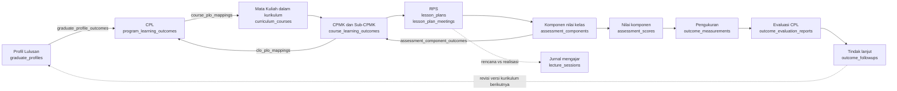
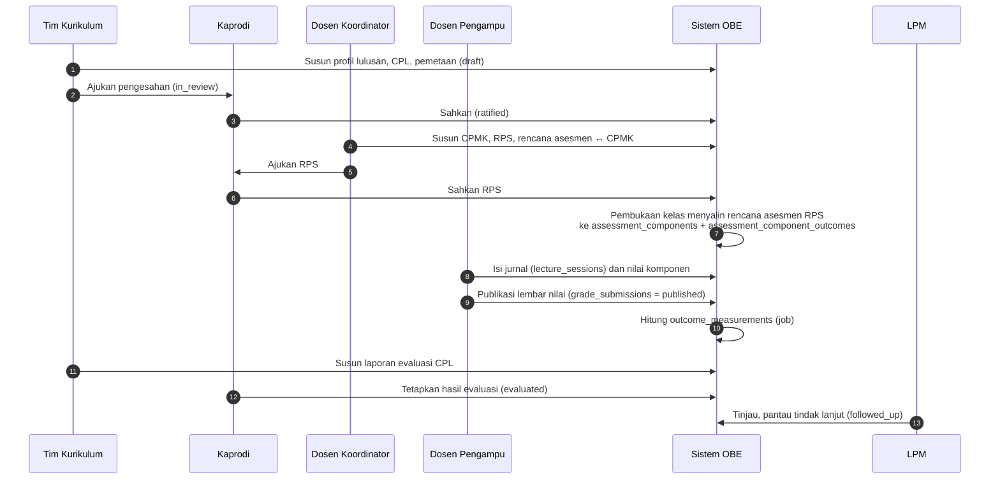
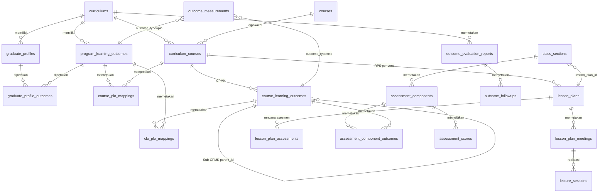
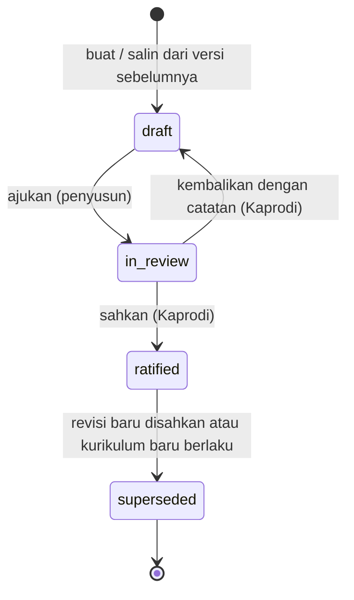
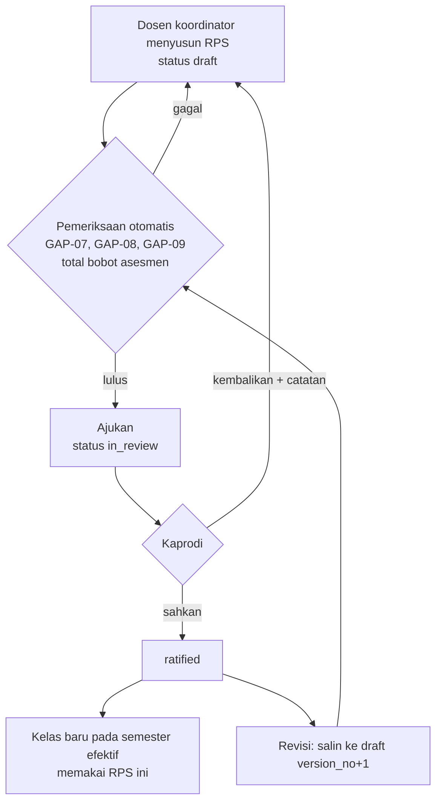
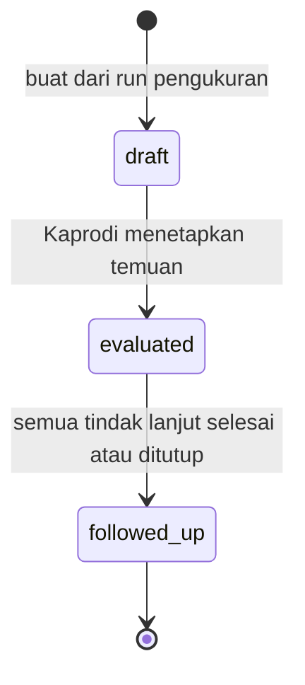
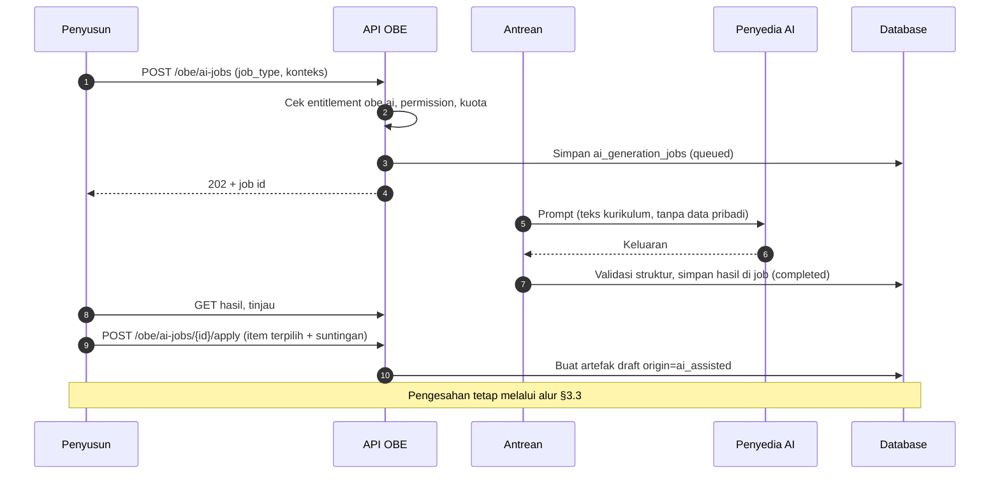

# 04 — Rancangan Modul OBE (Outcome Based Education)

> **Status:** rancangan sistem (bukan dokumentasi fitur jadi). Seluruh entitas, endpoint, dan layar OBE berstatus **(Baru)**. Repository per commit `ab81cc7` belum memiliki satu pun tabel atau endpoint OBE.
> **Disusun:** 2026-10-11
> **Kembali ke:** [README](README.md) · Kanon penamaan: [README §5](README.md#5-kanon-penamaan-wajib-diikuti-seluruh-dokumen) · Label: [README §6](README.md#6-label-klasifikasi-fitur)
> **Referensi:** [SEVIMA_Penjelasan_Modul.md §10](../SEVIMA_Penjelasan_Modul.md) dan [SEVIMA_Platform_Proposal.md §3.14 dan §6.1](../SEVIMA_Platform_Proposal.md)

## Daftar Isi

1. [Ringkasan Modul](#1-ringkasan-modul)
2. [Alur Besar OBE](#2-alur-besar-obe)
3. [Model Data dan Versi Artefak OBE](#3-model-data-dan-versi-artefak-obe)
4. [D.1 Profil Lulusan](#4-d1-profil-lulusan)
5. [D.2 Capaian Pembelajaran Lulusan (CPL)](#5-d2-capaian-pembelajaran-lulusan-cpl)
6. [D.3 Kurikulum dan Pemetaan](#6-d3-kurikulum-dan-pemetaan)
7. [D.4 Rencana Pembelajaran Semester (RPS)](#7-d4-rencana-pembelajaran-semester-rps)
8. [D.5 Penilaian dan Pengukuran Ketercapaian](#8-d5-penilaian-dan-pengukuran-ketercapaian)
9. [D.6 Pelaporan dan Akreditasi](#9-d6-pelaporan-dan-akreditasi)
10. [D.7 OBE AI](#10-d7-obe-ai)
11. [Hak Akses](#11-hak-akses)
12. [Ringkasan Endpoint](#12-ringkasan-endpoint)
13. [Ringkasan Layar](#13-ringkasan-layar)
14. [Konfigurasi](#14-konfigurasi)
15. [Entitlement Paket](#15-entitlement-paket)
16. [Daftar Aturan Bisnis OBE](#16-daftar-aturan-bisnis-obe)
17. [Risiko dan Keputusan Terbuka](#17-risiko-dan-keputusan-terbuka)

---

## 1. Ringkasan Modul

OBE adalah pendekatan kurikulum yang dimulai dari hasil akhir, yaitu profil lulusan yang diharapkan. Profil lulusan diturunkan menjadi capaian pembelajaran lulusan (CPL), lalu didistribusikan ke mata kuliah dalam bentuk capaian pembelajaran mata kuliah (CPMK). CPMK diukur melalui komponen penilaian yang direncanakan di RPS. Hasil pengukuran kemudian dievaluasi untuk memperbaiki kurikulum. **[Referensi]**

Tujuan utama modul ini: **ketercapaian CPL dapat diukur dengan data nilai yang sebenarnya, bukan perkiraan**, dan setiap angka dapat ditelusuri kembali ke nilai komponen mahasiswa. **[Referensi]**

### 1.1 Pengguna dan aktor

| Aktor | Role kanon | Peran dalam OBE |
|---|---|---|
| Ketua program studi | `head_of_study_program` | Pemilik kurikulum OBE prodi. Mengesahkan profil lulusan, CPL, pemetaan, dan RPS. Menyetujui laporan evaluasi |
| Tim kurikulum / admin prodi | `study_program_administrator` | Menyusun draf profil, CPL, dan pemetaan. Menjalankan perhitungan ulang. Menyusun laporan |
| Dosen koordinator mata kuliah | `lecturer` (koordinator = `class_sections.lecturer_id` atau penanggung jawab RPS) | Menyusun CPMK, Sub-CPMK, RPS, dan pemetaan komponen nilai ↔ CPMK |
| Dosen pengampu | `lecturer` | Memakai RPS yang disahkan, mengisi jurnal mengajar (realisasi), dan menginput nilai komponen |
| LPM | `quality_assurance` | Memantau ketercapaian lintas prodi, meninjau laporan evaluasi, dan audit mutu |
| Pimpinan | `dean`, `vice_rector`, `rector` | Membaca dasbor ketercapaian sesuai scope |
| BAAK | `academic_administrator` | Membaca. Mengelola data kurikulum di SIAKAD yang menjadi dasar OBE |
| Auditor | `auditor` | Read-only, termasuk jejak audit |
| Mahasiswa | `student` | **[Rekomendasi] [Konfirmasi]** Melihat ketercapaian CPL miliknya sendiri jika diaktifkan tenant |

### 1.2 Cakupan fitur terhadap referensi

| Fitur referensi (SEVIMA §10, Proposal §3.14) | Bagian dokumen ini | Label | Status |
|---|---|---|---|
| Manajemen profil lulusan | [§4](#4-d1-profil-lulusan) | [Referensi] | (Baru) |
| Capaian Pembelajaran Lulusan (CPL) | [§5](#5-d2-capaian-pembelajaran-lulusan-cpl) | [Referensi] | (Baru) |
| Mata kuliah & RPS | [§7](#7-d4-rencana-pembelajaran-semester-rps) | [Referensi] | (Baru). Mata kuliah memakai `courses` (Ada) |
| Kurikulum prodi | [§6](#6-d3-kurikulum-dan-pemetaan) | [Referensi] | (Parsial). Memakai `curriculums` dan `curriculum_courses` dari [01-siakad.md](01-siakad.md) A.2 |
| Pemetaan CPL ke mata kuliah | [§6.3](#63-pemetaan-cpl--mata-kuliah) | [Referensi] | (Baru) |
| Pemetaan CPMK | [§6.4](#64-pemetaan-cpmk--cpl) | [Referensi] | (Baru) |
| Pemetaan profil lulusan ke CPL | [§6.2](#62-pemetaan-profil-lulusan--cpl) | [Referensi] | (Baru) |
| Rencana pembelajaran & evaluasi | [§7](#7-d4-rencana-pembelajaran-semester-rps) | [Referensi] | (Baru) |
| Komposisi nilai perkuliahan terhubung CPMK | [§8](#8-d5-penilaian-dan-pengukuran-ketercapaian) | [Referensi] | (Baru). Bergantung pada `assessment_components` dari 01 A.6 |
| Evaluasi ketercapaian CPL & tindak lanjut | [§8.10](#810-evaluasi-kurikulum-dan-tindak-lanjut) | [Rekomendasi] (diturunkan dari tujuan OBE) | (Baru) |
| Laporan akreditasi | [§9](#9-d6-pelaporan-dan-akreditasi) | Inti: [Rekomendasi]. Format lembaga: [Konfirmasi] | (Baru) |
| OBE AI | [§10](#10-d7-obe-ai) | Add-on [Referensi]. Cakupan [Konfirmasi] | (Baru) |

### 1.3 Ketergantungan

OBE berada di **Tahap 6** roadmap ([README §7](README.md#7-dependensi-dan-urutan-implementasi)). Modul ini tidak bisa berjalan tanpa:

1. `curriculums` versi dan `curriculum_courses` ([01-siakad.md](01-siakad.md) A.2, [OD-03](16-open-decisions.md#od-03)).
2. `assessment_components`, `assessment_scores`, dan `grade_submissions` ([01-siakad.md](01-siakad.md) A.6). Tanpa nilai per komponen, CPMK tidak dapat diukur.
3. `lecture_sessions` untuk realisasi RPS ([01-siakad.md](01-siakad.md) A.5).
4. Disarankan menunggu integrasi nilai CBT ke `assessment_scores` ([03-cbt-cbt-ai.md](03-cbt-cbt-ai.md) C.5), agar nilai ujian ikut terpetakan ke CPMK.

---

## 2. Alur Besar OBE

Alur referensi: **Profil Lulusan → CPL → Mata Kuliah → CPMK → RPS & Penilaian**. Rancangan ini menambahkan tahap penutup **Evaluasi Ketercapaian CPL**, yang hasilnya menjadi masukan revisi kurikulum berikutnya (siklus perbaikan berkelanjutan).



### 2.1 Siklus per versi kurikulum



---

## 3. Model Data dan Versi Artefak OBE

### 3.1 ERD inti OBE

Rincian tipe kolom, indeks, dan constraint final ada di [07-database-erd.md](07-database-erd.md). ERD berikut menampilkan relasi dan kolom kunci yang menjadi dasar aturan di dokumen ini. Semua tabel memiliki `id` ULID, `university_id`, dan `timestampsTz`.



### 3.2 Ringkasan tabel

| Tabel | Fungsi | Kolom kunci (usulan) | Status |
|---|---|---|---|
| `graduate_profiles` | Profil lulusan per versi kurikulum | `curriculum_id`, `study_program_id`, `code`, `name`, `description`, `competencies` (json daftar kompetensi), `needs_rationale`, `status`, `version_no`, `previous_version_id`, `ratified_at`, `ratified_by`, `origin` | (Baru) |
| `program_learning_outcomes` | CPL | `curriculum_id`, `study_program_id`, `code`, `statement`, `category_code`, `indicators` (json), `measurement_methods` (json), `target_score`, `target_attainment_rate`, `status`, `version_no`, `previous_version_id`, `ratified_at`, `ratified_by`, `origin` | (Baru) |
| `graduate_profile_outcomes` | Pivot profil ↔ CPL | `graduate_profile_id`, `program_learning_outcome_id`, `note` | (Baru) |
| `course_plo_mappings` | CPL ↔ mata kuliah dalam kurikulum | `curriculum_course_id`, `program_learning_outcome_id`, `contribution_level`, `contribution_weight` | (Baru) |
| `course_learning_outcomes` | CPMK dan Sub-CPMK | `curriculum_course_id`, `parent_id` (null = CPMK), `code`, `statement`, `order_index`, `origin` | (Baru) |
| `clo_plo_mappings` | CPMK ↔ CPL | `course_learning_outcome_id`, `program_learning_outcome_id`, `weight` | (Baru) |
| `lesson_plans` | RPS | `curriculum_course_id`, `version_no`, `previous_version_id`, `status`, `coordinator_lecturer_id`, `description`, `learning_methods`, `references` (json), `effective_from_term_id`, `ratified_at`, `ratified_by`, `origin` | (Baru) |
| `lesson_plan_meetings` | Rencana per pertemuan | `lesson_plan_id`, `meeting_number`, `course_learning_outcome_id` (Sub-CPMK/CPMK, opsional), `topic`, `learning_method`, `delivery_mode`, `duration_minutes`, `learning_materials`, `assessment_indicators`, `assessment_criteria` | (Baru) |
| `lesson_plan_assessments` | Rencana asesmen RPS (templat komponen nilai) | `lesson_plan_id`, `name`, `component_type`, `weight_percent`, `max_score`, `meeting_number`, `assessment_method`, `measures_outcome` (bool), `outcome_weights` (json `{course_learning_outcome_id: weight}`) | (Baru, **di luar kanon**, lihat §7.4) |
| `assessment_component_outcomes` | Komponen nilai kelas ↔ CPMK | `assessment_component_id`, `course_learning_outcome_id`, `weight` | (Baru) |
| `outcome_measurements` | Snapshot hasil hitung | lihat [§8.9](#89-snapshot-outcome_measurements-dan-pemicu-hitung-ulang) | (Baru) |
| `outcome_evaluation_reports` | Laporan evaluasi CPL | `curriculum_id`, `study_program_id`, `academic_term_id` (akhir rentang), `term_range` (json), `calculation_run_id`, `status`, `summary`, `findings` (json), `evaluated_at`, `evaluated_by` | (Baru) |
| `outcome_followups` | Rencana tindak lanjut | `outcome_evaluation_report_id`, `program_learning_outcome_id`, `curriculum_course_id` (opsional), `action`, `owner_user_id`, `due_date`, `completed_at`, `result_note` | (Baru) |

Kolom tambahan pada tabel yang ada atau kanon lain:

| Tabel | Kolom tambahan | Fungsi |
|---|---|---|
| `curriculums` | `obe_status`, `obe_ratified_at`, `obe_ratified_by` | Status pengesahan **paket OBE kurikulum** (profil + CPL + pemetaan sebagai satu kesatuan) |
| `class_sections` | `lesson_plan_id` | RPS yang berlaku untuk kelas, dikunci saat kelas dibuka |
| `assessment_components` | `lesson_plan_assessment_id`, `measures_outcome` | Asal komponen dari templat RPS dan penanda komponen yang tidak mengukur CPMK |
| `lecture_sessions` | `lesson_plan_meeting_id`, `deviation_note` | Menghubungkan realisasi ke rencana pertemuan |

### 3.3 Versi artefak OBE dan keterkaitan dengan versi kurikulum

Status kanon artefak OBE (`graduate_profiles`, `program_learning_outcomes`, `lesson_plans`, dan `curriculums.obe_status`): **`draft`, `in_review`, `ratified`, `superseded`**.



Prinsip versi:

1. **Artefak melekat pada satu versi kurikulum.** `graduate_profiles.curriculum_id` dan `program_learning_outcomes.curriculum_id` mengikat profil dan CPL ke satu baris `curriculums`. CPMK dan RPS melekat pada `curriculum_courses`, yaitu mata kuliah dalam versi kurikulum tertentu. Karena itu, angkatan yang memakai kurikulum 2020 tetap diukur dengan CPL 2020, sedangkan angkatan yang memakai kurikulum 2024 diukur dengan CPL 2024 ([01-siakad.md](01-siakad.md) A.2, `curriculum_cohorts`).
2. **Versi kurikulum baru = salinan artefak OBE.** Saat versi kurikulum baru dibuat, sistem menawarkan "Salin OBE dari versi sebelumnya". Semua profil, CPL, pemetaan, CPMK, dan RPS disalin sebagai `draft` dengan `previous_version_id` menunjuk baris asal. Baris asal tidak diubah.
3. **Revisi di dalam versi kurikulum yang sama** (misalnya perbaikan redaksi CPL atau penyesuaian RPS) membuat baris baru `draft` dengan `version_no + 1`. Saat disahkan, baris lama menjadi `superseded`. Pemetaan yang menunjuk baris lama disalin ke baris baru dalam transaksi pengesahan.
4. **Hasil ukur tidak ikut berubah.** `outcome_measurements` menyimpan ID artefak pada saat dihitung. Laporan lama tetap dapat dibaca dengan definisi CPL yang berlaku saat itu.
5. **Hanya baris `ratified` yang dipakai untuk pengukuran resmi.** Draft dapat dihitung dalam mode simulasi (pratinjau), tetapi hasilnya tidak disimpan sebagai snapshot resmi.

| ID | Aturan |
|---|---|
| BR-OBE-VER-01 | Transisi status artefak OBE hanya melalui service dan mengikuti diagram §3.3. Transisi lain ditolak `409`. |
| BR-OBE-VER-02 | Artefak berstatus `ratified` atau `superseded` tidak dapat diubah langsung. Perubahan wajib melalui revisi (baris baru). |
| BR-OBE-VER-03 | Pengesahan revisi mengubah baris sebelumnya (`previous_version_id`) menjadi `superseded` dalam transaksi yang sama. |
| BR-OBE-VER-04 | Dalam satu `curriculum_id`, paling banyak satu baris `ratified` per `code` untuk `graduate_profiles` dan `program_learning_outcomes`. Untuk `lesson_plans`, paling banyak satu `ratified` per `curriculum_course_id`. |
| BR-OBE-VER-05 | Artefak tidak dapat dihapus setelah pernah `ratified`. Draft yang belum pernah diajukan boleh dihapus fisik. |
| BR-OBE-VER-06 | Setiap transisi dan pengesahan dicatat di `audit_logs` (`AuditAction::approved`/`rejected`, `old_values`/`new_values`) dan menyimpan `ratified_by`/`ratified_at`. |
| BR-OBE-VER-07 | `curriculums.obe_status = ratified` mensyaratkan semua profil dan CPL aktif dalam kurikulum itu `ratified` dan tidak ada temuan kesenjangan berderajat **Blokir** ([§6.6](#66-deteksi-kesenjangan)). |

**Pengesahan memakai ApprovalWorkflow** yang sudah ada (`ApprovalRequestService::submit()` dengan `requestable` = artefak). Listener sinkronisasi keputusan mengikuti pola `SyncStudentRequestDecision`. Jika tenant tidak mengonfigurasi workflow, pengesahan langsung oleh `head_of_study_program` berlaku sebagai workflow satu langkah. **[Rekomendasi]**

---

## 4. D.1 Profil Lulusan

**[Referensi]** Mendefinisikan peran lulusan, misalnya "Software Engineer" atau "Peneliti". **(Baru)**

### 4.1 Data

| Data | Wajib | Keterangan |
|---|---|---|
| Kode | Ya | Unik per `curriculum_id`, contoh `PL-01` |
| Nama profil | Ya | Contoh "Pengembang Perangkat Lunak" |
| Deskripsi peran | Ya | Uraian peran lulusan di dunia kerja atau masyarakat |
| Kompetensi | Ya, minimal 1 | Daftar kompetensi utama profil (json berurutan) |
| Hubungan dengan kebutuhan prodi | Opsional | `needs_rationale`: hasil tracer study, masukan pengguna lulusan, visi prodi, asosiasi profesi. Dapat melampirkan dokumen melalui `file_uploads` (`fileable` = profil) |
| Pemetaan ke CPL | Ya sebelum pengesahan | Melalui `graduate_profile_outcomes` ([§6.2](#62-pemetaan-profil-lulusan--cpl)) |
| Riwayat revisi | Otomatis | Rantai `previous_version_id` + `audit_logs` |

### 4.2 Alur

1. Tim kurikulum membuat profil `draft` pada versi kurikulum yang dipilih.
2. Tim kurikulum memetakan profil ke CPL.
3. Profil diajukan bersama paket OBE kurikulum, atau sendiri jika berupa revisi.
4. Kaprodi mengesahkan profil atau mengembalikannya dengan catatan.

Alur alternatif:

- **Kurikulum sudah `ratified`, profil perlu revisi:** buat revisi. Revisi tidak memengaruhi pengukuran karena pengukuran berbasis CPL.
- **Profil dihapus dari kurikulum baru:** profil tidak disalin. Profil versi lama tetap ada.

| ID | Aturan |
|---|---|
| BR-OBE-PRF-01 | `code` unik per `curriculum_id` untuk baris yang tidak `superseded`. |
| BR-OBE-PRF-02 | Profil hanya dapat diajukan jika memiliki minimal satu CPL terpetakan. |
| BR-OBE-PRF-03 | Profil hanya dapat dipetakan ke CPL dalam `curriculum_id` yang sama. |

---

## 5. D.2 Capaian Pembelajaran Lulusan (CPL)

**[Referensi]** Kemampuan yang harus dimiliki lulusan. Referensi mencontohkan pengelompokan sikap, pengetahuan, keterampilan umum, dan keterampilan khusus. **(Baru)**

### 5.1 Data

| Data | Wajib | Keterangan |
|---|---|---|
| Kode | Ya | Unik per kurikulum, contoh `CPL-03` |
| Rumusan | Ya | Kalimat capaian |
| Kategori | Ya | `category_code` dari daftar kategori tenant ([§5.2](#52-kategori-cpl-dapat-dikonfigurasi)) |
| Hubungan dengan profil | Ya | Melalui `graduate_profile_outcomes` |
| Indikator | Ya, minimal 1 | Pernyataan terukur yang menandakan CPL tercapai (json `[{code, statement}]`) |
| Metode pengukuran | Ya | Daftar metode, misalnya asesmen langsung melalui nilai komponen, portofolio, atau survei pengguna lulusan. Hanya metode **asesmen langsung** yang dihitung otomatis oleh §8. Metode lain dicatat sebagai bukti pendukung laporan |
| Target | Ya | `target_score` (skor minimal per mahasiswa, skala 0–100) dan `target_attainment_rate` (persentase mahasiswa yang harus mencapai `target_score`). Bawaan diambil dari konfigurasi ([OD-16](16-open-decisions.md#od-16)) |
| Riwayat revisi | Otomatis | Rantai versi + audit |

### 5.2 Kategori CPL dapat dikonfigurasi

Sistem **tidak menetapkan taksonomi eksternal sebagai aturan mutlak**. Kategori CPL adalah daftar milik tenant, disimpan di `university_settings` key `academic.obe.plo_categories` (json `[{code, label, order}]`). Daftar ini dapat ditimpa per prodi melalui scope prodi.

| Templat opsional | Isi | Label |
|---|---|---|
| Templat SN-Dikti | `attitude` (Sikap), `knowledge` (Pengetahuan), `general_skill` (Keterampilan Umum), `specific_skill` (Keterampilan Khusus) | [Konfirmasi]: tenant memilih memakai atau tidak. Kesesuaian dengan regulasi berlaku menjadi tanggung jawab prodi |
| Templat taksonomi kognitif (misalnya Bloom revisi) untuk level CPMK | Daftar level kognitif sebagai **atribut opsional** CPMK, bukan kategori CPL | [Konfirmasi], [Rekomendasi] |
| Kategori bebas | Ditentukan prodi, misalnya mengikuti asosiasi profesi atau akreditasi internasional | [Rekomendasi] |

Konsekuensi desain:

- Laporan mengelompokkan CPL berdasarkan `category_code` milik tenant, bukan daftar kategori tetap.
- Penghapusan kategori yang sudah dipakai CPL `ratified` ditolak. Kategori hanya dapat dinonaktifkan untuk penggunaan baru.

### 5.3 Aturan CPL

| ID | Aturan |
|---|---|
| BR-OBE-CPL-01 | `code` unik per `curriculum_id` untuk baris yang tidak `superseded`. |
| BR-OBE-CPL-02 | `category_code` harus ada di daftar kategori aktif tenant/prodi saat CPL dibuat atau direvisi. |
| BR-OBE-CPL-03 | `target_score` berada pada rentang 0–100, dan `target_attainment_rate` pada rentang 0–100. Jika kosong, nilai bawaan konfigurasi dipakai dan dicatat pada snapshot pengukuran. |
| BR-OBE-CPL-04 | CPL hanya dapat diajukan jika memiliki minimal satu indikator dan minimal satu metode pengukuran. |
| BR-OBE-CPL-05 | Perubahan `target_score` atau `target_attainment_rate` pada CPL `ratified` dilakukan melalui revisi. Snapshot lama tetap memakai target lama ([§8.9](#89-snapshot-outcome_measurements-dan-pemicu-hitung-ulang)). |

---

## 6. D.3 Kurikulum dan Pemetaan

### 6.1 Struktur yang dipakai

OBE **tidak membuat struktur kurikulum sendiri**. Versi kurikulum (`curriculums`), mata kuliah dalam kurikulum (`curriculum_courses`, termasuk semester rekomendasi dan wajib/pilihan), dan angkatan pemakai (`curriculum_cohorts`) dikelola SIAKAD ([01-siakad.md](01-siakad.md) A.2). Pemetaan **MK → semester** dibaca dari `curriculum_courses` dan ditampilkan di matriks OBE. **[Referensi]**

Empat pemetaan OBE:

| Pemetaan | Tabel | Kardinalitas | Bobot |
|---|---|---|---|
| Profil → CPL | `graduate_profile_outcomes` | N:M | Tanpa bobot |
| CPL → MK | `course_plo_mappings` | N:M | `contribution_level` + `contribution_weight` |
| CPMK → CPL | `clo_plo_mappings` | N:M (CPMK dapat mendukung lebih dari satu CPL) | `weight` |
| Komponen nilai → CPMK | `assessment_component_outcomes` | N:M | `weight` ([§8](#8-d5-penilaian-dan-pengukuran-ketercapaian)) |

### 6.2 Pemetaan profil lulusan → CPL

Matriks profil (baris) × CPL (kolom) dengan sel centang. Satu CPL dapat mendukung beberapa profil.

### 6.3 Pemetaan CPL → mata kuliah

Matriks MK (baris, dikelompokkan per semester rekomendasi) × CPL (kolom). Setiap sel berisi **tingkat kontribusi**.

| Kolom | Arti |
|---|---|
| `contribution_level` | Kode tingkat dari daftar tenant `academic.obe.contribution_levels`, contoh `low`/`medium`/`high` dengan bobot bawaan 1/2/3 (contoh) |
| `contribution_weight` | Angka desimal yang dipakai agregasi. Diisi otomatis dari bobot bawaan tingkat, tetapi dapat ditimpa |

Pemetaan ini **menyatakan rencana kontribusi**. Bukti kontribusi berasal dari `clo_plo_mappings` (CPMK mana yang mendukung CPL itu) dan dari nilai komponen. Ketidakcocokan antara keduanya dideteksi di [§6.6](#66-deteksi-kesenjangan).

### 6.4 Pemetaan CPMK → CPL

Disusun dosen koordinator di halaman mata kuliah. CPMK hanya boleh dipetakan ke CPL yang sudah dipetakan ke MK tersebut di `course_plo_mappings` (BR-OBE-MAP-02). `weight` menyatakan porsi relatif CPMK terhadap CPL. Contoh: CPMK-2 mendukung CPL-03 dan CPL-07 masing-masing 0,5.

Sub-CPMK (`parent_id` terisi) **tidak dipetakan langsung ke CPL**. Sub-CPMK mewarisi pemetaan induknya.

### 6.5 Riwayat pemetaan

- Pemetaan melekat pada artefak berversi. Jika CPL direvisi, pemetaannya disalin ke baris baru saat pengesahan (BR-OBE-VER-03). Baris lama tetap menyimpan pemetaan lama.
- Setiap perubahan pemetaan saat `draft` dicatat di `audit_logs` dengan `old_values`/`new_values`. Halaman "Riwayat Pemetaan" menampilkan perbandingan dua versi (sel ditambah, dihapus, atau bobot berubah).
- Setelah `curriculums.obe_status = ratified`, perubahan `course_plo_mappings` hanya dapat dilakukan melalui pengajuan revisi paket OBE (kurikulum kembali ke `in_review` untuk bagian pemetaan). Perubahan ini **tidak berlaku surut** terhadap snapshot yang sudah dihitung, kecuali dipicu hitung ulang manual ([§8.9](#89-snapshot-outcome_measurements-dan-pemicu-hitung-ulang)).

### 6.6 Deteksi kesenjangan

Sistem menjalankan pemeriksaan otomatis setiap kali pemetaan disimpan dan sebelum pengajuan pengesahan. Hasilnya ditampilkan di panel "Kesenjangan Pemetaan".

| Kode | Kondisi | Derajat | Dampak |
|---|---|---|---|
| GAP-01 | **CPL tanpa MK pendukung**: tidak ada baris `course_plo_mappings` | Blokir | Paket OBE kurikulum tidak dapat disahkan |
| GAP-02 | CPL hanya didukung MK pilihan | Peringatan | Ada risiko lulusan tidak menempuh MK pendukung |
| GAP-03 | CPL hanya didukung kontribusi tingkat terendah | Peringatan | |
| GAP-04 | **MK wajib tanpa CPL**: `curriculum_courses` wajib tanpa `course_plo_mappings` | Blokir untuk MK wajib, Peringatan untuk MK pilihan | |
| GAP-05 | Profil lulusan tanpa CPL | Blokir | |
| GAP-06 | CPL tidak terhubung ke profil mana pun | Peringatan | |
| GAP-07 | MK memetakan CPL di `course_plo_mappings`, tetapi tidak ada CPMK MK itu yang dipetakan ke CPL tersebut | Peringatan (Blokir untuk pengesahan RPS MK itu) | Klaim kontribusi tanpa bukti ukur |
| GAP-08 | CPMK tidak dipetakan ke CPL | Blokir untuk pengesahan RPS | |
| GAP-09 | CPMK tanpa rencana asesmen (`lesson_plan_assessments.outcome_weights` tidak memuatnya) | Blokir untuk pengesahan RPS | CPMK tidak dapat diukur |
| GAP-10 | Komponen nilai kelas tanpa CPMK (`assessment_component_outcomes` kosong) | Peringatan di kelas | Bobot komponen itu tidak berkontribusi ke CPMK |
| GAP-11 | CPL yang tidak memiliki bukti ukur pada rentang semester evaluasi (tidak ada snapshot) | Peringatan di laporan evaluasi | |
| GAP-12 | Jalur ukur CPL hanya bergantung pada satu MK | Informasi | Risiko konsentrasi pengukuran |

| ID | Aturan |
|---|---|
| BR-OBE-MAP-01 | Semua ujung pemetaan (profil, CPL, MK, CPMK) harus berada dalam `curriculum_id` yang sama. |
| BR-OBE-MAP-02 | `clo_plo_mappings` hanya boleh menunjuk CPL yang dipetakan ke MK pemilik CPMK di `course_plo_mappings`. |
| BR-OBE-MAP-03 | `contribution_weight` dan `clo_plo_mappings.weight` bernilai > 0. Nilai 0 tidak disimpan (hapus pemetaan). |
| BR-OBE-MAP-04 | Temuan berderajat Blokir mencegah transisi `in_review` → `ratified` pada artefak terkait. Pesan `409` mencantumkan kode GAP. |
| BR-OBE-MAP-05 | Sub-CPMK tidak dapat dipetakan langsung ke CPL. |

---

## 7. D.4 Rencana Pembelajaran Semester (RPS)

**[Referensi]** "Mata kuliah & RPS" dan "Rencana pembelajaran & evaluasi". **(Baru)**

### 7.1 Isi RPS

| Bagian | Sumber/tabel | Keterangan |
|---|---|---|
| Identitas MK | `curriculum_courses` → `courses` | Kode, nama, SKS, semester rekomendasi (dibaca, tidak disalin) |
| Penyusun & koordinator | `lesson_plans.coordinator_lecturer_id` | |
| Deskripsi MK | `lesson_plans.description` | |
| CPL yang didukung | `course_plo_mappings` | Dibaca |
| CPMK | `course_learning_outcomes` (`parent_id` null) | Wajib minimal 1 |
| Sub-CPMK | `course_learning_outcomes` (`parent_id` terisi) | **Opsional**. Tenant dapat mewajibkannya melalui `academic.obe.require_sub_clo` (bawaan `false`) |
| Bahan kajian/materi & metode | `lesson_plans.learning_methods`, `lesson_plan_meetings.learning_materials` | |
| Rencana per pertemuan | `lesson_plan_meetings` | Jumlah pertemuan bawaan dari `academic.obe.default_meeting_count` (contoh 16, termasuk UTS dan UAS) |
| Metode asesmen & bobot | `lesson_plan_assessments` | Templat komponen nilai |
| Asesmen ↔ CPMK | `lesson_plan_assessments.outcome_weights` | Bobot kontribusi tiap asesmen ke tiap CPMK |
| Referensi pustaka | `lesson_plans.references` | |

### 7.2 Rencana per pertemuan

| Kolom | Wajib | Keterangan |
|---|---|---|
| `meeting_number` | Ya | Unik per RPS |
| `course_learning_outcome_id` | Tidak | CPMK atau Sub-CPMK yang menjadi sasaran pertemuan |
| `topic` | Ya | |
| `learning_method` | Ya | Contoh: ceramah, diskusi, studi kasus, praktikum, PjBL. Daftar tenant `academic.obe.learning_methods` |
| `delivery_mode` | Ya | `offline`, `online`, `hybrid` (selaras dengan mode sesi LMS di [02-edlink-lms.md](02-edlink-lms.md) B.3) |
| `duration_minutes` | Ya | |
| `learning_materials` | Tidak | Teks. Tautan ke `course_materials` dibuat saat kelas berjalan melalui `lecture_session_materials` |
| `assessment_indicators`, `assessment_criteria` | Tidak | |

### 7.3 Pengesahan dan revisi RPS



| ID | Aturan |
|---|---|
| BR-OBE-RPS-01 | Jumlah `lesson_plan_assessments.weight_percent` dalam satu RPS = 100 (toleransi 0,01). |
| BR-OBE-RPS-02 | Untuk setiap asesmen, jumlah `outcome_weights` = `weight_percent` asesmen tersebut. Artinya, bobot asesmen sepenuhnya dibagi ke CPMK. Asesmen yang sengaja tidak mengukur CPMK (misalnya kehadiran, jika kebijakan kampus menilainya) harus ditandai `measures_outcome = false` dan dikecualikan dari aturan ini. |
| BR-OBE-RPS-03 | Setiap CPMK menerima bobot > 0 dari minimal satu asesmen (GAP-09). |
| BR-OBE-RPS-04 | RPS hanya dapat diajukan oleh `coordinator_lecturer_id` atau `study_program_administrator` pada prodi tersebut. |
| BR-OBE-RPS-05 | `effective_from_term_id` wajib. Kelas pada semester ≥ semester efektif memakai RPS `ratified` terbaru saat kelas dibuka. |
| BR-OBE-RPS-06 | `class_sections.lesson_plan_id` diisi saat kelas berpindah ke status `open` dan tidak berubah otomatis ketika RPS direvisi. Penggantian RPS untuk kelas berjalan hanya dapat dilakukan Kaprodi selama kelas belum memiliki `assessment_scores`. |
| BR-OBE-RPS-07 | Jika tidak ada RPS `ratified` saat kelas dibuka, kelas tetap dapat dibuka (agar operasional SIAKAD tidak terhambat), tetapi diberi penanda "Tanpa RPS" dan nilai kelas tersebut dikecualikan dari pengukuran resmi sampai pemetaan komponen ↔ CPMK dilengkapi Kaprodi. Kebijakan ini dapat diubah menjadi blokir melalui `academic.obe.require_ratified_lesson_plan` [Konfirmasi]. |

### 7.4 Dari RPS ke komponen nilai kelas

RPS bersifat **per mata kuliah** (per `curriculum_courses`), sedangkan `assessment_components` bersifat **per kelas** ([README §5.2](README.md#52-entitas--padanan-nama-brief--nama-kanon)). Karena itu RPS membutuhkan templat asesmen. Rancangan ini mengusulkan tabel `lesson_plan_assessments` (**nama baru di luar kanon**). Alternatifnya, templat disimpan sebagai kolom json di `lesson_plans`, tetapi tabel dipilih agar asesmen dapat dirujuk, divalidasi, dan dibandingkan antarversi.

Saat kelas dibuka ([01-siakad.md](01-siakad.md) A.3/A.6):

1. Sistem menyalin setiap `lesson_plan_assessments` menjadi `assessment_components` kelas (nama, tipe, bobot, skor maksimum). Komponen yang dibuat menyimpan `lesson_plan_assessment_id` sebagai asal.
2. Sistem menyalin `outcome_weights` menjadi baris `assessment_component_outcomes`.
3. Dosen pengampu **boleh** mengubah komponen kelas sebelum nilai pertama diinput, misalnya memecah UTS menjadi teori dan praktik. Sistem memeriksa ulang BR-OBE-RPS-01/02 pada tingkat kelas dan menandai deviasi dari RPS.
4. Setelah ada `assessment_scores`, perubahan bobot komponen ↔ CPMK memerlukan persetujuan Kaprodi dan memicu hitung ulang (BR-OBE-MSR-12).

**[Rekomendasi]** Untuk CBT, pemetaan dapat dibuat lebih rinci per soal (`question_bank_items` → CPMK). Fitur ini tidak termasuk cakupan awal. Pada cakupan awal, nilai ujian masuk sebagai satu komponen dan dipetakan ke CPMK pada tingkat komponen.

### 7.5 Realisasi RPS melalui jurnal mengajar

Realisasi diambil dari `lecture_sessions` ([01-siakad.md](01-siakad.md) A.5). Ini adalah integrasi brief §4 butir 3–4.

- Saat sesi dibentuk dari jadwal, sistem mengisi `lecture_sessions.lesson_plan_meeting_id` berdasarkan urutan pertemuan (`meeting_number`). Dosen dapat mengganti pilihan rencana pertemuan.
- Saat mengisi jurnal, dosen melihat topik dan sasaran CPMK yang direncanakan. Dosen mengisi topik aktual. Jika berbeda dari rencana, dosen wajib mengisi `deviation_note`.

| Metrik realisasi per kelas | Rumus |
|---|---|
| Keterlaksanaan pertemuan | `held` ÷ jumlah `lesson_plan_meetings` × 100% |
| Kesesuaian topik | Sesi `held` dengan `lesson_plan_meeting_id` terisi dan `deviation_note` kosong ÷ jumlah sesi `held` × 100% |
| Cakupan CPMK | CPMK yang memiliki minimal satu sesi `held` dengan sasaran CPMK/Sub-CPMK tersebut ÷ jumlah CPMK × 100% |
| Pertemuan rencana yang tidak terealisasi | Daftar `lesson_plan_meetings` tanpa sesi `held` |

Metrik ini dipakai di rekap realisasi RPS ([§9](#9-d6-pelaporan-dan-akreditasi)) dan sebagai petunjuk akar masalah saat CPMK tidak tercapai ([§8.10](#810-evaluasi-kurikulum-dan-tindak-lanjut)).

| ID | Aturan |
|---|---|
| BR-OBE-RPS-08 | Sesi `held` yang topiknya berbeda dari rencana wajib memiliki `deviation_note`. |
| BR-OBE-RPS-09 | Metrik realisasi dihitung hanya dari sesi berstatus `held`. Sesi `rescheduled` dihitung pada sesi penggantinya. |

---

## 8. D.5 Penilaian dan Pengukuran Ketercapaian

Bagian ini mendefinisikan **semua rumus secara eksplisit**. Seluruh angka ambang adalah **contoh** dan dikonfigurasi di `university_settings` grup `academic.*` ([§14](#14-konfigurasi)). Metode agregasi bawaan dan ambang ketercapaian adalah keputusan terbuka [OD-16](16-open-decisions.md#od-16).

### 8.1 Notasi

| Simbol | Arti | Sumber data |
|---|---|---|
| *i* | Mahasiswa | `students` |
| *k* | Komponen nilai di kelas | `assessment_components` |
| *j* | CPMK | `course_learning_outcomes` (`parent_id` null) |
| *p* | CPL | `program_learning_outcomes` |
| *c* | Mata kuliah dalam kurikulum yang ditempuh mahasiswa | `curriculum_courses` melalui `class_sections` → `krs_items` |
| s<sub>i,k</sub> | Skor mentah komponen | `assessment_scores` |
| M<sub>k</sub> | Skor maksimum komponen | `assessment_components.max_score` |
| w<sub>k,j</sub> | Bobot komponen *k* terhadap CPMK *j* | `assessment_component_outcomes.weight` |
| v<sub>j,p</sub> | Bobot CPMK *j* terhadap CPL *p* | `clo_plo_mappings.weight` |
| u<sub>c,p</sub> | Bobot kontribusi MK *c* terhadap CPL *p* | `course_plo_mappings.contribution_weight` |
| SKS<sub>c</sub> | SKS mata kuliah | `courses.credits` |
| T<sub>p</sub> | Target skor CPL | `program_learning_outcomes.target_score` |
| R<sub>p</sub> | Target persentase mahasiswa | `program_learning_outcomes.target_attainment_rate` |

### 8.2 Langkah 1 — Normalisasi skor komponen

Komponen dapat memiliki skor maksimum berbeda. Semua skor dinormalisasi ke skala 0–100:

```
n(i,k) = s(i,k) / M(k) × 100
```

- Jika `max_score` tidak diisi, sistem memakai 100.
- Nilai yang melebihi `max_score` (misalnya karena nilai bonus) dipotong ke 100 untuk keperluan OBE. Nilai akhir SIAKAD tidak ikut berubah.

### 8.3 Langkah 2 — Ketercapaian CPMK per mahasiswa

```
A(i,j) = Σ_k [ n(i,k) × w(k,j) ]  /  Σ_k w(k,j)
```

Penjumlahan dilakukan atas semua komponen *k* di kelas mahasiswa yang memiliki w<sub>k,j</sub> > 0. Penanganan komponen kosong dijelaskan di [§8.8](#88-penanganan-kasus-khusus).

Karena w<sub>k,j</sub> berasal dari pembagian bobot komponen (BR-OBE-RPS-02), Σ<sub>j</sub>Σ<sub>k</sub> w<sub>k,j</sub> = 100. Konsekuensinya, rata-rata tertimbang A<sub>i,j</sub> dengan bobot Σ<sub>k</sub>w<sub>k,j</sub> **sama dengan nilai akhir angka** mahasiswa (sebelum pembulatan dan konversi huruf). Sifat ini dipakai sebagai **uji konsistensi** otomatis (BR-OBE-MSR-05).

### 8.4 Langkah 3 — Ketercapaian CPL per mahasiswa per mata kuliah

```
B(i,c,p) = Σ_j [ A(i,j) × v(j,p) ]  /  Σ_j v(j,p)
```

Penjumlahan dilakukan atas CPMK *j* milik MK *c* yang dipetakan ke CPL *p*.

**Opsi varian (konfigurasi `academic.obe.clo_to_plo_method`):**

| Kode | Rumus | Konsekuensi |
|---|---|---|
| `mapping_weight` (bawaan usulan) | Seperti di atas | Sederhana. Bobot ditentukan eksplisit oleh dosen koordinator |
| `mapping_x_assessment_mass` | v'<sub>j,p</sub> = v<sub>j,p</sub> × Σ<sub>k</sub>w<sub>k,j</sub> | CPMK yang diukur dengan porsi nilai lebih besar berpengaruh lebih besar. Lebih mencerminkan bukti, tetapi bobot pemetaan tidak lagi berdiri sendiri |

### 8.5 Langkah 4 — Agregasi CPL lintas mata kuliah

CPL didukung banyak MK yang ditempuh pada semester berbeda. Ada beberapa metode agregasi yang sah. Sistem menyediakan semuanya sebagai **opsi konfigurasi** (`academic.obe.plo_aggregation_method`). Metode yang dipakai **dicatat di setiap snapshot**.

| Kode | Metode | Rumus per mahasiswa | Kelebihan | Konsekuensi / risiko |
|---|---|---|---|---|
| `weighted_credit_contribution` | Tertimbang SKS × bobot kontribusi | C(i,p) = Σ<sub>c</sub>[B(i,c,p) × SKS<sub>c</sub> × u<sub>c,p</sub>] ÷ Σ<sub>c</sub>[SKS<sub>c</sub> × u<sub>c,p</sub>] | MK besar dan berkontribusi tinggi lebih berpengaruh. Sejalan dengan logika IPK | Bergantung pada kualitas `contribution_weight`. MK kecil berkontribusi tinggi bisa "tenggelam" |
| `simple_average` | Rata-rata sederhana | C(i,p) = Σ<sub>c</sub> B(i,c,p) ÷ jumlah *c* | Mudah dijelaskan | MK 1 SKS dan 4 SKS dianggap setara. Mengabaikan tingkat kontribusi |
| `contribution_only` | Tertimbang bobot kontribusi saja | Seperti metode pertama tanpa SKS | Cocok jika SKS dianggap tidak relevan terhadap CPL | Sama seperti metode pertama, tetapi tanpa efek SKS |
| `cohort_threshold` | Persentase mahasiswa mencapai target | Bukan nilai per mahasiswa. Lihat [§8.6](#86-ketercapaian-tingkat-kohort-dan-prodi) | Bahasa yang umum di laporan mutu: "x% mahasiswa mencapai CPL" | Menyembunyikan seberapa jauh di bawah target. Wajib disajikan bersama rata-rata |

Dimensi kedua yang **independen** adalah **pemilihan percobaan untuk MK yang diulang** (`academic.obe.attempt_policy`):

| Kode | Arti | Konsekuensi |
|---|---|---|
| `latest` (usulan bawaan) | Hanya percobaan terakhir yang sudah dipublikasikan | Mencerminkan kemampuan terkini. Bisa berbeda dari IPK jika IPK memakai nilai terbaik |
| `best` | Percobaan dengan B(i,c,p) tertinggi | Selaras dengan IPK saat ini (`StudentGradeService` memakai nilai terbaik). Ketercapaian dapat terlihat lebih tinggi |
| `all` | Semua percobaan dihitung sebagai MK terpisah | Menunjukkan kesulitan belajar. Menurunkan rata-rata dan menggandakan bobot MK yang diulang |

Kebijakan ini dapat berbeda dari kebijakan IPK ([OD-08](16-open-decisions.md#od-08)). Perbedaannya **wajib ditampilkan** di laporan agar tidak menimbulkan pertanyaan akreditasi.

### 8.6 Ketercapaian tingkat kohort dan prodi

Untuk setiap CPL *p* dan populasi *P* (kelas, angkatan, atau prodi pada rentang semester):

```
Rata-rata(p, P)        = Σ_{i∈P} C(i,p) / |P|
Tingkat capai(p, P)    = |{ i ∈ P : C(i,p) ≥ T(p) }| / |P| × 100%
CPL tercapai pada P    ⇔ Tingkat capai(p, P) ≥ R(p)
```

- |P| hanya menghitung mahasiswa yang memiliki bukti ukur CPL tersebut (`coverage_ratio` memenuhi syarat, [§8.8](#88-penanganan-kasus-khusus)).
- Jumlah mahasiswa tanpa bukti dilaporkan terpisah.
- Hal yang sama berlaku untuk CPMK di tingkat kelas: rata-rata A<sub>i,j</sub> dan persentase mahasiswa dengan A<sub>i,j</sub> ≥ target CPMK. Target CPMK bawaan mengikuti `academic.obe.default_clo_target_score`.

### 8.7 Contoh perhitungan lengkap

**Konfigurasi contoh:** T = 70, R = 75%, `clo_to_plo_method = mapping_weight`, `plo_aggregation_method = weighted_credit_contribution`, `attempt_policy = latest`. Semua angka hanya ilustrasi.

**Mata kuliah:** Basis Data, 3 SKS, memiliki CPMK-1, CPMK-2, dan CPMK-3.

**Komponen dan pemetaan ke CPMK (w<sub>k,j</sub>):**

| Komponen | Bobot nilai akhir | Skor maks | → CPMK-1 | → CPMK-2 | → CPMK-3 |
|---|---:|---:|---:|---:|---:|
| Tugas | 20 | 100 | 10 | 10 | 0 |
| Kuis | 10 | 50 | 10 | 0 | 0 |
| UTS | 30 | 100 | 15 | 15 | 0 |
| UAS | 40 | 120 | 0 | 15 | 25 |
| **Σ w<sub>k,j</sub>** | **100** | | **35** | **40** | **25** |

**Skor mahasiswa (Andi) dan normalisasi:**

| Komponen | s | n = s/M × 100 |
|---|---:|---:|
| Tugas | 80 | 80,00 |
| Kuis | 35 | 70,00 |
| UTS | 66 | 66,00 |
| UAS | 90 | 75,00 |

**Langkah 2 — CPMK:**

- A(CPMK-1) = (80×10 + 70×10 + 66×15) ÷ 35 = (800 + 700 + 990) ÷ 35 = 2490 ÷ 35 = **71,14**
- A(CPMK-2) = (80×10 + 66×15 + 75×15) ÷ 40 = (800 + 990 + 1125) ÷ 40 = 2915 ÷ 40 = **72,88** (72,875)
- A(CPMK-3) = (75×25) ÷ 25 = **75,00**

**Uji konsistensi:** (2490 + 2915 + 1875) ÷ 100 = **72,80**. Nilai akhir SIAKAD = 0,2×80 + 0,1×70 + 0,3×66 + 0,4×75 = 16 + 7 + 19,8 + 30 = **72,80**. Hasilnya cocok.

**Langkah 3 — CPL per MK.** Pemetaan v<sub>j,p</sub>: CPMK-1 → CPL-03 (1), CPMK-2 → CPL-03 (0,5) dan CPL-07 (0,5), CPMK-3 → CPL-07 (1).

- B(Basis Data, CPL-03) = (71,142857×1 + 72,875×0,5) ÷ 1,5 = 107,580357 ÷ 1,5 = **71,72**
- B(Basis Data, CPL-07) = (72,875×0,5 + 75×1) ÷ 1,5 = 111,4375 ÷ 1,5 = **74,29**

Perhitungan antara memakai presisi penuh. Pembulatan hanya dilakukan saat disimpan (BR-OBE-MSR-07).

**Langkah 4 — CPL-03 lintas MK untuk Andi:**

| MK | SKS | u<sub>c,p</sub> | SKS × u | B(i,c,CPL-03) |
|---|---:|---:|---:|---:|
| Basis Data | 3 | 0,6 | 1,8 | 71,72 |
| Algoritma | 4 | 1,0 | 4,0 | 82,00 |
| Rekayasa Perangkat Lunak, percobaan 1 (2025 ganjil) | 3 | 0,4 | 1,2 | 55,00 |
| Rekayasa Perangkat Lunak, percobaan 2 (2026 ganjil) | 3 | 0,4 | 1,2 | 60,00 |

Catatan: tabel memakai B tersimpan dua desimal agar mudah dibaca. Dengan presisi penuh (B Basis Data = 71,720238) hasil metode pertama tetap 75,59.

Perbandingan hasil menurut metode:

| Metode | Perhitungan | C(Andi, CPL-03) | ≥ T = 70? |
|---|---|---:|:-:|
| `weighted_credit_contribution` + `latest` | (71,72×1,8 + 82×4,0 + 60×1,2) ÷ 7,0 = (129,096 + 328 + 72) ÷ 7,0 | **75,59** | Ya |
| `weighted_credit_contribution` + `all` | (129,096 + 328 + 55×1,2 + 72) ÷ 8,2 = 595,096 ÷ 8,2 | **72,57** | Ya |
| `weighted_credit_contribution` + percobaan pertama (ilustrasi bila RPL tidak diulang) | (129,096 + 328 + 66) ÷ 7,0 | **74,73** | Ya |
| `simple_average` + `latest` | (71,72 + 82 + 60) ÷ 3 | **71,24** | Ya |
| `contribution_only` + `latest` | (71,72×0,6 + 82×1,0 + 60×0,4) ÷ 2,0 = (43,032 + 82 + 24) ÷ 2,0 | **74,52** | Ya |

Contoh ini menunjukkan bahwa **metode agregasi mengubah angka secara material** (71,24 sampai 75,59 untuk data yang sama). Karena itu metode harus ditetapkan sebelum evaluasi, tidak boleh diubah setelah melihat hasil, dan dicantumkan di setiap laporan (BR-OBE-MSR-08).

**Tingkat kohort (`cohort_threshold`).** Angkatan 2023 berisi 40 mahasiswa dengan bukti CPL-03. Sebanyak 31 mahasiswa memiliki C ≥ 70, sehingga tingkat capai = 31 ÷ 40 = **77,5%**. Karena 77,5% ≥ R = 75%, **CPL-03 tercapai** untuk angkatan 2023. Laporan juga menampilkan rata-rata kohort, misalnya 73,4, dan distribusi skor.

### 8.8 Penanganan kasus khusus

| Kasus | Perlakuan bawaan | Opsi konfigurasi | Konsekuensi |
|---|---|---|---|
| **Komponen kosong**, mahasiswa tidak memiliki `assessment_scores` untuk komponen yang memetakan CPMK | Mengikuti kebijakan nilai kosong SIAKAD ([01-siakad.md](01-siakad.md) A.6). Jika SIAKAD menghitung kosong = 0, OBE juga memakai 0 agar uji konsistensi tetap berlaku | `academic.obe.missing_component_policy`: `follow_grading` (bawaan), `zero`, `exclude` | `exclude` membuang komponen dari pembilang dan penyebut, sehingga capaian tidak turun karena ketidakhadiran ujian. Akibatnya uji konsistensi dengan nilai akhir tidak lagi berlaku |
| **Cakupan bukti rendah** | Hitung `coverage_ratio(i,j)` = Σw<sub>k,j</sub> yang memiliki skor ÷ Σw<sub>k,j</sub>. Jika di bawah `academic.obe.min_coverage_ratio` (contoh 0,5), hasil ditandai `insufficient_evidence` dan dikeluarkan dari populasi P | Ambang dapat dikonfigurasi | Mencegah CPMK dinilai hanya dari satu kuis kecil |
| **Nilai belum dipublikasikan** | Tidak dihitung. Pengukuran resmi hanya memakai kelas dengan `grade_submissions.status = published` | — | Snapshot selalu konsisten dengan nilai resmi |
| **Lembar nilai dibuka kembali** (`reopened`) | Snapshot kelas ditandai `is_current = false` sampai kelas dipublikasikan ulang. Setelah itu snapshot dihitung ulang | — | |
| **MK diulang** | Mengikuti `attempt_policy` ([§8.5](#85-langkah-4--agregasi-cpl-lintas-mata-kuliah)) | `latest`/`best`/`all` | Lihat tabel §8.5 |
| **Perbaikan atau pemutihan nilai** (`grade_revisions` `applied`, `revision_type = remediation`) | Jika revisi mengubah `assessment_scores`, A<sub>i,j</sub> dihitung ulang. Jika revisi hanya mengubah nilai akhir tanpa skor komponen, OBE **tidak** mengubah A<sub>i,j</sub> dan menandai snapshot `evidence_type = final_only_override` | — | Pemutihan nilai akhir tidak otomatis menaikkan capaian CPL tanpa bukti asesmen |
| **MK transfer atau konversi** (`credit_conversions` dengan `source_type` transfer) | Tidak memiliki skor komponen, sehingga `evidence_type = none` dan MK dikeluarkan dari agregasi CPL mahasiswa tersebut | `academic.obe.converted_course_policy`: `exclude` (bawaan), `proxy_final_score`, `manual_mapping` | `proxy_final_score` memakai nilai akhir hasil konversi sebagai B untuk semua CPL MK itu, ditandai `evidence_type = proxy`. Laporan memisahkan proporsi proxy |
| **MBKM yang dikonversi ke MK** | Sama dengan transfer. Jika `mbkm_assessments` memiliki rubrik yang dipetakan prodi ke CPMK MK target, opsi `manual_mapping` memungkinkan skor rubrik dipakai sebagai n<sub>i,k</sub> virtual | Seperti di atas | Membutuhkan pemetaan rubrik MBKM ↔ CPMK oleh prodi ([01-siakad.md](01-siakad.md) A.10) |
| **Mahasiswa pindah kurikulum** (mengikuti ekuivalensi `course_equivalencies`) | Diukur dengan CPL kurikulum yang berlaku untuk mahasiswa saat ini (`curriculum_cohorts`). MK lama dipetakan melalui ekuivalensi ke MK kurikulum baru. Jika tidak ada ekuivalensi, MK lama dikeluarkan | — | [Konfirmasi] melalui OD-NEW-obe-curriculum-migration |
| **Kelas tanpa RPS** | Dikecualikan sampai pemetaan dilengkapi (BR-OBE-RPS-07) | — | |
| **Komponen dengan `measures_outcome = false`** | Tidak masuk perhitungan CPMK. Uji konsistensi memakai nilai akhir tanpa komponen tersebut | — | |
| **Mahasiswa mengundurkan diri dari kelas** (`krs_items.status = dropped`) | Tidak dihitung | — | |

### 8.9 Snapshot `outcome_measurements` dan pemicu hitung ulang

Hasil perhitungan disimpan sebagai **snapshot**. Snapshot tidak dihitung saat laporan dibuka, karena perhitungan lintas semester berat dan laporan akreditasi harus dapat direproduksi.

**Kolom usulan `outcome_measurements`:**

| Kolom | Tipe | Keterangan |
|---|---|---|
| `id`, `university_id` | ULID | |
| `calculation_run_id` | ULID | Mengelompokkan satu kali proses hitung |
| `measurement_level` | string(30) | `clo_student`, `clo_class`, `plo_student_course`, `plo_student`, `plo_cohort`, `plo_program` |
| `outcome_type` | string(10) | `clo` / `plo` |
| `outcome_id` | ULID | `course_learning_outcomes.id` atau `program_learning_outcomes.id` |
| `curriculum_id`, `study_program_id` | ULID | |
| `student_id` | ULID null | Terisi untuk level `*_student*` |
| `class_section_id`, `curriculum_course_id`, `krs_item_id` | ULID null | Konteks MK dan kelas |
| `academic_term_id` | ULID null | Semester (level kelas/MK), atau akhir rentang (level kohort) |
| `cohort_year` | smallint null | Untuk `plo_cohort` |
| `score` | decimal(6,2) | A, B, C, atau rata-rata populasi |
| `attainment_rate` | decimal(5,2) null | Untuk level populasi |
| `population_count`, `insufficient_count` | integer null | Untuk level populasi |
| `target_score`, `target_attainment_rate` | decimal(5,2) | Target **yang berlaku saat dihitung** |
| `is_achieved` | boolean | |
| `coverage_ratio` | decimal(5,4) | |
| `evidence_type` | string(30) | `direct`, `proxy`, `final_only_override`, `insufficient_evidence`, `none` |
| `parameters` | jsonb | Metode, kebijakan percobaan, kebijakan komponen kosong, ambang cakupan, dan presisi |
| `input_fingerprint` | string(64) | Hash input (skor, bobot, pemetaan) untuk mendeteksi data basi |
| `is_current` | boolean | `false` jika digantikan run yang lebih baru |
| `computed_at` | timestamptz | |

Indeks utama: `(university_id, outcome_type, outcome_id, measurement_level, is_current)`, `(university_id, student_id, is_current)`, `(university_id, class_section_id)`, dan `(university_id, calculation_run_id)`.

**Pemicu hitung ulang:**

| Pemicu | Cakupan | Mode |
|---|---|---|
| `grade_submissions` → `published` | Kelas tersebut → mahasiswa terkait → CPL mahasiswa terkait | Otomatis (job antrean, domain event `GradeSubmissionPublished`) |
| `grade_submissions` → `reopened` | Snapshot kelas ditandai `is_current = false` | Otomatis |
| `grade_revisions` → `applied` | Mahasiswa dan kelas terkait | Otomatis |
| Perubahan `assessment_component_outcomes` setelah publikasi (sudah disetujui Kaprodi) | Kelas | Otomatis |
| `credit_conversions` disetujui | Mahasiswa | Otomatis |
| Revisi CPL atau pemetaan disahkan | **Tidak otomatis**. Sistem menampilkan pemberitahuan "Ada definisi baru, hitung ulang?" | Manual oleh `study_program_administrator` |
| Perubahan konfigurasi metode atau ambang | **Tidak otomatis**. Wajib pratinjau perbandingan lama vs baru sebelum dijalankan | Manual, dengan alasan dan audit |
| Hitung ulang terjadwal | Seluruh prodi, untuk menyelaraskan data basi menurut `input_fingerprint` | Terjadwal (contoh mingguan), [Rekomendasi] |

| ID | Aturan |
|---|---|
| BR-OBE-MSR-01 | Pengukuran resmi hanya memakai kelas dengan `grade_submissions.status = published` dan artefak berstatus `ratified`. |
| BR-OBE-MSR-02 | Normalisasi skor memakai `max_score` komponen. Hasil dipotong ke rentang 0–100. |
| BR-OBE-MSR-03 | Rumus A, B, C, dan tingkat capai mengikuti §8.2–§8.6 dengan metode dari konfigurasi yang aktif saat run dimulai. |
| BR-OBE-MSR-04 | Setiap snapshot menyimpan `parameters`, target yang berlaku, dan `evidence_type`. |
| BR-OBE-MSR-05 | Untuk setiap mahasiswa dan kelas dengan kebijakan `follow_grading` atau `zero`, selisih antara rata-rata tertimbang A<sub>i,j</sub> dan nilai akhir angka sebelum pembulatan harus ≤ 0,01. Pelanggaran dicatat sebagai anomali di run dan ditampilkan ke admin prodi. |
| BR-OBE-MSR-06 | Hasil dengan `coverage_ratio` < ambang ditandai `insufficient_evidence` dan dikeluarkan dari \|P\|. |
| BR-OBE-MSR-07 | Perhitungan antara memakai presisi penuh. Nilai disimpan dibulatkan *half-up* ke `academic.obe.decimal_places` (contoh 2). Perbandingan dengan target memakai nilai tersimpan. |
| BR-OBE-MSR-08 | Setiap laporan menampilkan metode agregasi, kebijakan percobaan, dan kebijakan komponen kosong yang dipakai. |
| BR-OBE-MSR-09 | Run baru menandai snapshot sebelumnya dengan cakupan yang sama sebagai `is_current = false`. Snapshot tidak pernah dihapus selama masa retensi. |
| BR-OBE-MSR-10 | Laporan evaluasi yang sudah `evaluated` merujuk `calculation_run_id` tertentu dan tidak berubah ketika ada run baru. |
| BR-OBE-MSR-11 | Perubahan konfigurasi metode pengukuran wajib memiliki alasan, tercatat di audit, dan hanya berlaku untuk run berikutnya. |
| BR-OBE-MSR-12 | Perubahan `assessment_component_outcomes` pada kelas yang sudah memiliki `assessment_scores` memerlukan persetujuan Kaprodi dan memicu hitung ulang kelas. |
| BR-OBE-MSR-13 | Run bersifat idempoten per `(cakupan, input_fingerprint, parameters)`. Run dengan input dan parameter identik tidak membuat snapshot baru. |

### 8.10 Evaluasi kurikulum dan tindak lanjut

**[Rekomendasi]**, diturunkan dari tujuan OBE: target vs realisasi, area yang belum mencapai target, rekomendasi tindak lanjut, dan riwayat evaluasi.

Status kanon `outcome_evaluation_reports.status`: `draft` → `evaluated` → `followed_up`.



**Analisis area yang belum mencapai target** dihasilkan otomatis dengan aturan berikut, bukan AI:

| Temuan | Aturan deteksi | Petunjuk akar masalah yang ditampilkan |
|---|---|---|
| CPL tidak tercapai | Tingkat capai < R<sub>p</sub> | MK kontributor dengan B rata-rata terendah |
| CPMK lemah di MK kontributor | Rata-rata A<sub>j</sub> di kelas < target CPMK | Komponen dengan n rata-rata terendah untuk CPMK itu, keterlaksanaan RPS (§7.5), dan cakupan CPMK di jurnal |
| Disparitas antarkelas paralel | Selisih rata-rata A<sub>j</sub> antarkelas MK yang sama > `academic.obe.parallel_gap_threshold` (contoh 10 poin) | Dosen dan RPS per kelas (RPS sama tetapi realisasi berbeda) |
| Bukti tidak cukup | Proporsi `insufficient_evidence` > 20% (contoh) | Komponen tanpa pemetaan (GAP-10) |
| Tren menurun | Tingkat capai turun dua semester berturut-turut | Perubahan RPS atau dosen pada periode tersebut |

**Rekomendasi tindak lanjut** dipilih tim kurikulum dari daftar jenis tindakan tenant (`academic.obe.followup_action_types`, contoh: revisi RPS, revisi asesmen, pelatihan dosen, penambahan MK pendukung, atau revisi CPL pada kurikulum berikutnya). Setiap tindak lanjut memiliki penanggung jawab dan tenggat. Sistem tidak menetapkan tindakan secara otomatis. OBE AI dapat memberi draf saran ([§10](#10-d7-obe-ai)).

**Riwayat evaluasi kurikulum** adalah daftar `outcome_evaluation_reports` per versi kurikulum, beserta tautan ke tindak lanjut dan perubahan versi berikutnya (melalui `previous_version_id`). Riwayat ini menjadi bukti siklus perbaikan berkelanjutan untuk akreditasi.

| ID | Aturan |
|---|---|
| BR-OBE-EVL-01 | Laporan evaluasi hanya dapat dibuat dari run yang seluruh snapshotnya `is_current = true` pada saat pembuatan. |
| BR-OBE-EVL-02 | Transisi `draft` → `evaluated` hanya oleh `head_of_study_program` dalam scope prodi. |
| BR-OBE-EVL-03 | Transisi `evaluated` → `followed_up` mensyaratkan setiap `outcome_followups` memiliki `completed_at` atau `result_note` penutupan. |
| BR-OBE-EVL-04 | Laporan `evaluated` bersifat immutable. Koreksi dilakukan dengan membuat laporan baru yang merujuk laporan lama. |

---

## 9. D.6 Pelaporan dan Akreditasi

Laporan dibagi menjadi **laporan inti**, yang dibangun di Civitas One dan tidak bergantung pada format lembaga, dan **format lembaga akreditasi**, yang perlu dikonfirmasi ([OD-19](16-open-decisions.md#od-19)). Spesifikasi kolom dan filter lengkap ada di [12-reports-analytics.md](12-reports-analytics.md).

### 9.1 Laporan inti

| No | Laporan | Isi | Sumber | Ekspor | Label |
|---|---|---|---|---|---|
| R-OBE-01 | Profil lulusan & CPL | Daftar profil, CPL per kategori, indikator, metode, dan target per versi kurikulum | `graduate_profiles`, `program_learning_outcomes` | PDF, XLSX | [Rekomendasi] |
| R-OBE-02 | Matriks profil–CPL | Matriks centang | `graduate_profile_outcomes` | PDF, XLSX | [Rekomendasi] |
| R-OBE-03 | Matriks CPL–MK | MK per semester × CPL dengan tingkat kontribusi | `course_plo_mappings`, `curriculum_courses` | PDF, XLSX | [Rekomendasi] |
| R-OBE-04 | Matriks CPMK–CPL per MK | CPMK × CPL dengan bobot | `clo_plo_mappings` | PDF, XLSX | [Rekomendasi] |
| R-OBE-05 | Matriks asesmen–CPMK per kelas | Komponen × CPMK dengan bobot | `assessment_component_outcomes` | XLSX | [Rekomendasi] |
| R-OBE-06 | Dokumen RPS | RPS lengkap per versi | `lesson_plans`, `lesson_plan_meetings`, `lesson_plan_assessments` | PDF | [Rekomendasi] |
| R-OBE-07 | Rekap realisasi RPS | Metrik §7.5 per kelas, MK, dan prodi | `lecture_sessions`, `lesson_plan_meetings` | XLSX, PDF | [Rekomendasi] |
| R-OBE-08 | Ketercapaian CPMK per kelas | Rata-rata, tingkat capai, distribusi, dan bukti tidak cukup | `outcome_measurements` (`clo_class`) | XLSX, PDF | [Rekomendasi] |
| R-OBE-09 | Ketercapaian CPL per mahasiswa | C<sub>i,p</sub> semua CPL beserta rincian MK penyumbang | `outcome_measurements` (`plo_student`, `plo_student_course`) | PDF, XLSX | [Rekomendasi] |
| R-OBE-10 | Ketercapaian CPL per angkatan dan prodi | Rata-rata, tingkat capai, status tercapai, dan tren | `outcome_measurements` (`plo_cohort`, `plo_program`) | XLSX, PDF | [Rekomendasi] |
| R-OBE-11 | Bukti asesmen | Untuk satu CPMK atau CPL: daftar komponen, contoh berkas tugas/soal (tautan `file_uploads`, `exams`), dan distribusi skor | `assessment_components`, `assignments`, `exams` | ZIP (indeks PDF + berkas) | [Rekomendasi] |
| R-OBE-12 | Riwayat evaluasi & perbaikan | Laporan evaluasi, tindak lanjut, dan perubahan versi kurikulum | `outcome_evaluation_reports`, `outcome_followups` | PDF | [Rekomendasi] |
| R-OBE-13 | Kesenjangan pemetaan | Temuan GAP per versi kurikulum | Hasil §6.6 | XLSX | [Rekomendasi] |

Setiap laporan ketercapaian mencantumkan `calculation_run_id`, waktu hitung, dan parameter metode (BR-OBE-MSR-08).

### 9.2 Format lembaga akreditasi

| Hal | Status |
|---|---|
| Tabel atau borang LAM tertentu (misalnya LAM INFOKOM, LAMEMBA, LAMTEKNIK) | [Konfirmasi] [OD-19](16-open-decisions.md#od-19). Dibangun sebagai **templat ekspor** di atas data laporan inti setelah format resmi diperoleh |
| Format BAN-PT (LKPS/LED) yang terkait kurikulum dan CPL | [Konfirmasi] OD-19 |
| Akreditasi internasional (misalnya ABET, IABEE, AUN-QA) | [Konfirmasi]. Umumnya dapat dipenuhi oleh R-OBE-03/04/08/10/12 dengan kategori CPL kustom |

Prinsip: **format lembaga tidak boleh mengubah model data inti**. Format baru ditambahkan sebagai pemetaan kolom dari laporan inti (templat ekspor per tenant).

| ID | Aturan |
|---|---|
| BR-OBE-RPT-01 | Laporan per mahasiswa (R-OBE-09) hanya dapat diakses role dengan `obe_reports.read` pada scope prodi mahasiswa, dosen wali mahasiswa tersebut ([OD-28](16-open-decisions.md#od-28)), dan mahasiswa itu sendiri jika diaktifkan. |
| BR-OBE-RPT-02 | Setiap ekspor dicatat `AuditAction::exported` beserta filter yang dipakai. |
| BR-OBE-RPT-03 | Laporan populasi tidak menampilkan nama mahasiswa, kecuali pengguna memiliki akses laporan per mahasiswa. |

---

## 10. D.7 OBE AI

**Status: Add-on [Referensi] (Proposal §6.1, "Outcome Based Education AI", minimal Professional). Cakupan fungsional di bawah adalah [Rekomendasi]. Harga dan cakupan [Konfirmasi] ([OD-02](16-open-decisions.md#od-02)). Penyedia AI dan kebijakan data [Konfirmasi] ([OD-11](16-open-decisions.md#od-11)).** Feature key: `obe.ai`. Fitur ini mensyaratkan `obe` aktif.

### 10.1 Prinsip

1. **AI hanya memberi rekomendasi.** Semua keluaran AI masuk sebagai **draf** yang wajib ditinjau, diubah, dan disetujui manusia.
2. **AI tidak pernah mengubah artefak `ratified`, menjalankan pengesahan, atau mengubah snapshot pengukuran.**
3. **Asal keluaran tercatat.** Artefak yang berasal dari AI diberi `origin = ai_assisted` dan `ai_generation_job_id`. Label "Dibantu AI" tetap terlihat sampai artefak disahkan. Setelah itu label tetap tersimpan di riwayat.
4. **Data minimal.** Data yang dikirim ke penyedia AI dibatasi pada teks kurikulum, misalnya rumusan CPL, deskripsi MK, dan topik RPS. Untuk analisis kesenjangan, sistem hanya mengirim **statistik agregat**. **Tidak pernah** dikirim identitas mahasiswa, nilai per mahasiswa, atau data dosen pribadi (BR-OBE-AI-03).

### 10.2 Kemampuan

| Kemampuan | Masukan | Keluaran (draf) | Tempat penyimpanan draf |
|---|---|---|---|
| Draf CPL | Profil lulusan, kategori CPL tenant, deskripsi prodi, opsional standar asosiasi yang diunggah prodi | Rumusan CPL + indikator + metode ukur | `program_learning_outcomes` berstatus `draft`, `origin = ai_assisted` |
| Draf CPMK | CPL yang dipetakan ke MK, deskripsi MK, SKS | CPMK dan opsional Sub-CPMK, usulan bobot `clo_plo_mappings` | `course_learning_outcomes` (draft RPS) |
| Draf RPS | CPMK, jumlah pertemuan, metode tenant | Rencana per pertemuan + usulan asesmen dan bobot ke CPMK | `lesson_plans` `draft` beserta anaknya |
| Usulan pemetaan | Daftar CPL dan deskripsi MK | Usulan matriks CPL–MK dengan tingkat kontribusi | Disajikan sebagai **saran berbeda warna** di matriks. Diterapkan per sel oleh pengguna |
| Analisis kesenjangan naratif | Hasil GAP §6.6 dan statistik ketercapaian agregat | Narasi temuan dan usulan tindak lanjut | Draf teks di `outcome_evaluation_reports.findings` bagian `ai_suggestions` |

Eksekusi memakai `ai_generation_jobs` yang dipakai bersama CBT AI ([03-cbt-cbt-ai.md](03-cbt-cbt-ai.md) C.3) dengan `job_type` khusus OBE (`obe_plo_draft`, `obe_clo_draft`, `obe_lesson_plan_draft`, `obe_mapping_suggestion`, `obe_gap_narrative`). Job berjalan asinkron di antrean dengan status, biaya token, dan log galat.



| ID | Aturan |
|---|---|
| BR-OBE-AI-01 | Endpoint OBE AI memerlukan feature `obe.ai` aktif untuk tenant ([11-roles-permissions.md](11-roles-permissions.md) lapis 1–2) dan permission terkait artefak target (`obe_outcomes.create`, `lesson_plans.create`, atau `obe_mappings.update`). |
| BR-OBE-AI-02 | Keluaran AI hanya dapat menghasilkan artefak `draft`. Penerapan ke artefak non-draft ditolak `409`. |
| BR-OBE-AI-03 | Payload ke penyedia AI tidak boleh berisi identitas atau nilai per mahasiswa. Validasi dilakukan oleh pembangun prompt melalui daftar field yang diizinkan, bukan daftar field yang dilarang. |
| BR-OBE-AI-04 | Artefak `origin = ai_assisted` hanya dapat diajukan setelah pengguna manusia menyimpannya minimal sekali. Tanda waktu dan pengguna yang menyimpan tercatat di audit. |
| BR-OBE-AI-05 | Prompt, versi model, dan respons mentah disimpan di job selama masa retensi `academic.obe.ai_log_retention_days` (contoh 180) untuk audit. |

---

## 11. Hak Akses

Matriks lengkap ada di [11-roles-permissions.md](11-roles-permissions.md). Ringkasan untuk OBE:

| Permission | `head_of_study_program` | `study_program_administrator` | `lecturer` | `quality_assurance` | `dean` / `vice_rector` / `rector` | `academic_administrator` | `auditor` | `student` |
|---|---|---|---|---|---|---|---|---|
| `obe_profiles.read/create/update` | R C U (prodi) | R C U (prodi) | R | R | R (scope) | R | R | — |
| `obe_profiles.approve` | ✓ (prodi) | — | — | — | — | — | — | — |
| `obe_outcomes.*` (CPL & CPMK) | R C U approve (prodi) | R C U (prodi) | R. C U CPMK pada MK yang dikoordinasi | R | R | R | R | — |
| `obe_mappings.read/update` | R U (prodi) | R U (prodi) | R. U CPMK–CPL dan komponen–CPMK di kelasnya | R | R | R | R | — |
| `lesson_plans.read/create/update` | R C U | R C U | R. C U jika koordinator | R | R | R | R | R (RPS ratified kelasnya) [Rekomendasi] |
| `lesson_plans.approve` | ✓ | — | — | — | — | — | — | — |
| `obe_measurements.read` | ✓ | ✓ | Kelasnya sendiri | ✓ (semua prodi) | ✓ (scope) | — | ✓ | Milik sendiri [Konfirmasi] |
| `obe_measurements.update` (hitung ulang) | ✓ | ✓ | — | — | — | — | — | — |
| `obe_reports.read/export` | ✓ | ✓ | Kelasnya | ✓ | ✓ | — | ✓ (read) | — |
| `obe_reports.approve` (laporan evaluasi) | ✓ | — | — | — | — | — | — | — |

Scope prodi memakai `user_roles.scope_type = study_program`. Scope fakultas untuk `dean` memakai `scope_type = faculty`. Kepemilikan kelas dosen memakai `ClassSectionAccess` yang sudah ada.

---

## 12. Ringkasan Endpoint

Semua endpoint berada di bawah `/api/v1/obe`, dengan middleware `auth:sanctum`, `tenant.resolve`, dan pemeriksaan entitlement `obe`. Spesifikasi lengkap ada di [08-api-specification.md](08-api-specification.md). Semua endpoint berstatus **(Baru)**.

| Method | URL | Fungsi | Permission |
|---|---|---|---|
| GET/POST | `/obe/curriculums/{curriculum}/graduate-profiles` | Daftar/buat profil | `obe_profiles.read/create` |
| GET/PUT/DELETE | `/obe/graduate-profiles/{id}` | Detail/ubah draf/hapus draf | `obe_profiles.*` |
| POST | `/obe/graduate-profiles/{id}/revisions` | Buat revisi dari `ratified` | `obe_profiles.create` |
| GET/POST | `/obe/curriculums/{curriculum}/program-learning-outcomes` | Daftar/buat CPL | `obe_outcomes.read/create` |
| GET/PUT/DELETE | `/obe/program-learning-outcomes/{id}` | | `obe_outcomes.*` |
| POST | `/obe/program-learning-outcomes/{id}/revisions` | | `obe_outcomes.create` |
| GET/PUT | `/obe/curriculums/{curriculum}/profile-outcome-matrix` | Matriks profil–CPL (simpan massal) | `obe_mappings.read/update` |
| GET/PUT | `/obe/curriculums/{curriculum}/course-outcome-matrix` | Matriks CPL–MK | `obe_mappings.read/update` |
| GET | `/obe/curriculums/{curriculum}/gaps` | Hasil deteksi kesenjangan | `obe_mappings.read` |
| POST | `/obe/curriculums/{curriculum}/clone-from/{source}` | Salin OBE dari versi kurikulum lain | `obe_outcomes.create` |
| POST | `/obe/curriculums/{curriculum}/submit` / `approve` / `return` | Pengesahan paket OBE | `obe_outcomes.create` / `obe_outcomes.approve` |
| GET/POST | `/obe/curriculum-courses/{id}/learning-outcomes` | CPMK dan Sub-CPMK | `obe_outcomes.*` |
| PUT | `/obe/curriculum-courses/{id}/clo-plo-mappings` | Pemetaan CPMK–CPL | `obe_mappings.update` |
| GET/POST | `/obe/curriculum-courses/{id}/lesson-plans` | Daftar versi/buat RPS | `lesson_plans.read/create` |
| GET/PUT | `/obe/lesson-plans/{id}` | Termasuk `meetings` dan `assessments` bersarang | `lesson_plans.read/update` |
| POST | `/obe/lesson-plans/{id}/submit` / `approve` / `return` / `revisions` | | `lesson_plans.*` |
| GET | `/obe/lesson-plans/{id}/export?format=pdf` | Dokumen RPS | `lesson_plans.read` |
| GET/PUT | `/obe/class-sections/{id}/component-outcomes` | Pemetaan komponen ↔ CPMK kelas | `obe_mappings.update` |
| GET | `/obe/class-sections/{id}/realization` | Metrik realisasi RPS | `lesson_plans.read` |
| POST | `/obe/measurement-runs` | Hitung ulang (cakupan, pratinjau `dry_run`) | `obe_measurements.update` |
| GET | `/obe/measurement-runs/{runId}` | Status dan ringkasan run | `obe_measurements.read` |
| GET | `/obe/measurements` | Filter `level`, `outcome_id`, `student_id`, `class_section_id`, `cohort_year`, `academic_term_id` | `obe_measurements.read` |
| GET/POST | `/obe/evaluation-reports` | | `obe_reports.read/create` |
| POST | `/obe/evaluation-reports/{id}/evaluate` | `draft` → `evaluated` | `obe_reports.approve` |
| GET/POST/PUT | `/obe/evaluation-reports/{id}/followups` | | `obe_reports.update` |
| GET | `/obe/reports/{reportCode}` | R-OBE-01 … R-OBE-13, `?format=xlsx\|pdf` | `obe_reports.read/export` |
| POST | `/obe/ai-jobs`, GET `/obe/ai-jobs/{id}`, POST `/obe/ai-jobs/{id}/apply` | OBE AI | `obe.ai` + permission artefak |
| GET | `/student/obe/attainment` | Ketercapaian milik sendiri [Konfirmasi] | `student_portal` |

Contoh respons `GET /obe/measurements?filter[level]=plo_student&filter[student_id]=01J...`:

```json
{
  "success": true,
  "message": "Data ketercapaian berhasil diambil",
  "data": [
    {
      "id": "01JA9Z3Q8M2V6X4K7T1R5N0BCD",
      "measurement_level": "plo_student",
      "outcome": { "id": "01JA8...", "code": "CPL-03", "category_code": "specific_skill" },
      "score": 75.59,
      "target_score": 70.0,
      "is_achieved": true,
      "coverage_ratio": 1.0,
      "evidence_type": "direct",
      "parameters": {
        "plo_aggregation_method": "weighted_credit_contribution",
        "attempt_policy": "latest",
        "missing_component_policy": "follow_grading",
        "clo_to_plo_method": "mapping_weight",
        "decimal_places": 2
      },
      "calculation_run_id": "01JA9Z2X...",
      "computed_at": "2026-10-11T03:12:45Z"
    }
  ],
  "meta": { "current_page": 1, "per_page": 20, "total": 9, "last_page": 1 }
}
```

Contoh galat pengesahan dengan kesenjangan:

```json
{
  "success": false,
  "message": "Paket OBE belum dapat disahkan karena masih ada kesenjangan pemetaan.",
  "errors": {
    "gaps": [
      { "code": "GAP-01", "program_learning_outcome": "CPL-09", "detail": "CPL tidak didukung mata kuliah mana pun." },
      { "code": "GAP-04", "course": "IF201 Basis Data", "detail": "Mata kuliah wajib belum dipetakan ke CPL." }
    ]
  }
}
```

---

## 13. Ringkasan Layar

Spesifikasi detail ada di [09-ui-ux-specification.md](09-ui-ux-specification.md). Semua layar memakai komponen `frontend/src/components/ui/` (`PageHeader`, `DataTable`, `Badge`, `Modal`, `StatCard`, `EmptyState`) dan grafik `recharts`.

| Layar | Pengguna | Inti |
|---|---|---|
| Dasbor OBE Prodi | Kaprodi, admin prodi, LPM | Kartu: jumlah CPL, CPL tercapai, kesenjangan, RPS belum disahkan. Grafik radar/batang ketercapaian CPL per angkatan |
| Profil Lulusan & CPL | Tim kurikulum | Pemilih versi kurikulum, tabel dengan `Badge` status (draft abu-abu, in_review kuning, ratified hijau, superseded netral) |
| Matriks Pemetaan | Tim kurikulum | Grid sel dapat disunting (tingkat kontribusi), panel kesenjangan di samping, dan saran AI ditampilkan dengan garis putus-putus |
| Riwayat Versi | Semua pembaca | Perbandingan dua versi berdampingan |
| Editor RPS | Dosen koordinator | Tab Identitas, CPMK, Pertemuan, Asesmen. Validasi bobot langsung (total 100). Tombol Ajukan aktif hanya jika pemeriksaan lulus |
| Realisasi RPS | Dosen, Kaprodi | Linimasa rencana vs sesi, dengan penanda deviasi |
| Ketercapaian Kelas | Dosen | Tabel mahasiswa × CPMK dengan warna di bawah target dan distribusi |
| Ketercapaian Mahasiswa | Kaprodi, dosen wali, mahasiswa (opsional) | Daftar CPL dengan rincian MK penyumbang dan "mengapa angka ini", yaitu penelusuran rumus |
| Laporan Evaluasi | Kaprodi, LPM | Temuan otomatis, tindak lanjut, dan status |
| Pusat Perhitungan | Admin prodi | Daftar run, pratinjau perubahan parameter, dan anomali konsistensi |

**Transparansi rumus [Rekomendasi]:** setiap angka ketercapaian memiliki tombol "Lihat perhitungan" yang menampilkan langkah §8.2–§8.5 dengan angka sebenarnya, seperti contoh §8.7.

---

## 14. Konfigurasi

Semua key berada di `university_settings` grup `academic`. Angka adalah **contoh bawaan**, bukan ketentuan.

| Key | Tipe | Contoh bawaan | Keterangan |
|---|---|---|---|
| `academic.obe.plo_categories` | json | Templat SN-Dikti jika tenant memilihnya | §5.2 |
| `academic.obe.contribution_levels` | json | `[{code:"low",weight:1},{code:"medium",weight:2},{code:"high",weight:3}]` | §6.3 |
| `academic.obe.default_target_score` | decimal | 70 | T bawaan CPL, [OD-16](16-open-decisions.md#od-16) |
| `academic.obe.default_cohort_target_rate` | decimal | 75 | R bawaan, OD-16 |
| `academic.obe.default_clo_target_score` | decimal | 70 | Target CPMK |
| `academic.obe.clo_to_plo_method` | enum | `mapping_weight` | §8.4 |
| `academic.obe.plo_aggregation_method` | enum | `weighted_credit_contribution` | §8.5, OD-16 |
| `academic.obe.attempt_policy` | enum | `latest` | §8.5 |
| `academic.obe.missing_component_policy` | enum | `follow_grading` | §8.8 |
| `academic.obe.min_coverage_ratio` | decimal | 0,5 | §8.8 |
| `academic.obe.converted_course_policy` | enum | `exclude` | §8.8 |
| `academic.obe.decimal_places` | int | 2 | BR-OBE-MSR-07 |
| `academic.obe.require_sub_clo` | bool | `false` | §7.1 |
| `academic.obe.require_ratified_lesson_plan` | bool | `false` | BR-OBE-RPS-07 |
| `academic.obe.default_meeting_count` | int | 16 | §7.1 |
| `academic.obe.learning_methods` | json | Daftar metode | §7.2 |
| `academic.obe.parallel_gap_threshold` | decimal | 10 | §8.10 |
| `academic.obe.followup_action_types` | json | Daftar jenis tindakan | §8.10 |
| `academic.obe.student_can_view_attainment` | bool | `false` | [Konfirmasi] |
| `academic.obe.ai_log_retention_days` | int | 180 | §10 |

Perubahan key `academic.obe.*` yang memengaruhi perhitungan dicatat di audit dengan alasan (BR-OBE-MSR-11).

---

## 15. Entitlement Paket

| Feature key | Fitur | Paket referensi | Penegakan |
|---|---|---|---|
| `obe` | Seluruh §4–§9 | **Professional ke atas**, atau **add-on** untuk paket lain. Referensi: Rp3.000.000/bulan, perlu verifikasi [OD-01](16-open-decisions.md#od-01), [OD-02](16-open-decisions.md#od-02) | Middleware `EnsureFeatureEntitled:obe` pada grup `/obe/*`. Menu OBE disembunyikan jika tidak aktif |
| `obe.ai` | §10 | Add-on berbayar, minimal Professional. Referensi "mulai Rp3.000.000/bulan" [Konfirmasi] OD-02 | `EnsureFeatureEntitled:obe.ai` pada `/obe/ai-jobs*`. Mensyaratkan `obe` |

Konsekuensi jika `obe` dinonaktifkan (kontrak berakhir):

- Data OBE **tidak dihapus**. Akses menjadi read-only untuk ekspor selama masa tenggang `academic.obe.grace_days` [Konfirmasi].
- Hook pembukaan kelas (§7.4) tidak lagi menyalin RPS. Komponen nilai dibuat manual seperti tanpa OBE.
- Job hitung ulang dihentikan.

Lapis izin keempat (data memenuhi syarat) pada OBE, misalnya: pengukuran hanya untuk kelas yang dipublikasikan, pengesahan hanya tanpa GAP berderajat Blokir, dan RPS hanya dapat diajukan oleh koordinator.

---

## 16. Daftar Aturan Bisnis OBE

Pemilik resmi daftar adalah [10-business-rules.md](10-business-rules.md). Tabel ini adalah indeks aturan yang didefinisikan di dokumen ini.

| Area | ID | Ringkas |
|---|---|---|
| Versi | BR-OBE-VER-01 … 07 | Transisi status, immutabilitas, supersede, keunikan, larangan hapus, audit, syarat pengesahan paket |
| Profil | BR-OBE-PRF-01 … 03 | Keunikan kode, minimal satu CPL, satu kurikulum |
| CPL | BR-OBE-CPL-01 … 05 | Keunikan, kategori tenant, rentang target, indikator dan metode wajib, revisi target |
| Pemetaan | BR-OBE-MAP-01 … 05 | Satu kurikulum, konsistensi CPMK–CPL dengan MK–CPL, bobot > 0, blokir GAP, Sub-CPMK |
| RPS | BR-OBE-RPS-01 … 09 | Total bobot 100, pembagian bobot ke CPMK, CPMK terukur, pengaju, semester efektif, penguncian RPS kelas, kelas tanpa RPS, catatan deviasi, metrik dari sesi `held` |
| Pengukuran | BR-OBE-MSR-01 … 13 | Sumber resmi, normalisasi, rumus, parameter, uji konsistensi, cakupan, pembulatan, transparansi, snapshot, immutabilitas laporan, perubahan konfigurasi, perubahan pemetaan, idempotensi |
| Evaluasi | BR-OBE-EVL-01 … 04 | Run current, penetapan Kaprodi, penutupan tindak lanjut, immutabilitas |
| Laporan | BR-OBE-RPT-01 … 03 | Akses laporan per mahasiswa, audit ekspor, anonimisasi populasi |
| AI | BR-OBE-AI-01 … 05 | Entitlement, hanya draf, minimisasi data, penyimpanan manusia sebelum pengajuan, retensi log |

---

## 17. Risiko dan Keputusan Terbuka

### 17.1 Risiko

| Risiko | Dampak | Mitigasi |
|---|---|---|
| Komponen nilai (01 A.6) belum siap | OBE tidak dapat mengukur apa pun | OBE dijadwalkan di Tahap 6 setelah nilai berbasis komponen berjalan minimal satu semester |
| Pemetaan diisi asal-asalan | Angka ketercapaian tidak bermakna | Deteksi GAP, uji konsistensi BR-OBE-MSR-05, dan pelaporan `coverage_ratio` |
| Metode agregasi diubah setelah melihat hasil | Manipulasi laporan akreditasi | BR-OBE-MSR-08/11: metode tercatat di snapshot, perubahan diaudit, dan pratinjau wajib |
| Volume hitung besar (prodi besar × banyak semester) | Beban antrean | Hitung inkremental per kelas saat publikasi. Agregasi kohort dijalankan sebagai job terjadwal. Snapshot diindeks |
| Data historis sebelum OBE tidak memiliki komponen | Tidak ada baseline | Dinyatakan `evidence_type = none`. Opsi `proxy_final_score` hanya untuk analisis, tidak dicampur dengan bukti langsung |
| Ketergantungan pada format akreditasi | Pengerjaan ulang | Laporan inti terpisah dari templat ekspor (§9.2) |
| Keluaran AI diterima tanpa telaah | Kualitas kurikulum menurun | Draf wajib, label asal, dan BR-OBE-AI-04 |

### 17.2 Keputusan terbuka terkait

| ID | Topik |
|---|---|
| [OD-01](16-open-decisions.md#od-01) | Pemetaan paket dan OBE sebagai add-on |
| [OD-02](16-open-decisions.md#od-02) | Harga add-on OBE dan OBE AI |
| [OD-03](16-open-decisions.md#od-03) | `curriculum_courses`. CPMK dan RPS melekat padanya |
| [OD-08](16-open-decisions.md#od-08) | Kebijakan nilai terbaik vs terakhir. Memengaruhi `attempt_policy` |
| [OD-11](16-open-decisions.md#od-11) | Penyedia AI dan kebijakan data |
| [OD-16](16-open-decisions.md#od-16) | Metode agregasi CPMK→CPL bawaan dan ambang ketercapaian |
| [OD-19](16-open-decisions.md#od-19) | Format laporan akreditasi |
| [OD-28](16-open-decisions.md#od-28) | Akses dosen wali ke detail nilai komponen dan ketercapaian per mahasiswa |
| OD-NEW-obe-curriculum-migration | Pengukuran CPL bagi mahasiswa yang pindah versi kurikulum (§8.8) |
| OD-NEW-obe-student-visibility | Apakah mahasiswa dapat melihat ketercapaian CPL miliknya (`academic.obe.student_can_view_attainment`) |
| OD-NEW-obe-lesson-plan-required | Apakah kelas wajib memiliki RPS `ratified` untuk dibuka (BR-OBE-RPS-07) |
