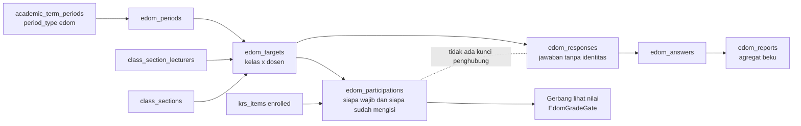
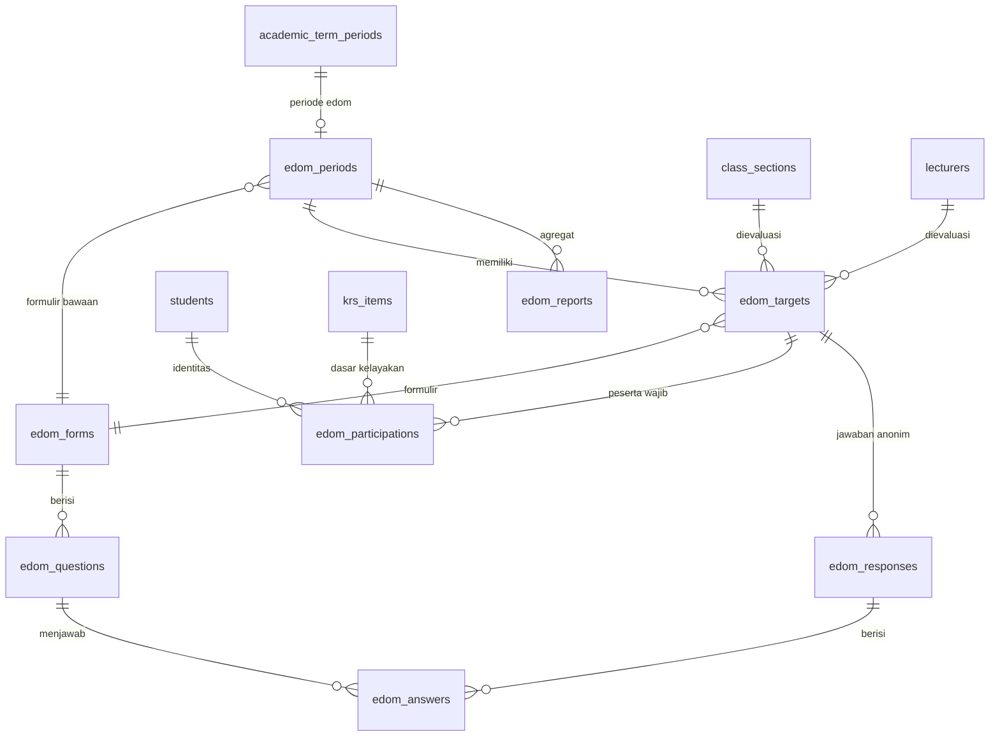
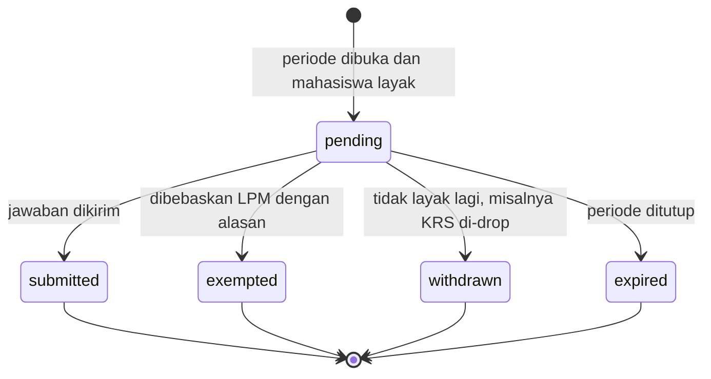
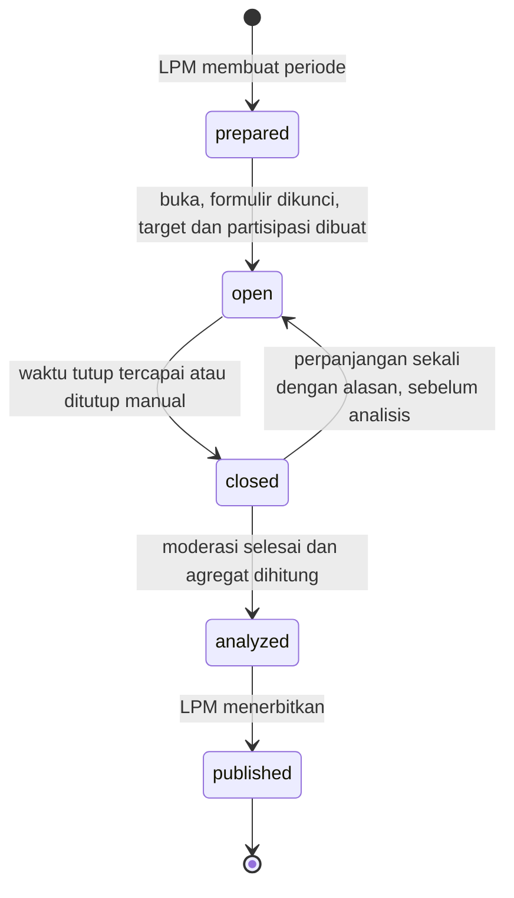
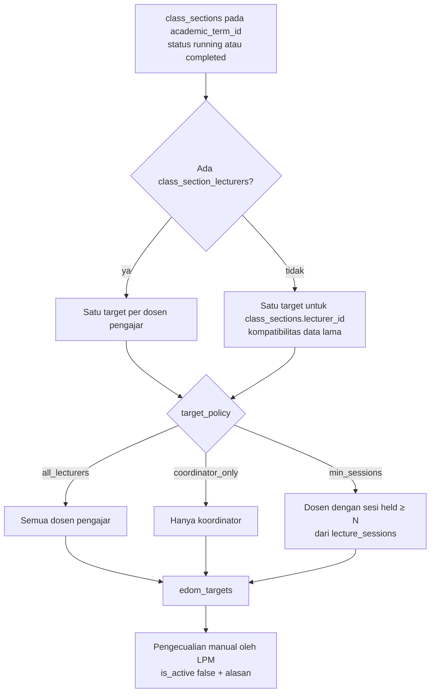
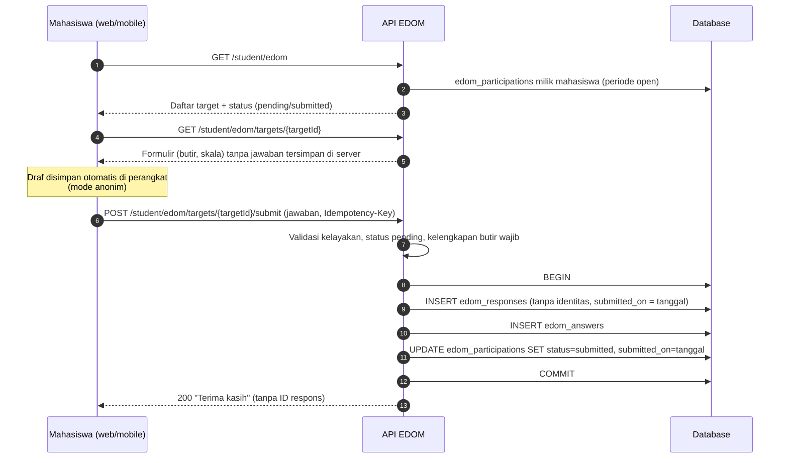
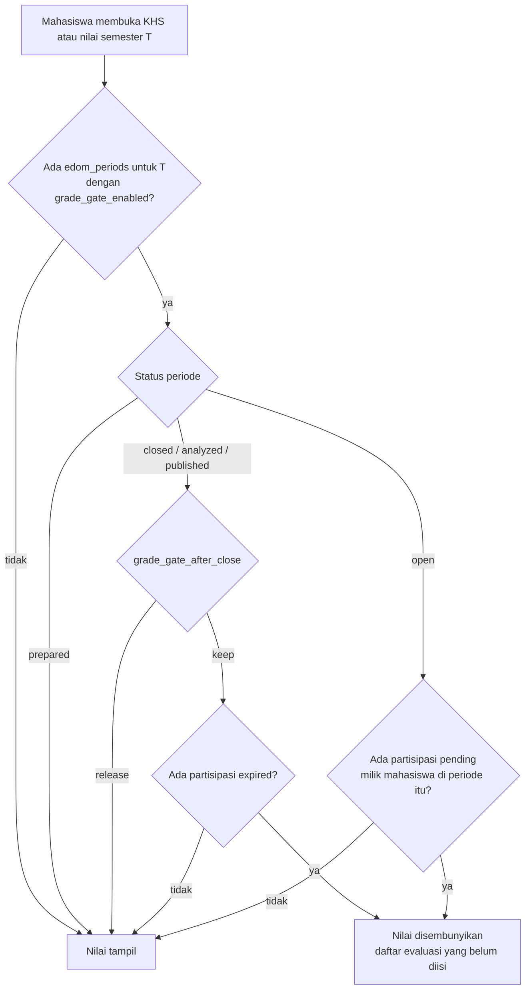

# 05 — Rancangan Modul EDOM (Evaluasi Dosen oleh Mahasiswa)

> **Status:** rancangan sistem (bukan dokumentasi fitur jadi). Backend EDOM belum ada (tidak ada tabel atau endpoint). Di frontend hanya ada halaman mock `frontend/src/pages/portal/PortalLecturerEvaluationPage.tsx` dengan data statis dan tanpa route/API.
> **Disusun:** 2026-10-11
> **Kembali ke:** [README](README.md) · Kanon penamaan: [README §5](README.md#5-kanon-penamaan-wajib-diikuti-seluruh-dokumen) · Label: [README §6](README.md#6-label-klasifikasi-fitur)
> **Referensi:** [SEVIMA_Penjelasan_Modul.md §11](../SEVIMA_Penjelasan_Modul.md) dan [SEVIMA_Platform_Proposal.md §3.8](../SEVIMA_Platform_Proposal.md)

## Daftar Isi

1. [Ringkasan Modul](#1-ringkasan-modul)
2. [Prinsip Penggunaan Hasil EDOM](#2-prinsip-penggunaan-hasil-edom)
3. [Model Data](#3-model-data)
4. [Siklus Periode EDOM](#4-siklus-periode-edom)
5. [E.1 Pengaturan](#5-e1-pengaturan)
6. [E.2 Pengisian](#6-e2-pengisian)
7. [Privasi dan Anonimitas](#7-privasi-dan-anonimitas)
8. [EDOM sebagai Syarat Melihat Nilai](#8-edom-sebagai-syarat-melihat-nilai)
9. [E.3 Rekap dan Analisis](#9-e3-rekap-dan-analisis)
10. [Hak Akses](#10-hak-akses)
11. [Ringkasan Endpoint](#11-ringkasan-endpoint)
12. [Ringkasan Layar](#12-ringkasan-layar)
13. [Konfigurasi](#13-konfigurasi)
14. [Entitlement Paket](#14-entitlement-paket)
15. [Daftar Aturan Bisnis EDOM](#15-daftar-aturan-bisnis-edom)
16. [Risiko dan Keputusan Terbuka](#16-risiko-dan-keputusan-terbuka)

---

## 1. Ringkasan Modul

EDOM adalah kuesioner yang diisi mahasiswa untuk menilai kualitas pengajaran dosen setiap semester. Hasilnya dipakai untuk pembinaan dosen dan penjaminan mutu. **[Referensi]**

### 1.1 Cakupan fitur terhadap referensi

| Fitur referensi (SEVIMA §11, Proposal §3.8) | Bagian | Label | Status |
|---|---|---|---|
| Form EDOM kustom: kampus menyusun pertanyaan dan skala sendiri | [§5.3](#53-pembuat-formulir) | [Referensi] | (Baru) |
| Pengisian online oleh mahasiswa | [§6](#6-e2-pengisian) | [Referensi] | (Baru). UI mock ada |
| Pengisian sebagai syarat melihat nilai | [§8](#8-edom-sebagai-syarat-melihat-nilai) | [Referensi], kebijakan per tenant [Konfirmasi] [OD-10](16-open-decisions.md#od-10) | (Baru) |
| Rekap per dosen dan per kelas | [§9](#9-e3-rekap-dan-analisis) | [Referensi] | (Baru) |
| Periode terikat kalender, target otomatis dari kelas × dosen, aturan kelayakan | [§5.1](#51-periode-evaluasi)–[§5.4](#54-aturan-kelayakan-peserta) | [Rekomendasi] (rincian operasional) | (Baru) |
| Model anonimitas terpisah, ambang responden minimum, moderasi teks | [§7](#7-privasi-dan-anonimitas) | [Rekomendasi], wajib untuk rancangan ini | (Baru) |
| Distribusi, partisipasi, perbandingan antarsemester, area pembinaan, laporan LPM | [§9](#9-e3-rekap-dan-analisis) | [Rekomendasi] | (Baru) |

### 1.2 Aktor

| Aktor | Role kanon | Peran |
|---|---|---|
| LPM | `quality_assurance` | Pemilik proses: menyusun formulir, membuka/menutup periode, moderasi teks, analisis, dan publikasi |
| BAAK | `academic_administrator` | Membantu pengaturan periode dan memantau partisipasi |
| Ketua program studi | `head_of_study_program` | Membaca rekap prodi setelah publikasi dan menindaklanjuti pembinaan |
| Dekan, pimpinan | `dean`, `vice_rector`, `rector` | Membaca rekap agregat sesuai scope |
| Dosen | `lecturer` | Membaca rekap **miliknya sendiri** setelah periode dipublikasikan |
| Mahasiswa | `student` | Mengisi evaluasi |
| Auditor | `auditor` | Membaca rekap dan jejak audit proses. Tidak dapat melihat jawaban mentah |

### 1.3 Ketergantungan

EDOM bergantung pada `class_sections`, `class_section_lecturers` (team teaching), `krs_items`, `academic_term_periods`, dan opsional `attendances`/`lecture_sessions` untuk aturan kehadiran ([01-siakad.md](01-siakad.md) A.1, A.3, A.5). Karena tidak bergantung pada LMS, CBT, atau OBE, EDOM dapat dikerjakan paralel setelah Tahap 2 ([README §7](README.md#7-dependensi-dan-urutan-implementasi)).



---

## 2. Prinsip Penggunaan Hasil EDOM

**EDOM adalah masukan, bukan satu-satunya ukuran kinerja dosen.** Prinsip ini dinyatakan di sistem, laporan, dan kebijakan akses:

1. Hasil EDOM mencerminkan **persepsi mahasiswa** dan dipengaruhi faktor di luar kualitas mengajar, misalnya tingkat kesulitan MK, ukuran kelas, nilai yang diharapkan, MK wajib vs pilihan, dan tingkat partisipasi.
2. Setiap laporan menampilkan **jumlah responden, tingkat partisipasi, dan penanda keandalan**. Laporan tanpa konteks ini tidak diterbitkan.
3. Sistem **tidak membuat peringkat dosen lintas prodi** sebagai keluaran bawaan. Perbandingan antar dosen hanya tersedia untuk LPM/Kaprodi dalam bentuk distribusi, bukan daftar peringkat publik. **[Rekomendasi]**
4. Keputusan kepegawaian, misalnya sanksi, promosi, atau beban mengajar, **tidak boleh diotomatisasi** dari skor EDOM. Integrasi ke modul SDM ([`app/Modules/HumanResource`](../../app/Modules/HumanResource)) hanya berupa tautan baca ke laporan yang dipublikasikan, bukan nilai otomatis yang mengubah data kepegawaian.
5. Istilah di UI adalah **"Aspek yang perlu perhatian"**, bukan "Dosen bermasalah".

| ID | Aturan |
|---|---|
| BR-EDM-USE-01 | Setiap tampilan dan ekspor rekap EDOM wajib memuat jumlah responden, jumlah peserta layak, tingkat partisipasi, dan penanda keandalan ([§9.4](#94-penanda-keandalan)). |
| BR-EDM-USE-02 | Tidak ada proses otomatis yang mengubah data kepegawaian, honor, atau penugasan mengajar berdasarkan skor EDOM. |
| BR-EDM-USE-03 | Ekspor yang memuat skor per dosen lintas prodi hanya tersedia untuk `quality_assurance` dan dicatat `AuditAction::exported`. |

---

## 3. Model Data

Semua tabel berstatus **(Baru)**, memakai PK ULID, `university_id`, dan trait `TenantScoped`. Rincian tipe, indeks, dan constraint ada di [07-database-erd.md](07-database-erd.md).

### 3.1 ERD

Perhatikan bahwa **tidak ada relasi** antara `edom_participations` dan `edom_responses`. Ketiadaan relasi ini disengaja dan menjadi inti model privasi ([§7](#7-privasi-dan-anonimitas)).



### 3.2 Tabel

| Tabel | Fungsi | Kolom kunci (usulan) |
|---|---|---|
| `edom_periods` | Satu periode evaluasi per semester (dapat lebih dari satu, misalnya tengah dan akhir semester) | `academic_term_id`, `academic_term_period_id`, `name`, `default_form_id`, `anonymity_mode` (`anonymous`/`identified`), `target_policy` (json), `eligibility_rules` (json), `grade_gate_enabled`, `grade_gate_after_close` (`release`/`keep`), `min_respondents`, `status`, `opened_at`, `closed_at`, `analyzed_at`, `published_at` |
| `edom_forms` | Formulir berversi | `name`, `description`, `version_no`, `previous_version_id`, `scale_config` (json), `study_program_id` (null = berlaku umum), `locked_at`, `is_active` |
| `edom_questions` | Butir pertanyaan | `edom_form_id`, `code` (stabil antarversi), `category_code`, `category_label`, `order_index`, `question_text`, `question_type`, `options` (json), `scale_override` (json), `is_required`, `is_scored`, `weight`, `reverse_scored` |
| `edom_targets` | Objek evaluasi = satu dosen di satu kelas | `edom_period_id`, `class_section_id`, `lecturer_id`, `edom_form_id`, `is_active`, `deactivated_reason`, `eligible_count` (cache) |
| `edom_participations` | **Sisi identitas**: siapa wajib dan siapa sudah mengisi. **Tanpa jawaban** | `edom_period_id`, `edom_target_id`, `student_id`, `krs_item_id`, `status`, `submitted_on` (date), `exempted_by`, `exemption_reason` |
| `edom_responses` | **Sisi jawaban**: satu baris per pengisian. **Tanpa identitas** dalam mode anonim | `edom_period_id`, `edom_target_id`, `edom_form_id`, `submitted_on` (date), `student_id` (**hanya terisi pada mode `identified`**, selain itu selalu null) |
| `edom_answers` | Jawaban per butir | `edom_response_id`, `edom_question_id`, `numeric_value`, `selected_options` (json), `text_value`, `text_moderation_status`, `text_published`, `moderated_by`, `moderated_at` |
| `edom_reports` | Agregat beku per scope | `edom_period_id`, `scope_type` (`target`, `class_section`, `lecturer`, `study_program`, `faculty`, `university`), `scope_id`, `respondent_count`, `eligible_count`, `participation_rate`, `is_suppressed`, `reliability_flag`, `payload` (json), `generated_at`, `published_at` |

Unique dan constraint penting:

- `edom_targets`: unique `(university_id, edom_period_id, class_section_id, lecturer_id)`.
- `edom_participations`: unique `(university_id, edom_target_id, student_id)`.
- `edom_responses`: **tidak ada** kolom, indeks, atau constraint yang menyertakan `student_id`, `edom_participation_id`, `krs_item_id`, atau turunan/hash identitas pada mode `anonymous`.
- `edom_answers`: unique `(edom_response_id, edom_question_id)`.

### 3.3 Status partisipasi

Kanon README hanya menetapkan status `edom_periods`. Rancangan ini mengusulkan status `edom_participations.status` berikut (**nilai baru**):



`submitted` bersifat final. Dalam mode anonim, jawaban yang sudah dikirim **tidak dapat diubah atau ditarik**, karena sistem tidak dapat lagi menemukan baris jawaban milik mahasiswa tersebut ([§7.6](#76-model-ancaman-dan-batas-perlindungan)).

---

## 4. Siklus Periode EDOM

Status kanon `edom_periods.status`: `prepared`, `open`, `closed`, `analyzed`, `published`.



| Transisi | Aktor | Prasyarat | Efek samping |
|---|---|---|---|
| → `prepared` | `quality_assurance`, `academic_administrator` | `academic_term_periods` bertipe `edom` ada untuk semester tersebut | — |
| `prepared` → `open` | `quality_assurance` | Formulir memiliki ≥ 1 butir. Target sudah dibuat. Waktu sekarang berada dalam rentang `academic_term_periods` | `edom_forms.locked_at` diisi. `edom_participations` dibuat untuk semua mahasiswa layak. Notifikasi ke mahasiswa (`NotificationDispatcher`, event `edom.period_opened`) |
| `open` → `closed` | Sistem (jadwal) atau `quality_assurance` | — | Partisipasi `pending` menjadi `expired`. Gerbang nilai mengikuti `grade_gate_after_close` |
| `closed` → `open` | `quality_assurance` | Belum pernah diperpanjang. Alasan wajib | Partisipasi `expired` yang masih layak kembali menjadi `pending`. Dicatat di audit |
| `closed` → `analyzed` | `quality_assurance` | Tidak ada jawaban teks berstatus moderasi `pending` | `edom_reports` dihitung. Laporan dapat dilihat LPM dan Kaprodi (pratinjau) |
| `analyzed` → `published` | `quality_assurance` | — | `edom_reports.published_at` diisi. Dosen dapat melihat laporan miliknya. Notifikasi ke dosen (`edom.report_published`) |

| ID | Aturan |
|---|---|
| BR-EDM-PER-01 | Transisi status periode hanya melalui service dan mengikuti diagram §4. Transisi lain ditolak `409`. |
| BR-EDM-PER-02 | Rentang pengisian diambil dari `academic_term_periods` (`period_type = edom`). `edom_periods` tidak menyimpan rentang tanggal sendiri, kecuali perpanjangan yang tercatat. |
| BR-EDM-PER-03 | `anonymity_mode` tidak dapat diubah setelah status `open`. |
| BR-EDM-PER-04 | Perpanjangan (`closed` → `open`) paling banyak satu kali per periode dan wajib memiliki alasan. |
| BR-EDM-PER-05 | Laporan `published` bersifat immutable. Koreksi dilakukan dengan menerbitkan ulang laporan baru berversi, dan versi lama tetap tersimpan. |

---

## 5. E.1 Pengaturan

### 5.1 Periode evaluasi

**[Referensi]** "Periode per semester". **(Baru)**

- Periode terikat pada `academic_terms` melalui `academic_term_periods` dengan `period_type = edom` ([01-siakad.md](01-siakad.md) A.1). Dengan demikian kalender akademik mengatur periode EDOM sesuai integrasi brief §4 butir 8.
- Satu semester boleh memiliki lebih dari satu periode, misalnya evaluasi tengah semester dan akhir semester. **[Rekomendasi]**
- Semester pendek (`academic_terms.term_type = short`) dapat memiliki periode sendiri.

### 5.2 Penentuan dosen dan kelas yang dievaluasi

**[Referensi]** "Dosen & kelas dievaluasi". Target **dibangkitkan otomatis**, bukan diinput manual satu per satu.



| Kebijakan target (`target_policy.mode`) | Arti | Konsekuensi |
|---|---|---|
| `all_lecturers` (usulan bawaan) | Setiap dosen dalam team teaching dievaluasi terpisah | Mahasiswa mengisi lebih banyak formulir. Hasil lebih adil per dosen |
| `coordinator_only` | Hanya `class_sections.lecturer_id` | Beban mahasiswa lebih ringan, tetapi dosen anggota tidak memperoleh umpan balik |
| `min_sessions` | Dosen dengan jumlah `lecture_sessions` berstatus `held` ≥ `min_sessions` (contoh 3) | Dosen yang hanya mengajar 1–2 kali tidak dievaluasi. Membutuhkan jurnal mengajar yang terisi |

Kelas yang dikecualikan secara bawaan: `class_sections.status = cancelled` dan kelas dengan jumlah peserta `enrolled` = 0. Jenis kelas tertentu, misalnya tugas akhir atau MBKM yang dikonversi, dapat dikecualikan melalui `target_policy.excluded_course_types` [Konfirmasi].

**Perubahan data saat periode berjalan:**

| Kejadian | Perlakuan |
|---|---|
| Dosen ditambahkan ke `class_section_lecturers` | Target baru dibuat saat sinkronisasi harian. Partisipasi `pending` dibuat untuk mahasiswa layak |
| Dosen dihapus dari kelas | Target `is_active = false`. Partisipasi `pending` menjadi `withdrawn`. Jawaban yang sudah masuk tetap disimpan, tetapi target ditandai di laporan |
| Mahasiswa menambah kelas (add) | Partisipasi baru dibuat saat sinkronisasi |
| Mahasiswa men-drop kelas | Partisipasi `pending` menjadi `withdrawn`. Partisipasi yang sudah `submitted` tidak berubah |

### 5.3 Pembuat formulir

**[Referensi]** "Form EDOM kustom: kampus menyusun sendiri pertanyaan dan skala penilaiannya".

**Struktur:** formulir → bagian/kategori (`category_code` + `category_label`, misalnya "Penguasaan materi", "Metode pengajaran", "Disiplin", "Interaksi") → butir pertanyaan.

| Jenis butir (`question_type`) | Penyimpanan jawaban | Dihitung ke skor? | Keterangan |
|---|---|---|---|
| `likert` | `numeric_value` | Ya (`is_scored` bawaan true) | Skala dari `scale_config` formulir, misalnya 1–5 atau 1–4. Label per titik dapat diatur, misalnya "Sangat tidak setuju" sampai "Sangat setuju" |
| `scale` | `numeric_value` | Ya | Rentang numerik bebas, misalnya 0–10, melalui `scale_override` |
| `single_choice` | `selected_options` | Opsional (setiap opsi dapat memiliki `score`) | |
| `multiple_choice` | `selected_options` | Tidak | Untuk pertanyaan deskriptif, misalnya "Media yang digunakan dosen" |
| `text` | `text_value` | Tidak | Melalui moderasi ([§7.5](#75-moderasi-jawaban-teks)) |

Pengaturan lain:

| Pengaturan | Keterangan |
|---|---|
| Wajib/opsional | `is_required` per butir |
| Skala | `scale_config` formulir: `{min, max, labels[], allow_not_applicable}`. Opsi "Tidak dapat menilai" (N/A) [Rekomendasi]: disimpan sebagai `numeric_value = null` dan dikecualikan dari rata-rata |
| Butir terbalik | `reverse_scored` [Rekomendasi]: untuk pernyataan negatif, skor diubah menjadi `max + min - nilai` saat agregasi |
| Bobot | `weight` per butir untuk indeks kategori (bawaan 1) |
| Kode butir | `code` stabil antarversi, misalnya `MAT-01`. Kode ini menjadi dasar perbandingan antarsemester |
| Formulir per prodi/jenis kelas | `study_program_id` pada formulir dan penimpaan formulir per target, misalnya formulir praktikum [Rekomendasi] |
| Templat | LPM dapat menggandakan formulir dari periode sebelumnya |

**Versi formulir.** Formulir dikunci (`locked_at`) saat periode pertama yang memakainya dibuka. Perubahan setelah dikunci membuat versi baru (`version_no + 1`, `previous_version_id`). Jawaban selalu merujuk `edom_form_id` versi yang dipakai.

| ID | Aturan |
|---|---|
| BR-EDM-FRM-01 | Formulir yang `locked_at`-nya terisi tidak dapat diubah. Perubahan membuat versi baru. |
| BR-EDM-FRM-02 | Formulir minimal memiliki satu butir ber-`is_scored = true` agar dapat dipakai di periode. |
| BR-EDM-FRM-03 | `code` butir unik dalam satu formulir. Butir dengan `code` sama di versi berbeda dianggap butir yang sama untuk perbandingan, **jika** jenis dan skalanya sama. Jika berbeda, sistem memperingatkan saat penyimpanan. |
| BR-EDM-FRM-04 | `scale_config.min` < `scale_config.max`, dan jumlah label sama dengan jumlah titik skala jika label diisi. |
| BR-EDM-FRM-05 | Formulir **tidak boleh** memuat butir yang meminta identitas mahasiswa (NIM, nama, email, nomor telepon). Pembuat formulir menampilkan peringatan untuk butir teks yang mengandung kata kunci identitas. Kebijakan ini wajib pada mode anonim. |

### 5.4 Aturan kelayakan peserta

**[Referensi]** "Aturan kelayakan peserta". Aturan disimpan di `edom_periods.eligibility_rules` dan dievaluasi saat periode dibuka serta saat sinkronisasi harian.

| Aturan | Wajib/opsional | Sumber data | Contoh bawaan |
|---|---|---|---|
| Terdaftar di kelas | Wajib | `krs_items.status = enrolled` untuk `class_section_id` target | — |
| Status mahasiswa aktif | Wajib | `students.status = active` | — |
| Kehadiran minimum | Opsional | Persentase hadir dari `attendances` ([01-siakad.md](01-siakad.md) A.5) | `null` (nonaktif). Jika diaktifkan, contoh 25%. Alasannya, mahasiswa yang hampir tidak pernah hadir dianggap kurang mampu menilai |
| Status KRS disetujui | Opsional | `krs_submissions.status ∈ {approved, locked}` | Aktif |
| Pengecualian program | Opsional | Mahasiswa MBKM penuh di luar kampus | [Konfirmasi] |

| ID | Aturan |
|---|---|
| BR-EDM-ELG-01 | Partisipasi hanya dibuat untuk pasangan (mahasiswa, target) yang memenuhi semua aturan wajib dan aturan opsional yang aktif. |
| BR-EDM-ELG-02 | Aturan kehadiran minimum, jika aktif, dihitung dari data presensi pada saat sinkronisasi. Mahasiswa yang menjadi layak kemudian mendapat partisipasi baru. Partisipasi `pending` yang tidak lagi layak menjadi `withdrawn`. Partisipasi `submitted` tidak pernah dicabut. |
| BR-EDM-ELG-03 | Mahasiswa tanpa partisipasi `pending` untuk suatu target tidak dapat mengirim jawaban ke target tersebut (`403`). |

---

## 6. E.2 Pengisian

### 6.1 Alur mahasiswa



### 6.2 Daftar evaluasi

Halaman "Evaluasi Dosen" menggantikan mock `PortalLecturerEvaluationPage` yang ada:

| Kolom | Isi |
|---|---|
| Mata kuliah | Kode, nama, dan kelas (`class_code`) |
| Dosen | Nama dosen target. Untuk team teaching, satu baris per dosen |
| Status | `Badge`: Belum diisi (warning), Sudah diisi (success), Dibebaskan (neutral), Kedaluwarsa (danger) |
| Tenggat | Akhir periode |
| Aksi | "Isi Evaluasi" jika `pending` |

Ringkasan di atas daftar: "3 dari 7 evaluasi selesai". Jika gerbang nilai aktif, tampilkan pesan "Lengkapi evaluasi untuk melihat nilai semester ini" ([§8](#8-edom-sebagai-syarat-melihat-nilai)).

### 6.3 Formulir per dosen × kelas

- Satu formulir untuk satu target (dosen di kelas tertentu). Judul menampilkan MK, kelas, dan nama dosen.
- Butir dikelompokkan per kategori. Indikator kemajuan menampilkan jumlah butir wajib yang sudah terjawab.
- Pemberitahuan privasi ditampilkan di bagian atas formulir, sesuai mode ([§7.7](#77-pemberitahuan-kepada-mahasiswa)).

### 6.4 Simpan otomatis (autosave)

Draf yang disimpan di server akan menghubungkan identitas mahasiswa dengan jawaban sebelum pengiriman. Kondisi ini bertentangan dengan model anonim. Karena itu:

| Mode | Lokasi draf | Alasan |
|---|---|---|
| `anonymous` | **Hanya di perangkat**: `localStorage`/IndexedDB di web dan secure storage di Flutter, dengan key `edom-draft:{targetId}`. Draf dihapus setelah kiriman berhasil atau setelah periode ditutup | Server tidak pernah menyimpan jawaban yang terhubung ke identitas, bahkan sementara |
| `identified` | Boleh di server, pada kolom draf partisipasi [Rekomendasi], atau tetap di perangkat | Identitas memang disimpan dalam mode ini |

Konsekuensi: pada mode anonim, draf tidak berpindah antar perangkat. UI menyatakan hal ini secara jelas ("Draf tersimpan di perangkat ini").

### 6.5 Validasi kelengkapan dan pengiriman

| ID | Aturan |
|---|---|
| BR-EDM-FIL-01 | Pengiriman hanya diterima jika periode `open`, waktu server berada dalam rentang periode, dan partisipasi mahasiswa untuk target berstatus `pending`. |
| BR-EDM-FIL-02 | Semua butir `is_required = true` wajib terjawab. Butir `likert`/`scale` harus berada dalam rentang skala atau N/A jika diizinkan. `single_choice` harus memilih tepat satu opsi yang valid. Galat `422` menyebut kode butir yang belum lengkap. |
| BR-EDM-FIL-03 | Jawaban teks dibatasi `academic.edom.max_text_length` karakter (contoh 1000). |
| BR-EDM-FIL-04 | Insert respons, insert jawaban, dan update partisipasi berada dalam **satu transaksi**. Jika transaksi gagal, tidak ada data yang tersimpan. |
| BR-EDM-FIL-05 | Pengiriman bersifat idempoten melalui header `Idempotency-Key`. Pengiriman kedua untuk partisipasi yang sudah `submitted` mengembalikan `409` dengan pesan "Evaluasi sudah dikirim". Penguncian baris partisipasi (`SELECT … FOR UPDATE`) mencegah pengiriman ganda yang bersamaan. |
| BR-EDM-FIL-06 | Respons API pengiriman tidak mengembalikan `edom_responses.id` atau data apa pun yang dapat dipakai sebagai kunci penghubung. |
| BR-EDM-FIL-07 | Pada mode anonim, jawaban yang sudah dikirim tidak dapat diubah atau dibatalkan oleh siapa pun melalui aplikasi. |

### 6.6 Pengingat

Notifikasi pengingat terjadwal kepada mahasiswa dengan partisipasi `pending`, misalnya H-3 dan H-1 sebelum tutup, melalui `NotificationDispatcher` (event `edom.reminder`, kanal sesuai preferensi). Pengingat dikirim berdasarkan `edom_participations`, yaitu sisi identitas, sehingga tidak menyentuh jawaban.

---

## 7. Privasi dan Anonimitas

Bagian ini **mengikat**. Implementasi yang melanggar aturan BR-EDM-PRV dianggap cacat keamanan.

### 7.1 Mode anonimitas

| Mode | Default | Penjelasan |
|---|---|---|
| `anonymous` | **Ya (usulan bawaan)** [OD-10](16-open-decisions.md#od-10) | Identitas pengisi dan isi jawaban disimpan di dua tabel tanpa kunci penghubung. Secara desain, jawaban tidak dapat dikembalikan ke mahasiswa dari data tersimpan |
| `identified` | Tidak | `edom_responses.student_id` diisi. Hanya boleh dipakai jika kebijakan kampus memerlukannya, misalnya untuk tindak lanjut keluhan. Mahasiswa **wajib** diberi tahu sebelum mengisi. Akses ke identitas dibatasi ketat ([§7.4](#74-siapa-dapat-melihat-apa)) |

### 7.2 Mekanisme pemisahan identitas (mode anonim)

1. **Dua tabel terpisah.**
   - `edom_participations` menyimpan **siapa** (mahasiswa, target, status) **tanpa jawaban**.
   - `edom_responses` dan `edom_answers` menyimpan **apa** (target, jawaban) **tanpa siapa**.
2. **Tidak ada kunci penghubung.** `edom_responses` tidak memiliki `student_id`, `edom_participation_id`, `krs_item_id`, `user_id`, hash, token, atau nilai turunan identitas lainnya. `edom_participations` juga tidak menyimpan ID respons.
3. **Penanda waktu dikasarkan.**
   - `edom_responses.submitted_on` dan `edom_participations.submitted_on` hanya menyimpan **tanggal**, bukan jam.
   - `created_at`/`updated_at` pada `edom_responses` dan `edom_answers` diisi **awal hari** (00:00 zona waktu tenant) dari tanggal pengiriman, bukan waktu sebenarnya.
   - `updated_at` pada `edom_participations` saat transisi ke `submitted` juga diisi awal hari.
4. **ULID tanpa waktu presisi.** ULID secara bawaan menyandikan waktu dalam milidetik. Untuk `edom_responses.id` dan `edom_answers.id`, komponen waktu ULID dibangkitkan dari **awal hari**, sedangkan 80 bit sisanya acak. Keunikan tetap terjaga, tetapi urutan pengisian tidak dapat dibaca dari ID.
5. **Tanpa atribut demografis.** `edom_responses` tidak menyimpan angkatan, jenis kelamin, IPK, nilai, atau atribut mahasiswa lain. Analisis per atribut tidak tersedia pada mode anonim. Jika tenant memerlukannya, keputusan itu harus melalui OD-10 dan hanya dengan atribut kasar serta ambang minimum.
6. **Log dan audit.**
   - Payload jawaban **tidak** ditulis ke `audit_logs`, log aplikasi, log galat (Sentry/sejenisnya), atau log request.
   - Pengiriman tidak menghasilkan baris audit per mahasiswa yang berisi `edom_target_id` dengan waktu presisi. Bukti partisipasi cukup berasal dari `edom_participations`.
   - Middleware logging mengecualikan body request untuk route `/student/edom/*`.
7. **Tanpa jawaban di antrean.** Pengiriman ditulis langsung dalam transaksi request ([BR-EDM-FIL-04](#65-validasi-kelengkapan-dan-pengiriman)). Jawaban tidak dititipkan ke `jobs` atau `failed_jobs` yang dapat menyimpan payload dengan waktu presisi.

### 7.3 Ambang responden minimum

Agregat yang dihitung dari terlalu sedikit responden dapat mengungkap jawaban individu. Contohnya, kelas dengan 2 responden dan rata-rata 1,0 berarti keduanya memberi nilai 1.

| Aturan | Nilai (contoh) | Konfigurasi |
|---|---|---|
| Rekap target/kelas disembunyikan jika jumlah responden < *n*<sub>min</sub> | *n*<sub>min</sub> = 5 (contoh) | `academic.edom.min_respondents`. Nilai disalin ke `edom_periods.min_respondents` saat periode dibuka |
| Komentar teks disembunyikan jika responden target < *n*<sub>min</sub> | Sama | |
| Distribusi per opsi disembunyikan jika jumlah responden < *n*<sub>min</sub> | Sama | |
| Target yang disembunyikan tetap masuk agregat tingkat lebih tinggi (dosen lintas kelas, prodi) **hanya jika** agregat tersebut juga ≥ *n*<sub>min</sub> | — | |
| Pengurangan agregat tidak boleh membuka sel kecil | — | Sistem tidak menampilkan agregat A dan A−B bersamaan jika B < *n*<sub>min</sub> (perlindungan *differencing*) |

Nilai *n*<sub>min</sub> tidak dapat diturunkan di bawah batas platform `academic.edom.min_respondents_floor` (contoh 3) oleh admin tenant.

### 7.4 Siapa dapat melihat apa

| Data | Mahasiswa | Dosen yang dievaluasi | Kaprodi / Dekan / pimpinan | LPM (`quality_assurance`) | BAAK | Auditor | Super admin platform |
|---|---|---|---|---|---|---|---|
| Status partisipasi miliknya | ✓ | — | — | — | — | — | — |
| Daftar mahasiswa yang belum/sudah mengisi | — | **Tidak pernah** | Jumlah saja | ✓ (untuk pengingat dan pembebasan) | ✓ | Jumlah saja | Melalui akses DB saja, di luar aplikasi |
| Jumlah respons per target selama `open` | — | **Tidak** | — | **Tidak** (hanya tingkat partisipasi dari sisi identitas) | — | — | — |
| Agregat skor target/kelas | — | Miliknya, setelah `published` dan ≥ *n*<sub>min</sub> | Scope-nya, setelah `analyzed` | ✓ setelah `closed` | — | ✓ setelah `published` | — |
| Komentar teks termoderasi | — | Miliknya, setelah `published`, ≥ *n*<sub>min</sub>, urutan diacak, **terpisah dari skor** | Scope-nya, setelah `analyzed` | ✓ | — | — | — |
| Komentar teks asli (sebelum moderasi) | — | — | — | Moderator saja | — | — | — |
| Baris jawaban mentah anonim (per respons) | — | **Tidak** | **Tidak** | ✓ setelah `closed`, hanya target ≥ *n*<sub>min</sub>, ekspor diaudit (`viewed_sensitive`/`exported`) | — | — | — |
| Jawaban + identitas mahasiswa (mode anonim) | **Tidak ada siapa pun.** Data penghubungnya tidak disimpan | | | | | | |
| Jawaban + identitas mahasiswa (mode `identified`) | Miliknya [Rekomendasi] | **Tidak pernah** | **Tidak** | Hanya pemegang permission khusus `edom_reports.approve`, per kasus dengan alasan dan audit `viewed_sensitive` | — | — | — |

**Dosen tidak pernah melihat** siapa yang sudah atau belum mengisi di kelasnya, dan tidak melihat hasil sebelum periode `published`. Aturan ini mencegah tekanan kepada mahasiswa dan korelasi waktu, misalnya ketika jumlah responden naik tepat setelah seorang mahasiswa keluar ruangan.

### 7.5 Moderasi jawaban teks

| Tahap | Pelaku | Keterangan |
|---|---|---|
| Penyaringan otomatis | Sistem, saat pengiriman | Deteksi pola data pribadi (NIM, nomor telepon, email) dan daftar kata kasar tenant. Hasilnya hanya berupa **penanda**, bukan penolakan, agar mahasiswa tidak dapat menguji filter [Rekomendasi] |
| Moderasi | `quality_assurance` | Setiap jawaban teks berstatus `pending` → `approved` (tampil apa adanya), `redacted` (tampil dengan bagian disamarkan, disimpan di `text_published`), atau `rejected` (tidak tampil, misalnya ujaran kebencian, spam, atau identitas pihak ketiga) |
| Tampilan | Dosen, Kaprodi | Hanya `text_published` dari jawaban `approved`/`redacted` |

Status moderasi `text_moderation_status`: `pending`, `approved`, `redacted`, `rejected` (**nilai baru**). Moderator melihat teks **tanpa skor butir lain** dari respons yang sama, agar gaya penilaian tidak menjadi petunjuk identitas.

| ID | Aturan |
|---|---|
| BR-EDM-PRV-01 | Pada mode `anonymous`, `edom_responses.student_id` wajib null. Tidak boleh ada kolom, indeks, tabel bantu, cache, atau log yang menghubungkan `edom_responses`/`edom_answers` dengan `students`, `users`, `krs_items`, atau `edom_participations`. |
| BR-EDM-PRV-02 | Kolom waktu `edom_responses`, `edom_answers`, dan transisi `submitted` pada `edom_participations` disimpan dengan granularitas tanggal (awal hari, zona tenant). |
| BR-EDM-PRV-03 | ID ULID `edom_responses` dan `edom_answers` memakai komponen waktu awal hari. |
| BR-EDM-PRV-04 | Rekap, distribusi, dan komentar untuk scope dengan responden < `min_respondents` tidak ditampilkan dan tidak diekspor. API mengembalikan `is_suppressed = true` tanpa angka. |
| BR-EDM-PRV-05 | Dosen hanya dapat membaca laporan untuk target dengan `lecturer_id` miliknya, dan hanya setelah periode `published`. |
| BR-EDM-PRV-06 | Tidak ada endpoint yang mengembalikan daftar partisipasi per target kepada dosen. |
| BR-EDM-PRV-07 | Jumlah respons per target tidak ditampilkan kepada siapa pun selama periode `open`. Tingkat partisipasi selama `open` dihitung dari `edom_participations` dan hanya ditampilkan pada tingkat prodi ke atas kepada LPM/BAAK. |
| BR-EDM-PRV-08 | Body request `/student/edom/*/submit` dikecualikan dari semua log aplikasi. Pengujian otomatis memverifikasi bahwa log tidak memuat payload jawaban. |
| BR-EDM-PRV-09 | Jawaban teks hanya ditampilkan di luar LPM setelah dimoderasi (`approved`/`redacted`). |
| BR-EDM-PRV-10 | Pada mode `identified`, akses jawaban beridentitas hanya per kasus, wajib alasan, dicatat `AuditAction::viewed_sensitive`, dan tidak pernah tersedia bagi dosen yang dievaluasi. |
| BR-EDM-PRV-11 | Perubahan `academic.edom.min_respondents` hanya berlaku untuk periode yang belum `open` dan tidak dapat lebih kecil dari batas platform. |

### 7.6 Model ancaman dan batas perlindungan

Anonimitas harus dinyatakan secara jujur. Tabel berikut menjelaskan apa yang **dilindungi** dan apa yang **tidak** dilindungi.

| Pelaku/ancaman | Terlindungi? | Penjelasan |
|---|---|---|
| Dosen yang dievaluasi, melalui aplikasi | **Ya** | Tidak ada akses ke partisipasi, tidak ada data sebelum `published`, ambang *n*<sub>min</sub>, dan komentar terpisah dari skor |
| Kaprodi, LPM, dan admin tenant, melalui aplikasi | **Ya** | Tidak ada fitur yang menghubungkan identitas dan jawaban karena datanya tidak ada |
| Admin basis data atau pemegang backup yang membaca tabel **saat diam** (at rest) | **Ya, dengan batas** | Tidak ada kolom penghubung. Waktu dikasarkan ke tanggal dan ID tidak memuat waktu presisi. **Batas:** jika dalam satu target dan satu tanggal hanya ada satu mahasiswa yang `submitted`, respons pada tanggal itu dapat diduga miliknya. Tingkat anonimitas efektif per target = jumlah pengisi pada tanggal yang sama. Pada target kecil, anonimitas terhadap DBA lemah |
| Admin basis data dengan akses **log transaksi** (WAL/binlog), statement log, atau urutan fisik baris | **Sebagian** | Urutan penulisan dalam log transaksi dapat menghubungkan update partisipasi dan insert respons yang berada dalam transaksi yang sama. Mitigasi: statement logging dimatikan untuk tabel EDOM, akses log replikasi dibatasi ke operator infrastruktur, dan opsi pengerasan *batched shuffle* di bawah. Perlindungan penuh terhadap pelaku ini tidak dijanjikan |
| Pelaku dengan kendali runtime aplikasi (server aplikasi disusupi, kode diubah untuk mencatat payload, penyadapan sebelum TLS berakhir) | **Tidak** | Pada saat request diproses, aplikasi mengetahui identitas dan jawaban sekaligus. Mitigasi hanya bersifat prosedural: review kode wajib pada modul EDOM, pengujian BR-EDM-PRV-08, dan kontrol perubahan deploy |
| Reidentifikasi dari isi jawaban, misalnya komentar menyebut kejadian unik | **Sebagian** | Moderasi dan redaksi. Pemberitahuan kepada mahasiswa agar tidak menulis identitas |
| Reidentifikasi dari agregat kecil | **Ya** | *n*<sub>min</sub> dan perlindungan *differencing* |
| Mahasiswa lain di kelas | **Ya** | Tidak ada data yang dapat dilihat mahasiswa selain status miliknya |

**Opsi pengerasan *batched shuffle* [Rekomendasi]:** jawaban ditampung di penyangga memori yang tidak persisten (misalnya Redis tanpa AOF, terpisah dari antrean umum), lalu ditulis per batch acak (misalnya setiap ≥ 10 respons atau setiap jam) dalam transaksi terpisah dari update partisipasi. Opsi ini memutus korelasi di log transaksi. Konsekuensinya: (a) ada risiko kehilangan jawaban jika penyangga gagal sebelum flush, (b) muncul jeda tampilan, dan (c) BR-EDM-FIL-04 (satu transaksi) dilonggarkan. Opsi ini nonaktif secara bawaan dan diaktifkan per tenant melalui `academic.edom.batched_write`.

#### Konsekuensi yang harus diterima

- Jawaban anonim **tidak dapat dikoreksi atau ditarik** setelah dikirim.
- Keluhan serius dalam komentar anonim **tidak dapat ditindaklanjuti ke pengirimnya**. Kampus perlu menyediakan kanal pengaduan terpisah (modul pengaduan atau `complaint`, di luar ruang lingkup).
- Permintaan hukum atas identitas pengisi **tidak dapat dipenuhi** dari data EDOM anonim, karena data tersebut memang tidak ada.
- Analisis per angkatan atau per atribut mahasiswa tidak tersedia pada mode anonim.

### 7.7 Pemberitahuan kepada mahasiswa

| Mode | Teks pemberitahuan (contoh) |
|---|---|
| `anonymous` | "Jawaban Anda **anonim**. Sistem mencatat bahwa Anda sudah mengisi, tetapi jawaban disimpan terpisah tanpa identitas Anda. Dosen hanya melihat rekap gabungan setelah periode selesai, dan hanya jika jumlah pengisi minimal 5. Jangan menulis nama, NIM, atau data pribadi di kolom komentar." |
| `identified` | "Evaluasi ini **tidak anonim**. Identitas Anda tersimpan bersama jawaban dan hanya dapat diakses oleh LPM untuk keperluan tindak lanjut. Dosen tidak dapat melihat identitas Anda." |

Teks pemberitahuan dapat diubah tenant, tetapi butir faktualnya (mode, siapa yang melihat, dan ambang) dibangkitkan otomatis dari konfigurasi agar tidak menyesatkan (BR-EDM-PRV-12).

| ID | Aturan |
|---|---|
| BR-EDM-PRV-12 | Formulir menampilkan pemberitahuan privasi sesuai `anonymity_mode`, dengan nilai *n*<sub>min</sub> aktual. Pemberitahuan tidak dapat dihilangkan. |

---

## 8. EDOM sebagai Syarat Melihat Nilai

**[Referensi]** "Pengisian bisa dijadikan syarat sebelum melihat nilai". Aktivasi per tenant/per periode **[Konfirmasi]** [OD-10](16-open-decisions.md#od-10).

### 8.1 Pilihan implementasi

Ada dua opsi: (A) memakai `academic_blocks` dengan layanan `view_grades`, atau (B) pemeriksaan khusus yang dihitung langsung dari `edom_participations`.

| Kriteria | (A) `academic_blocks` service `view_grades` | (B) Pemeriksaan khusus `EdomGradeGate` |
|---|---|---|
| Sumber kebenaran | Baris cekal material yang harus disinkronkan dengan status partisipasi | Langsung dari `edom_participations` (satu sumber) |
| Pembukaan akses setelah mengisi | Perlu mencabut baris cekal. Ada risiko tertinggal jika job gagal | Seketika, dalam request yang sama |
| Volume | Satu baris cekal per mahasiswa per periode, dibuat lalu dicabut. Riwayat cekal menjadi penuh hal rutin | Tidak ada penulisan tambahan |
| Makna | Cekal adalah sanksi administratif dengan dispensasi dan masa berlaku. Belum mengisi EDOM adalah kondisi sementara yang dapat diselesaikan mahasiswa sendiri dalam hitungan menit | Sesuai dengan sifat syarat |
| Dispensasi | Memakai `academic_block_exemptions` | Memakai status partisipasi `exempted` (dengan alasan dan audit) |
| Tampilan terpadu "layanan terbatas" | Otomatis | Gerbang ikut mendaftarkan diri ke agregator alasan pembatasan yang sama, sehingga tampilan tetap terpadu |

**Keputusan rancangan: opsi (B), pemeriksaan khusus.** Alasannya: tetap ada satu sumber kebenaran, akses terbuka seketika tanpa sinkronisasi, dan cekal tetap dipakai untuk sanksi yang memang memerlukan riwayat dan dispensasi formal ([01-siakad.md](01-siakad.md) A.8). Agar pengalaman pengguna tetap konsisten, `EdomGradeGate` mengembalikan alasan dengan format yang sama dengan alasan cekal (`reason_code = edom_incomplete`). Dengan demikian, halaman "Status Layanan" mahasiswa menampilkan satu daftar.

### 8.2 Perilaku gerbang



| Aspek | Ketentuan |
|---|---|
| Layanan yang dibatasi | Tampilan nilai **semester T** di portal mahasiswa dan mobile, yaitu KHS dan nilai per MK (`GET /student/...grades`). Cakupan disimpan di `academic.edom.grade_gate_scope` |
| Yang **tidak** dibatasi | Transkrip resmi yang dicetak BAAK, perhitungan IPS/IPK, KRS semester berikutnya, akses dosen/admin ke nilai, dan nilai semester lain |
| Portal orang tua | Mengikuti pengaturan `academic.edom.grade_gate_applies_to_guardian` (bawaan `false`) [Konfirmasi], karena orang tua tidak dapat memenuhi syarat tersebut |
| Setelah periode tutup | `release` (usulan bawaan): gerbang dibuka agar mahasiswa tidak terkunci permanen. `keep`: tetap terkunci sampai LPM membebaskan (`exempted`) |
| Pembebasan | LPM dapat mengubah partisipasi menjadi `exempted` dengan alasan, misalnya sakit atau gangguan teknis. Tindakan ini dicatat di audit. Pembebasan tidak menciptakan respons |

| ID | Aturan |
|---|---|
| BR-EDM-GAT-01 | Gerbang hanya berlaku jika fitur `edom` aktif untuk tenant dan `edom_periods.grade_gate_enabled = true`. |
| BR-EDM-GAT-02 | Mahasiswa diblokir melihat nilai semester T jika dan hanya jika kondisi diagram §8.2 menghasilkan BLOCK. |
| BR-EDM-GAT-03 | Endpoint nilai mengembalikan `403` dengan `errors.gate = "edom_incomplete"` dan daftar target `pending` (MK, kelas, dosen). Endpoint tidak mengembalikan sebagian nilai. |
| BR-EDM-GAT-04 | Gerbang tidak memengaruhi perhitungan, publikasi, atau penyimpanan nilai. Gerbang hanya membatasi tampilan untuk mahasiswa (dan orang tua jika dikonfigurasi). |
| BR-EDM-GAT-05 | Pemeriksaan gerbang tidak membaca `edom_responses`. Gerbang hanya membaca `edom_participations`. |

Contoh respons:

```json
{
  "success": false,
  "message": "Lengkapi evaluasi dosen semester ini untuk melihat nilai.",
  "errors": {
    "gate": "edom_incomplete",
    "academic_term_id": "01J9X2K4M8...",
    "pending_targets": [
      { "target_id": "01JA1...", "course": "IF201 Basis Data", "class_code": "A", "lecturer": "Dr. Siti Nurhaliza" },
      { "target_id": "01JA2...", "course": "IF203 Struktur Data", "class_code": "B", "lecturer": "Dr. Ahmad Fauzi" }
    ],
    "closes_at": "2026-12-20T23:59:59+07:00"
  }
}
```

---

## 9. E.3 Rekap dan Analisis

Rekap dihitung saat periode berpindah ke `analyzed` dan dibekukan di `edom_reports`. Rekap tidak dihitung ulang setiap kali halaman dibuka.

### 9.1 Rumus

Untuk butir skor *q* dengan skala [min<sub>q</sub>, max<sub>q</sub>] dan jawaban x<sub>r,q</sub> pada respons *r*, setelah pembalikan untuk `reverse_scored` dan tanpa N/A:

```
Rata-rata butir      m(q)   = Σ_r x(r,q) / N(q)                         (skala asli)
Indeks butir         I(q)   = (m(q) − min_q) / (max_q − min_q) × 100     (0–100)
Indeks kategori      I(cat) = Σ_{q∈cat} I(q) × w(q) / Σ_{q∈cat} w(q)
Indeks keseluruhan   I(tot) = Σ_{q scored} I(q) × w(q) / Σ w(q)
Simpangan baku       sd(q)  pada skala asli
Partisipasi          P      = submitted / (eligible − exempted − withdrawn) × 100%
```

- N(q) adalah jumlah jawaban non-N/A untuk butir *q*.
- Indeks 0–100 dipakai agar formulir dengan skala berbeda (1–4 vs 1–5) dapat dibandingkan. Rata-rata skala asli tetap ditampilkan karena lebih mudah dipahami dosen.
- **Agregat dosen lintas kelas** = rata-rata tertimbang jumlah responden atas target milik dosen tersebut. Perhitungan ulang dari jawaban mentah gabungan memberi hasil yang sama untuk rata-rata, tetapi tidak untuk simpangan baku. Karena itu sistem menghitung dari jawaban mentah gabungan.
- **Agregat prodi/fakultas** dihitung dari jawaban mentah semua target dalam scope, dengan **prodi kelas** (`class_sections.study_program_id`) sebagai dasar, bukan homebase dosen. Laporan "per homebase dosen" tersedia sebagai tampilan alternatif.

**Contoh (ilustrasi):** butir MAT-01 pada skala 1–5 dengan 20 responden dan distribusi {1: 0, 2: 1, 3: 4, 4: 9, 5: 6}.
m = (0×1 + 1×2 + 4×3 + 9×4 + 6×5) ÷ 20 = (2 + 12 + 36 + 30) ÷ 20 = 80 ÷ 20 = **4,00**. I = (4,00 − 1) ÷ 4 × 100 = **75,0**. Jika kelas memiliki 32 mahasiswa layak dan tidak ada yang dibebaskan, P = 20 ÷ 32 = **62,5%**.

### 9.2 Jenis rekap

| No | Rekap | Pengguna | Isi | Label |
|---|---|---|---|---|
| R-EDM-01 | Per dosen (laporan pribadi) | Dosen (miliknya), Kaprodi, LPM | Indeks keseluruhan dan per kategori, rata-rata per butir, distribusi, komentar termoderasi, perbandingan dengan rata-rata prodi (sebagai rentang, bukan peringkat), dan tren antarsemester | [Referensi] |
| R-EDM-02 | Per kelas | Kaprodi, LPM, dosen (kelasnya) | Seperti R-EDM-01 per target. Untuk team teaching, satu bagian per dosen | [Referensi] |
| R-EDM-03 | Distribusi nilai | Kaprodi, LPM | Histogram jawaban per butir dan sebaran indeks dosen dalam prodi (boxplot) | [Rekomendasi] |
| R-EDM-04 | Partisipasi | LPM, BAAK, Kaprodi | Tingkat partisipasi per prodi, MK, dan kelas. Daftar mahasiswa yang belum mengisi **hanya untuk LPM/BAAK** | [Rekomendasi] |
| R-EDM-05 | Perbandingan antarsemester | Dosen (miliknya), Kaprodi, LPM | Indeks per kategori dan per butir berdasarkan `code` butir, untuk 2–6 periode | [Rekomendasi] |
| R-EDM-06 | Aspek yang perlu perhatian | Kaprodi, LPM, dosen (miliknya) | Lihat §9.3 | [Rekomendasi] |
| R-EDM-07 | Laporan prodi | Kaprodi, Dekan | Ringkasan prodi: indeks, partisipasi, aspek terlemah dan terkuat, serta jumlah dosen per rentang indeks | [Rekomendasi] |
| R-EDM-08 | Laporan LPM institusi | LPM, pimpinan | Ringkasan lintas fakultas/prodi, tren, dan kepatuhan partisipasi | [Rekomendasi] |
| R-EDM-09 | Ekspor jawaban mentah anonim | LPM | Satu baris per respons tanpa identitas, hanya target ≥ *n*<sub>min</sub>. Komentar memakai versi termoderasi | [Rekomendasi] |

Format ekspor: XLSX dan CSV untuk tabel, serta PDF untuk laporan dosen dan prodi. Setiap ekspor dicatat `AuditAction::exported`. Rincian kolom dan filter ada di [12-reports-analytics.md](12-reports-analytics.md).

### 9.3 Aspek yang perlu perhatian (area pembinaan)

Ditandai otomatis. Kriteria bawaan dapat dikonfigurasi, dan semua angka adalah **contoh**:

| Kriteria | Aturan contoh | Konfigurasi |
|---|---|---|
| Ambang absolut | I(cat) < 60 | `academic.edom.attention_threshold` |
| Relatif terhadap prodi | I(cat) < rata-rata prodi − 1 simpangan baku antar-dosen | `academic.edom.attention_sd_factor` |
| Tren menurun | I(cat) turun ≥ 10 poin dibanding periode sebelumnya pada `code` butir yang sama | `academic.edom.attention_trend_drop` |
| Keandalan cukup | Hanya diberi penanda jika responden ≥ *n*<sub>min</sub> **dan** partisipasi ≥ `academic.edom.min_reliable_participation` (contoh 30%) | |

Keluaran berupa daftar kategori/butir dengan alasan penanda dan data pendukung. Tindak lanjut pembinaan, misalnya pelatihan atau pendampingan sejawat, dicatat Kaprodi di luar EDOM atau sebagai catatan bebas pada laporan [Rekomendasi]. Sistem tidak memberi label negatif kepada dosen.

### 9.4 Penanda keandalan

| Penanda | Kondisi (contoh) | Tampilan |
|---|---|---|
| `suppressed` | Responden < *n*<sub>min</sub> | Angka disembunyikan |
| `low` | Partisipasi < 30% atau responden < 10 | Angka tampil dengan peringatan "Keandalan rendah" |
| `adequate` | Selain kondisi di atas | Normal |

### 9.5 Perbandingan antarsemester

- Perbandingan per butir hanya dilakukan untuk butir dengan `code` sama serta jenis dan skala sama (BR-EDM-FRM-03).
- Perbandingan per kategori memakai indeks 0–100 dan `category_code` yang sama.
- Jika formulir berganti versi, grafik menampilkan penanda "formulir berubah".
- Periode dengan penanda `suppressed` ditampilkan sebagai celah, bukan nol.

| ID | Aturan |
|---|---|
| BR-EDM-RPT-01 | `edom_reports` dihitung saat transisi `closed` → `analyzed`, dari jawaban dengan moderasi selesai. Laporan tidak dihitung saat periode `open`. |
| BR-EDM-RPT-02 | Rumus mengikuti §9.1. N/A dikecualikan. Butir `reverse_scored` dibalik sebelum agregasi. |
| BR-EDM-RPT-03 | Agregat prodi dan fakultas memakai prodi kelas sebagai dasar. |
| BR-EDM-RPT-04 | Penanda keandalan dan ambang responden diterapkan pada setiap scope dan setiap ekspor. |
| BR-EDM-RPT-05 | Rekap tidak menyediakan peringkat dosen berurutan sebagai keluaran bawaan. |
| BR-EDM-RPT-06 | Perbandingan antarsemester hanya memasangkan butir dengan `code`, jenis, dan skala yang sama. |
| BR-EDM-RPT-07 | Daftar nama mahasiswa yang belum mengisi hanya dapat diakses `quality_assurance` dan `academic_administrator`. |

---

## 10. Hak Akses

Matriks lengkap ada di [11-roles-permissions.md](11-roles-permissions.md). Permission kanon: `edom_periods`, `edom_forms`, `edom_participation`, `edom_reports`.

| Permission | `quality_assurance` | `academic_administrator` | `head_of_study_program` | `dean` / pimpinan | `lecturer` | `student` | `auditor` |
|---|---|---|---|---|---|---|---|
| `edom_periods.create/update` | ✓ | ✓ | — | — | — | — | — |
| `edom_periods.publish` (open, close, analyze, publish) | ✓ | — | — | — | — | — | — |
| `edom_forms.create/update` | ✓ | — | Usul (formulir prodi) [Rekomendasi] | — | — | — | — |
| `edom_participation.read` (daftar per mahasiswa) | ✓ | ✓ | Jumlah saja | Jumlah saja | — | Miliknya | Jumlah saja |
| `edom_participation.update` (pembebasan) | ✓ | — | — | — | — | — | — |
| `edom_participation.create` (mengisi) | — | — | — | — | — | ✓ (miliknya) | — |
| `edom_reports.read` | ✓ | — | Scope prodi, setelah `analyzed` | Scope, setelah `analyzed` | Miliknya, setelah `published` | — | ✓ setelah `published` |
| `edom_reports.export` | ✓ | — | Scope prodi | Scope | Miliknya (PDF) | — | — |
| `edom_reports.approve` (moderasi dan akses identitas mode `identified`) | ✓ (dengan alasan) | — | — | — | — | — | — |

Scope prodi dan fakultas memakai `user_roles.scope_type`. Dosen dibatasi pada target dengan `lecturer_id` = identitas dosennya (`LecturerIdentity`).

---

## 11. Ringkasan Endpoint

Semua endpoint berada di bawah `/api/v1`, dengan `auth:sanctum`, `tenant.resolve`, dan entitlement `edom`. Spesifikasi lengkap ada di [08-api-specification.md](08-api-specification.md). Semua endpoint berstatus **(Baru)**.

| Method | URL | Fungsi | Permission |
|---|---|---|---|
| GET/POST | `/edom/forms` | Daftar/buat formulir | `edom_forms.read/create` |
| GET/PUT | `/edom/forms/{id}` | Detail/ubah (ditolak `409` jika terkunci) | `edom_forms.*` |
| POST | `/edom/forms/{id}/versions` | Buat versi baru | `edom_forms.create` |
| GET/POST/PUT/DELETE | `/edom/forms/{id}/questions[/{qid}]` | Kelola butir | `edom_forms.update` |
| GET/POST | `/edom/periods` | | `edom_periods.read/create` |
| GET/PUT | `/edom/periods/{id}` | | `edom_periods.*` |
| POST | `/edom/periods/{id}/targets/generate` | Bangkitkan target (pratinjau `dry_run`) | `edom_periods.update` |
| GET/PATCH | `/edom/periods/{id}/targets[/{targetId}]` | Daftar dan pengecualian target | `edom_periods.update` |
| POST | `/edom/periods/{id}/open`, `/close`, `/reopen`, `/analyze`, `/publish` | Transisi status | `edom_periods.publish` |
| GET | `/edom/periods/{id}/participation-summary` | Tingkat partisipasi per prodi, MK, dan kelas | `edom_participation.read` |
| GET | `/edom/periods/{id}/participations` | Daftar per mahasiswa (filter status) | `edom_participation.read` (LPM, BAAK) |
| POST | `/edom/participations/{id}/exempt` | Pembebasan + alasan | `edom_participation.update` |
| GET | `/edom/periods/{id}/moderation/answers` | Antrean moderasi teks (tanpa skor lain) | `edom_reports.approve` |
| PATCH | `/edom/moderation/answers/{answerId}` | `approved`/`redacted`/`rejected` | `edom_reports.approve` |
| GET | `/edom/reports` | Filter `period`, `scope_type`, `scope_id` | `edom_reports.read` |
| GET | `/edom/reports/{id}/export?format=xlsx\|pdf\|csv` | | `edom_reports.export` |
| GET | `/edom/periods/{id}/raw-export` | R-EDM-09 | `edom_reports.export` (LPM) |
| GET | `/teaching/edom/reports` | Laporan milik dosen | `edom_reports.read` + kepemilikan |
| GET | `/student/edom` | Daftar evaluasi wajib | `student_portal` |
| GET | `/student/edom/targets/{targetId}` | Formulir | `edom_participation.create` |
| POST | `/student/edom/targets/{targetId}/submit` | Kirim (header `Idempotency-Key`) | `edom_participation.create` |

Contoh request pengiriman:

```json
{
  "answers": [
    { "question_id": "01JA7Q...", "numeric_value": 4 },
    { "question_id": "01JA7R...", "numeric_value": null, "not_applicable": true },
    { "question_id": "01JA7S...", "selected_options": ["slide", "video"] },
    { "question_id": "01JA7T...", "text_value": "Penjelasan contoh kasus sangat membantu." }
  ]
}
```

Respons sukses (tanpa ID respons, BR-EDM-FIL-06):

```json
{
  "success": true,
  "message": "Terima kasih, evaluasi Anda telah tersimpan.",
  "data": { "target_id": "01JA1...", "participation_status": "submitted", "remaining_pending": 2 },
  "meta": null
}
```

Respons galat kelengkapan:

```json
{
  "success": false,
  "message": "Masih ada pertanyaan wajib yang belum dijawab.",
  "errors": { "answers": ["Pertanyaan MAT-02 wajib diisi.", "Pertanyaan DIS-01 wajib diisi."] }
}
```

---

## 12. Ringkasan Layar

Spesifikasi detail ada di [09-ui-ux-specification.md](09-ui-ux-specification.md).

| Layar | Pengguna | Inti | Catatan |
|---|---|---|---|
| Evaluasi Dosen (portal) | Mahasiswa | Daftar target + status + ringkasan kemajuan | Menggantikan mock `PortalLecturerEvaluationPage`. Perlu route dan API |
| Isi Evaluasi | Mahasiswa | Formulir per kategori, indikator kemajuan, pemberitahuan privasi, autosave lokal, konfirmasi kirim ("Jawaban tidak dapat diubah setelah dikirim") | Mobile Flutter: fitur baru `edom` di `mobile/lib/features` |
| Periode EDOM | LPM, BAAK | Daftar periode + `Badge` status, wizard pembuatan (semester → formulir → kebijakan target → kelayakan → anonimitas → gerbang nilai) | |
| Target | LPM | Tabel kelas × dosen, pengecualian, dan pratinjau pembangkitan | |
| Pembuat Formulir | LPM | Bagian/kategori, butir yang dapat diseret untuk mengubah urutan, pratinjau seperti tampilan mahasiswa, dan peringatan butir identitas | |
| Pemantauan Partisipasi | LPM, BAAK | Kartu tingkat partisipasi, tabel per prodi/MK, dan tombol kirim pengingat | Tidak menampilkan jumlah respons |
| Moderasi Komentar | LPM | Antrean teks dengan aksi setuju/samarkan/tolak dan penanda otomatis | |
| Laporan Saya | Dosen | Indeks per kategori, grafik radar, tren, dan komentar | Hanya setelah `published` |
| Rekap Prodi / Institusi | Kaprodi, Dekan, LPM | Distribusi, aspek yang perlu perhatian, dan ekspor | |

---

## 13. Konfigurasi

Semua key berada di `university_settings` grup `academic`. Angka adalah **contoh bawaan**.

| Key | Tipe | Contoh bawaan | Keterangan |
|---|---|---|---|
| `academic.edom.default_anonymity_mode` | enum | `anonymous` | [OD-10](16-open-decisions.md#od-10) |
| `academic.edom.min_respondents` | int | 5 | §7.3 |
| `academic.edom.min_respondents_floor` | int | 3 | Batas platform, tidak dapat diubah tenant |
| `academic.edom.default_target_policy` | json | `{mode: "all_lecturers"}` | §5.2 |
| `academic.edom.min_attendance_percent` | decimal null | null | §5.4 |
| `academic.edom.grade_gate_enabled` | bool | `false` | OD-10 |
| `academic.edom.grade_gate_after_close` | enum | `release` | §8.2 |
| `academic.edom.grade_gate_scope` | json | `["term_grades"]` | §8.2 |
| `academic.edom.grade_gate_applies_to_guardian` | bool | `false` | §8.2 |
| `academic.edom.max_text_length` | int | 1000 | BR-EDM-FIL-03 |
| `academic.edom.reminder_days_before_close` | json | `[3, 1]` | §6.6 |
| `academic.edom.attention_threshold` | decimal | 60 | §9.3 |
| `academic.edom.attention_sd_factor` | decimal | 1,0 | §9.3 |
| `academic.edom.attention_trend_drop` | decimal | 10 | §9.3 |
| `academic.edom.min_reliable_participation` | decimal | 30 | §9.3, §9.4 |
| `academic.edom.batched_write` | bool | `false` | §7.6 |
| `academic.edom.profanity_list` | json | Daftar tenant | §7.5 |

---

## 14. Entitlement Paket

| Feature key | Fitur | Paket referensi | Penegakan |
|---|---|---|---|
| `edom` | Seluruh modul (formulir kustom, pengisian, rekap per dosen dan kelas) | **Semua paket** (referensi: Growth ke atas) [OD-01](16-open-decisions.md#od-01) | `EnsureFeatureEntitled:edom` pada `/edom/*`, `/student/edom/*`, dan `/teaching/edom/*`. Gerbang nilai otomatis nonaktif jika fitur tidak aktif |

Fitur [Rekomendasi] di dokumen ini, misalnya moderasi, distribusi, dan perbandingan antarsemester, diusulkan masuk fitur `edom` tanpa pembedaan paket. Perlindungan privasi **tidak boleh** dibedakan per paket.

---

## 15. Daftar Aturan Bisnis EDOM

Pemilik resmi daftar adalah [10-business-rules.md](10-business-rules.md).

| Area | ID | Ringkas |
|---|---|---|
| Penggunaan hasil | BR-EDM-USE-01 … 03 | Konteks wajib, tanpa otomatisasi kepegawaian, ekspor lintas prodi terbatas |
| Periode | BR-EDM-PER-01 … 05 | Transisi status, rentang dari kalender, mode terkunci, perpanjangan sekali, laporan immutable |
| Formulir | BR-EDM-FRM-01 … 05 | Penguncian dan versi, butir skor minimal, kode butir stabil, validasi skala, larangan butir identitas |
| Kelayakan | BR-EDM-ELG-01 … 03 | Syarat partisipasi, sinkronisasi, penolakan non-peserta |
| Pengisian | BR-EDM-FIL-01 … 07 | Syarat kirim, kelengkapan, panjang teks, transaksi tunggal, idempotensi, tanpa ID respons, final |
| Privasi | BR-EDM-PRV-01 … 12 | Pemisahan, waktu kasar, ULID kasar, ambang responden, akses dosen, tanpa daftar partisipasi untuk dosen, tanpa jumlah respons saat `open`, log, moderasi, mode `identified`, ambang minimum platform, pemberitahuan |
| Gerbang nilai | BR-EDM-GAT-01 … 05 | Aktivasi, kondisi blokir, format galat, tidak memengaruhi nilai, hanya membaca partisipasi |
| Rekap | BR-EDM-RPT-01 … 07 | Waktu hitung, rumus, dasar prodi, keandalan, tanpa peringkat, perbandingan, daftar belum mengisi |

---

## 16. Risiko dan Keputusan Terbuka

### 16.1 Risiko

| Risiko | Dampak | Mitigasi |
|---|---|---|
| Kebocoran identitas melalui log atau kode baru | Kepercayaan mahasiswa hilang, partisipasi jujur menurun | BR-EDM-PRV-01/08, uji otomatis terhadap log, dan review kode wajib untuk modul EDOM ([13-security-audit.md](13-security-audit.md)) |
| Kelas kecil (< *n*<sub>min</sub>) tidak pernah mendapat umpan balik | Dosen MK pilihan kecil tidak memperoleh data | Agregat lintas kelas/semester untuk dosen. Komentar tetap disembunyikan |
| Gerbang nilai mendorong pengisian asal-asalan | Data tidak bermakna | Gerbang bersifat opsional. Opsi `release` setelah tutup. Analisis pola jawaban seragam (straight-lining) sebagai penanda kualitas agregat [Rekomendasi], **tanpa** menghubungkan ke identitas |
| Hasil dipakai untuk sanksi tanpa konteks | Ketidakadilan dan resistensi dosen | §2, BR-EDM-USE-01/02, penanda keandalan, dan tanpa peringkat |
| Data `class_section_lecturers` belum lengkap | Target salah | Fallback ke `class_sections.lecturer_id`, pratinjau target sebelum `open` |
| Draf hanya di perangkat | Mahasiswa kehilangan draf saat berganti perangkat | Pemberitahuan UI. Formulir dirancang singkat |

### 16.2 Keputusan terbuka terkait

| ID | Topik |
|---|---|
| [OD-01](16-open-decisions.md#od-01) | Pemetaan paket (EDOM semua paket) |
| [OD-10](16-open-decisions.md#od-10) | Anonimitas EDOM bawaan dan EDOM sebagai syarat melihat nilai |
| [OD-21](16-open-decisions.md#od-21) | Akses orang tua, terkait `grade_gate_applies_to_guardian` |
| OD-NEW-edom-gate-after-close | Perilaku gerbang nilai setelah periode tutup (`release` vs `keep`) |
| OD-NEW-edom-min-respondents | Nilai *n*<sub>min</sub> bawaan dan batas platform |
| OD-NEW-edom-target-policy | Kebijakan target team teaching bawaan (`all_lecturers` / `coordinator_only` / `min_sessions`) |
| OD-NEW-edom-batched-write | Apakah pengerasan *batched shuffle* diwajibkan, dengan menerima risiko kehilangan data |
