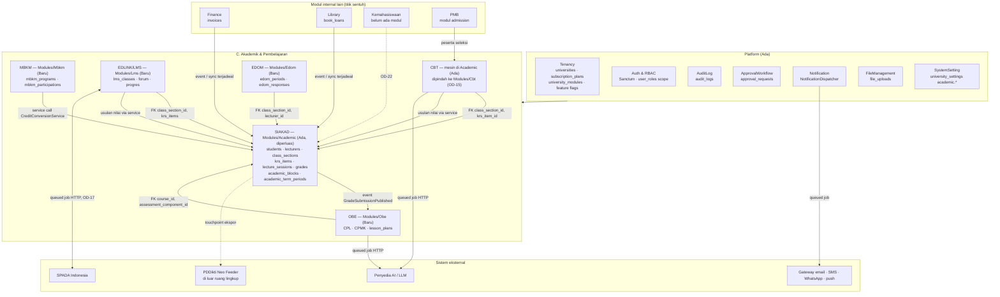
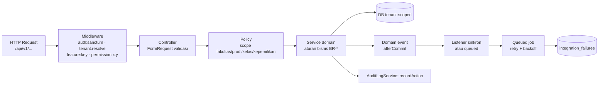
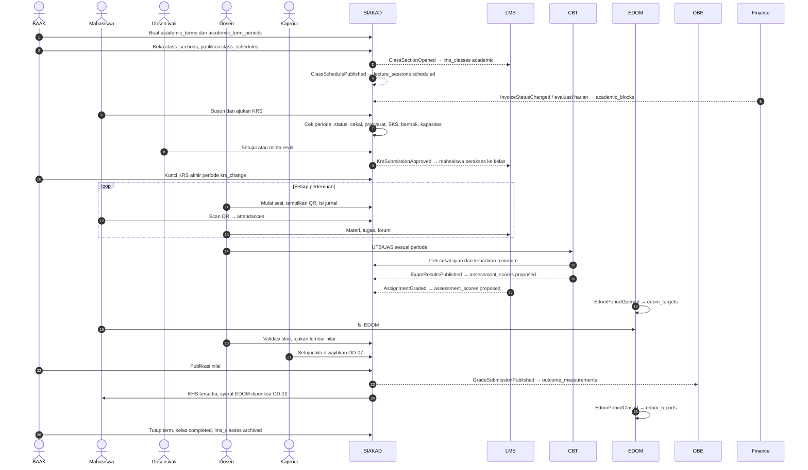
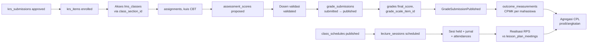
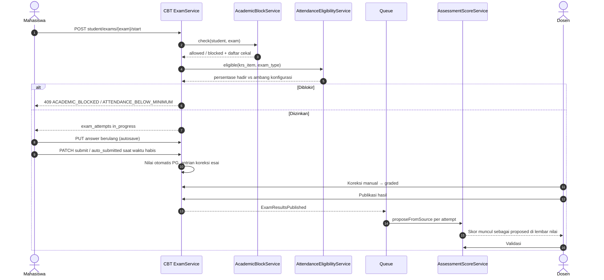
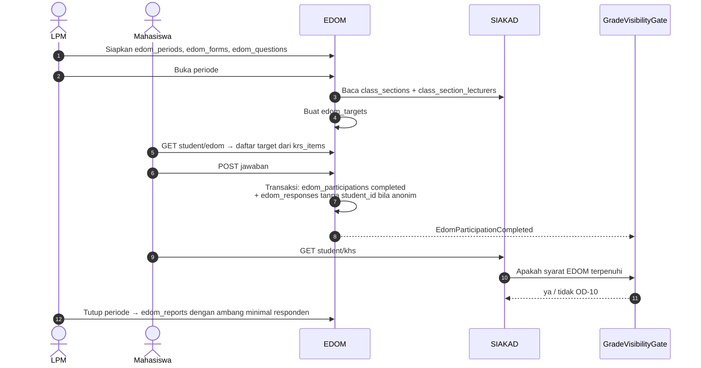
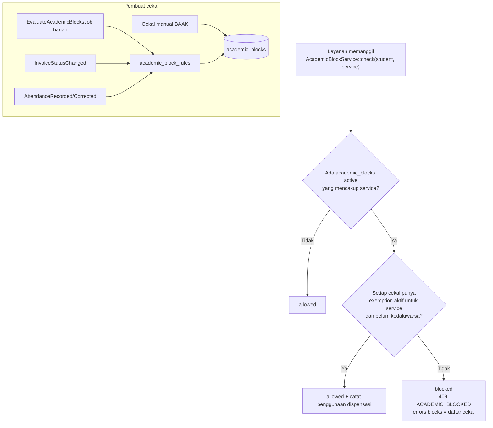
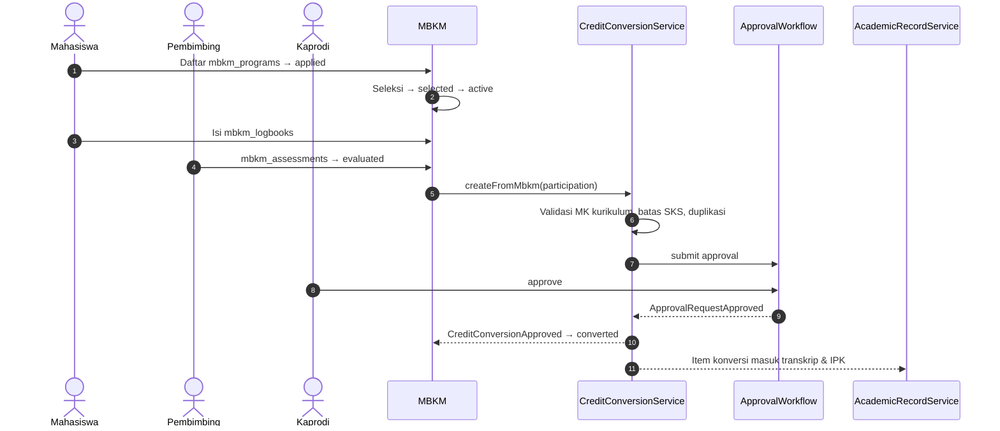

# 06 — Integrasi Antarmodul & Arsitektur

> **Status:** rancangan (bukan dokumentasi fitur jadi). Tidak ada kode atau skema yang diubah.
> **Disusun:** 2026-10-11, berdasarkan repository commit `ab81cc7`.
> Kembali ke [README](README.md) · Kanon penamaan: [README §5](README.md#5-kanon-penamaan-wajib-diikuti-seluruh-dokumen) · API: [08-api-specification.md](08-api-specification.md) · Tabel: [07-database-erd.md](07-database-erd.md)

## Daftar Isi

1. [Prinsip Integrasi](#1-prinsip-integrasi)
2. [Arsitektur Modul](#2-arsitektur-modul)
3. [Mekanisme Integrasi Standar](#3-mekanisme-integrasi-standar)
4. [Matriks Kepemilikan Data](#4-matriks-kepemilikan-data)
5. [Sepuluh Relasi Integrasi Wajib](#5-sepuluh-relasi-integrasi-wajib)
6. [Katalog Domain Event](#6-katalog-domain-event)
7. [Alur Proses Utama](#7-alur-proses-utama)
8. [Integrasi Eksternal](#8-integrasi-eksternal)
9. [Retry, Dead-Letter, Logging, dan Monitoring](#9-retry-dead-letter-logging-dan-monitoring)
10. [Penanganan Konflik dan Idempotensi](#10-penanganan-konflik-dan-idempotensi)
11. [Aturan Bisnis Integrasi](#11-aturan-bisnis-integrasi)
12. [Risiko dan Keputusan Terbuka](#12-risiko-dan-keputusan-terbuka)

---

## 1. Prinsip Integrasi

| No | Prinsip | Konsekuensi teknis |
|---|---|---|
| P1 | **Satu sumber kebenaran per entitas.** Mahasiswa, dosen, kelas, jadwal, KRS, dan nilai akhir hanya dimiliki SIAKAD (`app/Modules/Academic`). | LMS, CBT, OBE, EDOM, dan MBKM **tidak menyalin** data tersebut. Mereka menyimpan foreign key ke `students.id`, `lecturers.id`, `class_sections.id`, `krs_items.id`, dan `academic_terms.id`. |
| P2 | **Tidak ada salinan data.** Nama mahasiswa, NIM, nama dosen, dan kode kelas selalu dibaca lewat relasi (join/eager load). | Tidak ada kolom seperti `lms_classes.course_name` atau `edom_targets.lecturer_name`. Pengecualian yang sah hanya **snapshot berlabel waktu** untuk laporan beku (mis. `outcome_measurements`, `edom_reports`, `iku_snapshots`) yang menyimpan hasil hitung, bukan data master. |
| P3 | **Satu database, satu codebase.** Integrasi internal tidak memakai HTTP antarlayanan. | Mekanisme internal: FK, *synchronous service call*, *domain event* (Laravel event, dikirim setelah commit), dan *queued job* (Redis, `QUEUE_CONNECTION=redis`). HTTP hanya untuk sistem di luar instalasi (AI, SPADA, SMS/WhatsApp gateway). |
| P4 | **Pemilik data adalah satu-satunya penulis.** | Modul konsumen yang perlu mengubah data milik modul lain memanggil **service publik** milik pemilik (mis. LMS memanggil `AssessmentScoreService::proposeFromSource()`), bukan menulis tabelnya langsung. |
| P5 | **Validasi manusia sebelum nilai masuk SIAKAD.** | Nilai dari LMS dan CBT masuk sebagai *usulan* ke `assessment_scores`. Nilai baru dihitung ke `grades` setelah dosen memvalidasi lembar nilai (`grade_submissions`). |
| P6 | **Tenant selalu ikut.** | Setiap event, job, dan baris integrasi membawa `university_id`. Job menyetel `TenantContext` sebelum eksekusi, sehingga global scope `BelongsToInstitutionScope` tetap aktif di worker. |
| P7 | **Kebijakan sebagai konfigurasi.** | Ambang (kehadiran minimum, masa berlaku QR, jumlah retry) dibaca dari `university_settings` grup `academic.*`. Angka di dokumen ini adalah **contoh**. |

---

## 2. Arsitektur Modul

### 2.1 Diagram modul dan dependensi

### 2.2 Lapisan di dalam setiap modul

Middleware `feature:<key>` (kelas `EnsureFeatureEntitled`, **Baru**) menegakkan lapis 1–2 entitlement ([11-roles-permissions.md](11-roles-permissions.md)). Middleware `permission:` (Ada) menegakkan lapis 3. Policy dan service menegakkan lapis 3 (scope) dan lapis 4 (data memenuhi syarat).

### 2.3 Batas modul (siapa boleh memanggil siapa)

| Pemanggil → | SIAKAD | LMS | CBT | OBE | EDOM | MBKM |
|---|---|---|---|---|---|---|
| **SIAKAD** | — | Tidak memanggil; hanya memancarkan event | Tidak memanggil; event | Tidak memanggil; event | Tidak memanggil; event | Tidak memanggil; event |
| **LMS** | Baca model (read-only), panggil `AssessmentScoreService`, `LectureSessionService`, `AcademicBlockService::check` | — | Panggil `ExamService` untuk kuis berbasis CBT | Baca `lesson_plan_meetings` | — | — |
| **CBT** | Baca model, panggil `AssessmentScoreService`, `AcademicBlockService::check`, `AttendanceEligibilityService` | — | — | Baca `course_learning_outcomes` untuk tag soal | — | — |
| **OBE** | Baca `assessment_scores`, `grades`, `curriculum_courses` | — | Baca `exam_attempts` (bukti asesmen) | — | — | — |
| **EDOM** | Baca `class_sections`, `class_section_lecturers`, `krs_items`; panggil `GradeVisibilityGate` | — | — | — | — | — |
| **MBKM** | Panggil `CreditConversionService`, baca `students`, `courses` | — | — | Baca CPL untuk pemetaan konversi | — | — |

Aturan: dependensi hanya mengarah **ke** SIAKAD (dan dari LMS ke CBT). SIAKAD tidak bergantung pada modul konsumen; ia hanya memancarkan event. Ini mencegah dependensi melingkar dan memungkinkan modul berbayar (CBT, OBE) dinonaktifkan per tenant tanpa memengaruhi SIAKAD.

---

## 3. Mekanisme Integrasi Standar

| Kode | Mekanisme | Kapan dipakai | Konsistensi | Contoh |
|---|---|---|---|---|
| **M1** | **FK reference** | Konsumen membutuhkan identitas entitas pemilik | Kuat (constraint DB, `restrictOnDelete` untuk data riwayat) | `lms_classes.class_section_id → class_sections.id` |
| **M2** | **Synchronous service call** | Keputusan harus diambil sekarang dan hasilnya memengaruhi respons pengguna | Kuat, dalam transaksi yang sama | `AcademicBlockService::check($student, 'krs')` saat KRS diajukan |
| **M3** | **Domain event (sinkron, afterCommit)** | Efek samping wajib yang murah, dalam DB yang sama | Kuat setelah commit | `KrsSubmissionApproved` → ubah `krs_items` menjadi `enrolled` |
| **M4** | **Queued job** (dipicu event atau jadwal) | Efek samping mahal, bisa ditunda, atau lintas banyak baris | *Eventually consistent* (detik–menit) | `ProvisionLmsClassJob`, `ComputeOutcomeMeasurementsJob` |
| **M5** | **Scheduled job** (Laravel scheduler) | Rekonsiliasi berkala, kedaluwarsa, evaluasi massal | Terjadwal | `EvaluateAcademicBlocksJob` harian, `ExpireAttendanceQrTokensJob` |
| **M6** | **External HTTP** (selalu dari queued job) | Sistem di luar instalasi | Eventually consistent + retry | Panggilan LLM, SPADA, SMS gateway |

Ketentuan umum:

1. Event domain diimplementasikan dengan `ShouldDispatchAfterCommit` sehingga listener tidak berjalan bila transaksi pemilik di-rollback.
2. Setiap job mengimplementasikan `ShouldQueue`, memiliki properti `$tries`, `backoff()`, `uniqueId()` (untuk `ShouldBeUnique`), dan `failed()` yang mencatat ke `integration_failures` (§9).
3. Payload event hanya membawa **ID dan metadata minimal**, bukan salinan data. Listener membaca ulang data terkini dari DB (*fetch on handle*) agar tidak memproses data basi.
4. Setiap job membawa `university_id` dan `correlation_id` (diturunkan dari header `X-Request-ID` atau ULID baru).

---

## 4. Matriks Kepemilikan Data

Kolom **Write oleh** = service/aktor yang berhak menulis. Konsumen lain hanya membaca atau memanggil service pemilik.

| Entitas (tabel kanon) | Pemilik modul | Konsumen | Write oleh | Status |
|---|---|---|---|---|
| `universities`, `subscription_plans`, `plan_feature_entitlements` | Tenancy | Semua (entitlement) | `super_admin` via `/platform/*` | Ada / Baru |
| `faculties`, `study_programs` | SIAKAD | Semua | `academic_administrator`, `university_administrator` | Ada |
| `academic_terms`, `academic_term_periods` | SIAKAD | LMS, CBT, EDOM, MBKM, OBE | `academic_administrator` | Ada / Baru |
| `academic_calendar_events` | SIAKAD | Portal (tampilan) | `academic_administrator` | Ada |
| `students`, `student_status_histories` | SIAKAD | LMS, CBT, EDOM, MBKM, OBE, Finance, Library | `academic_administrator`; riwayat oleh `StudentObserver` | Ada |
| `student_guardians` | SIAKAD | Guardian portal | `academic_administrator` | Baru |
| `lecturers` | SIAKAD (data SDM via HumanResource `employees`) | LMS, CBT, EDOM, OBE, MBKM | `academic_administrator`, HR | Ada |
| `rooms` | SIAKAD | Jadwal, CBT (lokasi ujian) | `academic_administrator` | Baru |
| `curriculums`, `curriculum_courses`, `curriculum_cohorts`, `courses`, `course_prerequisites`, `course_equivalencies`, `course_packages(_items)` | SIAKAD | OBE, KRS, MBKM | `academic_administrator`, `study_program_administrator` | Ada / Baru |
| `class_sections`, `class_section_lecturers`, `class_schedules` | SIAKAD | LMS, CBT, EDOM, OBE | `academic_administrator`, `study_program_administrator` | Ada / Baru |
| `krs_submissions`, `krs_items`, `krs_submission_events` | SIAKAD | LMS (peserta), CBT (peserta), EDOM (kelayakan), Finance (biaya per SKS) | Mahasiswa (draf), `academic_advisor` (keputusan), `academic_administrator` | Ada / Baru |
| `lecture_sessions`, `lecture_session_materials` | SIAKAD | LMS (pertemuan), OBE (realisasi RPS) | `lecturer` pengampu; LMS via `LectureSessionService` | Baru |
| `attendances`, `attendance_corrections`, `attendance_qr_tokens` | SIAKAD | LMS (QR), CBT (syarat ujian), Guardian | `lecturer`, mahasiswa (scan QR via service), `academic_administrator` (koreksi) | Ada / Baru |
| `grade_scales`, `grade_scale_items` | SIAKAD | CBT (`exam_grade_ranges` opsional), Portal | `academic_administrator` | Baru |
| `assessment_components`, `assessment_scores` | SIAKAD | OBE, LMS, CBT | `lecturer` pengampu; LMS/CBT hanya **mengusulkan** via `AssessmentScoreService` | Baru |
| `grade_submissions`, `grades`, `grade_revisions` | SIAKAD | OBE, EDOM (syarat lihat nilai), Guardian, MBKM | `lecturer` (input), `head_of_study_program` (persetujuan, [OD-07](16-open-decisions.md#od-07)), `academic_administrator` (publikasi/revisi) | Ada / Baru |
| `advising_records` | SIAKAD | Kaprodi (ringkasan) | `academic_advisor` | Baru |
| `academic_blocks`, `academic_block_rules`, `academic_block_exemptions`, `academic_block_histories` | SIAKAD | KRS, CBT, LMS, Yudisium, Portal | `AcademicBlockService` (otomatis), `academic_administrator` (manual/dispensasi) | Baru |
| `student_requests` | SIAKAD | ApprovalWorkflow | Mahasiswa, `academic_administrator` | Ada |
| `credit_conversions`, `credit_conversion_items` | SIAKAD | MBKM, transfer, transkrip | `CreditConversionService` (dipanggil MBKM/transfer), disetujui `head_of_study_program` | Baru |
| `theses` + tabel TA | SIAKAD (modul Thesis) | Portal | Mahasiswa, `lecturer`, `academic_administrator` | Ada / Baru |
| `mbkm_partners`, `mbkm_programs`, `mbkm_participations`, `mbkm_logbooks`, `mbkm_assessments`, `iku_snapshots` | MBKM | SIAKAD (konversi), laporan IKU | `academic_administrator`, mahasiswa (pengajuan, logbook), pembimbing | Baru |
| `lms_classes`, `lms_class_members` | LMS | Dashboard | `ProvisionLmsClassJob` (akademik), `lms_administrator`/`lecturer` (umum) | Baru |
| `course_materials`, `course_material_versions`, `assignments`, `assignment_submissions` | LMS (tabel fisik di Academic saat ini) | SIAKAD (`lecture_session_materials`), OBE (bukti) | `lecturer`, mahasiswa (submission) | Ada / Baru |
| `lms_discussion_*`, `lms_class_announcements`, `lms_material_progress`, `lms_activity_events`, skor, gamification, `storage_usage_snapshots` | LMS | Dashboard, laporan | LMS service | Baru |
| `question_banks`, `question_bank_items`, `exams`, `exam_questions`, `exam_participants`, `exam_attempts`, `exam_attempt_answers`, `exam_violations`, `proctoring_snapshots`, `exam_grade_ranges` | CBT | SIAKAD (usulan nilai), LMS (kuis), OBE (bukti) | `lecturer`, `exam_committee`, mahasiswa/peserta (jawaban) | Ada / Baru |
| `ai_generation_jobs`, `ai_question_drafts` | CBT (dipakai bersama OBE AI) | OBE | Job AI; reviewer manusia | Baru |
| `graduate_profiles`, `program_learning_outcomes`, `graduate_profile_outcomes`, `course_plo_mappings`, `course_learning_outcomes`, `clo_plo_mappings`, `lesson_plans`, `lesson_plan_meetings`, `assessment_component_outcomes` | OBE | SIAKAD (RPS → sesi, komponen), LMS | `study_program_administrator`, `head_of_study_program` (pengesahan), `lecturer` (RPS) | Baru |
| `outcome_measurements`, `outcome_evaluation_reports`, `outcome_followups` | OBE | `quality_assurance`, pimpinan | `ComputeOutcomeMeasurementsJob`; evaluasi oleh Kaprodi/LPM | Baru |
| `edom_*` | EDOM | Dosen (rekap sendiri), Kaprodi, LPM | `quality_assurance` (pengaturan), mahasiswa (jawaban) | Baru |
| `invoices`, `payments` | Finance | SIAKAD (cekal), Guardian | Finance | Ada |
| `book_loans` | Library | SIAKAD (cekal yudisium) | Library | Ada |

**Catatan `assessment_components`:** dimiliki SIAKAD, tetapi OBE memiliki tabel pemetaan `assessment_component_outcomes`. OBE tidak mengubah bobot komponen; bila RPS yang disahkan berbeda dari komponen kelas, sistem menampilkan *drift warning* (§5 R3), bukan menimpa.

---

## 5. Sepuluh Relasi Integrasi Wajib

Setiap relasi dijelaskan dengan atribut yang sama. Kode mekanisme mengacu ke §3.

### R1 — Data mahasiswa & dosen SIAKAD → LMS

| Atribut | Ketentuan |
|---|---|
| Sumber data utama | `students`, `lecturers`, `krs_items` (status `enrolled`), `class_section_lecturers` |
| Pemilik data | SIAKAD |
| Arah | SIAKAD → LMS (satu arah, baca) |
| Mekanisme | **M1 FK reference.** Peserta kelas akademik LMS **tidak disimpan**; dihitung dari `krs_items` aktif pada `lms_classes.class_section_id`. Pengajar dihitung dari `class_section_lecturers`. `lms_class_members` hanya untuk kelas umum dan menyimpan `user_id` (FK) |
| Frekuensi | Real-time (query langsung). Tidak ada sinkronisasi |
| Validasi | Akses mahasiswa ke kelas LMS akademik = `krs_items.status = enrolled` dan `students.status = active`. Mahasiswa `leave`/`dropped_out` otomatis kehilangan akses tulis tetapi riwayat submission tetap |
| Retry | Tidak relevan (tanpa salinan) |
| Logging | Akses ditolak dicatat di log aplikasi; perubahan status mahasiswa sudah dicatat `student_status_histories` |
| Konflik | Tidak ada konflik data karena satu sumber. Kasus *drop* KRS di tengah semester: submission lama tetap tersimpan dan terlihat dosen dengan penanda "peserta keluar" |
| Idempotency key | Tidak diperlukan |

### R2 — Kelas & jadwal SIAKAD → kelas akademik LMS

| Atribut | Ketentuan |
|---|---|
| Sumber data utama | `class_sections` (status `open`), `class_schedules` (status `published`) |
| Pemilik data | SIAKAD (kelas, jadwal, sesi); LMS hanya memiliki atribut ruang kelas digital (`lms_classes.status`, pengaturan, forum) |
| Arah | SIAKAD → LMS |
| Mekanisme | **M3 + M4.** Event `ClassSectionOpened` → `ProvisionLmsClassJob` membuat satu `lms_classes` (`class_type = academic`, `class_section_id` FK, unique `university_id + class_section_id`). Event `ClassSchedulePublished` → `GenerateLectureSessionsJob` membuat baris `lecture_sessions` (status `scheduled`) sesuai pola jadwal dan periode `lecture` di `academic_term_periods`. LMS menampilkan sesi tersebut sebagai "pertemuan" (tanpa tabel sesi sendiri) |
| Frekuensi | Event (saat kelas dibuka / jadwal dipublikasi atau direvisi) + rekonsiliasi terjadwal harian `ReconcileLmsClassesJob` |
| Validasi | Kelas harus punya `academic_term_id` aktif dan minimal satu dosen. Fitur `lms` harus aktif untuk tenant; bila tidak, job selesai tanpa aksi dan mencatat `skipped` |
| Retry | 5 percobaan, backoff 10 s → 60 s → 5 mnt → 15 mnt → 1 jam; gagal final → `integration_failures` (`integration_key = lms.provision_class`) |
| Logging | `integration_sync_runs` untuk rekonsiliasi harian (jumlah dibuat/dilewati/gagal) |
| Konflik | Revisi jadwal setelah sesi dibuat: sesi `scheduled` di masa depan diregenerasi; sesi `held` **tidak pernah** diubah; sesi yang tanggalnya berubah diberi status `rescheduled` dan relasi ke sesi pengganti. Kelas `cancelled` → `lms_classes.status = archived` |
| Idempotency key | `uniqueId = provision:{class_section_id}`; unique constraint mencegah duplikasi. Sesi: unique `class_section_id + meeting_number` |

### R3 — RPS OBE → perencanaan pembelajaran

| Atribut | Ketentuan |
|---|---|
| Sumber data utama | `lesson_plans` (status `ratified`), `lesson_plan_meetings`, `course_learning_outcomes` |
| Pemilik data | OBE |
| Arah | OBE → SIAKAD (rencana per pertemuan) dan OBE → LMS (struktur topik) |
| Mekanisme | **M1 + M3.** `lecture_sessions.lesson_plan_meeting_id` (FK nullable) diisi oleh listener `LinkLessonPlanToSessions` saat event `LessonPlanRatified` untuk kelas di semester berjalan yang memakai `course_id` sama. Usulan komponen penilaian dari RPS ditampilkan sebagai *template* saat dosen membuat `assessment_components`; dosen menyetujui, tidak ditimpa otomatis |
| Frekuensi | Event (pengesahan RPS) |
| Validasi | Hanya RPS berstatus `ratified` dan berlaku untuk versi kurikulum kelas. Jumlah pertemuan RPS dibandingkan jumlah sesi; selisih dilaporkan |
| Retry | 3 percobaan, backoff 10 s → 60 s → 5 mnt |
| Logging | Audit `lesson_plans` (ratified). Hasil linking dicatat di log `integration` |
| Konflik | RPS direvisi (`superseded`) di tengah semester: sesi yang sudah `held` tetap merujuk pertemuan RPS lama (riwayat). Sesi masa depan dipetakan ulang hanya jika dosen menyetujui *re-link*. Bobot RPS ≠ bobot `assessment_components` → *drift warning* di halaman kelas dan laporan OBE |
| Idempotency key | `link-rps:{lesson_plan_id}:{class_section_id}` |

### R4 — Jurnal mengajar → rencana vs realisasi

| Atribut | Ketentuan |
|---|---|
| Sumber data utama | `lecture_sessions` (status `held`, kolom topik realisasi, metode, catatan), `lecture_session_materials` |
| Pemilik data | SIAKAD |
| Arah | SIAKAD → OBE (laporan realisasi RPS) dan SIAKAD → LMS (tampilan) |
| Mekanisme | **M1 (baca).** Laporan realisasi menghitung `held` vs `lesson_plan_meetings` dari join. Tidak ada salinan |
| Frekuensi | Real-time untuk tampilan; snapshot pada `outcome_evaluation_reports` saat evaluasi semester |
| Validasi | Jurnal hanya bisa diisi untuk sesi milik dosen pengampu (`ClassSectionAccess::canWriteTeaching`). Sesi tidak bisa `held` sebelum `scheduled_at` dikurangi toleransi (contoh 30 menit, konfigurasi `academic.session.early_open_minutes`) |
| Retry | Tidak relevan |
| Logging | Perubahan jurnal setelah `held` dicatat `audit_logs` (old/new values) |
| Konflik | Dua dosen team teaching mengisi sesi yang sama: penguncian optimistis (`updated_at` / `version`) → 409 `SESSION_CONFLICT` untuk penulis kedua |
| Idempotency key | Tidak diperlukan (update by id) |

### R5 — Nilai LMS & CBT → komponen nilai SIAKAD (setelah validasi)

| Atribut | Ketentuan |
|---|---|
| Sumber data utama | `assignment_submissions.score`, `exam_attempts.score` / `weighted_score` |
| Pemilik data | Sumber skor: LMS/CBT. Nilai komponen dan nilai akhir: SIAKAD |
| Arah | LMS/CBT → SIAKAD |
| Mekanisme | **M2 + M4.** Komponen nilai punya atribut sumber (`assessment_components.source_type` = `manual` / `lms_assignment` / `exam`, `source_id`). Event `AssignmentGraded` / `ExamAttemptGraded` / `ExamResultsPublished` → `ProposeAssessmentScoresJob` memanggil `AssessmentScoreService::proposeFromSource()` yang menulis `assessment_scores` dengan `status = proposed`. Dosen meninjau di lembar nilai lalu menekan "Validasi" → `status = validated`. Hanya skor `validated` yang dihitung ke `grades.final_score` |
| Frekuensi | Event (per penilaian) + tombol "Tarik ulang nilai" (manual) |
| Validasi | `krs_item_id` peserta harus `enrolled` di kelas komponen; skor dinormalisasi ke 0–100 (`score / max_score × 100`); komponen harus berstatus terbuka (`grade_submissions.status` ∈ `draft`, `reopened`). Percobaan ujian ganda: aturan pilih (tertinggi/terakhir) mengikuti konfigurasi ujian |
| Retry | 5 percobaan, backoff eksponensial 10 s → 1 jam; gagal → `integration_failures` (`grade.propose_from_source`) dan notifikasi ke dosen |
| Logging | Setiap usulan menyimpan `source_type`, `source_id`, `proposed_at`. Validasi dan override dicatat `audit_logs` |
| Konflik | Skor sumber berubah setelah divalidasi (mis. dosen menilai ulang tugas): skor baru masuk sebagai usulan baru, nilai tervalidasi tidak ditimpa; lembar nilai menampilkan badge "Ada pembaruan dari sumber". Setelah `grade_submissions.status = published`, perubahan hanya lewat `grade_revisions` |
| Idempotency key | `propose:{component_id}:{krs_item_id}:{source_id}:{source_version}` (unique pada usulan; `source_version` = `updated_at` sumber) |

### R6 — Komponen nilai → CPMK (OBE)

| Atribut | Ketentuan |
|---|---|
| Sumber data utama | `assessment_scores` (validated), `assessment_component_outcomes` (bobot kontribusi komponen ke CPMK), `clo_plo_mappings` |
| Pemilik data | Nilai: SIAKAD. Pemetaan dan hasil ukur: OBE |
| Arah | SIAKAD → OBE |
| Mekanisme | **M3 + M4.** Event `GradeSubmissionPublished` → `ComputeOutcomeMeasurementsJob` (per kelas) menghitung capaian CPMK per mahasiswa dan menulis `outcome_measurements` (snapshot). Agregasi CPL per prodi/angkatan dijalankan `AggregatePloAttainmentJob` (terjadwal mingguan dan on-demand). Rumus dan opsi agregasi ada di [04-obe.md](04-obe.md) ([OD-16](16-open-decisions.md#od-16)) |
| Frekuensi | Event + terjadwal + on-demand |
| Validasi | Bobot `assessment_component_outcomes` per komponen harus berjumlah 100% (contoh aturan; konfigurasi). Komponen tanpa pemetaan dilaporkan sebagai "tidak terukur", tidak dianggap 0 |
| Retry | 3 percobaan, backoff 60 s → 5 mnt → 30 mnt |
| Logging | `outcome_measurements.computed_at`, `calculation_version`; ringkasan run di `integration_sync_runs` |
| Konflik | Nilai direvisi (`GradeRevisionApplied`) → job hitung ulang untuk mahasiswa terkait; snapshot lama ditandai `superseded` (tidak dihapus) agar laporan akreditasi historis tetap dapat direproduksi |
| Idempotency key | `measure:{class_section_id}:{grade_submission_version}` |

### R7 — EDOM mengambil dosen & kelas dari SIAKAD

| Atribut | Ketentuan |
|---|---|
| Sumber data utama | `class_sections`, `class_section_lecturers`, `krs_items` (enrolled) |
| Pemilik data | SIAKAD (kelas/dosen/peserta); EDOM (target, jawaban) |
| Arah | SIAKAD → EDOM |
| Mekanisme | **M1 + M4.** Saat `edom_periods` berpindah ke `open`, `GenerateEdomTargetsJob` membuat `edom_targets` (FK `class_section_id`, `lecturer_id`) sesuai aturan cakupan periode. Kelayakan mahasiswa dihitung dari `krs_items` saat mengisi (tidak disalin). `edom_participations` dibuat saat mahasiswa membuka formulir |
| Frekuensi | Event (periode dibuka) + rekonsiliasi harian selama periode `open` (kelas/dosen baru) |
| Validasi | Hanya kelas `running`/`completed` di term periode; pasangan kelas–dosen unik per periode |
| Retry | 5 percobaan, backoff 10 s → 1 jam |
| Logging | `integration_sync_runs` (`edom.generate_targets`) |
| Konflik | Dosen pengampu diganti di tengah periode: target lama tetap (jawaban yang sudah ada tidak dipindah), target baru ditambahkan; laporan memisahkan keduanya |
| Idempotency key | Unique `edom_period_id + class_section_id + lecturer_id` |

**Privasi:** untuk periode anonim, `edom_responses` tidak memiliki FK ke `students` atau `edom_participations`. Penautan hanya lewat status partisipasi (sudah/belum). Detail di [05-edom.md](05-edom.md) ([OD-10](16-open-decisions.md#od-10)).

### R8 — Kalender/periode akademik mengatur KRS, kuliah, ujian, evaluasi

| Atribut | Ketentuan |
|---|---|
| Sumber data utama | `academic_term_periods` (jenis periode: `krs`, `krs_change`, `lecture`, `midterm_exam`, `final_exam`, `grading`, `edom`; `starts_at`, `ends_at`) |
| Pemilik data | SIAKAD |
| Arah | SIAKAD → semua modul |
| Mekanisme | **M2.** `AcademicPeriodService::assertOpen($termId, $periodType)` dipanggil sinkron oleh KRS, CBT (validasi jadwal ujian UTS/UAS berada di periode), penilaian, dan EDOM. `academic_calendar_events` tetap untuk tampilan dan dapat dibuat otomatis dari periode (`AcademicTermPeriodChanged` → listener sinkron) |
| Frekuensi | Real-time; transisi status berbasis waktu (mis. `edom_periods` `open` → `closed`) oleh scheduler tiap 5 menit |
| Validasi | Periode tidak boleh tumpang tindih untuk jenis yang sama dalam satu term; `ends_at > starts_at`. Perpanjangan periode dicatat audit |
| Retry | Tidak relevan untuk cek sinkron; job transisi status idempoten dan diulang di tick berikutnya |
| Logging | Perubahan periode → `audit_logs` |
| Konflik | Kompatibilitas: `academic_terms.krs_start_date/krs_end_date` (Ada) dibaca sebagai fallback bila periode `krs` belum dibuat. Saat migrasi, nilai kolom lama disalin satu kali menjadi periode `krs`, lalu endpoint lama `PATCH academic-terms/{id}/krs-period` menulis keduanya |
| Idempotency key | Tidak diperlukan |

### R9 — Cekal membatasi layanan

| Atribut | Ketentuan |
|---|---|
| Sumber data utama | `academic_blocks` (status `active`, `blocked_services`), `academic_block_exemptions` |
| Pemilik data | SIAKAD. Data pemicu: Finance (`invoices`), Library (`book_loans`), SIAKAD sendiri (kehadiran, IPK), Kemahasiswaan ([OD-22](16-open-decisions.md#od-22)) |
| Arah | Pemicu → SIAKAD (pembuatan cekal); SIAKAD → layanan (penegakan) |
| Mekanisme | Pembuatan: **M3/M5.** Event dari Finance (`InvoiceStatusChanged`, Baru) dan job harian `EvaluateAcademicBlocksJob` menjalankan `academic_block_rules`. Penegakan: **M2** `AcademicBlockService::check($studentId, $service)` dipanggil sinkron di titik layanan (`krs`, `exam`, `yudisium`, `grade_view` bila dikonfigurasi). Hasil: `allowed` atau daftar cekal aktif yang tidak berdispensasi |
| Frekuensi | Event + harian (contoh 01:00 waktu tenant) + on-demand "Evaluasi ulang" oleh BAAK |
| Validasi | Satu cekal aktif per `student + block_type + academic_term` (unique parsial). Dispensasi wajib alasan, masa berlaku, dan pemberi (BR-SIA-BLK di [01-siakad.md](01-siakad.md)) |
| Retry | Job evaluasi: 3 percobaan per tenant, backoff 5 → 15 → 60 menit; kegagalan per mahasiswa dicatat dan tidak menghentikan batch |
| Logging | `academic_block_histories` (setiap transisi), `audit_logs` untuk dispensasi, `integration_sync_runs` untuk batch |
| Konflik | Tagihan lunas setelah cekal dibuat → cekal `revoked` otomatis oleh event/evaluasi berikutnya. Cekal manual BAAK **tidak** dicabut otomatis. Beberapa cekal bersamaan: layanan diblokir jika **minimal satu** cekal aktif tanpa dispensasi mencakup layanan itu |
| Idempotency key | `block:{student_id}:{block_type}:{academic_term_id}` (unique parsial pada status `active`) |

### R10 — MBKM → konversi mata kuliah & SKS

| Atribut | Ketentuan |
|---|---|
| Sumber data utama | `mbkm_participations` (status `evaluated`), `mbkm_assessments` |
| Pemilik data | MBKM (aktivitas & penilaian); SIAKAD (`credit_conversions`, transkrip) |
| Arah | MBKM → SIAKAD |
| Mekanisme | **M2.** `CreditConversionService::createFromMbkm($participation)` membuat `credit_conversions` (`source_type = mbkm`, `source_id`) dengan `credit_conversion_items` (MK tujuan, SKS, nilai). Pengesahan Kaprodi lewat ApprovalWorkflow; event `CreditConversionApproved` → listener mengubah `mbkm_participations.status = converted` dan transkrip membaca item konversi melalui `AcademicRecordService` |
| Frekuensi | Event (setelah evaluasi) |
| Validasi | Total SKS konversi ≤ batas program (konfigurasi `academic.mbkm.max_credits_per_term`, contoh 20); MK tujuan harus ada di kurikulum mahasiswa; MK yang sudah lulus tidak dikonversi ganda |
| Retry | Panggilan sinkron (tanpa retry). Listener pasca-persetujuan: 3 percobaan |
| Logging | Audit pada pembuatan dan persetujuan konversi |
| Konflik | Konversi ditolak → kembali ke `evaluated` untuk perbaikan. Nilai konversi bertabrakan dengan nilai reguler MK yang sama → aturan nilai terbaik/terakhir mengikuti [OD-08](16-open-decisions.md#od-08) |
| Idempotency key | Unique `credit_conversions.source_type + source_id` |

---

## 6. Katalog Domain Event

Semua event **Baru** kecuali disebut lain. Payload selalu memuat `university_id`, `occurred_at`, `correlation_id`, dan `actor_user_id` (nullable untuk proses sistem); kolom tersebut tidak diulang di tabel.

| Event | Produsen | Konsumen (listener/job) | Payload tambahan |
|---|---|---|---|
| `AcademicTermPeriodChanged` | SIAKAD | Kalender (sinkron), EDOM (buka/tutup), Notification | `academic_term_id`, `period_type`, `starts_at`, `ends_at`, `change` (created/updated/deleted) |
| `StudentStatusChanged` | SIAKAD (`StudentObserver`, Ada sebagai riwayat) | LMS (akses), CBT (peserta), Cekal, Finance | `student_id`, `from_status`, `to_status`, `effective_date` |
| `ClassSectionOpened` | SIAKAD | LMS `ProvisionLmsClassJob` | `class_section_id`, `academic_term_id`, `course_id` |
| `ClassSectionCancelled` | SIAKAD | LMS (arsip), CBT (batalkan ujian draf), EDOM | `class_section_id`, `reason` |
| `ClassSectionLecturersChanged` | SIAKAD | LMS (pengajar), EDOM (target), Notification | `class_section_id`, `added_lecturer_ids[]`, `removed_lecturer_ids[]` |
| `ClassSchedulePublished` | SIAKAD | `GenerateLectureSessionsJob`, Notification | `class_schedule_id`, `class_section_id`, `revision_no` |
| `ClassScheduleRevised` | SIAKAD | Sesi (regenerasi), Notification ke peserta | `class_schedule_id`, `class_section_id`, `changed_fields[]`, `revision_no` |
| `KrsSubmissionSubmitted` | SIAKAD | Notification ke dosen wali | `krs_submission_id`, `student_id`, `academic_term_id`, `total_credits` |
| `KrsSubmissionApproved` | SIAKAD | `krs_items` → `enrolled` (sinkron), Finance (biaya per SKS), Notification | `krs_submission_id`, `student_id`, `academic_term_id`, `krs_item_ids[]` |
| `KrsRevisionRequested` | SIAKAD | Notification ke mahasiswa | `krs_submission_id`, `student_id`, `note` |
| `KrsSubmissionLocked` | SIAKAD | LMS/CBT (peserta final), Finance | `krs_submission_id`, `student_id`, `academic_term_id` |
| `KrsItemDropped` | SIAKAD | LMS (akses), CBT (peserta), Finance | `krs_item_id`, `class_section_id`, `student_id` |
| `LectureSessionHeld` | SIAKAD | LMS (aktivitas, dashboard), OBE (realisasi) | `lecture_session_id`, `class_section_id`, `meeting_number`, `lesson_plan_meeting_id` |
| `AttendanceRecorded` | SIAKAD | Cekal kehadiran (rekalkulasi persentase), LMS engagement | `lecture_session_id`, `krs_item_ids[]`, `method` (manual/qr/ai) |
| `AttendanceCorrected` | SIAKAD | Cekal kehadiran, Notification | `attendance_correction_id`, `attendance_id`, `from_status`, `to_status` |
| `AssignmentGraded` | LMS | `ProposeAssessmentScoresJob` | `assignment_submission_id`, `assignment_id`, `krs_item_id`, `score`, `max_score` |
| `ExamAttemptGraded` | CBT | `ProposeAssessmentScoresJob` (jika ujian terhubung komponen) | `exam_attempt_id`, `exam_id`, `krs_item_id` (nullable untuk PMB), `exam_participant_id`, `score` |
| `ExamResultsPublished` | CBT | `ProposeAssessmentScoresJob` (batch), PMB, Notification | `exam_id`, `context_type` (class_section/admission/lms_quiz), `attempt_count` |
| `GradeSubmissionSubmitted` | SIAKAD | Notification Kaprodi ([OD-07](16-open-decisions.md#od-07)) | `grade_submission_id`, `class_section_id` |
| `GradeSubmissionPublished` | SIAKAD | OBE `ComputeOutcomeMeasurementsJob`, IPS/IPK cache, Notification mahasiswa/wali, EDOM gate | `grade_submission_id`, `class_section_id`, `version`, `grade_ids[]` |
| `GradeRevisionApplied` | SIAKAD | OBE (hitung ulang), IPK cache, Notification | `grade_revision_id`, `grade_id`, `krs_item_id`, `revision_type`, `from_letter`, `to_letter` |
| `AcademicBlockActivated` | SIAKAD | Notification mahasiswa/wali | `academic_block_id`, `student_id`, `block_type`, `blocked_services[]` |
| `AcademicBlockLifted` | SIAKAD | Notification | `academic_block_id`, `student_id`, `lift_reason` (revoked/expired/exempted) |
| `AcademicBlockExemptionGranted` | SIAKAD | Notification, audit | `academic_block_exemption_id`, `academic_block_id`, `valid_until`, `services[]` |
| `InvoiceStatusChanged` | Finance (event baru di modul yang ada) | Cekal keuangan | `invoice_id`, `student_id`, `from_status`, `to_status`, `period` |
| `LessonPlanRatified` | OBE | `LinkLessonPlanToSessions`, LMS (struktur topik) | `lesson_plan_id`, `course_id`, `curriculum_id`, `version` |
| `OutcomeMeasurementsComputed` | OBE | Dashboard OBE, Notification Kaprodi | `scope_type` (class_section/study_program), `scope_id`, `run_id` |
| `EdomPeriodOpened` / `EdomPeriodClosed` | EDOM | `GenerateEdomTargetsJob`, Notification, `EdomReportJob` | `edom_period_id`, `academic_term_id` |
| `EdomParticipationCompleted` | EDOM | `GradeVisibilityGate` (cache), dashboard partisipasi | `edom_participation_id`, `student_id`, `edom_target_id` (tidak membawa jawaban) |
| `MbkmParticipationEvaluated` | MBKM | `CreditConversionService` (draf konversi), Notification | `mbkm_participation_id`, `student_id`, `mbkm_program_id` |
| `CreditConversionApproved` | SIAKAD | MBKM (status `converted`), IPK cache, IKU snapshot | `credit_conversion_id`, `source_type`, `source_id`, `student_id`, `total_credits` |
| `AiGenerationJobCompleted` | CBT | Notification ke pemohon | `ai_generation_job_id`, `job_type`, `draft_count`, `status` |
| `ApprovalRequestApproved/Rejected/Returned` | ApprovalWorkflow (**Ada**) | Listener per domain (pola `SyncStudentRequestDecision`) | Sesuai event yang ada |

**Catatan EDOM:** event EDOM tidak boleh membawa isi jawaban atau `edom_response_id` bersama identitas mahasiswa.

---

## 7. Alur Proses Utama

### 7.1 Siklus semester ujung-ke-ujung

### 7.2 KRS → kelas LMS → sesi → nilai → OBE

### 7.3 CBT → nilai

### 7.4 EDOM

### 7.5 Pemeriksaan cekal

### 7.6 Konversi MBKM

---

## 8. Integrasi Eksternal

| Sistem | Arah | Mekanisme | Data yang dipertukarkan | Pemilik data | Retry & kegagalan | Status / keputusan |
|---|---|---|---|---|---|---|
| **Finance** (`app/Modules/Finance`, Ada) | Finance → SIAKAD (cekal); SIAKAD → Finance (SKS terdaftar untuk biaya per SKS) | Event `InvoiceStatusChanged` (Baru, dipancarkan Finance) + `EvaluateAcademicBlocksJob` harian sebagai jaring pengaman. Finance membaca `krs_items` lewat FK | `invoices.student_id`, `status` (unpaid/partial/paid), `due_date`, `period` | Finance | Event gagal tertutup oleh evaluasi harian. Aturan cekal menentukan status mana yang memblokir (contoh: `unpaid` melewati `due_date`) | Pemetaan `invoices.period` ke `academic_term_id` perlu diputuskan: **OD-NEW-finance-term-mapping** |
| **Library** (`app/Modules/Library`, Ada) | Library → SIAKAD | Evaluasi terjadwal (baca `book_loans` status `dipinjam`/`terlambat`, `fine_amount > 0`) | Pinjaman aktif, denda | Library | Retry job harian | [OD-22](16-open-decisions.md#od-22) |
| **Kemahasiswaan** (belum ada modul) | Kemahasiswaan → SIAKAD | Cekal manual BAAK sampai modul tersedia; kontrak data disiapkan sebagai `academic_block_rules.source = student_affairs` | Poin, pelanggaran | Kemahasiswaan | — | [OD-22](16-open-decisions.md#od-22) |
| **PMB** (modul `admission`) | PMB → CBT; CBT → PMB | `exam_participants` dengan `participant_type = applicant` (FK ke data pendaftar) dan akses publik `/public/exams/{accessToken}` (Ada). Hasil kembali lewat event `ExamResultsPublished` (`context_type = admission`) | Peserta seleksi, skor | PMB (pendaftar), CBT (hasil) | 5 percobaan, DLQ `cbt.admission_result` | Sebelum PMB terstruktur, peserta publik diidentifikasi NIM/nomor pendaftaran seperti saat ini |
| **Penyedia AI (LLM)** | CBT/OBE → AI | **M6** dari `RunAiGenerationJob`; status disimpan di `ai_generation_jobs` | Topik, cuplikan materi (sesuai kebijakan data), parameter jumlah/jenis/kesulitan. Respons → `ai_question_drafts` | Draf milik CBT; materi milik LMS | Timeout 60 s (contoh); 3 percobaan, backoff 30 s → 2 mnt → 10 mnt; HTTP 429 provider memakai header `Retry-After`; gagal → `ai_generation_jobs.status = failed` + `integration_failures` | [OD-11](16-open-decisions.md#od-11). Kunci API tidak disimpan di audit log |
| **SPADA Indonesia** | LMS ↔ SPADA | **M6** ekspor/impor kursus, atau tautan/LTI bila tersedia | Metadata kursus, materi terbuka, peserta (bila protokol mendukung) | LMS | 5 percobaan; DLQ `lms.spada_sync` | [OD-17](16-open-decisions.md#od-17): protokol belum dipastikan; fitur tetap **[Konfirmasi]** |
| **Kanal notifikasi** (email, SMS, WhatsApp, push, database) | Semua → pengguna | `NotificationDispatcher` (Ada) dengan template per tenant; pengiriman massal di-*chunk* dalam queued job | Event key + placeholder; tanpa data nilai rinci di SMS | Notification | Retry per kanal mengikuti driver; kegagalan kanal eksternal tidak membatalkan kanal `database` | Biaya SMS [OD-24](16-open-decisions.md#od-24) |
| **PDDikti Neo Feeder** | SIAKAD → Feeder | **Di luar ruang lingkup.** Titik sentuh: struktur `students`, `lecturers`, `class_sections`, `krs_items`, `grades`, `credit_conversions` dirancang agar dapat diekspor; kolom kode referensi (mis. `nidn`, `nim`) dipertahankan | — | SIAKAD | — | Tidak dirancang di dokumen ini |

---

## 9. Retry, Dead-Letter, Logging, dan Monitoring

### 9.1 Kebijakan retry standar

| Kelas job | `$tries` | Backoff (detik) | Timeout | Setelah gagal final |
|---|---|---|---|---|
| Internal ringan (provisioning, linking) | 5 | `[10, 60, 300, 900, 3600]` | 120 | `integration_failures` + notifikasi admin LMS/BAAK |
| Perhitungan berat (OBE, rekap EDOM, IKU) | 3 | `[60, 300, 1800]` | 900 | `integration_failures` + status run `failed` |
| Eksternal HTTP (AI, SPADA, SMS) | 3–5 | Eksponensial dengan jitter, menghormati `Retry-After` | 60–120 | `integration_failures`; status entitas sumber `failed` |
| Notifikasi massal | 3 | `[30, 120, 600]` | 300 | Laravel `failed_jobs` (Ada) cukup; ringkasan kegagalan per kanal |

Semua angka adalah **contoh** dan dikonfigurasi di `university_settings` (`academic.integration.*`) atau `config/queue.php`. Error yang jelas tidak dapat dipulihkan (validasi gagal, entitas sumber dihapus/dibatalkan) **tidak** di-retry: job memanggil `fail()` dan langsung menulis ke dead-letter.

### 9.2 Tabel dead-letter `integration_failures` (Baru, nama usulan)

| Kolom | Tipe | Keterangan |
|---|---|---|
| `id` | ULID | PK |
| `university_id` | ULID FK | Tenant |
| `integration_key` | string(60) | Mis. `lms.provision_class`, `grade.propose_from_source`, `obe.compute_measurements`, `ai.generate_questions`, `lms.spada_sync`, `block.evaluate` |
| `source_type`, `source_id` | string, ULID | Entitas pemicu (morph) |
| `idempotency_key` | string(190) | Kunci yang sama dengan job |
| `payload` | json | Payload job (tanpa token/rahasia; nilai sensitif di-*mask* via `AuditLogService::maskValue`) |
| `error_class`, `error_message` | string, text | Ringkasan error |
| `attempts` | smallint | Jumlah percobaan |
| `status` | string(20) | `open`, `retrying`, `resolved`, `ignored` |
| `first_failed_at`, `last_failed_at`, `resolved_at` | timestamptz | |
| `resolved_by` | ULID FK users, nullable | |
| `correlation_id` | string(40) | Penelusuran lintas log |

Indeks: `(university_id, status, integration_key)`, unique `(university_id, integration_key, idempotency_key)` agar kegagalan berulang memperbarui baris yang sama.

Operasi: halaman admin "Monitor Integrasi" (lihat [09-ui-ux-specification.md](09-ui-ux-specification.md)) dengan aksi **Coba lagi** (dispatch ulang job dengan kunci idempotensi yang sama) dan **Abaikan** (wajib alasan, dicatat audit).

### 9.3 Log run terjadwal `integration_sync_runs` (Baru, nama usulan)

Kolom: `id`, `university_id`, `run_key` (mis. `block.evaluate_daily`), `started_at`, `finished_at`, `status` (`running`/`succeeded`/`partial`/`failed`), `processed_count`, `created_count`, `updated_count`, `skipped_count`, `failed_count`, `summary` (json), `correlation_id`. Dipakai untuk rekonsiliasi harian (R2, R7, R9) dan perhitungan OBE (R6).

### 9.4 Logging dan audit

| Jenis | Tempat | Isi |
|---|---|---|
| Log teknis | Channel log `integration` (JSON terstruktur) | `correlation_id`, `university_id`, `integration_key`, durasi, hasil, error |
| Audit bisnis | `audit_logs` (Ada) via `AuditLogService::recordAction` | Validasi/override nilai, publikasi, revisi nilai, dispensasi, perubahan kurikulum, pengesahan CPL/RPS, perubahan periode, aksi "Abaikan" pada DLQ |
| Riwayat domain | `krs_submission_events`, `academic_block_histories`, `student_status_histories`, `grade_revisions` | Jejak status per entitas |
| Larangan | — | Token, kunci API, password, isi jawaban EDOM anonim, dan snapshot proctoring **tidak** pernah ditulis ke log/audit |

### 9.5 Monitoring

- Metrik per tenant: jumlah `integration_failures` `open`, umur kegagalan tertua, panjang antrean Redis, durasi job p95.
- Ambang peringatan (contoh): kegagalan `open` > 0 selama 1 jam untuk `grade.*`, atau run harian cekal tidak `succeeded` sampai 06:00.
- Peringatan dikirim ke `university_administrator` dan tim platform via `NotificationDispatcher`.

---

## 10. Penanganan Konflik dan Idempotensi

### 10.1 Pola konflik

| Situasi | Strategi | Respons |
|---|---|---|
| Dua penulis memperbarui entitas yang sama (jurnal team teaching, lembar nilai) | Optimistic locking dengan kolom `version` atau pemeriksaan `updated_at` dari klien (`If-Match`/`version` di body) | 409 `STALE_VERSION` |
| Aksi tidak sah untuk status saat ini (publikasi lembar nilai yang belum `submitted`) | Guard transisi di service | 409 `INVALID_STATE_TRANSITION` |
| Data sumber berubah setelah divalidasi (R5) | Simpan sebagai usulan baru; tidak menimpa | Badge UI, bukan error |
| Kuota kelas terlampaui oleh permintaan bersamaan | `SELECT ... FOR UPDATE` pada `class_sections` saat menambah `krs_items` | 409 `CLASS_FULL` |
| Duplikasi ujian untuk kelas dan jenis yang sama | Unique `(class_section_id, exam_type, academic_term_id)` untuk ujian UTS/UAS (kuis bebas) | 409 `EXAM_DUPLICATE` |
| Kejadian event ganda (at-least-once delivery) | Listener idempoten dengan unique constraint / `ShouldBeUnique` | Tidak ada efek ganda |

### 10.2 Kunci idempotensi

| Proses | Sumber kunci | Penyimpanan |
|---|---|---|
| Permintaan API yang bisa terulang (submit KRS, scan QR, input/publish nilai, job AI) | Header `Idempotency-Key` dari klien | Tabel `idempotency_keys` (Baru, nama usulan; detail di [08-api-specification.md §1.8](08-api-specification.md#18-idempotensi)) |
| Jawaban ujian | Natural key `exam_attempt_id + exam_question_id` (upsert) + `client_seq` monotonic | `exam_attempt_answers` |
| Presensi QR | Natural key `krs_item_id + lecture_session_id` | `attendances` unique |
| Job internal | `uniqueId()` deterministik (lihat kolom "Idempotency key" di §5) | Redis lock (`ShouldBeUnique`) + unique constraint DB |
| Kegagalan integrasi | `integration_key + idempotency_key` | `integration_failures` unique |

---

## 11. Aturan Bisnis Integrasi

Daftar resmi dikelola di [10-business-rules.md](10-business-rules.md). Aturan di bawah didefinisikan oleh dokumen ini dan memakai prefix modul pemilik.

| ID | Aturan | Cara uji |
|---|---|---|
| BR-SIA-INT-01 | Modul LMS, CBT, OBE, EDOM, dan MBKM tidak boleh memiliki kolom yang menyalin nama/NIM/NIDN/kode kelas dari SIAKAD. | Review skema: tidak ada kolom tersebut di tabel modul konsumen |
| BR-SIA-INT-02 | Nilai dari LMS/CBT tidak memengaruhi `grades` sebelum `assessment_scores.status = validated`. | Nilai tugas 90 berstatus `proposed` → `grades.final_score` tidak berubah |
| BR-SIA-INT-03 | Setiap transisi status yang memancarkan event harus memancarkannya setelah commit. | Rollback transaksi → tidak ada job yang ter-dispatch |
| BR-SIA-INT-04 | Setiap job integrasi yang gagal final menghasilkan tepat satu baris `integration_failures` per `integration_key + idempotency_key`. | Paksa gagal dua kali → satu baris, `attempts` bertambah |
| BR-SIA-INT-05 | Pemeriksaan cekal dilakukan sinkron di titik layanan (`krs`, `exam`, `yudisium`) dan tidak memakai cache lebih lama dari 60 detik (contoh). | Lunasi tagihan → cekal dicabut → mahasiswa dapat mengajukan KRS tanpa menunggu job harian |
| BR-SIA-INT-06 | Sesi `held` tidak pernah diubah oleh regenerasi jadwal. | Revisi jadwal setelah 3 sesi `held` → 3 sesi tetap |
| BR-LMS-INT-01 | Kelas LMS akademik dibuat paling banyak satu per `class_section`. | Kirim event `ClassSectionOpened` dua kali → satu `lms_classes` |
| BR-OBE-INT-01 | Revisi nilai yang sudah dipublikasi memicu hitung ulang capaian dan menandai snapshot lama `superseded`. | Terapkan `grade_revisions` → `outcome_measurements` baru + lama `superseded` |
| BR-EDM-INT-01 | Event dan log EDOM tidak pernah memuat isi jawaban bersama identitas mahasiswa. | Inspeksi payload `EdomParticipationCompleted` |
| BR-MBK-INT-01 | Satu `mbkm_participations` menghasilkan paling banyak satu `credit_conversions` aktif. | Panggil `createFromMbkm` dua kali → 409 `CONVERSION_EXISTS` |

---

## 12. Risiko dan Keputusan Terbuka

| Risiko | Dampak | Mitigasi |
|---|---|---|
| Worker antrean berhenti | Kelas LMS, sesi, dan usulan nilai tertunda | Rekonsiliasi harian (R2, R7), monitoring panjang antrean, tombol "Tarik ulang" manual |
| Event Finance belum ada | Cekal keuangan terlambat sampai evaluasi harian | `EvaluateAcademicBlocksJob` sebagai jaring pengaman + cek on-demand saat KRS |
| Mesin ujian masih di modul Academic | Batas modul CBT kabur | Antarmuka `ExamService` dipertahankan; pemindahan bertahap [OD-15](16-open-decisions.md#od-15) |
| `courses.curriculum_id` tunggal | Pemetaan OBE per versi kurikulum ambigu | `curriculum_courses` [OD-03](16-open-decisions.md#od-03) |
| Event ganda / urutan event | Efek ganda | Idempotensi §10, fetch-on-handle |

Keputusan terbuka terkait: [OD-07](16-open-decisions.md#od-07), [OD-08](16-open-decisions.md#od-08), [OD-10](16-open-decisions.md#od-10), [OD-11](16-open-decisions.md#od-11), [OD-15](16-open-decisions.md#od-15), [OD-16](16-open-decisions.md#od-16), [OD-17](16-open-decisions.md#od-17), [OD-22](16-open-decisions.md#od-22), [OD-24](16-open-decisions.md#od-24), dan **OD-NEW-finance-term-mapping** (pemetaan `invoices.period` ke `academic_term_id`).
