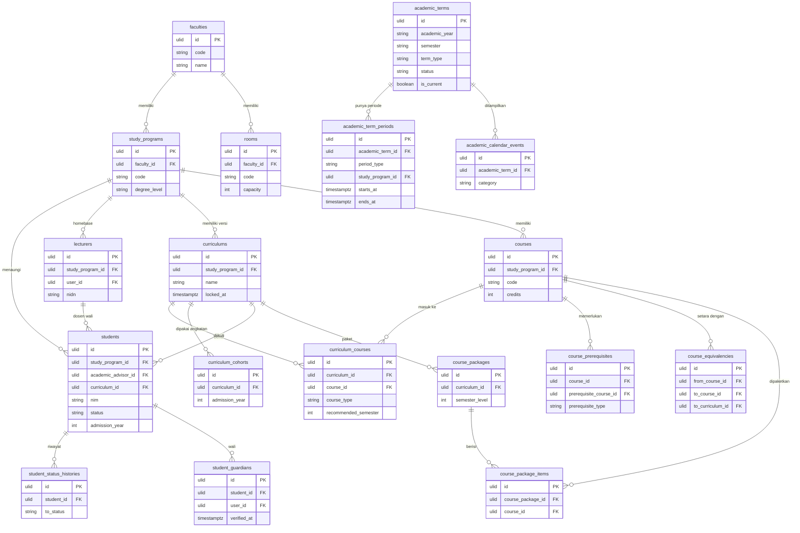
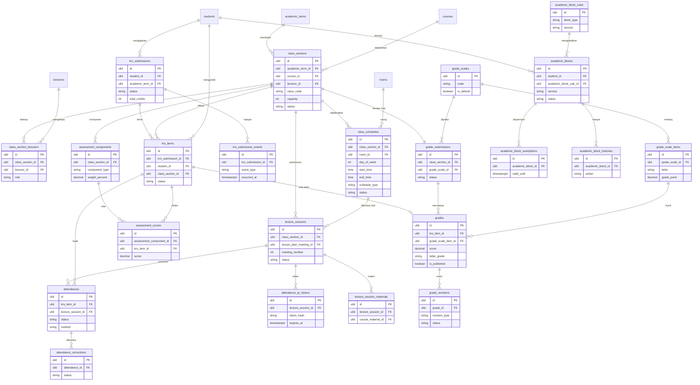
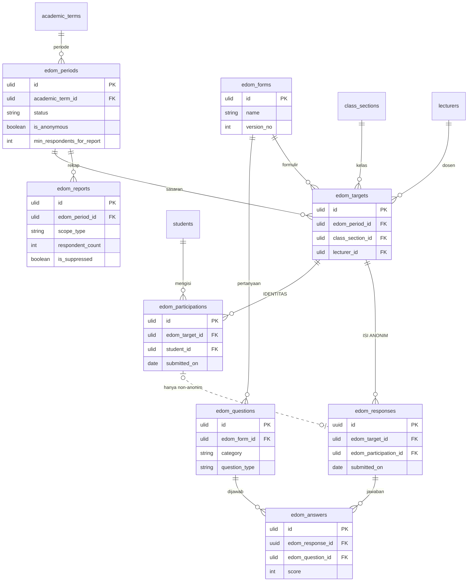

# 07 — Rancangan Database & ERD

> **Status:** rancangan (bukan skema yang sudah dimigrasikan). Tabel dan kolom berlabel **Baru** atau **(baru)** belum ada di repository.
> **Disusun:** 2026-10-11, berdasarkan migration pada commit `ab81cc7` di `app/Modules/Academic`, `app/Modules/HumanResource`, `app/Modules/Thesis`, `app/Modules/Internship`, `app/Modules/Tenancy`, `app/Modules/SystemSetting`, dan `app/Modules/FileManagement`.
> Kembali ke [README](README.md) · Kanon nama tabel: [README §5.2](README.md#52-entitas--padanan-nama-brief--nama-kanon) · Kanon status: [README §5.4](README.md#54-status-kanon-state-machine-lengkap-di-10-business-rulesmd)

Dokumen ini adalah **skema acuan** untuk seluruh set dokumen `academic-learning`. Jika dokumen lain (01–06, 08–16) menyebut kolom yang berbeda dari dokumen ini, dokumen inilah yang berlaku untuk nama dan tipe kolom. Aturan bisnis yang memakai kolom-kolom ini didefinisikan di [10-business-rules.md](10-business-rules.md).

## Daftar Isi

1. [Konvensi](#1-konvensi)
2. [Strategi Multi-Tenant](#2-strategi-multi-tenant)
3. [Spesifikasi Tabel per Kelompok Modul](#3-spesifikasi-tabel-per-kelompok-modul)
   - 3.1 [Master Akademik](#31-master-akademik)
   - 3.2 [Kurikulum](#32-kurikulum)
   - 3.3 [Perkuliahan: Kelas, Jadwal, KRS, Sesi, Presensi](#33-perkuliahan-kelas-jadwal-krs-sesi-presensi)
   - 3.4 [Penilaian](#34-penilaian)
   - 3.5 [Perwalian & Cekal](#35-perwalian--cekal)
   - 3.6 [Layanan Akademik & Tugas Akhir](#36-layanan-akademik--tugas-akhir)
   - 3.7 [MBKM](#37-mbkm)
   - 3.8 [LMS](#38-lms)
   - 3.9 [CBT](#39-cbt)
   - 3.10 [OBE](#310-obe)
   - 3.11 [EDOM](#311-edom)
   - 3.12 [Entitlement & Konfigurasi](#312-entitlement--konfigurasi)
4. [Data Turunan dan Denormalisasi](#4-data-turunan-dan-denormalisasi)
5. [ERD Mermaid](#5-erd-mermaid)
6. [Strategi Migrasi dari Skema yang Ada](#6-strategi-migrasi-dari-skema-yang-ada)
7. [Ringkasan Indeks Tabel](#7-ringkasan-indeks-tabel)

---

## 1. Konvensi

### 1.1 Mesin database

`.env.example` memakai `DB_CONNECTION=mysql`. Rancangan ini menargetkan **MySQL 8.0 (InnoDB, utf8mb4)**. Bila nanti dipakai PostgreSQL, catatan khusus diberikan di tempat yang relevan (indeks parsial, partisi). Semua migration ditulis dengan Laravel Schema Builder. SQL mentah hanya dipakai untuk kolom *generated* dan partisi.

### 1.2 Kolom standar

Setiap tabel tenant baru **wajib** memiliki kolom berikut. Agar tidak berulang, tabel kolom di §3 menuliskannya sebagai satu baris *"kolom standar"*.

| Kolom | Tipe | Null | Keterangan |
|---|---|---|---|
| `id` | `ulid` (`char(26)`) | tidak | PK. Dibuat oleh trait `HasUlids` |
| `university_id` | `ulid` | tidak | FK → `universities.id` **cascadeOnDelete** (pola yang sudah ada). Diisi otomatis oleh trait `TenantScoped` |
| `created_at`, `updated_at` | `timestamptz` (`timestampsTz()`) | ya | |

Pengecualian kolom standar dicatat per tabel: tabel *append-only* (tanpa `updated_at`), tabel platform (tanpa `university_id`), dan `edom_responses` (lihat §3.11).

### 1.3 Penamaan

| Objek | Aturan | Contoh |
|---|---|---|
| Tabel | `snake_case` jamak, bahasa Inggris, mengikuti kanon README §5.2 | `lecture_sessions` |
| FK | `<entitas_tunggal>_id`. Jika peran berbeda dari nama tabel, beri awalan peran | `supervisor_lecturer_id`, `decided_by` (→ `users`) |
| Kolom aktor | `*_by` → `users.id`, **nullOnDelete** | `approved_by`, `recorded_by` |
| Waktu domain | `*_at` (`timestamptz`) untuk instan, `*_date`/`*_on` (`date`) untuk tanggal kalender | `published_at`, `session_date` |
| Boolean | awalan `is_`/`has_`/`allow_` | `is_required`, `allow_late_submission` |
| Indeks | Default Laravel `{tabel}_{kolom}_index`. Bila melebihi 64 karakter (batas MySQL), pakai nama eksplisit `{singkatan_tabel}_{kolom_ringkas}_idx` | `qbi_options_university_id_item_id_index` (sudah ada) |
| Unique | `{singkatan}_{kolom}_uq` bila nama default terlalu panjang | `clo_plo_uq` |
| Generated column untuk unique parsial | `active_key` / `scope_key` | lihat §1.8 |

### 1.4 Status dan enum

- Kolom status baru: `string(20)` + PHP backed enum di `Modules\<Modul>\Enums`. **Jangan** memakai `$table->enum()` untuk kolom baru. Menambah nilai enum MySQL memerlukan `ALTER TABLE` penuh, sedangkan `string(20)` cukup diubah di kode.
- Kolom yang **saat ini** masih `enum` MySQL dan perlu nilai baru dikonversi ke `string(20)` (lihat §6.2): `academic_terms.semester`, `grades.letter_grade`, `attendances.status`, `exam_attempts.status`, `exam_violations.violation_type`, `exams.question_selection_mode`, `theses.status`, `theses.thesis_type`, `internships.status`, `internships.program_type`. `students.status` dan `krs_items.status` sudah dikonversi oleh migration `2026_10_06_200006` dan `2026_10_06_200005`.
- Kolom kategori non-status (`period_type`, `block_type`, `question_type`, dll.) juga `string(20)`–`string(40)` + PHP enum.
- Nilai status hanya diubah oleh service ([10-business-rules.md](10-business-rules.md)). Tidak ada `CHECK` constraint di DB untuk status karena MySQL 8 baru menegakkan `CHECK` sejak 8.0.16 dan konversi enum akan lebih sulit. Validasi ada di PHP enum + Form Request.

### 1.5 Presisi angka

| Jenis nilai | Tipe | Alasan |
|---|---|---|
| Nilai angka mahasiswa (komponen, akhir, ujian) | `decimal(5,2)` (0.00–999.99) | Sama dengan `grades.score`, `exam_attempts.score`, `assignment_submissions.score` yang sudah ada |
| Bobot dan persentase | `decimal(5,2)` (0.00–100.00) | Sama dengan `exams.weight_percentage` |
| Bobot nilai/mutu (grade point) | `decimal(3,2)` (0.00–9.99) | Skala 4.00. Ruang ke 9.99 untuk skala tenant non-standar |
| IPS/IPK (bila disalin ke snapshot dokumen) | `decimal(4,2)` | |
| Skor agregat OBE/EDOM/engagement | `decimal(6,2)` | Rata-rata bisa memiliki skala lebih besar dari 100 pada skala kustom |
| Nilai IKU (rasio) | `decimal(7,4)` | Rasio 0–1 dengan 4 desimal |
| Uang | `decimal(14,2)` | Sama dengan `subscription_plans.price`. Modul akademik **tidak** menyimpan tagihan. Tagihan ada di modul Finance |
| Ukuran berkas | `unsignedBigInteger` (byte) | Sama dengan `file_uploads.size_bytes` |
| SKS | `unsignedTinyInteger` | Sama dengan `courses.credits` |

Pembulatan **tidak** dilakukan oleh tipe kolom. Pembulatan nilai akhir sebelum konversi huruf diatur oleh `academic.grading.rounding` ([OD-29](16-open-decisions.md#od-29)) dan dilakukan di service, lalu hasilnya disimpan.

### 1.6 Kebijakan pemakaian `json`

`json` **boleh** dipakai untuk:

1. Parameter konfigurasi yang strukturnya berbeda per jenis, misalnya `academic_block_rules.parameters` dan `ai_generation_jobs.input_params`.
2. Rincian hasil hitung yang hanya ditampilkan dan tidak difilter, misalnya `edom_reports.distribution` dan `lms_engagement_scores.components`.
3. Payload riwayat/audit, misalnya `krs_submission_events.payload`.
4. Data klien yang tidak di-query, misalnya `exam_attempts.question_order` (sudah ada) dan `exam_violations.metadata` (sudah ada).

`json` **dilarang** untuk:

- Atribut yang dipakai di `WHERE`, `JOIN`, `ORDER BY`, atau agregasi laporan. Contoh: layanan yang dicekal disimpan sebagai kolom `academic_blocks.service`, bukan array json.
- Relasi ke entitas lain (daftar id). Gunakan tabel pivot.
- Data pribadi yang harus bisa dimasking per kolom.

### 1.7 Soft delete vs arsip vs pembatalan

| Kategori | Mekanisme | Contoh tabel |
|---|---|---|
| Master yang direferensikan riwayat | `softDeletesTz()` + `is_active` | `lecturers` (sudah ada), `rooms`, `mbkm_partners`, `question_banks` |
| Master yang tidak boleh hilang dari riwayat dan tidak perlu soft delete | `is_active = false` saja. Hapus fisik ditolak service bila sudah direferensikan | `faculties`, `study_programs`, `courses`, `curriculums`, `grade_scales` |
| Transaksi akademik | **Tidak dihapus**. Dibatalkan/diarsipkan lewat `status` (`cancelled`, `dropped`, `voided`, `revoked`, `archived`, `superseded`) | `krs_submissions`, `krs_items`, `grades`, `academic_blocks`, `exam_attempts`, `lesson_plans` |
| Konten LMS buatan pengguna | `archived_at` untuk materi/tugas; `softDeletesTz()` untuk konten forum (moderasi) | `course_materials`, `lms_discussion_posts` |
| Log append-only | Tidak ada update/delete. Penghapusan hanya oleh job retensi | `krs_submission_events`, `academic_block_histories`, `lms_activity_events` |
| Berkas | `file_uploads.deleted_at` (sudah ada) + job retensi ([OD-20](16-open-decisions.md#od-20)) | `file_uploads` |

**FK `on delete`.** Migration lama banyak memakai `cascadeOnDelete()` (misalnya `krs_items.student_id`, `grades.krs_item_id`). Perilaku itu **dipertahankan** demi kompatibilitas, tetapi penghapusan induk diblokir di service. Untuk tabel baru berlaku:

| Jenis referensi | `on delete` |
|---|---|
| `university_id` → `universities` | `cascade` (penghapusan tenant = penghapusan seluruh data, hanya lewat prosedur offboarding) |
| Anak murni dari header (item, versi, jawaban) | `cascade` |
| Referensi ke master yang tercatat di riwayat (`students`, `lecturers`, `courses`, `class_sections`, `krs_items`, `academic_terms`) | `restrict` |
| Referensi opsional/aktor (`users`, `file_uploads`, `rooms`) | `set null` |

### 1.8 Unique parsial di MySQL

MySQL tidak mendukung indeks unik parsial (`WHERE status = 'active'`). Polanya adalah **stored generated column** yang bernilai `NULL` di luar kondisi, karena MySQL mengizinkan banyak `NULL` dalam indeks unik:

```sql
active_key CHAR(80) GENERATED ALWAYS AS (
  CASE WHEN status = 'active' THEN CONCAT(student_id, ':', service, ':', block_type) END
) STORED,
UNIQUE KEY academic_blocks_active_key_uq (university_id, active_key)
```

Pola yang sama dipakai untuk kolom nullable yang harus ikut unik: `scope_key = COALESCE(study_program_id, '*')`. Di PostgreSQL pola ini diganti dengan indeks unik parsial biasa.

### 1.9 Kolom `university_id` pada setiap anak

`university_id` diulang di setiap tabel anak, meskipun bisa diturunkan dari induk. Ini **denormalisasi yang disengaja** agar:

1. Global scope `BelongsToInstitutionScope` bisa menyaring tanpa join.
2. Setiap indeks komposit bisa diawali `university_id`.
3. Partisi per tenant (§2.8) bisa dilakukan.

---

## 2. Strategi Multi-Tenant

### 2.1 Model yang dipakai: shared database, shared schema

Semua tenant berada di satu database dan satu skema. Setiap baris memiliki `university_id`. Mekanisme yang sudah ada dan dipakai apa adanya:

| Komponen | Peran |
|---|---|
| `ResolveUniversityMiddleware` (`tenant.resolve`) | Menentukan tenant dari header `X-University-ID`, domain (`university_domains`), atau membership default (`user_universities.is_default`) |
| `TenantContext` | Menyimpan tenant aktif. `null` = konteks platform |
| Trait `TenantScoped` + `BelongsToInstitutionScope` | Menambahkan `where university_id = ?` ke setiap query model dan mengisi `university_id` saat `creating` |
| Kontrak `ScopesToInstitution` | Penanda model tenant |

### 2.2 Kunci unik komposit

Setiap kunci bisnis yang unik **per tenant** harus diawali `university_id`. Pola yang sudah ada: `faculties (university_id, code)`, `students (university_id, nim)`, `lecturers (university_id, nidn)`, `academic_terms (university_id, academic_year, semester)`.

Pengecualian yang sudah ada dan **dipertahankan**: unique tanpa `university_id` pada kolom yang secara definisi unik global, yaitu ULID induk (`grades.krs_item_id`, `krs_items (student_id, class_section_id)`), `exams.access_token`, dan `exam_attempts.session_token_hash`. Karena induknya sudah ber-tenant, unique ini tetap aman.

Untuk tabel baru:

- Kode bisnis yang diketik pengguna (kode ruang, kode CPL, kode lencana) → unique `(university_id, ...)`.
- Kombinasi ULID induk (pivot) → unique pada kolom ULID saja, tanpa `university_id`. Indeks terpisah `(university_id, <fk>)` tetap dibuat untuk penyaringan.

### 2.3 Konsistensi tenant antara induk dan anak

Risiko: baris anak berisi `university_id = A`, tetapi FK menunjuk induk milik tenant B (misalnya akibat id yang dikirim klien).

| Opsi | Cara | Kelebihan | Kekurangan |
|---|---|---|---|
| A. Composite FK | Tambah `UNIQUE (university_id, id)` di setiap induk, lalu FK anak `(university_id, parent_id) → parent (university_id, id)` | Dijamin DB | Perlu indeks unik tambahan di setiap induk. Tidak didukung `foreignUlid()` sehingga harus raw SQL. **Tidak kompatibel dengan partisi MySQL** (tabel berpartisi tidak boleh punya FK). Membuat migrasi tabel lama berat |
| B. Pemeriksaan di aplikasi | (1) Validasi Form Request `Rule::exists(...)->where('university_id', $tenant)`. (2) Route model binding sudah melewati global scope tenant, sehingga id milik tenant lain menghasilkan 404. (3) Hook `creating`/`updating` pada trait baru `InheritsTenantFromParent` yang memastikan `child.university_id === parent.university_id`. (4) Job harian `TenantIntegrityAuditJob` yang menjalankan query pemeriksa per relasi dan melapor ke log/monitoring | Konsisten dengan kode yang ada. Tidak menghalangi partisi | Bergantung pada disiplin kode. Dimitigasi oleh uji otomatis dan job audit |

**Rekomendasi: Opsi B** sebagai standar untuk semua tabel, dengan uji isolasi tenant wajib per endpoint ([14-test-scenarios.md](14-test-scenarios.md)). Opsi A **tidak** dipakai karena bertentangan dengan rencana partisi §2.8 dan tidak sebanding biayanya pada skema yang sudah berjalan.

Contoh query `TenantIntegrityAuditJob`:

```sql
SELECT c.id FROM krs_items c
JOIN class_sections p ON p.id = c.class_section_id
WHERE c.university_id <> p.university_id
LIMIT 100;
```

### 2.4 Konteks platform

- Tabel **tanpa** `university_id` (milik platform): `subscription_plans`, `plan_feature_entitlements` (baru), `feature_flags`, `modules`, `permissions`. Model tabel ini tidak memakai `TenantScoped`.
- Saat `TenantContext` bernilai `null` (super admin di konsol platform), global scope tidak menyaring. Konsekuensinya: **setiap operasi tulis** dari konteks platform ke tabel tenant wajib menetapkan `university_id` secara eksplisit. Service menolak `create` tanpa `university_id` bila konteks platform.
- Laporan lintas tenant (misalnya statistik pemakaian storage untuk billing) hanya membaca tabel snapshot (`storage_usage_snapshots`, `iku_snapshots`). Laporan itu tidak membaca data mahasiswa mentah.

### 2.5 Path berkas per tenant

Saat ini `FileUploadService` menyimpan ke `uploads/{uploader_id}`. Path ini **belum** per tenant. Rekomendasi untuk unggahan baru:

```
tenants/{university_id}/{module}/{yyyy}/{mm}/{file_upload_id}.{ext}
```

- `{module}`: `academic`, `lms`, `cbt`, `obe`, `edom`, `mbkm`, `thesis`.
- Berkas lama **tidak dipindahkan** secara paksa. Kolom `file_uploads.path` tetap menunjuk lokasi lama. Job opsional `RelocateTenantFilesJob` dapat memindahkan berkas bertahap dan memperbarui `path`.
- Path per tenant mempermudah tiga hal: (1) penghitungan kuota storage per tenant tanpa join, (2) ekspor/offboarding tenant, dan (3) kebijakan bucket per tenant untuk whitelabel.
- Akses berkas tetap lewat URL bertanda tangan (signed URL) setelah pemeriksaan policy. Path tidak pernah dianggap rahasia.

### 2.6 Replika baca untuk pelaporan

- Laporan berat ([12-reports-analytics.md](12-reports-analytics.md)), seperti rekap presensi semester, distribusi nilai, ketercapaian CPL, dan rekap EDOM, dijalankan pada **koneksi baca** (`database.connections.mysql.read`) bila replika tersedia.
- Laporan yang membutuhkan konsistensi baca-setelah-tulis (misalnya KRS mahasiswa setelah submit) **tetap** di primary. Laravel `sticky => true` dipakai.
- Snapshot terhitung (`outcome_measurements`, `edom_reports`, `lms_engagement_scores`, `iku_snapshots`, `storage_usage_snapshots`) ditulis di primary oleh job, lalu dibaca dari replika.
- Global scope tenant tetap berlaku di koneksi replika karena scope bekerja di level query builder, bukan koneksi.

### 2.7 Mengapa bukan database per tenant

| Pertimbangan | Shared DB (dipilih) | DB per tenant |
|---|---|---|
| Kesesuaian dengan kode | Sudah dipakai (`TenantScoped`, [MULTI-TENANT-ARCHITECTURE.md](../MULTI-TENANT-ARCHITECTURE.md)) | Perlu penulisan ulang koneksi, migration runner, dan queue per tenant |
| Migrasi skema | Satu kali | N kali, dengan risiko versi skema berbeda antar-tenant |
| Laporan platform (billing, storage) | Satu query | Fan-out ke N database |
| Isolasi | Logis (scope + uji) | Fisik |
| Biaya operasional | Rendah | Tinggi untuk ratusan PT kecil |

Database terpisah tetap dapat ditawarkan sebagai opsi **Enterprise** di masa depan bila ada tuntutan kontrak. Saat ini opsi itu tidak dirancang ([OD-NEW-dedicated-db](16-open-decisions.md)).

### 2.8 Partisi tabel besar di masa depan

Tabel dengan pertumbuhan tertinggi (perkiraan untuk PT 10.000 mahasiswa):

| Tabel | Perkiraan baris/semester | Strategi |
|---|---|---|
| `attendances` | ~10.000 mhs × 8 MK × 16 pertemuan ≈ 1,3 juta | Indeks `(university_id, lecture_session_id)`. Partisi `KEY(university_id)` bila total > 50 juta |
| `lms_activity_events` | puluhan juta | **Sejak awal tanpa FK**. PK `(id, university_id)`. Partisi `RANGE` per bulan atas `occurred_at` untuk retensi, dengan sub-partisi `KEY(university_id)` |
| `exam_attempt_answers` | ~10.000 × 6 ujian × 40 soal ≈ 2,4 juta | Partisi `KEY(university_id)` bila total > 50 juta |
| `outcome_measurements` | per mahasiswa × CPMK × semester | Indeks `(university_id, academic_term_id, measurement_level)`. Partisi tidak diperlukan pada tahap awal |

Batasan MySQL yang harus diperhitungkan:

1. Tabel berpartisi **tidak boleh** memiliki FK (masuk maupun keluar).
2. Setiap unique key (termasuk PK) harus memuat kolom partisi.

Konsekuensinya, partisi `attendances` dan `exam_attempt_answers` memerlukan:

- penghapusan FK-nya, dengan integritas dialihkan ke Opsi B §2.3;
- PK diubah menjadi `(id, university_id)`.

Langkah ini baru dilakukan bila volume menuntut. `lms_activity_events` dirancang siap partisi sejak awal karena tidak direferensikan tabel mana pun.

---

## 3. Spesifikasi Tabel per Kelompok Modul

**Cara membaca.**

- **Status tabel:** **Ada** = sudah ada di migration, tidak berubah. **Diperluas** = sudah ada dan mendapat kolom/indeks baru. **Baru** = belum ada.
- Pada tabel *Ada/Diperluas*, kolom yang sudah ada ditulis sesuai migration saat ini. Kolom tambahan diberi tanda **(baru)**, dan perubahan tipe diberi tanda **(ubah)**.
- "Kolom standar" = `id`, `university_id`, `created_at`, `updated_at` sesuai §1.2.
- Kardinalitas ditulis `1:N`, `1:1`, `N:M`, dengan `0..1` untuk relasi opsional.

### 3.1 Master Akademik

#### 3.1.1 `universities` — Ada (referensi)

**Fungsi:** tenant. Hanya dirujuk. Tabel ini tidak diubah oleh rancangan akademik. Kolom yang relevan untuk modul akademik: `id`, `code` (unique global), `slug` (unique global), `name`, `short_name`, `status`, `timezone` (default `Asia/Jakarta`), `locale`, `logo_file_id`, `primary_color`, `secondary_color` (dipakai whitelabel LMS), `is_active`, `deleted_at` (soft delete).

- **Relasi:** `1:N` ke setiap tabel tenant.
- **Arsip:** soft delete tenant **tidak** menghapus data akademik. Penghapusan fisik hanya lewat prosedur offboarding, lalu cascade.

#### 3.1.2 `faculties` — Ada

**Fungsi:** fakultas/unit akademik di atas prodi.

| Kolom | Tipe | Null | Keterangan |
|---|---|---|---|
| kolom standar | | | |
| `code` | string(255) | tidak | |
| `name` | string(255) | tidak | |
| `is_active` | boolean | tidak | default `true` |

- **PK:** `id`. **FK:** `university_id` cascade.
- **Unique:** `(university_id, code)`.
- **Relasi:** `1:N` `study_programs`. `0..N` `lecturers.faculty_id`, `rooms.faculty_id`.
- **Arsip:** `is_active = false`. Hapus fisik ditolak bila ada prodi.

#### 3.1.3 `study_programs` — Ada

**Fungsi:** program studi. Ini adalah unit scope utama untuk Kaprodi dan admin prodi.

| Kolom | Tipe | Null | Keterangan |
|---|---|---|---|
| kolom standar | | | |
| `faculty_id` | ulid | tidak | FK → `faculties` cascade |
| `code` | string(255) | tidak | |
| `name` | string(255) | tidak | |
| `degree_level` | string(255) | tidak | Jenjang (D3/S1/S2/...) |
| `is_active` | boolean | tidak | default `true` |

- **Unique:** `(university_id, code)`. **Indeks:** `(university_id, faculty_id)`.
- **Relasi:** `N:1` `faculties`. `1:N` `students`, `curriculums`, `courses`, `class_sections`. `1:N` `lecturers` (homebase).
- **Arsip:** `is_active = false`.

#### 3.1.4 `academic_terms` — Diperluas

**Fungsi:** satu baris = satu semester dalam satu tahun akademik. Gabungan konsep brief `academic_years` dan `semesters`.

| Kolom | Tipe | Null | Keterangan |
|---|---|---|---|
| kolom standar | | | |
| `academic_year` | string(255) | tidak | Contoh `2026/2027` |
| `semester` | enum `ganjil\|genap` → **(ubah)** string(20) | tidak | Nilai `pendek` ditambahkan sesuai [semester-pendek/desain-database.md](../semester-pendek/desain-database.md) |
| `term_type` **(baru)** | string(20) | tidak | `regular` / `short`. Diturunkan dari `semester` (`pendek` → `short`) dan dijaga konsisten oleh service. Default `regular` |
| `status` **(baru)** | string(20) | tidak | Siklus hidup periode sesuai rancangan semester pendek (`draft`, `planned`, `registration_open`, `registration_closed`, `ongoing`, `grading`, `completed`, `archived`). Lihat catatan kanon di §6.6 |
| `is_current` | boolean | tidak | default `false` |
| `start_date`, `end_date` | date | tidak | |
| `krs_start_date`, `krs_end_date` | date | ya | **Dipertahankan** untuk kompatibilitas `KrsPlanService`. Sumber kebenaran baru: `academic_term_periods` dengan `period_type = krs`. Service menyinkronkan keduanya |
| `max_credits` **(baru)** | unsignedTinyInteger | ya | Batas SKS khusus periode (dipakai SP). `null` = ikut `academic.krs.max_sks_tiers` |

- **Unique:** `(university_id, academic_year, semester)` (tetap). **Indeks:** `(university_id, is_current)`, `(university_id, status)` **(baru)**.
- **Relasi:** `1:N` `academic_term_periods`, `class_sections`, `krs_submissions`, `krs_items`, `academic_calendar_events`, `edom_periods`, `mbkm_programs`.
- **Arsip:** `status = archived`. Tidak pernah dihapus setelah ada `class_sections`.

#### 3.1.5 `academic_term_periods` — Baru

**Fungsi:** jendela waktu yang **mengikat proses** (KRS, perubahan KRS, perkuliahan, UTS, UAS, input nilai, publikasi nilai, EDOM). Berbeda dengan `academic_calendar_events`, yang hanya untuk tampilan kalender.

| Kolom | Tipe | Null | Keterangan |
|---|---|---|---|
| kolom standar | | | |
| `academic_term_id` | ulid | tidak | FK → `academic_terms` cascade |
| `period_type` | string(30) | tidak | `krs`, `krs_change`, `lecture`, `midterm_exam`, `final_exam`, `grading`, `grade_publication`, `edom`, `thesis_registration`, `mbkm_registration` |
| `study_program_id` | ulid | ya | FK → `study_programs` cascade. `null` = berlaku untuk seluruh tenant. Jika diisi = override prodi |
| `scope_key` | char(26) generated | tidak | `COALESCE(study_program_id, '*')` (lihat §1.8) |
| `starts_at` | timestamptz | tidak | |
| `ends_at` | timestamptz | tidak | `> starts_at` |
| `academic_calendar_event_id` | ulid | ya | FK → `academic_calendar_events` set null. Event kalender yang ditampilkan untuk periode ini |
| `notes` | string(255) | ya | |
| `created_by` | ulid | ya | FK → `users` set null |

- **Unique:** `(university_id, academic_term_id, period_type, scope_key)`.
- **Indeks:** `(university_id, period_type, starts_at)`.
- **Relasi:** `N:1` `academic_terms`. `0..1` `academic_calendar_events`.
- **Resolusi:** periode prodi menimpa periode tenant ([10-business-rules.md](10-business-rules.md)). Mengubah periode yang sudah berjalan dicatat di `audit_logs`.
- **Arsip:** ikut `academic_terms`. Tidak ada soft delete.

#### 3.1.6 `academic_calendar_events` — Ada

**Fungsi:** acara kalender akademik untuk tampilan.

| Kolom | Tipe | Null | Keterangan |
|---|---|---|---|
| kolom standar | | | |
| `academic_term_id` | ulid | ya | FK → `academic_terms` set null |
| `study_program_id` | ulid | ya | FK → `study_programs` set null |
| `title` | string(255) | tidak | |
| `description` | text | ya | |
| `category` | string(30) | tidak | `registration`, `krs`, `lecture`, `midterm_exam`, `final_exam`, `holiday`, `graduation`, `other` |
| `start_date`, `end_date` | date | tidak | |
| `created_by` | ulid | ya | FK → `users` set null |

- **Indeks:** `(university_id, start_date)`, `(university_id, academic_term_id)`.
- **Relasi:** `0..1` dirujuk oleh `academic_term_periods`.
- **Arsip:** boleh dihapus (bukan transaksi). Penghapusan dicatat di audit.

#### 3.1.7 `students` — Diperluas

**Fungsi:** mahasiswa.

| Kolom | Tipe | Null | Keterangan |
|---|---|---|---|
| kolom standar | | | |
| `user_id` | ulid | ya | FK → `users` set null. Unique global |
| `study_program_id` | ulid | tidak | FK → `study_programs` cascade |
| `academic_advisor_id` | ulid | ya | FK → `lecturers` set null. Dosen wali |
| `curriculum_id` **(baru)** | ulid | ya | FK → `curriculums` restrict. Versi kurikulum yang diikuti. Default diambil dari `curriculum_cohorts` saat mahasiswa dibuat. Disimpan karena mahasiswa pindahan atau yang dipindah kurikulum bisa berbeda dari angkatannya |
| `entry_type` **(baru)** | string(20) | tidak | `regular`, `transfer`, `double_degree`. Default `regular` |
| `nim` | string(255) | tidak | |
| `name` | string(255) | tidak | |
| `email` | string(255) | ya | |
| `phone` | string(30) | ya | |
| `address` | text | ya | |
| `photo_file_id` | ulid | ya | FK → `file_uploads` set null |
| `tanggal_lahir` | date | ya | Nama kolom yang ada dipertahankan |
| `birth_place` | string(100) | ya | |
| `gender` | string(10) | ya | |
| `admission_year` | unsignedSmallInteger | tidak | Angkatan |
| `status` | string(20) | tidak | `active`, `leave`, `graduated`, `inactive`, `dropped_out`, `resigned` |
| `enrolled_at` | date | tidak | |
| `graduated_at` | date | ya | |

- **Unique:** `(university_id, nim)`, `user_id`.
- **Indeks:** `(university_id, status)`, `(university_id, study_program_id)`, `(university_id, admission_year)`, `(university_id, academic_advisor_id)`, `(university_id, curriculum_id)` **(baru)**.
- **Relasi:** `1:N` `krs_submissions`, `krs_items`, `student_status_histories`, `student_requests`, `advising_records`, `academic_blocks`, `student_guardians`, `mbkm_participations`, `credit_conversions`. `0..N` `theses` (lihat §3.6.6).
- **Arsip:** tidak ada soft delete. Mahasiswa keluar = `status` (`dropped_out`/`resigned`/`graduated`) + riwayat.

#### 3.1.8 `student_status_histories` — Ada

**Fungsi:** riwayat perubahan status mahasiswa. Diisi oleh `StudentObserver`.

| Kolom | Tipe | Null | Keterangan |
|---|---|---|---|
| kolom standar | | | |
| `student_id` | ulid | tidak | FK → `students` cascade |
| `from_status` | string(20) | ya | |
| `to_status` | string(20) | tidak | |
| `effective_date` | date | tidak | |
| `academic_term_id` | ulid | ya | FK → `academic_terms` set null |
| `reason` | string(255) | ya | |
| `changed_by` | ulid | ya | FK → `users` set null |

- **Indeks:** `(student_id, effective_date)`, `(university_id, to_status)`.
- **Arsip:** append-only.

#### 3.1.9 `lecturers` — Ada

**Fungsi:** dosen. Homebase = `study_program_id`. Kolom berasal dari migration Academic dan HumanResource (`2026_10_06_100002_link_lecturers_to_employees`).

| Kolom | Tipe | Null | Keterangan |
|---|---|---|---|
| kolom standar | | | |
| `user_id` | ulid | ya | FK → `users` set null |
| `faculty_id` | ulid | ya | FK → `faculties` set null |
| `employee_id` | ulid | ya | FK → `employees` set null. Unique |
| `study_program_id` | ulid | ya | FK → `study_programs` set null. **Homebase** |
| `nidn` | string(255) | tidak | |
| `nidk` | string(50) | ya | |
| `nip` | string(50) | ya | |
| `name` | string(255) | tidak | |
| `email` | string(255) | ya | |
| `phone` | string(30) | ya | |
| `employment_status` | string(20) | ya | |
| `functional_rank` | string(30) | ya | |
| `highest_education` | string(10) | ya | |
| `hired_at` | date | ya | |
| `serdos_number` | string(50) | ya | |
| `academic_rank` | enum `AcademicRank` | ya | |
| `expertise` | string(255) | ya | |
| `lecturer_status` | enum `LecturerStatus` | ya | |
| `teaching_started_at` | date | ya | |
| `is_active` | boolean | tidak | default `true` |
| `deleted_at` | timestamptz | ya | Soft delete |

- **Unique:** `(university_id, nidn)`, `(university_id, user_id)`, `employee_id`.
- **Indeks:** `(university_id, faculty_id)`, `(university_id, email)`.
- **Relasi:** `1:N` `class_section_lecturers`, `students.academic_advisor_id`, `thesis_supervisors`, `edom_targets`. Riwayat mengajar = `class_section_lecturers` ⨝ `class_sections` ⨝ `academic_terms` (diturunkan, tidak disimpan).
- **Arsip:** soft delete. Data riwayat tetap merujuk baris yang di-soft delete.

#### 3.1.10 `student_guardians` — Baru

**Fungsi:** relasi orang tua/wali (akun `users`) dengan mahasiswa untuk portal `guardian`. Akses dibatasi persetujuan dan verifikasi ([OD-21](16-open-decisions.md#od-21)).

| Kolom | Tipe | Null | Keterangan |
|---|---|---|---|
| kolom standar | | | |
| `student_id` | ulid | tidak | FK → `students` restrict |
| `user_id` | ulid | ya | FK → `users` set null. Akun wali. `null` = data kontak saja |
| `name` | string(150) | tidak | |
| `relationship` | string(20) | tidak | `father`, `mother`, `guardian`, `other` |
| `phone` | string(30) | ya | |
| `email` | string(255) | ya | |
| `is_primary` | boolean | tidak | default `false` |
| `can_view_grades` | boolean | tidak | default `false` |
| `can_view_attendance` | boolean | tidak | default `false` |
| `can_view_invoices` | boolean | tidak | default `false` |
| `verified_at` | timestamptz | ya | Verifikasi identitas oleh BAAK |
| `verified_by` | ulid | ya | FK → `users` set null |
| `student_consented_at` | timestamptz | ya | Persetujuan mahasiswa bila diwajibkan kebijakan |
| `revoked_at` | timestamptz | ya | Akses dicabut |
| `revoked_by` | ulid | ya | FK → `users` set null |

- **Unique:** `(student_id, user_id)`.
- **Indeks:** `(university_id, user_id)`.
- **Relasi:** `N:1` `students`. `N:1` `users`. Satu wali dapat terhubung ke beberapa mahasiswa (kakak-adik).
- **Akses efektif:** `verified_at` terisi, `revoked_at` null, flag `can_view_*` true, dan (jika diwajibkan) `student_consented_at` terisi.
- **Arsip:** pencabutan lewat `revoked_at`. Tidak dihapus agar jejak akses tetap ada.

#### 3.1.11 `rooms` — Baru

**Fungsi:** ruang kuliah/laboratorium untuk validasi bentrok ruang. Menggantikan `class_schedules.room` (teks bebas).

| Kolom | Tipe | Null | Keterangan |
|---|---|---|---|
| kolom standar | | | |
| `faculty_id` | ulid | ya | FK → `faculties` set null. `null` = ruang bersama |
| `code` | string(30) | tidak | |
| `name` | string(150) | tidak | |
| `building` | string(100) | ya | |
| `floor` | string(10) | ya | |
| `capacity` | unsignedSmallInteger | ya | Kapasitas ruang. Dibandingkan dengan `class_sections.capacity` sebagai peringatan |
| `room_type` | string(20) | tidak | `classroom`, `laboratory`, `studio`, `auditorium`, `virtual`, `other` |
| `is_active` | boolean | tidak | default `true` |
| `deleted_at` | timestamptz | ya | Soft delete |

- **Unique:** `(university_id, code)`.
- **Indeks:** `(university_id, is_active)`.
- **Relasi:** `1:N` `class_schedules.room_id`, `lecture_sessions.room_id`, `thesis_examinations.room_id`.
- **Aturan:** ruang `virtual` dikecualikan dari cek bentrok ruang.
- **Arsip:** soft delete. Jadwal lama tetap merujuk ruang tersebut.

### 3.2 Kurikulum

#### 3.2.1 `curriculums` — Diperluas

**Fungsi:** satu baris = **satu versi** kurikulum prodi.

| Kolom | Tipe | Null | Keterangan |
|---|---|---|---|
| kolom standar | | | |
| `study_program_id` | ulid | tidak | FK → `study_programs` cascade |
| `name` | string(255) | tidak | Contoh "Kurikulum 2024" |
| `academic_year` | string(255) | tidak | Tahun akademik berlaku |
| `code` **(baru)** | string(30) | ya | Kode singkat versi |
| `effective_admission_year` **(baru)** | unsignedSmallInteger | ya | Angkatan pertama yang memakai versi ini (informasi). Pemetaan mengikat ada di `curriculum_cohorts` |
| `total_credits_required` **(baru)** | unsignedSmallInteger | ya | Total SKS lulus |
| `description` **(baru)** | text | ya | |
| `previous_curriculum_id` **(baru)** | ulid | ya | FK → `curriculums` set null. Garis keturunan versi |
| `ratified_at` **(baru)** | timestamptz | ya | Tanggal pengesahan |
| `ratified_by` **(baru)** | ulid | ya | FK → `users` set null |
| `locked_at` **(baru)** | timestamptz | ya | Setelah terkunci, perubahan struktur (`curriculum_courses`) hanya lewat versi baru |
| `is_active` | boolean | tidak | default `true` |

- **Unique:** `(university_id, study_program_id, name)` (tetap).
- **Indeks:** `(university_id, study_program_id, is_active)` **(baru)**.
- **Relasi:** `1:N` `curriculum_courses`, `curriculum_cohorts`, `graduate_profiles`, `program_learning_outcomes`. `0..1` `previous_curriculum_id`.
- **Riwayat perubahan:** perubahan kolom tercatat di `audit_logs` (trait `Auditable`). Perubahan struktur setelah `locked_at` ditolak, sehingga angkatan lama tidak terdampak.
- **Arsip:** `is_active = false`. Tidak dihapus bila sudah dirujuk mahasiswa/kelas.

#### 3.2.2 `courses` — Diperluas

**Fungsi:** master mata kuliah per prodi (identitas MK). Keanggotaan dalam versi kurikulum dipindahkan ke `curriculum_courses`.

| Kolom | Tipe | Null | Keterangan |
|---|---|---|---|
| kolom standar | | | |
| `study_program_id` | ulid | tidak | FK → `study_programs` cascade. Prodi pemilik MK |
| `curriculum_id` | ulid | tidak → **(ubah)** ya | FK → `curriculums`. **Deprecated** setelah backfill ke `curriculum_courses`. Dipertahankan agar endpoint lama tetap berfungsi ([OD-03](16-open-decisions.md#od-03)) |
| `code` | string(255) | tidak | |
| `name` | string(255) | tidak | |
| `credits` | unsignedTinyInteger | tidak | Total SKS |
| `credits_theory` **(baru)** | unsignedTinyInteger | ya | Rincian SKS teori |
| `credits_practicum` **(baru)** | unsignedTinyInteger | ya | Rincian SKS praktikum |
| `credits_field` **(baru)** | unsignedTinyInteger | ya | Rincian SKS lapangan |
| `semester_level` | unsignedTinyInteger | tidak | **Deprecated**. Semester rekomendasi per versi ada di `curriculum_courses.recommended_semester` |
| `description` **(baru)** | text | ya | Deskripsi singkat |
| `grade_scale_id` **(baru)** | ulid | ya | FK → `grade_scales` set null. Skala khusus MK bila kebijakan mengizinkan ([OD-04](16-open-decisions.md#od-04)) |
| `is_active` | boolean | tidak | default `true` |

- **Unique:** `(university_id, code)` (tetap; kode MK unik per tenant).
- **Indeks:** `(university_id, study_program_id)`, `(university_id, curriculum_id)`.
- **Relasi:** `1:N` `curriculum_courses`, `class_sections`, `course_prerequisites` (dua arah), `course_equivalencies` (dua arah), `question_bank_items`, `question_banks`.
- **Arsip:** `is_active = false`. Perubahan `credits` setelah MK dipakai di kelas yang sudah dinilai ditolak. Perubahan seperti itu dilakukan dengan MK baru + ekuivalensi.

#### 3.2.3 `curriculum_courses` — Baru

**Fungsi:** keanggotaan MK dalam satu versi kurikulum, berikut sifat wajib/pilihan dan semester rekomendasi.

| Kolom | Tipe | Null | Keterangan |
|---|---|---|---|
| kolom standar | | | |
| `curriculum_id` | ulid | tidak | FK → `curriculums` cascade |
| `course_id` | ulid | tidak | FK → `courses` restrict |
| `course_type` | string(20) | tidak | `mandatory`, `elective` |
| `recommended_semester` | unsignedTinyInteger | ya | Semester rekomendasi |
| `elective_group` | string(50) | ya | Kelompok/peminatan pilihan |
| `min_semester` | unsignedTinyInteger | ya | Paling awal boleh diambil |
| `sort_order` | unsignedSmallInteger | tidak | default 0 |

- **Unique:** `(curriculum_id, course_id)`.
- **Indeks:** `(university_id, course_id)`, `(curriculum_id, recommended_semester)`.
- **Relasi:** `N:1` `curriculums`, `N:1` `courses`. `1:N` `course_plo_mappings`, `course_learning_outcomes`, `lesson_plans`. `courses` ↔ `curriculums` = `N:M` melalui tabel ini.
- **Arsip:** tidak boleh dihapus setelah `curriculums.locked_at`.

#### 3.2.4 `curriculum_cohorts` — Baru

**Fungsi:** menetapkan versi kurikulum yang dipakai angkatan tertentu di satu prodi.

| Kolom | Tipe | Null | Keterangan |
|---|---|---|---|
| kolom standar | | | |
| `curriculum_id` | ulid | tidak | FK → `curriculums` restrict |
| `study_program_id` | ulid | tidak | FK → `study_programs` cascade. Harus sama dengan `curriculums.study_program_id` (dicek service) |
| `admission_year` | unsignedSmallInteger | tidak | Angkatan |
| `assigned_by` | ulid | ya | FK → `users` set null |

- **Unique:** `(university_id, study_program_id, admission_year)`. Satu angkatan prodi memakai tepat satu versi.
- **Indeks:** `(university_id, curriculum_id)`.
- **Relasi:** `N:1` `curriculums`. Satu versi dipakai `1..N` angkatan.
- **Arsip:** perubahan pemetaan angkatan **tidak** mengubah `students.curriculum_id` yang sudah ada secara otomatis. Pemindahan mahasiswa ke versi lain adalah aksi eksplisit yang diaudit.

#### 3.2.5 `course_prerequisites` — Diperluas

**Fungsi:** prasyarat MK.

| Kolom | Tipe | Null | Keterangan |
|---|---|---|---|
| kolom standar | | | |
| `course_id` | ulid | tidak | FK → `courses` cascade |
| `prerequisite_course_id` | ulid | tidak | FK → `courses` cascade |
| `min_letter_grade` | string(5) | ya | Kode huruf minimal. Dibandingkan lewat `grade_scale_items.grade_point` setelah skala dikonfigurasi |
| `prerequisite_type` **(baru)** | string(20) | tidak | `passed` (harus lulus), `taken` (pernah ambil), `corequisite` (diambil bersamaan). Default `passed` |
| `group_no` **(baru)** | unsignedTinyInteger | tidak | default 1. Prasyarat dalam satu grup = AND. Antar-grup = OR |
| `curriculum_id` **(baru)** | ulid | ya | FK → `curriculums` cascade. `null` = berlaku di semua versi |
| `scope_key` **(baru)** | char(26) generated | tidak | `COALESCE(curriculum_id, '*')` |

- **Unique:** `(course_id, prerequisite_course_id)` → **(ubah)** `(course_id, prerequisite_course_id, scope_key)`.
- **Indeks:** `(university_id, course_id)`.
- **Relasi:** `N:M` `courses` ↔ `courses` (self).
- **Arsip:** hapus fisik diizinkan (aturan konfigurasi). Perubahan diaudit.

#### 3.2.6 `course_equivalencies` — Baru

**Fungsi:** ekuivalensi MK antarversi kurikulum, juga dipakai saat konversi nilai.

| Kolom | Tipe | Null | Keterangan |
|---|---|---|---|
| kolom standar | | | |
| `from_curriculum_id` | ulid | tidak | FK → `curriculums` restrict |
| `from_course_id` | ulid | tidak | FK → `courses` restrict |
| `to_curriculum_id` | ulid | tidak | FK → `curriculums` restrict |
| `to_course_id` | ulid | tidak | FK → `courses` restrict |
| `equivalency_group` | string(30) | ya | Mengelompokkan relasi `N:1`/`1:N` (beberapa MK lama setara satu MK baru) |
| `is_bidirectional` | boolean | tidak | default `false` |
| `notes` | string(255) | ya | |
| `created_by` | ulid | ya | FK → `users` set null |

- **Unique:** `(from_course_id, to_course_id, to_curriculum_id)`.
- **Indeks:** `(university_id, to_curriculum_id)`, `(university_id, from_course_id)`.
- **Relasi:** `N:M` `courses` ↔ `courses` dalam konteks dua versi kurikulum.
- **Arsip:** tidak dihapus setelah dipakai oleh `credit_conversion_items` atau perhitungan kelulusan. Penonaktifan lewat versi kurikulum baru.

#### 3.2.7 `course_packages` — Baru

**Fungsi:** paket MK untuk KRS otomatis (semester awal) atau paket per semester.

| Kolom | Tipe | Null | Keterangan |
|---|---|---|---|
| kolom standar | | | |
| `study_program_id` | ulid | tidak | FK → `study_programs` cascade |
| `curriculum_id` | ulid | tidak | FK → `curriculums` restrict |
| `academic_term_id` | ulid | ya | FK → `academic_terms` restrict. `null` = templat lintas semester |
| `admission_year` | unsignedSmallInteger | ya | Angkatan sasaran |
| `semester_level` | unsignedTinyInteger | tidak | |
| `name` | string(150) | tidak | |
| `auto_apply` | boolean | tidak | default `false`. `true` = otomatis diisikan ke KRS draf saat periode KRS dibuka |
| `is_active` | boolean | tidak | default `true` |

- **Indeks:** `(university_id, study_program_id, academic_term_id)`.
- **Relasi:** `1:N` `course_package_items`. `0..N` `krs_submissions.course_package_id`.
- **Arsip:** `is_active = false`.

#### 3.2.8 `course_package_items` — Baru

| Kolom | Tipe | Null | Keterangan |
|---|---|---|---|
| kolom standar | | | |
| `course_package_id` | ulid | tidak | FK → `course_packages` cascade |
| `course_id` | ulid | tidak | FK → `courses` restrict |
| `class_section_id` | ulid | ya | FK → `class_sections` set null. Kelas yang disarankan (hanya untuk paket ber-`academic_term_id`) |
| `sort_order` | unsignedSmallInteger | tidak | default 0 |

- **Unique:** `(course_package_id, course_id)`.
- **Relasi:** `N:1` `course_packages`. `N:1` `courses`.
- **Arsip:** ikut paket.

### 3.3 Perkuliahan: Kelas, Jadwal, KRS, Sesi, Presensi

#### 3.3.1 `class_sections` — Diperluas

**Fungsi:** kelas perkuliahan (penawaran MK pada satu semester). Brief menyebutnya `classes`/`course_offerings`.

| Kolom | Tipe | Null | Keterangan |
|---|---|---|---|
| kolom standar | | | |
| `study_program_id` | ulid | tidak | FK → `study_programs` cascade |
| `academic_term_id` | ulid | tidak | FK → `academic_terms` cascade |
| `course_id` | ulid | tidak | FK → `courses` cascade |
| `lecturer_id` | ulid | ya | FK → `lecturers` set null. **Dosen koordinator**, dicerminkan dari `class_section_lecturers` baris `role = coordinator` |
| `course_name` | string(255) | tidak | Kolom lama (default `''`). **Deprecated**. Tidak diisi lagi |
| `class_code` | string(255) | tidak | Contoh `A`, `B`, `PR-1` |
| `capacity` | unsignedInteger | tidak | default 40 |
| `status` **(baru)** | string(20) | tidak | `planned`, `open`, `running`, `completed`, `cancelled`. Default `planned` |
| `delivery_mode` **(baru)** | string(20) | tidak | `offline`, `online`, `hybrid`. Default `offline` |
| `min_participants` **(baru)** | unsignedSmallInteger | ya | Sesuai rancangan semester pendek |
| `grade_scale_id` **(baru)** | ulid | ya | FK → `grade_scales` restrict. Skala yang dipakai kelas, ditetapkan saat kelas `open` (snapshot kebijakan) |
| `curriculum_id` **(baru)** | ulid | ya | FK → `curriculums` set null. Versi kurikulum acuan penawaran (informasi) |
| `cancelled_at` **(baru)** | timestamptz | ya | |
| `cancellation_reason` **(baru)** | string(255) | ya | |
| `is_active` | boolean | tidak | default `true`. Dipertahankan. Service menyelaraskan `is_active = status NOT IN (cancelled)` |

- **Indeks:** `(university_id, is_active, academic_term_id)`, `(university_id, study_program_id)`, `(university_id, course_id)`, `(university_id, lecturer_id)`, `(university_id, academic_term_id, status)` **(baru)**.
- **Unique (baru):** `(university_id, academic_term_id, course_id, class_code)`. Diterapkan setelah pemeriksaan duplikat (§6.3).
- **Relasi:** `1:N` `class_section_lecturers`, `class_schedules`, `krs_items`, `lecture_sessions`, `assessment_components`, `exams`, `edom_targets`. `1:1` `grade_submissions`. `0..1` `lms_classes`.
- **Kapasitas:** jumlah peserta **tidak disimpan** (lihat §4). Pemeriksaan kapasitas memakai `SELECT ... FOR UPDATE` pada baris `class_sections`.
- **Arsip:** `status = cancelled` (hanya bila tidak ada `krs_items` `enrolled`, atau setelah dipindahkan) atau `completed`. Tidak dihapus.

#### 3.3.2 `class_section_lecturers` — Baru

**Fungsi:** team teaching. Satu kelas dapat diampu banyak dosen.

| Kolom | Tipe | Null | Keterangan |
|---|---|---|---|
| kolom standar | | | |
| `class_section_id` | ulid | tidak | FK → `class_sections` cascade |
| `lecturer_id` | ulid | tidak | FK → `lecturers` **restrict** |
| `role` | string(20) | tidak | `coordinator`, `member` (sama dengan rancangan semester pendek) |
| `planned_meetings` | unsignedSmallInteger | ya | Rencana jumlah pertemuan dosen ini |
| `teaching_share_percent` | decimal(5,2) | ya | Porsi beban mengajar (untuk BKD/remunerasi; informasi) |
| `can_grade` | boolean | tidak | default `true`. Boleh mengisi nilai |
| `assigned_by` | ulid | ya | FK → `users` set null |

- **Unique:** `(class_section_id, lecturer_id)`.
- **Unique parsial:** satu koordinator per kelas, melalui `active_key = IF(role='coordinator', class_section_id, NULL)` unique.
- **Indeks:** `(university_id, lecturer_id)`.
- **Relasi:** `N:M` `class_sections` ↔ `lecturers`.
- **Arsip:** penghapusan dosen dari kelas diizinkan sebelum sesi pertama `held`. Setelah itu dosen hanya bisa dihapus bila tidak tercatat sebagai `lecture_sessions.lecturer_id`. Perubahan diaudit.

#### 3.3.3 `class_schedules` — Diperluas

**Fungsi:** slot jadwal mingguan kelas.

| Kolom | Tipe | Null | Keterangan |
|---|---|---|---|
| kolom standar | | | |
| `class_section_id` | ulid | tidak | FK → `class_sections` cascade |
| `day_of_week` | unsignedTinyInteger | tidak | 1 = Senin … 7 = Minggu |
| `start_time` | time | tidak | |
| `end_time` | time | tidak | `> start_time` |
| `room` | string(100) | ya | **Deprecated**. Teks lama. Setelah backfill hanya dibaca bila `room_id` null |
| `room_id` **(baru)** | ulid | ya | FK → `rooms` set null |
| `lecturer_id` **(baru)** | ulid | ya | FK → `lecturers` set null. Dosen pengisi slot. `null` = semua dosen kelas (dipakai untuk cek bentrok dosen) |
| `schedule_type` **(baru)** | string(20) | tidak | `theory`, `practicum`, `tutorial`. Default `theory` |
| `group_label` **(baru)** | string(30) | ya | Label kelompok (praktikum kelompok 1/2) |
| `status` **(baru)** | string(20) | tidak | `draft`, `in_review`, `published`, `cancelled`. Default `draft`; backfill data lama → `published` |
| `effective_from` **(baru)** | date | ya | Berlaku mulai (untuk perubahan jadwal di tengah semester) |
| `effective_until` **(baru)** | date | ya | |
| `revision_no` **(baru)** | unsignedSmallInteger | tidak | default 1 |
| `supersedes_schedule_id` **(baru)** | ulid | ya | FK → `class_schedules` set null. Revisi atas jadwal `published` |
| `published_at` **(baru)** | timestamptz | ya | |
| `published_by` **(baru)** | ulid | ya | FK → `users` set null |
| `change_reason` **(baru)** | string(255) | ya | Wajib diisi pada revisi |

- **Indeks:** `(university_id, class_section_id)`, `(university_id, day_of_week)`, `(university_id, room_id, day_of_week, start_time)` **(baru)** untuk cek bentrok ruang, `(university_id, lecturer_id, day_of_week)` **(baru)**.
- **Relasi:** `N:1` `class_sections`, `0..1` `rooms`, `0..1` `lecturers`. `1:N` `lecture_sessions.class_schedule_id`.
- **Bentrok:** dicek di service (dosen, ruang, kelas, dan bentrok mahasiswa saat KRS), dengan `lockForUpdate` per term sesuai [semester-pendek/desain-api.md](../semester-pendek/desain-api.md).
- **Arsip:** perubahan atas jadwal `published` membuat baris baru (`revision_no + 1`, `supersedes_schedule_id`), dan baris lama mendapat `effective_until`. Pembatalan = `cancelled`.

#### 3.3.4 `krs_submissions` — Diperluas

**Fungsi:** header KRS mahasiswa per semester.

| Kolom | Tipe | Null | Keterangan |
|---|---|---|---|
| kolom standar | | | |
| `student_id` | ulid | tidak | FK → `students` cascade |
| `academic_term_id` | ulid | tidak | FK → `academic_terms` cascade |
| `status` | string(20) | tidak | `draft`, `submitted`, `revision_requested`, `approved`, `locked`, `cancelled`. Nilai lama `rejected` dimigrasikan → `revision_requested` |
| `total_credits` | unsignedSmallInteger | tidak | default 0. Denormalisasi (lihat §4) |
| `max_credits` | unsignedSmallInteger | ya | Snapshot batas SKS saat pengajuan |
| `advisor_lecturer_id` **(baru)** | ulid | ya | FK → `lecturers` set null. Snapshot dosen wali yang memutuskan |
| `course_package_id` **(baru)** | ulid | ya | FK → `course_packages` set null. Paket yang dipakai |
| `revision_count` **(baru)** | unsignedSmallInteger | tidak | default 0 |
| `submitted_at` | timestamptz | ya | |
| `decided_at` | timestamptz | ya | |
| `decided_by` | ulid | ya | FK → `users` set null |
| `decision_note` | text | ya | |
| `locked_at` **(baru)** | timestamptz | ya | |
| `locked_by` **(baru)** | ulid | ya | FK → `users` set null. `null` + `locked_at` terisi = dikunci job otomatis |

- **Unique:** `(student_id, academic_term_id)`.
- **Indeks:** `(university_id, academic_term_id, status)`, `(university_id, advisor_lecturer_id, status)` **(baru)** untuk antrean dosen wali.
- **Relasi:** `N:1` `students`, `academic_terms`. `1:N` `krs_items`, `krs_submission_events`. `0..N` `advising_records`.
- **Arsip:** tidak dihapus. Pembatalan = `cancelled`.

#### 3.3.5 `krs_items` — Diperluas

**Fungsi:** baris KRS (mahasiswa × kelas). Brief menyebutnya `study_plan_items`.

| Kolom | Tipe | Null | Keterangan |
|---|---|---|---|
| kolom standar | | | |
| `student_id` | ulid | tidak | FK → `students` cascade |
| `class_section_id` | ulid | tidak | FK → `class_sections` cascade |
| `academic_term_id` | ulid | tidak | FK → `academic_terms` cascade. Denormalisasi dari kelas (lihat §4) |
| `krs_submission_id` | ulid | ya | FK → `krs_submissions` set null |
| `status` | string(20) | tidak | `draft`, `pending`, `enrolled`, `dropped` |
| `added_via` **(baru)** | string(20) | tidak | `self`, `package`, `advisor`, `admin`, `add_drop`. Default `self` |
| `is_retake` **(baru)** | boolean | tidak | default `false`. MK pernah diambil sebelumnya |
| `dropped_at` **(baru)** | timestamptz | ya | |
| `drop_reason` **(baru)** | string(255) | ya | |

- **Unique:** `(student_id, class_section_id)`.
- **Indeks:** `(university_id, academic_term_id)`, `(university_id, student_id)`, `(university_id, class_section_id)`, `(student_id, academic_term_id, status)`.
- **Relasi:** `N:1` `students`, `class_sections`, `krs_submissions`. `1:N` `attendances`, `assessment_scores`, `assignment_submissions`, `exam_attempts`, `exam_participants`. `0..1` `grades`.
- **Arsip:** tidak dihapus. Pembatalan = `dropped`. `krs_items` adalah pusat seluruh data hasil studi.

#### 3.3.6 `krs_submission_events` — Baru

**Fungsi:** jejak riwayat KRS (ajukan, setujui, minta revisi, kunci, perubahan). Append-only.

| Kolom | Tipe | Null | Keterangan |
|---|---|---|---|
| `id`, `university_id` | ulid | tidak | Standar |
| `krs_submission_id` | ulid | tidak | FK → `krs_submissions` cascade |
| `event_type` | string(30) | tidak | `created`, `submitted`, `approved`, `revision_requested`, `resubmitted`, `locked`, `unlocked`, `item_added`, `item_dropped`, `cancelled` |
| `from_status` | string(20) | ya | |
| `to_status` | string(20) | ya | |
| `krs_item_id` | ulid | ya | FK → `krs_items` set null. Untuk `item_added`/`item_dropped` |
| `actor_user_id` | ulid | ya | FK → `users` set null. `null` = sistem |
| `actor_role` | string(50) | ya | Slug role saat aksi |
| `note` | text | ya | |
| `payload` | json | ya | Ringkasan perubahan (SKS sebelum/sesudah, kelas) |
| `occurred_at` | timestamptz | tidak | |
| `created_at` | timestamptz | tidak | Tidak ada `updated_at` |

- **Indeks:** `(krs_submission_id, occurred_at)`, `(university_id, event_type, occurred_at)`.
- **Relasi:** `N:1` `krs_submissions`.
- **Arsip:** append-only, tidak pernah diubah.

#### 3.3.7 `lecture_sessions` — Baru

**Fungsi:** sesi pertemuan + jurnal mengajar/BAP. Brief menyebut `attendance_sessions` + `teaching_journals`, yang di sini disatukan.

| Kolom | Tipe | Null | Keterangan |
|---|---|---|---|
| kolom standar | | | |
| `class_section_id` | ulid | tidak | FK → `class_sections` restrict |
| `class_schedule_id` | ulid | ya | FK → `class_schedules` set null. Slot asal (sesi yang dibentuk dari jadwal) |
| `meeting_number` | unsignedTinyInteger | tidak | |
| `session_date` | date | tidak | |
| `starts_at` | timestamptz | tidak | |
| `ends_at` | timestamptz | tidak | |
| `room_id` | ulid | ya | FK → `rooms` set null |
| `delivery_mode` | string(20) | tidak | `offline`, `online`, `hybrid` |
| `online_url` | string(2048) | ya | |
| `lecturer_id` | ulid | ya | FK → `lecturers` restrict. Dosen yang benar-benar mengajar |
| `status` | string(20) | tidak | `scheduled`, `ongoing`, `held`, `cancelled`, `rescheduled` |
| `lesson_plan_meeting_id` | ulid | ya | FK → `lesson_plan_meetings` set null. Rencana RPS |
| `planned_topic` | string(255) | ya | Salinan topik rencana (bila RPS belum ada) |
| `actual_topic` | string(255) | ya | Realisasi (jurnal) |
| `journal_notes` | text | ya | Isi BAP |
| `learning_method` | string(100) | ya | |
| `journal_submitted_at` | timestamptz | ya | |
| `journal_verified_at` | timestamptz | ya | Verifikasi prodi (opsional) |
| `journal_verified_by` | ulid | ya | FK → `users` set null |
| `rescheduled_to_session_id` | ulid | ya | FK → `lecture_sessions` set null |
| `cancellation_reason` | string(255) | ya | |
| `attendance_opened_at` | timestamptz | ya | |
| `attendance_closed_at` | timestamptz | ya | |

- **Unique:** `(class_section_id, meeting_number)`.
- **Indeks:** `(university_id, session_date)`, `(university_id, lecturer_id, session_date)`, `(university_id, class_section_id, status)`.
- **Relasi:** `N:1` `class_sections`. `1:N` `attendances`, `attendance_qr_tokens`, `lecture_session_materials`. `0..1` `lesson_plan_meetings` (rencana vs realisasi).
- **Arsip:** tidak dihapus. Sesi batal = `cancelled`, sesi pindah = `rescheduled` + sesi baru.

#### 3.3.8 `lecture_session_materials` — Baru

**Fungsi:** pivot materi yang dipakai di tiap pertemuan.

| Kolom | Tipe | Null | Keterangan |
|---|---|---|---|
| kolom standar | | | |
| `lecture_session_id` | ulid | tidak | FK → `lecture_sessions` cascade |
| `course_material_id` | ulid | tidak | FK → `course_materials` cascade |
| `phase` | string(20) | tidak | `pre_class`, `in_class`, `post_class` |
| `sort_order` | unsignedSmallInteger | tidak | default 0 |

- **Unique:** `(lecture_session_id, course_material_id)`.
- **Relasi:** `N:M` `lecture_sessions` ↔ `course_materials`.

#### 3.3.9 `attendances` — Diperluas

**Fungsi:** presensi mahasiswa per pertemuan.

| Kolom | Tipe | Null | Keterangan |
|---|---|---|---|
| kolom standar | | | |
| `krs_item_id` | ulid | tidak | FK → `krs_items` cascade |
| `lecture_session_id` **(baru)** | ulid | ya | FK → `lecture_sessions` restrict. Diisi untuk data baru. Data lama di-backfill bila sesi dibentuk |
| `meeting_number` | unsignedTinyInteger | tidak | |
| `meeting_date` | date | tidak | |
| `status` | enum → **(ubah)** string(20) | tidak | `present`, `permitted`, `sick`, `absent` |
| `method` **(baru)** | string(20) | tidak | `manual`, `qr`, `self`, `ai_face`, `import`. Default `manual` |
| `recorded_by` **(baru)** | ulid | ya | FK → `users` set null |
| `recorded_at` **(baru)** | timestamptz | ya | |
| `attendance_qr_token_id` **(baru)** | ulid | ya | FK → `attendance_qr_tokens` set null |
| `metadata` **(baru)** | json | ya | Konteks pemindaian (perangkat, jarak geofence). Tidak di-query |
| `notes` | string(255) | ya | |

- **Unique:** `(krs_item_id, meeting_number)` (tetap). **(baru)** `(lecture_session_id, krs_item_id)`.
- **Indeks:** `(university_id, meeting_date)`, `(university_id, lecture_session_id)` **(baru)**.
- **Relasi:** `N:1` `krs_items`, `0..1` `lecture_sessions`. `1:N` `attendance_corrections`.
- **Arsip:** tidak dihapus. Perubahan setelah sesi ditutup hanya melalui `attendance_corrections`.

#### 3.3.10 `attendance_corrections` — Baru

**Fungsi:** koreksi presensi berotorisasi beserta riwayatnya.

| Kolom | Tipe | Null | Keterangan |
|---|---|---|---|
| kolom standar | | | |
| `attendance_id` | ulid | tidak | FK → `attendances` cascade |
| `old_status` | string(20) | tidak | |
| `new_status` | string(20) | tidak | |
| `reason` | text | tidak | |
| `evidence_file_id` | ulid | ya | FK → `file_uploads` set null (surat sakit, dll.) |
| `status` | string(20) | tidak | `requested`, `approved`, `rejected`, `applied` |
| `requested_by` | ulid | ya | FK → `users` set null |
| `decided_by` | ulid | ya | FK → `users` set null |
| `decided_at` | timestamptz | ya | |
| `applied_at` | timestamptz | ya | |

- **Indeks:** `(university_id, status)`, `(attendance_id, created_at)`.
- **Relasi:** `N:1` `attendances`.
- **Arsip:** append-only setelah `applied`/`rejected`.

#### 3.3.11 `attendance_qr_tokens` — Baru

**Fungsi:** token QR presensi berotasi per sesi.

| Kolom | Tipe | Null | Keterangan |
|---|---|---|---|
| kolom standar | | | |
| `lecture_session_id` | ulid | tidak | FK → `lecture_sessions` cascade |
| `token_hash` | char(64) | tidak | SHA-256 dari token. Token mentah tidak disimpan |
| `sequence_no` | unsignedInteger | tidak | Nomor rotasi |
| `issued_at` | timestamptz | tidak | |
| `expires_at` | timestamptz | tidak | Masa berlaku pendek (contoh 30–60 detik, konfigurasi `academic.attendance.qr_ttl_seconds`) |
| `geofence_lat` | decimal(10,7) | ya | |
| `geofence_lng` | decimal(10,7) | ya | |
| `geofence_radius_m` | unsignedSmallInteger | ya | |
| `issued_by` | ulid | ya | FK → `users` set null |
| `revoked_at` | timestamptz | ya | |

- **Unique:** `token_hash`, `(lecture_session_id, sequence_no)`.
- **Indeks:** `(university_id, expires_at)`.
- **Arsip:** dibersihkan job setelah sesi `held` + N hari (konfigurasi). FK `attendances.attendance_qr_token_id` menjadi null.

### 3.4 Penilaian

#### 3.4.1 `grade_scales` — Baru

**Fungsi:** skala nilai yang dapat dikonfigurasi. Menggantikan enum `LetterGrade` yang hardcoded.

| Kolom | Tipe | Null | Keterangan |
|---|---|---|---|
| kolom standar | | | |
| `code` | string(30) | tidak | |
| `name` | string(150) | tidak | |
| `is_default` | boolean | tidak | default `false`. Satu skala default per tenant |
| `passing_grade_point` | decimal(3,2) | tidak | Ambang lulus (contoh 2.00 = C) |
| `rounding_mode` | string(20) | tidak | `none`, `half_up`, `floor`, `ceil` ([OD-29](16-open-decisions.md#od-29)) |
| `rounding_precision` | unsignedTinyInteger | tidak | default 2 |
| `effective_from` | date | ya | |
| `is_active` | boolean | tidak | default `true` |
| `locked_at` | timestamptz | ya | Terkunci setelah dipakai kelas. Perubahan harus membuat skala baru |

- **Unique:** `(university_id, code)`. Unique parsial `is_default` lewat `active_key`.
- **Relasi:** `1:N` `grade_scale_items`. Dirujuk `class_sections.grade_scale_id`, `courses.grade_scale_id`, `grade_submissions.grade_scale_id`.
- **Arsip:** `is_active = false`. Tidak dihapus setelah `locked_at`.

#### 3.4.2 `grade_scale_items` — Baru

| Kolom | Tipe | Null | Keterangan |
|---|---|---|---|
| kolom standar | | | |
| `grade_scale_id` | ulid | tidak | FK → `grade_scales` cascade |
| `letter` | string(5) | tidak | `A`, `AB`, … |
| `grade_point` | decimal(3,2) | tidak | Bobot mutu |
| `min_score` | decimal(5,2) | tidak | Batas bawah inklusif |
| `max_score` | decimal(5,2) | tidak | Batas atas inklusif |
| `is_passing` | boolean | tidak | |
| `sort_order` | unsignedTinyInteger | tidak | |

- **Unique:** `(grade_scale_id, letter)`.
- **Validasi service:** rentang tidak tumpang tindih dan menutup 0–100 (atau nilai maksimum skala).
- **Relasi:** `N:1` `grade_scales`. Dirujuk `grades.grade_scale_item_id`.

#### 3.4.3 `assessment_components` — Baru

**Fungsi:** komponen nilai per kelas beserta bobotnya.

| Kolom | Tipe | Null | Keterangan |
|---|---|---|---|
| kolom standar | | | |
| `class_section_id` | ulid | tidak | FK → `class_sections` restrict |
| `component_type` | string(20) | tidak | `assignment`, `quiz`, `midterm`, `final`, `practicum`, `participation`, `project`, `other`. Daftar dapat dibatasi via `academic.grading.component_types` |
| `name` | string(100) | tidak | |
| `weight_percent` | decimal(5,2) | tidak | Total per kelas = 100 (dicek saat `grade_submissions` diajukan) |
| `max_score` | decimal(5,2) | tidak | default 100 |
| `source_type` | string(20) | tidak | `manual`, `assignment`, `exam`, `lms_quiz`. Default `manual` |
| `source_id` | ulid | ya | Id `assignments`/`exams` bila `source_type` bukan manual. Polimorfik ringan; integritas dicek service |
| `aggregation` | string(20) | tidak | `single`, `average`, `best_n`. Untuk komponen yang menggabungkan beberapa sumber |
| `is_required` | boolean | tidak | default `true`. Nilai kosong menghalangi publikasi |
| `sort_order` | unsignedTinyInteger | tidak | |

- **Unique:** `(class_section_id, name)`.
- **Indeks:** `(university_id, class_section_id)`, `(university_id, source_type, source_id)`.
- **Relasi:** `N:1` `class_sections`. `1:N` `assessment_scores`, `assessment_component_outcomes`.
- **Arsip:** dikunci (tidak bisa diubah bobotnya) setelah `grade_submissions.status = submitted`. Bisa dibuka kembali lewat `reopened`.

#### 3.4.4 `assessment_scores` — Baru

**Fungsi:** nilai mahasiswa per komponen.

| Kolom | Tipe | Null | Keterangan |
|---|---|---|---|
| kolom standar | | | |
| `assessment_component_id` | ulid | tidak | FK → `assessment_components` cascade |
| `krs_item_id` | ulid | tidak | FK → `krs_items` restrict |
| `score` | decimal(5,2) | ya | `null` = belum dinilai |
| `is_excused` | boolean | tidak | default `false`. Dikecualikan (bobot dialihkan sesuai kebijakan) |
| `source` | string(20) | tidak | `manual`, `lms`, `cbt`, `import` |
| `source_reference_id` | ulid | ya | `assignment_submissions.id` / `exam_attempts.id` |
| `entered_by` | ulid | ya | FK → `users` set null |
| `entered_at` | timestamptz | ya | |
| `synced_at` | timestamptz | ya | Waktu tarik dari LMS/CBT |

- **Unique:** `(assessment_component_id, krs_item_id)`.
- **Indeks:** `(university_id, krs_item_id)`.
- **Relasi:** `N:1` `assessment_components`, `N:1` `krs_items`.
- **Arsip:** perubahan setelah publikasi hanya lewat `grade_revisions`. Perubahan sebelum publikasi dicatat di `audit_logs`.

#### 3.4.5 `grade_submissions` — Baru

**Fungsi:** lembar nilai kelas dan alur publikasinya. Satu per kelas.

| Kolom | Tipe | Null | Keterangan |
|---|---|---|---|
| kolom standar | | | |
| `class_section_id` | ulid | tidak | FK → `class_sections` restrict |
| `grade_scale_id` | ulid | tidak | FK → `grade_scales` restrict. Snapshot skala yang dipakai |
| `status` | string(20) | tidak | `draft`, `submitted`, `in_review`, `published`, `reopened` |
| `submitted_at` | timestamptz | ya | |
| `submitted_by` | ulid | ya | FK → `users` set null |
| `reviewed_by` | ulid | ya | FK → `users` set null (Kaprodi, bila [OD-07](16-open-decisions.md#od-07) aktif) |
| `reviewed_at` | timestamptz | ya | |
| `published_at` | timestamptz | ya | |
| `published_by` | ulid | ya | FK → `users` set null |
| `reopened_at` | timestamptz | ya | |
| `reopen_reason` | text | ya | |
| `approval_request_id` | ulid | ya | FK → `approval_requests` set null |
| `completeness_snapshot` | json | ya | Ringkasan validasi kelengkapan saat submit |

- **Unique:** `class_section_id`.
- **Indeks:** `(university_id, status)`.
- **Relasi:** `1:1` `class_sections`. `1:N` `grades.grade_submission_id`.
- **Arsip:** tidak dihapus.

#### 3.4.6 `grades` — Diperluas

**Fungsi:** nilai akhir per `krs_item`.

| Kolom | Tipe | Null | Keterangan |
|---|---|---|---|
| kolom standar | | | |
| `krs_item_id` | ulid | tidak | FK → `krs_items` cascade. Unique |
| `letter_grade` | enum `LetterGrade` → **(ubah)** string(5) | ya | Huruf. Disalin dari `grade_scale_items.letter` |
| `score` | decimal(5,2) | ya | Nilai angka yang sudah ada. Setelah migrasi = nilai akhir yang **sudah dibulatkan** |
| `final_score` **(baru)** | decimal(5,2) | ya | Nilai akhir **sebelum** pembulatan (hasil hitung komponen). `score` = hasil pembulatan |
| `grade_scale_item_id` **(baru)** | ulid | ya | FK → `grade_scale_items` restrict |
| `grade_point` **(baru)** | decimal(3,2) | ya | Snapshot bobot mutu |
| `grade_submission_id` **(baru)** | ulid | ya | FK → `grade_submissions` set null |
| `is_published` **(baru)** | boolean | tidak | default `false`. Backfill data lama → `true` bila `letter_grade` terisi |
| `published_at` **(baru)** | timestamptz | ya | |
| `submitted_at` | timestamptz | ya | |

- **Unique:** `krs_item_id`.
- **Indeks (baru):** `(university_id, is_published)`, `(university_id, grade_submission_id)`.
- **Relasi:** `1:1` `krs_items`. `1:N` `grade_revisions`.
- **Arsip:** tidak dihapus. Perubahan setelah publikasi hanya lewat `grade_revisions`.

#### 3.4.7 `grade_revisions` — Baru

**Fungsi:** revisi nilai setelah publikasi dan pemutihan (remediasi).

| Kolom | Tipe | Null | Keterangan |
|---|---|---|---|
| kolom standar | | | |
| `grade_id` | ulid | tidak | FK → `grades` restrict |
| `revision_type` | string(20) | tidak | `correction`, `remediation` |
| `old_score` | decimal(5,2) | ya | Snapshot |
| `old_letter_grade` | string(5) | ya | |
| `old_grade_point` | decimal(3,2) | ya | |
| `new_score` | decimal(5,2) | tidak | |
| `new_letter_grade` | string(5) | tidak | Dihitung dari skala |
| `new_grade_point` | decimal(3,2) | tidak | |
| `reason` | text | tidak | |
| `evidence_file_id` | ulid | ya | FK → `file_uploads` set null |
| `status` | string(20) | tidak | `requested`, `approved`, `rejected`, `applied` |
| `requested_by` | ulid | ya | FK → `users` set null |
| `approval_request_id` | ulid | ya | FK → `approval_requests` set null |
| `decided_by` | ulid | ya | FK → `users` set null |
| `decided_at` | timestamptz | ya | |
| `applied_at` | timestamptz | ya | |
| `applied_by` | ulid | ya | FK → `users` set null |

- **Indeks:** `(university_id, status)`, `(grade_id, created_at)`.
- **Relasi:** `N:1` `grades`.
- **Arsip:** append-only setelah `applied`/`rejected`. Ini menggantikan `grade_revision_requests` dari rancangan semester pendek (§6.6).

### 3.5 Perwalian & Cekal

#### 3.5.1 `advising_records` — Baru

**Fungsi:** catatan konsultasi perwalian dan penanda pendampingan.

| Kolom | Tipe | Null | Keterangan |
|---|---|---|---|
| kolom standar | | | |
| `student_id` | ulid | tidak | FK → `students` restrict |
| `lecturer_id` | ulid | tidak | FK → `lecturers` restrict. Dosen wali saat pencatatan |
| `academic_term_id` | ulid | tidak | FK → `academic_terms` restrict |
| `krs_submission_id` | ulid | ya | FK → `krs_submissions` set null. Bila terkait persetujuan KRS |
| `session_date` | date | tidak | |
| `channel` | string(20) | tidak | `in_person`, `online`, `chat`, `phone` |
| `topic_category` | string(30) | tidak | `krs`, `academic_progress`, `personal`, `career`, `other` |
| `summary` | text | tidak | |
| `follow_up` | text | ya | |
| `visibility` | string(20) | tidak | `advisor_only`, `study_program`, `shared_with_student` |
| `needs_assistance` | boolean | tidak | default `false`. Penanda manual mahasiswa perlu pendampingan |
| `created_by` | ulid | ya | FK → `users` set null |

- **Indeks:** `(university_id, student_id, session_date)`, `(university_id, lecturer_id, academic_term_id)`.
- **Relasi:** `N:1` `students`, `lecturers`, `academic_terms`.
- **Akses:** `advisor_only` hanya bisa dibaca dosen pencatat dan BAAK berizin ([11-roles-permissions.md](11-roles-permissions.md)).
- **Arsip:** tidak dihapus. Koreksi isi diaudit.

#### 3.5.2 `academic_block_rules` — Baru

**Fungsi:** aturan cekal otomatis per tenant.

| Kolom | Tipe | Null | Keterangan |
|---|---|---|---|
| kolom standar | | | |
| `code` | string(50) | tidak | |
| `name` | string(150) | tidak | |
| `block_type` | string(20) | tidak | `finance`, `academic`, `student_affairs`, `library`, `attendance` |
| `service` | string(20) | tidak | Layanan yang dibatasi: `krs`, `exam`, `grade_view`, `yudisium`, `graduation`, `transcript` |
| `condition_type` | string(40) | tidak | `outstanding_invoice`, `gpa_below`, `student_status_not_active`, `library_loan_outstanding`, `student_affairs_violation`, `attendance_below_minimum` |
| `parameters` | json | ya | Ambang (contoh `{ "min_gpa": 2.0 }`). Nilai = konfigurasi, bukan kebijakan baku |
| `study_program_id` | ulid | ya | FK → `study_programs` cascade. `null` = semua prodi |
| `evaluation_trigger` | string(20) | tidak | `event`, `scheduled`, `on_demand` |
| `auto_release` | boolean | tidak | default `true`. Cekal otomatis dicabut bila kondisi tidak lagi terpenuhi |
| `notify_student` | boolean | tidak | default `true` |
| `is_active` | boolean | tidak | default `true` |

- **Unique:** `(university_id, code)`.
- **Indeks:** `(university_id, is_active, service)`.
- **Relasi:** `1:N` `academic_blocks`.
- **Arsip:** `is_active = false`. Tidak dihapus bila sudah menghasilkan cekal.

#### 3.5.3 `academic_blocks` — Baru

**Fungsi:** cekal aktif/riwayat per mahasiswa × layanan. Satu sumber cekal yang membatasi dua layanan menghasilkan **dua baris** (satu per `service`).

| Kolom | Tipe | Null | Keterangan |
|---|---|---|---|
| kolom standar | | | |
| `student_id` | ulid | tidak | FK → `students` restrict |
| `academic_block_rule_id` | ulid | ya | FK → `academic_block_rules` set null. `null` = cekal manual |
| `block_type` | string(20) | tidak | Sama dengan aturan |
| `service` | string(20) | tidak | Layanan yang dibatasi |
| `academic_term_id` | ulid | ya | FK → `academic_terms` restrict |
| `class_section_id` | ulid | ya | FK → `class_sections` restrict. Untuk cekal ujian karena kehadiran per MK |
| `source_reference_type` | string(50) | ya | Contoh `invoice`, `book_loan` |
| `source_reference_id` | ulid | ya | Id sumber di modul lain (tanpa FK lintas modul) |
| `reason` | text | tidak | |
| `status` | string(20) | tidak | `active`, `exempted`, `revoked`, `expired` |
| `starts_at` | timestamptz | tidak | |
| `expires_at` | timestamptz | ya | Masa berlaku |
| `imposed_by` | ulid | ya | FK → `users` set null. `null` = sistem |
| `revoked_by` | ulid | ya | FK → `users` set null |
| `revoked_at` | timestamptz | ya | |
| `revoke_reason` | text | ya | |
| `active_key` | varchar(120) generated | ya | `IF(status='active', CONCAT(student_id,':',service,':',block_type,':',COALESCE(class_section_id,'*'),':',COALESCE(source_reference_id,'*')), NULL)` |

- **Unique:** `(university_id, active_key)`. Mencegah cekal aktif ganda dari sumber yang sama.
- **Indeks:** `(university_id, student_id, service, status)` (dipakai setiap pemeriksaan KRS/ujian), `(university_id, status, expires_at)` (job kedaluwarsa).
- **Relasi:** `N:1` `students`, `0..1` `academic_block_rules`. `1:N` `academic_block_exemptions`, `academic_block_histories`.
- **Beberapa cekal sekaligus:** layanan diblokir bila ada **setidaknya satu** baris `status = active` untuk `service` tersebut yang tidak tertutup dispensasi berlaku.
- **Arsip:** tidak dihapus. Perubahan status selalu menambah `academic_block_histories`.

#### 3.5.4 `academic_block_exemptions` — Baru

**Fungsi:** dispensasi atas cekal.

| Kolom | Tipe | Null | Keterangan |
|---|---|---|---|
| kolom standar | | | |
| `academic_block_id` | ulid | tidak | FK → `academic_blocks` restrict |
| `reason` | text | tidak | |
| `evidence_file_id` | ulid | ya | FK → `file_uploads` set null |
| `valid_from` | timestamptz | tidak | |
| `valid_until` | timestamptz | tidak | Wajib. Dispensasi tanpa batas waktu tidak diizinkan |
| `granted_by` | ulid | ya | FK → `users` set null |
| `approval_request_id` | ulid | ya | FK → `approval_requests` set null |
| `revoked_at` | timestamptz | ya | |
| `revoked_by` | ulid | ya | FK → `users` set null |

- **Indeks:** `(university_id, academic_block_id, valid_until)`.
- **Relasi:** `N:1` `academic_blocks`. Satu cekal dapat memiliki beberapa dispensasi berurutan.
- **Arsip:** tidak dihapus. Setiap pembuatan/pencabutan dicatat di `audit_logs` dan `academic_block_histories`.

#### 3.5.5 `academic_block_histories` — Baru

| Kolom | Tipe | Null | Keterangan |
|---|---|---|---|
| `id`, `university_id` | ulid | tidak | Standar |
| `academic_block_id` | ulid | tidak | FK → `academic_blocks` cascade |
| `action` | string(30) | tidak | `imposed`, `exempted`, `exemption_expired`, `exemption_revoked`, `revoked`, `expired`, `reactivated` |
| `from_status` | string(20) | ya | |
| `to_status` | string(20) | tidak | |
| `actor_user_id` | ulid | ya | FK → `users` set null. `null` = sistem |
| `reason` | text | ya | |
| `payload` | json | ya | |
| `occurred_at` | timestamptz | tidak | |
| `created_at` | timestamptz | tidak | Tidak ada `updated_at` |

- **Indeks:** `(academic_block_id, occurred_at)`, `(university_id, action, occurred_at)`.
- **Arsip:** append-only.

### 3.6 Layanan Akademik & Tugas Akhir

#### 3.6.1 `student_requests` — Ada

**Fungsi:** pengajuan layanan mahasiswa (cuti, aktif kembali, perubahan data, surat) melalui ApprovalWorkflow.

| Kolom | Tipe | Null | Keterangan |
|---|---|---|---|
| kolom standar | | | |
| `student_id` | ulid | tidak | FK → `students` cascade |
| `type` | string(30) | tidak | `leave`, `reactivation`, `data_change`, `letter`, `other` |
| `status` | string(20) | tidak | `draft`, `submitted`, `approved`, `rejected`, `cancelled` |
| `title` | string(255) | tidak | |
| `description` | text | ya | |
| `payload` | json | ya | Data spesifik jenis pengajuan |
| `attachment_file_id` | ulid | ya | FK → `file_uploads` set null |
| `academic_term_id` | ulid | ya | FK → `academic_terms` set null |
| `approval_request_id` | ulid | ya | FK → `approval_requests` set null |
| `requested_by` | ulid | ya | FK → `users` set null |
| `submitted_at`, `decided_at`, `cancelled_at` | timestamptz | ya | |
| `decided_by` | ulid | ya | FK → `users` set null |
| `decision_note` | text | ya | |

- **Indeks:** `(university_id, status)`, `(student_id, status)`.
- **Arsip:** tidak dihapus. Tidak ada perubahan skema dalam rancangan ini.

#### 3.6.2 `student_transfers` — Baru

**Fungsi:** pindahan masuk dari PT lain, pindah prodi internal, dan pindah keluar.

| Kolom | Tipe | Null | Keterangan |
|---|---|---|---|
| kolom standar | | | |
| `student_id` | ulid | tidak | FK → `students` restrict. Untuk pindahan masuk, baris `students` dibuat lebih dulu dengan `entry_type = transfer` |
| `transfer_type` | string(20) | tidak | `incoming`, `internal`, `outgoing` |
| `origin_institution_name` | string(255) | ya | Asal PT (masuk) |
| `origin_study_program_name` | string(255) | ya | |
| `origin_student_number` | string(50) | ya | NIM asal |
| `from_study_program_id` | ulid | ya | FK → `study_programs` restrict (internal) |
| `to_study_program_id` | ulid | ya | FK → `study_programs` restrict |
| `destination_institution_name` | string(255) | ya | Tujuan (keluar) |
| `academic_term_id` | ulid | tidak | FK → `academic_terms` restrict. Semester efektif |
| `status` | string(20) | tidak | `draft`, `submitted`, `approved`, `rejected`, `cancelled` (pola `student_requests`) |
| `approval_request_id` | ulid | ya | FK → `approval_requests` set null |
| `decided_by` | ulid | ya | FK → `users` set null |
| `decided_at` | timestamptz | ya | |
| `notes` | text | ya | |

- **Indeks:** `(university_id, status)`, `(university_id, student_id)`.
- **Relasi:** `N:1` `students`. `0..1` `credit_conversions` (`source_type = transfer`).
- **Arsip:** tidak dihapus.

#### 3.6.3 `double_degree_enrollments` — Baru

**Fungsi:** keikutsertaan double degree, baik internal maupun dengan PT mitra ([OD-23](16-open-decisions.md#od-23)).

| Kolom | Tipe | Null | Keterangan |
|---|---|---|---|
| kolom standar | | | |
| `student_id` | ulid | tidak | FK → `students` restrict. Identitas prodi utama |
| `scheme` | string(20) | tidak | `internal`, `partner` |
| `second_student_id` | ulid | ya | FK → `students` restrict. Baris mahasiswa di prodi kedua (internal; NIM kedua) |
| `second_study_program_id` | ulid | ya | FK → `study_programs` restrict |
| `partner_institution_name` | string(255) | ya | |
| `agreement_number` | string(100) | ya | Nomor perjanjian kerja sama |
| `start_term_id` | ulid | tidak | FK → `academic_terms` restrict |
| `status` | string(20) | tidak | `draft`, `submitted`, `approved`, `rejected`, `cancelled` |
| `approval_request_id` | ulid | ya | FK → `approval_requests` set null |
| `ended_at` | timestamptz | ya | |

- **Unique:** `(student_id, second_study_program_id)`.
- **Relasi:** `N:1` `students` (dua peran). `0..N` `credit_conversions` (`source_type = double_degree`).
- **Arsip:** tidak dihapus.

#### 3.6.4 `credit_conversions` — Baru

**Fungsi:** header konversi nilai/SKS. Menyatukan brief `transfer_credit_conversions` dan `course_credit_conversions`.

| Kolom | Tipe | Null | Keterangan |
|---|---|---|---|
| kolom standar | | | |
| `student_id` | ulid | tidak | FK → `students` restrict |
| `source_type` | string(20) | tidak | `transfer`, `mbkm`, `double_degree`, `curriculum_change` |
| `source_id` | ulid | ya | Id `student_transfers` / `mbkm_participations` / `double_degree_enrollments`. Integritas dicek service |
| `curriculum_id` | ulid | tidak | FK → `curriculums` restrict. Kurikulum tujuan |
| `academic_term_id` | ulid | tidak | FK → `academic_terms` restrict. Semester pengakuan |
| `status` | string(20) | tidak | `draft`, `submitted`, `approved`, `rejected`, `applied`, `cancelled` |
| `total_credits_recognized` | unsignedSmallInteger | tidak | default 0. Snapshot jumlah SKS item |
| `approval_request_id` | ulid | ya | FK → `approval_requests` set null |
| `approved_by` | ulid | ya | FK → `users` set null |
| `approved_at` | timestamptz | ya | |
| `applied_at` | timestamptz | ya | Masuk ke hasil studi |

- **Indeks:** `(university_id, student_id, status)`, `(university_id, source_type, source_id)`.
- **Relasi:** `1:N` `credit_conversion_items`.
- **Arsip:** tidak dihapus. Pembatalan setelah `applied` dilakukan lewat konversi koreksi.

#### 3.6.5 `credit_conversion_items` — Baru

| Kolom | Tipe | Null | Keterangan |
|---|---|---|---|
| kolom standar | | | |
| `credit_conversion_id` | ulid | tidak | FK → `credit_conversions` cascade |
| `source_course_code` | string(50) | ya | Kode MK asal (teks; asal di luar sistem) |
| `source_course_name` | string(255) | tidak | Nama MK/aktivitas asal |
| `source_credits` | unsignedTinyInteger | ya | |
| `source_grade` | string(10) | ya | Nilai asal apa adanya |
| `source_score` | decimal(5,2) | ya | |
| `target_course_id` | ulid | tidak | FK → `courses` restrict |
| `target_credits` | unsignedTinyInteger | tidak | |
| `target_grade_scale_item_id` | ulid | ya | FK → `grade_scale_items` restrict |
| `target_letter_grade` | string(5) | ya | Snapshot |
| `target_grade_point` | decimal(3,2) | ya | Snapshot |
| `course_equivalency_id` | ulid | ya | FK → `course_equivalencies` set null. Bila konversi memakai tabel ekuivalensi |

- **Unique:** `(credit_conversion_id, target_course_id)`.
- **Relasi:** `N:1` `credit_conversions`, `N:1` `courses`.
- **Hasil studi:** transkrip = `grades` (dipublikasikan) ∪ `credit_conversion_items` (header `applied`). Konversi **tidak** membuat `krs_items` sintetis ([OD-NEW-konversi-transkrip](16-open-decisions.md)).

#### 3.6.6 `theses` — Diperluas

**Fungsi:** tugas akhir (skripsi/tesis/disertasi).

| Kolom | Tipe | Null | Keterangan |
|---|---|---|---|
| kolom standar | | | |
| `student_id` | ulid | tidak | FK → `students` cascade. **(ubah)** unique dilepas, diganti unique parsial (lihat bawah) |
| `supervisor_lecturer_id` | ulid | ya | FK → `lecturers` set null. **Dipertahankan** sebagai cermin pembimbing utama (`thesis_supervisors.role = primary`) |
| `title` | string(255) | tidak | |
| `thesis_type` | enum → **(ubah)** string(20) | tidak | `skripsi`, `tesis`, `disertasi` |
| `status` | enum → **(ubah)** string(20) | tidak | `submitted`, `in_review`, `approved`, `in_supervision`, `ready_for_defense`, `completed`, `rejected`, `cancelled` |
| `legacy_status` **(baru)** | string(30) | ya | Nilai enum lama sebelum migrasi (`proposal`, `bimbingan`, `seminar_proposal`, `penelitian`, `sidang`, `selesai`) |
| `abstract` **(baru)** | text | ya | |
| `topic_area` **(baru)** | string(150) | ya | |
| `academic_term_id` **(baru)** | ulid | ya | FK → `academic_terms` set null. Semester pengajuan |
| `proposal_file_id` **(baru)** | ulid | ya | FK → `file_uploads` set null |
| `final_file_id` **(baru)** | ulid | ya | FK → `file_uploads` set null |
| `approved_at` **(baru)** | timestamptz | ya | Judul disetujui |
| `approved_by` **(baru)** | ulid | ya | FK → `users` set null |
| `decision_note` **(baru)** | text | ya | |
| `submitted_at` | timestamptz | tidak | |
| `completed_at` | timestamptz | ya | |
| `active_key` **(baru)** | char(26) generated | ya | `IF(status NOT IN ('rejected','cancelled'), student_id, NULL)` |

- **Unique:** `student_id` → **(ubah)** `(university_id, active_key)`. Mahasiswa boleh mengajukan ulang setelah ditolak/dibatalkan, tetapi hanya satu TA aktif.
- **Indeks:** `(university_id, status)`, `(university_id, student_id)` **(baru)**.
- **Relasi:** `N:1` `students`. `1:N` `thesis_supervisors`, `thesis_guidance_records`, `thesis_examinations`.
- **Arsip:** tidak dihapus.

#### 3.6.7 `thesis_supervisors` — Baru

| Kolom | Tipe | Null | Keterangan |
|---|---|---|---|
| kolom standar | | | |
| `thesis_id` | ulid | tidak | FK → `theses` cascade |
| `lecturer_id` | ulid | tidak | FK → `lecturers` restrict |
| `role` | string(20) | tidak | `primary`, `co_supervisor` |
| `order_no` | unsignedTinyInteger | tidak | default 1 |
| `assigned_at` | timestamptz | tidak | |
| `assigned_by` | ulid | ya | FK → `users` set null |
| `ended_at` | timestamptz | ya | Pergantian pembimbing |
| `end_reason` | string(255) | ya | |

- **Unique:** `(thesis_id, lecturer_id, assigned_at)`.
- **Indeks:** `(university_id, lecturer_id, ended_at)` untuk beban bimbingan.
- **Arsip:** pergantian = isi `ended_at` + baris baru.

#### 3.6.8 `thesis_guidance_records` — Baru

| Kolom | Tipe | Null | Keterangan |
|---|---|---|---|
| kolom standar | | | |
| `thesis_id` | ulid | tidak | FK → `theses` cascade |
| `lecturer_id` | ulid | tidak | FK → `lecturers` restrict |
| `session_date` | date | tidak | |
| `channel` | string(20) | tidak | `in_person`, `online` |
| `student_notes` | text | ya | |
| `lecturer_feedback` | text | ya | |
| `progress_stage` | string(30) | ya | Bab/tahap |
| `attachment_file_id` | ulid | ya | FK → `file_uploads` set null |
| `acknowledged_at` | timestamptz | ya | Konfirmasi dosen |

- **Indeks:** `(thesis_id, session_date)`, `(university_id, lecturer_id, session_date)`.
- **Arsip:** tidak dihapus.

#### 3.6.9 `thesis_examinations` — Baru

**Fungsi:** seminar proposal, seminar hasil, dan sidang.

| Kolom | Tipe | Null | Keterangan |
|---|---|---|---|
| kolom standar | | | |
| `thesis_id` | ulid | tidak | FK → `theses` cascade |
| `examination_type` | string(30) | tidak | `proposal_seminar`, `results_seminar`, `final_defense` |
| `scheduled_at` | timestamptz | ya | |
| `room_id` | ulid | ya | FK → `rooms` set null |
| `online_url` | string(2048) | ya | |
| `held_at` | timestamptz | ya | |
| `result` | string(30) | ya | `passed`, `passed_with_revision`, `failed`. `null` = belum dilaksanakan |
| `final_score` | decimal(5,2) | ya | |
| `revision_due_date` | date | ya | |
| `minutes_file_id` | ulid | ya | FK → `file_uploads` set null. Berita acara |
| `cancelled_at` | timestamptz | ya | |

- **Indeks:** `(thesis_id, examination_type)`, `(university_id, scheduled_at)`.
- **Relasi:** `1:N` `thesis_examiners`.
- **Arsip:** ujian ulang = baris baru.

#### 3.6.10 `thesis_examiners` — Baru

| Kolom | Tipe | Null | Keterangan |
|---|---|---|---|
| kolom standar | | | |
| `thesis_examination_id` | ulid | tidak | FK → `thesis_examinations` cascade |
| `lecturer_id` | ulid | tidak | FK → `lecturers` restrict |
| `role` | string(20) | tidak | `chair`, `secretary`, `examiner`, `supervisor` |
| `score` | decimal(5,2) | ya | |
| `notes` | text | ya | |
| `signed_at` | timestamptz | ya | |

- **Unique:** `(thesis_examination_id, lecturer_id)`.
- **Indeks:** `(university_id, lecturer_id)`.

### 3.7 MBKM

#### 3.7.1 `mbkm_partners` — Baru

| Kolom | Tipe | Null | Keterangan |
|---|---|---|---|
| kolom standar | | | |
| `name` | string(255) | tidak | |
| `partner_type` | string(20) | tidak | `company`, `government`, `ngo`, `university`, `school`, `village`, `other` |
| `address` | text | ya | |
| `contact_name` | string(150) | ya | |
| `contact_email` | string(255) | ya | |
| `contact_phone` | string(30) | ya | |
| `agreement_number` | string(100) | ya | MoU/PKS |
| `agreement_valid_until` | date | ya | |
| `agreement_file_id` | ulid | ya | FK → `file_uploads` set null |
| `is_active` | boolean | tidak | default `true` |
| `deleted_at` | timestamptz | ya | Soft delete |

- **Unique:** `(university_id, name)`.
- **Relasi:** `1:N` `mbkm_programs`.
- **Arsip:** soft delete.

#### 3.7.2 `mbkm_programs` — Baru

**Fungsi:** penawaran aktivitas MBKM per semester.

| Kolom | Tipe | Null | Keterangan |
|---|---|---|---|
| kolom standar | | | |
| `activity_type` | string(40) | tidak | `student_exchange_internal`, `student_exchange_external`, `internship`, `teaching_assistance`, `research`, `humanitarian_project`, `entrepreneurship`, `independent_study`, `thematic_kkn` |
| `title` | string(255) | tidak | |
| `description` | text | ya | |
| `mbkm_partner_id` | ulid | ya | FK → `mbkm_partners` restrict |
| `host_study_program_id` | ulid | ya | FK → `study_programs` restrict. Prodi penyelenggara (pertukaran internal) |
| `coordinator_lecturer_id` | ulid | ya | FK → `lecturers` set null |
| `academic_term_id` | ulid | tidak | FK → `academic_terms` restrict |
| `quota` | unsignedSmallInteger | ya | |
| `max_credits` | unsignedTinyInteger | ya | SKS maksimal yang dapat dikonversi |
| `registration_starts_at`, `registration_ends_at` | timestamptz | ya | |
| `starts_on`, `ends_on` | date | ya | |
| `is_national_program` | boolean | tidak | default `false`. Program nasional di luar sistem kampus |
| `status` | string(20) | tidak | `draft`, `offered`, `registration_open`, `selection`, `running`, `evaluating`, `completed`, `cancelled` |

- **Indeks:** `(university_id, academic_term_id, status)`, `(university_id, activity_type)`.
- **Relasi:** `N:1` `mbkm_partners`, `academic_terms`. `1:N` `mbkm_participations`.
- **Arsip:** `cancelled`/`completed`. Tidak dihapus.

#### 3.7.3 `mbkm_participations` — Baru

| Kolom | Tipe | Null | Keterangan |
|---|---|---|---|
| kolom standar | | | |
| `mbkm_program_id` | ulid | tidak | FK → `mbkm_programs` restrict |
| `student_id` | ulid | tidak | FK → `students` restrict |
| `status` | string(20) | tidak | `applied`, `selected`, `rejected`, `active`, `evaluated`, `converted`, `completed`, `withdrawn` |
| `applied_at` | timestamptz | tidak | |
| `selected_at` | timestamptz | ya | |
| `selection_note` | text | ya | |
| `supervisor_lecturer_id` | ulid | ya | FK → `lecturers` set null. Pembimbing kampus |
| `field_supervisor_name` | string(150) | ya | Pembimbing lapangan (mitra) |
| `field_supervisor_contact` | string(150) | ya | |
| `credits_planned` | unsignedTinyInteger | ya | |
| `final_score` | decimal(5,2) | ya | Hasil agregasi `mbkm_assessments` |
| `credit_conversion_id` | ulid | ya | FK → `credit_conversions` set null |
| `approval_request_id` | ulid | ya | FK → `approval_requests` set null |
| `withdrawn_at` | timestamptz | ya | |
| `withdraw_reason` | string(255) | ya | |

- **Unique:** `(mbkm_program_id, student_id)`.
- **Indeks:** `(university_id, student_id, status)`, `(university_id, supervisor_lecturer_id)`.
- **Relasi:** `N:1` `mbkm_programs`, `students`. `1:N` `mbkm_logbooks`, `mbkm_assessments`. `0..1` `credit_conversions`.
- **Arsip:** tidak dihapus.

#### 3.7.4 `mbkm_logbooks` — Baru

| Kolom | Tipe | Null | Keterangan |
|---|---|---|---|
| kolom standar | | | |
| `mbkm_participation_id` | ulid | tidak | FK → `mbkm_participations` cascade |
| `entry_date` | date | tidak | |
| `week_no` | unsignedTinyInteger | ya | |
| `activities` | text | tidak | |
| `hours` | decimal(5,2) | ya | |
| `attachment_file_id` | ulid | ya | FK → `file_uploads` set null |
| `reviewed_by` | ulid | ya | FK → `users` set null |
| `reviewed_at` | timestamptz | ya | |
| `review_note` | text | ya | |

- **Unique:** `(mbkm_participation_id, entry_date)`.
- **Arsip:** entri terkunci setelah `reviewed_at`.

#### 3.7.5 `mbkm_assessments` — Baru

| Kolom | Tipe | Null | Keterangan |
|---|---|---|---|
| kolom standar | | | |
| `mbkm_participation_id` | ulid | tidak | FK → `mbkm_participations` cascade |
| `assessor_type` | string(20) | tidak | `field_supervisor`, `lecturer`, `partner` |
| `assessor_user_id` | ulid | ya | FK → `users` set null |
| `assessor_name` | string(150) | ya | Penilai eksternal tanpa akun |
| `component` | string(100) | tidak | Aspek yang dinilai |
| `score` | decimal(5,2) | tidak | |
| `weight_percent` | decimal(5,2) | ya | |
| `notes` | text | ya | |
| `assessed_at` | timestamptz | tidak | |

- **Indeks:** `(mbkm_participation_id, assessor_type)`.
- **Arsip:** dikunci setelah partisipasi `converted`.

#### 3.7.6 `iku_snapshots` — Baru (Enterprise, `siakad.mbkm.iku`)

**Fungsi:** hasil hitung indikator IKU per periode. Definisi indikator: [OD-13](16-open-decisions.md#od-13).

| Kolom | Tipe | Null | Keterangan |
|---|---|---|---|
| kolom standar | | | |
| `indicator_code` | string(30) | tidak | Kode indikator (konfigurasi) |
| `period_label` | string(20) | tidak | Contoh `2026` atau `2026/2027-ganjil` |
| `academic_term_id` | ulid | ya | FK → `academic_terms` set null |
| `study_program_id` | ulid | ya | FK → `study_programs` cascade. `null` = tingkat PT |
| `scope_key` | char(26) generated | tidak | `COALESCE(study_program_id,'*')` |
| `numerator` | unsignedInteger | tidak | |
| `denominator` | unsignedInteger | tidak | |
| `value` | decimal(7,4) | tidak | |
| `calculation_version` | string(20) | tidak | Versi rumus |
| `breakdown` | json | ya | Rincian (daftar id mahasiswa tidak disimpan; hanya agregat) |
| `computed_at` | timestamptz | tidak | |
| `computed_by` | ulid | ya | FK → `users` set null. `null` = job |

- **Unique:** `(university_id, indicator_code, period_label, scope_key, calculation_version)`.
- **Arsip:** snapshot tidak diubah. Penghitungan ulang = versi/baris baru.

#### 3.7.7 `internships` — Ada (legacy)

**Fungsi:** magang/KKN/MBKM tidak terstruktur dari modul `Internship`.

| Kolom | Tipe | Null | Keterangan |
|---|---|---|---|
| kolom standar | | | |
| `student_id` | ulid | tidak | FK → `students` cascade |
| `program_type` | enum | tidak | `magang`, `kkn`, `mbkm` |
| `institution_name` | string(255) | tidak | |
| `position` | string(255) | ya | |
| `supervisor_lecturer_id` | ulid | ya | FK → `lecturers` set null |
| `start_date` | date | tidak | |
| `end_date` | date | ya | |
| `status` | enum | tidak | `terdaftar`, `berlangsung`, `selesai`, `dibatalkan` |
| `sks_converted` | integer | ya | |

- **Indeks:** `(university_id, status)`, `(university_id, student_id)`.
- **Rancangan:** tidak diubah. Nasibnya (dibekukan, dimigrasikan ke `mbkm_participations`, atau tetap untuk magang non-MBKM) = [OD-14](16-open-decisions.md#od-14). Usulan pemetaan ada di §6.4.

### 3.8 LMS

#### 3.8.1 `lms_classes` — Baru

**Fungsi:** kelas LMS. Untuk kelas akademik, baris ini hanya menjadi wadah konten yang merujuk `class_sections`. Peserta dan dosen **tidak disalin**.

| Kolom | Tipe | Null | Keterangan |
|---|---|---|---|
| kolom standar | | | |
| `class_type` | string(20) | tidak | `academic`, `general` |
| `class_section_id` | ulid | ya | FK → `class_sections` restrict. Wajib bila `academic`, null bila `general` |
| `academic_term_id` | ulid | ya | FK → `academic_terms` restrict. Wajib untuk akademik. Untuk umum dipakai sebagai periode kuota |
| `title` | string(255) | tidak | Untuk akademik default dari nama MK + kode kelas |
| `description` | text | ya | |
| `owner_user_id` | ulid | ya | FK → `users` set null. Pembuat kelas umum |
| `status` | string(20) | tidak | `draft`, `active`, `archived` |
| `join_code` | string(12) | ya | Kode gabung kelas umum |
| `allow_self_enroll` | boolean | tidak | default `false` |
| `max_members` | unsignedInteger | ya | |
| `cover_file_id` | ulid | ya | FK → `file_uploads` set null |
| `copied_from_lms_class_id` | ulid | ya | FK → `lms_classes` set null. Duplikasi bahan ajar |
| `starts_on`, `ends_on` | date | ya | Periode kelas umum |
| `archived_at` | timestamptz | ya | |
| `archived_by` | ulid | ya | FK → `users` set null |

- **Unique:** `class_section_id` (satu kelas LMS per kelas SIAKAD), `(university_id, join_code)`.
- **Indeks:** `(university_id, class_type, academic_term_id, status)` (dipakai hitung kuota kelas umum [OD-27](16-open-decisions.md#od-27)).
- **Relasi:** `0..1 : 1` `class_sections`. `1:N` `lms_class_members` (umum saja), `course_materials`, `assignments`, `lms_discussion_threads`, `lms_class_announcements`, `exams` (`context_type = lms_class`).
- **Peserta kelas akademik:** diturunkan dari `krs_items` (`enrolled`) + `class_section_lecturers`.
- **Arsip:** `archived` (baca saja). Tidak dihapus.

#### 3.8.2 `lms_class_members` — Baru

**Fungsi:** anggota kelas **umum** saja.

| Kolom | Tipe | Null | Keterangan |
|---|---|---|---|
| kolom standar | | | |
| `lms_class_id` | ulid | tidak | FK → `lms_classes` cascade |
| `user_id` | ulid | tidak | FK → `users` restrict |
| `member_role` | string(20) | tidak | `instructor`, `assistant`, `participant` |
| `joined_at` | timestamptz | tidak | |
| `removed_at` | timestamptz | ya | |
| `removed_by` | ulid | ya | FK → `users` set null |

- **Unique:** `(lms_class_id, user_id)`.
- **Indeks:** `(university_id, user_id)`.
- **Validasi service:** menolak insert bila `lms_classes.class_type = academic`.
- **Arsip:** keluar = `removed_at`.

#### 3.8.3 `course_materials` — Diperluas

| Kolom | Tipe | Null | Keterangan |
|---|---|---|---|
| kolom standar | | | |
| `class_section_id` | ulid | tidak → **(ubah)** ya | FK → `class_sections` cascade. Null untuk kelas umum |
| `lms_class_id` **(baru)** | ulid | ya | FK → `lms_classes` restrict. Diisi untuk semua materi baru. Data lama di-backfill |
| `meeting_number` | unsignedTinyInteger | ya | |
| `topic` **(baru)** | string(150) | ya | Pengelompokan per topik |
| `phase` **(baru)** | string(20) | ya | `pre_class`, `in_class`, `post_class` |
| `title` | string(255) | tidak | |
| `description` | text | ya | |
| `type` | string(20) | tidak | `file`, `link`, `video`, `text` |
| `url` | string(2048) | ya | |
| `file_upload_id` | ulid | ya | FK → `file_uploads` set null. Mengikuti versi aktif |
| `current_version_id` **(baru)** | ulid | ya | FK → `course_material_versions` set null |
| `sort_order` **(baru)** | unsignedSmallInteger | tidak | default 0 |
| `copied_from_material_id` **(baru)** | ulid | ya | FK → `course_materials` set null |
| `is_published` | boolean | tidak | default `true` |
| `published_at` | timestamptz | ya | |
| `archived_at` **(baru)** | timestamptz | ya | |
| `created_by` | ulid | ya | FK → `users` set null |

- **Indeks:** `(class_section_id, meeting_number)`, `(university_id, class_section_id)`, `(university_id, lms_class_id, topic)` **(baru)**.
- **Validasi:** minimal satu dari `class_section_id`/`lms_class_id` terisi. Keduanya harus konsisten.
- **Relasi:** `N:1` `lms_classes`. `1:N` `course_material_versions`, `lms_material_progress`. `N:M` `lecture_sessions`.
- **Arsip:** `archived_at`. Berkas tetap dihitung kuota sampai dihapus oleh kebijakan retensi.

#### 3.8.4 `course_material_versions` — Baru

| Kolom | Tipe | Null | Keterangan |
|---|---|---|---|
| kolom standar | | | |
| `course_material_id` | ulid | tidak | FK → `course_materials` cascade |
| `version_no` | unsignedSmallInteger | tidak | |
| `file_upload_id` | ulid | ya | FK → `file_uploads` set null |
| `url` | string(2048) | ya | |
| `body` | longText | ya | Untuk tipe `text` |
| `change_note` | string(255) | ya | |
| `created_by` | ulid | ya | FK → `users` set null |

- **Unique:** `(course_material_id, version_no)`.
- **Arsip:** versi lama dipertahankan. Retensi berkas versi lama mengikuti [OD-20](16-open-decisions.md#od-20).

#### 3.8.5 `assignments` — Diperluas

| Kolom | Tipe | Null | Keterangan |
|---|---|---|---|
| kolom standar | | | |
| `class_section_id` | ulid | tidak → **(ubah)** ya | FK → `class_sections` cascade |
| `lms_class_id` **(baru)** | ulid | ya | FK → `lms_classes` restrict |
| `topic` **(baru)** | string(150) | ya | |
| `title` | string(255) | tidak | |
| `description` | text | ya | |
| `attachment_file_id` | ulid | ya | FK → `file_uploads` set null |
| `due_at` | timestamptz | tidak | |
| `allow_late_submission` | boolean | tidak | default `false` |
| `allow_resubmission` | boolean | tidak | default `true` |
| `max_file_size_mb` | unsignedSmallInteger | tidak | default 10 |
| `allowed_extensions` | json | ya | |
| `max_score` | decimal(5,2) | tidak | default 100 |
| `grading_mode` **(baru)** | string(20) | tidak | `score`, `pdf_annotation` (fitur `lms.pdf_annotation`). Default `score` |
| `copied_from_assignment_id` **(baru)** | ulid | ya | FK → `assignments` set null |
| `is_published` | boolean | tidak | default `true` |
| `published_at` | timestamptz | ya | |
| `archived_at` **(baru)** | timestamptz | ya | |
| `created_by` | ulid | ya | FK → `users` set null |

- **Indeks:** `(class_section_id, due_at)`, `(university_id, due_at)`, `(university_id, lms_class_id)` **(baru)**.
- **Relasi:** `1:N` `assignment_submissions`. Dapat menjadi sumber `assessment_components` (`source_type = assignment`).
- **Arsip:** `archived_at`.

#### 3.8.6 `assignment_submissions` — Diperluas

| Kolom | Tipe | Null | Keterangan |
|---|---|---|---|
| kolom standar | | | |
| `assignment_id` | ulid | tidak | FK → `assignments` cascade |
| `krs_item_id` | ulid | tidak → **(ubah)** ya | FK → `krs_items` cascade. Kelas akademik |
| `lms_class_member_id` **(baru)** | ulid | ya | FK → `lms_class_members` restrict. Kelas umum |
| `file_upload_id` | ulid | ya | FK → `file_uploads` set null |
| `annotated_file_id` **(baru)** | ulid | ya | FK → `file_uploads` set null. Hasil anotasi PDF dosen |
| `notes` | text | ya | |
| `submitted_at` | timestamptz | tidak | |
| `is_late` | boolean | tidak | default `false` |
| `submission_count` | unsignedSmallInteger | tidak | default 1 |
| `score` | decimal(5,2) | ya | |
| `feedback` | text | ya | |
| `graded_at` | timestamptz | ya | |
| `graded_by` | ulid | ya | FK → `users` set null |

- **Unique:** `(assignment_id, krs_item_id)` (tetap), `(assignment_id, lms_class_member_id)` **(baru)**.
- **Indeks:** `(university_id, krs_item_id)`.
- **Validasi:** tepat satu dari `krs_item_id`/`lms_class_member_id` terisi.
- **Arsip:** tidak dihapus.

#### 3.8.7 `lms_discussion_threads` — Baru

| Kolom | Tipe | Null | Keterangan |
|---|---|---|---|
| kolom standar | | | |
| `lms_class_id` | ulid | tidak | FK → `lms_classes` cascade |
| `lecture_session_id` | ulid | ya | FK → `lecture_sessions` set null |
| `author_user_id` | ulid | ya | FK → `users` set null |
| `title` | string(255) | tidak | |
| `body` | text | tidak | |
| `is_pinned` | boolean | tidak | default `false` |
| `is_locked` | boolean | tidak | default `false` |
| `posts_count` | unsignedInteger | tidak | default 0. Denormalisasi (§4) |
| `last_posted_at` | timestamptz | ya | Denormalisasi |
| `deleted_at` | timestamptz | ya | Soft delete (moderasi) |

- **Indeks:** `(university_id, lms_class_id, last_posted_at)`.
- **Relasi:** `1:N` `lms_discussion_posts`.

#### 3.8.8 `lms_discussion_posts` — Baru

| Kolom | Tipe | Null | Keterangan |
|---|---|---|---|
| kolom standar | | | |
| `lms_discussion_thread_id` | ulid | tidak | FK → `lms_discussion_threads` cascade |
| `parent_post_id` | ulid | ya | FK → `lms_discussion_posts` set null |
| `author_user_id` | ulid | ya | FK → `users` set null |
| `body` | text | tidak | |
| `edited_at` | timestamptz | ya | |
| `moderated_by` | ulid | ya | FK → `users` set null |
| `deleted_at` | timestamptz | ya | Soft delete. Isi disembunyikan, jejak tetap ada |

- **Indeks:** `(lms_discussion_thread_id, created_at)`.

#### 3.8.9 `lms_class_announcements` — Baru

| Kolom | Tipe | Null | Keterangan |
|---|---|---|---|
| kolom standar | | | |
| `lms_class_id` | ulid | tidak | FK → `lms_classes` cascade |
| `author_user_id` | ulid | ya | FK → `users` set null |
| `title` | string(255) | tidak | |
| `body` | text | tidak | |
| `is_pinned` | boolean | tidak | default `false` |
| `publish_at` | timestamptz | ya | Terjadwal |
| `published_at` | timestamptz | ya | |
| `notified_at` | timestamptz | ya | Notifikasi terkirim (idempoten) |

- **Indeks:** `(university_id, lms_class_id, published_at)`.
- **Arsip:** ikut kelas.

#### 3.8.10 `lms_material_progress` — Baru

| Kolom | Tipe | Null | Keterangan |
|---|---|---|---|
| kolom standar | | | |
| `course_material_id` | ulid | tidak | FK → `course_materials` cascade |
| `lms_class_id` | ulid | tidak | FK → `lms_classes` cascade. Denormalisasi untuk agregasi |
| `user_id` | ulid | tidak | FK → `users` cascade |
| `first_opened_at` | timestamptz | ya | |
| `last_opened_at` | timestamptz | ya | |
| `progress_percent` | decimal(5,2) | tidak | default 0 |
| `time_spent_seconds` | unsignedInteger | tidak | default 0 |
| `completed_at` | timestamptz | ya | |

- **Unique:** `(course_material_id, user_id)`.
- **Indeks:** `(university_id, lms_class_id, user_id)`.
- **Catatan:** progres = interaksi dengan materi, **bukan** ukuran pemahaman.

#### 3.8.11 `lms_activity_events` — Baru (append-only, siap partisi)

| Kolom | Tipe | Null | Keterangan |
|---|---|---|---|
| `id` | ulid | tidak | PK komposit `(id, university_id)` |
| `university_id` | ulid | tidak | **Tanpa FK** (§2.8) |
| `lms_class_id` | ulid | ya | Tanpa FK |
| `user_id` | ulid | ya | Tanpa FK |
| `actor_role` | string(20) | ya | `student`, `lecturer`, `member` |
| `event_type` | string(40) | tidak | `material.viewed`, `material.completed`, `assignment.submitted`, `forum.posted`, `quiz.attempted`, `session.attended`, `announcement.read` |
| `subject_type` | string(40) | ya | |
| `subject_id` | ulid | ya | |
| `occurred_at` | timestamptz | tidak | |
| `metadata` | json | ya | Tanpa data pribadi tambahan |

- **Indeks:** `(university_id, lms_class_id, occurred_at)`, `(university_id, user_id, occurred_at)`.
- **Arsip:** retensi per bulan (drop partisi). Default masa simpan = konfigurasi ([OD-20](16-open-decisions.md#od-20)).

#### 3.8.12 `lms_engagement_scores` — Baru (Business+, `lms.engagement_score`)

| Kolom | Tipe | Null | Keterangan |
|---|---|---|---|
| kolom standar | | | |
| `lms_class_id` | ulid | tidak | FK → `lms_classes` cascade |
| `user_id` | ulid | tidak | FK → `users` cascade |
| `academic_term_id` | ulid | ya | FK → `academic_terms` set null |
| `period_end_date` | date | tidak | Akhir jendela hitung (mingguan) |
| `score` | decimal(6,2) | tidak | |
| `components` | json | tidak | Rincian per indikator dan bobot |
| `formula_version` | string(20) | tidak | |
| `computed_at` | timestamptz | tidak | |

- **Unique:** `(lms_class_id, user_id, period_end_date, formula_version)`.
- **Indeks:** `(university_id, academic_term_id, period_end_date)`.

#### 3.8.13 `lms_lecture_performance_scores` — Baru (Business+, `lms.lecture_performance_score`)

| Kolom | Tipe | Null | Keterangan |
|---|---|---|---|
| kolom standar | | | |
| `lecturer_id` | ulid | tidak | FK → `lecturers` restrict |
| `lms_class_id` | ulid | ya | FK → `lms_classes` cascade. `null` = agregat semua kelas |
| `academic_term_id` | ulid | tidak | FK → `academic_terms` restrict |
| `period_end_date` | date | tidak | |
| `score` | decimal(6,2) | tidak | |
| `components` | json | tidak | |
| `formula_version` | string(20) | tidak | |
| `computed_at` | timestamptz | tidak | |

- **Unique:** `(lecturer_id, academic_term_id, period_end_date, formula_version, scope_key)` dengan `scope_key = COALESCE(lms_class_id,'*')`.

#### 3.8.14 `lms_point_ledgers` — Baru (`lms.gamification`)

| Kolom | Tipe | Null | Keterangan |
|---|---|---|---|
| kolom standar | | | |
| `user_id` | ulid | tidak | FK → `users` cascade |
| `lms_class_id` | ulid | ya | FK → `lms_classes` cascade |
| `points` | integer | tidak | Positif/negatif |
| `reason_code` | string(40) | tidak | |
| `source_type` | string(40) | ya | |
| `source_id` | ulid | ya | |
| `occurred_at` | timestamptz | tidak | |

- **Unique (idempotensi):** `(user_id, reason_code, source_type, source_id)`.
- **Indeks:** `(university_id, lms_class_id, user_id)`.
- **Catatan:** saldo dan leaderboard **diturunkan** (`SUM(points)`), tidak disimpan.

#### 3.8.15 `lms_badges` — Baru

| Kolom | Tipe | Null | Keterangan |
|---|---|---|---|
| kolom standar | | | |
| `code` | string(40) | tidak | |
| `name` | string(100) | tidak | |
| `description` | string(255) | ya | |
| `icon_file_id` | ulid | ya | FK → `file_uploads` set null |
| `criteria` | json | ya | Aturan otomatis |
| `lms_class_id` | ulid | ya | FK → `lms_classes` cascade. `null` = berlaku di semua kelas tenant |
| `is_active` | boolean | tidak | default `true` |

- **Unique:** `(university_id, code)`.

#### 3.8.16 `lms_badge_awards` — Baru

| Kolom | Tipe | Null | Keterangan |
|---|---|---|---|
| kolom standar | | | |
| `lms_badge_id` | ulid | tidak | FK → `lms_badges` cascade |
| `user_id` | ulid | tidak | FK → `users` cascade |
| `lms_class_id` | ulid | ya | FK → `lms_classes` cascade |
| `scope_key` | char(26) generated | tidak | `COALESCE(lms_class_id,'*')` |
| `awarded_at` | timestamptz | tidak | |
| `awarded_by` | ulid | ya | FK → `users` set null. `null` = otomatis |

- **Unique:** `(lms_badge_id, user_id, scope_key)`.

#### 3.8.17 `storage_usage_snapshots` — Baru

**Fungsi:** snapshot pemakaian storage untuk pemantauan kuota `lms.storage_gb`. Sumber hitung = `SUM(file_uploads.size_bytes)` untuk berkas yang belum dihapus.

| Kolom | Tipe | Null | Keterangan |
|---|---|---|---|
| kolom standar | | | |
| `snapshot_date` | date | tidak | |
| `scope_type` | string(20) | tidak | `tenant`, `module`, `lms_class` |
| `scope_id` | string(30) | ya | Id kelas atau nama modul |
| `scope_key` | varchar(30) generated | tidak | `COALESCE(scope_id,'*')` |
| `bytes_used` | unsignedBigInteger | tidak | |
| `file_count` | unsignedInteger | tidak | |
| `quota_bytes` | unsignedBigInteger | ya | Kuota efektif saat snapshot |
| `computed_at` | timestamptz | tidak | |

- **Unique:** `(university_id, snapshot_date, scope_type, scope_key)`.
- **Arsip:** dipadatkan ke snapshot bulanan setelah 90 hari (contoh).

### 3.9 CBT

Seluruh tabel CBT yang ada saat ini berada di modul `Academic`. Pemindahan ke modul `Cbt` ([OD-15](16-open-decisions.md#od-15)) **tidak** mengubah nama tabel.

#### 3.9.1 `question_banks` — Baru

**Fungsi:** wadah bank soal per MK/konteks.

| Kolom | Tipe | Null | Keterangan |
|---|---|---|---|
| kolom standar | | | |
| `name` | string(150) | tidak | |
| `description` | text | ya | |
| `context_type` | string(20) | tidak | `course`, `admission`, `general` |
| `course_id` | ulid | ya | FK → `courses` restrict |
| `study_program_id` | ulid | ya | FK → `study_programs` restrict |
| `owner_user_id` | ulid | ya | FK → `users` set null |
| `visibility` | string(20) | tidak | `private`, `study_program`, `university` |
| `is_active` | boolean | tidak | default `true` |
| `deleted_at` | timestamptz | ya | Soft delete |

- **Indeks:** `(university_id, course_id)`, `(university_id, context_type)`.
- **Relasi:** `1:N` `question_bank_items`, `ai_question_drafts`.
- **Arsip:** soft delete. Soal yang sudah dipakai ujian tetap utuh karena `exam_questions` menyalin teks soal.

#### 3.9.2 `question_bank_items` — Diperluas

| Kolom | Tipe | Null | Keterangan |
|---|---|---|---|
| kolom standar | | | |
| `course_id` | ulid | ya | FK → `courses` set null |
| `question_bank_id` **(baru)** | ulid | ya | FK → `question_banks` restrict. Backfill: satu bank default per `course_id` |
| `question_type` **(baru)** | string(20) | tidak | `multiple_choice` (default), `multiple_response`, `true_false`, `short_answer`, `essay` ([OD-26](16-open-decisions.md#od-26)) |
| `question_text` | text | tidak | |
| `points` | decimal(5,2) | tidak | default 1 |
| `difficulty` **(baru)** | string(10) | ya | `easy`, `medium`, `hard` |
| `topic` **(baru)** | string(150) | ya | |
| `category` **(baru)** | string(100) | ya | |
| `answer_key` **(baru)** | json | ya | Kunci untuk tipe non-pilihan (contoh daftar jawaban singkat yang diterima, rubrik esai) |
| `explanation` **(baru)** | text | ya | Pembahasan |
| `course_learning_outcome_id` **(baru)** | ulid | ya | FK → `course_learning_outcomes` set null. Pemetaan soal → CPMK (opsional) |
| `status` **(baru)** | string(20) | tidak | `draft`, `in_review`, `published`, `retired`. Backfill data lama → `published` |
| `source` **(baru)** | string(20) | tidak | `manual`, `ai`, `import`. Default `manual` |
| `created_by` **(baru)** | ulid | ya | FK → `users` set null |
| `reviewed_by` **(baru)** | ulid | ya | FK → `users` set null |
| `reviewed_at` **(baru)** | timestamptz | ya | |

- **Indeks:** `(university_id, course_id)`, `(university_id, question_bank_id, status)` **(baru)**, `(university_id, difficulty)` **(baru)**.
- **Relasi:** `N:1` `question_banks`. `1:N` `question_bank_item_options`. `0..N` `exam_questions.question_bank_item_id`.
- **Aturan:** hanya `published` yang dapat ditarik ke ujian.
- **Arsip:** `retired`.

#### 3.9.3 `question_bank_item_options` — Ada

| Kolom | Tipe | Null | Keterangan |
|---|---|---|---|
| kolom standar | | | |
| `question_bank_item_id` | ulid | tidak | FK → `question_bank_items` cascade |
| `option_text` | text | tidak | |
| `is_correct` | boolean | tidak | default `false` |
| `order_index` | unsignedInteger | tidak | default 0 |

- **Indeks:** `qbi_options_university_id_item_id_index (university_id, question_bank_item_id)`.

#### 3.9.4 `exams` — Diperluas

| Kolom | Tipe | Null | Keterangan |
|---|---|---|---|
| kolom standar | | | |
| `class_section_id` | ulid | tidak → **(ubah)** ya | FK → `class_sections` cascade. Null untuk ujian seleksi PMB |
| `lms_class_id` **(baru)** | ulid | ya | FK → `lms_classes` restrict. Kuis LMS |
| `exam_type` **(baru)** | string(20) | tidak | `midterm`, `final`, `quiz`, `admission`, `other`. Backfill → `other` |
| `context_type` **(baru)** | string(20) | tidak | `class_section`, `lms_class`, `admission`. Backfill → `class_section` |
| `status` **(baru)** | string(20) | tidak | `draft`, `scheduled`, `active`, `finished`, `grading`, `graded`, `published`, `cancelled` |
| `title` | string(255) | tidak | |
| `duration_minutes` | unsignedInteger | tidak | |
| `starts_at` | timestamptz | ya | |
| `ends_at` | timestamptz | ya | |
| `questions_per_participant` | unsignedInteger | tidak | |
| `question_selection_mode` | enum → **(ubah)** string(20) | tidak | `all`, `random`, `manual` |
| `randomize_questions` | boolean | tidak | default `false` |
| `randomize_options` | boolean | tidak | default `false` |
| `allow_back_navigation` | boolean | tidak | default `true` |
| `show_result_after_submission` | boolean | tidak | default `true` |
| `max_attempts` | unsignedInteger | tidak | default 1 |
| `weight_percentage` | decimal(5,2) | ya | |
| `autosave_interval_seconds` **(baru)** | unsignedSmallInteger | tidak | default 15 (contoh) |
| `network_grace_seconds` **(baru)** | unsignedSmallInteger | tidak | default 0. Toleransi waktu saat koneksi putus |
| `proctoring_mode` **(baru)** | string(20) | tidak | `none`, `browser`, `camera`. Default `browser` (perilaku sekarang: `exam_violations`) |
| `requires_attendance_clearance` **(baru)** | boolean | tidak | default `false`. Memeriksa cekal kehadiran |
| `is_published` | boolean | tidak | default `false`. **Dipertahankan**. Diselaraskan: `true` ⇔ `status ∉ {draft, cancelled}` |
| `published_at` | timestamptz | ya | |
| `results_sent_at` **(baru)** | timestamptz | ya | Nilai dikirim ke `assessment_scores` |
| `access_token` | string(64) | ya | Unique global. Ujian publik |
| `access_token_generated_at` | timestamptz | ya | |
| `created_by` | ulid | ya | FK → `users` set null |

- **Unique:** `access_token`.
- **Indeks:** `(university_id, class_section_id)`, `(university_id, status, starts_at)` **(baru)**, `(university_id, exam_type)` **(baru)**.
- **Relasi:** `1:N` `exam_questions`, `exam_participants`, `exam_attempts`, `exam_grade_ranges`. Sumber `assessment_components` (`source_type = exam`).
- **Pencegahan duplikasi (integrasi kalender/LMS):** unique **(baru)** `(university_id, class_section_id, exam_type, active_key)` dengan `active_key = IF(exam_type IN ('midterm','final') AND status <> 'cancelled', 1, NULL)`.
- **Arsip:** `cancelled`. Tidak dihapus setelah ada `exam_attempts`.

#### 3.9.5 `exam_questions` — Diperluas

| Kolom | Tipe | Null | Keterangan |
|---|---|---|---|
| kolom standar | | | |
| `exam_id` | ulid | tidak | FK → `exams` cascade |
| `question_bank_item_id` | ulid | ya | FK → `question_bank_items` (set null) |
| `question_type` **(baru)** | string(20) | tidak | Salinan dari bank. Default `multiple_choice` |
| `question_text` | text | tidak | Salinan (soal ujian tidak berubah bila bank diedit) |
| `answer_key` **(baru)** | json | ya | Salinan kunci non-pilihan |
| `points` | decimal(5,2) | tidak | default 1 |
| `order_index` | unsignedInteger | tidak | default 0 |
| `is_selected` | boolean | tidak | default `true` |

- **Indeks:** `(university_id, exam_id)`, `(exam_id, question_bank_item_id)`.

#### 3.9.6 `exam_question_options` — Ada

Kolom: kolom standar, `exam_question_id` (FK → `exam_questions` cascade), `option_text` text, `is_correct` boolean, `order_index` unsignedInteger. **Indeks:** `(university_id, exam_question_id)`.

#### 3.9.7 `exam_participants` — Baru

**Fungsi:** daftar peserta eksplisit. Sumbernya bisa KRS, peserta PMB, atau tambahan manual.

| Kolom | Tipe | Null | Keterangan |
|---|---|---|---|
| kolom standar | | | |
| `exam_id` | ulid | tidak | FK → `exams` cascade |
| `participant_type` | string(20) | tidak | `krs`, `applicant`, `manual` |
| `krs_item_id` | ulid | ya | FK → `krs_items` restrict |
| `student_id` | ulid | ya | FK → `students` restrict. Denormalisasi untuk portal mahasiswa |
| `user_id` | ulid | ya | FK → `users` set null |
| `applicant_reference` | string(50) | ya | No. peserta PMB (modul PMB; tanpa FK lintas modul) |
| `display_name` | string(150) | tidak | Snapshot |
| `identifier` | string(50) | tidak | NIM / nomor peserta. Dipakai login ujian publik |
| `is_eligible` | boolean | tidak | default `true` |
| `ineligible_reason` | string(255) | ya | Contoh cekal kehadiran/keuangan |
| `extra_time_minutes` | unsignedSmallInteger | tidak | default 0. Akomodasi |
| `seat_label` | string(20) | ya | |
| `synced_at` | timestamptz | ya | Sinkron peserta dari KRS |

- **Unique:** `(exam_id, identifier)`, `(exam_id, krs_item_id)`.
- **Indeks:** `(university_id, student_id)`.
- **Relasi:** `N:1` `exams`. `1:N` `exam_attempts`.
- **Arsip:** peserta yang sudah memiliki attempt tidak dihapus. Pengecualian dilakukan dengan `is_eligible = false`.

#### 3.9.8 `exam_attempts` — Diperluas

| Kolom | Tipe | Null | Keterangan |
|---|---|---|---|
| kolom standar | | | |
| `exam_id` | ulid | tidak | FK → `exams` cascade |
| `krs_item_id` | ulid | tidak → **(ubah)** ya | FK → `krs_items` cascade |
| `exam_participant_id` **(baru)** | ulid | ya | FK → `exam_participants` restrict. Wajib untuk attempt baru |
| `attempt_number` | unsignedInteger | tidak | default 1 |
| `status` | enum → **(ubah)** string(20) | tidak | `in_progress`, `submitted`, `auto_submitted`, `graded`, `voided` |
| `question_order` | json | tidak | |
| `option_order` | json | tidak | |
| `started_at` | timestamptz | tidak | |
| `submitted_at` | timestamptz | ya | |
| `deadline_at` **(baru)** | timestamptz | ya | Batas waktu efektif peserta (durasi + extra time, dibatasi `ends_at`) |
| `last_heartbeat_at` **(baru)** | timestamptz | ya | Deteksi koneksi putus |
| `score` | decimal(5,2) | ya | Skor akhir |
| `raw_score` | decimal(5,2) | ya | |
| `penalty_score` | decimal(5,2) | tidak | default 0 |
| `manual_score` **(baru)** | decimal(5,2) | ya | Total skor esai/manual |
| `grade` | string(5) | ya | |
| `weighted_score` | decimal(5,2) | ya | |
| `graded_at` **(baru)** | timestamptz | ya | |
| `graded_by` **(baru)** | ulid | ya | FK → `users` set null |
| `voided_at` **(baru)** | timestamptz | ya | |
| `voided_by` **(baru)** | ulid | ya | FK → `users` set null |
| `void_reason` **(baru)** | string(255) | ya | |
| `session_token_hash` | string(64) | ya | Unique global |
| `session_expires_at` | timestamptz | ya | |

- **Unique:** `(exam_id, krs_item_id, attempt_number)` (tetap), `(exam_id, exam_participant_id, attempt_number)` **(baru)**, `session_token_hash`.
- **Indeks:** `(university_id, krs_item_id)`, `(university_id, exam_id, status)` **(baru)**.
- **Relasi:** `1:N` `exam_attempt_answers`, `exam_violations`, `proctoring_snapshots`.
- **Arsip:** pembatalan = `voided`. Tidak dihapus.

#### 3.9.9 `exam_attempt_answers` — Diperluas

| Kolom | Tipe | Null | Keterangan |
|---|---|---|---|
| kolom standar | | | |
| `exam_attempt_id` | ulid | tidak | FK → `exam_attempts` cascade |
| `exam_question_id` | ulid | tidak | FK → `exam_questions` cascade |
| `exam_question_option_id` | ulid | ya | FK → `exam_question_options` set null. Pilihan ganda |
| `selected_option_ids` **(baru)** | json | ya | Untuk `multiple_response` (array id opsi; tidak di-query) |
| `answer_text` **(baru)** | text | ya | Jawaban singkat/esai |
| `is_correct` **(baru)** | boolean | ya | Hasil penilaian otomatis |
| `auto_score` **(baru)** | decimal(5,2) | ya | |
| `manual_score` **(baru)** | decimal(5,2) | ya | |
| `grader_feedback` **(baru)** | text | ya | |
| `graded_by` **(baru)** | ulid | ya | FK → `users` set null |
| `graded_at` **(baru)** | timestamptz | ya | |
| `client_revision` **(baru)** | unsignedInteger | tidak | default 0. Nomor revisi dari klien untuk sinkron offline (abaikan revisi lebih lama) |
| `answered_at` | timestamptz | tidak | |

- **Unique:** `(exam_attempt_id, exam_question_id)`.
- **Indeks (baru):** `(university_id, exam_attempt_id)`.
- **Partisi:** kandidat §2.8.

#### 3.9.10 `exam_violations` — Diperluas

| Kolom | Tipe | Null | Keterangan |
|---|---|---|---|
| kolom standar | | | |
| `exam_attempt_id` | ulid | tidak | FK → `exam_attempts` cascade |
| `violation_type` | enum → **(ubah)** string(30) | tidak | Ada: `tab_switch`, `window_blur`, `fullscreen_exit`, `copy_attempt`, `paste_attempt`, `context_menu`. **(baru)**: `camera_off`, `face_not_detected`, `multiple_faces`, `network_lost` |
| `source` **(baru)** | string(20) | tidak | `client`, `camera`, `proctor`. Default `client` |
| `sequence_number` | unsignedInteger | tidak | |
| `penalty_points` | decimal(5,2) | tidak | default 1 |
| `occurred_at` | timestamptz | tidak | |
| `metadata` | json | ya | |
| `proctoring_snapshot_id` **(baru)** | ulid | ya | FK → `proctoring_snapshots` set null |
| `review_decision` **(baru)** | string(20) | ya | `confirmed`, `dismissed`. Deteksi otomatis ≠ bukti pasti |
| `reviewed_by` **(baru)** | ulid | ya | FK → `users` set null |
| `reviewed_at` **(baru)** | timestamptz | ya | |

- **Unique:** `(exam_attempt_id, sequence_number)`.
- **Indeks:** `(university_id, exam_attempt_id)`.

#### 3.9.11 `proctoring_snapshots` — Baru (`lms.proctoring`)

| Kolom | Tipe | Null | Keterangan |
|---|---|---|---|
| kolom standar | | | |
| `exam_attempt_id` | ulid | tidak | FK → `exam_attempts` cascade |
| `captured_at` | timestamptz | tidak | |
| `capture_type` | string(20) | tidak | `periodic`, `event` |
| `file_upload_id` | ulid | ya | FK → `file_uploads` set null. Null bila kebijakan hanya menyimpan event ([OD-12](16-open-decisions.md#od-12)) |
| `detection` | json | ya | Label & tingkat keyakinan |
| `retention_until` | date | tidak | |
| `purged_at` | timestamptz | ya | Berkas dihapus job retensi |

- **Indeks:** `(university_id, exam_attempt_id, captured_at)`, `(university_id, retention_until)`.
- **Arsip:** penghapusan berkas otomatis setelah `retention_until`. Baris metadata tetap ada.

#### 3.9.12 `exam_grade_ranges` — Ada

Kolom: kolom standar, `exam_id` (FK → `exams` cascade), `grade` string(5), `min_score` decimal(5,2), `max_score` decimal(5,2). **Unique:** `(exam_id, grade)`. **Indeks:** `(university_id, exam_id)`. Rentang ini hanya untuk tampilan hasil ujian. Nilai akhir MK tetap memakai `grade_scales`.

#### 3.9.13 `ai_generation_jobs` — Baru (dipakai CBT AI dan OBE AI)

| Kolom | Tipe | Null | Keterangan |
|---|---|---|---|
| kolom standar | | | |
| `job_type` | string(40) | tidak | `cbt_questions`, `obe_plo_draft`, `obe_clo_draft`, `obe_lesson_plan_draft`, `obe_mapping_suggestion`, `obe_gap_analysis` |
| `requested_by` | ulid | ya | FK → `users` set null |
| `context_type` | string(40) | ya | Contoh `question_bank`, `curriculum`, `curriculum_course` |
| `context_id` | ulid | ya | |
| `input_params` | json | tidak | Topik, tingkat kesulitan, jumlah, jenis soal, id materi sumber |
| `provider` | string(40) | ya | [OD-11](16-open-decisions.md#od-11) |
| `model` | string(80) | ya | |
| `status` | string(20) | tidak | `queued`, `running`, `succeeded`, `failed`, `cancelled` |
| `started_at`, `finished_at` | timestamptz | ya | |
| `error_message` | text | ya | |
| `usage` | json | ya | Token/biaya (tanpa prompt mentah) |
| `output` | json | ya | Hasil untuk job OBE (draf). Draf soal CBT disimpan di `ai_question_drafts` |

- **Indeks:** `(university_id, job_type, status)`, `(university_id, requested_by, created_at)`.
- **Arsip:** dipertahankan sebagai jejak asal-usul draf. Retensi = konfigurasi.

#### 3.9.14 `ai_question_drafts` — Baru (`cbt.ai`)

| Kolom | Tipe | Null | Keterangan |
|---|---|---|---|
| kolom standar | | | |
| `ai_generation_job_id` | ulid | tidak | FK → `ai_generation_jobs` cascade |
| `question_bank_id` | ulid | tidak | FK → `question_banks` restrict |
| `question_type` | string(20) | tidak | |
| `question_text` | text | tidak | |
| `options` | json | ya | Opsi + penanda benar |
| `answer_key` | json | ya | |
| `explanation` | text | ya | |
| `difficulty` | string(10) | ya | |
| `topic` | string(150) | ya | |
| `review_status` | string(20) | tidak | `pending`, `accepted`, `rejected` |
| `reviewed_by` | ulid | ya | FK → `users` set null |
| `reviewed_at` | timestamptz | ya | |
| `question_bank_item_id` | ulid | ya | FK → `question_bank_items` set null. Terisi saat diterima. Item dibuat berstatus `draft` (`source = ai`) dan tetap harus melalui `in_review` → `published` |

- **Indeks:** `(university_id, question_bank_id, review_status)`.
- **Aturan:** draf AI **tidak pernah** langsung masuk `exam_questions`.

### 3.10 OBE

Artefak OBE terikat pada **versi kurikulum** agar riwayat pemetaan tidak rusak saat kurikulum direvisi.

#### 3.10.1 `graduate_profiles` — Baru

| Kolom | Tipe | Null | Keterangan |
|---|---|---|---|
| kolom standar | | | |
| `study_program_id` | ulid | tidak | FK → `study_programs` restrict |
| `curriculum_id` | ulid | tidak | FK → `curriculums` restrict |
| `code` | string(20) | tidak | Contoh `PL-01` |
| `name` | string(150) | tidak | |
| `description` | text | tidak | |
| `competencies` | text | ya | |
| `stakeholder_basis` | text | ya | Hubungan dengan kebutuhan prodi/pengguna lulusan |
| `status` | string(20) | tidak | `draft`, `in_review`, `ratified`, `superseded` |
| `version_no` | unsignedSmallInteger | tidak | default 1 |
| `supersedes_id` | ulid | ya | FK → `graduate_profiles` set null |
| `ratified_by` | ulid | ya | FK → `users` set null |
| `ratified_at` | timestamptz | ya | |

- **Unique:** `(curriculum_id, code, version_no)`.
- **Relasi:** `N:M` `program_learning_outcomes` via `graduate_profile_outcomes`.
- **Arsip:** revisi = baris baru (`version_no + 1`), dan yang lama menjadi `superseded`.

#### 3.10.2 `program_learning_outcomes` — Baru (CPL)

| Kolom | Tipe | Null | Keterangan |
|---|---|---|---|
| kolom standar | | | |
| `study_program_id` | ulid | tidak | FK → `study_programs` restrict |
| `curriculum_id` | ulid | tidak | FK → `curriculums` restrict |
| `code` | string(20) | tidak | Contoh `CPL-01` |
| `description` | text | tidak | |
| `category` | string(50) | ya | Kategori sesuai kebijakan prodi (teks terkonfigurasi, bukan taksonomi baku) |
| `indicators` | text | ya | |
| `measurement_method` | string(255) | ya | |
| `target_percent` | decimal(5,2) | ya | Target persentase mahasiswa yang mencapai |
| `threshold_score` | decimal(5,2) | ya | Ambang skor tercapai ([OD-16](16-open-decisions.md#od-16)) |
| `status` | string(20) | tidak | `draft`, `in_review`, `ratified`, `superseded` |
| `version_no` | unsignedSmallInteger | tidak | default 1 |
| `supersedes_id` | ulid | ya | FK → `program_learning_outcomes` set null |
| `ratified_by` | ulid | ya | FK → `users` set null |
| `ratified_at` | timestamptz | ya | |

- **Unique:** `(curriculum_id, code, version_no)`.
- **Relasi:** `N:M` `graduate_profiles`, `N:M` `curriculum_courses` (via `course_plo_mappings`), `N:M` `course_learning_outcomes` (via `clo_plo_mappings`). `1:N` `outcome_measurements`.
- **Arsip:** `superseded`. Pengesahan dicatat di `audit_logs`.

#### 3.10.3 `graduate_profile_outcomes` — Baru

Kolom: kolom standar, `graduate_profile_id` (FK cascade), `program_learning_outcome_id` (FK cascade).
- **Unique:** `(graduate_profile_id, program_learning_outcome_id)`.

#### 3.10.4 `course_plo_mappings` — Baru

| Kolom | Tipe | Null | Keterangan |
|---|---|---|---|
| kolom standar | | | |
| `curriculum_course_id` | ulid | tidak | FK → `curriculum_courses` cascade |
| `program_learning_outcome_id` | ulid | tidak | FK → `program_learning_outcomes` cascade |
| `contribution_level` | string(10) | ya | `low`, `medium`, `high` |
| `weight_percent` | decimal(5,2) | ya | Dipakai metode agregasi berbobot |

- **Unique:** `(curriculum_course_id, program_learning_outcome_id)`.
- **Indeks:** `(university_id, program_learning_outcome_id)` (mencari CPL tanpa MK pendukung = CPL tanpa baris di sini).
- **Riwayat:** perubahan diaudit. Setelah kurikulum `locked_at`, pemetaan hanya berubah lewat versi baru.

#### 3.10.5 `course_learning_outcomes` — Baru (CPMK & Sub-CPMK)

| Kolom | Tipe | Null | Keterangan |
|---|---|---|---|
| kolom standar | | | |
| `curriculum_course_id` | ulid | tidak | FK → `curriculum_courses` restrict |
| `parent_id` | ulid | ya | FK → `course_learning_outcomes` cascade. Terisi = Sub-CPMK |
| `code` | string(20) | tidak | |
| `description` | text | tidak | |
| `weight_percent` | decimal(5,2) | ya | Bobot dalam MK |
| `sort_order` | unsignedSmallInteger | tidak | default 0 |
| `is_active` | boolean | tidak | default `true` |

- **Unique:** `(curriculum_course_id, code)`.
- **Relasi:** `N:M` `program_learning_outcomes` (via `clo_plo_mappings`), `N:M` `assessment_components` (via `assessment_component_outcomes`). `1:N` `lesson_plan_meetings`, `outcome_measurements`.
- **Arsip:** `is_active = false` bila sudah dipakai pengukuran.

#### 3.10.6 `clo_plo_mappings` — Baru

Kolom: kolom standar, `course_learning_outcome_id` (FK cascade), `program_learning_outcome_id` (FK cascade), `weight_percent` decimal(5,2) null.
- **Unique:** `clo_plo_uq (course_learning_outcome_id, program_learning_outcome_id)`.

#### 3.10.7 `lesson_plans` — Baru (RPS)

| Kolom | Tipe | Null | Keterangan |
|---|---|---|---|
| kolom standar | | | |
| `curriculum_course_id` | ulid | tidak | FK → `curriculum_courses` restrict |
| `academic_term_id` | ulid | ya | FK → `academic_terms` restrict. `null` = RPS berlaku lintas semester |
| `version_no` | unsignedSmallInteger | tidak | default 1 |
| `coordinator_lecturer_id` | ulid | ya | FK → `lecturers` set null |
| `description` | text | ya | |
| `learning_methods` | text | ya | |
| `references` | text | ya | |
| `assessment_overview` | text | ya | |
| `status` | string(20) | tidak | `draft`, `in_review`, `ratified`, `superseded` |
| `supersedes_id` | ulid | ya | FK → `lesson_plans` set null |
| `ratified_by` | ulid | ya | FK → `users` set null |
| `ratified_at` | timestamptz | ya | |
| `export_file_id` | ulid | ya | FK → `file_uploads` set null |

- **Unique:** `(curriculum_course_id, scope_key, version_no)` dengan `scope_key = COALESCE(academic_term_id,'*')`.
- **Relasi:** `1:N` `lesson_plan_meetings`.
- **Arsip:** `superseded`.

#### 3.10.8 `lesson_plan_meetings` — Baru

| Kolom | Tipe | Null | Keterangan |
|---|---|---|---|
| kolom standar | | | |
| `lesson_plan_id` | ulid | tidak | FK → `lesson_plans` cascade |
| `meeting_number` | unsignedTinyInteger | tidak | |
| `course_learning_outcome_id` | ulid | ya | FK → `course_learning_outcomes` set null. (Sub-)CPMK pertemuan |
| `topic` | string(255) | tidak | |
| `learning_materials` | text | ya | |
| `learning_method` | string(150) | ya | |
| `assessment_method` | string(150) | ya | |
| `assessment_weight_percent` | decimal(5,2) | ya | |
| `estimated_minutes` | unsignedSmallInteger | ya | |

- **Unique:** `(lesson_plan_id, meeting_number)`.
- **Relasi:** `1:N` `lecture_sessions.lesson_plan_meeting_id` (rencana vs realisasi).

#### 3.10.9 `assessment_component_outcomes` — Baru

| Kolom | Tipe | Null | Keterangan |
|---|---|---|---|
| kolom standar | | | |
| `assessment_component_id` | ulid | tidak | FK → `assessment_components` cascade |
| `course_learning_outcome_id` | ulid | tidak | FK → `course_learning_outcomes` restrict |
| `weight_percent` | decimal(5,2) | tidak | Porsi komponen yang mengukur CPMK ini |

- **Unique:** `(assessment_component_id, course_learning_outcome_id)`.

#### 3.10.10 `outcome_measurements` — Baru

**Fungsi:** snapshot hasil hitung capaian CPMK/CPL.

| Kolom | Tipe | Null | Keterangan |
|---|---|---|---|
| kolom standar | | | |
| `measurement_level` | string(10) | tidak | `clo`, `plo` |
| `course_learning_outcome_id` | ulid | ya | FK → `course_learning_outcomes` restrict |
| `program_learning_outcome_id` | ulid | ya | FK → `program_learning_outcomes` restrict |
| `subject_type` | string(20) | tidak | `student`, `class_section`, `curriculum_course`, `study_program`, `cohort` |
| `student_id` | ulid | ya | FK → `students` restrict |
| `class_section_id` | ulid | ya | FK → `class_sections` restrict |
| `study_program_id` | ulid | ya | FK → `study_programs` restrict |
| `admission_year` | unsignedSmallInteger | ya | Untuk `cohort` |
| `academic_term_id` | ulid | ya | FK → `academic_terms` restrict |
| `value` | decimal(6,2) | tidak | |
| `target` | decimal(6,2) | ya | |
| `is_achieved` | boolean | ya | |
| `sample_size` | unsignedInteger | ya | |
| `aggregation_method` | string(30) | tidak | [OD-16](16-open-decisions.md#od-16) |
| `calculation_version` | string(20) | tidak | |
| `computed_at` | timestamptz | tidak | |
| `measurement_key` | varchar(200) generated | tidak | Gabungan level, outcome, subject, term, versi |

- **Unique:** `(university_id, measurement_key)`.
- **Indeks:** `(university_id, academic_term_id, measurement_level)`, `(university_id, student_id, measurement_level)`.
- **Arsip:** dihitung ulang = baris diganti (upsert per `measurement_key`). Versi rumus yang berbeda tetap tersimpan berdampingan.

#### 3.10.11 `outcome_evaluation_reports` — Baru

| Kolom | Tipe | Null | Keterangan |
|---|---|---|---|
| kolom standar | | | |
| `study_program_id` | ulid | tidak | FK → `study_programs` restrict |
| `curriculum_id` | ulid | tidak | FK → `curriculums` restrict |
| `academic_term_id` | ulid | ya | FK → `academic_terms` set null |
| `title` | string(255) | tidak | |
| `summary` | text | ya | |
| `findings` | text | ya | |
| `status` | string(20) | tidak | `draft`, `evaluated`, `followed_up` |
| `evaluated_by` | ulid | ya | FK → `users` set null |
| `evaluated_at` | timestamptz | ya | |
| `report_file_id` | ulid | ya | FK → `file_uploads` set null |

- **Relasi:** `1:N` `outcome_followups`.
- **Arsip:** tidak dihapus. Menjadi bukti akreditasi.

#### 3.10.12 `outcome_followups` — Baru

| Kolom | Tipe | Null | Keterangan |
|---|---|---|---|
| kolom standar | | | |
| `outcome_evaluation_report_id` | ulid | tidak | FK → `outcome_evaluation_reports` cascade |
| `program_learning_outcome_id` | ulid | ya | FK → `program_learning_outcomes` set null |
| `course_id` | ulid | ya | FK → `courses` set null |
| `action` | text | tidak | |
| `pic_user_id` | ulid | ya | FK → `users` set null |
| `due_date` | date | ya | |
| `completed_at` | timestamptz | ya | |
| `result_note` | text | ya | |

- **Indeks:** `(university_id, due_date)`.

### 3.11 EDOM

**Model privasi.** Identitas pengisi (`edom_participations`) dipisah dari isi jawaban (`edom_responses` + `edom_answers`). Pada periode anonim, **tidak ada kolom, FK, atau urutan waktu presisi** yang dapat menghubungkan keduanya. Detail kebijakan: [05-edom.md](05-edom.md) dan [13-security-audit.md](13-security-audit.md).

#### 3.11.1 `edom_periods` — Baru

| Kolom | Tipe | Null | Keterangan |
|---|---|---|---|
| kolom standar | | | |
| `academic_term_id` | ulid | tidak | FK → `academic_terms` restrict |
| `name` | string(150) | tidak | |
| `status` | string(20) | tidak | `prepared`, `open`, `closed`, `analyzed`, `published` |
| `opens_at` | timestamptz | tidak | |
| `closes_at` | timestamptz | tidak | |
| `is_anonymous` | boolean | tidak | default `true` ([OD-10](16-open-decisions.md#od-10)). **Tidak dapat diubah** setelah `open` |
| `min_respondents_for_report` | unsignedSmallInteger | tidak | Ambang penekanan laporan (contoh 5) |
| `gates_grade_view` | boolean | tidak | default `false`. EDOM sebagai syarat melihat nilai |
| `published_at` | timestamptz | ya | |

- **Unique:** `(university_id, academic_term_id, name)`.
- **Relasi:** `1:N` `edom_targets`, `edom_reports`.
- **Arsip:** tidak dihapus setelah `open`.

#### 3.11.2 `edom_forms` — Baru

| Kolom | Tipe | Null | Keterangan |
|---|---|---|---|
| kolom standar | | | |
| `name` | string(150) | tidak | |
| `description` | text | ya | |
| `scale_min` | unsignedTinyInteger | tidak | default 1 |
| `scale_max` | unsignedTinyInteger | tidak | default 5 |
| `scale_labels` | json | ya | Label tiap titik skala |
| `version_no` | unsignedSmallInteger | tidak | default 1 |
| `locked_at` | timestamptz | ya | Terkunci setelah dipakai periode `open`. Perubahan = versi baru |
| `is_active` | boolean | tidak | default `true` |

- **Relasi:** `1:N` `edom_questions`, `edom_targets`.

#### 3.11.3 `edom_questions` — Baru

| Kolom | Tipe | Null | Keterangan |
|---|---|---|---|
| kolom standar | | | |
| `edom_form_id` | ulid | tidak | FK → `edom_forms` cascade |
| `category` | string(100) | tidak | Aspek (konfigurasi) |
| `question_text` | text | tidak | |
| `question_type` | string(20) | tidak | `scale`, `text`, `choice` |
| `options` | json | ya | Untuk `choice` |
| `is_required` | boolean | tidak | default `true` |
| `sort_order` | unsignedSmallInteger | tidak | |

- **Indeks:** `(edom_form_id, sort_order)`.

#### 3.11.4 `edom_targets` — Baru

**Fungsi:** pasangan dosen × kelas yang dievaluasi pada suatu periode.

| Kolom | Tipe | Null | Keterangan |
|---|---|---|---|
| kolom standar | | | |
| `edom_period_id` | ulid | tidak | FK → `edom_periods` restrict |
| `edom_form_id` | ulid | tidak | FK → `edom_forms` restrict |
| `class_section_id` | ulid | tidak | FK → `class_sections` restrict |
| `lecturer_id` | ulid | tidak | FK → `lecturers` restrict |

- **Unique:** `(edom_period_id, class_section_id, lecturer_id)`.
- **Indeks:** `(university_id, lecturer_id)`.
- **Relasi:** `1:N` `edom_participations`, `edom_responses`.

#### 3.11.5 `edom_participations` — Baru (menyimpan identitas)

| Kolom | Tipe | Null | Keterangan |
|---|---|---|---|
| kolom standar | | | |
| `edom_target_id` | ulid | tidak | FK → `edom_targets` restrict |
| `student_id` | ulid | tidak | FK → `students` restrict |
| `krs_item_id` | ulid | tidak | FK → `krs_items` restrict |
| `is_required` | boolean | tidak | default `true` |
| `submitted_on` | date | ya | **Tanggal saja** (bukan timestamp) untuk mengurangi korelasi waktu. `null` = belum mengisi |

- **Unique:** `(edom_target_id, student_id)`.
- **Indeks:** `(university_id, student_id, submitted_on)`.
- **Catatan:** `created_at`/`updated_at` tetap ada, tetapi **`updated_at` tidak boleh diperbarui pada saat submit**. Service menulis `submitted_on` dengan `saveQuietly()` tanpa sentuhan timestamp, atau timestamp dibulatkan ke hari.

#### 3.11.6 `edom_responses` — Baru (isi, tanpa identitas bila anonim)

| Kolom | Tipe | Null | Keterangan |
|---|---|---|---|
| `id` | **uuid v4** (`char(36)`) | tidak | **Pengecualian** dari konvensi ULID: ULID mengandung timestamp milidetik yang dapat dikorelasikan dengan aktivitas login/participation |
| `university_id` | ulid | tidak | FK → `universities` cascade |
| `edom_period_id` | ulid | tidak | FK → `edom_periods` restrict |
| `edom_target_id` | ulid | tidak | FK → `edom_targets` restrict |
| `edom_participation_id` | ulid | ya | FK → `edom_participations` restrict. **Hanya** diisi bila `edom_periods.is_anonymous = false` |
| `submitted_on` | date | tidak | Tanggal saja |

- **Tanpa** `created_at`/`updated_at` (model `$timestamps = false`).
- **Indeks:** `(university_id, edom_target_id)`.
- **Penulisan:** response ditulis oleh job antrean dengan jeda acak, dalam transaksi terpisah dari update `edom_participations`, sehingga urutan insert tidak dapat dicocokkan.
- **Arsip:** tidak dapat diubah setelah ditulis. Tidak ada endpoint untuk membaca response per individu pada periode anonim.

#### 3.11.7 `edom_answers` — Baru

| Kolom | Tipe | Null | Keterangan |
|---|---|---|---|
| `id` | ulid | tidak | PK. Aman karena dibuat bersamaan dengan response di job (waktu job, bukan waktu pengisian) |
| `university_id` | ulid | tidak | FK |
| `edom_response_id` | char(36) | tidak | FK → `edom_responses` cascade |
| `edom_question_id` | ulid | tidak | FK → `edom_questions` restrict |
| `score` | unsignedTinyInteger | ya | |
| `text_answer` | text | ya | Rentan mengungkap identitas. Ditampilkan ke dosen hanya setelah moderasi/penyaringan (kebijakan di 05) |
| `choice_value` | string(50) | ya | |

- **Tanpa** timestamps.
- **Unique:** `(edom_response_id, edom_question_id)`.
- **Indeks:** `(university_id, edom_question_id)`.

#### 3.11.8 `edom_reports` — Baru

| Kolom | Tipe | Null | Keterangan |
|---|---|---|---|
| kolom standar | | | |
| `edom_period_id` | ulid | tidak | FK → `edom_periods` restrict |
| `scope_type` | string(20) | tidak | `lecturer`, `class_section`, `study_program`, `faculty`, `university` |
| `scope_id` | ulid | ya | |
| `scope_key` | char(26) generated | tidak | `COALESCE(scope_id,'*')` |
| `eligible_count` | unsignedInteger | tidak | |
| `respondent_count` | unsignedInteger | tidak | |
| `participation_rate` | decimal(5,2) | tidak | |
| `mean_score` | decimal(6,2) | ya | |
| `distribution` | json | ya | Sebaran skor |
| `per_question` | json | ya | Rata-rata per pertanyaan/kategori |
| `is_suppressed` | boolean | tidak | `true` bila `respondent_count < min_respondents_for_report`. Angka rinci tidak ditampilkan |
| `computed_at` | timestamptz | tidak | |
| `published_at` | timestamptz | ya | |

- **Unique:** `(edom_period_id, scope_type, scope_key)`.
- **Arsip:** dihitung ulang sampai `published`, lalu dibekukan.

### 3.12 Entitlement & Konfigurasi

#### 3.12.1 `subscription_plans` — Ada (platform)

Kolom: `id`, `code` (unique: `trial`, `starter`, `professional`, `enterprise`), `name`, `description`, `limits` json (`max_users`, `max_storage_gb`), `price` decimal(14,2), `billing_period` (default `monthly`), `is_active`, timestamps. **Tanpa** `university_id`. Tidak diubah. Batas fitur akademik dipindahkan ke `plan_feature_entitlements` agar dapat di-query.

#### 3.12.2 `plan_feature_entitlements` — Baru (platform)

| Kolom | Tipe | Null | Keterangan |
|---|---|---|---|
| `id` | ulid | tidak | PK. **Tanpa** `university_id` |
| `subscription_plan_id` | ulid | tidak | FK → `subscription_plans` cascade |
| `feature_key` | string(60) | tidak | Kanon README §5.7 (contoh `cbt.ai`, `lms.storage_gb`) |
| `availability` | string(20) | tidak | `included`, `addon`, `unavailable` |
| `limit_value` | unsignedBigInteger | ya | Untuk kunci kuantitatif (`lms.storage_gb` = 50, `lms.general_classes_per_term` = 10) |
| `notes` | string(255) | ya | |
| `created_at`, `updated_at` | timestamptz | | |

- **Unique:** `(subscription_plan_id, feature_key)`.
- **Relasi:** `N:1` `subscription_plans`.
- **Resolusi akses** (lapis 1–2 README §4): fitur aktif bila `availability = included`, atau `addon` dan tenant memiliki `university_feature_flags.is_enabled = true` untuk kunci yang sama. Override batas per tenant: `university_settings` key `entitlement.<feature_key>` ([OD-01](16-open-decisions.md#od-01)).

#### 3.12.3 `university_feature_flags` — Ada

Kolom: kolom standar, `key` string(255), `is_enabled` boolean (default `false`), `updated_by` (FK → `users` set null). **Unique:** `(university_id, key)`. Dipakai untuk mengaktifkan fitur per tenant dan add-on (contoh `obe`). Tidak diubah.

#### 3.12.4 `feature_flags` — Ada (platform)

Kolom: `id`, `key` (unique), `name`, `description`, `is_enabled`, `updated_by`, timestamps. Default global. Kunci akademik yang sudah ada: `academic.lecturer_ownership`, `academic.short_term`.

#### 3.12.5 `modules` / `university_modules` — Ada

`modules` (`key` unique, termasuk `academic`, `mbkm`) dan `university_modules` (`university_id`, `module_id`, `is_enabled`, `enabled_at`, `disabled_at`, `configuration` json, `usage_limit`; unique `(university_id, module_id)`). Rancangan ini **tidak** menambah kolom. Penegakan modul tingkat kasar (misalnya modul `academic` aktif) memakai tabel ini, sedangkan penegakan per fitur memakai `plan_feature_entitlements` + `university_feature_flags`.

#### 3.12.6 `university_settings` — Ada

Kolom: kolom standar, `key` string, `value` text, `type` enum `SettingValueType`, `group` string null, `description` text, `is_public` boolean, `updated_by`. **Unique:** `(university_id, key)`. Kebijakan akademik disimpan dengan `group = 'academic'`. Contoh kunci (nilai default adalah **contoh**):

| Key | Tipe | Contoh default | Dipakai oleh |
|---|---|---|---|
| `academic.krs.max_sks_tiers` | json | migrasi dari `SKS_LIMIT_TIERS` ([OD-05](16-open-decisions.md#od-05)) | `KrsPlanService` |
| `academic.krs.gpa_basis` | string | `previous_ips` | idem |
| `academic.krs.auto_lock_on_period_end` | boolean | `true` | job penguncian |
| `academic.krs.change_max_items` | integer | contoh 2 ([OD-09](16-open-decisions.md#od-09)) | add/drop |
| `academic.min_attendance_percentage` | integer | contoh 75 ([OD-06](16-open-decisions.md#od-06)) | cekal kehadiran |
| `academic.attendance_excused_counts_as_present` | boolean | `true` | idem |
| `academic.attendance.qr_ttl_seconds` | integer | contoh 45 | `attendance_qr_tokens` |
| `academic.grading.rounding` | string | `half_up` ([OD-29](16-open-decisions.md#od-29)) | hitung nilai akhir |
| `academic.grading.requires_head_approval` | boolean | `false` ([OD-07](16-open-decisions.md#od-07)) | `grade_submissions` |
| `academic.grading.component_types` | json | daftar tipe aktif | `assessment_components` |
| `academic.repeat_grade_policy` | string | `highest` ([OD-08](16-open-decisions.md#od-08)) | IPK |
| `academic.edom.default_anonymous` | boolean | `true` ([OD-10](16-open-decisions.md#od-10)) | `edom_periods` |
| `academic.lms.file_retention_days` | integer | konfigurasi ([OD-20](16-open-decisions.md#od-20)) | job retensi |

---

## 4. Data Turunan dan Denormalisasi

### 4.1 Data yang diturunkan (tidak disimpan)

| Data | Cara menurunkan | Alasan tidak disimpan |
|---|---|---|
| Persentase kehadiran mahasiswa per kelas | `COUNT(attendances WHERE status IN hadir-efektif) / COUNT(lecture_sessions WHERE status = held)`. Definisi "hadir efektif" mengikuti `academic.attendance_excused_counts_as_present` | Berubah setiap ada sesi/koreksi. Menyimpan berisiko basi. Query murah dengan indeks `(university_id, lecture_session_id)` dan `(krs_item_id, meeting_number)` |
| Jumlah peserta kelas (`enrolled_count`) | `COUNT(krs_items WHERE class_section_id = ? AND status IN (pending, enrolled))` | Counter rawan *race condition*. Pemeriksaan kapasitas memakai `lockForUpdate` pada `class_sections` lalu `COUNT` dalam transaksi yang sama |
| Sisa kuota kelas | `capacity − enrolled_count` | Turunan dari di atas |
| IPS dan IPK | `AcademicRecordService` dan `StudentGradeService` dari `grades` (dipublikasikan) ∪ `credit_conversion_items` (`applied`), dengan kebijakan nilai mengulang `academic.repeat_grade_policy` | Sumber kebenaran tunggal = nilai. Lihat kebijakan cache §4.2 |
| Riwayat mengajar dosen | `class_section_lecturers` ⨝ `class_sections` ⨝ `academic_terms` | Sudah lengkap di relasi |
| Peserta kelas LMS akademik | `krs_items` (`enrolled`) + `class_section_lecturers` | Prinsip satu sumber kebenaran (README §4) |
| Status cekal efektif per layanan | `academic_blocks` aktif tanpa `academic_block_exemptions` yang berlaku saat ini | Bergantung pada waktu (`valid_until`) |
| Saldo poin & leaderboard | `SUM(lms_point_ledgers.points)` | Ledger adalah sumber kebenaran |
| Kuota kelas umum terpakai | `COUNT(lms_classes WHERE class_type = general AND academic_term_id = ? AND status <> 'archived')` (aturan arsip = [OD-27](16-open-decisions.md#od-27)) | Bergantung pada keputusan OD-27 |
| Pemakaian storage realtime | `SUM(file_uploads.size_bytes WHERE university_id = ? AND deleted_at IS NULL)` | Snapshot harian ada di `storage_usage_snapshots` untuk tren. Pemeriksaan kuota saat unggah memakai nilai realtime |
| Realisasi RPS | `lecture_sessions` (`held`) dibandingkan dengan `lesson_plan_meetings` | Turunan dua tabel |
| Status kelengkapan nilai kelas | Komponen `is_required` dengan `assessment_scores.score IS NULL` | Hanya disalin ke `grade_submissions.completeness_snapshot` saat submit sebagai bukti |

### 4.2 Kebijakan cache IPS/IPK

- **Dihitung saat diminta** dan di-cache dengan kunci `academic:gpa:{university_id}:{student_id}`.
- Cache diinvalidasi oleh event berikut: publikasi nilai (`grade_submissions` → `published`), `grade_revisions` → `applied`, `credit_conversions` → `applied`, dan perubahan `academic.repeat_grade_policy`.
- **Payload cache harus berupa array/skalar, bukan `Collection`.** Collection Eloquent di payload `Cache::remember()` rusak saat dibaca kembali dari Redis dan memecah `.map()` di frontend.
- **Snapshot persisten** IPS/IPK hanya dibuat pada dokumen resmi yang diterbitkan (KHS/transkrip PDF), sebagai nilai tercetak di dokumen. Snapshot ini tidak dibuat sebagai tabel terpisah. `krs_submissions.max_credits` sudah menyimpan batas SKS hasil IP pada saat pengajuan.

### 4.3 Denormalisasi yang diizinkan

| Kolom | Disalin dari | Alasan | Penjaga konsistensi |
|---|---|---|---|
| `university_id` di semua tabel anak | induk | Scope tenant tanpa join (§1.9) | `TenantScoped` + `InheritsTenantFromParent` + audit job |
| `krs_items.academic_term_id` | `class_sections.academic_term_id` | Sudah ada. Query KRS per semester tanpa join | Diisi saat insert. Kelas tidak boleh pindah semester |
| `krs_submissions.total_credits` | `SUM(courses.credits)` item aktif | Sudah ada. Antrean dosen wali & validasi batas SKS | Dihitung ulang oleh `KrsPlanService` setiap item berubah |
| `krs_submissions.max_credits`, `advisor_lecturer_id` | kebijakan & `students.academic_advisor_id` | Snapshot saat keputusan, sebagai bukti audit | Ditulis sekali per pengajuan |
| `class_sections.lecturer_id` | `class_section_lecturers` (`coordinator`) | Kompatibilitas kode dan endpoint lama | Service menulis keduanya dalam satu transaksi |
| `theses.supervisor_lecturer_id` | `thesis_supervisors` (`primary`) | Kompatibilitas | idem |
| `grades.letter_grade`, `grade_point` | `grade_scale_items` | Nilai historis tidak boleh berubah saat skala diubah | Skala dikunci (`locked_at`) |
| `exam_questions.question_text`, `answer_key` | `question_bank_items` | Soal ujian beku walau bank direvisi | Disalin saat penarikan soal |
| `exam_participants.display_name`, `identifier`, `student_id` | `students` / PMB | Login ujian publik dan tampilan tanpa join lintas modul | Disinkron ulang sebelum ujian `active` |
| `lms_material_progress.lms_class_id` | `course_materials.lms_class_id` | Agregasi dashboard | Materi tidak pindah kelas |
| `lms_discussion_threads.posts_count`, `last_posted_at` | `lms_discussion_posts` | Daftar forum terurut tanpa agregasi | Diperbarui dalam transaksi insert post |
| `credit_conversions.total_credits_recognized` | `SUM(credit_conversion_items.target_credits)` | Tampilan antrean persetujuan | Dihitung ulang saat item berubah (sebelum `approved`) |
| `academic_terms.krs_start_date`/`krs_end_date` | `academic_term_periods` (`krs`) | Kompatibilitas `KrsPlanService` | Service sinkron dua arah selama masa transisi |
| `exams.is_published` | `exams.status` | Kompatibilitas endpoint `PATCH exams/{id}/publish` | Mutator status |

Snapshot terhitung (`outcome_measurements`, `edom_reports`, `lms_engagement_scores`, `lms_lecture_performance_scores`, `iku_snapshots`, `storage_usage_snapshots`) **bukan** denormalisasi transaksi. Snapshot ini adalah hasil job yang selalu menyimpan `calculation_version`/`formula_version` dan `computed_at`, sehingga dapat diaudit dan dihitung ulang.

---

## 5. ERD Mermaid

Diagram hanya menampilkan kolom kunci. Kolom standar `university_id`, `created_at`, dan `updated_at` tidak ditampilkan.

### 5.1 (a) Master dan kurikulum



### 5.2 (b) Perkuliahan, KRS, presensi, dan nilai



### 5.3 (c) LMS dan CBT

```mermaid
erDiagram
    class_sections ||--o| lms_classes : "kelas akademik"
    lms_classes ||--o{ lms_class_members : "anggota umum"
    lms_classes ||--o{ course_materials : "materi"
    course_materials ||--o{ course_material_versions : "versi"
    course_materials ||--o{ lms_material_progress : "progres"
    lms_classes ||--o{ assignments : "tugas"
    assignments ||--o{ assignment_submissions : "pengumpulan"
    krs_items ||--o{ assignment_submissions : "akademik"
    lms_class_members ||--o{ assignment_submissions : "umum"
    lms_classes ||--o{ lms_discussion_threads : "forum"
    lms_discussion_threads ||--o{ lms_discussion_posts : "balasan"
    lms_classes ||--o{ lms_class_announcements : "pengumuman"
    lms_classes ||--o{ lms_engagement_scores : "skor"
    lms_badges ||--o{ lms_badge_awards : "diberikan"
    question_banks ||--o{ question_bank_items : "soal"
    question_bank_items ||--o{ question_bank_item_options : "opsi"
    class_sections ||--o{ exams : "ujian kelas"
    lms_classes ||--o{ exams : "kuis"
    exams ||--o{ exam_questions : "soal"
    question_bank_items ||--o{ exam_questions : "disalin ke"
    exam_questions ||--o{ exam_question_options : "opsi"
    exams ||--o{ exam_participants : "peserta"
    krs_items ||--o{ exam_participants : "dari KRS"
    exam_participants ||--o{ exam_attempts : "mengerjakan"
    exam_attempts ||--o{ exam_attempt_answers : "jawaban"
    exam_attempts ||--o{ exam_violations : "pelanggaran"
    exam_attempts ||--o{ proctoring_snapshots : "rekaman"
    exams ||--o{ exam_grade_ranges : "rentang"
    ai_generation_jobs ||--o{ ai_question_drafts : "menghasilkan"
    question_banks ||--o{ ai_question_drafts : "tujuan"
    ai_question_drafts |o--o| question_bank_items : "diterima jadi"

    lms_classes {
        ulid id PK
        ulid class_section_id FK
        string class_type
        string status
    }
    lms_class_members {
        ulid id PK
        ulid lms_class_id FK
        ulid user_id FK
        string member_role
    }
    course_materials {
        ulid id PK
        ulid lms_class_id FK
        ulid class_section_id FK
        ulid current_version_id FK
        string type
    }
    course_material_versions {
        ulid id PK
        ulid course_material_id FK
        int version_no
    }
    lms_material_progress {
        ulid id PK
        ulid course_material_id FK
        ulid user_id FK
        decimal progress_percent
    }
    assignments {
        ulid id PK
        ulid lms_class_id FK
        timestamptz due_at
    }
    assignment_submissions {
        ulid id PK
        ulid assignment_id FK
        ulid krs_item_id FK
        ulid lms_class_member_id FK
        decimal score
    }
    lms_discussion_threads {
        ulid id PK
        ulid lms_class_id FK
        string title
    }
    lms_discussion_posts {
        ulid id PK
        ulid lms_discussion_thread_id FK
        ulid parent_post_id FK
    }
    lms_class_announcements {
        ulid id PK
        ulid lms_class_id FK
    }
    lms_engagement_scores {
        ulid id PK
        ulid lms_class_id FK
        ulid user_id FK
        decimal score
    }
    lms_badges {
        ulid id PK
        string code
    }
    lms_badge_awards {
        ulid id PK
        ulid lms_badge_id FK
        ulid user_id FK
    }
    question_banks {
        ulid id PK
        ulid course_id FK
        string context_type
    }
    question_bank_items {
        ulid id PK
        ulid question_bank_id FK
        string question_type
        string difficulty
        string status
    }
    question_bank_item_options {
        ulid id PK
        ulid question_bank_item_id FK
        boolean is_correct
    }
    exams {
        ulid id PK
        ulid class_section_id FK
        ulid lms_class_id FK
        string exam_type
        string context_type
        string status
    }
    exam_questions {
        ulid id PK
        ulid exam_id FK
        ulid question_bank_item_id FK
        string question_type
    }
    exam_question_options {
        ulid id PK
        ulid exam_question_id FK
    }
    exam_participants {
        ulid id PK
        ulid exam_id FK
        ulid krs_item_id FK
        string participant_type
        string identifier
    }
    exam_attempts {
        ulid id PK
        ulid exam_id FK
        ulid exam_participant_id FK
        string status
        decimal score
    }
    exam_attempt_answers {
        ulid id PK
        ulid exam_attempt_id FK
        ulid exam_question_id FK
        decimal manual_score
    }
    exam_violations {
        ulid id PK
        ulid exam_attempt_id FK
        string violation_type
        string review_decision
    }
    proctoring_snapshots {
        ulid id PK
        ulid exam_attempt_id FK
        date retention_until
    }
    exam_grade_ranges {
        ulid id PK
        ulid exam_id FK
        string grade
    }
    ai_generation_jobs {
        ulid id PK
        string job_type
        string status
    }
    ai_question_drafts {
        ulid id PK
        ulid ai_generation_job_id FK
        ulid question_bank_id FK
        ulid question_bank_item_id FK
        string review_status
    }
```



### 5.4 (d) OBE

```mermaid
erDiagram
    curriculums ||--o{ graduate_profiles : "profil lulusan"
    curriculums ||--o{ program_learning_outcomes : "CPL"
    graduate_profiles ||--o{ graduate_profile_outcomes : "dipetakan"
    program_learning_outcomes ||--o{ graduate_profile_outcomes : "dipetakan"
    curriculum_courses ||--o{ course_plo_mappings : "berkontribusi"
    program_learning_outcomes ||--o{ course_plo_mappings : "didukung"
    curriculum_courses ||--o{ course_learning_outcomes : "CPMK"
    course_learning_outcomes ||--o{ course_learning_outcomes : "Sub-CPMK"
    course_learning_outcomes ||--o{ clo_plo_mappings : "mendukung"
    program_learning_outcomes ||--o{ clo_plo_mappings : "didukung"
    curriculum_courses ||--o{ lesson_plans : "RPS"
    lesson_plans ||--o{ lesson_plan_meetings : "pertemuan"
    course_learning_outcomes ||--o{ lesson_plan_meetings : "target"
    lesson_plan_meetings ||--o{ lecture_sessions : "realisasi"
    assessment_components ||--o{ assessment_component_outcomes : "mengukur"
    course_learning_outcomes ||--o{ assessment_component_outcomes : "diukur"
    course_learning_outcomes ||--o{ outcome_measurements : "capaian CPMK"
    program_learning_outcomes ||--o{ outcome_measurements : "capaian CPL"
    outcome_evaluation_reports ||--o{ outcome_followups : "tindak lanjut"
    program_learning_outcomes ||--o{ outcome_followups : "sasaran"

    graduate_profiles {
        ulid id PK
        ulid curriculum_id FK
        string code
        string status
        int version_no
    }
    program_learning_outcomes {
        ulid id PK
        ulid curriculum_id FK
        string code
        decimal target_percent
        string status
    }
    graduate_profile_outcomes {
        ulid id PK
        ulid graduate_profile_id FK
        ulid program_learning_outcome_id FK
    }
    curriculum_courses {
        ulid id PK
        ulid curriculum_id FK
        ulid course_id FK
    }
    course_plo_mappings {
        ulid id PK
        ulid curriculum_course_id FK
        ulid program_learning_outcome_id FK
        decimal weight_percent
    }
    course_learning_outcomes {
        ulid id PK
        ulid curriculum_course_id FK
        ulid parent_id FK
        string code
    }
    clo_plo_mappings {
        ulid id PK
        ulid course_learning_outcome_id FK
        ulid program_learning_outcome_id FK
        decimal weight_percent
    }
    lesson_plans {
        ulid id PK
        ulid curriculum_course_id FK
        ulid academic_term_id FK
        string status
        int version_no
    }
    lesson_plan_meetings {
        ulid id PK
        ulid lesson_plan_id FK
        ulid course_learning_outcome_id FK
        int meeting_number
    }
    lecture_sessions {
        ulid id PK
        ulid lesson_plan_meeting_id FK
        string status
    }
    assessment_components {
        ulid id PK
        ulid class_section_id FK
        decimal weight_percent
    }
    assessment_component_outcomes {
        ulid id PK
        ulid assessment_component_id FK
        ulid course_learning_outcome_id FK
        decimal weight_percent
    }
    outcome_measurements {
        ulid id PK
        string measurement_level
        ulid course_learning_outcome_id FK
        ulid program_learning_outcome_id FK
        ulid student_id FK
        decimal value
        boolean is_achieved
    }
    outcome_evaluation_reports {
        ulid id PK
        ulid curriculum_id FK
        string status
    }
    outcome_followups {
        ulid id PK
        ulid outcome_evaluation_report_id FK
        ulid program_learning_outcome_id FK
    }
```



### 5.5 (e) EDOM dengan pemisahan anonimitas

Garis putus-putus (`..`) menandai relasi **non-identifying**. Relasi `edom_participations` ↔ `edom_responses` **hanya ada pada periode non-anonim** (`edom_participation_id` nullable). Pada periode anonim tidak ada kolom yang menghubungkan keduanya. Satu-satunya titik temu adalah `edom_targets`, yang berisi dosen × kelas, bukan mahasiswa.



---

## 6. Strategi Migrasi dari Skema yang Ada

### 6.1 Prinsip

1. **Aditif dahulu.** Setiap tahap hanya menambah tabel/kolom nullable atau ber-default. Kolom lama **tidak** dihapus pada rilis yang sama dengan penggantinya.
2. **Expand → backfill → switch → contract.**
   - *Expand*: tambah struktur baru.
   - *Backfill*: isi data melalui command/job yang idempoten, per tenant, per batch.
   - *Switch*: kode membaca/menulis struktur baru dan tetap menulis kolom lama (dual write).
   - *Contract*: hapus kolom lama setelah minimal dua rilis stabil, dalam migration terpisah yang ditandai jelas.
3. **Backfill bukan bagian `up()` migration skema.** Backfill dijalankan sebagai Artisan command (`php artisan academic:backfill-<nama> --university=<id>|--all --chunk=500`) agar dapat diulang, dipantau, dan dijalankan per tenant tanpa mengunci tabel lama.
4. **Penamaan file** mengikuti pola modul: `app/Modules/<Modul>/Database/Migrations/YYYY_MM_DD_HHMMSS_<aksi>_<tabel>.php`. Tanggal pada daftar di bawah adalah urutan logis, bukan tanggal final.
5. **Perubahan tipe pada tabel besar** (`attendances`, `exam_attempts`, `grades`) di MySQL memicu *table copy*. Untuk tenant produksi besar, migration dijalankan di jendela pemeliharaan atau memakai alat online DDL (`gh-ost`/`pt-online-schema-change`). Migration Laravel tetap menjadi sumber definisi.

### 6.2 Urutan migration aditif

Kolom "Tahap" merujuk ke [15-implementation-roadmap.md](15-implementation-roadmap.md).

| No | Tahap | Modul | Migration | Isi |
|---|---|---|---|---|
| M01 | 0 | Tenancy | `create_plan_feature_entitlements_table` | Tabel platform + seeder pemetaan paket ([OD-01](16-open-decisions.md#od-01)) |
| M02 | 0 | Academic | `create_grade_scales_tables` | `grade_scales`, `grade_scale_items` |
| M03 | 0 | Academic | `convert_enum_columns_to_string` | `academic_terms.semester`, `grades.letter_grade` (string(5)), `attendances.status`, `exams.question_selection_mode`, `exam_attempts.status`, `exam_violations.violation_type` (string(30)) |
| M04 | 1 | Academic | `extend_academic_terms_table` | `term_type`, `status`, `max_credits`, indeks `(university_id, status)` |
| M05 | 1 | Academic | `create_academic_term_periods_table` | |
| M06 | 1 | Academic | `create_rooms_table` | |
| M07 | 1 | Academic | `create_student_guardians_table` | |
| M08 | 1 | Academic | `extend_curriculums_table` | `code`, `effective_admission_year`, `total_credits_required`, `description`, `previous_curriculum_id`, `ratified_*`, `locked_at` |
| M09 | 1 | Academic | `create_curriculum_courses_and_cohorts_tables` | `curriculum_courses`, `curriculum_cohorts` |
| M10 | 1 | Academic | `extend_courses_table` | Rincian SKS, `description`, `grade_scale_id`. `curriculum_id` → nullable |
| M11 | 1 | Academic | `extend_course_prerequisites_table` | `prerequisite_type`, `group_no`, `curriculum_id`, `scope_key`, ganti unique |
| M12 | 1 | Academic | `create_course_equivalencies_table` | |
| M13 | 1 | Academic | `create_course_packages_tables` | `course_packages`, `course_package_items` |
| M14 | 1 | Academic | `extend_students_table` | `curriculum_id`, `entry_type` |
| M15 | 2 | Academic | `extend_class_sections_table` | `status`, `delivery_mode`, `min_participants`, `grade_scale_id`, `curriculum_id`, `cancelled_at`, `cancellation_reason` |
| M16 | 2 | Academic | `create_class_section_lecturers_table` | Termasuk `active_key` koordinator |
| M17 | 2 | Academic | `extend_class_schedules_table` | `room_id`, `lecturer_id`, `schedule_type`, `group_label`, `status`, efektif & revisi, publikasi |
| M18 | 2 | Academic | `extend_krs_submissions_table` | `advisor_lecturer_id`, `course_package_id`, `revision_count`, `locked_*` |
| M19 | 2 | Academic | `extend_krs_items_table` | `added_via`, `is_retake`, `dropped_at`, `drop_reason` |
| M20 | 2 | Academic | `create_krs_submission_events_table` | |
| M21 | 2 | Academic | `create_lecture_sessions_tables` | `lecture_sessions`, `lecture_session_materials`, `attendance_qr_tokens` |
| M22 | 2 | Academic | `extend_attendances_table` | `lecture_session_id`, `method`, `recorded_*`, `attendance_qr_token_id`, `metadata`, unique baru |
| M23 | 2 | Academic | `create_attendance_corrections_table` | |
| M24 | 2 | Academic | `create_assessment_tables` | `assessment_components`, `assessment_scores`, `grade_submissions` |
| M25 | 2 | Academic | `extend_grades_table` | `final_score`, `grade_scale_item_id`, `grade_point`, `grade_submission_id`, `is_published`, `published_at` |
| M26 | 2 | Academic | `create_grade_revisions_table` | |
| M27 | 3 | Academic | `create_advising_records_table` | |
| M28 | 3 | Academic | `create_academic_block_tables` | `academic_block_rules`, `academic_blocks`, `academic_block_exemptions`, `academic_block_histories` |
| M29 | 3 | Academic | `create_student_transfer_tables` | `student_transfers`, `double_degree_enrollments`, `credit_conversions`, `credit_conversion_items` |
| M30 | 3 | Thesis | `extend_theses_table` | Enum → string, `legacy_status`, kolom baru, `active_key`, ganti unique |
| M31 | 3 | Thesis | `create_thesis_detail_tables` | `thesis_supervisors`, `thesis_guidance_records`, `thesis_examinations`, `thesis_examiners` |
| M32 | 4 | Lms | `create_lms_classes_tables` | `lms_classes`, `lms_class_members` |
| M33 | 4 | Academic | `extend_course_materials_and_assignments` | Kolom baru, `class_section_id` → nullable, `assignment_submissions.krs_item_id` → nullable + `lms_class_member_id` |
| M34 | 4 | Lms | `create_course_material_versions_table` | |
| M35 | 4 | Lms | `create_lms_interaction_tables` | Forum, pengumuman, progres, `lms_activity_events` (tanpa FK) |
| M36 | 4 | Lms | `create_lms_scoring_tables` | Skor engagement/kinerja, gamification, `storage_usage_snapshots` |
| M37 | 5 | Academic→Cbt | `create_question_banks_and_extend_items` | `question_banks` + kolom `question_bank_items` |
| M38 | 5 | Academic→Cbt | `extend_exams_tables` | Kolom `exams`, `exam_questions`, `exam_attempts`, `exam_attempt_answers`, `exam_violations`. `exams.class_section_id` & `exam_attempts.krs_item_id` → nullable |
| M39 | 5 | Cbt | `create_exam_participants_and_proctoring_tables` | `exam_participants`, `proctoring_snapshots` |
| M40 | 5 | Edom | `create_edom_tables` | 8 tabel EDOM |
| M41 | 6 | Obe | `create_obe_outcome_tables` | Profil, CPL, pivot, pemetaan, CPMK |
| M42 | 6 | Obe | `create_lesson_plan_tables` | `lesson_plans`, `lesson_plan_meetings` + FK `lecture_sessions.lesson_plan_meeting_id` |
| M43 | 6 | Obe | `create_outcome_measurement_tables` | `assessment_component_outcomes`, `outcome_measurements`, `outcome_evaluation_reports`, `outcome_followups` |
| M44 | 7 | Cbt | `create_ai_generation_tables` | `ai_generation_jobs`, `ai_question_drafts` + FK `question_bank_items.course_learning_outcome_id` |
| M45 | 7 | Mbkm | `create_mbkm_tables` | 5 tabel MBKM + `iku_snapshots` |

FK silang antar-modul yang tabel tujuannya dibuat belakangan (misalnya `lecture_sessions.lesson_plan_meeting_id` dan `question_bank_items.course_learning_outcome_id`) dibuat **sebagai kolom ulid tanpa constraint** di migration awal. Constraint baru ditambahkan di migration modul tujuan (M42, M44).

### 6.3 Backfill data

| No | Backfill | Langkah | Validasi |
|---|---|---|---|
| B1 | `LetterGrade` → `grade_scales` | Per tenant: buat `grade_scales` `code = DEFAULT`, `is_default = true`, `passing_grade_point = 2.00`. Buat 7 item sesuai enum: A 4.00 (≥85), AB 3.50 (75–84,99), B 3.00 (65–74,99), BC 2.50 (55–64,99), C 2.00 (45–54,99), D 1.00 (35–44,99), E 0.00 (<35). Lalu `grades.grade_scale_item_id` dan `grade_point` diisi dengan join `letter_grade = letter`. `grades.is_published = (letter_grade IS NOT NULL)`, `published_at = COALESCE(submitted_at, updated_at)`. `class_sections.grade_scale_id` = skala default | Jumlah `grades` dengan `letter_grade` terisi = jumlah dengan `grade_scale_item_id` terisi. IPK sebelum = sesudah untuk sampel 100 mahasiswa per tenant |
| B2 | `class_schedules.room` → `rooms` | Per tenant: normalisasi `room` (trim, spasi tunggal, `UPPER` untuk kode). Buat `rooms` per nilai unik (`code` = normalisasi dipotong 30 karakter + sufiks angka bila bentrok, `name` = teks asli pertama, `room_type = classroom`). Set `class_schedules.room_id`. Kolom `room` **tidak** dikosongkan | Tidak ada `class_schedules` dengan `room` terisi tetapi `room_id` null. Laporan nilai mirip (contoh "Lab 1" vs "Lab-1") untuk digabung manual oleh admin |
| B3 | `courses.curriculum_id` → `curriculum_courses` | Untuk setiap `courses`: insert `curriculum_courses (curriculum_id, course_id, course_type = mandatory, recommended_semester = semester_level)`. `INSERT IGNORE` pada unique | Jumlah baris = jumlah `courses`. `course_type` perlu ditinjau prodi karena data lama tidak membedakan wajib/pilihan |
| B4 | `curriculum_cohorts` dan `students.curriculum_id` | Untuk setiap prodi: tentukan kurikulum aktif berdasarkan `curriculums.academic_year` ≤ angkatan. Bila ambigu, ambil kurikulum `is_active` terbaru. Isi `curriculum_cohorts` per `admission_year` yang ada di `students`, lalu `students.curriculum_id` | Mahasiswa tanpa kurikulum dilaporkan, tidak dipaksa |
| B5 | `krs_submissions.status` `rejected` → `revision_requested` | `UPDATE krs_submissions SET status = 'revision_requested' WHERE status = 'rejected'`. Buat `krs_submission_events` sintetis: `submitted` (dari `submitted_at`) dan keputusan (`approved`/`revision_requested` dari `decided_at`, `decided_by`, `decision_note`), `payload = {"backfilled": true}`. `advisor_lecturer_id` diisi dari `students.academic_advisor_id` saat ini (ditandai perkiraan) | Tidak ada lagi nilai `rejected`. PHP enum `KrsSubmissionStatus` diperbarui di rilis yang sama, dengan case `Rejected` dibaca sebagai alias selama transisi |
| B6 | `theses.status` (enum lama) → status kanon | Setelah M30: `legacy_status = status`, lalu pemetaan: `proposal` → `submitted`; `bimbingan` → `in_supervision`; `seminar_proposal` → `in_supervision` + `thesis_examinations (proposal_seminar, result = null)`; `penelitian` → `in_supervision`; `sidang` → `ready_for_defense` + `thesis_examinations (final_defense, result = null)`; `selesai` → `completed`. `supervisor_lecturer_id` → `thesis_supervisors (role = primary, order_no = 1, assigned_at = submitted_at)` | Pemetaan ini adalah usulan dan harus selaras dengan [01-siakad.md](01-siakad.md) §A.9. `legacy_status` memungkinkan rollback |
| B7 | `class_sections.lecturer_id` → `class_section_lecturers` | Untuk kelas dengan `lecturer_id` terisi: insert `(class_section_id, lecturer_id, role = coordinator, can_grade = true)` | Jumlah koordinator = jumlah kelas ber-`lecturer_id`. `ClassSectionAccess` diubah membaca `class_section_lecturers` dengan fallback `lecturer_id` |
| B8 | `exams.is_published` → `exams.status` | `is_published = false` → `draft`. `true` dan `starts_at` null → `active`. `true` dan `now < starts_at` → `scheduled`. `true` dan `starts_at ≤ now ≤ ends_at` → `active`. `true` dan `now > ends_at` → `finished`. `exam_type = other`, `context_type = class_section` | `is_published` dipertahankan dan disinkronkan oleh mutator |
| B9 | `exam_attempts` → `exam_participants` | Untuk setiap pasangan `(exam_id, krs_item_id)` di `exam_attempts`: buat `exam_participants (participant_type = krs, identifier = students.nim)` dan isi `exam_attempts.exam_participant_id`. Status attempt lama `in_progress`/`submitted` dipertahankan | Setiap attempt memiliki participant |
| B10 | `question_bank_items` → `question_banks` | Per `(university_id, course_id)`: buat bank "Bank Soal <kode MK>" (`context_type = course`, `visibility = study_program`). Item tanpa `course_id` → bank "Umum". `status = published`, `question_type = multiple_choice` | |
| B11 | `class_schedules.status`, `class_sections.status` | Jadwal lama → `published`. Kelas: `is_active = false` → `cancelled`. Term `end_date < today` → `completed`. Term berjalan → `running`. Lainnya → `open` | |
| B12 | `academic_terms` | `term_type = regular`. `status` mengikuti backfill rancangan semester pendek (`is_current` → `ongoing`, `end_date < today` → `completed`, sisanya → `planned`). Bila `krs_start_date` terisi, buat `academic_term_periods (krs)` | |
| B13 | LMS akademik | Untuk setiap `class_sections` yang memiliki `course_materials` atau `assignments`: buat `lms_classes (academic)`, lalu isi `lms_class_id` di materi/tugas | |
| B14 | `lecture_sessions` dari `attendances` lama | Opsional per tenant: kelompokkan `attendances` per `(class_section_id, meeting_number)` menjadi `lecture_sessions (status = held, session_date = meeting_date)`, lalu isi `attendances.lecture_session_id`. Jika tidak dijalankan, presensi lama tetap valid lewat `meeting_number` | Persentase kehadiran sebelum = sesudah |

### 6.4 Kompatibilitas mundur

| Area | Perilaku selama transisi |
|---|---|
| Endpoint yang ada (`/class-sections`, `/krs-items`, `/grades`, `/exams`, `PATCH exams/{id}/publish`, `/teaching/classes`) | Tidak diubah. Resource API menambahkan field baru secara aditif (`status`, `lecturers[]`, `room` objek di samping string lama) |
| `class_sections.lecturer_id` | Tetap terisi (koordinator). Kode baru membaca `class_section_lecturers` |
| `class_schedules.room` | Tetap dikembalikan di API. Bila `room_id` terisi, `room` diisi dari `rooms.name` |
| `courses.curriculum_id` / `semester_level` | Tetap dibaca endpoint lama. Ditulis dari `curriculum_courses` pertama selama transisi |
| `LetterGrade` enum | Tetap ada sebagai fallback bila tenant belum memiliki skala default. Dihapus pada tahap *contract* |
| `academic_terms.krs_start_date`/`krs_end_date` | Disinkronkan dengan `academic_term_periods (krs)` |
| `exams.is_published` | Disinkronkan dengan `status` |
| `krs_submissions` `rejected` | PHP enum menerima `rejected` saat membaca dan memetakannya ke `revision_requested` |
| `internships` | Tidak disentuh. Bila [OD-14](16-open-decisions.md#od-14) memutuskan migrasi: `program_type = mbkm` → `mbkm_participations` di bawah `mbkm_programs` sintetis per `(institution_name, academic_term)`; `status` `terdaftar` → `selected`, `berlangsung` → `active`, `selesai` → `completed`, `dibatalkan` → `withdrawn`; `sks_converted` dipindahkan ke `credit_conversions` berstatus `draft` untuk ditinjau |
| Frontend `frontend/src` | Field lama tetap dikirim. Halaman diperbarui bertahap ([09-ui-ux-specification.md](09-ui-ux-specification.md)) |
| Mobile (`mobile/lib/features/exam`) | Endpoint ujian mahasiswa tidak berubah. Field `status` attempt baru (`auto_submitted`, `voided`) harus ditangani sebagai "selesai" oleh klien lama |

### 6.5 Rollback

| Jenis perubahan | Strategi rollback |
|---|---|
| Tabel baru | `down()` = `dropIfExists`. Aman selama belum ada data produksi. Setelah ada data, rollback dilakukan dengan **menonaktifkan fitur** (feature flag), bukan drop tabel |
| Kolom baru | `down()` = `dropColumn` / `dropConstrainedForeignId` (pola yang sudah dipakai migration repo) |
| Konversi enum → string (M03, M30) | `down()` mengembalikan ke `enum(...)` **hanya** bila tidak ada nilai di luar daftar lama. Migration memeriksa dan menolak rollback bila ada nilai baru (`auto_submitted`, `pendek`, `in_supervision`, …). Data harus dipetakan balik lebih dulu |
| Status `krs_submissions` | Command `academic:rollback-krs-status` memetakan `revision_requested` → `rejected`, serta `locked`/`cancelled` → `approved`/`draft` dengan log |
| Status `theses` | Kembalikan dari `legacy_status` |
| Unique yang diganti (`course_prerequisites`, `theses.student_id`) | `down()` mengembalikan unique lama. Gagal bila data baru melanggar, dan ini sengaja agar operator memutuskan |
| Backfill | Idempoten dan dapat diulang. Tidak menghapus kolom sumber, sehingga rollback kode cukup kembali membaca kolom lama |
| Tahap *contract* (drop `class_schedules.room`, `courses.curriculum_id`, `courses.semester_level`, `class_sections.course_name`, enum `LetterGrade`) | Hanya setelah backup penuh dan dua rilis stabil. Rollback = restore dari backup ([13-security-audit.md](13-security-audit.md)). Tidak ada `down()` otomatis yang memulihkan data |

### 6.6 Catatan keselarasan dengan rancangan semester pendek

[semester-pendek/desain-database.md](../semester-pendek/desain-database.md) disusun lebih dahulu dan memakai beberapa nama/nilai yang berbeda. Dokumen ini menyelaraskannya sebagai berikut:

| Rancangan semester pendek | Keputusan dokumen ini |
|---|---|
| `academic_terms.semester = 'pendek'` | Dipertahankan agar unique `(university_id, academic_year, semester)` tetap berlaku. `term_type` (kanon README) ditambahkan sebagai diskriminator yang konsisten dengan `semester` |
| `academic_terms.status` (8 nilai) | Diadopsi. Nilai ini belum tercantum di README §5.4 dan perlu ditambahkan oleh integrator |
| `academic_terms.registration_starts_at`/`registration_ends_at` | Digantikan `academic_term_periods (period_type = krs)`. Kolom boleh tetap ada bila fase SP diimplementasikan lebih dulu, lalu disinkronkan |
| `grade_revision_requests` | Digantikan `grade_revisions` (kanon) |
| `grades.status` (`draft`, `submitted`, `finalized`) | Digantikan `grade_submissions.status` + `grades.is_published` |
| `krs_items.status += rejected` | Tidak diadopsi. Kanon `krs_items.status` tetap `draft`, `pending`, `enrolled`, `dropped`. Penolakan item SP = `dropped` + `drop_reason` |
| `krs_items.invoice_id` | Diizinkan sebagai kolom tambahan modul SP (nullable, FK → `invoices` set null) |
| `class_section_lecturers.role` (`coordinator`, `member`) | Sama |

---

## 7. Ringkasan Indeks Tabel

| Kelompok | Ada | Diperluas | Baru |
|---|---|---|---|
| Master akademik | `universities`, `faculties`, `study_programs`, `academic_calendar_events`, `student_status_histories`, `lecturers` | `academic_terms`, `students` | `academic_term_periods`, `student_guardians`, `rooms` |
| Kurikulum | — | `curriculums`, `courses`, `course_prerequisites` | `curriculum_courses`, `curriculum_cohorts`, `course_equivalencies`, `course_packages`, `course_package_items` |
| Perkuliahan | — | `class_sections`, `class_schedules`, `krs_submissions`, `krs_items`, `attendances` | `class_section_lecturers`, `krs_submission_events`, `lecture_sessions`, `lecture_session_materials`, `attendance_corrections`, `attendance_qr_tokens` |
| Penilaian | — | `grades` | `grade_scales`, `grade_scale_items`, `assessment_components`, `assessment_scores`, `grade_submissions`, `grade_revisions` |
| Perwalian & cekal | — | — | `advising_records`, `academic_block_rules`, `academic_blocks`, `academic_block_exemptions`, `academic_block_histories` |
| Layanan & TA | `student_requests` | `theses` | `student_transfers`, `double_degree_enrollments`, `credit_conversions`, `credit_conversion_items`, `thesis_supervisors`, `thesis_guidance_records`, `thesis_examinations`, `thesis_examiners` |
| MBKM | `internships` (legacy) | — | `mbkm_partners`, `mbkm_programs`, `mbkm_participations`, `mbkm_logbooks`, `mbkm_assessments`, `iku_snapshots` |
| LMS | — | `course_materials`, `assignments`, `assignment_submissions` | `lms_classes`, `lms_class_members`, `course_material_versions`, `lms_discussion_threads`, `lms_discussion_posts`, `lms_class_announcements`, `lms_material_progress`, `lms_activity_events`, `lms_engagement_scores`, `lms_lecture_performance_scores`, `lms_point_ledgers`, `lms_badges`, `lms_badge_awards`, `storage_usage_snapshots` |
| CBT | `question_bank_item_options`, `exam_question_options`, `exam_grade_ranges` | `question_bank_items`, `exams`, `exam_questions`, `exam_attempts`, `exam_attempt_answers`, `exam_violations` | `question_banks`, `exam_participants`, `proctoring_snapshots`, `ai_generation_jobs`, `ai_question_drafts` |
| OBE | — | — | `graduate_profiles`, `program_learning_outcomes`, `graduate_profile_outcomes`, `course_plo_mappings`, `course_learning_outcomes`, `clo_plo_mappings`, `lesson_plans`, `lesson_plan_meetings`, `assessment_component_outcomes`, `outcome_measurements`, `outcome_evaluation_reports`, `outcome_followups` |
| EDOM | — | — | `edom_periods`, `edom_forms`, `edom_questions`, `edom_targets`, `edom_participations`, `edom_responses`, `edom_answers`, `edom_reports` |
| Entitlement & konfigurasi | `subscription_plans`, `university_feature_flags`, `feature_flags`, `modules`, `university_modules`, `university_settings` | — | `plan_feature_entitlements` |
