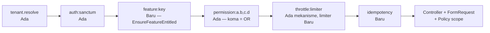

# 08 — Spesifikasi API

> **Status:** rancangan (bukan dokumentasi fitur jadi). Endpoint berstatus **Baru** belum ada di sistem.
> **Disusun:** 2026-10-11, berdasarkan repository commit `ab81cc7`.
> Kembali ke [README](README.md) · Kanon prefix: [README §5.6](README.md#56-prefix-endpoint-kanon) · Integrasi: [06-integrasi-arsitektur.md](06-integrasi-arsitektur.md) · Hak akses: [11-roles-permissions.md](11-roles-permissions.md)

## Daftar Isi

1. [Konvensi Umum](#1-konvensi-umum)
   - [1.1 Base URL dan versi](#11-base-url-dan-versi)
   - [1.2 Autentikasi dan tenant](#12-autentikasi-dan-tenant)
   - [1.3 Rantai middleware](#13-rantai-middleware)
   - [1.4 Envelope respons](#14-envelope-respons)
   - [1.5 Pagination, filter, sort](#15-pagination-filter-sort)
   - [1.6 Kode status HTTP dan body error](#16-kode-status-http-dan-body-error)
   - [1.7 Katalog kode error domain](#17-katalog-kode-error-domain)
   - [1.8 Idempotensi](#18-idempotensi)
   - [1.9 Konkurensi optimistis](#19-konkurensi-optimistis)
   - [1.10 Audit](#110-audit)
   - [1.11 Rate limit](#111-rate-limit)
   - [1.12 Format data](#112-format-data)
2. [Daftar Endpoint per Kelompok](#2-daftar-endpoint-per-kelompok)
3. [Contoh Request dan Response](#3-contoh-request-dan-response)
4. [Catatan Kompatibilitas Endpoint Lama](#4-catatan-kompatibilitas-endpoint-lama)

---

## 1. Konvensi Umum

### 1.1 Base URL dan versi

| Aspek | Ketentuan |
|---|---|
| Base path | `/api/v1` (Ada — `routes/api.php` memasang `Route::prefix('v1')->middleware(['tenant.resolve'])` lalu memuat `app/Modules/*/Routes/api.php`) |
| Gaya path | kebab-case, kata benda jamak, ID berupa ULID: `/class-sections/{classSection}` |
| Aksi non-CRUD | Sub-resource kata kerja dengan `POST`: `/grade-submissions/{id}/publish`. Endpoint lama yang memakai `PATCH .../publish` tetap dipertahankan |
| Perubahan aditif | Menambah field respons, parameter opsional, atau endpoint baru **tidak** menaikkan versi |
| Perubahan breaking | Mengubah/menghapus field, makna status, atau URL → `/api/v2` untuk resource terkait. Versi lama diberi header `Deprecation: true` dan `Sunset: <tanggal>` minimal satu semester akademik sebelum dihapus |
| Dokumentasi mesin | Scramble (Ada) menghasilkan OpenAPI dari FormRequest/Resource. Dokumen ini adalah kontrak rancangan; OpenAPI adalah turunan setelah implementasi |

### 1.2 Autentikasi dan tenant

| Header | Wajib | Keterangan |
|---|---|---|
| `Authorization: Bearer <token>` | Ya (kecuali `/public/*`) | Laravel Sanctum personal access token (Ada) |
| `X-University-ID: <ULID>` | Disarankan | Dibaca `ResolveUniversityMiddleware` (Ada). Urutan resolusi: header → domain → membership default pengguna. Jika pengguna bukan anggota tenant → 403 |
| `Accept: application/json` | Ya | Memastikan error dirender JSON |
| `Accept-Language: id` / `en` | Opsional | Pesan default berbahasa Indonesia. Dukungan `en` adalah **[Rekomendasi]** |
| `Idempotency-Key: <UUID/ULID>` | Wajib untuk endpoint bertanda **IK** | Lihat §1.8 |
| `X-Request-ID` | Opsional | Dipakai sebagai `correlation_id` di log dan job; dikembalikan pada respons |

Endpoint ujian publik `/api/v1/public/exams/{accessToken}` (Ada) tidak memakai bearer token; identitas peserta memakai NIM/nomor pendaftaran dan `sessionToken`.

### 1.3 Rantai middleware



Kolom **Permission/role** di §2 menulis `feature` bila endpoint memerlukan feature key selain `siakad`, lalu slug permission (kanon README §5.5). Policy menambahkan pembatasan **scope** (fakultas, prodi, kelas yang diampu, mahasiswa perwalian, anak sendiri) sesuai [11-roles-permissions.md](11-roles-permissions.md). Endpoint `/student/*` tidak pernah menerima `student_id` dari klien; mahasiswa diresolusi dari akun login (pola `ResolvesCurrentStudent`, Ada). Hal yang sama berlaku untuk `/teaching/*` (dosen dari `LecturerIdentity`), `/advising/*`, dan `/guardian/*`.

### 1.4 Envelope respons

Mengikuti `App\Support\Http\ApiResponse` (Ada).

**Sukses (objek tunggal):**

```json
{
  "success": true,
  "message": "Berhasil.",
  "data": { "id": "01JABCD..." },
  "meta": {}
}
```

**Sukses (daftar berhalaman, `ApiResponse::paginated`):**

```json
{
  "success": true,
  "message": "Berhasil.",
  "data": [ { "id": "01J..." } ],
  "meta": { "current_page": 1, "per_page": 20, "total": 134, "last_page": 7 }
}
```

**Gagal (`ApiResponse::error`):**

```json
{
  "success": false,
  "message": "Validasi data gagal.",
  "errors": { "class_section_id": ["Kelas wajib dipilih."] }
}
```

Untuk 409, `errors` berbentuk `{ "code": "<KODE>", ...konteks }` sesuai `ConflictException` (Ada, mendukung `errorCode` + `context`).

Kode status sukses: `200` (baca/ubah), `201` (membuat resource), `202` (diterima untuk diproses asinkron, mis. job AI, ekspor), `204` tidak dipakai (selalu kembalikan envelope).

### 1.5 Pagination, filter, sort

Semua endpoint daftar memakai `App\Support\Http\ListQuery` (Ada):

| Parameter | Contoh | Perilaku |
|---|---|---|
| `search` | `?search=andi` | `LIKE %term%` pada kolom `searchable` yang di-whitelist |
| `filter[col]` | `?filter[status]=submitted,revision_requested` | Kolom `filterable` saja; koma → `whereIn` |
| `sort` | `?sort=-submitted_at` | Kolom `sortable` saja; awalan `-` = descending |
| `per_page` | `?per_page=50` | Default 20, maksimum 100 |
| `page` | `?page=2` | Pagination Laravel |

Parameter di luar whitelist **diabaikan**, tidak menghasilkan error. Kolom filter/sort yang diizinkan didokumentasikan per endpoint di OpenAPI. Ekspor (`.../export`) menerima parameter yang sama dan mengembalikan berkas (`text/csv`, `application/vnd.openxmlformats-officedocument.spreadsheetml.sheet`, atau `application/pdf`); ekspor besar (> 5.000 baris, contoh) dikembalikan sebagai `202` dengan job dan tautan unduh melalui notifikasi.

### 1.6 Kode status HTTP dan body error

Pesan berbahasa Indonesia; empat pesan pertama berasal dari `bootstrap/app.php` (Ada).

| Status | Kapan | `message` default | Bentuk `errors` |
|---|---|---|---|
| **400** | Request tidak dapat diproses secara struktural: header `Idempotency-Key` hilang/format salah pada endpoint IK, JSON rusak | "Permintaan tidak dapat diproses." | `{ "code": "IDEMPOTENCY_KEY_REQUIRED" }` |
| **401** | Token tidak ada/kedaluwarsa | "Tidak terautentikasi." | `[]` |
| **403** | Tidak punya permission, di luar scope, fitur tidak termasuk paket, atau fitur dinonaktifkan tenant | "Anda tidak memiliki izin untuk mengakses resource ini." | `[]` atau `{ "code": "FEATURE_NOT_ENTITLED", "feature": "obe" }` |
| **404** | Resource tidak ada **atau** milik tenant lain (tidak dibedakan, mencegah enumerasi) | "Data tidak ditemukan." | `[]` |
| **409** | Request valid tetapi bertentangan dengan kondisi/aturan bisnis | Pesan spesifik | `{ "code": "...", ...konteks }` |
| **422** | Validasi field gagal (FormRequest) | "Validasi data gagal." | Peta `field → [pesan]` |
| **423** | **Tidak dipakai.** Kondisi terkunci (KRS `locked`, nilai `published`) dilaporkan sebagai 409 dengan kode `KRS_LOCKED` / `GRADE_PUBLISHED` agar konsisten dengan `ConflictException` yang sudah ada dan klien cukup menangani satu jenis konflik | — | — |
| **429** | Rate limit terlampaui | "Terlalu banyak permintaan. Coba lagi nanti." | `[]`; header `Retry-After` |
| **500** | Galat tak terduga | "Terjadi kesalahan pada server. Silakan coba lagi nanti." | `[]` |
| **503** | Dependensi eksternal (penyedia AI, SPADA) tidak tersedia saat panggilan sinkron (jarang; umumnya asinkron) | "Layanan eksternal sedang tidak tersedia." | `{ "code": "UPSTREAM_UNAVAILABLE" }` |

Contoh 403 karena entitlement:

```json
{
  "success": false,
  "message": "Fitur OBE tidak termasuk dalam paket langganan perguruan tinggi Anda.",
  "errors": { "code": "FEATURE_NOT_ENTITLED", "feature": "obe" }
}
```

Contoh 422:

```json
{
  "success": false,
  "message": "Validasi data gagal.",
  "errors": {
    "scores.0.score": ["Nilai harus di antara 0 dan 100."],
    "scores.3.krs_item_id": ["Peserta tidak terdaftar di kelas ini."]
  }
}
```

Contoh 429:

```json
{
  "success": false,
  "message": "Terlalu banyak permintaan. Coba lagi nanti.",
  "errors": []
}
```

### 1.7 Katalog kode error domain

Kode dikirim di `errors.code` (409 kecuali disebut lain). Klien bercabang berdasarkan kode, bukan pesan.

| Kode | Status | Pesan contoh | Konteks tambahan |
|---|---|---|---|
| `KRS_VALIDATION_FAILED` | 409 | "KRS tidak dapat diajukan karena ada pelanggaran aturan." | `violations[]` (lihat contoh 3.1) |
| `PERIOD_CLOSED` | 409 | "Periode KRS belum dibuka atau sudah ditutup." | `period_type`, `starts_at`, `ends_at` |
| `STUDENT_NOT_ACTIVE` | 409 | "Status mahasiswa tidak aktif." | `student_status` |
| `ACADEMIC_BLOCKED` | 409 | "Layanan diblokir karena cekal aktif." | `service`, `blocks[]` |
| `PREREQUISITE_NOT_MET` | 409 | "Prasyarat mata kuliah belum terpenuhi." | `course_id`, `missing[]` |
| `CREDIT_LIMIT_EXCEEDED` | 409 | "Total SKS melebihi batas." | `total_credits`, `max_credits` |
| `SCHEDULE_CONFLICT` | 409 | "Jadwal bentrok." | `conflicts[]` |
| `CLASS_FULL` | 409 | "Kapasitas kelas sudah penuh." | `class_section_id`, `capacity` |
| `KRS_LOCKED` | 409 | "KRS sudah dikunci." | `locked_at` |
| `INVALID_STATE_TRANSITION` | 409 | "Status saat ini tidak mengizinkan aksi ini." | `current_status`, `action` |
| `STALE_VERSION` | 409 | "Data telah diubah pengguna lain. Muat ulang lalu coba lagi." | `current_version` |
| `ROOM_CONFLICT` / `LECTURER_CONFLICT` | 409 | "Ruang/dosen sudah terjadwal pada waktu tersebut." | `conflicts[]` |
| `QR_TOKEN_INVALID` / `QR_TOKEN_EXPIRED` | 409 | "Kode QR tidak valid atau sudah kedaluwarsa." | `lecture_session_id` |
| `SESSION_NOT_OPEN` | 409 | "Sesi perkuliahan belum dibuka untuk presensi." | `status` |
| `ALREADY_RECORDED` | 200 | (bukan error) presensi sudah tercatat; respons idempoten | `attendance_id` |
| `ATTENDANCE_BELOW_MINIMUM` | 409 | "Kehadiran di bawah batas minimal untuk mengikuti ujian." | `attendance_rate`, `minimum_rate` |
| `GRADE_INCOMPLETE` | 409 | "Masih ada nilai komponen yang kosong." | `missing_count`, `missing[]` |
| `WEIGHT_TOTAL_INVALID` | 422 | "Total bobot komponen harus 100%." | `total` |
| `GRADE_PUBLISHED` | 409 | "Nilai sudah dipublikasikan. Gunakan pengajuan revisi nilai." | `published_at` |
| `GRADE_SUBMISSION_ACTIVE` | 409 | "Kelas ini memakai lembar nilai; ubah nilai melalui lembar nilai." | `grade_submission_id` |
| `EXEMPTION_NOT_ALLOWED` | 409 | "Jenis cekal ini tidak dapat diberi dispensasi." | `block_type` |
| `EXAM_NOT_ACTIVE` / `ATTEMPT_CLOSED` | 409 | "Ujian belum dimulai/sudah berakhir." | `starts_at`, `ends_at` |
| `ANSWER_OUT_OF_ORDER` | 409 | "Jawaban yang lebih baru sudah tersimpan." | `server_seq` |
| `EXAM_DUPLICATE` | 409 | "Ujian dengan jenis yang sama sudah ada untuk kelas ini." | `exam_id` |
| `AI_QUOTA_EXCEEDED` | 409 | "Kuota pembuatan soal AI periode ini telah habis." | `quota`, `used` |
| `EDOM_ALREADY_SUBMITTED` | 409 | "Evaluasi untuk dosen dan kelas ini sudah diisi." | `edom_target_id` |
| `EDOM_PERIOD_CLOSED` | 409 | "Periode EDOM tidak sedang dibuka." | `status` |
| `EDOM_REQUIRED` | 409 | "Isi EDOM terlebih dahulu untuk melihat nilai." | `pending_targets` (jumlah) |
| `CONVERSION_EXISTS` | 409 | "Konversi untuk kegiatan ini sudah ada." | `credit_conversion_id` |
| `STORAGE_QUOTA_EXCEEDED` | 409 | "Kuota penyimpanan LMS penuh." | `used_bytes`, `quota_bytes` |
| `GENERAL_CLASS_QUOTA_EXCEEDED` | 409 | "Kuota kelas umum semester ini sudah habis." | `quota`, `used` |
| `IDEMPOTENCY_KEY_REQUIRED` | 400 | "Header Idempotency-Key wajib diisi." | — |
| `IDEMPOTENCY_KEY_REUSED` | 409 | "Idempotency-Key sudah dipakai untuk permintaan berbeda." | — |
| `IDEMPOTENCY_IN_PROGRESS` | 409 | "Permintaan dengan kunci yang sama sedang diproses." | — |
| `FEATURE_NOT_ENTITLED` | 403 | "Fitur tidak termasuk dalam paket langganan." | `feature` |
| `FEATURE_DISABLED` | 403 | "Fitur dinonaktifkan untuk perguruan tinggi ini." | `feature` |

### 1.8 Idempotensi

Endpoint bertanda **IK** pada §2 **wajib** mengirim `Idempotency-Key`. Tujuannya mencegah efek ganda akibat klik ganda, retry jaringan seluler, atau retry otomatis klien.

| Aspek | Ketentuan |
|---|---|
| Format kunci | UUID v4 atau ULID, dibuat klien per *niat* aksi (bukan per percobaan) |
| Penyimpanan | Tabel `idempotency_keys` (**Baru, nama usulan**): `id`, `university_id`, `user_id`, `key`, `method`, `route` (nama route), `request_hash` (SHA-256 body ternormalisasi), `status` (`processing`/`completed`), `response_status`, `response_body` (json), `created_at`, `expires_at`. Unique `(university_id, user_id, key)` |
| Masa berlaku | 24 jam (contoh, konfigurasi `academic.api.idempotency_ttl_hours`) |
| Kunci sama, body sama, selesai | Respons tersimpan dikembalikan apa adanya + header `Idempotent-Replayed: true` |
| Kunci sama, body berbeda | 409 `IDEMPOTENCY_KEY_REUSED` |
| Kunci sama, masih diproses | 409 `IDEMPOTENCY_IN_PROGRESS` + `Retry-After: 1` |
| Respons 5xx | Tidak disimpan; klien boleh mengulang dengan kunci yang sama |
| Respons 4xx | Disimpan (hasil deterministik) |

Endpoint dengan **idempotensi alami** (tidak wajib header, tetap boleh mengirim): `PUT` upsert jawaban ujian (`exam_attempt_id + exam_question_id`, ditambah `client_seq`), presensi QR (`krs_item_id + lecture_session_id`), dan seluruh `PUT` penggantian penuh.

Daftar endpoint IK: pengajuan KRS, permintaan perubahan KRS, scan QR presensi, input batch nilai komponen, pengajuan/publikasi lembar nilai, pengajuan revisi nilai, pembuatan dispensasi, pembuatan job AI (CBT & OBE), pengiriman EDOM, pendaftaran MBKM, pembuatan konversi SKS, siaran pengumuman massal, mulai ujian.

### 1.9 Konkurensi optimistis

Resource yang diedit bersama (lembar nilai, jurnal sesi team teaching, RPS, formulir EDOM) mengembalikan `version` (integer). Klien mengirim balik `version` pada `PUT`/aksi. Jika berbeda → 409 `STALE_VERSION`. Header `If-Match` setara dengan field `version` dan boleh dipakai sebagai alternatif.

### 1.10 Audit

Aksi bertanda **A** pada §2 dicatat via `AuditLogService::recordAction()` ke `audit_logs` (Ada) dengan `old_values`, `new_values`, `reason`, `ip_address`, `user_agent`. Kolom `reason` **wajib** dikirim klien (field `reason`, minimal 10 karakter, contoh) untuk aksi: override nilai, revisi nilai, publikasi ulang, buka kembali lembar nilai, dispensasi/pencabutan cekal, buka kunci KRS, koreksi presensi, perubahan kurikulum aktif, pengesahan dan revisi CPL/RPS, perpanjangan periode, abaikan kegagalan integrasi. Ekspor data pribadi dicatat dengan `AuditAction::Exported`; melihat jawaban EDOM tidak mungkin per individu sehingga tidak ada audit `viewed_sensitive` untuknya. Token, password, kunci API, dan isi jawaban EDOM tidak pernah masuk audit.

### 1.11 Rate limit

Limiter bernama didaftarkan di `RateLimiter::for()` (**Baru**; saat ini hanya `throttle:10,1` untuk akses ujian publik dan rate limit login yang Ada). Angka adalah contoh.

| Limiter | Batas contoh | Kunci | Endpoint |
|---|---|---|---|
| `api` | 300/menit | user + tenant | Default seluruh `/api/v1` |
| `krs-write` | 30/menit | user | Tambah/hapus item, ajukan KRS |
| `qr-scan` | 6/menit; 30/jam | user, dan 60/menit per IP | Scan QR presensi |
| `exam-answer` | 120/menit | `exam_attempt_id` | Autosave jawaban |
| `exam-violation` | 60/menit | `exam_attempt_id` | Pencatatan pelanggaran |
| `ai-jobs` | 10/jam per user; kuota bulanan per tenant | user, tenant | `POST /cbt/ai-jobs`, `POST /obe/ai-jobs` |
| `export` | 10/jam | user | Semua `.../export` |
| `public-exam-access` | 10/menit (Ada) | IP | `POST /public/exams/{accessToken}/access` |

Respons menyertakan `X-RateLimit-Limit`, `X-RateLimit-Remaining`, dan saat 429 `Retry-After`.

### 1.12 Format data

| Tipe | Format |
|---|---|
| ID | ULID string 26 karakter |
| Waktu | ISO 8601 dengan offset, mis. `2026-10-11T08:00:00+07:00`; disimpan `timestamptz` |
| Tanggal | `YYYY-MM-DD` |
| Jam jadwal | `HH:MM` |
| Desimal nilai | Angka JSON dengan 2 desimal (`85.25`). Pembulatan mengikuti konfigurasi ([OD-29](16-open-decisions.md#od-29)) |
| Enum/status | String kode kanon (README §5.4), label tampilan disediakan field `*_label` |
| Uang (guardian/tagihan) | Integer rupiah |
| Berkas | Unggah dulu ke `POST /file-uploads` (Ada), lalu kirim `file_upload_id` |

---

## 2. Daftar Endpoint per Kelompok

Legenda kolom **Fungsi**: **IK** = wajib `Idempotency-Key`; **A** = diaudit; **R** = wajib field `reason`. Kolom **Status**: **Ada** = route sudah terdaftar dan **tidak diubah**; **Baru** = rancangan. Semua path relatif terhadap `/api/v1`. Permission ditulis `resource.action`; tanda koma berarti OR, sesuai middleware `permission:` yang ada.

### 2.1 Data master

| Method | URL | Fungsi | Permission/role | Validasi utama | Status |
|---|---|---|---|---|---|
| GET | `/students` | Daftar mahasiswa (search NIM/nama, filter prodi/status/angkatan) | `students.read` + scope prodi/fakultas | ListQuery | Ada |
| POST | `/students` | Tambah mahasiswa | `students.create` | NIM unik per tenant, prodi aktif | Ada |
| GET | `/students/{student}` | Detail mahasiswa | `students.read` | Scope | Ada |
| PUT | `/students/{student}` | Ubah biodata (A) | `students.update` | NIM tidak boleh diubah setelah ada KRS | Baru |
| GET | `/students/{student}/transcript` | Transkrip | `students.read` | — | Ada |
| GET | `/students/{student}/status-histories` | Riwayat status | `students.read` | — | Baru |
| POST | `/students/{student}/status-changes` | Ubah status akademik (A, R) | `students.update` | Transisi status valid; `effective_date` dalam term | Baru |
| PATCH | `/students/{student}/academic-advisor` | Tetapkan dosen wali | `students.update` | Dosen aktif | Ada |
| POST | `/students/academic-advisor/bulk` | Penetapan dosen wali massal (A) | `students.update` | Maks 500 mahasiswa per request | Baru |
| GET/POST | `/students/{student}/guardians` | Daftar/tautkan orang tua/wali (A) | `students.read` / `students.update` | Verifikasi identitas & persetujuan [OD-21](16-open-decisions.md#od-21) | Baru |
| DELETE | `/student-guardians/{studentGuardian}` | Cabut tautan wali (A, R) | `students.update` | — | Baru |
| GET | `/lecturers` | Daftar dosen | `lecturers.read` | ListQuery | Ada |
| POST | `/lecturers` | Tambah dosen | `lecturers.create` | NIDN unik per tenant | Ada |
| GET/PUT/DELETE | `/lecturers/{lecturer}` | Detail/ubah/hapus lunak | `lecturers.read` / `.update` / `.delete` | Tidak bisa dihapus bila mengajar di term berjalan | Ada |
| POST | `/lecturers/{lecturer}/account` (+ `/reset-password`, PATCH `/status`) | Akun dosen | `lecturers.update` | — | Ada |
| GET | `/lecturers/{lecturer}/teaching-history` | Riwayat mengajar (dari `class_section_lecturers`) | `lecturers.read` | Filter term | Baru |
| GET/PUT | `/lecturer-profile` | Profil dosen login | `lecturer_profile.read` / `.update` | — | Ada |
| GET | `/faculties` | Daftar fakultas | `lecturers.read,study_programs.read` | — | Ada |
| POST / PUT | `/faculties`, `/faculties/{faculty}` | Kelola fakultas | `faculties.create` / `faculties.update` | Kode unik | Baru |
| GET | `/study-programs`, `/study-programs/{studyProgram}` | Daftar/detail prodi | `study_programs.read` | — | Ada |
| POST / PUT | `/study-programs`, `/study-programs/{studyProgram}` | Kelola prodi | `study_programs.create` / `.update` | Kode unik, fakultas aktif | Baru |
| GET | `/academic-terms` | Daftar term | `classes.read,krs.read,krs_advising.read,academic_calendar.read,course_materials.read` | — | Ada |
| POST / PUT | `/academic-terms`, `/academic-terms/{academicTerm}` | Kelola term (`term_type` regular/short) | `academic_terms.create` / `.update` | Unik tahun+semester+term_type | Baru |
| POST | `/academic-terms/{academicTerm}/set-current` | Jadikan term berjalan (A) | `academic_terms.update` | Hanya satu `is_current` | Baru |
| PATCH | `/academic-terms/{academicTerm}/krs-period` | Ubah periode KRS | `krs.update` | `krs_end_date ≥ krs_start_date` | Ada |
| GET/POST | `/academic-terms/{academicTerm}/periods` | Daftar/tambah periode (`krs`, `krs_change`, `lecture`, `midterm_exam`, `final_exam`, `grading`, `edom`) (A) | `academic_terms.read` / `.update` | Tidak tumpang tindih per jenis | Baru |
| PUT/DELETE | `/academic-term-periods/{academicTermPeriod}` | Ubah/hapus periode (A, R saat memperpanjang) | `academic_terms.update` | Tidak bisa dihapus bila sudah berjalan | Baru |
| GET/POST | `/academic-calendar-events` | Kalender | `academic_calendar.read` / `.create` | — | Ada |
| PUT/DELETE | `/academic-calendar-events/{academicCalendarEvent}` | Ubah/hapus | `academic_calendar.update` / `.delete` | — | Ada |
| GET/POST | `/rooms` | Daftar/tambah ruang | `rooms.read` / `rooms.create` | Kode unik, kapasitas > 0 | Baru |
| GET/PUT/DELETE | `/rooms/{room}` | Detail/ubah/nonaktifkan | `rooms.read` / `.update` / `.delete` | Tidak dihapus bila dipakai jadwal published | Baru |
| GET | `/rooms/{room}/utilization` | Utilitas ruang per term | `rooms.read` | `academic_term_id` wajib | Baru |

### 2.2 Kurikulum dan mata kuliah

| Method | URL | Fungsi | Permission/role | Validasi utama | Status |
|---|---|---|---|---|---|
| GET | `/curriculums`, `/curriculums/{curriculum}` | Daftar/detail kurikulum | `curriculums.read` | — | Ada |
| POST | `/curriculums` | Buat versi kurikulum (A) | `curriculums.create` | Prodi, tahun berlaku | Baru |
| PUT | `/curriculums/{curriculum}` | Ubah kurikulum draf (A) | `curriculums.update` | Kurikulum aktif hanya bisa diubah dengan R | Baru |
| POST | `/curriculums/{curriculum}/activate` | Aktifkan versi (A, R) | `curriculums.approve` | Minimal satu MK wajib | Baru |
| POST | `/curriculums/{curriculum}/duplicate` | Salin menjadi versi baru | `curriculums.create` | — | Baru |
| GET | `/curriculums/{curriculum}/history` | Riwayat perubahan (dari audit) | `curriculums.read` | — | Baru |
| GET/POST | `/curriculums/{curriculum}/courses` | Daftar/tambah MK dalam kurikulum (`curriculum_courses`) (A) | `curriculums.read` / `.update` | Wajib/pilihan, semester rekomendasi 1–14 | Baru |
| PUT/DELETE | `/curriculum-courses/{curriculumCourse}` | Ubah/hapus (A) | `curriculums.update` | Tidak hapus bila sudah ditawarkan | Baru |
| GET/PUT | `/curriculums/{curriculum}/cohorts` | Angkatan pengguna versi (A) | `curriculums.read` / `.update` | Satu versi per prodi+angkatan | Baru |
| GET | `/courses`, `/courses/{course}` | Daftar/detail MK | `courses.read` | — | Ada |
| POST / PUT | `/courses`, `/courses/{course}` | Kelola MK (A) | `courses.create` / `.update` | Kode unik, SKS > 0 | Baru |
| GET/PUT | `/courses/{course}/prerequisites` | Prasyarat | `courses.read` / `courses.update` | Tidak siklik | Ada |
| GET/POST | `/course-equivalencies` | Ekuivalensi antarversi (A) | `course_equivalencies.read` / `.create` | MK asal ≠ tujuan | Baru |
| DELETE | `/course-equivalencies/{courseEquivalency}` | Hapus (A, R) | `course_equivalencies.delete` | — | Baru |
| GET/POST | `/course-packages` | Paket MK (KRS otomatis) | `course_packages.read` / `.create` | Prodi, semester, kurikulum | Baru |
| GET/PUT/DELETE | `/course-packages/{coursePackage}` | Detail/ubah/hapus | `course_packages.read` / `.update` / `.delete` | — | Baru |
| PUT | `/course-packages/{coursePackage}/items` | Set MK dalam paket | `course_packages.update` | MK dari kurikulum yang sama | Baru |

### 2.3 Kelas, jadwal, dan dosen pengajar

| Method | URL | Fungsi | Permission/role | Validasi utama | Status |
|---|---|---|---|---|---|
| GET | `/class-sections`, `/class-sections/{classSection}` | Daftar/detail kelas | `classes.read` | — | Ada |
| PUT | `/class-sections/{classSection}/teaching` | Set dosen pengampu (koordinator) | `classes.update` | Dosen aktif | Ada |
| POST | `/class-sections` | Buka kelas (`planned`) | `classes.create` | MK ditawarkan pada kurikulum aktif, kode kelas unik per MK+term | Baru |
| POST | `/academic-terms/{academicTerm}/class-sections/generate` | Buat kelas massal dari kurikulum/paket | `classes.create` | Dry-run `?preview=1` | Baru |
| PUT | `/class-sections/{classSection}` | Ubah kapasitas, kode | `classes.update` | Kapasitas ≥ jumlah peserta `enrolled` | Baru |
| POST | `/class-sections/{classSection}/open` · `/cancel` (R) · `/complete` | Transisi status kelas (A) | `classes.update` | State machine 10-business-rules | Baru |
| GET/PUT | `/class-sections/{classSection}/lecturers` | Team teaching (`class_section_lecturers`, peran, porsi pertemuan) (A) | `classes.read` / `classes.update` | Tepat satu koordinator; bentrok dosen | Baru |
| GET | `/class-sections/{classSection}/participants` | Peserta (dari `krs_items` enrolled) | `classes.read` (+ dosen pengampu) | — | Baru |
| GET | `/class-schedules` | Daftar jadwal (filter term, prodi, ruang, dosen, status) | `class_schedules.read` | ListQuery | Baru |
| POST | `/class-sections/{classSection}/schedules` | Tambah jadwal (`schedule_type` theory/practicum/tutorial, `group_label`) | `class_schedules.create` | Jam valid, ruang aktif, cek bentrok | Baru |
| PUT/DELETE | `/class-schedules/{classSchedule}` | Ubah/hapus jadwal draf; ubah published = revisi (A, R) | `class_schedules.update` / `.delete` | Cek bentrok ulang | Baru |
| POST | `/class-schedules/check-conflicts` | Cek bentrok tanpa menyimpan (dosen, ruang, kelas, kelompok mahasiswa) | `class_schedules.read` | — | Baru |
| POST | `/class-schedules/{classSchedule}/submit-review` · `/publish` · `/cancel` | Transisi status jadwal (A) | `class_schedules.update` / `class_schedules.publish` | Tidak ada bentrok tersisa | Baru |
| POST | `/academic-terms/{academicTerm}/class-schedules/publish` | Publikasi massal + notifikasi | `class_schedules.publish` | Semua jadwal `in_review` bebas bentrok | Baru |
| GET | `/teaching/classes` | Kelas yang diampu dosen login | `course_materials.read,assignments.read` | — | Ada |
| GET | `/teaching/schedule` | Jadwal mengajar dosen login | `classes.read` | Filter rentang tanggal | Baru |
| GET | `/student/schedule` | Jadwal mahasiswa | `student_portal.read` | — | Ada |

### 2.4 KRS

| Method | URL | Fungsi | Permission/role | Validasi utama | Status |
|---|---|---|---|---|---|
| GET | `/student/krs` | KRS term berjalan | `krs_self_service.read` | — | Ada |
| GET | `/student/krs/offerings` | Kelas yang dapat diambil | `krs_self_service.read` | — | Ada |
| GET | `/student/krs/history` | Riwayat KRS | `krs_self_service.read` | — | Ada |
| POST | `/student/krs/items` | Tambah kelas ke draf | `krs_self_service.create` | Periode, kapasitas, bentrok, prasyarat | Ada |
| DELETE | `/student/krs/items/{krsItem}` | Hapus dari draf | `krs_self_service.update` | Hanya draf/revision_requested | Ada |
| POST | `/student/krs/submit` | Ajukan KRS (IK). Rancangan menambah cek cekal, paket, dan daftar pelanggaran 409 | `krs_self_service.update` | Seluruh siklus A.4 | Ada (diperluas, kontrak aditif) |
| POST | `/student/krs/cancel` | Tarik pengajuan | `krs_self_service.update` | Status `submitted` | Ada |
| GET | `/student/krs/validation` | Simulasi validasi tanpa mengajukan (daftar pelanggaran) | `krs_self_service.read` | — | Baru |
| POST | `/student/krs/change-requests` | Permintaan tambah/batal setelah dikunci (IK) | `krs_self_service.update` | Periode `krs_change`, batas perubahan [OD-09](16-open-decisions.md#od-09) | Baru |
| GET | `/krs-items` | Daftar item KRS (admin) | `krs.read` | — | Ada |
| POST | `/krs-items` | Tambah item oleh admin | `krs.create` | Sama dengan self-service | Ada |
| PATCH | `/krs-items/{krsItem}/drop` | Drop item | `krs.update` | — | Ada |
| GET | `/krs-submissions`, `/krs-submissions/{krsSubmission}` | Daftar/detail pengajuan | `krs.approve,krs_advising.read` | Scope wali | Ada |
| POST | `/krs-submissions/{krsSubmission}/approve` | Setujui | `krs.approve,krs_advising.approve` | Status `submitted` | Ada |
| POST | `/krs-submissions/{krsSubmission}/reject` | Tolak (dipetakan ke `revision_requested`) | `krs.approve,krs_advising.approve` | Catatan wajib | Ada |
| GET | `/krs-submissions/{krsSubmission}/events` | Riwayat (`krs_submission_events`) | `krs.read,krs_advising.read` | — | Baru |
| POST | `/krs-submissions/{krsSubmission}/lock` · `/unlock` (R) | Kunci/buka kunci (A) | `krs.update` | Unlock hanya BAAK, dicatat | Baru |
| POST | `/academic-terms/{academicTerm}/krs/lock` | Kunci massal akhir periode | `krs.update` | Pengajuan `approved` saja | Baru |
| POST | `/course-packages/{coursePackage}/apply` | Terapkan paket KRS ke mahasiswa baru (draf) (IK) | `krs.create` | Mahasiswa semester yang sesuai, kapasitas | Baru |
| GET | `/krs-change-requests` · POST `/{id}/approve` · `/reject` | Proses permintaan perubahan (A) | `krs.approve,krs_advising.approve` | Periode, kapasitas | Baru |
| GET | `/academic-terms/{academicTerm}/krs/summary` | Rekap status KRS per prodi | `krs.read` | — | Baru |

### 2.5 Dosen wali (perwalian)

| Method | URL | Fungsi | Permission/role | Validasi utama | Status |
|---|---|---|---|---|---|
| GET | `/advising/students` | Mahasiswa perwalian dosen login | `krs_advising.read` | Scope `academic_advisor_id` | Baru |
| GET | `/advising/students/{student}` | Ringkasan IPS/IPK, SKS, status, cekal, kehadiran | `krs_advising.read` | Scope; detail nilai komponen [OD-28](16-open-decisions.md#od-28) | Baru |
| GET | `/advising/krs-submissions` | Antrean KRS (filter status) | `krs_advising.read` | Scope | Baru |
| POST | `/advising/krs-submissions/{krsSubmission}/approve` | Setujui (A) | `krs_advising.approve` | Status `submitted`; memakai service yang sama dengan endpoint Ada | Baru |
| POST | `/advising/krs-submissions/{krsSubmission}/request-revision` | Minta revisi dengan catatan per item | `krs_advising.approve` | Catatan wajib | Baru |
| GET/POST | `/advising/students/{student}/records` | Catatan konsultasi (`advising_records`) | `advising_records.read` / `.create` | Topik, tanggal, tindak lanjut | Baru |
| PUT | `/advising-records/{advisingRecord}` | Ubah catatan milik sendiri | `advising_records.update` | Hanya penulis, ≤ 7 hari (contoh) | Baru |
| GET | `/advising/at-risk-students` | Mahasiswa butuh pendampingan (indikator konfigurasi) | `krs_advising.read` | — | Baru |

### 2.6 Presensi

| Method | URL | Fungsi | Permission/role | Validasi utama | Status |
|---|---|---|---|---|---|
| GET | `/attendances` | Daftar presensi | `attendance.read` | — | Ada |
| POST | `/class-sections/{classSection}/attendances` | Input batch per pertemuan (`meeting_number`) | `attendance.create,attendance.update` | Peserta enrolled | Ada |
| GET | `/teaching/lecture-sessions/{lectureSession}/attendances` | Daftar hadir sesi | `attendance.read` + pengampu | — | Baru |
| PUT | `/teaching/lecture-sessions/{lectureSession}/attendances` | Input/ubah batch presensi sesi | `attendance.create,attendance.update` + pengampu | Sesi `ongoing`/`held` dalam batas waktu edit; setelah itu wajib koreksi | Baru |
| POST | `/teaching/lecture-sessions/{lectureSession}/qr-tokens` | Terbitkan QR berotasi | `attendance.create` + pengampu | Sesi `ongoing`; masa berlaku contoh 30 detik | Baru |
| DELETE | `/teaching/lecture-sessions/{lectureSession}/qr-tokens` | Tutup presensi QR | `attendance.update` | — | Baru |
| POST | `/student/attendance/qr-scan` | Mahasiswa scan QR (IK) | `student_portal.read` | Token valid, mahasiswa enrolled, belum tercatat, opsional geolokasi/IP kampus | Baru |
| GET | `/student/attendance`, `/student/attendance/{krsItem}` | Rekap presensi mahasiswa | `student_portal.read` | — | Ada |
| GET | `/class-sections/{classSection}/attendance-recap` | Rekap per kelas (persentase per mahasiswa) | `attendance.read` | — | Baru |
| GET | `/students/{student}/attendance-recap` | Rekap per mahasiswa per term | `attendance.read` | — | Baru |
| GET/POST | `/attendance-corrections` | Daftar/ajukan koreksi (A, R) | `attendance_corrections.read` / `.create` | Status asal ≠ tujuan, bukti opsional | Baru |
| POST | `/attendance-corrections/{attendanceCorrection}/approve` · `/reject` | Putuskan koreksi (A) | `attendance_corrections.approve` | Penyetuju ≠ pengaju | Baru |
| GET | `/krs-items/{krsItem}/exam-eligibility` | Cek syarat kehadiran ujian | `attendance.read,exams.read` | Ambang konfigurasi [OD-06](16-open-decisions.md#od-06) | Baru |

### 2.7 Jurnal mengajar (lecture sessions)

| Method | URL | Fungsi | Permission/role | Validasi utama | Status |
|---|---|---|---|---|---|
| GET | `/class-sections/{classSection}/lecture-sessions` | Daftar sesi kelas | `lecture_sessions.read` | — | Baru |
| POST | `/class-sections/{classSection}/lecture-sessions/regenerate` | Regenerasi sesi dari jadwal (sesi `held` tidak disentuh) | `lecture_sessions.update` | — | Baru |
| GET | `/teaching/lecture-sessions` | Sesi dosen login (filter tanggal/kelas) | `lecture_sessions.read` | — | Baru |
| GET | `/teaching/lecture-sessions/{lectureSession}` | Detail sesi + rencana RPS terkait | `lecture_sessions.read` + pengampu | — | Baru |
| POST | `/teaching/lecture-sessions/{lectureSession}/start` | Mulai sesi (`ongoing`), mode `offline`/`online`/`hybrid` | `lecture_sessions.update` + pengampu | Dalam jendela waktu | Baru |
| PUT | `/teaching/lecture-sessions/{lectureSession}/journal` | Isi jurnal: topik realisasi, metode, catatan, `version` | `lecture_sessions.update` + pengampu | `STALE_VERSION` | Baru |
| PUT | `/teaching/lecture-sessions/{lectureSession}/materials` | Tautkan `course_materials` ke sesi | `lecture_sessions.update` | Materi dari kelas yang sama | Baru |
| POST | `/teaching/lecture-sessions/{lectureSession}/hold` | Finalisasi sesi (`held`) | `lecture_sessions.update` | Jurnal & presensi terisi | Baru |
| POST | `/teaching/lecture-sessions/{lectureSession}/cancel` (R) · `/reschedule` | Batalkan/jadwalkan ulang + notifikasi (A) | `lecture_sessions.update` | Reschedule cek bentrok | Baru |
| PUT | `/lecture-sessions/{lectureSession}/journal` | Koreksi jurnal setelah `held` oleh BAAK (A, R) | `lecture_sessions.update` (BAAK) | — | Baru |
| GET | `/class-sections/{classSection}/rps-realization` | Rencana RPS vs realisasi per pertemuan | `lecture_sessions.read,lesson_plans.read` | — | Baru |
| GET | `/academic-reports/lecture-realization` | Rekap realisasi perkuliahan per prodi | `academic_reports.read` | Term wajib | Baru |

### 2.8 Penilaian dan publikasi

| Method | URL | Fungsi | Permission/role | Validasi utama | Status |
|---|---|---|---|---|---|
| GET | `/grades` | Daftar nilai | `grades.read` | — | Ada |
| PUT | `/krs-items/{krsItem}/grade` | Upsert nilai akhir langsung (jalur lama) | `grades.create,grades.update` | Lihat §4 | Ada |
| GET/POST | `/grade-scales` | Skala nilai tenant | `grade_scales.read` / `.create` | Rentang tidak tumpang tindih, mencakup 0–100 | Baru |
| GET/PUT | `/grade-scales/{gradeScale}` | Detail/ubah skala (A, R bila sudah dipakai) | `grade_scales.read` / `.update` | Skala terpakai → versi baru | Baru |
| GET/PUT | `/class-sections/{classSection}/assessment-components` | Lihat/set komponen + bobot + sumber (`manual`/`lms_assignment`/`exam`) | `assessment_components.read` / `.update` + pengampu | Total bobot = 100%; lembar nilai `draft`/`reopened` | Baru |
| GET | `/class-sections/{classSection}/grade-sheet` | Lembar nilai: peserta × komponen, skor `proposed`/`validated`, nilai akhir terhitung | `grades.read` + pengampu | — | Baru |
| PUT | `/class-sections/{classSection}/assessment-scores` | Input batch skor komponen (IK) | `grades.create,grades.update` + pengampu | 0–100, peserta enrolled, `version` lembar | Baru |
| POST | `/class-sections/{classSection}/assessment-scores/validate` | Validasi skor usulan LMS/CBT (A) | `grades.update` + pengampu | Hanya `proposed` | Baru |
| POST | `/class-sections/{classSection}/assessment-scores/pull` | Tarik ulang skor dari sumber | `grades.update` | — | Baru |
| POST | `/class-sections/{classSection}/grade-submission/submit` | Ajukan lembar nilai (IK, A) | `grade_submissions.create` + pengampu | Kelengkapan (`GRADE_INCOMPLETE`), periode `grading` | Baru |
| GET | `/grade-submissions` | Daftar lembar nilai (filter term, prodi, status) | `grade_submissions.read` | Scope prodi | Baru |
| GET | `/grade-submissions/{gradeSubmission}` | Detail + distribusi nilai | `grade_submissions.read` | — | Baru |
| POST | `/grade-submissions/{gradeSubmission}/approve` · `/return` (R) | Persetujuan Kaprodi bila diwajibkan (A) | `grade_submissions.approve` | [OD-07](16-open-decisions.md#od-07) | Baru |
| POST | `/grade-submissions/{gradeSubmission}/publish` | Publikasi nilai (IK, A) | `grade_submissions.publish` | Status `submitted`/`in_review` sesuai konfigurasi | Baru |
| POST | `/academic-terms/{academicTerm}/grade-submissions/publish` | Publikasi massal (IK, A) | `grade_submissions.publish` | Hanya yang memenuhi syarat; hasil per kelas | Baru |
| POST | `/grade-submissions/{gradeSubmission}/reopen` | Buka kembali sebelum publikasi ulang (A, R) | `grade_submissions.update` (BAAK) | Status `published`; membuat versi baru | Baru |
| GET/POST | `/grade-revisions` | Daftar/ajukan revisi atau pemutihan (IK, A, R) | `grade_revisions.read` / `.create` | `revision_type` correction/remediation; batas waktu [OD-08](16-open-decisions.md#od-08) | Baru |
| POST | `/grade-revisions/{gradeRevision}/approve` · `/reject` | Putuskan (A, R) | `grade_revisions.approve` | Penyetuju ≠ pengaju | Baru |
| POST | `/grade-revisions/{gradeRevision}/apply` | Terapkan ke `grades` (A) | `grade_revisions.update` | Status `approved` | Baru |
| GET | `/student/grades`, `/student/khs`, `/student/transcript` | Nilai, KHS, transkrip mahasiswa | `student_portal.read` | Hanya nilai `published`; syarat EDOM [OD-10](16-open-decisions.md#od-10) | Ada |
| GET | `/student/grades/{krsItem}/components` | Rincian nilai komponen | `student_portal.read` | Hanya setelah publikasi | Baru |
| GET | `/students/{student}/academic-summary` | IPS per term, IPK, SKS lulus | `students.read` | — | Baru |

### 2.9 Pencekalan

| Method | URL | Fungsi | Permission/role | Validasi utama | Status |
|---|---|---|---|---|---|
| GET/POST | `/academic-block-rules` | Aturan cekal otomatis (jenis, layanan, sumber, kondisi) (A) | `academic_block_rules.read` / `.create` | `blocked_services` ⊂ {krs, exam, yudisium, grade_view} | Baru |
| PUT/DELETE | `/academic-block-rules/{academicBlockRule}` | Ubah/nonaktifkan (A) | `academic_block_rules.update` / `.delete` | — | Baru |
| GET | `/academic-blocks` | Daftar cekal (filter jenis, status, term, prodi) | `academic_blocks.read` | Scope | Baru |
| POST | `/academic-blocks` | Cekal manual (A, R) | `academic_blocks.create` | Unik per mahasiswa+jenis+term aktif | Baru |
| GET | `/academic-blocks/{academicBlock}` | Detail + riwayat + dispensasi | `academic_blocks.read` | — | Baru |
| POST | `/academic-blocks/{academicBlock}/revoke` | Cabut cekal (A, R) | `academic_blocks.update` | Status `active` | Baru |
| POST | `/academic-blocks/evaluate` | Jalankan evaluasi aturan (202, job) | `academic_blocks.create` | `academic_term_id`, opsional `student_ids[]` | Baru |
| GET | `/academic-blocks/check` | Cek layanan untuk satu mahasiswa (`student_id`, `service`) | `academic_blocks.read` | — | Baru |
| GET | `/students/{student}/academic-blocks` | Cekal per mahasiswa | `academic_blocks.read` | — | Baru |
| POST | `/academic-blocks/{academicBlock}/exemptions` | Beri dispensasi (IK, A, R) | `academic_block_exemptions.create` | `services[]`, `valid_until` ≤ batas maks konfigurasi, lampiran opsional | Baru |
| GET | `/academic-block-exemptions` | Riwayat dispensasi | `academic_block_exemptions.read` | — | Baru |
| POST | `/academic-block-exemptions/{academicBlockExemption}/revoke` | Cabut dispensasi (A, R) | `academic_block_exemptions.update` | — | Baru |
| GET | `/student/academic-blocks` | Cekal milik mahasiswa login + cara penyelesaian | `student_portal.read` | — | Baru |

### 2.10 Layanan akademik lain

| Method | URL | Fungsi | Permission/role | Validasi utama | Status |
|---|---|---|---|---|---|
| GET/POST | `/student/requests` | Pengajuan mahasiswa (cuti, aktif kembali, surat) | `student_requests.read` / `.create` | Tipe valid | Ada |
| GET | `/student/requests/options`, `/student/requests/{studentRequest}`, `/letter` | Opsi, detail, surat | `student_requests.read` | — | Ada |
| PUT · POST `/submit` · POST `/cancel` | `/student/requests/{studentRequest}` | Ubah/ajukan/batalkan | `student_requests.update` | Status | Ada |
| GET | `/student-requests`, `/student-requests/{studentRequest}` | Tinjau pengajuan (BAAK) | `approval_requests.read` | — | Ada |
| POST | `/student-requests/{studentRequest}/approve` · `/reject` | Putuskan | `approval_requests.read` | Via ApprovalWorkflow | Ada |
| GET/POST | `/student-transfers` | Mahasiswa pindahan (masuk/keluar, internal antarprodi) (A) | `student_transfers.read` / `.create` | Dokumen asal wajib | Baru |
| POST | `/student-transfers/{studentTransfer}/approve` · `/reject` | Putuskan (A, R) | `student_transfers.approve` | — | Baru |
| GET/POST | `/credit-conversions` | Konversi nilai/SKS (`source_type` transfer/mbkm/rpl) (IK, A) | `credit_conversions.read` / `.create` | MK tujuan di kurikulum mahasiswa; tidak duplikat | Baru |
| GET/PUT | `/credit-conversions/{creditConversion}` | Detail/ubah item draf | `credit_conversions.read` / `.update` | — | Baru |
| POST | `/credit-conversions/{creditConversion}/submit` · `/approve` · `/reject` (R) | Alur persetujuan (A) | `credit_conversions.update` / `.approve` | — | Baru |
| GET/POST | `/double-degree-enrollments` | Program gelar ganda | `students.read` / `students.update` | [OD-23](16-open-decisions.md#od-23) | Baru |
| GET | `/theses`, `/theses/{thesis}` | Daftar/detail TA | `theses.read` | — | Ada |
| POST | `/student/theses` | Ajukan proposal/judul | `theses.create` | Prasyarat SKS (konfigurasi) | Baru |
| POST | `/theses/{thesis}/approve` · `/reject` (R) | Putuskan judul (A) | `theses.approve` | — | Baru |
| PUT | `/theses/{thesis}/supervisors` | Tetapkan pembimbing (A) | `theses.update` | Kuota bimbingan dosen (konfigurasi) | Baru |
| GET/POST | `/theses/{thesis}/guidance-records` | Catatan bimbingan | `theses.read` / `theses.create` (mahasiswa & pembimbing) | Pembimbing terdaftar | Baru |
| POST | `/thesis-guidance-records/{thesisGuidanceRecord}/acknowledge` | Paraf pembimbing | `theses.update` | Hanya pembimbing | Baru |
| GET/POST | `/theses/{thesis}/examinations` | Jadwalkan seminar/sidang + penguji | `theses.update` | Bentrok ruang/penguji | Baru |
| POST | `/thesis-examinations/{thesisExamination}/result` | Catat hasil sidang (A) | `theses.approve` | Semua penguji memberi nilai | Baru |
| GET/POST | `/announcements` | Pengumuman | `announcements.read` / `.create` | — | Ada |
| POST | `/announcements/{announcement}/broadcast` | Siaran massal email/SMS/WA ke segmen (prodi, angkatan, kelas) (IK, A) | `announcements.create` | Kanal aktif tenant, [OD-24](16-open-decisions.md#od-24) | Baru |

### 2.11 MBKM

Feature `siakad.mbkm` untuk seluruh grup; IKU memerlukan `siakad.mbkm.iku`.

| Method | URL | Fungsi | Permission/role | Validasi utama | Status |
|---|---|---|---|---|---|
| GET | `/internships`, `/internships/{internship}` | Data magang lama | `internships.read` | — | Ada |
| GET/POST | `/mbkm/partners` | Mitra PT/instansi | `mbkm_partners.read` / `.create` | Nama, jenis, dokumen kerja sama | Baru |
| GET/PUT/DELETE | `/mbkm/partners/{mbkmPartner}` | Kelola mitra | `mbkm_partners.*` | — | Baru |
| GET/POST | `/mbkm/programs` | Penawaran program (8 jenis aktivitas + pertukaran antarprodi) | `mbkm_programs.read` / `.create` | Jenis aktivitas, kuota, periode, ekuivalensi MK rencana | Baru |
| GET/PUT | `/mbkm/programs/{mbkmProgram}` | Detail/ubah | `mbkm_programs.read` / `.update` | — | Baru |
| POST | `/mbkm/programs/{mbkmProgram}/publish` · `/open-registration` · `/start-selection` · `/start` · `/complete` · `/cancel` | Transisi status (A) | `mbkm_programs.publish` / `.update` | State machine | Baru |
| GET | `/student/mbkm/programs` | Program yang dapat diikuti | `mbkm_participations.read` | Kelayakan (semester, IPK, konfigurasi) | Baru |
| POST | `/student/mbkm/programs/{mbkmProgram}/apply` | Daftar (IK) | `mbkm_participations.create` | `registration_open`, belum terdaftar, cekal | Baru |
| GET | `/mbkm/participations` | Daftar peserta (filter program/status) | `mbkm_participations.read` | — | Baru |
| POST | `/mbkm/participations/{mbkmParticipation}/select` · `/reject` · `/withdraw` | Seleksi/pengunduran (A) | `mbkm_participations.approve` / `.update` | Kuota | Baru |
| PUT | `/mbkm/participations/{mbkmParticipation}/supervisors` | Pembimbing internal/lapangan | `mbkm_participations.update` | — | Baru |
| GET/POST | `/student/mbkm/participations/{mbkmParticipation}/logbooks` | Logbook mahasiswa | `mbkm_logbooks.read` / `.create` | Status `active`, tanggal dalam periode | Baru |
| POST | `/mbkm/logbooks/{mbkmLogbook}/review` | Review pembimbing | `mbkm_logbooks.update` | Hanya pembimbing | Baru |
| POST | `/mbkm/participations/{mbkmParticipation}/assessments` | Penilaian akhir (A) | `mbkm_participations.update` | Komponen penilaian program | Baru |
| POST | `/mbkm/participations/{mbkmParticipation}/conversion` | Buat draf konversi SKS/MK (IK, A) | `credit_conversions.create` | `CONVERSION_EXISTS`, batas SKS | Baru |
| GET | `/mbkm/iku-reports` | Rekap kontribusi IKU (feature `siakad.mbkm.iku`) | `iku_reports.read` | Definisi [OD-13](16-open-decisions.md#od-13) | Baru |
| POST | `/mbkm/iku-reports/snapshots` | Bekukan snapshot IKU (202) | `iku_reports.create` | — | Baru |

### 2.12 LMS (EDLINK)

Feature `lms` untuk seluruh grup kecuali disebut lain.

| Method | URL | Fungsi | Permission/role | Validasi utama | Status |
|---|---|---|---|---|---|
| GET | `/class-sections/{classSection}/materials` | Materi kelas | `course_materials.read` | — | Ada |
| POST | `/class-sections/{classSection}/materials` | Tambah materi | `course_materials.create` | Kuota storage | Ada |
| PUT/DELETE | `/course-materials/{courseMaterial}` | Ubah/hapus materi | `course_materials.update` / `.delete` | — | Ada |
| GET/POST | `/class-sections/{classSection}/assignments` | Tugas | `assignments.read` / `.create` | — | Ada |
| PUT/DELETE | `/assignments/{assignment}` | Ubah/hapus tugas | `assignments.update` / `.delete` | — | Ada |
| GET | `/assignments/{assignment}/submissions` | Pengumpulan | `assignment_submissions.read` | — | Ada |
| PUT | `/assignment-submissions/{assignmentSubmission}/grade` | Nilai tugas (memancarkan `AssignmentGraded`) | `assignment_submissions.update` | 0..max_score | Ada |
| GET | `/student/courses`, `/student/courses/{classSection}`, `/student/materials`, `/student/assignments`, `/student/assignments/{assignment}` | Portal belajar mahasiswa | `student_portal.read` | — | Ada |
| POST | `/student/assignments/{assignment}/submission` | Kumpulkan tugas | `assignment_submissions.create` | Tenggat, ekstensi, ukuran | Ada |
| GET | `/lms/classes` | Kelas LMS (akademik + umum) | `lms_classes.read` | Scope | Baru |
| POST | `/lms/classes` | Buat kelas umum | `lms_classes.create` | `GENERAL_CLASS_QUOTA_EXCEEDED` (limit `lms.general_classes_per_term`, [OD-27](16-open-decisions.md#od-27)) | Baru |
| GET/PUT | `/lms/classes/{lmsClass}` | Detail/ubah pengaturan | `lms_classes.read` / `.update` | Kelas akademik: atribut SIAKAD read-only | Baru |
| POST | `/lms/classes/{lmsClass}/archive` | Arsipkan (A) | `lms_classes.update` | — | Baru |
| POST | `/lms/classes/{lmsClass}/duplicate` | Salin struktur & materi ke kelas tujuan (feature `lms.material_duplication`) | `lms_classes.create` | Tujuan milik dosen yang sama | Baru |
| GET/POST/DELETE | `/lms/classes/{lmsClass}/members` | Anggota kelas umum | `lms_classes.update` | Hanya `class_type = general` | Baru |
| GET | `/lms/classes/{lmsClass}/participants` | Peserta (akademik dari KRS, umum dari members) | `lms_classes.read` | — | Baru |
| GET/POST | `/lms/classes/{lmsClass}/materials` | Materi per topik/pertemuan (kelas umum & akademik) | `course_materials.read` / `.create` | — | Baru |
| POST | `/course-materials/{courseMaterial}/versions` | Unggah versi baru | `course_materials.update` | — | Baru |
| POST | `/lms/classes/{lmsClass}/materials/copy` | Salin materi dari kelas lain | `course_materials.create` | Feature `lms.material_duplication` | Baru |
| POST | `/student/lms/materials/{courseMaterial}/progress` | Catat progres (dibuka, selesai, posisi video) | `student_portal.read` | Idempoten per mahasiswa+materi | Baru |
| GET/POST | `/lms/classes/{lmsClass}/announcements` | Pengumuman kelas | `lms_classes.read` / `.update` | — | Baru |
| GET/POST | `/lms/classes/{lmsClass}/discussions` | Thread forum | `lms_discussions.read` / `.create` | — | Baru |
| GET/POST | `/lms/discussions/{lmsDiscussionThread}/posts` | Balasan | `lms_discussions.read` / `.create` | Thread tidak dikunci | Baru |
| PATCH | `/lms/discussion-posts/{lmsDiscussionPost}` | Ubah/sembunyikan (moderasi) | `lms_discussions.update` | — | Baru |
| GET | `/lms/classes/{lmsClass}/activity` | Riwayat aktivitas kelas | `lms_analytics.read` + pengampu | — | Baru |
| GET | `/lms/dashboard/{role}` (`lecturer`, `student`, `study-program`, `executive`, `admin`) | Dashboard LMS | `lms_analytics.read` (mahasiswa: `student_portal.read`) | Scope per role | Baru |
| GET | `/lms/engagement-scores` | Student Engagement Score (feature `lms.engagement_score`) | `lms_analytics.read` | — | Baru |
| GET | `/lms/lecture-performance-scores` | Lecture Performance Score (feature `lms.lecture_performance_score`) | `lms_analytics.read` | — | Baru |
| GET | `/lms/gamification/leaderboard` | Papan peringkat (feature `lms.gamification`) | `lms_classes.read` | Per kelas | Baru |
| GET | `/lms/storage-usage` | Pemakaian storage vs kuota | `lms_storage.read` | — | Baru |
| POST | `/lms/classes/{lmsClass}/spada-exports` | Ekspor ke SPADA (202) | `lms_classes.update` | [OD-17](16-open-decisions.md#od-17) | Baru |
| GET/PUT | `/lms/whitelabel` | Pengaturan nama, logo, domain (feature `lms.whitelabel`) | `lms_classes.update` (role `lms_administrator`) | [OD-25](16-open-decisions.md#od-25) | Baru |

### 2.13 CBT dan CBT AI

Feature `cbt`; AI memerlukan `cbt.ai`; proctoring kamera memerlukan `lms.proctoring`.

| Method | URL | Fungsi | Permission/role | Validasi utama | Status |
|---|---|---|---|---|---|
| GET/POST | `/question-bank` | Butir bank soal | `question_bank.read` / `.create` | — | Ada |
| GET/PUT/DELETE | `/question-bank/{questionBankItem}` | Kelola butir | `question_bank.read` / `.update` / `.delete` | — | Ada |
| GET/POST | `/question-banks` | Wadah bank soal (MK, topik, penyusun) | `question_bank.read` / `.create` | — | Baru |
| GET/PUT | `/question-banks/{questionBank}` | Detail/ubah wadah | `question_bank.read` / `.update` | — | Baru |
| POST | `/question-bank/{questionBankItem}/submit-review` · `/publish` · `/retire` | Status butir (A) | `question_bank.update` / `question_bank.approve` | Reviewer ≠ penyusun | Baru |
| GET/POST | `/exams` | Ujian | `exams.read` / `.create` | Rancangan menambah `exam_type`, `context_type`; `EXAM_DUPLICATE` | Ada (diperluas aditif) |
| GET/PUT/DELETE | `/exams/{exam}` | Detail/ubah/hapus | `exams.read` / `.update` / `.delete` | — | Ada |
| PATCH | `/exams/{exam}/publish` | Publikasi ujian | `exams.publish` | Periode ujian (UTS/UAS) | Ada |
| PATCH | `/exams/{exam}/access-link` | Buat link akses publik | `exams.update` | — | Ada |
| GET | `/exams/{exam}/recap`, `/recap/export`, `/download` | Rekap dan unduhan | `exams.read` | — | Ada |
| GET/PUT | `/exams/{exam}/grade-ranges` | Rentang nilai ujian | `exams.read` / `.update` | — | Ada |
| GET/POST | `/exams/{exam}/questions` | Soal ujian | `exams.read` / `exams.create,exams.update` | — | Ada |
| PUT/DELETE | `/exam-questions/{examQuestion}` | Ubah/hapus soal | `exams.update` / `exams.update,exams.delete` | — | Ada |
| POST | `/exams/{exam}/questions/apply-bank` | Ambil dari bank | `exams.create,exams.update` | Hanya butir `published` (Baru) | Ada |
| GET | `/exams/{exam}/participants` | Peserta & percobaan | `exam_attempts.read` | — | Ada |
| POST | `/exams/{exam}/participants/sync` | Sinkron peserta dari KRS (`exam_participants`) | `exams.update` | Hanya `krs_items` enrolled; tidak menduplikasi | Baru |
| POST | `/exams/{exam}/participants` | Tambah peserta manual/PMB | `exams.update` | — | Baru |
| POST | `/krs-items/{krsItem}/exams/{exam}/attempt` | Mulai percobaan oleh admin | `exam_attempts.create` | — | Ada |
| PUT | `/exam-attempts/{examAttempt}/answer` · PATCH `/submit` | Jawab/kumpulkan (admin) | `exam_attempts.update` | — | Ada |
| GET | `/exam-attempts/{examAttempt}/violations`, `/exams/{exam}/violations/recent` | Pelanggaran | `exam_attempts.read` | — | Ada |
| GET | `/student/exams`, `/student/exams/{exam}` | Ujian mahasiswa | `exam_participation.read` | — | Ada |
| POST | `/student/exams/{exam}/start` | Mulai ujian (IK). Rancangan menambah cek cekal & kehadiran | `exam_participation.create` | `ACADEMIC_BLOCKED`, `ATTENDANCE_BELOW_MINIMUM` | Ada (diperluas) |
| GET | `/student/exam-attempts/{examAttempt}` | Lanjutkan percobaan | `exam_participation.read` | — | Ada |
| PUT | `/student/exam-attempts/{examAttempt}/answer` | Autosave jawaban (upsert). Rancangan menambah `client_seq`, `essay_text` | `exam_participation.update` | `ATTEMPT_CLOSED`, `ANSWER_OUT_OF_ORDER` | Ada (diperluas aditif) |
| PATCH | `/student/exam-attempts/{examAttempt}/submit` | Kumpulkan | `exam_participation.update` | Idempoten bila sudah `submitted` | Ada |
| POST | `/student/exam-attempts/{examAttempt}/violations` | Catat event tab/blur | `exam_participation.update` | — | Ada |
| GET | `/student/exam-attempts/{examAttempt}/result`, `/result/pdf` | Hasil | `exam_participation.read` | — | Ada |
| POST | `/student/exam-attempts/{examAttempt}/proctoring-snapshots` | Unggah snapshot kamera | `exam_participation.update` | Persetujuan kamera tercatat, [OD-12](16-open-decisions.md#od-12) | Baru |
| GET | `/exam-attempts/{examAttempt}/proctoring` | Timeline bukti proctoring | `exam_proctoring.read` | Hanya pengawas/panitia | Baru |
| POST | `/exam-violations/{examViolation}/review` | Tinjau pelanggaran (`confirmed`/`dismissed`) (A, R) | `exam_proctoring.update` | Deteksi otomatis ≠ bukti | Baru |
| GET | `/exams/{exam}/grading-queue` | Antrean koreksi esai | `exams.update` | — | Baru |
| PUT | `/exam-attempt-answers/{examAttemptAnswer}/score` | Skor manual esai | `exams.update` | 0..points | Baru |
| POST | `/exam-attempts/{examAttempt}/void` | Batalkan percobaan (A, R) | `exams.update` | — | Baru |
| POST | `/exams/{exam}/results/publish` | Publikasi hasil + kirim usulan nilai (IK, A) | `exams.publish` | Semua percobaan `graded` | Baru |
| PATCH | `/exams/{exam}/cancel` | Batalkan ujian (A, R) | `exams.update` | Bukan `published` | Baru |
| GET/PUT/PATCH/POST | `/public/exams/{accessToken}`, `/public/exam-attempts/{sessionToken}/...` | Ujian publik (PMB) | Tanpa login | Throttle | Ada |
| POST | `/cbt/ai-jobs` | Minta draf soal AI (202, IK) | `ai_question_generation.create` | Jumlah ≤ batas, jenis didukung [OD-26](16-open-decisions.md#od-26), `AI_QUOTA_EXCEEDED` | Baru |
| GET | `/cbt/ai-jobs`, `/cbt/ai-jobs/{aiGenerationJob}` | Status job | `ai_question_generation.read` | — | Baru |
| GET | `/cbt/ai-jobs/{aiGenerationJob}/drafts` | Draf soal | `ai_question_generation.read` | — | Baru |
| PUT | `/ai-question-drafts/{aiQuestionDraft}` | Edit draf | `ai_question_generation.update` | — | Baru |
| POST | `/ai-question-drafts/{aiQuestionDraft}/approve` · `/reject` | Setujui → `question_bank_items` status `draft`/`in_review` (A) | `ai_question_generation.approve` | Tidak pernah langsung ke ujian aktif | Baru |

### 2.14 OBE

Feature `obe` untuk seluruh grup; `/obe/ai-jobs` memerlukan `obe.ai`.

| Method | URL | Fungsi | Permission/role | Validasi utama | Status |
|---|---|---|---|---|---|
| GET/POST | `/obe/graduate-profiles` | Profil lulusan per prodi | `obe_profiles.read` / `.create` | — | Baru |
| GET/PUT | `/obe/graduate-profiles/{graduateProfile}` | Detail/ubah draf | `obe_profiles.read` / `.update` | `STALE_VERSION` | Baru |
| POST | `/obe/graduate-profiles/{graduateProfile}/submit` · `/ratify` · `/revise` | Alur pengesahan (A, R saat revise) | `obe_profiles.update` / `obe_profiles.approve` | — | Baru |
| GET/POST | `/obe/program-learning-outcomes` | CPL (kategori sesuai kebijakan prodi, indikator, target) | `obe_outcomes.read` / `.create` | Kode unik per kurikulum | Baru |
| GET/PUT | `/obe/program-learning-outcomes/{programLearningOutcome}` | Detail/ubah | `obe_outcomes.read` / `.update` | — | Baru |
| POST | `/obe/program-learning-outcomes/{programLearningOutcome}/submit` · `/ratify` · `/revise` | Pengesahan CPL (A, R) | `obe_outcomes.update` / `obe_outcomes.approve` | — | Baru |
| GET/PUT | `/obe/curriculums/{curriculum}/profile-outcome-matrix` | Pemetaan profil ↔ CPL | `obe_mappings.read` / `.update` | — | Baru |
| GET/PUT | `/obe/curriculums/{curriculum}/plo-course-matrix` | Pemetaan CPL ↔ MK (+ level kontribusi) (A) | `obe_mappings.read` / `.update` | MK dari kurikulum | Baru |
| GET | `/obe/curriculums/{curriculum}/coverage` | CPL tanpa MK pendukung, MK tanpa CPL | `obe_mappings.read` | — | Baru |
| GET/POST | `/obe/courses/{course}/learning-outcomes` | CPMK & Sub-CPMK | `obe_outcomes.read` / `.create` | `parent_id` untuk Sub-CPMK | Baru |
| PUT/DELETE | `/obe/course-learning-outcomes/{courseLearningOutcome}` | Ubah/hapus | `obe_outcomes.update` / `.delete` | Tidak dihapus bila terukur | Baru |
| PUT | `/obe/courses/{course}/clo-plo-mappings` | Pemetaan CPMK ↔ CPL | `obe_mappings.update` | CPL harus terpetakan ke MK | Baru |
| GET/POST | `/obe/lesson-plans` | RPS | `lesson_plans.read` / `.create` | MK, versi kurikulum | Baru |
| GET/PUT | `/obe/lesson-plans/{lessonPlan}` | Detail/ubah draf | `lesson_plans.read` / `.update` | `STALE_VERSION` | Baru |
| PUT | `/obe/lesson-plans/{lessonPlan}/meetings` | Rencana per pertemuan | `lesson_plans.update` | Nomor pertemuan unik | Baru |
| POST | `/obe/lesson-plans/{lessonPlan}/submit` · `/ratify` · `/revise` | Pengesahan RPS (A, R) | `lesson_plans.update` / `lesson_plans.approve` | — | Baru |
| GET/PUT | `/class-sections/{classSection}/assessment-component-outcomes` | Pemetaan komponen nilai ↔ CPMK (bobot) | `obe_mappings.read` / `.update` + pengampu | Total per komponen = 100% (contoh) | Baru |
| POST | `/obe/measurements/compute` | Hitung capaian (202) | `obe_measurements.create` | Scope kelas/prodi/term | Baru |
| GET | `/obe/reports/clo-attainment` | Capaian CPMK (per kelas, per mahasiswa) | `obe_reports.read` | — | Baru |
| GET | `/obe/reports/plo-attainment` | Capaian CPL (per prodi, angkatan, mahasiswa) | `obe_reports.read` | Metode agregasi [OD-16](16-open-decisions.md#od-16) | Baru |
| GET | `/obe/reports/matrices` | Matriks CPL–MK, CPMK | `obe_reports.read` | — | Baru |
| POST | `/obe/reports/accreditation-exports` | Ekspor paket akreditasi (202) | `obe_reports.export` | [OD-19](16-open-decisions.md#od-19) | Baru |
| GET/POST | `/obe/evaluation-reports` | Evaluasi kurikulum | `obe_reports.read` / `.create` | — | Baru |
| POST | `/obe/evaluation-reports/{outcomeEvaluationReport}/followups` | Tindak lanjut | `obe_reports.update` | — | Baru |
| POST | `/obe/ai-jobs` | Draf CPL/CPMK/RPS/pemetaan/analisis kesenjangan (202, IK) | `obe_outcomes.create` | Hasil hanya rekomendasi; [OD-11](16-open-decisions.md#od-11) | Baru |
| GET | `/obe/ai-jobs/{aiGenerationJob}` | Status & hasil | `obe_outcomes.read` | — | Baru |

### 2.15 EDOM

Feature `edom`.

| Method | URL | Fungsi | Permission/role | Validasi utama | Status |
|---|---|---|---|---|---|
| GET/POST | `/edom/periods` | Periode EDOM per term | `edom_periods.read` / `.create` | Satu periode aktif per term (contoh) | Baru |
| GET/PUT | `/edom/periods/{edomPeriod}` | Detail/ubah (anonimitas, syarat lihat nilai, kelayakan) | `edom_periods.read` / `.update` | Anonimitas tidak bisa diubah setelah `open` | Baru |
| POST | `/edom/periods/{edomPeriod}/open` · `/close` · `/analyze` · `/publish` | Transisi (A) | `edom_periods.update` / `edom_periods.publish` | — | Baru |
| GET | `/edom/periods/{edomPeriod}/targets` | Target dosen × kelas | `edom_periods.read` | — | Baru |
| POST | `/edom/periods/{edomPeriod}/targets/generate` | Bangkitkan target dari SIAKAD | `edom_periods.update` | Idempoten | Baru |
| GET/POST | `/edom/forms` | Formulir | `edom_forms.read` / `.create` | — | Baru |
| GET/PUT | `/edom/forms/{edomForm}` | Detail/ubah draf | `edom_forms.read` / `.update` | Terkunci setelah dipakai periode `open` | Baru |
| PUT | `/edom/forms/{edomForm}/questions` | Pertanyaan, kategori, skala, wajib/opsional | `edom_forms.update` | Skala min < maks | Baru |
| GET | `/edom/periods/{edomPeriod}/participation` | Partisipasi agregat (prodi/kelas) | `edom_reports.read` | Tanpa daftar jawaban | Baru |
| GET | `/student/edom` | Daftar evaluasi wajib/opsional + status | `edom_participation.read` | Dari `krs_items` enrolled | Baru |
| GET | `/student/edom/targets/{edomTarget}` | Formulir untuk satu dosen × kelas | `edom_participation.read` | Peserta kelas | Baru |
| POST | `/student/edom/targets/{edomTarget}/responses` | Kirim jawaban (IK) | `edom_participation.create` | Pertanyaan wajib terisi; `EDOM_ALREADY_SUBMITTED` | Baru |
| GET | `/edom/reports` | Rekap per dosen/kelas/prodi, distribusi, antarsemester | `edom_reports.read` | Ambang minimal responden (contoh 5) sebelum ditampilkan | Baru |
| GET | `/edom/reports/export` | Ekspor rekap | `edom_reports.export` | — | Baru |
| GET | `/teaching/edom-results` | Rekap untuk dosen login (setelah `published`) | `edom_reports.read` (dosen, data sendiri) | Komentar teks bebas mengikuti kebijakan [OD-10](16-open-decisions.md#od-10) | Baru |

### 2.16 Orang tua/wali

Feature `siakad`; role `guardian`; scope hanya mahasiswa yang tertaut di `student_guardians` dan berstatus aktif ([OD-21](16-open-decisions.md#od-21)).

| Method | URL | Fungsi | Permission/role | Validasi utama | Status |
|---|---|---|---|---|---|
| GET | `/guardian/students` | Daftar anak tertaut | `guardian_portal.read` | — | Baru |
| GET | `/guardian/students/{student}/academic-summary` | IPS/IPK, status, SKS | `guardian_portal.read` | Tautan aktif | Baru |
| GET | `/guardian/students/{student}/grades` | Nilai `published` per term | `guardian_portal.read` | Tidak menampilkan nilai belum publikasi | Baru |
| GET | `/guardian/students/{student}/attendance` | Rekap kehadiran | `guardian_portal.read` | — | Baru |
| GET | `/guardian/students/{student}/schedule` | Jadwal kuliah | `guardian_portal.read` | — | Baru |
| GET | `/guardian/students/{student}/invoices` | Tagihan (baca dari Finance) | `guardian_portal.read` | — | Baru |
| GET/PUT | `/student/guardian-access` | Mahasiswa melihat/mengatur cakupan akses wali | `student_portal.read` / `student_portal.update` | Kebijakan [OD-21](16-open-decisions.md#od-21) | Baru |

### 2.17 Entitlement dan pemantauan integrasi

| Method | URL | Fungsi | Permission/role | Validasi utama | Status |
|---|---|---|---|---|---|
| GET | `/feature-flags` | Daftar feature flag | `feature_flags.read` | — | Ada |
| PUT | `/feature-flags/{featureFlag}` | Ubah/override flag | `feature_flags.update` | — | Ada |
| DELETE | `/feature-flags/{featureFlag}/override` | Hapus override tenant | `feature_flags.update` | — | Ada |
| GET | `/tenant/entitlements` | Peta feature key → `entitled` (paket), `enabled` (tenant), limit & pemakaian | Anggota tenant (`tenant.access`) | — | Baru |
| GET | `/platform/subscription-plans/{subscriptionPlan}/feature-entitlements` | Pemetaan paket → feature key | `super_admin` | — | Baru |
| PUT | `/platform/subscription-plans/{subscriptionPlan}/feature-entitlements` | Set entitlement & limit paket (A) | `super_admin` | Feature key kanon README §5.7 | Baru |
| GET | `/integration-failures` | Dead-letter integrasi (filter `integration_key`, status) | `integration_monitor.read` | — | Baru |
| POST | `/integration-failures/{integrationFailure}/retry` | Jalankan ulang job (A) | `integration_monitor.update` | Status `open` | Baru |
| POST | `/integration-failures/{integrationFailure}/ignore` | Abaikan (A, R) | `integration_monitor.update` | — | Baru |
| GET | `/integration-sync-runs` | Riwayat run terjadwal | `integration_monitor.read` | — | Baru |

---

## 3. Contoh Request dan Response

Semua contoh memakai header berikut kecuali disebut lain:

```http
Authorization: Bearer 12|xxxxxxxxxxxxxxxx
X-University-ID: 01J9ZK3M5N6P7Q8R9S0T1U2V3W
Accept: application/json
Content-Type: application/json
```

### 3.1 Ajukan KRS — sukses dan 409 dengan daftar pelanggaran

**Request**

```http
POST /api/v1/student/krs/submit
Idempotency-Key: 6b1f4c1e-2a7d-4f0e-9a51-0d9f3e2a7c11
```

```json
{ "academic_term_id": "01JA0TERM2026GANJIL00000001" }
```

**Response 200**

```json
{
  "success": true,
  "message": "KRS berhasil diajukan dan menunggu persetujuan dosen wali.",
  "data": {
    "id": "01JA1KRS0000000000000000A1",
    "academic_term_id": "01JA0TERM2026GANJIL00000001",
    "status": "submitted",
    "status_label": "Diajukan",
    "total_credits": 21,
    "max_credits": 22,
    "submitted_at": "2026-08-20T09:15:02+07:00",
    "items": [
      {
        "id": "01JA1KRSITEM00000000000001",
        "class_section_id": "01JA0CLS00000000000000IF201A",
        "course_code": "IF201",
        "course_name": "Struktur Data",
        "class_code": "A",
        "credits": 3,
        "status": "pending"
      }
    ],
    "advisor": { "id": "01J8LECT0000000000000000W1", "name": "Dr. Rina Kusuma" }
  },
  "meta": {}
}
```

**Response 409 — pelanggaran aturan** (semua pelanggaran dikumpulkan dalam satu respons agar mahasiswa dapat memperbaiki sekaligus)

```json
{
  "success": false,
  "message": "KRS tidak dapat diajukan karena ada pelanggaran aturan.",
  "errors": {
    "code": "KRS_VALIDATION_FAILED",
    "violations": [
      {
        "code": "ACADEMIC_BLOCKED",
        "rule_id": "BR-SIA-BLK-02",
        "message": "Layanan KRS diblokir karena cekal keuangan aktif.",
        "context": {
          "service": "krs",
          "blocks": [
            { "id": "01JA1BLK00000000000000000F", "block_type": "finance", "reason": "Tagihan UKT 2026/2027 Ganjil belum lunas." }
          ]
        }
      },
      {
        "code": "PREREQUISITE_NOT_MET",
        "rule_id": "BR-SIA-KRS-03",
        "message": "Prasyarat IF201 Algoritma & Pemrograman (minimal C) belum terpenuhi.",
        "context": { "krs_item_id": "01JA1KRSITEM00000000000003", "course_id": "01J7CRS0000000000000IF301", "missing": [ { "course_code": "IF101", "min_letter_grade": "C", "best_grade": "D" } ] }
      },
      {
        "code": "SCHEDULE_CONFLICT",
        "rule_id": "BR-SIA-KRS-06",
        "message": "Jadwal IF305-B bentrok dengan MA201-A pada Senin 08:00–09:40.",
        "context": { "conflicts": [ { "class_section_id": "01JA0CLS00000000000000IF305B", "with_class_section_id": "01JA0CLS00000000000000MA201A", "day_of_week": 1, "start_time": "08:00", "end_time": "09:40" } ] }
      },
      {
        "code": "CREDIT_LIMIT_EXCEEDED",
        "rule_id": "BR-SIA-KRS-04",
        "message": "Total 25 SKS melebihi batas 22 SKS.",
        "context": { "total_credits": 25, "max_credits": 22 }
      }
    ]
  }
}
```

### 3.2 Dosen wali menyetujui KRS

```http
POST /api/v1/advising/krs-submissions/01JA1KRS0000000000000000A1/approve
```

```json
{ "note": "Disetujui. Perhatikan beban praktikum semester ini." }
```

**Response 200**

```json
{
  "success": true,
  "message": "KRS disetujui.",
  "data": {
    "id": "01JA1KRS0000000000000000A1",
    "status": "approved",
    "decided_at": "2026-08-21T10:02:44+07:00",
    "decided_by": { "id": "01J8USER0000000000000000W1", "name": "Dr. Rina Kusuma" },
    "decision_note": "Disetujui. Perhatikan beban praktikum semester ini.",
    "items_enrolled": 7,
    "event": { "id": "01JA1KRSEV0000000000000003", "type": "approved" }
  },
  "meta": {}
}
```

**Response 409 — status tidak sesuai**

```json
{
  "success": false,
  "message": "Status saat ini tidak mengizinkan aksi ini.",
  "errors": { "code": "INVALID_STATE_TRANSITION", "current_status": "revision_requested", "action": "approve" }
}
```

### 3.3 Scan QR presensi

```http
POST /api/v1/student/attendance/qr-scan
Idempotency-Key: 0f9e1d2c-3b4a-4c5d-8e7f-a1b2c3d4e5f6
```

```json
{
  "token": "qa1.01JA2SES0000000000000000P5.1760148000.Xz8kq",
  "device_id": "android-7c1e9a",
  "location": { "latitude": -6.9147, "longitude": 107.6098, "accuracy_m": 18 }
}
```

**Response 201**

```json
{
  "success": true,
  "message": "Presensi tercatat.",
  "data": {
    "attendance_id": "01JA2ATT00000000000000000Q",
    "lecture_session_id": "01JA2SES0000000000000000P5",
    "class_section": { "id": "01JA0CLS00000000000000IF201A", "course_name": "Struktur Data", "class_code": "A" },
    "meeting_number": 5,
    "status": "present",
    "method": "qr",
    "recorded_at": "2026-10-11T08:12:31+07:00"
  },
  "meta": {}
}
```

Scan ulang (token berbeda, sesi sama) mengembalikan `200` dengan `"meta": { "code": "ALREADY_RECORDED" }` dan data presensi yang sama.

**Response 409 — QR kedaluwarsa**

```json
{
  "success": false,
  "message": "Kode QR tidak valid atau sudah kedaluwarsa. Pindai kode terbaru di layar dosen.",
  "errors": { "code": "QR_TOKEN_EXPIRED", "lecture_session_id": "01JA2SES0000000000000000P5" }
}
```

### 3.4 Input batch nilai komponen

```http
PUT /api/v1/class-sections/01JA0CLS00000000000000IF201A/assessment-scores
Idempotency-Key: 3c2b1a09-8f7e-4d6c-b5a4-938271605f4e
```

```json
{
  "version": 7,
  "scores": [
    { "krs_item_id": "01JA1KRSITEM00000000000001", "assessment_component_id": "01JA3CMP000000000000000UTS", "score": 78.5 },
    { "krs_item_id": "01JA1KRSITEM00000000000001", "assessment_component_id": "01JA3CMP000000000000000UAS", "score": 82 },
    { "krs_item_id": "01JA1KRSITEM00000000000009", "assessment_component_id": "01JA3CMP000000000000000UTS", "score": null }
  ]
}
```

`score: null` mengosongkan nilai (dihitung sebagai belum diisi, bukan 0).

**Response 200**

```json
{
  "success": true,
  "message": "Nilai komponen tersimpan.",
  "data": {
    "grade_submission": { "id": "01JA3GSB00000000000000000A", "status": "draft", "version": 8 },
    "updated_count": 3,
    "rows": [
      {
        "krs_item_id": "01JA1KRSITEM00000000000001",
        "student": { "nim": "2024110021", "name": "Andi Pratama" },
        "components": [
          { "assessment_component_id": "01JA3CMP000000000000000TGS", "name": "Tugas", "weight": 20, "score": 88, "status": "validated", "source_type": "lms_assignment" },
          { "assessment_component_id": "01JA3CMP000000000000000UTS", "name": "UTS", "weight": 35, "score": 78.5, "status": "validated", "source_type": "manual" },
          { "assessment_component_id": "01JA3CMP000000000000000UAS", "name": "UAS", "weight": 45, "score": 82, "status": "validated", "source_type": "manual" }
        ],
        "final_score_preview": 81.98,
        "letter_grade_preview": "A",
        "is_complete": true
      }
    ]
  },
  "meta": { "missing_count": 4 }
}
```

### 3.5 Publikasi nilai

```http
POST /api/v1/grade-submissions/01JA3GSB00000000000000000A/publish
Idempotency-Key: 9d8c7b6a-5f4e-4d3c-a2b1-0f9e8d7c6b5a
```

```json
{ "version": 9, "notify_students": true, "notify_guardians": false }
```

**Response 200**

```json
{
  "success": true,
  "message": "Nilai kelas IF201-A berhasil dipublikasikan.",
  "data": {
    "id": "01JA3GSB00000000000000000A",
    "class_section_id": "01JA0CLS00000000000000IF201A",
    "status": "published",
    "version": 10,
    "published_at": "2027-01-20T14:00:05+07:00",
    "published_by": { "id": "01J8USER00000000000000BAAK", "name": "Siti Rahma" },
    "grade_scale": { "id": "01J9GSC00000000000000DEF01", "name": "Skala Default 2026" },
    "distribution": { "A": 9, "AB": 7, "B": 11, "BC": 5, "C": 3, "D": 1, "E": 0 },
    "grades_published": 36
  },
  "meta": {}
}
```

**Response 409 — nilai belum lengkap**

```json
{
  "success": false,
  "message": "Masih ada nilai komponen yang kosong.",
  "errors": {
    "code": "GRADE_INCOMPLETE",
    "missing_count": 2,
    "missing": [
      { "krs_item_id": "01JA1KRSITEM00000000000009", "nim": "2024110047", "components": ["UTS"] },
      { "krs_item_id": "01JA1KRSITEM00000000000014", "nim": "2024110063", "components": ["UAS"] }
    ]
  }
}
```

### 3.6 Pengajuan revisi nilai (setelah publikasi)

```http
POST /api/v1/grade-revisions
Idempotency-Key: 5e4d3c2b-1a09-48f7-a6b5-c4d3e2f1a0b9
```

```json
{
  "grade_id": "01JA3GRD00000000000000000X",
  "revision_type": "correction",
  "proposed_scores": [
    { "assessment_component_id": "01JA3CMP000000000000000UAS", "score": 74 }
  ],
  "reason": "Salah input nilai UAS; lembar jawaban asli 74, tercatat 47.",
  "attachment_file_id": "01JA4FIL0000000000000000LJ"
}
```

**Response 201**

```json
{
  "success": true,
  "message": "Pengajuan revisi nilai dibuat dan menunggu persetujuan.",
  "data": {
    "id": "01JA4REV00000000000000000R",
    "status": "requested",
    "revision_type": "correction",
    "grade_id": "01JA3GRD00000000000000000X",
    "before": { "final_score": 63.15, "letter_grade": "BC" },
    "after_preview": { "final_score": 75.3, "letter_grade": "AB" },
    "requested_by": { "id": "01J8USER0000000000000LECT1", "name": "Budi Santoso, M.Kom." },
    "requested_at": "2027-01-25T09:30:00+07:00",
    "approval_request_id": "01JA4APR00000000000000000Q"
  },
  "meta": {}
}
```

### 3.7 Dispensasi cekal

```http
POST /api/v1/academic-blocks/01JA1BLK00000000000000000F/exemptions
Idempotency-Key: 7a6b5c4d-3e2f-4a1b-9c8d-7e6f5a4b3c2d
```

```json
{
  "services": ["krs"],
  "valid_until": "2026-09-05T23:59:59+07:00",
  "reason": "Mahasiswa menyerahkan surat pernyataan cicilan yang disetujui Biro Keuangan.",
  "attachment_file_id": "01JA4FIL0000000000000000SP"
}
```

**Response 201**

```json
{
  "success": true,
  "message": "Dispensasi cekal berhasil diberikan.",
  "data": {
    "id": "01JA4EXM00000000000000000D",
    "academic_block_id": "01JA1BLK00000000000000000F",
    "block_type": "finance",
    "services": ["krs"],
    "valid_from": "2026-08-22T11:00:12+07:00",
    "valid_until": "2026-09-05T23:59:59+07:00",
    "granted_by": { "id": "01J8USER00000000000000BAAK", "name": "Siti Rahma" },
    "reason": "Mahasiswa menyerahkan surat pernyataan cicilan yang disetujui Biro Keuangan.",
    "block_status": "exempted"
  },
  "meta": { "audit_log_id": "01JA4AUD000000000000000001" }
}
```

**Response 409 — jenis cekal tidak boleh dispensasi** (mis. dikonfigurasi untuk `yudisium` perpustakaan)

```json
{
  "success": false,
  "message": "Jenis cekal ini tidak dapat diberi dispensasi.",
  "errors": { "code": "EXEMPTION_NOT_ALLOWED", "block_type": "library" }
}
```

### 3.8 Autosave jawaban ujian

Endpoint lama `PUT /student/exam-attempts/{examAttempt}/answer` tetap; field `client_seq` dan `essay_text` adalah tambahan aditif.

```http
PUT /api/v1/student/exam-attempts/01JA5ATT00000000000000000E/answer
```

```json
{
  "exam_question_id": "01JA5QST000000000000000012",
  "exam_question_option_id": "01JA5OPT000000000000000048",
  "client_seq": 37,
  "answered_at": "2026-10-20T08:41:09+07:00"
}
```

**Response 200**

```json
{
  "success": true,
  "message": "Jawaban tersimpan.",
  "data": {
    "exam_attempt_id": "01JA5ATT00000000000000000E",
    "exam_question_id": "01JA5QST000000000000000012",
    "server_seq": 37,
    "saved_at": "2026-10-20T08:41:09+07:00",
    "answered_count": 23,
    "remaining_seconds": 2871
  },
  "meta": {}
}
```

Jika klien mengirim ulang permintaan lama setelah jaringan pulih (`client_seq` lebih kecil dari yang tersimpan):

```json
{
  "success": false,
  "message": "Jawaban yang lebih baru sudah tersimpan.",
  "errors": { "code": "ANSWER_OUT_OF_ORDER", "server_seq": 41 }
}
```

Jika waktu habis, respons `409 ATTEMPT_CLOSED` dan percobaan sudah `auto_submitted`.

### 3.9 Job pembuatan soal AI

```http
POST /api/v1/cbt/ai-jobs
Idempotency-Key: 2b3c4d5e-6f7a-4b8c-9d0e-1f2a3b4c5d6e
```

```json
{
  "question_bank_id": "01JA6QBK0000000000000IF201",
  "course_id": "01J7CRS0000000000000IF201",
  "topic": "Pohon biner dan traversal",
  "source_material_ids": ["01JA6MAT00000000000000000T"],
  "question_type": "multiple_choice",
  "difficulty": "medium",
  "count": 10,
  "include_explanation": true,
  "language": "id"
}
```

**Response 202**

```json
{
  "success": true,
  "message": "Permintaan pembuatan soal diterima dan sedang diproses.",
  "data": {
    "id": "01JA6AIJ00000000000000000G",
    "job_type": "cbt_questions",
    "status": "queued",
    "requested_count": 10,
    "created_at": "2026-10-11T13:05:00+07:00",
    "status_url": "/api/v1/cbt/ai-jobs/01JA6AIJ00000000000000000G"
  },
  "meta": { "quota": { "period": "2026-10", "limit": 500, "used": 140 } }
}
```

**GET status setelah selesai — 200**

```json
{
  "success": true,
  "message": "Berhasil.",
  "data": {
    "id": "01JA6AIJ00000000000000000G",
    "status": "completed",
    "draft_count": 10,
    "completed_at": "2026-10-11T13:05:41+07:00",
    "review_required": true,
    "drafts_url": "/api/v1/cbt/ai-jobs/01JA6AIJ00000000000000000G/drafts"
  },
  "meta": {}
}
```

Draf berstatus `pending_review`; hanya `POST /ai-question-drafts/{id}/approve` yang memindahkannya ke `question_bank_items` (status `in_review`), tidak pernah langsung ke ujian aktif.

### 3.10 Laporan ketercapaian CPL

```http
GET /api/v1/obe/reports/plo-attainment?filter[study_program_id]=01J6SP000000000000000000IF&filter[academic_term_id]=01JA0TERM2026GANJIL00000001&group_by=cohort
```

**Response 200**

```json
{
  "success": true,
  "message": "Berhasil.",
  "data": {
    "study_program": { "id": "01J6SP000000000000000000IF", "name": "Informatika" },
    "curriculum": { "id": "01J6CUR0000000000000IF2024", "name": "Kurikulum OBE 2024" },
    "aggregation_method": "weighted_average_of_clo",
    "attainment_threshold": 70,
    "calculation_version": "obe-calc-1",
    "computed_at": "2027-01-28T02:00:13+07:00",
    "outcomes": [
      {
        "plo": { "id": "01J6PLO00000000000000000K1", "code": "CPL-01", "description": "Mampu menganalisis masalah komputasi..." },
        "target_percentage": 75,
        "contributing_courses": 6,
        "measured_courses": 5,
        "groups": [
          { "cohort": 2023, "students_measured": 112, "average_score": 74.6, "students_attained": 86, "attainment_percentage": 76.8, "meets_target": true },
          { "cohort": 2024, "students_measured": 128, "average_score": 68.1, "students_attained": 79, "attainment_percentage": 61.7, "meets_target": false }
        ],
        "unmeasured_components": 1
      }
    ]
  },
  "meta": { "notes": ["Komponen tanpa pemetaan CPMK dilaporkan sebagai tidak terukur, tidak dihitung 0."] }
}
```

### 3.11 Pengisian EDOM anonim

```http
POST /api/v1/student/edom/targets/01JA7TGT00000000000000000L/responses
Idempotency-Key: 4d5e6f7a-8b9c-4d0e-8f1a-2b3c4d5e6f7a
```

```json
{
  "answers": [
    { "edom_question_id": "01JA7Q00000000000000000001", "scale_value": 4 },
    { "edom_question_id": "01JA7Q00000000000000000002", "scale_value": 5 },
    { "edom_question_id": "01JA7Q00000000000000000009", "text_value": "Penjelasan contoh soal sangat membantu." }
  ]
}
```

**Response 201** (respons tidak mengembalikan `edom_response_id` agar klien tidak dapat menautkan identitas dengan jawaban)

```json
{
  "success": true,
  "message": "Terima kasih. Evaluasi Anda telah tersimpan secara anonim.",
  "data": {
    "edom_target_id": "01JA7TGT00000000000000000L",
    "participation_status": "completed",
    "is_anonymous": true,
    "submitted_at": "2026-12-15T19:22:40+07:00",
    "remaining_required_targets": 2
  },
  "meta": {}
}
```

**Response 422 — pertanyaan wajib kosong**

```json
{
  "success": false,
  "message": "Validasi data gagal.",
  "errors": { "answers": ["Pertanyaan wajib nomor 3, 4, dan 7 belum diisi."] }
}
```

### 3.12 Daftar berhalaman dengan filter (contoh umum)

```http
GET /api/v1/academic-blocks?filter[status]=active&filter[block_type]=finance,attendance&sort=-created_at&per_page=2
```

```json
{
  "success": true,
  "message": "Berhasil.",
  "data": [
    {
      "id": "01JA1BLK00000000000000000F",
      "student": { "id": "01J7STD000000000000000AND", "nim": "2024110021", "name": "Andi Pratama" },
      "block_type": "finance",
      "blocked_services": ["krs", "exam"],
      "status": "active",
      "source": "rule",
      "academic_term_id": "01JA0TERM2026GANJIL00000001",
      "created_at": "2026-08-15T01:00:04+07:00"
    },
    {
      "id": "01JA1BLK00000000000000000G",
      "student": { "id": "01J7STD000000000000000BRM", "nim": "2023110102", "name": "Bram Wijaya" },
      "block_type": "attendance",
      "blocked_services": ["exam"],
      "status": "active",
      "source": "rule",
      "academic_term_id": "01JA0TERM2026GANJIL00000001",
      "created_at": "2026-10-14T01:00:09+07:00"
    }
  ],
  "meta": { "current_page": 1, "per_page": 2, "total": 57, "last_page": 29 }
}
```

---

## 4. Catatan Kompatibilitas Endpoint Lama

| Endpoint Ada | Perlakuan dalam rancangan |
|---|---|
| `POST /krs-submissions/{id}/reject` | URL dan permission tetap. Status hasil berubah dari `rejected` ke `revision_requested` sesuai kanon (data lama dimigrasikan). Endpoint `/advising/.../request-revision` memanggil service yang sama |
| `POST /student/krs/submit` | URL tetap; respons sukses tetap. Penambahan cek cekal dan respons 409 `KRS_VALIDATION_FAILED` bersifat aditif. `Idempotency-Key` awalnya **opsional** untuk klien lama (mobile/web versi sebelumnya), lalu wajib setelah semua klien diperbarui |
| `PUT /krs-items/{krsItem}/grade` | Tetap untuk tenant yang belum memakai komponen nilai. Bila kelas sudah memiliki `grade_submissions`, endpoint menolak dengan 409 `GRADE_SUBMISSION_ACTIVE`; bila nilai sudah `published`, menolak dengan 409 `GRADE_PUBLISHED` **[Rekomendasi]** |
| `POST /class-sections/{id}/attendances` | Tetap (berbasis `meeting_number`). Setelah `lecture_sessions` tersedia, service memetakan `meeting_number` ke sesi yang sama sehingga kedua jalur menulis baris `attendances` yang sama |
| `PATCH /academic-terms/{id}/krs-period` | Tetap; menulis kolom lama dan periode `krs` di `academic_term_periods` ([06 §5 R8](06-integrasi-arsitektur.md#r8--kalenderperiode-akademik-mengatur-krs-kuliah-ujian-evaluasi)) |
| `PUT /student/exam-attempts/{id}/answer` | Field tambahan `client_seq`, `essay_text` opsional; tanpa `client_seq` perilaku *last write wins* seperti sekarang |
| `POST /student/exams/{exam}/start` | Ditambah cek cekal ujian dan kehadiran minimum (409). Mulai ujian sudah idempoten untuk percobaan berjalan (`ExamService`, Ada) |
| `POST /student-requests/{id}/approve`, `/reject` | Tetap memakai permission `approval_requests.read` seperti saat ini. **Catatan:** permission baca untuk aksi keputusan adalah inkonsistensi yang dicatat untuk ditinjau di [11-roles-permissions.md](11-roles-permissions.md) tanpa mengubah route |
| `GET /question-bank` (tunggal) vs `/question-banks` (baru) | `/question-bank` tetap untuk butir soal; `/question-banks` adalah wadah baru. Penamaan berbeda dipertahankan demi kompatibilitas |
