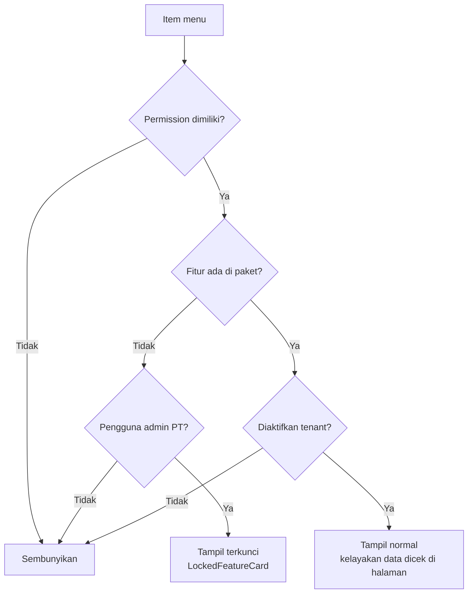

# 09 — Spesifikasi UI/UX Web & Mobile Modul Akademik & Pembelajaran

> **Status:** rancangan (bukan dokumentasi fitur jadi). Tidak ada kode frontend atau mobile yang diubah.
> **Disusun:** 2026-10-11, berdasarkan repository pada commit `ab81cc7`.
> Kembali ke [README](README.md) · Kanon nama: [README §5](README.md#5-kanon-penamaan-wajib-diikuti-seluruh-dokumen) · Endpoint: [08-api-specification.md](08-api-specification.md) · Hak akses: [11-roles-permissions.md](11-roles-permissions.md) · Laporan: [12-reports-analytics.md](12-reports-analytics.md)

Dokumen ini memenuhi brief §8 (UI/UX Web & Mobile): **A** dashboard per role, **B** navigasi per role dan modul, **C** spesifikasi halaman operasional, dan **D** standar UI. Seluruh rancangan **memakai ulang design system yang sudah ada** di `frontend/src` (React 19 + Tailwind 3) dan `mobile/lib` (Flutter). Komponen baru hanya diusulkan bila belum ada padanannya, dan selalu diberi label **[Rekomendasi]**.

## Daftar Isi

1. [Ruang Lingkup dan Prinsip](#1-ruang-lingkup-dan-prinsip)
2. [Fondasi Design System yang Sudah Ada](#2-fondasi-design-system-yang-sudah-ada)
3. [Registri Status → Badge](#3-registri-status--badge)
4. [A. Dashboard per Role](#4-a-dashboard-per-role)
5. [B. Navigasi per Role dan Modul](#5-b-navigasi-per-role-dan-modul)
6. [C. Spesifikasi Halaman Operasional](#6-c-spesifikasi-halaman-operasional)
7. [Wireframe ASCII Layar Kunci](#7-wireframe-ascii-layar-kunci)
8. [D. Standar UI](#8-d-standar-ui)
9. [Pola Mobile Flutter](#9-pola-mobile-flutter)
10. [Keterlacakan terhadap Brief §8](#10-keterlacakan-terhadap-brief-8)
11. [Keputusan Terbuka Terkait UI](#11-keputusan-terbuka-terkait-ui)

---

## 1. Ruang Lingkup dan Prinsip

### 1.1 Ruang lingkup

| Kanal | Basis kode | Pengguna utama | Cakupan dokumen ini |
|---|---|---|---|
| Web admin & dosen | `frontend/src` — `DashboardLayout` + `NAV_ITEMS` | `academic_administrator`, `faculty_administrator`, `study_program_administrator`, `head_of_study_program`, `dean`, `rector`, `vice_rector`, `lecturer`, `academic_advisor`, `quality_assurance`, `exam_committee`, `exam_proctor`, `lms_administrator`, `university_administrator`, `auditor` | Semua halaman §6 |
| Web portal mahasiswa | `frontend/src/pages/portal` — `PORTAL_NAV_ITEMS` | `student` | KRS, presensi QR, LMS, ujian, EDOM, layanan, MBKM |
| Web portal orang tua | Belum ada (Baru) | `guardian` | §6.29 |
| Platform | `PLATFORM_NAV_ITEMS` | `super_admin` | Entitlement & storage lintas tenant (§6.30) |
| Ujian publik (PMB) | `PublicExamLayout` (Ada) | Peserta seleksi tanpa akun | Dirujuk di §6.22 |
| Mobile | `mobile/lib` (Flutter, Riverpod, go_router, Dio, Hive) | `student`, `lecturer`, `academic_advisor`, `guardian` | §9 dan kolom "responsif" tiap halaman |

### 1.2 Prinsip desain

1. **Reuse dulu.** Setiap halaman memakai `PageHeader` → (`Alert` konteks) → `Card` berisi filter + `DataTable` + `ListPagination`, sama seperti `pages/academic/KrsPage.tsx` dan `AttendancePage.tsx` yang sudah ada.
2. **Server adalah sumber kebenaran aturan.** UI hanya *mencerminkan* hasil validasi backend (prasyarat, bentrok, cekal, kuota). Pesan blokir ditampilkan apa adanya dari `errors` envelope `ApiResponse` (422) atau `ConflictException` (409), tidak dihitung ulang di klien.
3. **Satu sumber status.** Label dan warna status berasal dari registri §3, bukan dari konstanta lokal per halaman (pola `STATUS_VARIANT` per halaman saat ini dirapikan ke satu modul).
4. **Kebijakan sebagai konfigurasi.** Angka seperti batas SKS, kehadiran minimum, dan skala nilai **tidak ditulis di UI**; UI menampilkan nilai dari `university_settings` grup `academic.*` (contoh: "Batas kehadiran ujian: 75% (contoh, dari pengaturan kampus)").
5. **Empat lapis izin terlihat di UI** (README §4): paket → aktivasi tenant → permission & scope → kelayakan data. Lapis 1–2 memengaruhi menu (§5.1), lapis 3 memengaruhi menu dan tombol, lapis 4 memengaruhi isi halaman (alert, tombol nonaktif dengan alasan).
6. **Aksi sensitif selalu dua langkah.** Ubah nilai pascapublikasi, dispensasi cekal, persetujuan KRS, pengesahan kurikulum/CPL, dan publikasi nilai memakai dialog konfirmasi dengan kolom alasan wajib; alasan dikirim ke backend dan tercatat di `audit_logs.reason`.
7. **Aktivitas ≠ pemahaman.** Metrik LMS (login, unduh materi, waktu aktif) diberi keterangan "indikator keaktifan, bukan ukuran pemahaman" di setiap widget yang menampilkannya (brief B.4).

---

## 2. Fondasi Design System yang Sudah Ada

### 2.1 Token warna (`frontend/src/styles/tokens.css`) — (Ada)

| Token | Terang | Gelap (`.dark`) | Pemakaian |
|---|---|---|---|
| `--color-primary` | `#166534` | `#3f9e68` | Tombol utama, link aktif, status sukses |
| `--color-accent` | `#d9791a` | `#f0ad53` | Tombol sekunder, sorotan |
| `--color-success` | `#166534` | `#3f9e68` | Sama dengan primary |
| `--color-warning` | `#ca8a04` | `#fbbf24` | Peringatan |
| `--color-danger` | `#dc2626` | `#f87171` | Error, aksi destruktif |
| `--color-info` | `#0284c7` | `#38bdf8` | Informasi |
| `--color-background` / `--color-surface` / `--color-surface-hover` | `#f8fafc` / `#ffffff` / `#f1f5f9` | `#0a0f1a` / `#111827` / `#1a2333` | Latar halaman, kartu, hover |
| `--color-border` / `--color-border-strong` | `#e2e8f0` / `#cbd5e1` | `#26324a` / `#35435f` | Garis |
| `--color-text-primary/secondary/tertiary` | `#0f172a` / `#475569` / `#94a3b8` | `#f1f5f9` / `#94a3b8` / `#64748b` | Teks |

Token Flutter `mobile/lib/core/theme/app_colors.dart` memakai nilai heksadesimal identik (Ada). Aturan: **komponen tidak boleh menulis hex langsung**; warna baru ditambahkan sebagai token di kedua file sekaligus.

### 2.2 Komponen web yang ada (`frontend/src/components/ui/`)

| Komponen | API penting (terverifikasi) | Dipakai untuk |
|---|---|---|
| `PageHeader` | `title`, `description`, `breadcrumb`, `actions` | Kepala setiap halaman |
| `Breadcrumb` | daftar `{label, path?}` | Di dalam `PageHeader` |
| `Card` | `title`, `description`, `actions`, `noPadding` | Wadah tabel, form, widget |
| `StatCard` | `label`, `value`, `icon`, `changePercent`, `trend` (up/down/flat), `caption` | KPI dashboard |
| `DataTable` | `columns: {header, cell, className}[]`, `data`, `rowKey`, `emptyMessage` | Semua tabel daftar |
| `ListPagination` | `meta` (`current_page`, `per_page`, `total`, `last_page`), `page`, `onPageChange`, `itemLabel` | Paginasi server |
| `Badge` | `variant`: `primary`/`success`/`warning`/`danger`/`info`/`neutral` | Status |
| `Button` | `variant`: `primary`/`secondary`/`outline`/`ghost`/`danger`; `size`: `sm`/`md`/`lg`; `isLoading`, `leftIcon`, `rightIcon` | Aksi |
| `Modal` | `open`, `onClose`, `title`, `className`; tutup dengan Escape | Form singkat, konfirmasi |
| `Alert` | `variant`: `info`/`success`/`warning`/`danger`; `title`, `onDismiss` | Pesan konteks, error, hasil aksi |
| `EmptyState` | `icon`, `title`, `description`, `action` | Data kosong |
| `Skeleton`, `SkeletonCard`, `SkeletonRow` | — | Loading |
| `Input`, `PasswordInput`, `Textarea`, `Select` (`label`, `error`, `hint`, `options`, `placeholder`), `Checkbox` | react-hook-form + zod | Form |
| `Dropdown` + `DropdownItem` | `trigger`, `align` | Menu aksi baris |
| `Tooltip` | `label`, `side` | Penjelasan tombol nonaktif, ikon |
| `Avatar` | — | Identitas pengguna |

Komponen pendukung lain yang ada: `components/portal/badges.tsx` (`KrsStatusBadge`, `AssignmentStatusBadge`, `RequestStatusBadge`, `StudentStatusBadge`, `GradeBadge`), `components/portal/PortalState.tsx` (`PortalLoading`, `PortalError` dengan `onRetry`, `PortalEmpty`, `InfoList`, `ProgressBar` dengan `tone`), `components/portal/GradeTable.tsx`, `components/portal/MaterialItem.tsx`, `components/shared/FileUploadField.tsx`, `components/dashboard/*` (grafik recharts: `StudentStatusChart`, `ActiveClassesByProgramChart`, `ApprovalStatusChart`, `PendingApprovalsTable`, `RecentActivityList`, `AcademicAgendaList`, `DashboardFilterBar`, `SummaryCardsGrid`, `ChartTooltip`), `components/layout/*` (`Sidebar`, `Header`, `TenantSwitcher`, `TenantModeBanner`, `ThemeToggle`). Hook: `usePaginatedList`, `usePermission`, `useFetch`, `useIsStudent`, `useExamViolationTracking`, `useExamViolationAlerts`, `useThemeSync`. Guard route: `RequirePermission` + `routes/routePermissions.ts`.

### 2.3 Komponen tambahan yang dibutuhkan — [Rekomendasi]

Komponen di bawah belum ada dan dibutuhkan berulang oleh halaman §6. Semuanya dibangun di atas token dan komponen yang ada (bukan pustaka UI baru).

| Komponen baru | Dasar | Kebutuhan | Dipakai di |
|---|---|---|---|
| `StatusBadge` | `Badge` + registri §3 | Satu pintu label/warna/ikon status | Semua halaman |
| `ConfirmDialog` | `Modal` + `Button` + `Textarea` | Konfirmasi dengan ringkasan dampak dan alasan wajib opsional | Aksi sensitif |
| `Toast` / `useToast` | `Alert` (posisi tetap, `role="status"`) | Feedback sukses tanpa memindahkan fokus | Semua aksi simpan |
| `Tabs` | `Button variant="ghost"` + `role="tablist"` | Detail kurikulum, kelas, sesi | §6.1, §6.3, §6.7 |
| `FilterBar` | `Input` + `Select` + `DashboardFilterBar` (pola) | Filter seragam tersinkron ke `?filter[...]` URL | Semua daftar |
| `SortableHeader` | perluasan `DataTableColumn` dengan `sortKey` | `?sort=-col` sesuai `ListQuery` | Semua daftar |
| `BulkActionBar` | `Checkbox` + `Button` | Aksi massal (setujui KRS, terbitkan nilai) | §6.6, §6.10, §6.14 |
| `EditableGrid` | `<table>` + `Input` per sel, navigasi panah | Input nilai, presensi massal | §6.8, §6.9 |
| `MatrixGrid` | `<table>` sticky header/kolom | Matriks CPL–MK, CPMK–CPL | §6.24 |
| `Stepper` | `Badge` + garis | Alur multi-langkah (KRS, TA, MBKM) | §6.5, §6.16, §6.17 |
| `Timeline` | `RecentActivityList` (pola) | Riwayat status/perubahan | KRS, nilai, cekal, cuti |
| `Drawer` | `Modal` varian samping | Detail baris tanpa pindah halaman | Konflik jadwal, proctoring |
| `CountdownTimer` | pola timer di `PortalExamTakingPage` | Timer ujian, QR | §6.7, §6.22 |
| `QrDisplay` | `<canvas>`/SVG dari payload token | Presensi QR dosen | §6.7 |
| `FeatureGate` / `LockedFeatureCard` | `EmptyState` + `Badge variant="warning"` | Fitur terkunci paket | §5.1 |
| `ConnectionBanner` | `Alert variant="warning"` sticky | Offline/sinkron | Ujian, presensi |
| `AsyncExportButton` | `Button` + polling status job | Ekspor besar asinkron | Laporan ([12](12-reports-analytics.md)) |

### 2.4 Mobile (`mobile/lib`) — (Ada)

Fondasi: `core/theme` (`app_colors.dart`, `app_text_theme.dart`, `app_dimensions.dart`, `theme_controller.dart`), `core/widgets` (`AppButton`, `AppCard`, `AppAlert`, `AppTextField`, `AppShell`), `core/permission/permission_gate.dart`, `core/router` (`app_router.dart`, `route_guard.dart`, `route_paths.dart` — path identik dengan `ROUTES` web), `core/network` (`dio_client.dart`, `api_envelope.dart`, `list_query_mapper.dart`), `core/storage` (`secure_storage.dart`, `hive_boxes.dart`), paket `connectivity_plus`, `shimmer`, `intl`, `flutter_localizations`. Fitur yang ada: `auth`, `dashboard`, `exam`. Folder `core/l10n` sudah ada tetapi **masih kosong**.

---

## 3. Registri Status → Badge

Registri tunggal (rekomendasi lokasi: `frontend/src/constants/statusRegistry.ts` dan padanannya `mobile/lib/shared/status_registry.dart` — **NEW NAMES**). Setiap entri berisi `label` (ID/EN), `variant`, dan `icon` lucide agar status **tidak hanya dibedakan oleh warna** (WCAG 1.4.1). Catatan: `Badge` `primary` dan `success` saat ini memakai kelas yang sama; registri hanya memakai `success` untuk status akhir positif.

### 3.1 Konvensi makna warna

| Variant | Makna | Ikon default |
|---|---|---|
| `neutral` | Belum dimulai, draf, dibatalkan, diarsipkan, digantikan | `Circle` / `Archive` |
| `info` | Sedang diproses, menunggu pihak lain, terjadwal | `Clock` |
| `warning` | Butuh tindakan pengguna, revisi diminta, dibuka kembali, kedaluwarsa | `AlertTriangle` |
| `success` | Disetujui, terbit, selesai, berlaku | `CheckCircle2` |
| `danger` | Ditolak, cekal aktif, pelanggaran, gagal | `XCircle` / `Ban` |
| `primary` | Berjalan/aktif (status operasional, bukan hasil akhir) | `PlayCircle` |

### 3.2 Pemetaan status kanon

| Entitas | Status → variant |
|---|---|
| `krs_submissions` | `draft` neutral · `submitted` info · `revision_requested` warning · `approved` success · `locked` success (ikon `Lock`) · `cancelled` neutral |
| `krs_items` (Ada) | `draft` neutral · `pending` info · `enrolled` success · `dropped` neutral |
| `class_sections` | `planned` neutral · `open` info · `running` primary · `completed` success · `cancelled` neutral |
| `class_schedules` | `draft` neutral · `in_review` info · `published` success · `cancelled` neutral; penanda "Diubah" = `Badge warning` tambahan bila ada revisi setelah `published` |
| `lecture_sessions` | `scheduled` info · `ongoing` primary · `held` success · `cancelled` neutral · `rescheduled` warning |
| `attendances.status` (Ada) | `present` success · `permitted` info · `sick` info · `absent` danger |
| `attendance_corrections` | mengikuti pola persetujuan: diajukan info · disetujui success · ditolak danger (nilai final mengikuti [07](07-database-erd.md)) |
| `grade_submissions` | `draft` neutral · `submitted` info · `in_review` info · `published` success · `reopened` warning |
| `grade_revisions` | `requested` info · `approved` success · `rejected` danger · `applied` success (ikon `CheckCheck`) |
| `academic_blocks` | `active` danger · `exempted` warning · `revoked` neutral · `expired` neutral |
| `student_requests` (Ada) | `draft` neutral · `submitted` info · `approved` success · `rejected` danger · `cancelled` neutral |
| `theses` | `submitted` info · `in_review` info · `approved` success · `in_supervision` primary · `ready_for_defense` warning · `completed` success · `rejected` danger · `cancelled` neutral |
| `mbkm_programs` | `draft` neutral · `offered` info · `registration_open` primary · `selection` info · `running` primary · `evaluating` info · `completed` success · `cancelled` neutral |
| `mbkm_participations` | `applied` info · `selected` success · `rejected` danger · `active` primary · `evaluated` info · `converted` success · `completed` success · `withdrawn` neutral |
| `lms_classes` | `draft` neutral · `active` primary · `archived` neutral (ikon `Archive`) |
| `question_bank_items` | `draft` neutral · `in_review` info · `published` success · `retired` neutral |
| `exams` | `draft` neutral · `scheduled` info · `active` primary · `finished` info · `grading` warning · `graded` info · `published` success · `cancelled` neutral |
| `exam_attempts` | `in_progress` primary · `submitted` success · `auto_submitted` warning · `graded` success · `voided` danger |
| Artefak OBE (`graduate_profiles`, `program_learning_outcomes`, `lesson_plans`) | `draft` neutral · `in_review` info · `ratified` success · `superseded` neutral |
| `outcome_evaluation_reports` | `draft` neutral · `evaluated` info · `followed_up` success |
| `edom_periods` | `prepared` neutral · `open` primary · `closed` info · `analyzed` info · `published` success |
| `students.status` (Ada, `StudentStatusBadge`) | `active` success · `leave` warning · `graduated` info · `inactive` neutral · `dropped_out` danger · `resigned` danger |
| Status turunan UI (bukan kolom DB) | "Belum dinilai" neutral · "Terlambat" danger · "Tercekal" danger · "Dispensasi s.d. {tanggal}" warning · "Fitur paket {X}" warning (ikon `Lock`) |

---

## 4. A. Dashboard per Role

### 4.1 Model umum

- **Satu route** `/dashboard` (Ada, `pages/dashboard/DashboardPage.tsx`; mahasiswa diarahkan ke `PortalDashboardPage` oleh `App.tsx`). Endpoint ringkasan `GET /dashboard` (Ada, hanya `auth:sanctum`).
- **[Rekomendasi]** Dashboard berbasis *widget registry*: setiap widget mendeklarasikan `permission`, `feature` (feature key §5.7 README), dan `scope`. Backend mengembalikan hanya widget yang lolos empat lapis izin, misalnya `GET /dashboard?view=lecturer` → `data.widgets[]`. Pengguna multi-role (contoh: dosen yang juga dosen wali dan kaprodi) melihat **pemilih tampilan** (`Tabs`) "Pengajar · Dosen Wali · Kaprodi", default role dengan scope terluas, pilihan terakhir disimpan di `localStorage`.
- **Pola tata letak**: baris 1 `SummaryCardsGrid` berisi 4 `StatCard`; baris 2 grafik (2/3) + `AcademicAgendaList` tenggat (1/3); baris 3 tabel tindakan (`PendingApprovalsTable` pola) + `RecentActivityList`. `DashboardFilterBar` (semester, fakultas/prodi sesuai scope).
- **Notifikasi** memakai `NotificationDispatcher` (Ada) channel `database` → ikon lonceng di `Header` dan `PortalNotificationsPage` (Ada); push untuk mobile. Daftar *event key* notifikasi di bawah adalah rekomendasi penamaan, finalnya mengikuti `notification_templates` per tenant.
- **Data dashboard = data operasional terkini** (lihat pembedaan dengan laporan analitik di [12 §2](12-reports-analytics.md#2-dashboard-operasional-vs-laporan-analitik)). Cache singkat per pengguna; ingat gotcha serialisasi Collection di `Cache::remember()` (payload harus array biasa).

### 4.2 Mahasiswa (`student`) — web `PortalDashboardPage` (Ada, diperluas) & mobile

| Elemen | Isi | Komponen | Sumber |
|---|---|---|---|
| Ringkasan | IPK, IPS terakhir, SKS lulus, status akademik | `StatCard` ×3 + `StudentStatusBadge` | `AcademicRecordService` (Ada) |
| Status KRS | Status `krs_submissions`, total SKS / batas SKS (dari konfigurasi), dosen wali | `Card` + `KrsStatusBadge` + `ProgressBar` | `/student/krs` (Ada) |
| Cekal aktif | Daftar cekal aktif beserta layanan yang dibatasi dan cara menyelesaikan | `Alert variant="danger"` berulang | `academic_blocks` (Baru) |
| Jadwal hari ini | Sesi kuliah, ruang/tautan daring, tombol "Scan QR" bila sesi `ongoing` | `Card` daftar | `lecture_sessions` (Baru) |
| Tenggat | Tugas, kuis, ujian, EDOM, batas KRS, logbook MBKM — urut waktu | `AcademicAgendaList` | assignments, exams, `edom_periods`, `academic_term_periods` |
| Kehadiran berisiko | MK dengan kehadiran < batas konfigurasi (contoh 75%) | `ProgressBar tone="danger"` | `attendances` |
| Pengumuman | 3 terbaru | daftar | Announcement (Ada) |
| Notifikasi | `krs.approved`, `krs.revision_requested`, `grade.published`, `block.activated`, `block.exempted`, `assignment.graded`, `exam.scheduled`, `edom.open`, `request.decided` | lonceng | `NotificationDispatcher` |
| Tindakan cepat | Isi KRS · Scan presensi · Kerjakan ujian · Isi EDOM · Ajukan cuti | `Button` | — |

### 4.3 Orang tua/wali (`guardian`) — [Rekomendasi], fitur [Referensi] "login sebagai orang tua"

| Elemen | Isi | Catatan privasi |
|---|---|---|
| Pemilih anak | Bila wali terhubung ke >1 mahasiswa (`student_guardians`) | Hanya relasi terverifikasi ([OD-21](16-open-decisions.md#od-21)) |
| Ringkasan | IPS/IPK, SKS, status mahasiswa | Tanpa nilai komponen |
| Kehadiran | % per MK semester berjalan | Tanpa catatan presensi rinci |
| Tagihan | Status tagihan (dari modul Keuangan) | Baca saja |
| Notifikasi | `grade.published`, `attendance.below_threshold`, `invoice.due` | Sesuai preferensi wali |
| Tindakan cepat | Lihat KHS · Lihat tagihan | Tidak ada aksi ubah |

### 4.4 Dosen pengajar (`lecturer`)

| Elemen | Isi | Komponen |
|---|---|---|
| KPI | Kelas diampu semester ini, sesi terlaksana / rencana, lembar nilai belum terbit, tugas belum dinilai | `StatCard` ×4 |
| Jadwal hari ini | Sesi dengan tombol "Mulai sesi" / "Tampilkan QR" / "Isi jurnal" | `Card` daftar |
| Realisasi RPS | % pertemuan dengan jurnal sesuai rencana RPS per kelas (bila `obe` aktif) | `ProgressBar` |
| Tenggat | Batas input nilai (`academic_term_periods` jenis nilai), batas jurnal, ujian yang harus disusun | `AcademicAgendaList` |
| Antrean | Tugas menunggu dinilai, pertanyaan forum belum dijawab, soal draf AI menunggu review | `PendingApprovalsTable` (pola) |
| LMS (sesuai paket) | Materi diunggah, keaktifan kelas; Lecture Performance Score hanya bila `lms.lecture_performance_score` aktif | `StatCard` + keterangan "indikator keaktifan" |
| EDOM | Hasil EDOM periode `published` miliknya (agregat) | `Card` |
| Notifikasi | `schedule.changed`, `grade_submission.returned`, `grade_revision.requested`, `attendance_correction.requested`, `assignment.submitted`, `question.review_requested` | lonceng |
| Tindakan cepat | Mulai sesi · Input nilai · Unggah materi · Buat tugas · Buat ujian | `Button` |

### 4.5 Dosen wali (`academic_advisor`)

| Elemen | Isi |
|---|---|
| KPI | Jumlah mahasiswa bimbingan, KRS menunggu persetujuan, mahasiswa berisiko, mahasiswa tercekal |
| Antrean persetujuan KRS | Tabel `krs_submissions` status `submitted` dengan SKS, IPS, peringatan (cekal, prasyarat override) dan tombol "Tinjau" |
| Mahasiswa butuh pendampingan | Daftar berdasarkan indikator konfigurasi (IPS < ambang, kehadiran rendah, belum KRS, cekal) — indikator dijelaskan per baris |
| Konsultasi terakhir | `advising_records` terbaru |
| Tenggat | Batas persetujuan KRS (akhir periode KRS) |
| Notifikasi | `krs.submitted`, `student.at_risk` |
| Tindakan cepat | Tinjau KRS · Catat konsultasi |

### 4.6 BAAK (`academic_administrator`)

| Elemen | Isi |
|---|---|
| KPI | Mahasiswa aktif, KRS disetujui/total, kelas `open` tanpa jadwal `published`, lembar nilai belum terbit |
| Kesiapan semester | Checklist: periode akademik terisi, kelas dibuka, jadwal terbit, konflik jadwal = 0, aturan cekal aktif, form EDOM siap |
| Konflik jadwal | Jumlah bentrok ruang/dosen/kelas + tautan ke panel konflik |
| Antrean | Pengajuan mahasiswa (`student_requests`), koreksi presensi, revisi nilai, dispensasi menunggu |
| Grafik | `StudentStatusChart` (Ada), progres KRS per prodi |
| Tenggat | Periode KRS, input nilai, EDOM, dari `academic_term_periods` |
| Tindakan cepat | Buka kelas · Terbitkan jadwal · Kelola cekal · Buka periode KRS |

### 4.7 Admin fakultas & admin prodi (`faculty_administrator`, `study_program_administrator`)

Sama dengan BAAK tetapi **ter-scope** fakultas/prodi (`user_roles.scope_type`). Tambahan admin prodi: status kurikulum (versi aktif per angkatan), MK tanpa dosen, kelas melebihi kapasitas. Tidak ada widget lintas fakultas.

### 4.8 Kaprodi (`head_of_study_program`)

| Elemen | Isi |
|---|---|
| KPI | Mahasiswa aktif prodi, rata-rata IPS semester lalu, % lembar nilai terbit, % realisasi perkuliahan |
| Persetujuan | Lembar nilai `in_review` (bila [OD-07](16-open-decisions.md#od-07) mewajibkan), revisi nilai, RPS `in_review`, pengajuan judul TA |
| OBE (feature `obe`) | Ketercapaian CPL prodi vs target, CPL tanpa MK pendukung |
| EDOM | Partisipasi EDOM per kelas (bukan jawaban individual) |
| LMS | Kelas daring tanpa aktivitas > N hari (konfigurasi) |
| Tindakan cepat | Setujui nilai · Sahkan RPS · Lihat ketercapaian CPL |

### 4.9 Pimpinan akademik (`rector`, `vice_rector`, `dean`)

Hanya agregat, tanpa data individual kecuali drill-down ke laporan yang diizinkan. Widget: tren mahasiswa aktif, rasio dosen:mahasiswa, % keterlaksanaan perkuliahan (Smart dashboard monitoring perkuliahan online [Referensi]), sebaran IPK per fakultas, ketercapaian CPL per prodi (feature `obe`), partisipasi EDOM, aktivitas MBKM dan IKU (`siakad.mbkm.iku`, Enterprise). `dean` di-scope fakultas.

### 4.10 LPM (`quality_assurance`)

Widget: periode EDOM (status, partisipasi), rekap EDOM per prodi, evaluasi kurikulum `outcome_evaluation_reports` dan tindak lanjut terbuka, realisasi RPS. Tindakan cepat: Buat periode EDOM · Susun form · Publikasikan rekap.

### 4.11 Panitia ujian (`exam_committee`) dan pengawas (`exam_proctor`)

| Role | Widget |
|---|---|
| `exam_committee` | Ujian per status (`exams.status`), peserta tercekal per ujian, soal `in_review`, hasil yang menunggu `published`, draf soal AI menunggu review |
| `exam_proctor` | Ujian yang diawasi hari ini, peserta online/offline, pelanggaran terbaru (`exam_violations`) dengan tombol "Tinjau" — label "indikasi, bukan bukti" |

### 4.12 Pengelola LMS (`lms_administrator`)

Widget: penggunaan storage vs kuota (`lms.storage_gb`), kelas umum terpakai vs `lms.general_classes_per_term`, kelas akademik tanpa materi, kelas aktif, sinkronisasi kelas SIAKAD → LMS (gagal/tertunda), file terbesar. Peringatan kuota pada 80% dan 95% (ambang = konfigurasi, angka contoh).

### 4.13 Admin PT (`university_administrator`, `university_owner`) dan `super_admin`

| Role | Widget |
|---|---|
| Admin PT | Paket aktif, fitur aktif vs terkunci, storage, jumlah pengguna vs `max_users`, aktivasi modul akademik |
| `super_admin` | Konteks platform (`TenantContext` null): tenant per paket, tenant mendekati kuota storage, job AI gagal. Masuk ke data tenant hanya melalui `TenantSwitcher` (Ada) |
| `auditor` | Tidak ada widget operasional; tautan ke Audit Log (Ada) dan laporan baca-saja |

---

## 5. B. Navigasi per Role dan Modul

### 5.1 Model gating: permission + entitlement

Saat ini `Sidebar.tsx` hanya menyaring berdasarkan `permission` (`hasNavPermission`). Rancangan menambah atribut **`feature`** pada `NavItem` (`types/navigation`) — **[Rekomendasi]**, NEW NAMES: `NavItem.feature?: string`, `NavItem.lockedVisibleTo?: string[]`.

| Kondisi | Perilaku menu | Perilaku route | Alasan |
|---|---|---|---|
| Permission tidak dimiliki | **Disembunyikan** | `RequirePermission` → halaman 403 | Sudah berlaku (Ada) |
| Fitur tidak termasuk paket tenant, pengguna adalah `university_administrator`/`university_owner` | **Ditampilkan terkunci**: ikon `Lock` + `Badge warning` "Paket", klik membuka `LockedFeatureCard` (nama fitur, paket minimum dari `plan_feature_entitlements`, tombol "Hubungi pengelola langganan") | Halaman `LockedFeatureCard`, tanpa memanggil API modul | Pembuat keputusan pembelian perlu tahu fitur ada |
| Fitur tidak termasuk paket, pengguna lain (dosen, mahasiswa, staf) | **Disembunyikan** | 403 bergaya `LockedFeatureCard` tanpa info harga | Mencegah kebingungan dan iklan ke pengguna akhir |
| Fitur termasuk paket tetapi dimatikan tenant (`university_feature_flags`) | **Disembunyikan** untuk semua; admin PT melihatnya di Pengaturan → Langganan dengan status "Nonaktif" | 403 | Pilihan sadar kampus |
| Permission ada, fitur aktif, data tidak memenuhi syarat (cekal, periode tutup) | **Ditampilkan normal** | Halaman tampil dengan `Alert` alasan dan tombol nonaktif + `Tooltip` | Lapis 4 adalah informasi, bukan rahasia |

**Rekomendasi (dipilih):** *hidden* sebagai default, *locked/upgrade* hanya untuk role pengelola langganan. Aturan uji: **BR-ENT-UI-01** — pengguna tanpa permission `system_settings.read`/role admin PT tidak pernah melihat label paket atau harga di menu; **BR-ENT-UI-02** — route fitur terkunci tidak memanggil endpoint modul (tidak ada request 403 berulang). Backend tetap menegakkan entitlement (`EnsureFeatureEntitled`, [11](11-roles-permissions.md)); gating UI hanya kosmetik.

Sumber data gating: payload profil/sesi pengguna diperluas dengan `features: {key: "enabled"|"locked"|"disabled"}` — **[Rekomendasi]**, endpoint final di [08](08-api-specification.md). Mobile memakai `permission_gate.dart` (Ada) yang diperluas dengan pengecekan `feature`.



### 5.2 Pohon navigasi web admin/dosen (`NAV_ITEMS` → `TENANT_BUSINESS_NAV_ITEMS`)

Grup "Akademik" saat ini berisi 12 child datar. Rancangan memecahnya menjadi grup modul agar tetap terbaca. Kolom **Route** menunjukkan konstanta `ROUTES` yang ada atau yang diusulkan (Baru). Permission mengikuti kanon README §5.5; slug persis per endpoint ditetapkan di [11](11-roles-permissions.md).

#### 5.2.1 SIAKAD

| Grup / item | Route | Status route | Permission (salah satu) | Feature | Role tipikal |
|---|---|---|---|---|---|
| **Data Master** | | | | `siakad` | |
| Fakultas | `/akademik/fakultas` | Baru | `faculties.read` | | BAAK, admin PT |
| Program Studi | `ROUTES.akademik.programStudi` | Ada | `study_programs.read` | | BAAK, admin fakultas |
| Periode Akademik | `/akademik/periode` | Baru | `academic_terms.read` | | BAAK |
| Kalender Akademik | `/akademik/kalender` | Baru (portal sudah ada `/portal/kalender`) | `academic_calendar.read` | | BAAK, semua (baca) |
| Ruang | `/akademik/ruang` | Baru | `rooms.read` | | BAAK |
| Mahasiswa | `ROUTES.mahasiswa` | Ada (menu atas) | `students.read` | | BAAK, admin prodi |
| Dosen | `ROUTES.dosen` | Ada (menu atas) | `lecturers.read` | | BAAK, admin prodi |
| **Kurikulum** | | | | `siakad` | |
| Kurikulum | `ROUTES.akademik.kurikulum` (+ detail = builder) | Ada | `curriculums.read` | | admin prodi, kaprodi |
| Mata Kuliah | `ROUTES.akademik.mataKuliah` | Ada | `courses.read` | | admin prodi |
| Paket Mata Kuliah | `/akademik/paket-mata-kuliah` | Baru | `course_packages.read` | | admin prodi |
| Ekuivalensi | `/akademik/ekuivalensi` | Baru | `course_equivalencies.read` | | admin prodi, kaprodi |
| **Perkuliahan** | | | | `siakad` | |
| Penawaran Kelas & Jadwal | `ROUTES.akademik.kelasJadwal` | Ada (diperluas) | `classes.read`, `class_schedules.read` | | BAAK, admin prodi |
| Kelas Saya | `ROUTES.akademik.kelasSaya` (+ `kelasSayaDetail`) | **Konstanta & menu ada, route belum didaftarkan** | `course_materials.read`, `assignments.read`, `lecture_sessions.read` | | dosen |
| Presensi | `ROUTES.akademik.absensi` | Ada | `attendance.read` | | BAAK |
| Koreksi Presensi | `/akademik/koreksi-presensi` | Baru | `attendance_corrections.read` | | BAAK, kaprodi, dosen |
| **KRS & Perwalian** | | | | `siakad` | |
| KRS | `ROUTES.akademik.krs` | Ada | `krs.read` | | BAAK |
| Persetujuan KRS | `ROUTES.akademik.persetujuanKrs` | **Konstanta & menu ada, route belum didaftarkan** | `krs.approve`, `krs_advising.read` | | dosen wali |
| Perwalian | `/akademik/perwalian` | Baru | `advising_records.read` | | dosen wali, kaprodi |
| **Penilaian** | | | | `siakad` | |
| Penilaian | `ROUTES.akademik.penilaian` | Ada (diperluas jadi daftar lembar nilai) | `grades.read`, `grade_submissions.read` | | BAAK, dosen |
| Publikasi Nilai | `/akademik/publikasi-nilai` | Baru | `grade_submissions.publish` | | BAAK, kaprodi |
| Revisi Nilai | `/akademik/revisi-nilai` | Baru | `grade_revisions.read` | | dosen, kaprodi, BAAK |
| Skala Nilai | `/akademik/skala-nilai` | Baru | `grade_scales.read` | | BAAK |
| **Layanan Akademik** | | | | `siakad` | |
| Pengajuan Mahasiswa | `ROUTES.akademik.pengajuanMahasiswa` | **Konstanta & menu ada, route belum didaftarkan** | `approval_requests.read`, `student_requests.read` | | BAAK |
| Cekal & Dispensasi | `/akademik/cekal` | Baru | `academic_blocks.read` | | BAAK, keuangan (baca) |
| Aturan Cekal | `/akademik/cekal/aturan` | Baru | `academic_block_rules.read` | | BAAK |
| Transfer & Konversi | `/akademik/transfer` | Baru | `student_transfers.read`, `credit_conversions.read` | | BAAK, kaprodi |
| Tugas Akhir | `ROUTES.skripsi` | Ada (diperluas) | `theses.read` | | kaprodi, dosen pembimbing |
| Pengumuman Massal | `ROUTES.pengumuman` | Ada | `announcements.read` | | BAAK |

#### 5.2.2 MBKM, LMS, CBT, OBE, EDOM

| Grup / item | Route | Status | Permission | Feature |
|---|---|---|---|---|
| **MBKM** (menggantikan menu "Magang dan MBKM" secara bertahap, [OD-14](16-open-decisions.md#od-14)) | | | | `siakad.mbkm` |
| Program MBKM | `/mbkm/program` | Baru | `mbkm_programs.read` | |
| Mitra | `/mbkm/mitra` | Baru | `mbkm_partners.read` | |
| Peserta & Seleksi | `/mbkm/peserta` | Baru | `mbkm_participations.read` | |
| Konversi SKS | `/mbkm/konversi` | Baru | `credit_conversions.read` | |
| Rekap IKU | `/mbkm/iku` | Baru | `iku_reports.read` | `siakad.mbkm.iku` (Enterprise) |
| Magang (lama) | `ROUTES.magangMbkm` | Ada | `internships.read` | |
| **LMS** | | | | `lms` |
| Kelas Daring | `/lms/kelas` (+ `/lms/kelas/:id`) | Baru | `lms_classes.read` | |
| Kelas Umum | `/lms/kelas-umum` | Baru | `lms_classes.create` | |
| Analitik Pembelajaran | `/lms/analitik` | Baru | `lms_analytics.read` | skor engagement: `lms.engagement_score` |
| Storage | `/lms/storage` | Baru | `lms_storage.read` | |
| **CBT** | | | | `cbt` |
| Ujian | `ROUTES.akademik.ujian` (+ detail, rekap) | Ada | `exams.read` | |
| Bank Soal | `ROUTES.akademik.bankSoal` | Ada (diperluas `question_banks`) | `question_bank.read` | |
| Review Soal AI | `/cbt/review-ai` | Baru | `ai_question_generation.read` | `cbt.ai` |
| Review Proctoring | `/akademik/ujian/:id/proctoring` | Baru | `exam_proctoring.read` | `lms.proctoring` |
| **OBE** | | | | `obe` |
| Profil Lulusan | `/obe/profil-lulusan` | Baru | `obe_profiles.read` | |
| CPL | `/obe/cpl` | Baru | `obe_outcomes.read` | |
| Pemetaan | `/obe/pemetaan` | Baru | `obe_mappings.read` | |
| RPS | `/obe/rps` (+ `/obe/rps/:id`) | Baru | `lesson_plans.read` | |
| Ketercapaian CPL | `/obe/ketercapaian` | Baru | `obe_measurements.read` | |
| Evaluasi & Laporan | `/obe/evaluasi` | Baru | `obe_reports.read` | asisten AI: `obe.ai` |
| **EDOM** | | | | `edom` |
| Periode EDOM | `/edom/periode` | Baru | `edom_periods.read` | |
| Formulir | `/edom/formulir` (+ `/edom/formulir/:id`) | Baru | `edom_forms.read` | |
| Rekap EDOM | `/edom/rekap` | Baru | `edom_reports.read` | |
| **Laporan** | `ROUTES.laporan` (+ `/laporan/akademik/:type`) | Ada (diperluas) | `reports.read` (Ada), `academic_reports.read` | per laporan |
| **Pengaturan** → Pengaturan Akademik | `/pengaturan/akademik` | Baru | `system_settings.read` | |
| **Pengaturan** → Langganan & Storage | `/pengaturan/langganan` | Baru | `system_settings.read` | |

**Catatan dosen.** Dosen memakai `NAV_ITEMS` yang sama; filter permission membuat dosen hanya melihat: Dashboard, Profil Saya (Ada), Akademik → Kelas Saya, Persetujuan KRS (bila wali), Perwalian, Revisi Nilai, Koreksi Presensi; CBT → Ujian, Bank Soal, Review Soal AI; OBE → RPS; LMS → Kelas Daring. **[Rekomendasi]** tambahkan grup "Mengajar" khusus dosen di atas grup "Akademik" (sama seperti `LECTURER_PROFILE_ITEM`) agar dosen tidak menelusuri grup admin.

#### 5.2.3 Route yang hilang dan halaman mock yang harus disambungkan

| Item | Kondisi saat ini | Backend yang sudah ada | Tindakan UI |
|---|---|---|---|
| `/akademik/kelas-saya` (+ `/:id`) | Konstanta `ROUTES`, menu `nav.ts`, dan `routePermissions` ada; **tidak terdaftar di `App.tsx`** → klik menu 404 | `GET /teaching/classes`, `/class-sections/{id}/materials`, `/class-sections/{id}/assignments` | Buat `MyClassesPage` + `MyClassDetailPage` (tab Sesi, Peserta, Materi, Tugas, Nilai); `ClassTeachingModal` (Ada) dijadikan isi tab |
| `/akademik/persetujuan-krs` | Sama: menu ada, route tidak | Persetujuan KRS dosen wali (`krs_advising`) | Halaman §6.6 |
| `/akademik/pengajuan-mahasiswa` | Sama: menu ada, route tidak | `student_requests` + ApprovalWorkflow (`/persetujuan` generik sudah ada) | Daftar `student_requests` dengan filter `type`; detail menautkan ke `ROUTES.persetujuanDetail` |
| `PortalLecturerEvaluationPage` | Mock data statis, tanpa route | Belum ada (EDOM Baru) | Route `/portal/edom`, `/portal/edom/:targetId`; §6.27 |
| `PortalAcademicAdvisingPage` | Mock | `students.academic_advisor_id`; `advising_records` Baru | Route `/portal/perwalian` |
| `PortalLeaveRequestPage` | Mock | `student_requests` type `leave` (Ada) | Route `/portal/cuti`; §6.15 |
| `PortalThesisAdvisingPage` | Mock | `theses` index/show (Ada, parsial) | Route `/portal/tugas-akhir`; §6.16 |
| `PortalQuizzesPage` | Mock | Kuis LMS memakai mesin CBT (Baru) | Route `/portal/kuis` saat `lms.cbt_integration`/`cbt` aktif |
| `PortalLetterRequestPage` | Mock | `student_requests` type `letter` (Ada) | Gabungkan ke `/portal/pengajuan` (Ada) sebagai jenis pengajuan |
| `PortalGraduationPage` | Mock | Di luar cakupan (Yudisium) | Tetap tanpa route; tampilkan cekal yudisium bila modul siap |
| `PortalScholarshipPage`, `PortalInvoicesPage` | Mock | Modul Keuangan/Beasiswa | Di luar cakupan; tagihan dirujuk dari portal orang tua |

### 5.3 Pohon navigasi portal mahasiswa (`PORTAL_NAV_ITEMS`)

| Grup | Item | Route | Status | Permission | Feature |
|---|---|---|---|---|---|
| Akademik | Akademik Saya, KRS, Jadwal, KHS, Nilai, Transkrip, Presensi, Dokumen | `ROUTES.portal.*` | Ada | `student_portal.read`, `krs_self_service.read` | `siakad` |
| Akademik | Scan Presensi | `/portal/presensi/scan` | Baru | `student_portal.read` | `lms` |
| Akademik | Perwalian | `/portal/perwalian` | Mock → wire | `student_portal.read` | `siakad` |
| Perkuliahan | Mata Kuliah (+ detail: Materi, Tugas, Forum, Pengumuman kelas) | `ROUTES.portal.mataKuliah*` | Ada (diperluas) | `student_portal.read` | `lms` |
| Perkuliahan | Kuis | `/portal/kuis` | Mock → wire | `exam_participation.read` | `lms.cbt_integration` |
| Perkuliahan | Kelas Umum | `/portal/kelas-umum` | Baru | `student_portal.read` | `lms` |
| Ujian | Ujian | `ROUTES.portal.ujian` | Ada | `exam_participation.read` | `cbt` |
| Evaluasi | EDOM | `/portal/edom` | Mock → wire | `edom_participation.read` | `edom` |
| MBKM | Program, Pendaftaran, Logbook | `/portal/mbkm`, `/portal/mbkm/:id` | Baru | `mbkm_participations.read` | `siakad.mbkm` |
| Layanan | Pengajuan (cuti, surat, aktif kembali), Tugas Akhir | `ROUTES.portal.pengajuan`, `/portal/cuti`, `/portal/tugas-akhir` | Ada / Mock → wire | `student_requests.read`, `theses.read` | `siakad` |
| Lain | Kalender, Pengumuman, Notifikasi, Pengaturan | Ada | Ada | — | — |

### 5.4 Portal orang tua (`guardian`) — Baru

Layout: `DashboardLayout` dengan `GUARDIAN_NAV_ITEMS` (NEW NAMES) dan pemilih anak di `Header`. Route prefix web `/orang-tua` (bukan `/wali` agar tidak tertukar dengan dosen wali).

| Item | Route | Permission | Endpoint |
|---|---|---|---|
| Dashboard | `/dashboard` | `guardian_portal.read` | `GET /guardian/students` |
| Nilai & KHS | `/orang-tua/:studentId/nilai` | `guardian_portal.read` | `GET /guardian/students/{id}/grades` |
| Kehadiran | `/orang-tua/:studentId/kehadiran` | `guardian_portal.read` | `GET /guardian/students/{id}/attendance-summary` |
| Tagihan | `/orang-tua/:studentId/tagihan` | `guardian_portal.read` | `GET /guardian/students/{id}/invoices` |
| Notifikasi, Pengaturan | Ada (pola portal) | — | — |

### 5.5 Navigasi mobile

| Role | Bottom navigation (maks. 5) | Menu "Lainnya" |
|---|---|---|
| `student` | Beranda · Jadwal · Kelas (LMS) · Ujian · Akun | KRS, KHS, Transkrip, Presensi, EDOM, Pengajuan, MBKM, Tugas Akhir, Kalender |
| `lecturer` (+ `academic_advisor`) | Beranda · Jadwal · Kelas Saya · Persetujuan (wali) · Akun | Input nilai (baca + input sederhana), Bank soal (baca), Perwalian |
| `guardian` | Beranda · Nilai · Kehadiran · Tagihan · Akun | — |

Tombol tengah kontekstual: **Scan QR** untuk mahasiswa saat ada sesi `ongoing`; **Tampilkan QR** untuk dosen saat sesinya `ongoing`. Item yang terkunci/nonaktif **disembunyikan** di mobile (tidak ada state "upgrade" di aplikasi mahasiswa/dosen).

---

## 6. C. Spesifikasi Halaman Operasional

### 6.0 Template spesifikasi dan konvensi bersama

Setiap halaman dispesifikasikan dengan tabel 16 baris berikut. Nilai yang **sama untuk semua halaman** ditetapkan sekali di sini dan hanya ditulis ulang bila berbeda.

| Baris template | Konvensi default |
|---|---|
| Nama & route | Nama menu + route (`ROUTES`) + status (Ada/Parsial/Baru) |
| Tujuan | Satu kalimat hasil yang dicapai pengguna |
| Pengguna | Role kanon + scope data |
| Komponen UI | Komponen §2.2/§2.3 |
| Filter | `FilterBar` → `?search=`, `?filter[col]=a,b` (`ListQuery`); semester default = `academic_terms.is_current`; filter tersimpan di URL (pola `pickFilterParams` Ada) |
| Kolom tabel | Kolom pertama identitas (nama tebal + kode `text-ink-secondary`), kolom status memakai `StatusBadge`, kolom terakhir aksi (`Dropdown` bila >2 aksi) |
| Form & validasi | react-hook-form + zod untuk validasi format; aturan bisnis divalidasi server, error 422 dipetakan ke field via `applyServerErrors` (Ada) |
| Tombol | Aksi utama di `PageHeader.actions` (`Button primary`), sekunder `outline`, destruktif `danger` |
| Status & badge | Registri §3 |
| Dialog konfirmasi | `ConfirmDialog`; aksi sensitif wajib alasan ≥ 10 karakter (konfigurasi) |
| Empty state | `EmptyState` dengan judul spesifik + aksi utama bila pengguna berhak |
| Loading | `SkeletonRow` ×5 untuk tabel, `SkeletonCard` untuk kartu; tombol `isLoading` |
| Error | `Alert variant="danger"` + tombol "Coba lagi" (pola `PortalError onRetry`); 403 → halaman tidak berizin; 409 → `Alert warning` berisi pesan konflik |
| Success feedback | `Toast` "{Objek} berhasil {aksi}" + refetch daftar; untuk aksi yang mengubah status, baris disorot 2 detik |
| Pagination | Server-side `ListPagination`, `per_page` default 20, maks 100 |
| Responsif | Desktop ≥1280 px: tabel penuh; tablet 768–1279: kolom sekunder disembunyikan, aksi ke `Dropdown`; mobile <768: tabel berubah jadi kartu bertumpuk (pola `PortalKrsPage`), aksi utama sticky di bawah |

Label klasifikasi fitur per halaman mengikuti README §6; status implementasi (Ada/Parsial/Baru) mengacu README §3.2.

### 6.1 Kurikulum Builder [Referensi] (Parsial)

| Aspek | Spesifikasi |
|---|---|
| Nama & route | Detail Kurikulum — `ROUTES.akademik.kurikulumDetail` (Ada, diperluas jadi builder bertab) |
| Tujuan | Menyusun satu versi kurikulum prodi: daftar MK wajib/pilihan per semester, prasyarat, paket, angkatan pengguna, dan ekuivalensi ke versi lama |
| Pengguna | `study_program_administrator` (ubah), `head_of_study_program` (setujui/aktifkan), `academic_administrator` (semua prodi), `dean` (baca, scope fakultas) |
| Komponen UI | `PageHeader` (judul = nama versi + `StatusBadge` aktif/nonaktif), `Tabs`: Struktur · Prasyarat · Paket · Angkatan · Ekuivalensi · Riwayat; `Card` per semester berisi `DataTable`; `Modal` "Tambah MK ke kurikulum"; `Timeline` riwayat; `Alert` |
| Filter | Tab Struktur: semester rekomendasi, sifat (wajib/pilihan), pencarian kode/nama |
| Kolom tabel | Struktur: Kode · Nama MK · SKS · Sifat (`Badge neutral` Wajib / `info` Pilihan) · Semester rekomendasi · Prasyarat (jumlah, `Tooltip` daftar) · Aksi. Footer per semester: total SKS semester. Ringkasan atas: total SKS wajib, pilihan, total kurikulum |
| Form & validasi | Tambah MK: `Select` MK (pencarian), sifat, semester rekomendasi (1..jumlah semester prodi), keterangan. Server menolak duplikat MK dalam versi yang sama (`curriculum_courses`), prasyarat siklik, dan perubahan struktur pada versi yang sudah dipakai angkatan aktif tanpa membuat versi baru ([OD-03](16-open-decisions.md#od-03)) |
| Tombol | Tambah MK · Duplikat sebagai versi baru · Ajukan pengesahan · Aktifkan (kaprodi) · Ekspor (xlsx) |
| Status & badge | `curriculums.is_active` → `success` "Aktif" / `neutral` "Nonaktif"; versi dipakai angkatan → `info` "Dipakai 2023, 2024" |
| Dialog konfirmasi | "Aktifkan kurikulum {versi} untuk angkatan {daftar}? Angkatan lain tidak terpengaruh. Riwayat nilai tidak berubah." + alasan (aksi sensitif, diaudit) |
| Empty state | "Belum ada mata kuliah di versi ini" + tombol Tambah MK / "Salin dari versi sebelumnya" |
| Loading/error | Default §6.0; 409 bila versi terkunci karena dipakai → `Alert warning` dengan tombol "Buat versi baru" |
| Success feedback | Toast "Mata kuliah ditambahkan ke semester 3" |
| Pagination | Tidak dipaginasi per semester (maks. puluhan baris); tab Riwayat dipaginasi |
| Responsif | Desktop: semester sebagai kolom kanban opsional (`Tabs` "Tabel/Papan"); tablet: tabel; mobile: baca saja, kartu per semester yang dapat dilipat |

### 6.2 Mata Kuliah [Referensi] (Parsial)

| Aspek | Spesifikasi |
|---|---|
| Nama & route | Mata Kuliah — `ROUTES.akademik.mataKuliah` + `mataKuliahDetail` (Ada) |
| Tujuan | Mengelola katalog MK: kode, nama, SKS, deskripsi, jenis (teori/praktikum), prasyarat, dan keanggotaan kurikulum |
| Pengguna | `study_program_administrator`, `academic_administrator` (tulis); `lecturer` (baca MK yang diampu) |
| Komponen UI | `PageHeader`, `FilterBar`, `DataTable` + `SortableHeader`, `Modal` form, detail: `Card` info + `Tabs` (Prasyarat · Kurikulum · Kelas · CPMK bila `obe`) |
| Filter | Prodi (scope), kurikulum, semester rekomendasi, status aktif, pencarian |
| Kolom tabel | Kode · Nama · SKS · Prodi · Kurikulum (jumlah versi) · Prasyarat · Status · Aksi |
| Form & validasi | Kode unik per tenant (Ada), nama wajib, SKS bilangan bulat > 0 (batas atas = konfigurasi), deskripsi opsional; prasyarat: MK + nilai minimal (`min_letter_grade` dari skala aktif), tidak boleh diri sendiri/siklik |
| Tombol | Tambah · Ubah · Nonaktifkan · Impor (xlsx) [Rekomendasi] · Ekspor |
| Status & badge | `is_active` → success/neutral |
| Dialog konfirmasi | Nonaktifkan MK yang masih punya kelas `open`/`running` → ditolak server (409) dengan daftar kelas |
| Empty state | "Belum ada mata kuliah untuk prodi ini" + Tambah |
| Success | Toast; detail menampilkan `Timeline` perubahan |
| Pagination | Server, 20 |
| Responsif | Mobile: kartu Kode–Nama–SKS, aksi via `Dropdown` |

### 6.3 Penawaran Kelas & Jadwal (dengan panel konflik) [Referensi] (Parsial)

| Aspek | Spesifikasi |
|---|---|
| Nama & route | Kelas dan Jadwal — `ROUTES.akademik.kelasJadwal` (Ada, diperluas); detail `kelasJadwalDetail` |
| Tujuan | Membuka kelas per semester, menetapkan dosen (koordinator + tim), kapasitas, jadwal (hari/jam/ruang/jenis/kelompok), menyelesaikan bentrok, lalu menerbitkan jadwal |
| Pengguna | `academic_administrator`, `study_program_administrator` (scope prodi), `head_of_study_program` (tinjau), `lecturer` (baca kelasnya) |
| Komponen UI | `PageHeader` + `Tabs` "Daftar · Kalender mingguan · Konflik (n)"; `DataTable`; `Drawer` detail kelas; `Modal` "Buka kelas" dan "Tambah jadwal"; **Panel konflik** = `Card` sticky kanan (desktop) berisi daftar konflik dikelompokkan jenis; `BulkActionBar` (terbitkan, batalkan) |
| Filter | Semester (wajib), prodi, MK, dosen, ruang, hari, status kelas, status jadwal, "hanya yang bentrok" |
| Kolom tabel | Kode kelas · MK (kode, SKS) · Dosen (koordinator + `+n` tim, `Tooltip`) · Kapasitas (terisi/kapasitas, `ProgressBar`) · Jadwal (Sen 08:00–09:40 · R.301 · Teori) · Status kelas · Status jadwal · Konflik (`Badge danger` jumlah) · Aksi |
| Form & validasi | Buka kelas: MK (dari `curriculum_courses` yang ditawarkan), kode kelas unik per MK & semester, kapasitas > 0 (default konfigurasi; Ada default 40), dosen koordinator wajib, tim opsional. Jadwal: hari, jam mulai < jam selesai, durasi sesuai SKS (aturan konfigurasi), ruang (`rooms`, kapasitas ruang ≥ kapasitas kelas → peringatan bukan blokir), jenis (`schedule_type`: teori/praktikum/tutorial), label kelompok. Server memeriksa bentrok **ruang**, **dosen**, dan **kelas/kelompok** dan mengembalikan 409 berisi daftar konflik |
| Tombol | Buka kelas · Salin dari semester lalu [Rekomendasi] · Tambah jadwal · Cek konflik · Ajukan tinjauan · Terbitkan jadwal · Ekspor |
| Status & badge | `class_sections.status`, `class_schedules.status` (§3.2); konflik: `danger` "Bentrok ruang", "Bentrok dosen", "Bentrok kelompok"; `warning` "Ruang lebih kecil dari kapasitas" |
| Dialog konfirmasi | Terbitkan: "Terbitkan {n} jadwal? Mahasiswa dan dosen akan menerima notifikasi." Ditolak bila masih ada konflik `danger`. Ubah jadwal `published`: wajib alasan, notifikasi `schedule.changed` ke peserta dan dosen. Batalkan kelas yang sudah berisi KRS: tampilkan jumlah mahasiswa terdampak |
| Empty state | "Belum ada kelas dibuka untuk semester {x}" + Buka kelas / Salin dari semester lalu |
| Loading/error | Kalender: `Skeleton` grid; 409 konflik ditampilkan di panel konflik, bukan toast |
| Success | Toast "12 jadwal diterbitkan"; badge berubah `published` |
| Pagination | Daftar 20; kalender tanpa paginasi (filter ruang/dosen wajib bila > 200 slot) |
| Responsif | Tablet: panel konflik menjadi tab; mobile: baca saja (kartu per kelas), penyusunan jadwal tidak didukung di mobile |

**Panel konflik** — tiap entri: jenis, dua slot yang bertabrakan (kelas, hari, jam, ruang/dosen), tombol "Ubah slot A", "Ubah slot B", "Abaikan peringatan" (hanya untuk `warning`). Wireframe di §7.2.

### 6.4 Ruang [Referensi: utilitas ruang kuliah] (Baru)

| Aspek | Spesifikasi |
|---|---|
| Nama & route | Ruang — `/akademik/ruang` (Baru) |
| Tujuan | Mengelola data ruang dan memantau utilisasi untuk mencegah bentrok |
| Pengguna | `academic_administrator` (tulis), `study_program_administrator`/`faculty_administrator` (baca ruang scope-nya) |
| Komponen UI | `DataTable`, `Modal` form, `Tabs` "Daftar · Utilisasi"; utilisasi = heatmap hari × jam (sel berwarna `primary` dengan opasitas sesuai keterisian) + `StatCard` % utilisasi |
| Filter | Gedung, fakultas, jenis ruang, kapasitas minimum, status aktif |
| Kolom tabel | Kode · Nama · Gedung · Kapasitas · Jenis (kelas/lab/daring) · Fasilitas · Utilisasi minggu ini (%) · Status · Aksi |
| Form & validasi | Kode unik per tenant, kapasitas bilangan > 0, jenis wajib; ruang "daring" tidak ikut validasi bentrok ruang |
| Tombol | Tambah · Ubah · Nonaktifkan · Lihat jadwal ruang |
| Status & badge | Aktif success / Nonaktif neutral |
| Dialog konfirmasi | Nonaktifkan ruang yang masih dijadwalkan → 409 + daftar jadwal |
| Empty state | "Belum ada data ruang. Jadwal lama memakai teks ruang bebas; impor dari jadwal lama?" (migrasi `class_schedules.room` → `room_id`) |
| Success | Toast |
| Pagination | 20 |
| Responsif | Heatmap disembunyikan di mobile, diganti daftar slot terpakai |

### 6.5 KRS Mahasiswa (web + mobile) [Referensi] (Parsial)

| Aspek | Spesifikasi |
|---|---|
| Nama & route | KRS — `ROUTES.portal.krs` (Ada, `PortalKrsPage`); mobile `/portal/krs` |
| Tujuan | Mahasiswa memilih kelas sesuai kurikulum, melihat hasil validasi (status akademik, cekal, prasyarat, batas SKS, bentrok, kapasitas), mengajukan ke dosen wali, dan memantau status |
| Pengguna | `student` (milik sendiri) |
| Komponen UI | `Stepper` (Periode → Pilih kelas → Tinjau → Diajukan → Disetujui/Revisi → Dikunci); `Alert` cekal (danger) di atas; kartu ringkasan SKS (`ProgressBar` terhadap batas dari konfigurasi); daftar penawaran (pola kartu `PortalKrsPage` Ada: badge "Dipilih", "Mengulang", "Tidak dapat diambil", daftar prasyarat dengan badge terpenuhi/tidak); keranjang KRS; `Timeline` riwayat (`krs_submission_events`); tombol unduh PDF KRS (Ada, `StudentDocumentService::krsPdf`) |
| Filter | Semester rekomendasi, sifat (wajib/pilihan), "hanya yang bisa diambil", pencarian MK |
| Kolom tabel | Keranjang: MK · Kelas · Jadwal · SKS · Status item (`krs_items`) · Aksi hapus. Penawaran (kartu): MK, SKS, kelas-kelas dengan jadwal, dosen, sisa kuota |
| Form & validasi | Pilih satu kelas per MK; server memvalidasi berurutan sesuai siklus A.4 dan mengembalikan **daftar alasan** per penawaran (`blockers`, pola Ada). Bentrok jadwal ditampilkan pada kedua kelas. Kelas penuh: tombol nonaktif + "Kuota penuh". Paket semester awal: keranjang terisi otomatis dari `course_packages` dengan label "Paket" (tidak dapat dihapus bila kebijakan mengunci) |
| Tombol | Pilih kelas · Hapus · Ajukan ke dosen wali · Batalkan pengajuan (selama `submitted`, Ada) · Unduh KRS (PDF) · Lihat riwayat |
| Status & badge | `krs_submissions.status`, `krs_items.status` (§3.2); periode KRS: `success` "Dibuka s.d. {tanggal}" / `neutral` "Ditutup" |
| Dialog konfirmasi | Ajukan: ringkasan MK, total SKS vs batas, "Setelah diajukan Anda tidak dapat mengubah KRS sampai dosen wali memberi keputusan." |
| Empty state | Periode belum dibuka: `EmptyState` "Periode KRS {semester} dibuka {tanggal}"; tidak ada penawaran: "Belum ada kelas ditawarkan untuk kurikulum Anda" |
| Error | Cekal aktif: seluruh halaman baca saja + `Alert danger` per cekal ("Cekal keuangan — selesaikan tagihan atau ajukan dispensasi ke BAAK"); periode ditutup: `Alert info`; status mahasiswa tidak aktif: `Alert warning` dengan tautan Pengajuan aktif kembali |
| Success | Toast "KRS diajukan ke {dosen wali}"; `revision_requested` → `Alert warning` berisi catatan wali (pola "KRS ditolak dosen wali" Ada, label diubah "Revisi diminta") |
| Pagination | Tidak (penawaran dikelompokkan per semester rekomendasi, dimuat sekaligus) |
| Responsif | Mobile (Flutter): `TabBar` "Penawaran · Keranjang (n)", ringkasan SKS sticky di atas, tombol "Ajukan" sticky bawah; validasi sama dari server; offline: baca saja dari cache Hive dengan banner "Data terakhir {waktu}" |

Wireframe di §7.1.

### 6.6 Persetujuan KRS Dosen Wali [Referensi] (Parsial; route belum ada)

| Aspek | Spesifikasi |
|---|---|
| Nama & route | Persetujuan KRS — `ROUTES.akademik.persetujuanKrs` (konstanta Ada, **daftarkan di `App.tsx`**); detail `/akademik/persetujuan-krs/:submissionId` (Baru) |
| Tujuan | Dosen wali meninjau KRS mahasiswa bimbingannya, menyetujui atau meminta revisi dengan catatan |
| Pengguna | `academic_advisor` (scope `students.academic_advisor_id`), `head_of_study_program`/`academic_administrator` (pengganti bila wali berhalangan, diaudit) |
| Komponen UI | `PageHeader`; `Tabs` "Menunggu (n) · Revisi diminta · Disetujui · Semua"; `DataTable` + `Checkbox` + `BulkActionBar`; detail: `Card` profil mahasiswa (IPK, IPS, SKS lulus, status, cekal) + `DataTable` item KRS + `Alert` peringatan dari server + `Textarea` catatan + `Timeline` |
| Filter | Semester, angkatan, prodi, status, "ada peringatan" |
| Kolom tabel | Mahasiswa (nama, NIM) · Angkatan · IPS lalu · SKS diajukan / batas · Peringatan (ikon + jumlah) · Diajukan pada · Status · Aksi "Tinjau" |
| Form & validasi | Minta revisi: catatan wajib. Setujui massal hanya untuk baris tanpa peringatan |
| Tombol | Setujui · Minta revisi · Setujui terpilih · Catat konsultasi (membuka form `advising_records`) |
| Status & badge | `krs_submissions.status` |
| Dialog konfirmasi | Setujui: "Setujui KRS {nama} ({sks} SKS)?" Massal: daftar nama. Persetujuan dicatat ke `krs_submission_events` dan audit |
| Empty state | "Tidak ada KRS yang menunggu persetujuan" |
| Error | 409 bila mahasiswa membatalkan pengajuan saat ditinjau → `Alert warning` + refetch |
| Success | Toast "KRS {nama} disetujui"; notifikasi `krs.approved` ke mahasiswa |
| Pagination | 20 |
| Responsif | Mobile (Flutter): daftar kartu, detail layar penuh dengan tombol Setujui/Minta revisi di bawah; persetujuan massal tidak tersedia di mobile |

### 6.7 Sesi Kuliah, Jurnal Mengajar, dan Presensi (termasuk QR) [Referensi] (Baru)

| Aspek | Spesifikasi |
|---|---|
| Nama & route | Kelas Saya → tab Sesi → detail sesi `/akademik/kelas-saya/:id/sesi/:sessionId` (Baru); tampilan proyektor QR `/akademik/kelas-saya/:id/sesi/:sessionId/qr` (layar penuh) |
| Tujuan | Dosen memulai sesi, menampilkan QR, merekam/menyesuaikan presensi, mengisi jurnal (topik, materi, metode, keterkaitan pertemuan RPS), lalu menutup sesi |
| Pengguna | `lecturer` (kelas sendiri, `ClassSectionAccess::canWriteTeaching`), tim pengajar (`class_section_lecturers`), `academic_administrator` (baca, koreksi lewat §6.8) |
| Komponen UI | Header sesi: pertemuan ke-n, tanggal, mode (tatap muka/daring/hybrid), `StatusBadge`; `Tabs` "Presensi · Jurnal · Materi"; Presensi: `EditableGrid` (baris mahasiswa, kolom status dengan tombol segmen H/I/S/A), penghitung hadir real-time, tombol "Tampilkan QR"; QR: `QrDisplay` + `CountdownTimer` rotasi + jumlah pemindai; Jurnal: `Textarea` topik/realisasi, `Select` pertemuan RPS (`lesson_plan_meetings`, bila `obe`), pemilih materi (`lecture_session_materials`), metode |
| Filter | Daftar sesi: status sesi, bulan; grid presensi: status presensi, pencarian nama |
| Kolom tabel | Daftar sesi: Pertemuan · Tanggal · Mode · Topik · Hadir/Total · Jurnal (lengkap/belum) · Status · Aksi. Grid presensi: No · NIM · Nama · Status (H/I/S/A) · Metode (QR/manual) · Waktu · Catatan |
| Form & validasi | Mulai sesi hanya dalam jendela waktu jadwal ± toleransi (konfigurasi). QR: token `attendance_qr_tokens` berumur pendek dan berotasi (durasi konfigurasi, contoh 30 detik), terikat sesi; server menolak token kedaluwarsa, mahasiswa bukan peserta, dan pemindaian ganda. Tutup sesi: jurnal topik wajib; presensi yang belum diisi diberi default sesuai konfigurasi (contoh `absent`) setelah konfirmasi |
| Tombol | Mulai sesi · Tampilkan QR · Hentikan QR · Tandai semua hadir · Simpan · Tutup sesi · Batalkan/Jadwalkan ulang sesi (alasan wajib) |
| Status & badge | `lecture_sessions.status`; `attendances.status` (Ada) |
| Dialog konfirmasi | Tutup sesi: "{n} mahasiswa belum berstatus. Tandai sebagai {default}?" Setelah `held`, perubahan presensi hanya lewat koreksi (§6.8) |
| Empty state | Belum ada sesi: "Sesi dibuat otomatis dari jadwal terbit" + tombol "Buat sesi tambahan" |
| Error | Jaringan putus saat QR: `ConnectionBanner` "QR berhenti diperbarui"; QR tidak menampilkan token lama setelah kedaluwarsa |
| Success | Toast "Sesi pertemuan 5 ditutup — 38/40 hadir" |
| Pagination | Daftar sesi tanpa paginasi (≤ jumlah pertemuan); grid presensi tanpa paginasi (virtualisasi bila > 150 baris) |
| Responsif | Tablet/mobile dosen: mode "Tampilkan QR" layar penuh dengan kecerahan maksimal; grid presensi menjadi daftar dengan tombol segmen besar (≥ 44 px). **Mahasiswa (scan)**: lihat §6.7.1 |

#### 6.7.1 Scan presensi mahasiswa (web & Flutter)

| Aspek | Spesifikasi |
|---|---|
| Route | Web `/portal/presensi/scan` (kamera browser), Flutter layar `AttendanceScanScreen` (NEW NAMES) dari tombol tengah bottom nav |
| Alur | Buka kamera → baca QR → kirim token + `lecture_session_id` (server memverifikasi) → layar hasil: `success` "Hadir tercatat 08:07" / `danger` dengan alasan ("QR kedaluwarsa, pindai ulang", "Anda bukan peserta kelas ini", "Sudah tercatat") |
| Izin kamera | Ditolak → instruksi membuka izin + alternatif "Masukkan kode" (kode pendek dari layar dosen) |
| Offline | Tidak menyimpan scan untuk dikirim belakangan (QR berumur pendek); tampilkan "Perlu koneksi internet untuk presensi" |
| Aksesibilitas | Hasil diumumkan via `aria-live="assertive"` (web) / `Semantics(liveRegion: true)` (Flutter); getaran singkat saat sukses |

### 6.8 Koreksi Presensi [Referensi: koreksi berotorisasi] (Baru)

| Aspek | Spesifikasi |
|---|---|
| Nama & route | Koreksi Presensi — `/akademik/koreksi-presensi` (Baru); pengajuan dari mahasiswa via detail presensi portal (`ROUTES.portal.absensi`, tombol "Ajukan koreksi") |
| Tujuan | Mengubah presensi sesi yang sudah `held` melalui pengajuan dan persetujuan dengan riwayat |
| Pengguna | Pengaju: `lecturer` (kelasnya) atau `student` (dirinya); penyetuju: sesuai konfigurasi (contoh: dosen pengampu untuk ajuan mahasiswa, kaprodi/BAAK untuk ajuan dosen setelah batas waktu) |
| Komponen UI | `Tabs` "Menunggu · Diputuskan"; `DataTable`; `Drawer` detail: status lama → baru, alasan, lampiran (`FileUploadField`, mis. surat sakit), `Timeline` |
| Filter | Semester, kelas, pengaju (dosen/mahasiswa), status |
| Kolom tabel | Mahasiswa · Kelas · Pertemuan · Dari → Ke (dua `Badge`) · Pengaju · Diajukan · Status · Aksi |
| Form & validasi | Status baru ≠ status lama; alasan wajib; lampiran opsional/wajib per jenis (konfigurasi); batas waktu pengajuan sejak sesi (konfigurasi) |
| Tombol | Ajukan koreksi · Setujui · Tolak |
| Status & badge | `attendance_corrections` (§3.2) |
| Dialog konfirmasi | Setujui: "Presensi {nama} pertemuan {n} berubah {lama} → {baru}. Persentase kehadiran berubah {x}% → {y}%." |
| Empty state | "Tidak ada pengajuan koreksi" |
| Success | Toast; mahasiswa menerima notifikasi keputusan |
| Pagination | 20 |
| Responsif | Mobile mahasiswa: form pengajuan sederhana; penyetuju di web atau mobile (kartu) |

### 6.9 Komponen Nilai dan Input Nilai (grid) [Referensi] (Baru, menggantikan input satu-per-satu `GradesPage`)

| Aspek | Spesifikasi |
|---|---|
| Nama & route | Lembar Nilai Kelas — `/akademik/penilaian/:classSectionId` (Baru); juga tab "Nilai" di Kelas Saya |
| Tujuan | Dosen menetapkan komponen & bobot, mengisi nilai per komponen untuk tiap peserta, melihat nilai akhir & huruf terhitung, lalu mengajukan lembar nilai |
| Pengguna | `lecturer`/tim pengajar (kelasnya), `academic_administrator` (baca semua; input atas nama dosen hanya dengan alasan, diaudit) |
| Komponen UI | Bagian atas: `Card` "Komponen & bobot" (tabel komponen: nama, jenis — tugas/kuis/UTS/UAS/praktik/lainnya, bobot %, sumber nilai: manual/LMS/CBT, pemetaan CPMK bila `obe`) dengan total bobot harus 100% (indikator `Badge` success/danger). Bagian utama: `EditableGrid` peserta × komponen, kolom terhitung Nilai Akhir dan Huruf (`GradeBadge`), sel impor dari LMS/CBT diberi ikon `Link` dan bisa "Tarik nilai" |
| Filter | Pencarian nama/NIM, "nilai belum lengkap", komponen |
| Kolom tabel | No · NIM · Nama · {komponen 1..n (bobot%)} · Nilai akhir · Huruf · Kehadiran % (indikator cekal kehadiran ujian) · Catatan |
| Form & validasi | Sel numerik 0–100 (rentang konfigurasi), desimal maks. 2; navigasi Enter/Tab/panah; tempel dari spreadsheet (multi-sel) [Rekomendasi]; total bobot = 100%; kelengkapan dicek saat ajukan; nilai kosong ditampilkan "—" dan **tidak dihitung 0** sampai diputuskan aturan konfigurasi (01 A.6); pembulatan dan konversi huruf memakai `grade_scales` aktif ([OD-04](16-open-decisions.md#od-04), [OD-29](16-open-decisions.md#od-29)) — dihitung server, grid menampilkan pratinjau dari respons |
| Tombol | Simpan draf (autosave tiap 10 detik/saat sel kehilangan fokus) · Tarik nilai LMS/CBT · Impor xlsx · Unduh templat · Ajukan lembar nilai |
| Status & badge | `grade_submissions.status` di header; sel diubah belum disimpan: titik `warning` |
| Dialog konfirmasi | Ajukan: "{n} peserta, {m} nilai kosong. Setelah diajukan nilai tidak bisa diubah kecuali dikembalikan." Ditolak bila kosong dan kebijakan mewajibkan lengkap |
| Empty state | Belum ada komponen: "Tetapkan komponen nilai terlebih dahulu" + templat dari RPS/kebijakan prodi |
| Error | Konflik penyimpanan (nilai diubah pengguna lain) → 409 + sorot sel; autosave gagal → `ConnectionBanner` "Perubahan belum tersimpan" |
| Success | Toast "Lembar nilai diajukan"; status → `submitted` |
| Pagination | Tidak (seluruh peserta kelas; virtualisasi baris > 100) |
| Responsif | Desktop/tablet landscape: grid penuh dengan kolom identitas sticky; mobile: per mahasiswa (kartu dengan input per komponen), tanpa impor |

Wireframe di §7.4.

### 6.10 Publikasi Nilai [Referensi] (Baru)

| Aspek | Spesifikasi |
|---|---|
| Nama & route | Publikasi Nilai — `/akademik/publikasi-nilai` (Baru) |
| Tujuan | Meninjau lembar nilai yang diajukan, menyetujui (bila diwajibkan, [OD-07](16-open-decisions.md#od-07)), mengembalikan ke dosen, dan menerbitkan ke mahasiswa |
| Pengguna | `head_of_study_program` (tinjau, scope prodi), `academic_administrator` (terbitkan) |
| Komponen UI | `StatCard` progres (terbit/total kelas), `Tabs` per status, `DataTable` + `BulkActionBar`, `Drawer` pratinjau lembar nilai (distribusi huruf mini-chart recharts, nilai kosong, anomali) |
| Filter | Semester, prodi, dosen, status, "ada anomali" |
| Kolom tabel | Kelas · MK · Dosen · Peserta · Lengkap (%) · Distribusi (A..E mini bar) · Diajukan · Status · Aksi |
| Form & validasi | Kembalikan: catatan wajib. Terbitkan hanya `submitted`/`in_review` yang lengkap |
| Tombol | Tinjau · Kembalikan · Setujui · Terbitkan · Terbitkan terpilih · Ekspor rekap |
| Status & badge | `grade_submissions.status` |
| Dialog konfirmasi | Terbitkan: "Nilai {n} kelas akan terlihat oleh mahasiswa dan orang tua. Perubahan setelah ini hanya melalui revisi nilai." (aksi sensitif, audit) |
| Empty state | "Belum ada lembar nilai yang diajukan" |
| Success | Toast; notifikasi `grade.published` ke peserta |
| Pagination | 20 |
| Responsif | Mobile: kaprodi dapat meninjau dan menyetujui (kartu); penerbitan massal hanya web |

### 6.11 Revisi Nilai dan Pemutihan [Referensi] (Baru)

| Aspek | Spesifikasi |
|---|---|
| Nama & route | Revisi Nilai — `/akademik/revisi-nilai` (Baru) |
| Tujuan | Mengajukan dan memproses perubahan nilai setelah terbit (`revision_type` correction) atau perbaikan/pemutihan (`remediation`) |
| Pengguna | Pengaju: `lecturer` (koreksi), `academic_administrator` (pemutihan sesuai kebijakan); penyetuju: kaprodi/BAAK sesuai `approval_workflows` |
| Komponen UI | `DataTable`, `Modal` pengajuan, `Drawer` detail (nilai lama → baru per komponen, dampak IPS/IPK pratinjau, lampiran, `Timeline`) |
| Filter | Semester, prodi, jenis, status |
| Kolom tabel | Mahasiswa · MK · Jenis (`Badge` Koreksi / Pemutihan) · Lama → Baru (huruf) · Pengaju · Status · Aksi |
| Form & validasi | Alasan wajib, lampiran wajib untuk koreksi (konfigurasi), batas waktu sejak publikasi ([OD-08](16-open-decisions.md#od-08)) |
| Tombol | Ajukan revisi · Setujui · Tolak · Terapkan |
| Status & badge | `grade_revisions.status` |
| Dialog konfirmasi | Terapkan: menampilkan dampak IPS/IPK dan transkrip; alasan tersimpan di audit |
| Empty state | "Tidak ada revisi nilai" |
| Success | Toast; mahasiswa dinotifikasi |
| Pagination | 20 |
| Responsif | Mobile: baca + setujui/tolak |

### 6.12 Transkrip dan KHS [Referensi] (Ada, diperluas)

| Aspek | Spesifikasi |
|---|---|
| Nama & route | Portal: `ROUTES.portal.khs`, `ROUTES.portal.transkrip` (Ada); admin: tab "Akademik" di `ROUTES.mahasiswaDetail` (Ada) |
| Tujuan | Menampilkan hasil studi per semester (KHS) dan kumulatif (transkrip) sesuai nilai terbit |
| Pengguna | `student` (sendiri), `academic_advisor` (bimbingan), `guardian` (KHS ringkas), BAAK/admin prodi (scope) |
| Komponen UI | `Select` semester, `GradeTable` (Ada), `StatCard` IPS/IPK/SKS, tombol unduh PDF (Ada: `khsPdf`, `transcriptPdf`); penanda MK konversi (transfer/MBKM) dan MK diulang |
| Filter | Semester (KHS); transkrip: tampilkan semua/terbaik ([OD-08](16-open-decisions.md#od-08)) |
| Kolom tabel | Kode · MK · SKS · Huruf · Bobot · SKS×Bobot · Keterangan (Konversi, Mengulang, Pemutihan) |
| Form & validasi | — (baca saja). EDOM sebagai syarat melihat nilai ([OD-10](16-open-decisions.md#od-10)): bila aktif dan belum mengisi, tabel diganti `Alert info` + tombol "Isi EDOM" |
| Tombol | Unduh KHS/Transkrip (PDF) · Cetak |
| Status & badge | `GradeBadge`; nilai belum terbit tidak ditampilkan (bukan "kosong") |
| Empty state | "Belum ada nilai terbit untuk semester ini" |
| Success | Unduhan dimulai; tombol `isLoading` selama render PDF |
| Pagination | Tidak |
| Responsif | Mobile: kartu per MK, ringkasan IPS/IPK di atas |

### 6.13 Cekal dan Dispensasi [Referensi] (Baru)

| Aspek | Spesifikasi |
|---|---|
| Nama & route | Cekal & Dispensasi — `/akademik/cekal`; Aturan — `/akademik/cekal/aturan` (Baru) |
| Tujuan | Melihat cekal aktif hasil aturan otomatis dan manual, memberi/mencabut dispensasi dengan masa berlaku, dan mengelola aturan |
| Pengguna | `academic_administrator` (semua jenis), `finance_administrator` (cekal keuangan, baca + dispensasi bila diberi permission), `library_administrator` (perpustakaan), kaprodi (baca scope prodi), `academic_advisor` (baca bimbingan) |
| Komponen UI | `StatCard` per jenis cekal; `Tabs` "Aktif · Dispensasi · Riwayat"; `DataTable`; `Drawer` mahasiswa: semua cekal bersamaan + layanan yang dibatasi (matriks kecil: KRS ✓/✗, Ujian, Yudisium) + `Timeline` `academic_block_histories`; `Modal` dispensasi |
| Filter | Jenis (keuangan, akademik, kemahasiswaan, perpustakaan, kehadiran), layanan terdampak (KRS/ujian/yudisium), prodi, angkatan, status, sumber (otomatis/manual) |
| Kolom tabel | Mahasiswa · Jenis · Layanan dibatasi (chip) · Alasan · Sumber · Berlaku sejak · Dispensasi s.d. · Status · Aksi |
| Form & validasi | Dispensasi: layanan yang dikecualikan (subset layanan cekal), tanggal mulai–akhir (akhir wajib, maks. sesuai konfigurasi), alasan wajib, dokumen pendukung opsional. Cekal manual: jenis, layanan, alasan |
| Tombol | Beri dispensasi · Cabut dispensasi · Tambah cekal manual · Cabut cekal · Hitung ulang (aturan otomatis) · Ekspor |
| Status & badge | `academic_blocks.status` (§3.2) |
| Dialog konfirmasi | Dispensasi: "Mahasiswa {nama} dapat mengakses {layanan} sampai {tanggal} meskipun cekal {jenis} aktif." Alasan wajib, audit. Cabut cekal otomatis tidak diizinkan (harus selesaikan sumber atau dispensasi) |
| Empty state | "Tidak ada mahasiswa tercekal untuk filter ini" |
| Success | Toast; notifikasi `block.exempted` ke mahasiswa |
| Pagination | 20 |
| Responsif | Mobile: baca + detail; pemberian dispensasi hanya web |

Halaman Aturan: tabel `academic_block_rules` (jenis, sumber data, kondisi, layanan, aktif) dengan form kondisi berbasis parameter konfigurasi (mis. "tagihan jatuh tempo belum lunas", "kehadiran < {ambang}%"), sumber data untuk kemahasiswaan/perpustakaan mengikuti [OD-22](16-open-decisions.md#od-22). Wireframe §7.5.

### 6.14 Pengajuan Mahasiswa (BAAK) [Referensi] (Parsial; route belum ada)

| Aspek | Spesifikasi |
|---|---|
| Nama & route | Pengajuan Mahasiswa — `ROUTES.akademik.pengajuanMahasiswa` (konstanta Ada, **daftarkan route**) |
| Tujuan | Satu kotak masuk BAAK untuk `student_requests` (cuti, aktif kembali, surat, perubahan data) |
| Pengguna | `academic_administrator`, penyetuju langkah workflow |
| Komponen UI | `Tabs` per `type`; `DataTable`; tautan "Proses" → `ROUTES.persetujuanDetail` (Ada, generik ApprovalWorkflow) |
| Filter | Jenis, status, semester, prodi |
| Kolom tabel | Mahasiswa · Jenis · Judul · Semester · Diajukan · Langkah saat ini · Status · Aksi |
| Form & validasi | Keputusan di halaman persetujuan generik (catatan wajib saat tolak/kembalikan) |
| Tombol | Proses · Ekspor |
| Status & badge | `student_requests.status` (`RequestStatusBadge` Ada) |
| Dialog konfirmasi | Di halaman persetujuan |
| Empty state | "Tidak ada pengajuan" |
| Success | Kembali ke daftar dengan toast |
| Pagination | 20 |
| Responsif | Standar |

### 6.15 Pengajuan Cuti (mahasiswa) [Referensi] (Ada di backend; halaman mock)

| Aspek | Spesifikasi |
|---|---|
| Nama & route | Cuti Studi — `/portal/cuti` (sambungkan `PortalLeaveRequestPage`); alternatif: jenis "Cuti" di `ROUTES.portal.pengajuan` (Ada) |
| Tujuan | Mahasiswa mengajukan cuti untuk semester tertentu dengan dokumen pendukung dan memantau persetujuan |
| Pengguna | `student` |
| Komponen UI | `Alert info` syarat (dari konfigurasi: maksimum semester cuti, tagihan yang harus lunas), form (`Select` semester, `Textarea` alasan, `FileUploadField`), `Stepper` persetujuan (langkah `approval_request_steps`), `Timeline` |
| Filter | — |
| Kolom tabel | Riwayat: Semester · Diajukan · Status · Keputusan |
| Form & validasi | Semester target ≥ semester berjalan; alasan wajib; lampiran sesuai konfigurasi; server menolak bila kuota cuti habis atau ada pengajuan aktif |
| Tombol | Simpan draf · Ajukan · Batalkan (saat `submitted`) · Unduh surat keputusan (setelah `approved`, `letterPdf` Ada) |
| Status & badge | `student_requests.status` |
| Dialog konfirmasi | Ajukan: "Selama cuti Anda tidak dapat mengisi KRS. Status akan berubah menjadi Cuti setelah disetujui." |
| Empty state | "Belum pernah mengajukan cuti" |
| Success | Toast; status di dashboard |
| Pagination | Tidak |
| Responsif | Mobile Flutter: form satu kolom, unggah dari kamera/berkas |

### 6.16 Tugas Akhir [Referensi] (Parsial)

| Aspek | Spesifikasi |
|---|---|
| Nama & route | Mahasiswa: `/portal/tugas-akhir` (sambungkan `PortalThesisAdvisingPage`); admin/dosen: `ROUTES.skripsi`, `skripsiDetail` (Ada, diperluas) |
| Tujuan | Mengelola pengajuan judul, penetapan pembimbing (multi), bimbingan, seminar proposal, dan sidang |
| Pengguna | `student`; `lecturer` (pembimbing/penguji, scope `thesis_supervisors`/`thesis_examiners`); `head_of_study_program` (setujui judul, tetapkan pembimbing/penguji); BAAK (baca) |
| Komponen UI | `Stepper` status `theses`; `Tabs` "Judul · Pembimbing · Bimbingan · Seminar/Sidang · Dokumen"; bimbingan: `Timeline` `thesis_guidance_records` (tanggal, topik, catatan pembimbing, lampiran); jadwal ujian: `Card` (`thesis_examinations`) |
| Filter | Admin: prodi, status, pembimbing, angkatan |
| Kolom tabel | Admin: Mahasiswa · Judul · Jenis (skripsi/tesis/disertasi) · Pembimbing · Bimbingan (jumlah) · Status · Aksi |
| Form & validasi | Judul wajib, ringkasan, usulan pembimbing; jumlah minimal bimbingan sebelum `ready_for_defense` = konfigurasi; jadwal ujian tidak bentrok dengan penguji |
| Tombol | Ajukan judul · Setujui/Tolak judul · Tetapkan pembimbing · Catat bimbingan · Ajukan seminar/sidang · Jadwalkan · Input hasil |
| Status & badge | `theses.status` |
| Dialog konfirmasi | Tolak judul (alasan), tetapkan pembimbing, input hasil sidang |
| Empty state | Mahasiswa belum memenuhi syarat SKS: `Alert info` syarat dari konfigurasi |
| Success | Toast + notifikasi pihak terkait |
| Pagination | 20 (admin) |
| Responsif | Mobile: catat/lihat bimbingan, unggah dokumen |

### 6.17 MBKM: Katalog, Pendaftaran, Logbook [Referensi] (Baru)

| Aspek | Spesifikasi |
|---|---|
| Nama & route | Mahasiswa: `/portal/mbkm` (katalog), `/portal/mbkm/:participationId` (pendaftaran & logbook). Admin: `/mbkm/program`, `/mbkm/mitra`, `/mbkm/peserta`, `/mbkm/konversi` |
| Tujuan | Mahasiswa menemukan program (8 aktivitas + pertukaran antarprodi), mendaftar, mengisi logbook; admin mengelola program/mitra, seleksi, pembimbing, evaluasi, konversi SKS/MK |
| Pengguna | `student`; `academic_administrator`/admin prodi; `lecturer` (pembimbing: logbook & `mbkm_assessments`); `head_of_study_program` (setujui konversi) |
| Komponen UI | Katalog: grid `Card` program (jenis aktivitas `Badge`, mitra, kuota, periode pendaftaran, SKS maks. konversi) + `FilterBar`; detail program: deskripsi, syarat, MK yang dapat dikonversi; pendaftaran: form + `FileUploadField`; peserta: `Stepper` `mbkm_participations`; logbook: daftar entri mingguan (`Timeline`) + `Modal` entri; konversi: `DataTable` aktivitas → MK (`credit_conversion_items`) |
| Filter | Jenis aktivitas, mitra, status pendaftaran, semester, prodi asal |
| Kolom tabel | Admin peserta: Mahasiswa · Program · Mitra · Pembimbing · Logbook (terisi/minggu) · Nilai evaluasi · SKS dikonversi · Status · Aksi |
| Form & validasi | Daftar: hanya saat `registration_open`, syarat (semester, IPK minimum dari konfigurasi program), tidak ganda di periode yang sama. Logbook: tanggal dalam periode, uraian wajib, lampiran opsional; terkunci setelah divalidasi pembimbing. Konversi: total SKS ≤ batas program, MK tidak duplikat dengan KRS |
| Tombol | Mahasiswa: Daftar · Tarik pendaftaran · Tambah logbook. Admin: Buat program · Buka pendaftaran · Seleksi (terima/tolak) · Tetapkan pembimbing · Ajukan konversi · Setujui konversi |
| Status & badge | `mbkm_programs.status`, `mbkm_participations.status` |
| Dialog konfirmasi | Terima/tolak peserta (massal, catatan opsional); setujui konversi (dampak ke KHS/transkrip, audit) |
| Empty state | Katalog kosong: "Belum ada program MBKM dibuka" |
| Success | Toast + notifikasi |
| Pagination | Katalog 12 kartu/halaman; tabel 20 |
| Responsif | Mobile Flutter: katalog dan logbook (prioritas mobile: entri harian, foto dari kamera); offline: draf logbook disimpan lokal (Hive) dan dikirim saat online dengan penanda "Belum terkirim" |

Rekap IKU (`/mbkm/iku`, feature `siakad.mbkm.iku`) dijelaskan di [12 §4.11](12-reports-analytics.md#411-aktivitas-mbkm-dan-rekap-iku).

### 6.18 LMS Kelas: Materi, Tugas, Forum [Referensi] (Parsial)

| Aspek | Spesifikasi |
|---|---|
| Nama & route | Dosen: `/lms/kelas/:id` (atau tab di Kelas Saya); mahasiswa: `ROUTES.portal.mataKuliahDetail` (Ada, diperluas) |
| Tujuan | Ruang kelas daring per kelas akademik (dari `class_sections`) atau kelas umum: materi per pertemuan/topik, tugas, forum, pengumuman, progres |
| Pengguna | `lecturer` (kelasnya), `student` (peserta KRS `enrolled` atau `lms_class_members`), `lms_administrator` (baca) |
| Komponen UI | Header kelas (MK, dosen, mode, `StatusBadge` `lms_classes`); `Tabs` "Beranda · Materi · Tugas · Forum · Peserta · Progres"; Materi: daftar per pertemuan/topik dengan `MaterialItem` (Ada), versi (`course_material_versions`), tombol "Duplikat ke kelas lain" (`lms.material_duplication`); Tugas: daftar + detail pengumpulan (`AssignmentStatusBadge` Ada), penilaian dengan anotasi PDF (`lms.pdf_annotation`); Forum: thread (`lms_discussion_threads`) + balasan bertingkat 1 level; Progres: tabel peserta × materi selesai (`lms_material_progress`) |
| Filter | Materi: pertemuan, jenis; Tugas: status; Forum: belum dijawab, disematkan |
| Kolom tabel | Pengumpulan tugas: Mahasiswa · Dikumpulkan · Terlambat · Pengumpulan ke- · Nilai · Status · Aksi |
| Form & validasi | Materi: judul, jenis (file/link/video/text, Ada), pertemuan, terbitkan sekarang/terjadwal; unggahan dicek kuota storage sebelum upload (pesan "Kuota storage kampus tersisa {x} GB"). Tugas: tenggat, keterlambatan, pengumpulan ulang, ekstensi & ukuran (Ada). Forum: isi wajib, moderasi oleh dosen |
| Tombol | Unggah materi · Duplikat · Buat tugas · Nilai · Kirim nilai ke komponen (`assessment_scores`, setelah validasi dosen) · Buat thread · Sematkan · Arsipkan kelas |
| Status & badge | `lms_classes.status`; tugas per mahasiswa (Ada) |
| Dialog konfirmasi | Kirim nilai tugas ke lembar nilai: "Nilai {n} mahasiswa akan mengisi komponen {nama}. Nilai yang sudah ada akan ditimpa." |
| Empty state | Materi: "Belum ada materi untuk pertemuan ini" + Unggah; Forum: "Mulai diskusi pertama" |
| Error | Kuota penuh: `Alert danger` dengan kontak pengelola LMS ([OD-20](16-open-decisions.md#od-20)) |
| Success | Toast; notifikasi `material.published`, `assignment.created` ke peserta |
| Pagination | Forum 20 thread; pengumpulan 20 |
| Responsif | Mobile Flutter: prioritas baca materi (unduh untuk offline), kumpul tugas (kamera/berkas), forum; penilaian dosen di mobile terbatas pada nilai + komentar |

Wireframe §7.3.

### 6.19 Bank Soal dan Review Soal AI [Referensi] (Parsial; CBT AI Baru)

| Aspek | Spesifikasi |
|---|---|
| Nama & route | Bank Soal — `ROUTES.akademik.bankSoal` (Ada, `QuestionBankPage`, diperluas dengan `question_banks`); Review AI — `/cbt/review-ai` (Baru) |
| Tujuan | Menyusun soal per MK/topik dengan kunci, bobot, tingkat kesulitan, dan alur status; membuat draf AI dan meninjaunya sebelum masuk bank |
| Pengguna | `lecturer` (penyusun), pemeriksa (`exam_committee` atau dosen yang ditunjuk), `head_of_study_program` (baca) |
| Komponen UI | Panel kiri: pohon bank → topik; panel kanan: `DataTable` soal; editor soal (`Modal` lebar): teks soal, jenis ([OD-26](16-open-decisions.md#od-26); pilihan ganda Ada), opsi + kunci (`Checkbox`), bobot, kesulitan, topik. AI: form job (`ai_generation_jobs`: topik, materi sumber dari `course_materials`, jumlah, jenis, kesulitan) → status job (`AsyncExportButton` pola polling) → daftar `ai_question_drafts` berdampingan: teks AI vs editor |
| Filter | Bank, topik, jenis, kesulitan, status, penyusun, sumber (manual/AI) |
| Kolom tabel | Soal (potongan teks) · Jenis · Kesulitan · Bobot · Topik · Sumber (`Badge info` "AI" bila dari draf AI) · Dipakai di ujian (jumlah) · Status · Aksi |
| Form & validasi | Minimal 2 opsi, tepat satu kunci (pilihan ganda), bobot > 0; soal `published` yang dipakai ujian aktif tidak dapat diubah (buat revisi). Draf AI **tidak dapat** langsung `published` atau masuk ujian: wajib ditinjau, minimal satu kali disimpan oleh manusia, lalu `in_review` → `published` |
| Tombol | Tambah soal · Impor · Buat dengan AI (feature `cbt.ai`) · Terima draf (ke `draft`) · Ubah lalu terima · Tolak draf · Ajukan review · Setujui · Pensiunkan |
| Status & badge | `question_bank_items.status`; draf AI: `Badge warning` "Belum ditinjau" |
| Dialog konfirmasi | Setujui publikasi; pensiunkan soal yang dipakai ujian terjadwal (peringatan) |
| Empty state | "Bank soal kosong" + Tambah / Buat dengan AI; AI tidak aktif → AI disembunyikan (atau `LockedFeatureCard` untuk admin PT) |
| Error | Job AI gagal: `Alert danger` dengan alasan dan "Coba lagi"; materi sumber tidak dikirim ke penyedia AI bila kebijakan [OD-11](16-open-decisions.md#od-11) melarang — UI menampilkan pemberitahuan data yang dikirim sebelum memulai job |
| Success | Toast "8 draf soal siap ditinjau" (notifikasi saat job selesai) |
| Pagination | 20 |
| Responsif | Desktop/tablet; mobile baca saja (`question_bank_screen.dart` Ada) |

Wireframe review AI §7.6.

### 6.20 Pengaturan Ujian (ringkas) [Referensi] (Ada, diperluas)

Halaman `ExamsPage`, `ExamDetailPage`, `ExamRecapPage` (Ada) diperluas: `exam_type` (kuis/UTS/UAS/seleksi PMB), `context_type`, status kanon `exams.status`, tab "Peserta" (`exam_participants`, dengan kolom cekal: peserta tercekal ditandai `danger` dan tidak dapat memulai kecuali dispensasi), pengaturan pengacakan/percobaan/timer (Ada), kebijakan autosave & gangguan jaringan (toleransi reconnect, konfigurasi), penilaian manual esai (tab "Penilaian" bila [OD-26](16-open-decisions.md#od-26)), "Kirim nilai ke komponen" (status `graded` → `published`). Dialog: publikasi ujian, pembatalan ujian dengan peserta yang sudah mulai (alasan, audit).

### 6.21 Kelas Saya (dosen) [Referensi] (Parsial; route belum ada)

| Aspek | Spesifikasi |
|---|---|
| Nama & route | Kelas Saya — `ROUTES.akademik.kelasSaya` dan `kelasSayaDetail` (konstanta, menu, dan `routePermissions` Ada; **route belum didaftarkan di `App.tsx`**) |
| Tujuan | Pintu masuk tunggal dosen ke semua kelas yang diampu: sesi & presensi, materi & tugas, nilai, RPS, ujian |
| Pengguna | `lecturer` dan tim pengajar (`class_section_lecturers`); scope dari `ClassSectionAccess::restrictToOwnClasses` (Ada) |
| Komponen UI | Daftar: grid `Card` per kelas (MK, kode kelas, jadwal, peserta, `StatusBadge` kelas, indikator "jurnal tertunda", "nilai belum diajukan"); detail: `PageHeader` + `Tabs` "Sesi · Peserta · Materi · Tugas · Nilai · Ujian · RPS"; isi tab Materi/Tugas memakai ulang `ClassTeachingModal` (Ada) yang dipecah menjadi panel |
| Filter | Semester (default berjalan), status kelas, pencarian MK |
| Kolom tabel | Tab Peserta: NIM · Nama · Prodi · Status KRS · Kehadiran % · Cekal ujian (`Badge danger` bila tercekal kehadiran/keuangan) |
| Form & validasi | Tidak ada form di daftar; aksi di tab masing-masing (§6.7, §6.9, §6.18) |
| Tombol | Mulai sesi (bila ada sesi hari ini) · Unggah materi · Buat tugas · Input nilai · Unduh daftar peserta (xlsx/pdf) |
| Status & badge | `class_sections.status`; peringatan operasional sebagai `Badge warning` |
| Dialog konfirmasi | — (di tab) |
| Empty state | "Anda belum ditugaskan mengajar pada semester ini" |
| Loading/error | `SkeletonCard` ×6; 403 bila kelas bukan milik dosen (pesan netral) |
| Success | — |
| Pagination | Tidak (jumlah kelas per dosen kecil) |
| Responsif | Mobile Flutter: daftar kelas = tab "Kelas Saya"; detail menampilkan Sesi, Peserta, Materi (baca/unggah sederhana) |

### 6.22 Pengerjaan Ujian (timer, autosave, offline banner) [Referensi] (Ada, diperluas)

| Aspek | Spesifikasi |
|---|---|
| Nama & route | `ROUTES.portal.ujianKerjakan` (Ada, `PortalExamTakingPage`); ujian publik `ROUTES.examPublic.attempt` (Ada); mobile `features/exam` |
| Tujuan | Peserta mengerjakan ujian dengan timer server, penyimpanan otomatis, dan ketahanan terhadap gangguan jaringan |
| Pengguna | `student` (peserta `exam_participants`), peserta PMB (tanpa login, token) |
| Komponen UI | Header sticky: judul, `CountdownTimer` (pola Ada, ambang warning/danger), indikator simpan ("Tersimpan 10:42:05" / "Menyimpan…" / "Belum tersimpan"), `ConnectionBanner`; navigasi soal (grid nomor: terjawab `primary`, ragu `warning`, belum `neutral`, aktif bercincin fokus); area soal; tombol Sebelumnya/Berikutnya (Sebelumnya disembunyikan bila `allow_back_navigation` false, Ada); `Alert` pelanggaran (pola `useExamViolationAlerts` Ada) |
| Filter | — |
| Kolom tabel | — |
| Form & validasi | Setiap jawaban dikirim segera (`/student/exam-attempts/{id}/answer`, Ada) dengan antrean lokal; jawaban terakhir menang berdasarkan `answered_at` klien + urutan; server menolak jawaban setelah `ends_at`/durasi habis |
| Tombol | Tandai ragu · Kumpulkan |
| Status & badge | `exam_attempts.status` di layar hasil |
| Dialog konfirmasi | Kumpulkan: "{n} soal belum dijawab, {m} ditandai ragu. Kumpulkan sekarang?" Waktu habis: auto-submit (`auto_submitted`) tanpa dialog, lalu layar hasil |
| Empty state | — |
| Error | **Offline**: `ConnectionBanner` warning "Koneksi terputus — jawaban disimpan di perangkat dan dikirim otomatis saat tersambung. Timer tetap berjalan." Jawaban disimpan lokal (web: `IndexedDB` dibungkus try/catch; Flutter: Hive terenkripsi) dan dikirim ulang berurutan saat online; bila waktu habis saat offline, pengiriman terakhir diterima hanya jika jawaban bertanda waktu sebelum batas (toleransi konfigurasi). Sesi dibuka di perangkat lain → `Alert danger` "Sesi ujian aktif di perangkat lain" (`session_token_hash`, Ada) |
| Success | Layar hasil (`PortalExamResultPage` Ada) sesuai `show_result_after_submission` |
| Pagination | Satu soal per layar (default) atau semua soal (konfigurasi ujian) |
| Responsif | Mobile: navigasi soal di `BottomSheet`; tablet/desktop: panel nomor di kanan. Mode layar penuh diminta bila proctoring aktif |

Wireframe §7.6 (bagian B).

### 6.23 Review Proctoring [Referensi] (Parsial: `exam_violations` Ada; kamera Baru)

| Aspek | Spesifikasi |
|---|---|
| Nama & route | `/akademik/ujian/:id/proctoring` (Baru), feature `lms.proctoring` |
| Tujuan | Pengawas meninjau indikasi pelanggaran per peserta (pindah tab, keluar layar penuh, salin/tempel, Ada; snapshot kamera bila [OD-12](16-open-decisions.md#od-12)) dan menetapkan keputusan manusia |
| Pengguna | `exam_proctor` (ujian yang ditugaskan), `exam_committee`, dosen pengampu (baca) |
| Komponen UI | `Alert info` permanen: "Deteksi otomatis adalah indikasi, bukan bukti pasti. Keputusan diambil pengawas."; `DataTable` peserta; `Drawer` peserta: lini waktu kejadian (`exam_violations` dengan `sequence_number`, `occurred_at`, penalti), galeri snapshot (bila ada) dengan watermark nama pengawas yang melihat; form keputusan |
| Filter | Jenis pelanggaran, jumlah minimum, status keputusan |
| Kolom tabel | Peserta · Status attempt · Jumlah kejadian per jenis · Penalti otomatis · Keputusan (belum/abaikan/peringatan/batalkan attempt) · Aksi |
| Form & validasi | Keputusan "Batalkan attempt" (`voided`) wajib alasan dan konfirmasi kedua; keputusan diaudit (`viewed_sensitive` saat membuka snapshot) |
| Tombol | Tinjau · Abaikan · Beri catatan · Batalkan attempt · Ekspor log (tanpa snapshot) |
| Status & badge | `exam_attempts.status`; kejadian `danger`/`warning` per jenis |
| Dialog konfirmasi | Batalkan attempt: dampak ke nilai, notifikasi peserta |
| Empty state | "Tidak ada kejadian terdeteksi" |
| Success | Toast |
| Pagination | 20 |
| Responsif | Desktop/tablet (snapshot butuh layar lebar); mobile pengawas: daftar peserta online + notifikasi kejadian real-time, tanpa galeri |

### 6.24 OBE: Matriks Pemetaan CPL–MK [Referensi] (Baru)

| Aspek | Spesifikasi |
|---|---|
| Nama & route | Pemetaan — `/obe/pemetaan` dengan `Tabs` "Profil–CPL · CPL–MK · CPMK–CPL" (Baru), feature `obe` |
| Tujuan | Memetakan CPL ke MK per versi kurikulum, menandai MK kontributor, dan menemukan CPL tanpa MK pendukung |
| Pengguna | `study_program_administrator`, tim kurikulum (`head_of_study_program`), `quality_assurance` (baca), `lecturer` (baca MK-nya) |
| Komponen UI | `Select` kurikulum (versi); `MatrixGrid`: baris = MK (dikelompokkan semester, kolom identitas sticky), kolom = CPL (kode, `Tooltip` deskripsi); sel = toggle kontribusi dan, bila dikonfigurasi, tingkat/bobot (mis. rendah/sedang/tinggi atau persentase); baris ringkasan bawah: jumlah MK per CPL dengan `Badge danger` "0 MK" untuk CPL tanpa pendukung; panel kanan riwayat pemetaan |
| Filter | Semester, sifat MK, CPL kategori, "hanya CPL tanpa MK", "hanya MK tanpa CPL" |
| Kolom tabel | Matriks seperti di atas |
| Form & validasi | Bobot per sel dalam rentang konfigurasi; total bobot per MK (bila metode menuntut) = 100% ditandai `danger` bila tidak; perubahan pada kurikulum dengan CPL `ratified` membuat revisi pemetaan (riwayat) |
| Tombol | Simpan perubahan (batch) · Batalkan perubahan · Ekspor matriks (xlsx/pdf) · Saran AI (feature `obe.ai`, hasil sebagai sel bergaris putus-putus yang harus diterima satu per satu) |
| Status & badge | Status CPL di header kolom (`ratified` success, `draft` neutral) |
| Dialog konfirmasi | Simpan: ringkasan "{a} pemetaan ditambah, {b} dihapus"; alasan revisi bila CPL sudah disahkan |
| Empty state | Belum ada CPL: `EmptyState` + tautan ke halaman CPL |
| Success | Toast "Pemetaan disimpan" |
| Pagination | Tidak; virtualisasi baris/kolom bila > 60 MK × 20 CPL |
| Responsif | Desktop utama; tablet dengan scroll horizontal dan kolom sticky; mobile: tampilan daftar per CPL → MK (baca saja) |

Wireframe §7.5 (bagian B).

### 6.25 RPS Editor [Referensi] (Baru)

| Aspek | Spesifikasi |
|---|---|
| Nama & route | RPS — `/obe/rps` (daftar), `/obe/rps/:id` (editor) |
| Tujuan | Dosen/tim menyusun RPS per MK: CPMK (+ Sub-CPMK opsional), materi, metode, rencana per pertemuan, asesmen dan pemetaannya ke CPMK, lalu mengajukan pengesahan |
| Pengguna | `lecturer` (koordinator MK), `head_of_study_program` (sahkan), `quality_assurance` (baca) |
| Komponen UI | `Stepper` bagian: Identitas → CPMK → Rencana pertemuan → Asesmen → Pratinjau; CPMK: daftar dengan `parent_id` (Sub-CPMK indentasi) dan pilihan CPL terkait (`clo_plo_mappings`); Rencana pertemuan: `EditableGrid` (pertemuan ke-, Sub-CPMK, materi, metode, waktu, asesmen); Asesmen: tabel komponen dengan bobot dan CPMK (`assessment_component_outcomes` templat); panel realisasi (dari `lecture_sessions` jurnal) bila RPS sudah dipakai; `Timeline` versi |
| Filter | Daftar: prodi, MK, status, semester berlaku |
| Kolom tabel | Daftar: MK · Versi · Koordinator · Status · Disahkan pada · Realisasi (%) · Aksi |
| Form & validasi | Minimal satu CPMK terpetakan ke CPL; jumlah pertemuan = konfigurasi prodi; total bobot asesmen 100%; setiap CPMK dinilai oleh ≥1 asesmen (peringatan bila tidak) |
| Tombol | Simpan draf (autosave) · Ajukan pengesahan · Sahkan / Kembalikan (kaprodi) · Buat revisi (dari `ratified` → versi baru, lama `superseded`) · Ekspor PDF · Saran AI (`obe.ai`) |
| Status & badge | Artefak OBE (§3.2) |
| Dialog konfirmasi | Sahkan (audit, aksi sensitif); buat revisi atas RPS yang dipakai kelas berjalan (kelas berjalan tetap mengacu versi lama) |
| Empty state | "Belum ada RPS untuk MK ini" + Buat / Salin dari versi sebelumnya |
| Success | Toast; notifikasi ke kaprodi saat diajukan |
| Pagination | Daftar 20 |
| Responsif | Desktop/tablet; mobile baca saja |

### 6.26 Dashboard Ketercapaian CPL [Referensi] (Baru)

| Aspek | Spesifikasi |
|---|---|
| Nama & route | Ketercapaian CPL — `/obe/ketercapaian` |
| Tujuan | Menampilkan capaian CPMK dan CPL per prodi, angkatan, MK, dan mahasiswa terhadap target, beserta metode agregasi yang dipakai |
| Pengguna | `head_of_study_program`, `quality_assurance`, `dean`/`rector` (agregat), `lecturer` (MK-nya), `student` (capaian dirinya, [Rekomendasi]) |
| Komponen UI | `DashboardFilterBar` (kurikulum, angkatan, semester, metode agregasi tampil read-only dari konfigurasi [OD-16](16-open-decisions.md#od-16)); `StatCard` jumlah CPL tercapai/total; bar chart horizontal CPL (realisasi vs garis target); heatmap angkatan × CPL; tabel MK kontributor dengan capaian CPMK; `Alert` "Area di bawah target" + daftar rekomendasi tindak lanjut (`outcome_followups`); tombol "Lihat rumus" membuka `Modal` penjelasan rumus dan contoh hitung |
| Filter | Kurikulum, angkatan, semester, CPL, MK |
| Kolom tabel | CPL · Target · Realisasi · Selisih · Jumlah mahasiswa terukur · MK kontributor · Status (tercapai `success`/belum `danger`/data kurang `neutral`) |
| Form & validasi | — (snapshot `outcome_measurements`); "Hitung ulang" membuat job |
| Tombol | Hitung ulang · Ekspor (xlsx/pdf) · Buat evaluasi (`outcome_evaluation_reports`) |
| Status & badge | Seperti kolom status |
| Dialog konfirmasi | Hitung ulang: "Snapshot lama tetap disimpan untuk riwayat" |
| Empty state | "Belum ada komponen nilai yang dipetakan ke CPMK untuk filter ini" |
| Success | Toast saat job selesai; label "Snapshot {tanggal}" di header |
| Pagination | Tabel 20 |
| Responsif | Grafik menyesuaikan lebar; heatmap disembunyikan di mobile |

### 6.27 EDOM: Form Builder, Pengisian, Rekap [Referensi] (Baru)

#### 6.27.1 Form builder

| Aspek | Spesifikasi |
|---|---|
| Nama & route | Formulir EDOM — `/edom/formulir`, `/edom/formulir/:id` |
| Tujuan | LPM menyusun formulir: kategori, pertanyaan, skala (konfigurasi), wajib/opsional, pertanyaan terbuka |
| Pengguna | `quality_assurance` (tulis), `head_of_study_program` (baca/usul) |
| Komponen UI | Dua kolom: daftar kategori + pertanyaan (urut seret dengan alternatif tombol naik/turun untuk keyboard) dan pratinjau langsung tampilan mahasiswa; editor pertanyaan: teks, jenis (skala/pilihan/teks), skala (`Select` dari skala tersimpan, mis. 1–4 atau 1–5 — contoh), wajib (`Checkbox`) |
| Filter | Daftar formulir: status aktif, dipakai periode |
| Kolom tabel | Nama · Jumlah pertanyaan · Skala · Dipakai di periode · Status · Aksi |
| Form & validasi | Minimal satu pertanyaan; formulir yang sudah dipakai periode `open` tidak bisa diubah (duplikat untuk revisi) |
| Tombol | Tambah kategori · Tambah pertanyaan · Pratinjau · Duplikat · Simpan |
| Status & badge | Dipakai → `info` "Dipakai {periode}" (terkunci, ikon `Lock`) |
| Dialog konfirmasi | Hapus pertanyaan pada draf |
| Empty state | "Mulai dari templat" (templat kampus) |
| Success | Toast |
| Pagination | 20 (daftar formulir) |
| Responsif | Desktop/tablet; mobile baca |

#### 6.27.2 Pengisian EDOM (mahasiswa)

| Aspek | Spesifikasi |
|---|---|
| Nama & route | `/portal/edom` (daftar), `/portal/edom/:targetId` (formulir) — sambungkan `PortalLecturerEvaluationPage` |
| Tujuan | Mahasiswa mengisi evaluasi wajib per dosen × kelas selama periode `open` |
| Pengguna | `student` peserta KRS kelas sasaran (`edom_targets`) |
| Komponen UI | `Alert info` privasi tetap di atas (lihat bawah); daftar sasaran: kartu per kelas-dosen dengan `Badge` "Belum diisi" warning / "Sudah diisi" success; `ProgressBar` n/m; formulir: kategori sebagai bagian, skala sebagai `role="radiogroup"` tombol besar berlabel teks (bukan hanya angka), pertanyaan terbuka `Textarea` |
| Filter | Status pengisian |
| Kolom tabel | — (kartu) |
| Form & validasi | Semua pertanyaan wajib harus dijawab; autosave draf lokal per sasaran; setelah dikirim tidak dapat diubah |
| Tombol | Mulai · Simpan & lanjut · Kirim |
| Status & badge | Belum/sudah (`edom_participations`) |
| Dialog konfirmasi | Kirim: "Jawaban tidak dapat diubah setelah dikirim." |
| Empty state | Periode belum dibuka: "EDOM semester ini dibuka {tanggal}" |
| Error | Periode ditutup saat mengisi → `Alert warning`, jawaban tidak terkirim |
| Success | Toast + kartu berubah "Sudah diisi"; bila EDOM syarat lihat nilai, `Alert success` "Anda sudah dapat melihat nilai" |
| Pagination | Tidak |
| Responsif | Mobile prioritas: satu kategori per layar, tombol skala ≥ 44 px |

**Teks privasi wajib (anonim, default [OD-10](16-open-decisions.md#od-10))**: "Jawaban Anda disimpan **tanpa identitas**. Dosen, prodi, dan LPM hanya melihat rekap gabungan, dan hanya bila jumlah responden kelas mencapai batas minimum. Sistem hanya mencatat bahwa Anda *sudah mengisi*, bukan *apa* jawaban Anda." Bila tenant memilih mode non-anonim, teks berubah dan mahasiswa harus melihatnya sebelum mulai (bukan hanya di footer).

#### 6.27.3 Rekap EDOM

| Aspek | Spesifikasi |
|---|---|
| Nama & route | `/edom/rekap` (LPM/prodi); dosen melihat rekap dirinya di dashboard dan `/edom/rekap?lecturer=me` |
| Tujuan | Rekap per dosen, kelas, prodi; distribusi; partisipasi; tren antarsemester; aspek yang butuh pembinaan |
| Pengguna | `quality_assurance` (semua), `head_of_study_program`/`dean` (scope), `lecturer` (dirinya, setelah periode `published`) |
| Komponen UI | `StatCard` partisipasi %, rata-rata skor; bar per kategori; distribusi skala (stacked bar); tren antarsemester (line); tabel per dosen/kelas; komentar terbuka hanya ditampilkan setelah disaring (mode anonim: tanpa metadata, urutan acak) |
| Filter | Periode, prodi, dosen, kelas, kategori |
| Kolom tabel | Dosen · Kelas · Responden/peserta · Partisipasi % · Skor rata-rata · Kategori terendah · Aksi |
| Form & validasi | Sel dengan responden < n minimum (konfigurasi, mis. 5 — contoh) tampil "Data tidak cukup" (lihat [12 §6](12-reports-analytics.md#6-aturan-data-sensitif)) |
| Tombol | Analisis (→ `analyzed`) · Publikasikan ke dosen (→ `published`) · Ekspor |
| Status & badge | `edom_periods.status` |
| Dialog konfirmasi | Publikasikan: "Dosen akan melihat rekap kelasnya." |
| Empty state | "Belum ada respons" |
| Success | Toast |
| Pagination | 20 |
| Responsif | Grafik bertumpuk vertikal di mobile |

Catatan wajib pada halaman: "EDOM adalah masukan untuk pembinaan, bukan satu-satunya ukuran kinerja dosen."

### 6.28 Periode EDOM [Referensi] (Baru)

| Aspek | Spesifikasi |
|---|---|
| Nama & route | Periode EDOM — `/edom/periode` (+ detail `/edom/periode/:id`) |
| Tujuan | Membuat periode evaluasi per semester, memilih formulir, membangkitkan sasaran dosen × kelas, mengatur kelayakan peserta dan jadwal pengisian, lalu membuka/menutup periode |
| Pengguna | `quality_assurance` (tulis), `head_of_study_program` (baca, usul pengecualian kelas) |
| Komponen UI | `Stepper` "Pengaturan → Sasaran → Kelayakan → Jadwal → Buka"; tabel sasaran (`edom_targets`) yang dibangkitkan dari `class_sections` + `class_section_lecturers`; `Checkbox` kecualikan sasaran (dengan alasan); `Alert info` mode anonimitas yang dipakai ([OD-10](16-open-decisions.md#od-10)) dan apakah EDOM menjadi syarat melihat nilai |
| Filter | Prodi, dosen, MK, status sasaran |
| Kolom tabel | Dosen · Kelas · MK · Peserta layak · Sudah mengisi · Partisipasi % · Disertakan (ya/tidak) |
| Form & validasi | Nama periode, semester, formulir (`edom_forms` aktif), mulai < selesai dan berada dalam periode `academic_term_periods` jenis EDOM; aturan kelayakan (contoh: KRS `enrolled`, kehadiran minimum opsional — konfigurasi); mode anonim tidak dapat diubah setelah `open` |
| Tombol | Bangkitkan sasaran · Buka periode · Perpanjang · Tutup · Kirim pengingat (notifikasi `edom.reminder` ke yang belum mengisi) |
| Status & badge | `edom_periods.status` |
| Dialog konfirmasi | Buka: "Mahasiswa akan melihat {n} evaluasi wajib. Formulir dan mode anonimitas terkunci." Tutup: "Pengisian berhenti; respons masuk ke analisis." |
| Empty state | "Belum ada periode EDOM" + Buat periode |
| Success | Toast; dashboard mahasiswa menampilkan tenggat EDOM |
| Pagination | Sasaran 50 per halaman |
| Responsif | Desktop/tablet; mobile baca status dan partisipasi |

### 6.29 Portal Orang Tua [Referensi] (Baru)

| Aspek | Spesifikasi |
|---|---|
| Nama & route | `/orang-tua/:studentId/nilai`, `/kehadiran`, `/tagihan` + dashboard §4.3 |
| Tujuan | Orang tua memantau nilai terbit, kehadiran, dan tagihan anak |
| Pengguna | `guardian` yang terhubung via `student_guardians` terverifikasi |
| Komponen UI | Pemilih anak di header, `StatCard`, `GradeTable` (baca), `ProgressBar` kehadiran per MK, daftar tagihan |
| Filter | Semester |
| Kolom tabel | Nilai: MK · SKS · Huruf (tanpa skor komponen). Kehadiran: MK · Hadir/Pertemuan · %. Tagihan: Jenis · Jatuh tempo · Jumlah · Status |
| Form & validasi | Tidak ada form ubah. Pengaturan notifikasi saja |
| Tombol | Unduh KHS (PDF, bila diizinkan konfigurasi) |
| Status & badge | Kehadiran di bawah ambang: `danger`; tagihan: status modul Keuangan |
| Dialog konfirmasi | — |
| Empty state | Akun belum terhubung/terverifikasi: `EmptyState` "Hubungkan akun dengan mahasiswa melalui kode undangan dari BAAK" ([OD-21](16-open-decisions.md#od-21)) |
| Error | Akses dicabut mahasiswa/kampus: 403 dengan pesan netral |
| Success | — |
| Pagination | Tidak |
| Responsif | Mobile-first (orang tua dominan memakai ponsel) |

Batas tegas: tidak ada akses ke presensi per sesi, nilai komponen, jawaban ujian, EDOM, catatan perwalian, logbook MBKM, atau dokumen pengajuan.

### 6.30 Storage dan Entitlement Admin [Referensi: B.6, §12] (Baru)

| Aspek | Spesifikasi |
|---|---|
| Nama & route | Tenant: `/pengaturan/langganan` (Langganan & Fitur), `/lms/storage` (Storage LMS). Platform: tab "Paket & Fitur" di `ROUTES.platform.universities` detail |
| Tujuan | Melihat paket, fitur yang tersedia/aktif/terkunci, limit (`lms.storage_gb`, `lms.general_classes_per_term`, `max_users`), pemakaian storage, dan mengaktifkan/menonaktifkan fitur yang termasuk paket |
| Pengguna | `university_administrator`/`university_owner` (tenant), `lms_administrator` (storage), `super_admin` (semua tenant: ubah entitlement paket, override) |
| Komponen UI | `Card` paket (nama paket, masa berlaku); tabel fitur per modul (feature key, nama, status: `success` Aktif / `neutral` Nonaktif / `warning` + `Lock` "Tidak termasuk paket"), `Checkbox` toggle untuk fitur yang termasuk paket; Storage: `StatCard` terpakai/kuota, `ProgressBar` (tone warning ≥ 80%, danger ≥ 95% — contoh), grafik tren dari `storage_usage_snapshots`, tabel pemakaian per prodi/kelas/jenis berkas, daftar berkas terbesar |
| Filter | Modul; storage: prodi, jenis kelas (akademik/umum), semester, status arsip |
| Kolom tabel | Fitur: Modul · Fitur · Feature key · Paket minimum · Status · Aksi. Storage: Kelas · Prodi · Jenis · Jumlah berkas · Ukuran · Terakhir diakses · Status kelas · Aksi |
| Form & validasi | Toggle hanya untuk fitur yang termasuk paket; menonaktifkan fitur yang sedang dipakai (mis. `cbt` saat ada ujian `active`) ditolak 409. Super admin: ubah entitlement memerlukan alasan |
| Tombol | Aktifkan/nonaktifkan · Arsipkan kelas lama (ke `archived`) · Ekspor pemakaian · (super admin) Ubah paket/override |
| Status & badge | Seperti di atas; kelas umum: "7/10 semester ini" |
| Dialog konfirmasi | Nonaktifkan fitur: daftar menu yang hilang untuk pengguna. Arsip massal: dampak akses mahasiswa (baca saja) dan pengaruh ke kuota ([OD-27](16-open-decisions.md#od-27), [OD-20](16-open-decisions.md#od-20)) |
| Empty state | Storage: "Belum ada berkas" |
| Success | Toast; menu pengguna diperbarui pada sesi berikutnya (cache permission/feature dibersihkan) |
| Pagination | 20 |
| Responsif | Desktop/tablet; mobile baca |

Harga dan nama paket tidak ditampilkan sebagai angka final; label paket mengikuti pemetaan [OD-01](16-open-decisions.md#od-01).

### 6.31 Ringkasan halaman tambahan (template standar §6.0)

Halaman berikut mengikuti template default tanpa pola khusus; hanya hal pembeda dicatat.

| Halaman | Route | Pembeda |
|---|---|---|
| Periode Akademik | `/akademik/periode` | Detail semester berisi tabel `academic_term_periods` (jenis: KRS, perkuliahan, UTS, UAS, input nilai, EDOM) dengan validasi tumpang tindih; hanya satu `is_current` (dialog konfirmasi saat mengganti) |
| Skala Nilai | `/akademik/skala-nilai` | Editor rentang `grade_scale_items` (huruf, bobot, batas bawah/atas) dengan validasi tidak tumpang tindih dan menutup 0–100; pratinjau konversi; skala yang dipakai nilai terbit tidak dapat diubah (buat versi baru) |
| Paket Mata Kuliah | `/akademik/paket-mata-kuliah` | Daftar paket per prodi/semester/angkatan + item MK; tombol "Terapkan ke mahasiswa baru" (job, hasil ringkas) |
| Ekuivalensi | `/akademik/ekuivalensi` | Tabel MK lama ↔ MK baru antar-versi kurikulum, jenis (1:1, n:1) |
| Transfer & Konversi | `/akademik/transfer` | Wizard: data asal → daftar MK asal → pemetaan ke MK tujuan (`credit_conversion_items`) → persetujuan kaprodi |
| Perwalian (dosen wali) | `/akademik/perwalian` | Daftar mahasiswa bimbingan dengan indikator risiko; detail: `advising_records` (`Timeline`), IPS/IPK tren (line chart), KRS, kehadiran ringkas; akses nilai komponen mengikuti [OD-28](16-open-decisions.md#od-28) |
| Perwalian (mahasiswa) | `/portal/perwalian` | Profil dosen wali, jadwal konsultasi, catatan yang ditandai "dapat dilihat mahasiswa" |
| Profil Lulusan & CPL | `/obe/profil-lulusan`, `/obe/cpl` | Daftar + editor dengan status artefak OBE, riwayat revisi; CPL: kategori dari konfigurasi prodi, indikator, metode pengukuran, target |
| Kelas Umum LMS | `/lms/kelas-umum` | Penghitung kuota per semester di header; anggota via undangan (`lms_class_members`) |
| Analitik LMS | `/lms/analitik` | Lihat [12 §4.12](12-reports-analytics.md#412-penggunaan-lms-dan-aktivitas-pembelajaran) |

---

## 7. Wireframe ASCII Layar Kunci

Wireframe menunjukkan hierarki dan penempatan komponen, bukan ukuran piksel. Nama komponen ditulis dalam kurung siku.

### 7.1 KRS mahasiswa — web desktop dan mobile (§6.5)

```text
┌─[Sidebar portal]─┬──────────────────────────────────────────────────────────────────────┐
│ Dashboard        │ [PageHeader] KRS Semester Ganjil 2026/2027      [Unduh KRS] [Riwayat]  │
│ Akademik ▾       │ Dashboard / Akademik / KRS                                            │
│   KRS  ●         ├──────────────────────────────────────────────────────────────────────┤
│   Jadwal         │ [Alert danger] Cekal keuangan aktif — KRS tidak dapat diajukan.       │
│   KHS            │                Selesaikan tagihan atau hubungi BAAK untuk dispensasi.  │
│ Perkuliahan ▸    ├──────────────────────────────────────────────────────────────────────┤
│ Ujian            │ [Stepper] Periode ✓ ─ Pilih kelas ● ─ Tinjau ─ Diajukan ─ Disetujui   │
│ EDOM             ├───────────────────────────────────────────┬──────────────────────────┤
│ ...              │ [FilterBar] Semester rek.[▾] Sifat[▾] 🔍  │ [Card] Keranjang KRS     │
│                  │ ┌───────────────────────────────────────┐ │ SKS 18 / 22 (batas dari  │
│                  │ │ IF201 Struktur Data · 3 SKS  [Wajib]  │ │ pengaturan kampus)       │
│                  │ │ Prasyarat: IF101 ≥ C [✓ terpenuhi]    │ │ [ProgressBar ███████░░]  │
│                  │ │ ○ A  Sen 08:00–10:30 R.301  12/40     │ │ ─────────────────────── │
│                  │ │ ● B  Rab 13:00–15:30 R.204  40/40     │ │ IF201-A  3 SKS  [Hapus]  │
│                  │ │      [Badge danger] Kuota penuh       │ │ IF203-B  3 SKS  [Hapus]  │
│                  │ └───────────────────────────────────────┘ │ MA201-A  2 SKS  ⚠ bentrok │
│                  │ ┌───────────────────────────────────────┐ │   dengan IF203-B (Rab)   │
│                  │ │ IF205 Basis Data · 3 SKS              │ │ ─────────────────────── │
│                  │ │ Prasyarat: IF103 ≥ C [✗ belum lulus]  │ │ [Button primary]         │
│                  │ │ [Badge danger] Tidak dapat diambil    │ │  Ajukan ke Dosen Wali    │
│                  │ └───────────────────────────────────────┘ │  (nonaktif + Tooltip:    │
│                  │                                           │   "Ada bentrok jadwal")  │
└──────────────────┴───────────────────────────────────────────┴──────────────────────────┘

Mobile (Flutter)
┌─────────────────────────────┐
│ ← KRS Ganjil 2026/2027   ⋮  │
│ SKS 18/22 ███████░░  Draf   │  ← ringkasan sticky
│ [Penawaran] [Keranjang (3)] │  ← TabBar
│ ┌─────────────────────────┐ │
│ │ IF201 Struktur Data  3  │ │
│ │ Kelas A · Sen 08:00     │ │
│ │ R.301 · 12/40   [Pilih] │ │
│ └─────────────────────────┘ │
│ ┌─────────────────────────┐ │
│ │ IF205 Basis Data     3  │ │
│ │ ✗ Prasyarat IF103       │ │
│ └─────────────────────────┘ │
│ [ Ajukan ke Dosen Wali   ]  │  ← tombol sticky
│ Beranda·Jadwal·Kelas·Ujian  │
└─────────────────────────────┘
```

### 7.2 Penawaran kelas & jadwal dengan panel konflik (§6.3)

```text
┌──────────────────────────────────────────────────────────────────────────────────────────┐
│ [PageHeader] Kelas dan Jadwal — Ganjil 2026/2027     [Salin dari semester lalu] [+ Buka kelas] │
│ [Tabs] Daftar ● | Kalender mingguan | Konflik (3)                                         │
├──────────────────────────────────────────────────────────────┬───────────────────────────┤
│ [FilterBar] Prodi[▾] Dosen[▾] Ruang[▾] Status[▾] ☐ hanya bentrok │ [Card sticky] Konflik (3) │
│ ☐ │Kelas   │MK          │Dosen        │Kapasitas│Jadwal          │St.│ ───────────────────────── │
│ ☐ │IF201-A │Struktur D. │Dr. Sari +1  │12/40 ▓░ │Sen 08:00 R.301 │●  │ [danger] Bentrok ruang    │
│ ☐ │IF201-B │Struktur D. │Dr. Sari     │40/40 ▓▓ │Rab 13:00 R.204 │●  │ R.301 · Sen 08:00–10:30   │
│ ☐ │IF203-A │Jaringan    │Budi, M.T.   │30/35 ▓▓ │Sen 09:40 R.301 │⚠2 │  IF201-A  vs  IF203-A     │
│ ☐ │MA201-A │Statistika  │Budi, M.T.   │ 0/40 ░░ │— belum ada —   │○  │ [Ubah IF201-A][Ubah IF203-A]│
│   │        │            │             │         │                │   │ ───────────────────────── │
│ [BulkActionBar] 2 dipilih: [Ajukan tinjauan] [Terbitkan] [Batalkan]  │ [danger] Bentrok dosen    │
│ [ListPagination] 1–20 dari 134 kelas          [‹ Sebelumnya][Berikut ›] │ Budi, M.T. Sen 09:40     │
│                                                              │  IF203-A vs EL110-C       │
│                                                              │ ───────────────────────── │
│                                                              │ [warning] Ruang lebih kecil│
│                                                              │ R.204 (35) < IF201-B (40) │
│                                                              │ [Abaikan dengan alasan]   │
└──────────────────────────────────────────────────────────────┴───────────────────────────┘
Legenda status jadwal: ● published  ⚠n konflik  ○ draft
```

### 7.3 LMS kelas — tampilan mahasiswa (§6.18)

```text
┌──────────────────────────────────────────────────────────────────────────────┐
│ [PageHeader] IF201 Struktur Data — Kelas A        Dr. Sari · Hybrid [Aktif]   │
│ [Tabs] Beranda | Materi ● | Tugas (1) | Forum (4 baru) | Progres saya          │
├──────────────────────────────────────────────────────────────────────────────┤
│ Pertemuan 5 · 8 Okt 2026 · Pohon Biner                         ▾              │
│   [MaterialItem] 📄 Slide Pohon Biner (v2) · PDF 2,1 MB   [Unduh] ✓ dibuka     │
│   [MaterialItem] ▶ Video Traversal · 14 menit             [Tonton]            │
│   [Card] Tugas 3: Implementasi BST  · Tenggat 15 Okt 23:59 [Badge warning]     │
│          Belum dikumpulkan                                 [Kumpulkan]         │
│ Pertemuan 4 · 1 Okt 2026 · Linked List                         ▸              │
├──────────────────────────────────────────────────────────────────────────────┤
│ Forum                                                                          │
│  📌 Pertanyaan seputar Tugas 3 (Dr. Sari) · 12 balasan                         │
│  ○  Kompleksitas waktu insert BST? (Andi) · belum dijawab                      │
│  [+ Buat diskusi]                                                              │
└──────────────────────────────────────────────────────────────────────────────┘
Catatan: indikator "✓ dibuka" adalah keaktifan, bukan ukuran pemahaman.
```

### 7.4 Input nilai (grid) — dosen (§6.9)

```text
┌──────────────────────────────────────────────────────────────────────────────────────────┐
│ [PageHeader] Lembar Nilai IF201-A        [Badge neutral] Draf   Tersimpan 10:42  [Ajukan] │
├──────────────────────────────────────────────────────────────────────────────────────────┤
│ [Card] Komponen & bobot            Total 100% [Badge success]        [Ubah komponen]      │
│  Tugas 20% (LMS ⛓) · Kuis 10% (CBT ⛓) · UTS 30% · UAS 40%                                │
├──────────────────────────────────────────────────────────────────────────────────────────┤
│ 🔍 Cari NIM/nama   ☐ hanya belum lengkap        [Tarik nilai LMS/CBT] [Impor xlsx] [Templat]│
│ No│NIM       │Nama (sticky)   │Tugas 20│Kuis 10│UTS 30│UAS 40│Akhir │Huruf│Hadir │        │
│ 1 │22010001  │Andi Pratama    │  85 ⛓  │ 70 ⛓  │ [78] │ [  ] │  —   │ —   │ 93%  │        │
│ 2 │22010002  │Bunga Lestari   │  90 ⛓  │ 80 ⛓  │  88  │  91  │ 88,4 │ [A] │ 100% │        │
│ 3 │22010003  │Citra Dewi      │  60 ⛓  │ 55 ⛓  │  62  │  58  │ 59,1 │[BC] │ 68% ⚠│ cekal  │
│   ↑ sel aktif bercincin fokus; Enter = bawah, Tab = kanan; ● = belum tersimpan           │
├──────────────────────────────────────────────────────────────────────────────────────────┤
│ Ringkasan: 40 peserta · 1 nilai kosong · distribusi A 12 | AB 9 | B 10 | BC 5 | C 3 | D/E 0 │
│ Konversi huruf memakai skala "{nama skala aktif}" dari pengaturan kampus (dihitung server) │
└──────────────────────────────────────────────────────────────────────────────────────────┘
```

### 7.5 Cekal & dispensasi (A) dan matriks CPL–MK (B)

```text
(A) Cekal & Dispensasi                                                    (§6.13)
┌──────────────────────────────────────────────────────────────────────────────┐
│ [StatCard] Keuangan 214 │ Akademik 37 │ Kehadiran 58 │ Perpustakaan 12        │
│ [Tabs] Aktif ● | Dispensasi | Riwayat        [+ Cekal manual] [Hitung ulang]  │
│ Mahasiswa      │Jenis     │Layanan       │Sumber  │Dispensasi s.d.│Status     │
│ Andi P. 2201.. │Keuangan  │[KRS][Ujian]  │Otomatis│ —             │[danger]   │
│ Citra D. 2201..│Kehadiran │[Ujian IF201] │Otomatis│ 20 Okt 2026   │[warning]  │
│                                                   [Beri dispensasi ▸]          │
├─ [Drawer] Andi Pratama ──────────────────────────────────────────────────────┤
│  Layanan     KRS ✗   Ujian ✗   Yudisium ✓                                     │
│  Cekal aktif: Keuangan (tagihan UKT jatuh tempo 1 Sep) · Perpustakaan (—)     │
│  [Timeline] 01 Sep aktif (aturan "UKT jatuh tempo") · 05 Sep notifikasi       │
└──────────────────────────────────────────────────────────────────────────────┘

(B) Matriks CPL–MK                                                        (§6.24)
┌──────────────────────────────────────────────────────────────────────────────┐
│ Kurikulum [2024 ▾]   ☐ hanya CPL tanpa MK            [Saran AI] [Ekspor] [Simpan] │
│ MK (sticky)          │CPL-01│CPL-02│CPL-03│CPL-04│CPL-05│                      │
│ Sem 1 IF101 Dasar Pr.│  ■   │      │  ■   │      │      │                      │
│ Sem 2 IF103 Algoritma│  ■   │  ■   │      │      │      │                      │
│ Sem 3 IF201 Struktur │      │  ■   │  ┊   │      │      │ ┊ = saran AI belum   │
│ ...                  │      │      │      │      │      │     diterima         │
│ Jumlah MK            │  2   │  2   │  1   │ [0]⚠ │ [0]⚠ │ ⚠ CPL tanpa MK       │
└──────────────────────────────────────────────────────────────────────────────┘
```

### 7.6 Review soal AI (A) dan pengerjaan ujian dengan banner offline (B)

```text
(A) Review Soal AI                                                         (§6.19)
┌──────────────────────────────────────────────────────────────────────────────┐
│ [PageHeader] Review Draf AI — Job #12 · Struktur Data · 10 soal · Sedang      │
│ [Alert info] Draf AI wajib ditinjau dan disimpan manusia sebelum masuk bank.  │
├────────────────────────────┬─────────────────────────────────────────────────┤
│ Draf (3/10 ditinjau)       │ Editor                                          │
│ ✓ 1 Traversal inorder      │ Soal: Urutan kunjungan inorder pada BST ...     │
│ ● 2 Tinggi pohon     ◀     │ (A) ...  (B) ...  (C) ✓kunci  (D) ...           │
│ ○ 3 Penghapusan node       │ Kesulitan [Sedang ▾] Bobot [2] Topik [Pohon ▾]  │
│ ✗ 4 (ditolak)              │ Pembahasan AI: ...                              │
│                            │ [Tolak] [Ubah lalu terima] [Terima sebagai draf]│
└────────────────────────────┴─────────────────────────────────────────────────┘

(B) Pengerjaan ujian                                                       (§6.22)
┌──────────────────────────────────────────────────────────────────────────────┐
│ UTS Struktur Data            ⏱ 00:41:27       ⟳ Menyimpan…                    │
│ [ConnectionBanner warning] Koneksi terputus — 2 jawaban disimpan di perangkat │
│ dan dikirim otomatis saat tersambung. Timer tetap berjalan.                   │
├──────────────────────────────────────────────────────┬───────────────────────┤
│ Soal 7 dari 40                                       │ Navigasi soal          │
│ Manakah kompleksitas pencarian pada BST seimbang?    │ [1][2][3][4][5][6]     │
│ ( ) O(1)                                             │ [7*][8 ][9?][10]...    │
│ (•) O(log n)                                         │ ■ terjawab ? ragu      │
│ ( ) O(n)                                             │ □ belum   * aktif      │
│ ( ) O(n log n)                                       │                        │
│ [☐ Tandai ragu]          [‹ Sebelumnya] [Berikutnya ›] │ [Kumpulkan]          │
└──────────────────────────────────────────────────────┴───────────────────────┘
```

### 7.7 Tampilan QR presensi (dosen, layar proyektor) (§6.7)

```text
┌──────────────────────────────────────────────────────────────┐
│ IF201-A · Pertemuan 5 · Struktur Data            [Hentikan QR] │
│                                                              │
│                  ██████████████████████                      │
│                  ██ ▄▄▄▄ █▀▄█ ▄▄▄▄ ██                      │
│                  ██ █  █ ▄▀▀█ █  █ ██     Kode: 4K7-Q2P       │
│                  ██ ▀▀▀▀ █▄▀▄ ▀▀▀▀ ██                      │
│                  ██████████████████████                      │
│                                                              │
│   QR berganti dalam 00:18  [CountdownTimer]                  │
│   Hadir 31 / 40   [ProgressBar ████████░░]                    │
│   Pindai dengan aplikasi Civitas One atau buka /portal/presensi/scan │
└──────────────────────────────────────────────────────────────┘
```

---

## 8. D. Standar UI

### 8.1 Konsistensi dan hierarki

| Standar | Aturan |
|---|---|
| Struktur halaman | `PageHeader` (judul, deskripsi satu kalimat, breadcrumb, maks. 1 aksi `primary` + 2 `outline`) → `Alert` konteks (cekal, periode, entitlement) → konten (`Card`) |
| Tipografi | Ikuti kelas Tailwind yang ada (`text-ink-primary`, `text-ink-secondary`, `text-ink-tertiary`); judul halaman satu `h1` (dari `PageHeader`), judul `Card` sebagai `h2` |
| Ikon | lucide-react (web) dan `lucide_icons_flutter` (mobile) dengan nama ikon sama |
| Istilah | Glosarium README §9; label status dari registri §3; tidak memakai istilah teknis (`krs_item`) di UI |
| Bahasa pesan | Kalimat aktif, menyebut objek dan solusi: "Kuota kelas IF201-B penuh. Pilih kelas lain atau hubungi prodi." |
| Angka | Format `id-ID` (desimal koma, pemisah ribuan titik); IPK 2 desimal; persentase tanpa desimal kecuali analitik |
| Tanggal | `d MMM yyyy`, waktu `HH:mm` 24 jam, zona waktu tenant ditampilkan bila berbeda dari perangkat |

### 8.2 Tabel

| Kebutuhan brief | Penerapan |
|---|---|
| Search | `FilterBar` input `?search=` dengan debounce 300 ms |
| Filter | `?filter[col]=a,b`; chip filter aktif dengan tombol hapus; "Reset filter" |
| Sort | `SortableHeader` → `?sort=-col`; `aria-sort` pada `<th>` |
| Pagination | `ListPagination` (server); `per_page` 20/50/100 |
| Kolom | Maks. 8 kolom di desktop; kolom sekunder tersembunyi di tablet; kartu di mobile |
| Aksi baris | ≤ 2 tombol `ghost`, sisanya `Dropdown` dengan label tombol "Aksi untuk {nama}" |
| Seleksi massal | `Checkbox` header + `BulkActionBar`; seleksi tidak melewati halaman kecuali eksplisit "Pilih semua {total}" |
| Data besar | Virtualisasi untuk grid > 100 baris (nilai, presensi); daftar biasa tetap paginasi server |
| Ekspor | Tombol "Ekspor" membuka pilihan xlsx/pdf; > ambang baris → job asinkron ([12 §7](12-reports-analytics.md#7-performa-dan-ekspor)) |

### 8.3 Form kompleks

1. **Bertahap**: form > 10 field dipecah dengan `Stepper` atau `Tabs`; tiap langkah tervalidasi sebelum lanjut.
2. **Autosave** untuk dokumen panjang (RPS, lembar nilai, logbook, EDOM) dengan indikator "Tersimpan {jam}"; peringatan `beforeunload` bila ada perubahan belum tersimpan.
3. **Validasi**: zod untuk format di klien; error server 422 dipetakan per field (`applyServerErrors`, Ada); error ringkasan di atas form (`Alert danger`) yang memuat tautan ke field pertama yang salah.
4. **Field wajib** ditandai `*` dan `aria-required="true"`; penjelasan kebijakan memakai `hint` pada `Input`/`Select` (contoh: "Batas dari pengaturan kampus: 24 SKS").
5. **Konfirmasi aksi sensitif** memakai `ConfirmDialog` yang menyebut dampak dan meminta alasan; tombol konfirmasi tidak menjadi fokus default (fokus pada "Batal").
6. **Idempotensi di UI**: tombol kirim nonaktif saat `isLoading`; permintaan aksi menyertakan header `Idempotency-Key` sesuai [08](08-api-specification.md) untuk aksi ajukan/terbitkan.

### 8.4 Aksesibilitas (target WCAG 2.1 AA)

| Kriteria | Penerapan |
|---|---|
| 1.1.1 Teks alternatif | Ikon dekoratif `aria-hidden` (pola Ada); ikon bermakna diberi label teks; grafik diberi ringkasan teks dan tabel data alternatif ("Lihat sebagai tabel") |
| 1.3.1 Struktur | `<table>` semantik dengan `<th scope>`; form dengan `<label>` (komponen `Input`/`Select` sudah punya `label`) |
| 1.4.1 Warna | Status selalu teks + ikon (registri §3), bukan warna saja; sel matriks memakai simbol ■/┊ selain warna |
| 1.4.3 Kontras | Lihat §8.5 |
| 1.4.10 Reflow | Tanpa scroll horizontal halaman pada lebar 320 px kecuali tabel/matriks yang memang dua dimensi (scroll di dalam kontainer berlabel) |
| 2.1.1 Keyboard | Semua aksi dapat dijangkau keyboard; `EditableGrid` dan `MatrixGrid` memakai pola *roving tabindex* (panah untuk berpindah sel, Enter untuk edit, Escape untuk batal); urutan seret di form builder punya alternatif tombol |
| 2.1.2 Tanpa jebakan | `Modal` menjebak fokus selama terbuka dan mengembalikan fokus ke pemicu saat ditutup (perlu ditambahkan pada `Modal` yang ada — saat ini baru Escape) |
| 2.2.1 Waktu | Timer ujian: pemberitahuan pada ambang (mis. 10 dan 1 menit) via `aria-live="polite"`; QR presensi tidak membatasi pengguna non-visual karena tersedia "Masukkan kode". Batas waktu ujian adalah pengecualian esensial WCAG; akomodasi waktu tambahan per peserta disediakan sebagai pengaturan peserta ujian [Rekomendasi] |
| 2.4.3 Urutan fokus | Mengikuti urutan visual; `Drawer` memindahkan fokus ke judulnya |
| 2.4.7 Fokus terlihat | Cincin fokus `ring-2 ring-primary` di semua elemen interaktif, kontras ≥ 3:1 terhadap latar |
| 3.3.1/3.3.3 Error | Pesan error spesifik dan saran perbaikan, dihubungkan via `aria-describedby` |
| 4.1.3 Pesan status | `Toast` `role="status"`; error kritis `role="alert"`; indikator autosave `aria-live="polite"` |
| Target sentuh | ≥ 44×44 px di mobile (tombol skala EDOM, status presensi) |

### 8.5 Kontras token yang ada (hasil hitung)

| Pasangan | Rasio | AA teks normal (4,5:1) | Tindakan |
|---|---|---|---|
| `primary #166534` di putih | 7,13 | Lulus | — |
| `text-secondary #475569` di putih | 7,58 | Lulus | — |
| `danger #dc2626` di putih | 4,83 | Lulus | — |
| `info #0284c7` di putih | 4,10 | **Gagal** (lulus untuk teks besar/ikon ≥ 3:1) | Teks info memakai `sky-700` (sudah dipakai `Badge`/`Alert`), token hanya untuk ikon/garis |
| `warning #ca8a04` di putih | 2,94 | **Gagal** | Jangan untuk teks; teks peringatan memakai `amber-700` (sudah di `Badge`) |
| `accent #d9791a` di putih / teks putih di atas accent (`Button secondary`) | 3,13 | **Gagal** untuk label tombol 14 px | [Rekomendasi] gelapkan token accent untuk latar tombol atau pakai teks gelap; sampai itu, `secondary` hanya untuk `size="lg"` |
| `text-tertiary #94a3b8` di putih | 2,56 | **Gagal** | Hanya untuk placeholder/dekorasi; NIM dan kode (mis. di `KrsPage`) dipindah ke `text-ink-secondary` |
| Gelap: teks putih di atas `primary #3f9e68` (`Button primary`) | 3,33 | **Gagal** untuk label 14 px | [Rekomendasi] tombol primary mode gelap memakai teks `--color-text-inverted` gelap atau primary yang lebih gelap |
| Gelap: `text-tertiary #64748b` di `surface #111827` | 3,73 | **Gagal** | Sama seperti terang |
| Gelap: `danger`, `info`, `warning`, `accent` di `surface` | 6,4–10,6 | Lulus | — |

### 8.6 Mode gelap — [Rekomendasi] (fondasi Ada)

Fondasi sudah ada: kelas `.dark` di `tokens.css`, `stores/themeStore.ts` (persist `civitasone-theme`, default dari `prefers-color-scheme`), `ThemeToggle`, `useThemeSync`, dan `theme_controller.dart` di mobile. Standar untuk halaman baru:

1. Hanya memakai token/kelas Tailwind yang punya padanan `dark:` (pola `Badge`, `Alert` Ada).
2. Grafik recharts membaca warna dari CSS variable, bukan hex; garis kisi memakai `--color-border`.
3. QR presensi selalu ditampilkan hitam di atas putih (kontras pemindaian) apa pun temanya.
4. Snapshot proctoring dan pratinjau PDF tidak diinversi.
5. Perbaikan kontras §8.5 wajib sebelum mode gelap dinyatakan memenuhi AA.

### 8.7 Multi-bahasa ID/EN — [Rekomendasi]

| Aspek | Rancangan |
|---|---|
| Kondisi saat ini | Web: string bahasa Indonesia ditulis langsung di komponen, belum ada pustaka i18n. Mobile: `flutter_localizations` + `intl` terpasang, `core/l10n` kosong. Pesan error backend berbahasa Indonesia (bootstrap/app.php) |
| Bahasa default | Indonesia; Inggris opsional per pengguna (preferensi di Pengaturan) dengan default tenant |
| Web | Katalog string per modul (`locales/id/academic.json`, `locales/en/academic.json` — NEW NAMES) memakai pustaka i18n ringan [Rekomendasi]; label status dari registri §3 sudah dua bahasa |
| Mobile | ARB (`app_id.arb`, `app_en.arb`) di `core/l10n` dengan `gen-l10n` |
| Backend | Header `Accept-Language` → pesan validasi dan label enum dalam bahasa pengguna; data master (nama MK, CPL) mendukung kolom terjemahan opsional (mis. nama MK bahasa Inggris untuk transkrip) — keputusan skema di [07](07-database-erd.md) |
| Format | Tanggal/angka mengikuti locale; istilah akademik resmi (KRS, KHS, SKS, IPK) dipertahankan dengan padanan EN di glosarium (Study Plan, Grade Report, Credits, GPA) |
| Dokumen resmi | KHS/transkrip PDF dapat dibuat dwibahasa (template dompdf) — kebutuhan tenant |

### 8.8 Feedback dan state

| State | Standar |
|---|---|
| Loading awal | Skeleton sesuai bentuk konten (tidak spinner layar penuh) |
| Loading aksi | `Button isLoading`; kontrol lain tetap aktif kecuali yang bergantung |
| Kosong | `EmptyState` dengan penyebab (filter vs belum ada data) dan aksi berikutnya |
| Error jaringan | `Alert danger` + "Coba lagi"; data lama tetap tampil bila ada |
| 403 | Halaman "Anda tidak memiliki akses" tanpa membocorkan keberadaan data |
| 409 | `Alert warning` berisi penjelasan konflik dari server dan aksi penyelesaian |
| Sukses | `Toast` 4 detik, dapat ditutup, tidak mencuri fokus |
| Proses panjang | Job asinkron dengan notifikasi saat selesai (ekspor, AI, hitung CPL, terapkan paket) |

---

## 9. Pola Mobile Flutter

### 9.1 Arsitektur fitur

Mengikuti pola `features/exam` (Ada): `data/` (remote data source Dio + model freezed), `domain/` (repository + entity + validasi), `presentation/` (screens + controllers Riverpod). Fitur baru yang diusulkan (NEW NAMES folder): `features/krs`, `features/schedule`, `features/attendance` (scan & tampil QR), `features/lms`, `features/grades`, `features/advising`, `features/edom`, `features/mbkm`, `features/guardian`. Route didaftarkan di `app_router.dart` dengan path identik `ROUTES` web (konvensi `route_paths.dart` Ada).

### 9.2 Pola UI

| Pola | Penerapan |
|---|---|
| Shell | `AppShell` (Ada) + `NavigationBar` bawah per role (§5.5) |
| Daftar | `ListView` dengan paginasi tak berujung memakai `PaginatedResult` + `ListQuery` (Ada); pull-to-refresh |
| Loading | `shimmer` (Ada) berbentuk kartu |
| Status | Chip berwarna dari registri §3 versi Dart + ikon |
| Form | `AppTextField` (Ada); validator `core/utils/validators.dart`; error server dari `api_envelope.dart` dipetakan per field |
| Aksi utama | Tombol lebar penuh sticky di bawah (`AppButton`) |
| Konfirmasi | `showModalBottomSheet` berisi ringkasan dampak + tombol konfirmasi |
| Feedback | `SnackBar` untuk sukses; `AppAlert` untuk error persisten |
| Izin perangkat | Kamera (scan QR, unggah tugas, proctoring bila mobile mendukung), notifikasi push; penjelasan sebelum meminta izin sistem |

### 9.3 Offline dan sinkronisasi

| Data | Perilaku offline | Penyimpanan |
|---|---|---|
| Jadwal, KHS, transkrip, materi yang diunduh | Baca dari cache dengan label "Terakhir diperbarui {waktu}" | Hive (`hive_boxes.dart`) |
| KRS | Baca saja; tidak bisa mengajukan | Hive |
| Presensi QR | Tidak tersedia (butuh validasi real-time) | — |
| Jawaban ujian | Antrean lokal terenkripsi, kirim ulang otomatis (§6.22) | Hive terenkripsi, kunci di `secure_storage` |
| Logbook MBKM, draf EDOM | Draf lokal, kirim manual/otomatis saat online, penanda "Belum terkirim" | Hive |
| Token sesi | — | `flutter_secure_storage` (Ada) |

Deteksi koneksi memakai `connectivity_plus` (Ada) dan dikonfirmasi dengan *heartbeat* ke API (koneksi Wi-Fi tanpa internet dianggap offline).

### 9.4 Whitelabel

Untuk tenant dengan `lms.whitelabel` (Premium/Enterprise referensi), nama aplikasi, ikon, warna `primary`/`accent`, dan logo diambil dari konfigurasi tenant saat build flavor (`core/config/flavor.dart` Ada) dan saat runtime untuk web. Token warna tenant harus lolos pemeriksaan kontras §8.5 sebelum dipakai. Proses build dan publikasi store: [OD-25](16-open-decisions.md#od-25).

---

## 10. Keterlacakan terhadap Brief §8

| Butir brief §8 | Bagian dokumen |
|---|---|
| A. Dashboard per role: ringkasan, aktivitas, notifikasi, tenggat, tindakan cepat | §4.2–§4.13 |
| B. Navigasi menu & submenu per modul, sesuai role & fitur aktif | §5.1 (gating), §5.2–§5.5 |
| C. Halaman operasional: nama, tujuan, pengguna, komponen, filter, kolom, form, validasi, tombol, status & badge, dialog, empty/loading/error, success, pagination, responsif | §6.0 (template & default), §6.1–§6.31 |
| C. Wireframe | §7 |
| D. Enterprise SaaS modern, konsisten, hierarki jelas | §1.2, §8.1 |
| D. Form kompleks mudah | §8.3 |
| D. Tabel search/filter/sort/pagination | §8.2 |
| D. Aksesibilitas, kontras | §8.4, §8.5 |
| D. Responsif | §6.0 baris responsif, kolom responsif tiap halaman, §9 |
| D. Dark mode [Rekomendasi] | §8.6 |
| D. Multi-bahasa ID/EN [Rekomendasi] | §8.7 |
| D. Prioritaskan design system yang ada | §2, seluruh kolom "Komponen UI" |

Aturan uji UI yang didefinisikan di dokumen ini: **BR-ENT-UI-01**, **BR-ENT-UI-02** (§5.1). Skenario uji terkait ada di [14-test-scenarios.md](14-test-scenarios.md).

---

## 11. Keputusan Terbuka Terkait UI

| ID | Dampak ke UI |
|---|---|
| [OD-01](16-open-decisions.md#od-01) | Label paket pada `LockedFeatureCard` dan halaman Langganan |
| [OD-04](16-open-decisions.md#od-04), [OD-29](16-open-decisions.md#od-29) | Pratinjau huruf dan pembulatan di grid nilai |
| [OD-07](16-open-decisions.md#od-07) | Ada/tidaknya langkah "Setujui" kaprodi di Publikasi Nilai |
| [OD-08](16-open-decisions.md#od-08) | Tampilan transkrip (nilai terbaik/terakhir) dan form revisi |
| [OD-09](16-open-decisions.md#od-09) | Tombol perubahan KRS setelah `locked` |
| [OD-10](16-open-decisions.md#od-10) | Teks privasi EDOM dan gerbang "isi EDOM sebelum lihat nilai" |
| [OD-11](16-open-decisions.md#od-11) | Pemberitahuan data yang dikirim ke penyedia AI |
| [OD-12](16-open-decisions.md#od-12) | Galeri snapshot di review proctoring |
| [OD-16](16-open-decisions.md#od-16) | Penjelasan metode agregasi di dashboard CPL |
| [OD-20](16-open-decisions.md#od-20), [OD-27](16-open-decisions.md#od-27) | Pesan kuota penuh dan perilaku arsip kelas |
| [OD-21](16-open-decisions.md#od-21) | Alur penautan akun orang tua |
| [OD-22](16-open-decisions.md#od-22) | Jenis cekal kemahasiswaan/perpustakaan yang tampil |
| [OD-25](16-open-decisions.md#od-25) | Whitelabel APK |
| [OD-26](16-open-decisions.md#od-26) | Jenis soal di editor bank soal dan tab penilaian manual |
| [OD-28](16-open-decisions.md#od-28) | Akses dosen wali ke nilai komponen di halaman Perwalian |
| OD-NEW-ui-locked-menu | Konfirmasi produk: menu fitur terkunci hanya terlihat oleh admin PT (rekomendasi §5.1) atau juga oleh role pimpinan |
| OD-NEW-i18n-library | Pemilihan pustaka i18n web dan cakupan terjemahan data master |
