# Aturan Bisnis & State Machine — Akademik & Pembelajaran

> **Status:** rancangan · **Disusun:** 2026-10-11 · kembali ke [README](README.md)
>
> Dokumen ini adalah **pemilik resmi** katalog aturan bisnis (`BR-…`) dan seluruh state machine untuk status kanon [README §5.4](README.md#54-status-kanon-state-machine-lengkap-di-10-business-rulesmd). Dokumen modul ([01](01-siakad.md)–[05](05-edom.md)) boleh merinci aturan modulnya dengan ID yang sama; bila ada perbedaan rumusan, **dokumen ini yang berlaku** dan perbedaan dicatat sebagai temuan untuk integrator.
>
> Seluruh angka kebijakan di dokumen ini (75%, 24 SKS, 14 hari, dan seterusnya) adalah **contoh**. Nilai sebenarnya dibaca dari `university_settings` grup `academic` per tenant (lihat [§5 Indeks kunci konfigurasi](#5-indeks-kunci-konfigurasi)).

## Daftar Isi

1. [Konvensi Dokumen](#1-konvensi-dokumen)
2. [Aturan Global Transisi Status](#2-aturan-global-transisi-status)
3. [State Machine per Entitas](#3-state-machine-per-entitas)
   - [3.1 KRS — `krs_submissions`](#31-krs--krs_submissions)
   - [3.2 Baris KRS — `krs_items`](#32-baris-krs--krs_items)
   - [3.3 Kelas — `class_sections`](#33-kelas--class_sections)
   - [3.4 Jadwal — `class_schedules`](#34-jadwal--class_schedules)
   - [3.5 Sesi perkuliahan — `lecture_sessions`](#35-sesi-perkuliahan--lecture_sessions)
   - [3.6 Lembar nilai — `grade_submissions`](#36-lembar-nilai--grade_submissions)
   - [3.7 Revisi nilai — `grade_revisions`](#37-revisi-nilai--grade_revisions)
   - [3.8 Cekal — `academic_blocks`](#38-cekal--academic_blocks)
   - [3.9 Layanan mahasiswa & cuti — `student_requests`](#39-layanan-mahasiswa--cuti--student_requests)
   - [3.10 Tugas akhir — `theses`](#310-tugas-akhir--theses)
   - [3.11 Program MBKM — `mbkm_programs`](#311-program-mbkm--mbkm_programs)
   - [3.12 Keikutsertaan MBKM — `mbkm_participations`](#312-keikutsertaan-mbkm--mbkm_participations)
   - [3.13 Kelas LMS — `lms_classes`](#313-kelas-lms--lms_classes)
   - [3.14 Butir bank soal — `question_bank_items`](#314-butir-bank-soal--question_bank_items)
   - [3.15 Ujian — `exams`](#315-ujian--exams)
   - [3.16 Percobaan ujian — `exam_attempts`](#316-percobaan-ujian--exam_attempts)
   - [3.17 Artefak OBE](#317-artefak-obe)
   - [3.18 Laporan evaluasi OBE — `outcome_evaluation_reports`](#318-laporan-evaluasi-obe--outcome_evaluation_reports)
   - [3.19 Periode EDOM — `edom_periods`](#319-periode-edom--edom_periods)
4. [Katalog Aturan Bisnis](#4-katalog-aturan-bisnis)
5. [Indeks Kunci Konfigurasi](#5-indeks-kunci-konfigurasi)
6. [Indeks Event Domain & Notifikasi](#6-indeks-event-domain--notifikasi)

---

## 1. Konvensi Dokumen

### 1.1 Format ID aturan

`BR-<MODUL>-<AREA>-NN`, contoh `BR-SIA-KRS-03`.

| Modul | Arti | Area yang dipakai |
|---|---|---|
| `SIA` | SIAKAD | `MST` data master, `KUR` kurikulum, `KLS` kelas, `JDW` jadwal, `KRS`, `PRS` presensi & jurnal, `NIL` penilaian, `IPK` hasil studi, `WAL` perwalian, `CKL` cekal, `CUT` cuti & status, `TRF` transfer & konversi, `TA` tugas akhir, `ORT` akses orang tua |
| `MBK` | MBKM | `PRG` program, `PAR` keikutsertaan, `KNV` konversi, `IKU` |
| `LMS` | EDLINK/LMS | `KLS` kelas LMS, `MAT` materi, `TGS` tugas, `FRM` forum, `QR` presensi QR, `ANL` analitik & skor, `STO` storage |
| `CBT` | CBT & CBT AI | `BNK` bank soal, `UJN` pengaturan ujian, `ATT` pengerjaan, `NIL` penilaian & pengiriman nilai, `AI`, `PRC` proctoring |
| `OBE` | OBE | `ART` artefak, `MAP` pemetaan, `UKR` pengukuran, `AI` |
| `EDM` | EDOM | `PRD` periode & formulir, `ISI` pengisian, `PRV` privasi, `REK` rekap |
| `SEC` | Keamanan & integritas lintas modul | `STATE` transisi status, `AUD` audit, `APV` persetujuan & empat mata |
| `ENT` | Entitlement paket | `PKG` fitur, `LIM` batas kuantitatif |

Nomor `NN` tidak dipakai ulang. Aturan yang dihapus ditandai *dicabut*, bukan dinomori ulang.

### 1.2 Format aturan

Setiap aturan ditulis **kondisi → hasil** agar langsung dapat diuji ([14-test-scenarios.md](14-test-scenarios.md)). Hasil penolakan memakai kode HTTP yang ada di `app/Support/Http`:

| Hasil | Arti |
|---|---|
| **422** | Validasi input gagal (`ValidationException`), `errors` per field |
| **409** | Aturan bisnis/konflik status (`ConflictException`), pesan berbahasa Indonesia |
| **403** | Izin/scope/entitlement tidak terpenuhi |
| **404** | Data tidak ditemukan **atau** milik tenant lain (tidak membocorkan keberadaan) |

### 1.3 Label

Label klasifikasi mengikuti [README §6](README.md#6-label-klasifikasi-fitur): **[Referensi]**, **[Rekomendasi]**, **[Konfirmasi]** (dengan `OD-xx`). Status implementasi: **(Ada)**, **(Parsial)**, **(Baru)**.

### 1.4 Cara membaca tabel transisi

Kolom tabel transisi: **Dari → Ke**, **Aksi / endpoint** (di bawah `/api/v1`), **Aktor** (slug role kanon [README §5.3](README.md#53-role-kanon) atau `sistem` untuk job terjadwal), **Prasyarat / guard** (semua harus benar; bila tidak, transisi ditolak dengan kode di §1.2), dan **Efek samping** (dieksekusi dalam transaksi yang sama kecuali ditandai *setelah commit*).

Endpoint yang **sudah ada** ditandai (Ada). Sisanya adalah usulan yang dirinci di [08-api-specification.md](08-api-specification.md).

---

## 2. Aturan Global Transisi Status

Aturan berikut berlaku untuk **setiap** state machine di §3 dan tidak diulang di tabel masing-masing.

### 2.1 Pola implementasi

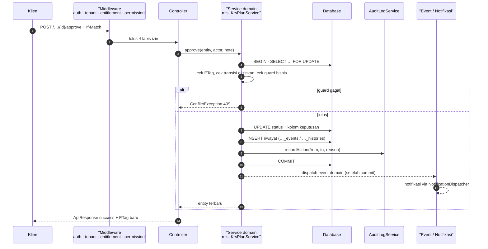

### 2.2 Aturan global

| ID | Aturan (kondisi → hasil) | Catatan |
|---|---|---|
| BR-SEC-STATE-01 | Request `PUT/PATCH` generik yang menyertakan field `status` → field diabaikan (tidak ada di `$fillable`), status tidak berubah. | Transisi hanya lewat method service bernama aksi (`submit()`, `approve()`, `lock()`, …). Pola sudah dipakai `KrsPlanService` (Ada) |
| BR-SEC-STATE-02 | Transisi yang tidak tercantum di tabel transisi entitas → **409** "Transisi status dari {dari} ke {ke} tidak diizinkan." | Peta transisi didefinisikan di PHP enum status melalui method `canTransitionTo()` (Baru) |
| BR-SEC-STATE-03 | Service membaca entitas dengan `lockForUpdate()` di dalam `DB::transaction()` sebelum memeriksa status asal → dua aksi bersamaan atas entitas yang sama diserialkan; aksi kedua melihat status baru dan ditolak 409. | Pola pessimistic lock sudah ada di `KrsPlanService::approve/reject` (Ada) |
| BR-SEC-STATE-04 | **Optimistic locking**: setiap respons `GET` entitas berstatus menyertakan header `ETag` = hash `id` + `updated_at` (presisi mikrodetik). Aksi transisi dari UI wajib mengirim `If-Match`. ETag tidak cocok → **409** "Data telah diubah oleh pengguna lain. Muat ulang lalu ulangi." | Tidak menambah kolom `version`; `updated_at` sudah ada di semua tabel (`timestampsTz`). Klien mobile lama tanpa `If-Match` tetap dilayani (hanya BR-SEC-STATE-03 yang berlaku) selama masa transisi [Rekomendasi] |
| BR-SEC-STATE-05 | Setiap transisi yang berhasil → satu baris `audit_logs` melalui `AuditLogService::recordAction()` dengan `new_values = {from, to, transition, …konteks}` dan `reason` bila diwajibkan. Kegagalan menulis audit → seluruh transaksi di-rollback. | Audit ditulis **di dalam** transaksi. Rincian field di [13-security-audit.md](13-security-audit.md) |
| BR-SEC-STATE-06 | Entitas yang punya tabel riwayat (`krs_submission_events`, `student_status_histories`, `academic_block_histories`, `grade_revisions`) → baris riwayat ditulis dalam transaksi yang sama dengan perubahan status. | Riwayat domain ≠ audit log: riwayat untuk ditampilkan ke pengguna, audit untuk pembuktian |
| BR-SEC-STATE-07 | Event domain dan notifikasi dikirim **setelah commit** (`DB::afterCommit` / event `ShouldDispatchAfterCommit`). Kegagalan kirim notifikasi tidak membatalkan transisi; kegagalan dicatat dan dicoba ulang oleh antrean. | Konsisten dengan `NotificationDispatcher` (Ada) |
| BR-SEC-STATE-08 | Transisi oleh job terjadwal (aktor `sistem`) → `audit_logs.user_id = null`, `new_values.actor = "system"`, `new_values.job = <nama job>`. | Job berjalan per tenant dengan `TenantContext` di-set eksplisit (lihat [13-security-audit.md](13-security-audit.md)) |
| BR-SEC-STATE-09 | Transisi yang ditandai *wajib alasan* dikirim tanpa `reason` atau `reason` < 10 karakter (contoh) → **422**. | `academic.audit.min_reason_length` |
| BR-SEC-STATE-10 | Status **terminal** (mis. `cancelled`, `completed`, `superseded`, `voided`, `applied`) → tidak ada transisi keluar; perubahan data selanjutnya hanya lewat entitas koreksi (mis. `grade_revisions`). | |
| BR-SEC-STATE-11 | Request transisi `POST` dengan header `Idempotency-Key` yang sama dalam 24 jam → respons pertama dikembalikan ulang, transisi tidak dieksekusi dua kali. | Wajib untuk klien mobile (jaringan tidak stabil). Detail di [08-api-specification.md](08-api-specification.md) |
| BR-SEC-STATE-12 | Transisi atas ID milik tenant lain → **404** (global scope `BelongsToInstitutionScope` menyaring sebelum guard). | |
| BR-SEC-STATE-13 | Aksi *override* (melewati guard bisnis, mis. memaksa jadwal bentrok) hanya bagi pemegang permission yang disebut di aturan terkait, wajib alasan, dan dicatat dengan `AuditAction::ForcedOverride`. | `ForcedOverride` sudah ada di enum `AuditAction` (Ada) |
| BR-SEC-STATE-14 | Transisi massal (mis. kunci semua KRS satu periode) diproses per entitas dalam transaksi terpisah; satu kegagalan tidak membatalkan entitas lain. Respons berisi ringkasan `{processed, succeeded, failed[]}`. | Dijalankan sebagai job antrean bila > 100 entitas (contoh) |
| BR-SEC-STATE-15 | Perbandingan waktu periode (buka/tutup) memakai waktu server UTC terhadap kolom `timestamptz`; tampilan memakai `universities.timezone` (Ada, default `Asia/Jakarta`). Kolom `_date` diinterpretasikan pada zona waktu tenant. | |
| BR-SEC-APV-01 | Transisi bertanda **empat mata** → pengguna yang menyetujui ≠ pengguna yang mengajukan. Pengaju = penyetuju → **403** "Persetujuan harus dilakukan oleh pengguna lain." | Berlaku juga bagi `super_admin` di konteks tenant |
| BR-SEC-APV-02 | Transisi yang memakai `ApprovalWorkflow` → status entitas hanya berubah melalui listener event `ApprovalRequestApproved/Rejected/Returned` (pola `SyncStudentRequestDecision`, Ada); endpoint entitas tidak boleh mengubah status langsung. | |

### 2.3 Daftar transisi empat mata

| Entitas | Transisi | Pengaju | Penyetuju |
|---|---|---|---|
| `grade_submissions` | `published → reopened` | dosen / `academic_administrator` | `head_of_study_program` atau `academic_administrator` lain |
| `grade_revisions` | `requested → approved` | dosen pengampu / mahasiswa | `head_of_study_program` (default, [OD-08](16-open-decisions.md#od-08)) |
| `academic_block_exemptions` | pembuatan dispensasi (`academic_blocks: active → exempted`) | `academic_administrator` / `finance_administrator` | pejabat sesuai `academic_block_rules` (mis. `vice_rector`) bila `academic.blocks.exemption_requires_approval = true` |
| `exam_attempts` | `* → voided` | `exam_proctor` / `exam_committee` | `exam_committee` lain |
| `exams` | `active → cancelled` | `exam_committee` | `academic_administrator` |
| Artefak OBE | `in_review → ratified` | `study_program_administrator` / tim kurikulum | `head_of_study_program` (dan `dean` bila dikonfigurasi) |
| `curriculums` | aktivasi versi kurikulum | `study_program_administrator` | `head_of_study_program` |
| `class_sections` | `running → cancelled` | `academic_administrator` | `head_of_study_program` |

---

## 3. State Machine per Entitas

### 3.1 KRS — `krs_submissions`

Status: `draft`, `submitted`, `revision_requested`, `approved`, `locked`, `cancelled`. Nilai lama `rejected` dimigrasikan menjadi `revision_requested` (Parsial: saat ini enum berisi `draft|submitted|approved|rejected`). **[Referensi]** A.4 langkah 9–13.

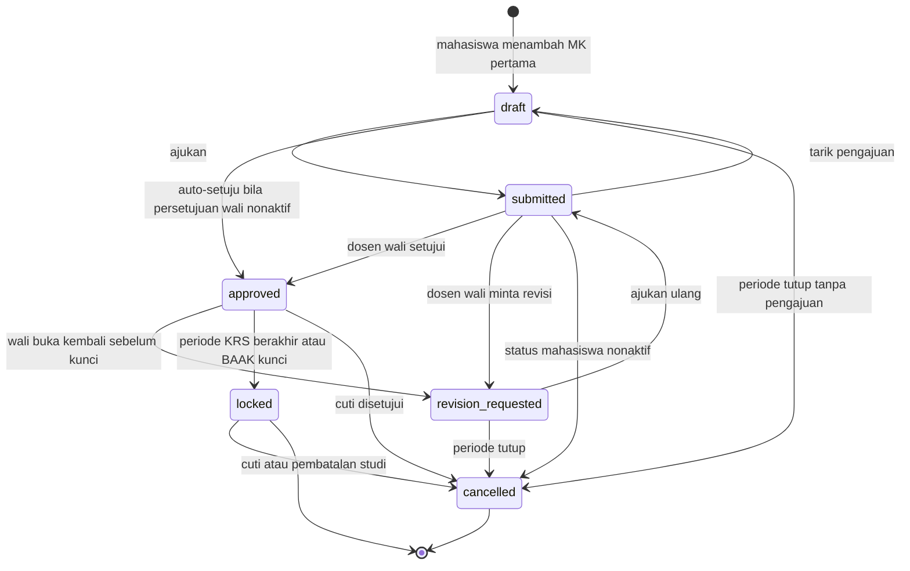

| Dari → Ke | Aksi / endpoint | Aktor | Prasyarat / guard | Efek samping |
|---|---|---|---|---|
| (baru) → `draft` | `POST /student/krs/items` (Ada) | `student` | Periode KRS terbuka (BR-SIA-KRS-01), mahasiswa `active` (BR-SIA-KRS-02), tidak tercekal layanan `krs` (BR-SIA-CKL-04) | Header dibuat bila belum ada; `krs_items.status = draft` |
| `draft → submitted` | `POST /student/krs/submit` (Ada) | `student` | Minimal satu item `draft`; total SKS ≤ batas (BR-SIA-KRS-05); tidak ada bentrok (BR-SIA-KRS-07); prasyarat (BR-SIA-KRS-04); cekal dicek ulang | Item `draft → pending`; `submitted_at`; `krs_submission_events(submitted)`; notifikasi `student.krs_submitted` ke mahasiswa dan `student.krs_review_requested` ke dosen wali & BAAK (Ada); event `KrsSubmissionSubmitted` |
| `submitted → draft` | `POST /student/krs/cancel` (Ada) | `student` | Belum diputuskan; periode masih terbuka | Item `pending → draft`; `submitted_at = null`; riwayat `withdrawn` |
| `submitted → approved` | `POST /advising/krs-submissions/{id}/approve`; `POST /krs-submissions/{id}/approve` (Ada) | `academic_advisor` (mahasiswa perwaliannya) atau `academic_administrator` (`krs.approve`) | Kapasitas setiap kelas masih cukup saat persetujuan (BR-SIA-KRS-08); cekal dicek ulang; batas SKS dicek ulang | Item `pending → enrolled`; `decided_at`, `decided_by`, `decision_note`; riwayat `approved`; audit `approved`; notifikasi `student.krs_approved` (Ada); event `KrsSubmissionApproved` → LMS menambah anggota kelas akademik, CBT menyinkronkan peserta |
| `submitted → revision_requested` | `POST /advising/krs-submissions/{id}/request-revision`; `POST /krs-submissions/{id}/reject` (Ada, makna diubah) | idem | `decision_note` wajib (BR-SIA-KRS-11) | Item `pending → draft` (kursi tetap dipegang selama periode); riwayat `revision_requested`; audit `returned`; notifikasi `student.krs_rejected` (Ada, teks diganti "perlu revisi") |
| `draft → approved` | `POST /student/krs/submit` | `sistem` | `academic.krs.require_advisor_approval = false` | Sama dengan `submitted → approved`; `decided_by = null`, riwayat mencatat `auto_approved` |
| `revision_requested → submitted` | `POST /student/krs/submit` | `student` | Sama dengan pengajuan pertama | Riwayat `resubmitted`; audit `resubmitted` |
| `approved → revision_requested` | `POST /advising/krs-submissions/{id}/reopen` | `academic_advisor`, `academic_administrator` | Belum `locked`; periode KRS masih terbuka; wajib alasan | Item `enrolled → draft`; LMS/CBT menarik keanggotaan; notifikasi `student.krs_reopened` [Rekomendasi] |
| `approved → locked` | Job `LockKrsSubmissionsJob` saat periode `krs` berakhir; `POST /krs-submissions/lock` (massal) | `sistem`, `academic_administrator` | Periode KRS telah lewat **atau** BAAK mengunci manual | `locked_at`; riwayat `locked`; KHS/presensi memakai daftar final |
| `draft/submitted/revision_requested → cancelled` | Job penutupan periode | `sistem` | Periode tutup dan bukan `approved` | Item `draft/pending → dropped`; kursi dilepas; notifikasi `student.krs_expired` ke mahasiswa & dosen wali |
| `approved/locked → cancelled` | Listener `student_requests` cuti disetujui; `POST /krs-submissions/{id}/cancel` | `sistem`, `academic_administrator` | Alasan wajib bila manual | Item `enrolled → dropped`; LMS/CBT menarik akses; presensi & nilai tidak dihapus |

**Perubahan setelah `locked`** (add/drop, A.4 langkah 12): header tetap `locked`. Perubahan dilakukan per `krs_items` selama periode `add_drop` di `academic_term_periods`, dicatat sebagai `krs_submission_events` jenis `change_requested` → `change_approved/change_rejected`, dan tetap memerlukan persetujuan dosen wali. Jumlah dan jenis perubahan bergantung pada [OD-09](16-open-decisions.md#od-09).

### 3.2 Baris KRS — `krs_items`

Status: `draft`, `pending`, `enrolled`, `dropped` (Ada). `seatHolding()` = `draft`, `pending`, `enrolled` (Ada).

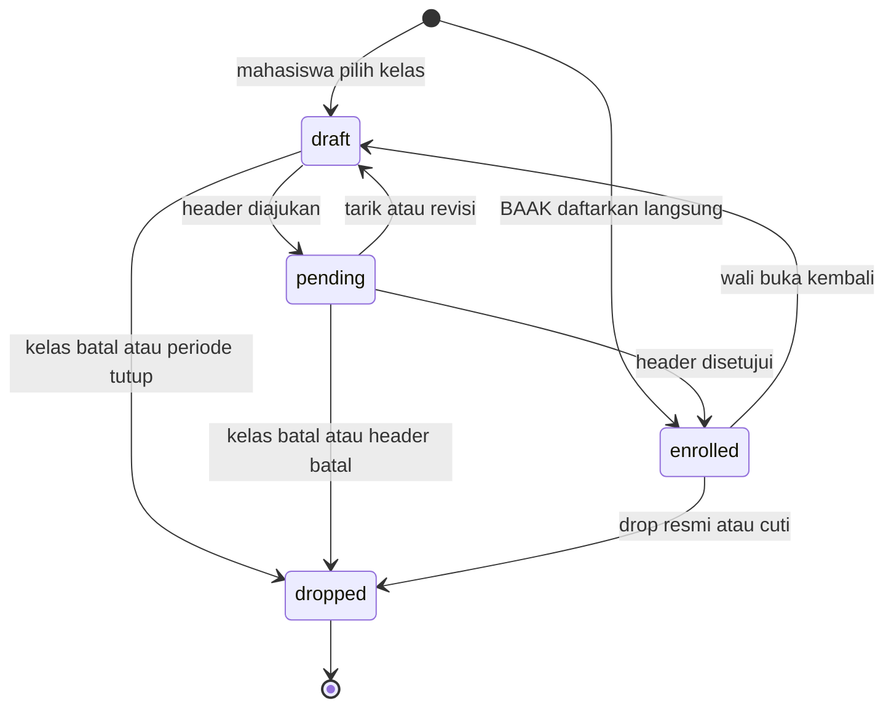

| Dari → Ke | Aksi / endpoint | Aktor | Prasyarat / guard | Efek samping |
|---|---|---|---|---|
| (baru) → `draft` | `POST /student/krs/items` (Ada) | `student` | BR-SIA-KRS-01…09 | Kursi dipegang |
| (baru) → `enrolled` | `POST /krs-items` (Ada) | `academic_administrator` | Guard sama; override wajib alasan (BR-SIA-KRS-14) | Audit `created` (+ `forced_override` bila override) |
| `draft` → (hapus) | `DELETE /student/krs/items/{id}` (Ada) | `student` | Header `draft`/`revision_requested` | Baris dihapus fisik (belum pernah diajukan, tidak punya riwayat bernilai) |
| `draft → pending`, `pending → draft`, `pending → enrolled`, `enrolled → draft` | Mengikuti transisi header §3.1 | — | — | — |
| `enrolled → dropped` | `PATCH /krs-items/{id}/drop` (Ada) | `academic_administrator`; `student` hanya dalam periode add/drop | Belum ada nilai `published` (BR-SIA-KRS-16) | `dropped_at`; presensi & pengumpulan tugas tetap ada, ditandai tidak aktif; LMS mencabut akses tulis |
| `draft/pending → dropped` | Pembatalan kelas / header | `sistem` | — | Notifikasi `student.class_cancelled` |

### 3.3 Kelas — `class_sections`

Status: `planned`, `open`, `running`, `completed`, `cancelled` (Baru; saat ini hanya `is_active`). Migrasi: `is_active = true` → `open` bila term berjalan sebelum masa kuliah, `running` bila masa kuliah, `completed` bila term selesai; `is_active = false` → `cancelled`.

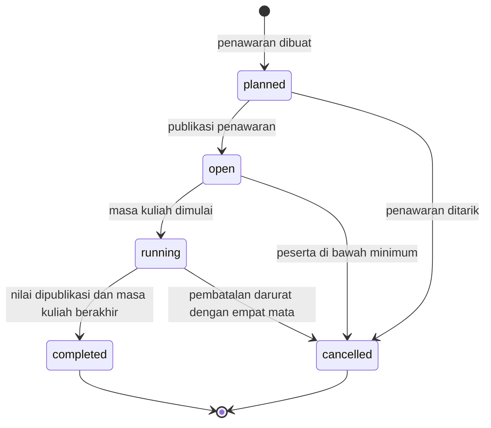

| Dari → Ke | Aksi / endpoint | Aktor | Prasyarat / guard | Efek samping |
|---|---|---|---|---|
| (baru) → `planned` | `POST /class-sections` | `academic_administrator`, `study_program_administrator` (prodinya) | MK ada di versi kurikulum yang dipakai angkatan sasaran (BR-SIA-KLS-01); `class_code` unik per term+MK | — |
| `planned → open` | `POST /class-sections/{id}/open` | idem | Dosen koordinator (`lecturer_id`) terisi (BR-SIA-KLS-03); kapasitas > 0; minimal satu `class_schedules` `published` (BR-SIA-KLS-04) | Kelas muncul di `student/krs/offerings`; event `ClassSectionOpened` → LMS membuat `lms_classes` akademik `draft` |
| `planned → cancelled` | `POST /class-sections/{id}/cancel` | idem | Wajib alasan | Jadwal `→ cancelled` |
| `open → running` | Job harian | `sistem` | Tanggal hari ini ≥ awal periode `lecture` | `lecture_sessions` dibangkitkan dari jadwal; `lms_classes → active` |
| `open → cancelled` | `POST /class-sections/{id}/cancel` | `academic_administrator` | Wajib alasan; bila jumlah peserta < `academic.class.min_participants` maka sistem menyarankan pembatalan (tidak otomatis) | Item `→ dropped`; jadwal `→ cancelled`; notifikasi `student.class_cancelled` ke peserta & dosen; audit |
| `running → completed` | Job / `POST /class-sections/{id}/complete` | `sistem`, `academic_administrator` | `grade_submissions.status = published`; periode `lecture` berakhir | LMS `lms_classes → archived` setelah `academic.lms.archive_after_days`; EDOM mengunci target |
| `running → cancelled` | `POST /class-sections/{id}/cancel` | `academic_administrator` + persetujuan `head_of_study_program` (empat mata) | Wajib alasan; tidak ada nilai `published` | Sesi mendatang `→ cancelled`; item `→ dropped`; audit `forced_override` |

### 3.4 Jadwal — `class_schedules`

Status: `draft`, `in_review`, `published`, `cancelled` (Baru). "Diubah" = revisi atas `published` yang **tidak** mengubah status, tetapi menulis riwayat dan memicu notifikasi.

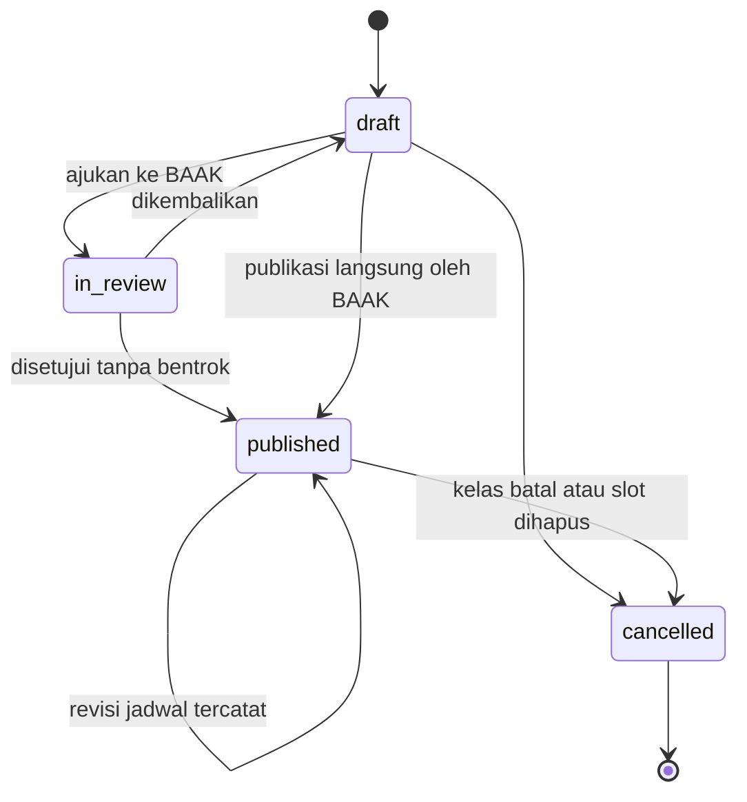

| Dari → Ke | Aksi / endpoint | Aktor | Prasyarat / guard | Efek samping |
|---|---|---|---|---|
| (baru) → `draft` | `POST /class-sections/{id}/schedules` | `study_program_administrator`, `academic_administrator` | `start_time < end_time`; `room_id` aktif; `schedule_type` valid | — |
| `draft → in_review` | `POST /class-schedules/{id}/submit` | `study_program_administrator` | Lolos cek bentrok ruang, dosen, dan kelompok (BR-SIA-JDW-01…04) | Notifikasi ke BAAK |
| `in_review → draft` | `POST /class-schedules/{id}/return` | `academic_administrator` | Catatan wajib | Notifikasi ke pengaju |
| `in_review/draft → published` | `POST /class-schedules/{id}/publish`; `POST /class-schedules/publish` (massal per term/prodi) | `academic_administrator` | Cek bentrok diulang di dalam lock (BR-SIA-JDW-05) | Jadwal tampil di portal; event `ClassSchedulePublished` |
| `published → published` (revisi) | `PUT /class-schedules/{id}` | `academic_administrator` | Cek bentrok; wajib alasan; bila sudah ada sesi `held`, perubahan hanya berlaku untuk sesi mendatang (BR-SIA-JDW-07) | Riwayat perubahan (nilai lama/baru); sesi mendatang disesuaikan; notifikasi `student.schedule_changed` & `lecturer.schedule_changed` (BR-SIA-JDW-08) |
| `* → cancelled` | `POST /class-schedules/{id}/cancel` | `academic_administrator` | Wajib alasan | Sesi `scheduled` terkait `→ cancelled` |

### 3.5 Sesi perkuliahan — `lecture_sessions`

Status: `scheduled`, `ongoing`, `held`, `cancelled`, `rescheduled` (Baru). Satu baris = satu pertemuan sekaligus jurnal mengajar/BAP.

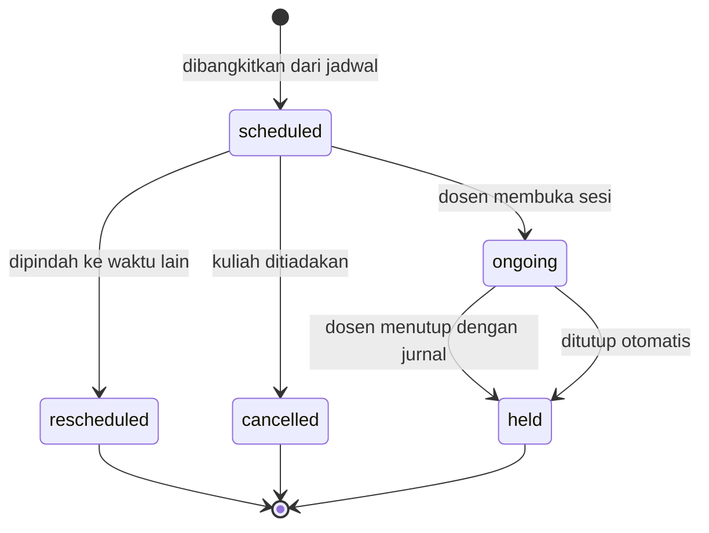

| Dari → Ke | Aksi / endpoint | Aktor | Prasyarat / guard | Efek samping |
|---|---|---|---|---|
| (baru) → `scheduled` | Job pembangkitan / `POST /teaching/classes/{id}/lecture-sessions` (sesi tambahan) | `sistem`, `lecturer` (kelas yang diampu) | Kelas `running`/`open`; `meeting_number` unik per kelas | — |
| `scheduled → ongoing` | `POST /teaching/lecture-sessions/{id}/start` | `lecturer` pengajar kelas (`class_section_lecturers`) | Waktu sekarang dalam jendela `[mulai − academic.attendance.open_before_minutes, selesai]` (BR-SIA-PRS-02) | Daftar hadir dibuat untuk semua `krs_items enrolled` dengan status awal kosong; token QR boleh diterbitkan (BR-LMS-QR-01) |
| `ongoing → held` | `POST /teaching/lecture-sessions/{id}/close` | `lecturer` | Topik/realisasi materi terisi (BR-SIA-PRS-05) | Peserta tanpa status → `absent`; token QR dicabut; realisasi RPS dihitung; event `LectureSessionHeld` |
| `ongoing → held` (otomatis) | Job | `sistem` | Lewat `academic.attendance.auto_close_hours` setelah jam selesai | Sama; sesi ditandai jurnal belum lengkap di laporan realisasi |
| `scheduled → cancelled` | `POST /teaching/lecture-sessions/{id}/cancel` | `lecturer`, `academic_administrator` | Wajib alasan | Notifikasi `student.session_cancelled`; tidak dihitung dalam pembagi persentase kehadiran (BR-SIA-PRS-09) |
| `scheduled → rescheduled` | `POST /teaching/lecture-sessions/{id}/reschedule` | `lecturer` (dengan persetujuan BAAK bila `academic.schedule.reschedule_requires_approval`) | Slot baru lolos cek bentrok ruang & dosen | Sesi baru `scheduled` dibuat dengan `meeting_number` sama; notifikasi `student.session_rescheduled` |

Koreksi presensi setelah `held` **tidak** mengubah status sesi; koreksi melalui `attendance_corrections` (BR-SIA-PRS-10…12).

### 3.6 Lembar nilai — `grade_submissions`

Status: `draft`, `submitted`, `in_review`, `published`, `reopened` (Baru). Satu baris per `class_section`.

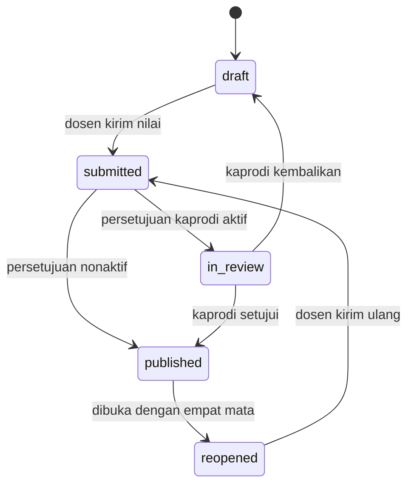

| Dari → Ke | Aksi / endpoint | Aktor | Prasyarat / guard | Efek samping |
|---|---|---|---|---|
| (baru) → `draft` | Otomatis saat kelas `open` | `sistem` | — | — |
| `draft → submitted` | `POST /teaching/classes/{id}/grade-submission/submit` | `lecturer` koordinator/pengajar yang diberi hak nilai | Periode `grading` terbuka (BR-SIA-NIL-01); bobot komponen = 100% (BR-SIA-NIL-03); semua nilai komponen terisi atau kebijakan nilai kosong terpenuhi (BR-SIA-NIL-05) | Nilai akhir & huruf dihitung (BR-SIA-NIL-06…09) dan dibekukan sebagai snapshot; dosen tidak bisa mengubah `assessment_scores` |
| `submitted → in_review` | Otomatis | `sistem` | `academic.grading.require_approval = true` ([OD-07](16-open-decisions.md#od-07)) | Notifikasi ke `head_of_study_program` prodi kelas |
| `submitted → published` / `in_review → published` | Otomatis / `POST /grade-submissions/{id}/approve` | `sistem` / `head_of_study_program` | Untuk `in_review`: penyetuju ≠ pengirim | `grades.is_published = true`; IPS/IPK dihitung ulang; notifikasi `student.grade_published` (Ada); event `GradeSubmissionPublished` → OBE menghitung ulang capaian, akses orang tua terbuka |
| `in_review → draft` | `POST /grade-submissions/{id}/return` | `head_of_study_program` | Catatan wajib | Snapshot dilepas; notifikasi ke dosen |
| `published → reopened` | `POST /grade-submissions/{id}/reopen` | Pengajuan oleh `lecturer`/`academic_administrator`, disetujui `head_of_study_program` (empat mata) | Dalam `academic.grading.reopen_window_days` sejak publikasi; alasan wajib | Nilai tetap tampil (versi lama) sampai dipublikasi ulang; audit `forced_override` |
| `reopened → submitted` | idem `submit` | `lecturer` | Sama dengan pengiriman pertama | Perubahan nilai per mahasiswa dicatat sebagai `grade_revisions` jenis `correction` yang otomatis `applied` saat publikasi ulang |

Perubahan nilai **satu mahasiswa** setelah publikasi tidak membuka seluruh lembar; gunakan `grade_revisions` (§3.7).

### 3.7 Revisi nilai — `grade_revisions`

Status: `requested`, `approved`, `rejected`, `applied` (Baru). `revision_type`: `correction` (perbaikan salah input) atau `remediation` (pemutihan/perbaikan nilai).

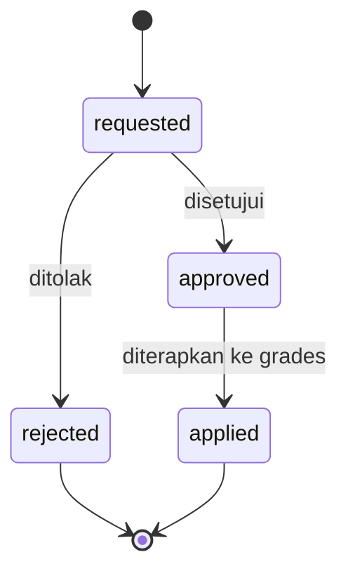

| Dari → Ke | Aksi / endpoint | Aktor | Prasyarat / guard | Efek samping |
|---|---|---|---|---|
| (baru) → `requested` | `POST /grade-revisions` | `lecturer` pengampu (`correction`); `academic_administrator` (`remediation` atas permohonan mahasiswa via `student_requests`) | Nilai sudah `published`; dalam `academic.grading.revision_window_days` untuk `correction`; nilai lama & baru serta alasan & lampiran bukti wajib (BR-SIA-NIL-14) | Notifikasi ke penyetuju |
| `requested → approved` | `POST /grade-revisions/{id}/approve` | `head_of_study_program` (default [OD-08](16-open-decisions.md#od-08)) | Penyetuju ≠ pengaju (BR-SEC-APV-01) | Audit `approved` |
| `requested → rejected` | `POST /grade-revisions/{id}/reject` | idem | Catatan wajib | Notifikasi ke pengaju |
| `approved → applied` | Otomatis dalam transaksi yang sama dengan persetujuan | `sistem` | Nilai `grades` saat ini masih sama dengan `old_value` di revisi (deteksi konflik) | `grades` diperbarui; IPS/IPK dihitung ulang; transkrip memakai kebijakan `academic.repeat_grade_policy`; notifikasi `student.grade_revised`; event `GradeRevised` → OBE |

### 3.8 Cekal — `academic_blocks`

Status: `active`, `exempted`, `revoked`, `expired` (Baru). Satu baris = satu cekal untuk satu mahasiswa, satu jenis (`block_type`), satu term, satu daftar layanan yang dibatasi (`krs`, `exam`, `grade_view`, `yudisium`, sesuai `academic_block_rules`).

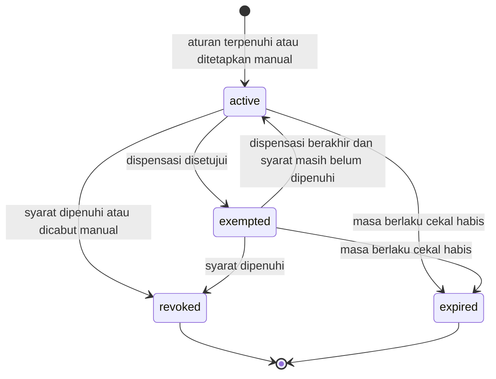

| Dari → Ke | Aksi / endpoint | Aktor | Prasyarat / guard | Efek samping |
|---|---|---|---|---|
| (baru) → `active` | Job evaluasi aturan (`EvaluateAcademicBlocksJob`), event dari Keuangan/Perpustakaan/Kemahasiswaan; `POST /academic-blocks` (manual) | `sistem`; `academic_administrator` / `finance_administrator` (manual) | Aturan aktif (`academic_block_rules`), sumber data valid (BR-SIA-CKL-01…03); manual wajib alasan | `academic_block_histories(created)`; notifikasi `student.block_applied` berisi alasan & cara menyelesaikan (BR-SIA-CKL-12) |
| `active → exempted` | `POST /academic-blocks/{id}/exemptions` (+ persetujuan bila dikonfigurasi) | `academic_administrator` / `finance_administrator` (sesuai jenis); penyetuju sesuai aturan | `valid_until` wajib dan ≤ `academic.blocks.max_exemption_days`; alasan & dokumen pendukung wajib (BR-SIA-CKL-08) | `academic_block_exemptions` dibuat; riwayat; audit `approved`; notifikasi `student.block_exempted` |
| `exempted → active` | Job harian | `sistem` | `valid_until` lewat dan sumber masih menyatakan syarat belum terpenuhi | Riwayat `exemption_expired`; notifikasi |
| `active/exempted → revoked` | Event sumber (mis. tagihan lunas) / `POST /academic-blocks/{id}/revoke` | `sistem`; pemberi cekal manual | Manual wajib alasan | Riwayat; layanan dibuka; notifikasi `student.block_revoked` |
| `active/exempted → expired` | Job | `sistem` | `expires_at` lewat (mis. akhir term) | Riwayat |

### 3.9 Layanan mahasiswa & cuti — `student_requests`

Status: `draft`, `submitted`, `approved`, `rejected`, `cancelled` (Ada). Keputusan lewat `ApprovalWorkflow` (Ada). Tipe yang relevan: `leave` (cuti), `reactivation` (aktif kembali).

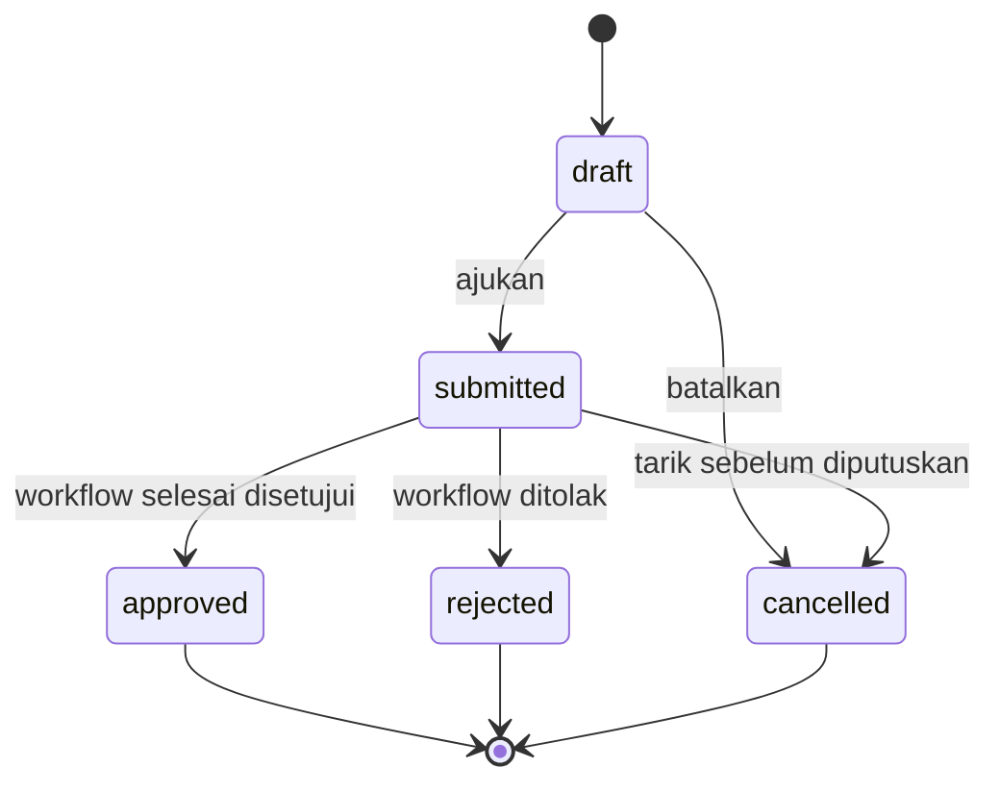

| Dari → Ke | Aksi / endpoint | Aktor | Prasyarat / guard | Efek samping |
|---|---|---|---|---|
| `draft → submitted` | `POST /student/requests/{id}/submit` (Ada) | `student` | Untuk `leave`: BR-SIA-CUT-01…04 | `ApprovalRequestService::submit()` (Ada); notifikasi `student.request_submitted` (Ada) |
| `submitted → approved` | Listener `SyncStudentRequestDecision` (Ada) atas `ApprovalRequestApproved` | Approver workflow (mis. `academic_advisor` → `head_of_study_program` → `academic_administrator`) | Seluruh langkah workflow disetujui | `leave`: `students.status → leave` + `student_status_histories` (Ada via `StudentObserver`); KRS term terkait `→ cancelled` (§3.1); tagihan diteruskan ke Keuangan sesuai kebijakan. `reactivation`: `students.status → active`. Notifikasi `student.request_decided` (Ada) |
| `submitted → rejected` | Listener atas `ApprovalRequestRejected` | Approver | Catatan wajib | Notifikasi `student.request_decided` |
| `draft/submitted → cancelled` | `POST /student/requests/{id}/cancel` (Ada) | `student` | Belum diputuskan | Approval request dibatalkan |

### 3.10 Tugas akhir — `theses`

Status kanon: `submitted`, `in_review`, `approved`, `in_supervision`, `ready_for_defense`, `completed`, `rejected`, `cancelled`. Enum lama (`proposal|bimbingan|seminar_proposal|penelitian|sidang|selesai`) dipetakan sesuai [01-siakad.md](01-siakad.md) §A.9. Ujian seminar proposal dan sidang dicatat di `thesis_examinations` dengan hasilnya sendiri.

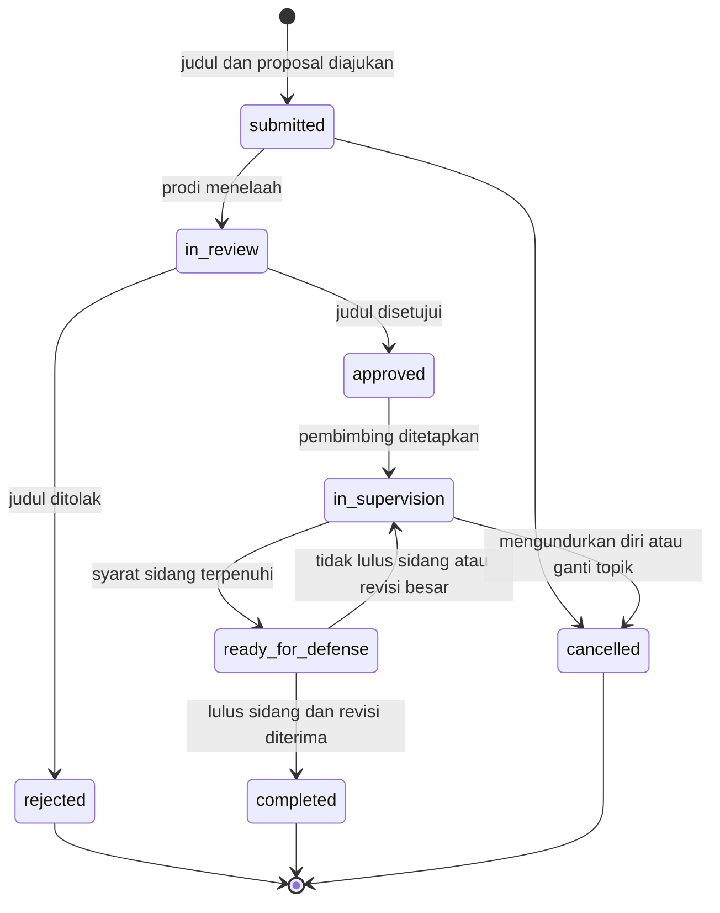

| Dari → Ke | Aksi / endpoint | Aktor | Prasyarat / guard | Efek samping |
|---|---|---|---|---|
| (baru) → `submitted` | `POST /student/theses` | `student` | BR-SIA-TA-01 (SKS minimum, MK prasyarat TA dalam KRS) | Notifikasi ke `study_program_administrator` |
| `submitted → in_review` | `POST /theses/{id}/review` | `study_program_administrator`, `head_of_study_program` | — | — |
| `in_review → approved / rejected` | `POST /theses/{id}/approve` / `reject` | `head_of_study_program` | Catatan wajib saat menolak | Notifikasi `student.thesis_decided` |
| `approved → in_supervision` | `POST /theses/{id}/supervisors` | `head_of_study_program` | Jumlah pembimbing sesuai `academic.thesis.max_supervisors`; kuota bimbingan dosen (BR-SIA-TA-03) | `thesis_supervisors` dibuat; notifikasi ke pembimbing |
| `in_supervision → ready_for_defense` | `POST /theses/{id}/ready-for-defense` | Pembimbing utama | Jumlah `thesis_guidance_records` tervalidasi ≥ `academic.thesis.min_guidance_sessions` (BR-SIA-TA-04); tidak tercekal layanan `thesis_defense` | Penjadwalan `thesis_examinations` dibuka |
| `ready_for_defense → completed` | Hasil `thesis_examinations` = lulus + revisi disetujui | `head_of_study_program` | Seluruh penguji mengisi nilai | Nilai TA dikirim ke `grades` MK TA; event `ThesisCompleted` (masukan Yudisium) |
| `ready_for_defense → in_supervision` | Hasil sidang = tidak lulus / revisi besar | `head_of_study_program` | — | Riwayat ujian disimpan |
| `submitted/in_supervision → cancelled` | `POST /theses/{id}/cancel` | `student` (dengan persetujuan prodi), `head_of_study_program` | Alasan wajib | Pembimbing dilepas; riwayat bimbingan tetap |

### 3.11 Program MBKM — `mbkm_programs`

Status: `draft`, `offered`, `registration_open`, `selection`, `running`, `evaluating`, `completed`, `cancelled` (Baru). Berlaku untuk semua bentuk kegiatan MBKM ([Referensi] A.10): pertukaran antarprodi, pertukaran dengan PT eksternal, magang, asistensi mengajar, penelitian, proyek kemanusiaan, wirausaha, studi independen, KKN tematik.

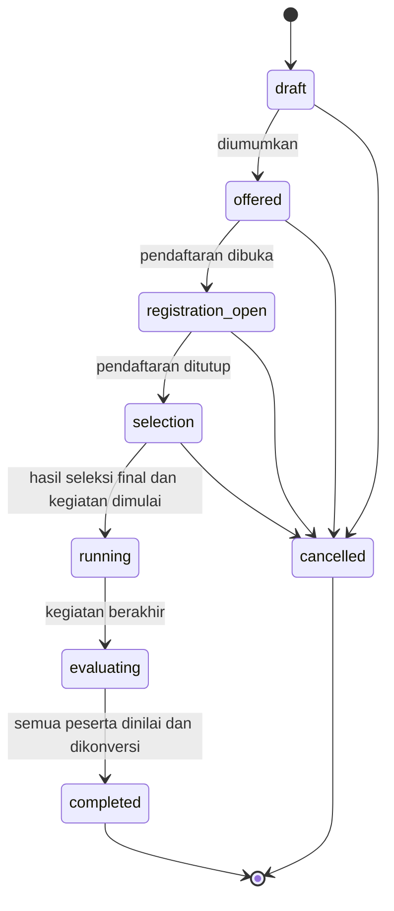

| Dari → Ke | Aksi / endpoint | Aktor | Prasyarat / guard | Efek samping |
|---|---|---|---|---|
| (baru) → `draft` | `POST /mbkm/programs` | `academic_administrator`, `study_program_administrator` | Mitra (`mbkm_partners`) aktif bila kegiatan eksternal (BR-MBK-PRG-01) | — |
| `draft → offered` | `POST /mbkm/programs/{id}/offer` | idem | Kuota, kriteria kelayakan, rencana konversi SKS/MK, dan periode diisi (BR-MBK-PRG-02) | Tampil di portal mahasiswa |
| `offered → registration_open` | Job pada `registration_starts_at` / manual | `sistem`, admin | — | Notifikasi `student.mbkm_registration_opened` ke mahasiswa yang memenuhi syarat |
| `registration_open → selection` | Job pada `registration_ends_at` | `sistem` | — | Pendaftaran ditolak sesudahnya |
| `selection → running` | `POST /mbkm/programs/{id}/start` | admin | Semua `mbkm_participations` `applied` sudah diputuskan; minimal satu `selected` | Peserta `selected → active`; pembimbing wajib ditetapkan (BR-MBK-PAR-04) |
| `running → evaluating` | Job pada tanggal selesai | `sistem` | — | Pembimbing/mitra diminta mengisi `mbkm_assessments` |
| `evaluating → completed` | `POST /mbkm/programs/{id}/complete` | admin | Semua peserta `converted`, `completed`, atau `withdrawn` | Event `MbkmProgramCompleted` → snapshot IKU (paket Enterprise, BR-MBK-IKU-01) |
| `* → cancelled` (sebelum `running`) | `POST /mbkm/programs/{id}/cancel` | admin | Alasan wajib | Peserta `→ withdrawn`; notifikasi |

### 3.12 Keikutsertaan MBKM — `mbkm_participations`

Status: `applied`, `selected`, `rejected`, `active`, `evaluated`, `converted`, `completed`, `withdrawn` (Baru).

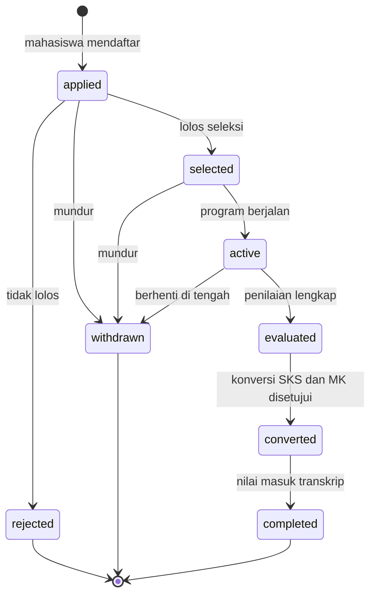

| Dari → Ke | Aksi / endpoint | Aktor | Prasyarat / guard | Efek samping |
|---|---|---|---|---|
| (baru) → `applied` | `POST /mbkm/programs/{id}/applications` | `student` | Program `registration_open`; kelayakan (semester, IPK minimum contoh, status `active`, tidak tercekal) — BR-MBK-PAR-01; tidak ada keikutsertaan aktif yang tumpang tindih (BR-MBK-PAR-02) | Dokumen pendukung wajib sesuai program |
| `applied → selected / rejected` | `POST /mbkm/participations/{id}/select` / `reject` | `academic_administrator`, `head_of_study_program` | Kuota program belum penuh untuk `selected` | Notifikasi `student.mbkm_selection` |
| `selected → active` | Otomatis saat program `running` | `sistem` | Pembimbing (dosen) ditetapkan; rencana konversi disetujui kaprodi (BR-MBK-KNV-01) | KRS term berjalan memuat MK konversi sebagai `enrolled` khusus MBKM bila dikonfigurasi |
| `active → evaluated` | Penilaian `mbkm_assessments` lengkap | `sistem` | Logbook minimal sesuai `academic.mbkm.min_logbook_entries` (BR-MBK-PAR-05); nilai pembimbing & mitra terisi | — |
| `evaluated → converted` | `POST /mbkm/participations/{id}/conversion/approve` | `head_of_study_program` | `credit_conversions` (`source_type = mbkm`) disetujui; total SKS ≤ `academic.mbkm.max_conversion_credits` (BR-MBK-KNV-02) | `credit_conversion_items` dibuat |
| `converted → completed` | Otomatis | `sistem` | Nilai konversi diterbitkan ke `grades` | IPS/IPK dihitung ulang; notifikasi |
| `* → withdrawn` | `POST /mbkm/participations/{id}/withdraw` | `student` (dengan persetujuan prodi saat `active`), admin | Alasan wajib | Konsekuensi akademik ditentukan prodi (KRS MK konversi `→ dropped`) |

### 3.13 Kelas LMS — `lms_classes`

Status: `draft`, `active`, `archived` (Baru). `class_type = academic` dibentuk dari `class_sections`; `class_type = general` dibuat bebas dalam batas kuota (BR-LMS-KLS-04).

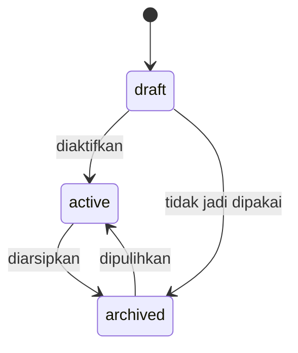

| Dari → Ke | Aksi / endpoint | Aktor | Prasyarat / guard | Efek samping |
|---|---|---|---|---|
| (baru) → `draft` | Event `ClassSectionOpened` (akademik); `POST /lms/classes` (umum) | `sistem`; `lecturer`, `lms_administrator` | Umum: kuota `lms.general_classes_per_term` belum habis (BR-ENT-LIM-02) | Akademik: tidak ada salinan peserta; anggota = `krs_items enrolled` + `class_section_lecturers` |
| `draft → active` | Event `ClassSectionOpened`→running / `POST /lms/classes/{id}/activate` | `sistem`; pengajar | Fitur `lms` aktif untuk tenant | Notifikasi ke anggota |
| `active → archived` | Job (`academic.lms.archive_after_days` setelah kelas `completed`) / `POST /lms/classes/{id}/archive` | `sistem`; pengajar; `lms_administrator` | — | Kelas baca-saja; pengumpulan baru ditolak; berkas tetap dihitung storage sampai dihapus sesuai retensi ([OD-20](16-open-decisions.md#od-20)) |
| `archived → active` | `POST /lms/classes/{id}/restore` | `lms_administrator` | Kelas umum: kuota tersedia ([OD-27](16-open-decisions.md#od-27)); kelas akademik: `class_sections` belum `completed` | — |

### 3.14 Butir bank soal — `question_bank_items`

Status: `draft`, `in_review`, `published`, `retired` (Baru; saat ini tanpa status). Butir lama dimigrasikan menjadi `published`.

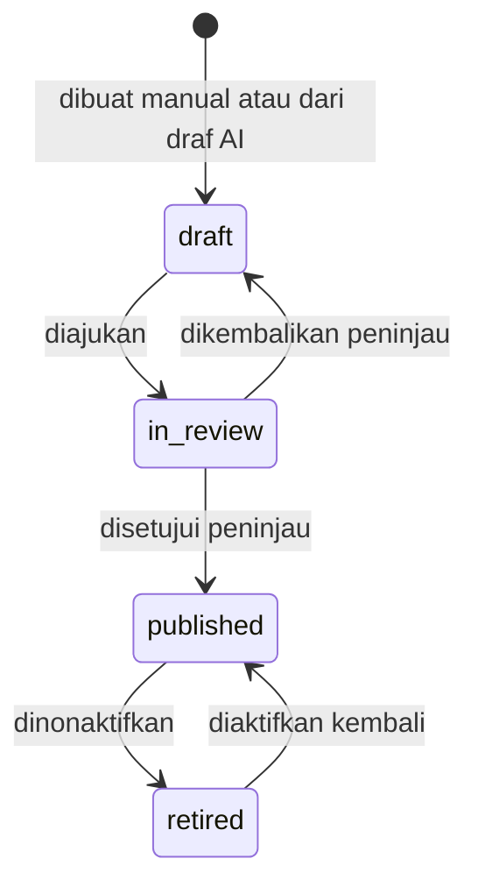

| Dari → Ke | Aksi / endpoint | Aktor | Prasyarat / guard | Efek samping |
|---|---|---|---|---|
| (baru) → `draft` | `POST /question-banks/{id}/items`; `POST /cbt/ai-jobs/{id}/drafts/{draftId}/accept` | `lecturer` penyusun; `exam_committee` | Kunci jawaban & bobot valid sesuai `question_type` (BR-CBT-BNK-01) | Butir dari AI mencatat `ai_question_drafts` asal (BR-CBT-AI-02) |
| `draft → in_review` | `POST /question-bank-items/{id}/submit-review` | penyusun | Field wajib lengkap | Notifikasi ke peninjau |
| `in_review → published` | `POST /question-bank-items/{id}/approve` | Peninjau (`exam_committee` atau dosen yang ditunjuk) | Peninjau ≠ penyusun (BR-CBT-BNK-03) | Butir dapat dipakai `apply-bank` |
| `in_review → draft` | `POST /question-bank-items/{id}/return` | Peninjau | Catatan wajib | — |
| `published → retired` | `POST /question-bank-items/{id}/retire` | penyusun, `exam_committee` | — | Tidak bisa dipilih untuk ujian baru; ujian yang sudah memakai salinan tidak terpengaruh (soal ujian adalah salinan, Ada) |
| `retired → published` | `POST /question-bank-items/{id}/reactivate` | `exam_committee` | — | — |

Mengubah isi butir `published` → butir kembali ke `draft` (versi baru) bila `academic.cbt.require_review = true`; jika tidak, perubahan langsung dengan audit.

### 3.15 Ujian — `exams`

Status: `draft`, `scheduled`, `active`, `finished`, `grading`, `graded`, `published`, `cancelled` (Baru; saat ini `is_published` + `starts_at/ends_at`). Migrasi: `is_published = false` → `draft`; `true` dan sebelum `starts_at` → `scheduled`; antara → `active`; sesudah → `graded` (pilihan ganda dinilai otomatis).

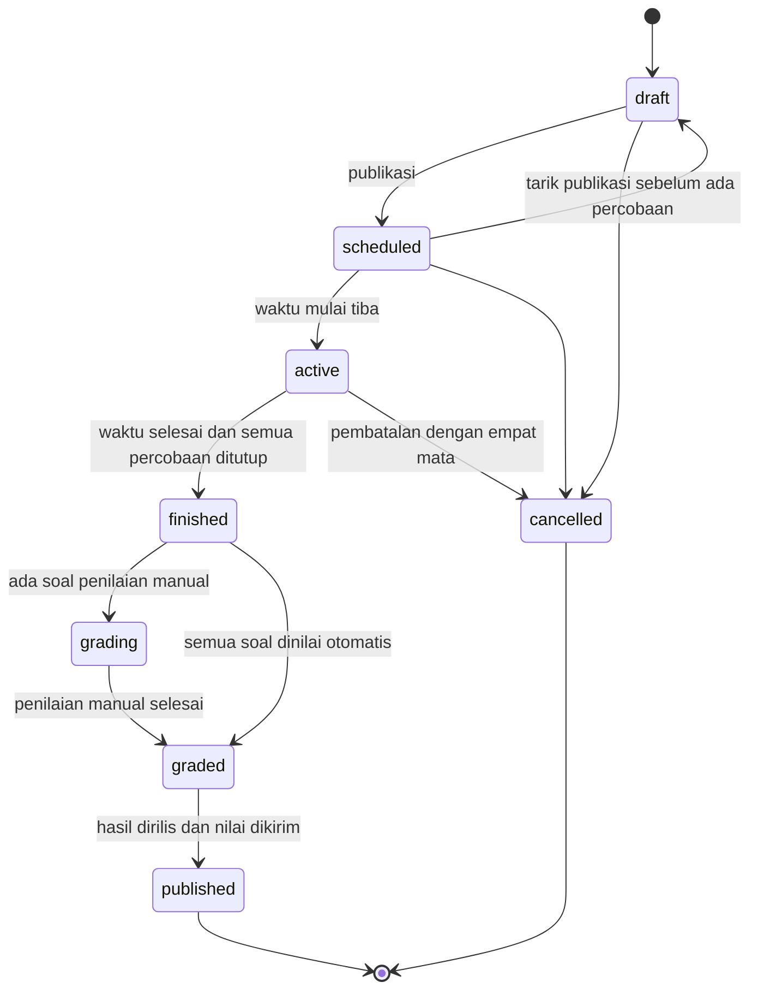

| Dari → Ke | Aksi / endpoint | Aktor | Prasyarat / guard | Efek samping |
|---|---|---|---|---|
| `draft → scheduled` | `PATCH /exams/{id}/publish` (Ada) | `lecturer` pengampu (bila `academic.lecturer_ownership`), `exam_committee` | Jumlah soal ≥ `questions_per_participant`; semua soal punya kunci; `starts_at < ends_at`; durasi ≤ jendela; jadwal di dalam periode ujian bila `exam_type` UTS/UAS (BR-CBT-UJN-02); peserta tersinkron (BR-CBT-UJN-04); fitur `cbt` aktif | `published_at`; peserta dibangkitkan di `exam_participants`; notifikasi `student.exam_scheduled`; muncul di kalender |
| `scheduled → draft` | `PATCH /exams/{id}/unpublish` | idem | Belum ada `exam_attempts` | — |
| `scheduled → active` | Job / evaluasi saat akses | `sistem` | `now() ≥ starts_at` | Peserta yang tercekal layanan `exam` atau kehadiran < minimum ditolak saat mulai (BR-CBT-ATT-01) |
| `active → finished` | Job | `sistem` | `now() ≥ ends_at + academic.cbt.reconnect_grace_minutes` | Percobaan `in_progress → auto_submitted` |
| `finished → graded` / `finished → grading` | Otomatis | `sistem` | Ada/tidaknya soal esai | Skor otomatis dihitung (Ada untuk pilihan ganda) |
| `grading → graded` | `POST /exams/{id}/grading/complete` | `lecturer` pengampu | Semua jawaban manual dinilai | — |
| `graded → published` | `POST /exams/{id}/results/publish` | `lecturer`, `exam_committee` | Pelanggaran yang ditandai sudah ditinjau (BR-CBT-PRC-04) | Hasil terlihat peserta bila `show_result_after_submission`; skor dikirim ke `assessment_scores` komponen terkait (BR-CBT-NIL-01) **sebelum** `grade_submissions` `submitted`; event `ExamResultsPublished` |
| `draft/scheduled → cancelled` | `POST /exams/{id}/cancel` | pemilik ujian, `exam_committee` | Alasan wajib | Notifikasi peserta |
| `active → cancelled` | idem + persetujuan `academic_administrator` | `exam_committee` | Empat mata; alasan wajib | Semua percobaan `→ voided`; ujian pengganti dibuat terpisah |

### 3.16 Percobaan ujian — `exam_attempts`

Status: `in_progress`, `submitted`, `auto_submitted`, `graded`, `voided` (Parsial: saat ini `in_progress|submitted`).

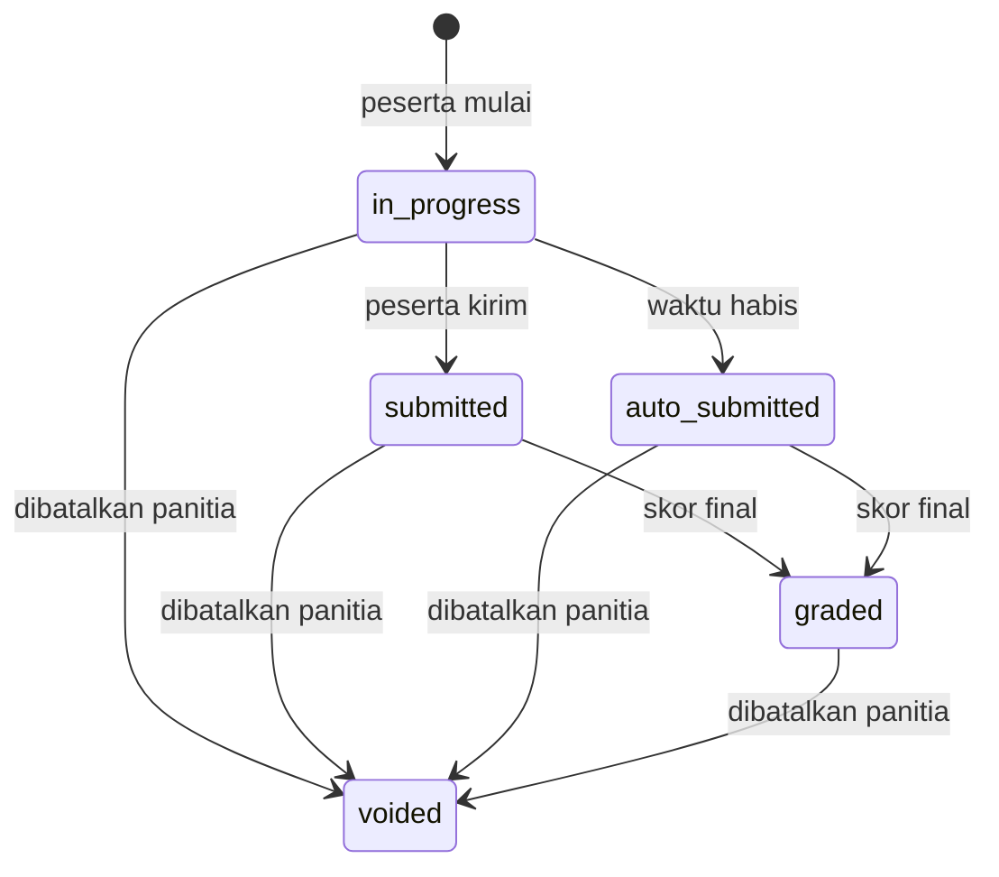

| Dari → Ke | Aksi / endpoint | Aktor | Prasyarat / guard | Efek samping |
|---|---|---|---|---|
| (baru) → `in_progress` | `POST /student/exams/{id}/start` (Ada); `POST /public/exams/{token}/access` (Ada) | `student`; peserta PMB | Ujian `active`; peserta terdaftar di `exam_participants`; `attempt_number ≤ max_attempts` (Ada); tidak tercekal (BR-CBT-ATT-01) | `question_order`/`option_order` diacak (Ada); `session_token_hash` (Ada) |
| `in_progress → submitted` | `PATCH /student/exam-attempts/{id}/submit` (Ada) | peserta | Token sesi valid; sebelum `deadline` peserta | Skor otomatis; idempoten (kirim ulang → 200 dengan hasil sama) |
| `in_progress → auto_submitted` | Job / saat request berikutnya setelah waktu habis | `sistem` | `now() ≥ min(started_at + duration, ends_at)` + toleransi | Jawaban tersimpan terakhir dipakai (BR-CBT-ATT-04) |
| `submitted/auto_submitted → graded` | Otomatis atau setelah penilaian manual | `sistem`, `lecturer` | Semua jawaban dinilai | `score`, `grade` dari `exam_grade_ranges` (Ada) |
| `* → voided` | `POST /exam-attempts/{id}/void` | Diajukan `exam_proctor`/`exam_committee`, disetujui `exam_committee` lain | Empat mata; alasan & bukti wajib; deteksi otomatis saja **tidak cukup** (BR-CBT-PRC-02) | Skor tidak dipakai; peserta dapat diberi percobaan baru oleh panitia; notifikasi peserta; audit |

### 3.17 Artefak OBE

Berlaku untuk `graduate_profiles`, `program_learning_outcomes`, dan `lesson_plans`. Status: `draft`, `in_review`, `ratified`, `superseded` (Baru). Pemetaan (`graduate_profile_outcomes`, `course_plo_mappings`, `clo_plo_mappings`, `assessment_component_outcomes`) mengikuti status artefak induknya dan **tidak** punya status sendiri.

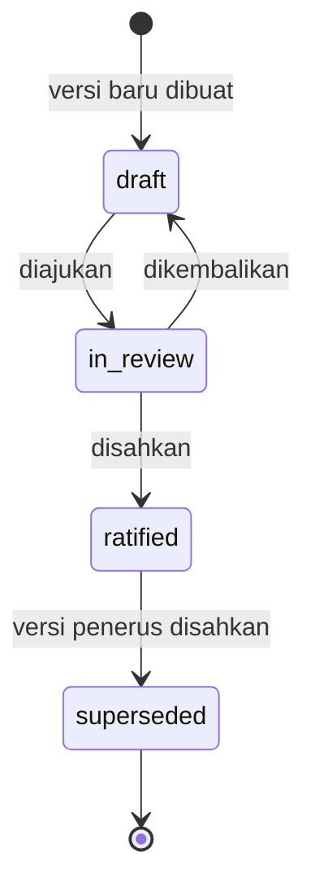

| Dari → Ke | Aksi / endpoint | Aktor | Prasyarat / guard | Efek samping |
|---|---|---|---|---|
| (baru) → `draft` | `POST /obe/...` atau `POST /obe/.../{id}/revise` (salin versi `ratified` menjadi draf baru) | `study_program_administrator`, tim kurikulum; `lecturer` untuk `lesson_plans` | Hanya satu `draft` terbuka per artefak induk (BR-OBE-ART-02) | Draf AI ditandai sumbernya (BR-OBE-AI-01) |
| `draft → in_review` | `POST /obe/.../{id}/submit` | penyusun | Kelengkapan: CPL punya indikator & target (BR-OBE-ART-04); RPS punya rencana per pertemuan dan asesmen yang terhubung ke CPMK (BR-OBE-ART-05) | Notifikasi ke pengesah |
| `in_review → draft` | `POST /obe/.../{id}/return` | pengesah | Catatan wajib | — |
| `in_review → ratified` | `POST /obe/.../{id}/ratify` | `head_of_study_program` (RPS); `head_of_study_program` + `dean` bila `academic.obe.ratification_requires_dean` (profil & CPL) | Pengesah ≠ penyusun (BR-SEC-APV-01) | `ratified_at`, `ratified_by`; versi `ratified` sebelumnya `→ superseded` dalam transaksi yang sama; audit sensitif (pengesahan CPL); event `ObeArtifactRatified` |
| `ratified → superseded` | Otomatis | `sistem` | — | Pengukuran historis tetap menunjuk versi lama (BR-OBE-UKR-06) |

### 3.18 Laporan evaluasi OBE — `outcome_evaluation_reports`

Status: `draft`, `evaluated`, `followed_up` (Baru).

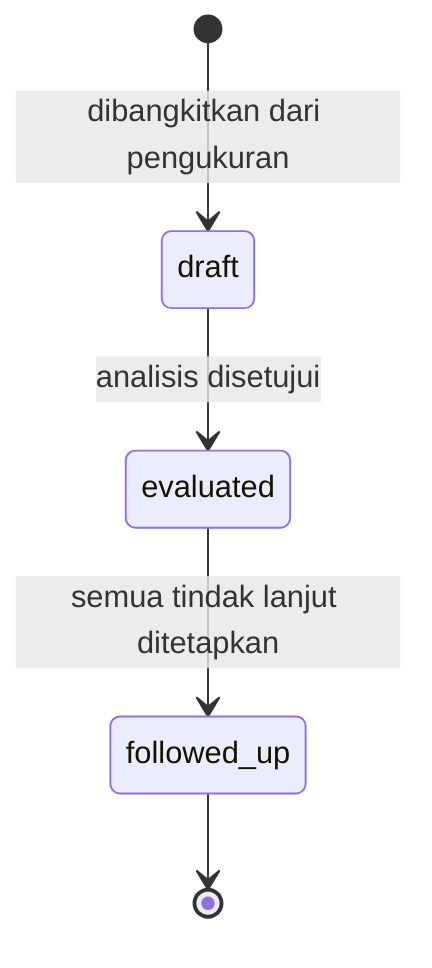

| Dari → Ke | Aksi / endpoint | Aktor | Prasyarat / guard | Efek samping |
|---|---|---|---|---|
| (baru) → `draft` | `POST /obe/evaluation-reports` | `study_program_administrator`, `quality_assurance` | `outcome_measurements` term terkait tersedia | Snapshot pengukuran dibekukan ke laporan |
| `draft → evaluated` | `POST /obe/evaluation-reports/{id}/evaluate` | `head_of_study_program` | Setiap CPL di bawah target punya analisis (BR-OBE-UKR-08) | Notifikasi ke `quality_assurance` |
| `evaluated → followed_up` | `POST /obe/evaluation-reports/{id}/follow-up` | `head_of_study_program`, `quality_assurance` | Setiap temuan punya `outcome_followups` dengan penanggung jawab & tenggat | Laporan menjadi bukti akreditasi |

### 3.19 Periode EDOM — `edom_periods`

Status: `prepared`, `open`, `closed`, `analyzed`, `published` (Baru).

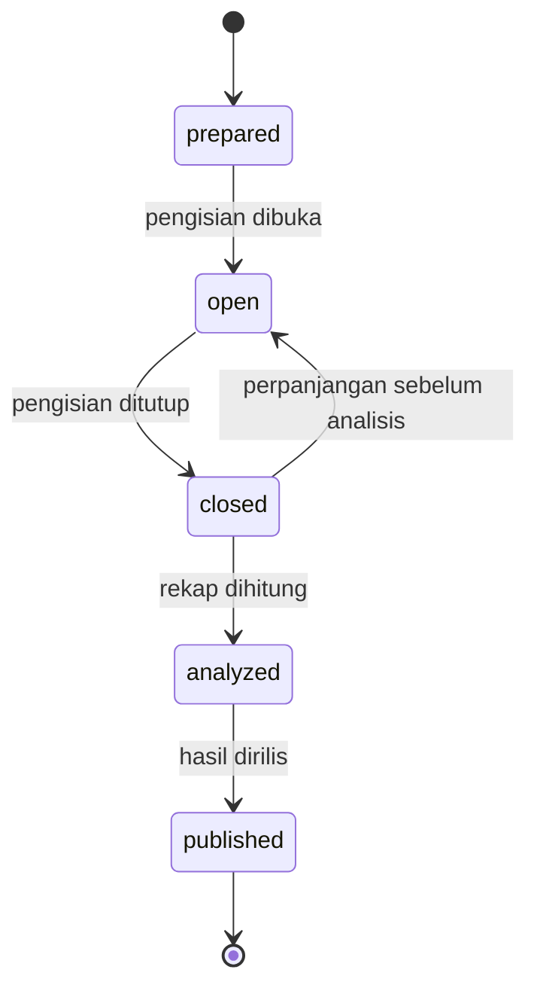

| Dari → Ke | Aksi / endpoint | Aktor | Prasyarat / guard | Efek samping |
|---|---|---|---|---|
| (baru) → `prepared` | `POST /edom/periods` | `quality_assurance`, `academic_administrator` | Satu periode per term per lingkup (BR-EDM-PRD-01) | — |
| `prepared → open` | `POST /edom/periods/{id}/open` / job pada `starts_at` | `quality_assurance` / `sistem` | Formulir `edom_forms` terpasang dan dikunci; `edom_targets` dibangkitkan dari kelas & dosen SIAKAD (BR-EDM-PRD-03) | `edom_participations` dibangkitkan per mahasiswa × target; notifikasi `student.edom_opened` |
| `open → closed` | Job pada `ends_at` / manual | `sistem` / `quality_assurance` | — | Pengisian baru ditolak |
| `closed → open` | `POST /edom/periods/{id}/extend` | `quality_assurance` | Belum `analyzed`; alasan wajib; `ends_at` baru > sekarang | Notifikasi ke yang belum mengisi |
| `closed → analyzed` | `POST /edom/periods/{id}/analyze` (job) | `quality_assurance` | — | `edom_reports` dihitung; target dengan responden < ambang ditandai tidak dilaporkan (BR-EDM-PRV-04) |
| `analyzed → published` | `POST /edom/periods/{id}/publish` | `quality_assurance` | — | Dosen melihat rekap dirinya; kaprodi/dekan sesuai scope (BR-EDM-REK-01…03) |

---

## 4. Katalog Aturan Bisnis

Kolom **Konfigurasi** berisi kunci `university_settings` (grup `academic`) bila aturan bergantung pada kebijakan tenant; "—" berarti aturan tetap (integritas data). Kolom **Status** memakai (Ada)/(Parsial)/(Baru) dan label klasifikasi bila relevan.

### 4.1 SIAKAD — Data master (`SIA-MST`)

| ID | Aturan (kondisi → hasil) | Konfigurasi | Status |
|---|---|---|---|
| BR-SIA-MST-01 | NIM baru sama dengan NIM mahasiswa lain di tenant yang sama → 422. NIM sama di tenant berbeda → diterima. | — | (Ada) |
| BR-SIA-MST-02 | NIDN/NIDK dosen sudah dipakai dosen lain di tenant → 422. | — | (Ada) |
| BR-SIA-MST-03 | Perubahan `students.status` (mis. `active → leave`) → satu baris `student_status_histories` dengan `from_status`, `to_status`, `effective_date`, `changed_by`. | — | (Ada, `StudentObserver`) |
| BR-SIA-MST-04 | `students.status` ≠ `active` → mahasiswa tidak dapat mengisi KRS, memulai ujian, atau mendaftar MBKM (pesan menyebut statusnya). | — | (Parsial: KRS Ada) |
| BR-SIA-MST-05 | Fakultas/prodi/MK/ruang yang sudah direferensikan data transaksi → tidak bisa dihapus (409); hanya dinonaktifkan (`is_active = false`). Data nonaktif tidak muncul di pilihan baru tetapi tetap tampil di riwayat. | — | (Baru) |
| BR-SIA-MST-06 | Homebase dosen (`lecturers.study_program_id`) diubah → riwayat mengajar lama tetap menunjuk prodi kelas, bukan homebase baru. | — | (Baru) |
| BR-SIA-MST-07 | Ruang (`rooms`) dengan kapasitas < kapasitas kelas yang dijadwalkan di dalamnya → peringatan saat menjadwalkan; diblokir bila `academic.schedule.enforce_room_capacity = true`. | `academic.schedule.enforce_room_capacity` | (Baru) |
| BR-SIA-MST-08 | Dua `academic_terms` tenant yang sama dengan rentang `start_date–end_date` beririsan → 409. | — | (Baru, selaras [semester-pendek](../semester-pendek/aturan-bisnis.md)) |
| BR-SIA-MST-09 | `academic_term_periods` (jenis `krs`, `add_drop`, `lecture`, `midterm_exam`, `final_exam`, `grading`, `edom`) di luar rentang term induk → 422; dua periode berjenis sama dalam satu term beririsan → 409. | — | (Baru) |
| BR-SIA-MST-10 | Hanya satu `academic_terms.is_current = true` per tenant; mengaktifkan term lain → term sebelumnya otomatis `false` dalam transaksi yang sama. | — | (Parsial) |

### 4.2 SIAKAD — Kurikulum (`SIA-KUR`)

| ID | Aturan (kondisi → hasil) | Konfigurasi | Status |
|---|---|---|---|
| BR-SIA-KUR-01 | Setiap angkatan × prodi menunjuk tepat satu versi kurikulum aktif (`curriculum_cohorts`); angkatan tanpa pemetaan → KRS menampilkan pesan "Kurikulum angkatan belum ditetapkan" dan pengajuan diblokir. | — | (Baru, [OD-03](16-open-decisions.md#od-03)) |
| BR-SIA-KUR-02 | Versi kurikulum yang sudah dipakai angkatan mana pun → struktur (MK, SKS, wajib/pilihan) tidak boleh diubah; perubahan dilakukan dengan membuat versi baru. | — | (Baru) |
| BR-SIA-KUR-03 | Mengubah SKS sebuah MK yang sudah punya nilai di transkrip → ditolak 409; buat MK/kode baru dan ekuivalensi. Transkrip lama tetap memakai SKS saat nilai diterbitkan. | — | (Baru) |
| BR-SIA-KUR-04 | Prasyarat melingkar (A mensyaratkan B, B mensyaratkan A, langsung atau berantai) → 422. | — | (Baru) |
| BR-SIA-KUR-05 | Prasyarat dinilai terpenuhi bila nilai terbaik mahasiswa untuk MK prasyarat **atau MK ekuivalennya** ≥ `min_letter_grade`. | — | (Parsial: tanpa ekuivalensi) |
| BR-SIA-KUR-06 | Ekuivalensi (`course_equivalencies`) dipakai saat menghitung kelulusan kurikulum dan prasyarat; MK lama dan ekuivalennya yang sama-sama lulus → hanya satu yang dihitung SKS-nya (nilai mengikuti `academic.repeat_grade_policy`). | `academic.repeat_grade_policy` | (Baru) |
| BR-SIA-KUR-07 | Total SKS wajib + pilihan minimum dalam satu versi kurikulum < `academic.curriculum.min_graduation_credits` → aktivasi versi ditolak 409. | `academic.curriculum.min_graduation_credits` | (Baru) |
| BR-SIA-KUR-08 | Aktivasi atau perubahan versi kurikulum → audit sensitif; empat mata (pengaju `study_program_administrator`, penyetuju `head_of_study_program`). | — | (Baru) |
| BR-SIA-KUR-09 | MK yang tidak ada di versi kurikulum angkatan mahasiswa dan tidak punya ekuivalensi → hanya bisa diambil sebagai MK pilihan lintas prodi bila `academic.krs.allow_cross_curriculum = true`. | `academic.krs.allow_cross_curriculum` | (Baru) |

### 4.3 SIAKAD — Kelas (`SIA-KLS`)

| ID | Aturan (kondisi → hasil) | Konfigurasi | Status |
|---|---|---|---|
| BR-SIA-KLS-01 | Kelas dibuka untuk MK yang tidak ada di versi kurikulum mana pun yang aktif di prodi itu → 409. | — | (Baru) |
| BR-SIA-KLS-02 | `class_code` sama untuk MK dan term yang sama → 422. | — | (Parsial) |
| BR-SIA-KLS-03 | Kelas tanpa dosen koordinator (`class_sections.lecturer_id`) → tidak bisa `open`. Dosen koordinator wajib tercatat juga sebagai baris `class_section_lecturers` berperan koordinator. | — | (Baru) |
| BR-SIA-KLS-04 | Kelas tanpa jadwal `published` → tidak bisa `open`, kecuali `schedule_type` kelas = tanpa jadwal tetap (mis. TA, MBKM). | — | (Baru) |
| BR-SIA-KLS-05 | Kapasitas diturunkan di bawah jumlah kursi terpakai (`draft`+`pending`+`enrolled`) → 409. | — | (Baru) |
| BR-SIA-KLS-06 | Jumlah peserta `enrolled` < `academic.class.min_participants` saat periode KRS berakhir → kelas ditandai "di bawah minimum" di dashboard BAAK; pembatalan tetap keputusan manual. | `academic.class.min_participants` | (Baru) |
| BR-SIA-KLS-07 | Team teaching: jumlah pertemuan yang ditugaskan ke seluruh `class_section_lecturers` ≤ jumlah pertemuan rencana; hak input nilai hanya bagi pengajar dengan flag hak nilai. | — | (Baru) |
| BR-SIA-KLS-08 | Duplikasi kelas ke term berikut menyalin MK, kapasitas, dosen, dan pola jadwal sebagai `planned`/`draft`; peserta dan nilai tidak disalin. | — | (Baru) |

### 4.4 SIAKAD — Jadwal (`SIA-JDW`)

| ID | Aturan (kondisi → hasil) | Konfigurasi | Status |
|---|---|---|---|
| BR-SIA-JDW-01 | Dua jadwal `published`/`in_review` pada `room_id` yang sama, hari sama, dan rentang waktu beririsan (`a.start < b.end && b.start < a.end`) dalam term yang sama → 409 "Ruang {kode} sudah dipakai {kelas} pada {hari jam}." | — | (Baru) |
| BR-SIA-JDW-02 | Dosen yang sama (koordinator atau anggota team teaching) terjadwal di dua slot beririsan → 409; dapat di-override oleh `academic_administrator` bila `academic.schedule.allow_forced_lecturer_conflict = true`, wajib alasan (`forced_override`). | `academic.schedule.allow_forced_lecturer_conflict` | (Baru) |
| BR-SIA-JDW-03 | Dua kelas yang ditandai satu kelompok paket (mis. kelas paralel angkatan yang sama, `group_label` sama) terjadwal beririsan → 409. | — | (Baru) |
| BR-SIA-JDW-04 | Jadwal praktikum dengan `group_label` berbeda dalam satu kelas boleh beririsan waktu tetapi tidak boleh di ruang yang sama. | — | (Baru) |
| BR-SIA-JDW-05 | Cek bentrok diulang di dalam `lockForUpdate()` atas term saat publikasi, sehingga dua publikasi bersamaan tidak lolos keduanya. | — | (Baru; pola lock term sudah dipakai `ClassTeachingService`) |
| BR-SIA-JDW-06 | Jadwal di luar periode `lecture` term → 422. | — | (Baru) |
| BR-SIA-JDW-07 | Revisi jadwal `published` setelah ada sesi `held` → hanya sesi `scheduled` mendatang yang berubah; sesi `held` tidak pernah diubah. | — | (Baru) |
| BR-SIA-JDW-08 | Revisi jadwal `published` → notifikasi ke semua peserta `enrolled`/`pending` dan pengajar, paling lambat dalam 1 menit (antrean). Perubahan kurang dari `academic.schedule.change_notice_hours` sebelum sesi → notifikasi juga lewat kanal push. | `academic.schedule.change_notice_hours` | (Baru) |

### 4.5 SIAKAD — KRS (`SIA-KRS`)

| ID | Aturan (kondisi → hasil) | Konfigurasi | Status |
|---|---|---|---|
| BR-SIA-KRS-01 | Mahasiswa menambah/mengajukan KRS di luar periode `krs` (atau `add_drop` untuk perubahan) → 409 berisi tanggal periode. | — | (Parsial: memakai `academic_terms.krs_start_date/krs_end_date`) |
| BR-SIA-KRS-02 | `students.status` ≠ `active` → 409 "Status akademik Anda {status}; KRS tidak dapat diisi." | — | (Ada) |
| BR-SIA-KRS-03 | Kelas bukan pada term berjalan atau bukan untuk prodi/kurikulum mahasiswa (kecuali BR-SIA-KUR-09) → 409. | — | (Ada) |
| BR-SIA-KRS-04 | Prasyarat MK belum terpenuhi (BR-SIA-KUR-05) → 409 menyebut MK prasyarat dan nilai minimum. | — | (Ada) |
| BR-SIA-KRS-05 | Total SKS (`draft`+`pending`+`enrolled`) + SKS MK baru > batas maksimum tier IP mahasiswa → 409 menyebut batas & SKS saat ini. Tier contoh: IP < 2,00 → 18; 2,00–2,49 → 20; 2,50–2,99 → 22; ≥ 3,00 → 24; semester 1 → 24. | `academic.krs.max_sks_tiers`, `academic.krs.sks_basis` ([OD-05](16-open-decisions.md#od-05)) | (Parsial: hardcoded `SKS_LIMIT_TIERS`) |
| BR-SIA-KRS-06 | Total SKS saat pengajuan < `academic.krs.min_credits` (contoh 0 = tanpa minimum) → 409. | `academic.krs.min_credits` | (Baru) |
| BR-SIA-KRS-07 | Jadwal kelas baru beririsan dengan kelas lain di rencana KRS mahasiswa → 409 menyebut kelas yang bentrok. | `academic.krs.allow_schedule_conflict` (default `false`) | (Ada) |
| BR-SIA-KRS-08 | Kursi terpakai ≥ kapasitas → 409 "Kelas sudah penuh." Kursi dipegang sejak `draft`. Kapasitas dicek ulang saat persetujuan; bila sudah penuh saat itu, persetujuan ditolak untuk item tersebut dan dosen wali diminta memilih revisi. | — | (Parsial: cek saat tambah Ada) |
| BR-SIA-KRS-09 | MK yang sudah lulus dengan nilai ≥ `academic.krs.retake_max_letter_grade` → tidak boleh diambil ulang (409). Nilai di bawahnya boleh diulang. | `academic.krs.retake_max_letter_grade` | (Parsial: saat ini semua MK lulus diblokir) |
| BR-SIA-KRS-10 | Mahasiswa dengan cekal aktif (tidak dalam dispensasi) yang membatasi layanan `krs` → tambah/ajukan 409 menyebut jenis cekal & cara menyelesaikan. | — | (Baru) |
| BR-SIA-KRS-11 | Dosen wali meminta revisi tanpa catatan → 422. | — | (Ada untuk `reject`) |
| BR-SIA-KRS-12 | Dosen wali hanya dapat memutuskan KRS mahasiswa dengan `students.academic_advisor_id` = dirinya; selain itu → 403. `academic_administrator` (`krs.approve`) boleh memutuskan semua KRS di scope-nya. | — | (Ada) |
| BR-SIA-KRS-13 | Mahasiswa semester ≤ `academic.krs.package_semesters` → KRS diisi otomatis dari `course_packages` angkatan/prodi saat periode dibuka (`draft`); mahasiswa tidak dapat menghapus MK paket bila `academic.krs.package_locked = true`. | `academic.krs.package_semesters`, `academic.krs.package_locked` | (Baru) [Referensi] |
| BR-SIA-KRS-14 | BAAK mendaftarkan MK atas nama mahasiswa melanggar BR-SIA-KRS-04/05/07/08 → hanya bila mengirim `override=true` dan `reason`; dicatat `forced_override`. | — | (Baru) |
| BR-SIA-KRS-15 | Setelah `locked`, perubahan hanya dalam periode `add_drop`, maksimum `academic.krs.max_changes_after_lock` perubahan, dan tetap melalui persetujuan dosen wali. Di luar itu → 409. | `academic.krs.max_changes_after_lock` ([OD-09](16-open-decisions.md#od-09)) | (Baru) |
| BR-SIA-KRS-16 | `krs_items` yang sudah punya nilai `published` → tidak dapat di-drop (409). | — | (Baru) |
| BR-SIA-KRS-17 | Setiap pengajuan, persetujuan, permintaan revisi, buka kembali, penguncian, perubahan, dan pembatalan → satu baris `krs_submission_events` (aktor, waktu, catatan, daftar item sebelum/sesudah). | — | (Baru) |
| BR-SIA-KRS-18 | Satu `krs_submissions` per mahasiswa per term (unique `student_id + academic_term_id`). | — | (Ada) |
| BR-SIA-KRS-19 | Mahasiswa tanpa dosen wali saat mengajukan → pengajuan tetap diterima dan diarahkan ke antrean BAAK; notifikasi ke BAAK. | — | (Ada) |

### 4.6 SIAKAD — Presensi & jurnal (`SIA-PRS`)

| ID | Aturan (kondisi → hasil) | Konfigurasi | Status |
|---|---|---|---|
| BR-SIA-PRS-01 | Presensi hanya untuk `krs_items.status = enrolled` pada kelas sesi tersebut; NIM/peserta lain → 422. | — | (Ada) |
| BR-SIA-PRS-02 | Membuka sesi di luar jendela `[mulai − open_before_minutes, selesai]` → 409, kecuali `academic_administrator`. | `academic.attendance.open_before_minutes` | (Baru) |
| BR-SIA-PRS-03 | Satu status presensi per mahasiswa per sesi (unique `krs_item_id + lecture_session_id`; saat ini `krs_item_id + meeting_number`). | — | (Ada) |
| BR-SIA-PRS-04 | Status yang sah: `present`, `permitted`, `sick`, `absent`. Status di luar itu → 422. | — | (Ada) |
| BR-SIA-PRS-05 | Menutup sesi tanpa topik/realisasi materi → 422. Jurnal yang ditautkan ke `lesson_plan_meetings` menghasilkan status realisasi RPS (sesuai/tidak sesuai). | — | (Baru) |
| BR-SIA-PRS-06 | Persentase kehadiran = (jumlah `present` [+ `permitted`/`sick` bila dihitung hadir]) ÷ jumlah sesi `held` kelas × 100, dibulatkan 2 desimal. | `academic.attendance_excused_counts_as_present` ([OD-06](16-open-decisions.md#od-06)) | (Baru) |
| BR-SIA-PRS-07 | Persentase kehadiran < `academic.min_attendance_percentage` (contoh 75%) saat ujian dimulai dan `academic.attendance_blocks_exam = true` → cekal kehadiran `active` untuk layanan `exam` kelas tersebut. | `academic.min_attendance_percentage`, `academic.attendance_blocks_exam` | (Baru) |
| BR-SIA-PRS-08 | Persentase dihitung terhadap sesi `held` sampai tanggal evaluasi; bila `academic.attendance.basis = planned`, pembagi = jumlah pertemuan rencana. | `academic.attendance.basis` | (Baru) |
| BR-SIA-PRS-09 | Sesi `cancelled`/`rescheduled` tidak dihitung dalam pembagi. | — | (Baru) |
| BR-SIA-PRS-10 | Perubahan presensi setelah sesi `held` → hanya lewat `attendance_corrections` dengan alasan; dosen pengajar dalam `academic.attendance.correction_window_days` setelah sesi, di luar itu hanya `academic_administrator`. | `academic.attendance.correction_window_days` | (Baru) |
| BR-SIA-PRS-11 | Koreksi yang mengubah kehadiran pada kelas yang nilainya `published` → koreksi tercatat, tetapi cekal kehadiran tidak dievaluasi ulang secara retroaktif. | — | (Baru) |
| BR-SIA-PRS-12 | Setiap koreksi menyimpan status lama, status baru, alasan, pengoreksi, waktu; nilai lama tidak pernah ditimpa tanpa jejak. | — | (Baru) |
| BR-SIA-PRS-13 | Mahasiswa dengan status `sick`/`permitted` wajib melampirkan bukti bila `academic.attendance.require_excuse_evidence = true`; tanpa bukti status tetap `absent` sampai diverifikasi dosen. | `academic.attendance.require_excuse_evidence` | (Baru) [Rekomendasi] |

### 4.7 SIAKAD — Penilaian (`SIA-NIL`)

| ID | Aturan (kondisi → hasil) | Konfigurasi | Status |
|---|---|---|---|
| BR-SIA-NIL-01 | Pengiriman lembar nilai di luar periode `grading` → 409; `academic_administrator` dapat memperpanjang per kelas (tercatat). | — | (Baru) |
| BR-SIA-NIL-02 | Jenis komponen yang diizinkan diambil dari konfigurasi tenant (contoh: `assignment`, `quiz`, `midterm`, `final`, `practicum`, `other`). | `academic.grading.component_types` | (Baru) |
| BR-SIA-NIL-03 | Jumlah bobot `assessment_components` satu kelas ≠ 100 → pengiriman lembar nilai 409. Bobot dikunci setelah nilai komponen pertama diinput, kecuali dibuka `academic_administrator`. | — | (Baru) |
| BR-SIA-NIL-04 | Nilai komponen di luar `0 ≤ nilai ≤ max_score` komponen → 422. | — | (Baru) |
| BR-SIA-NIL-05 | Nilai komponen kosong saat pengiriman → bila kebijakan `block`: 409 menyebut mahasiswa & komponen; bila `zero`: dihitung 0; bila `incomplete`: nilai akhir diberi tanda belum lengkap dan tidak dipublikasi. | `academic.grading.empty_component_policy` | (Baru) |
| BR-SIA-NIL-06 | Nilai akhir = Σ (nilai komponen ÷ `max_score` × 100 × bobot ÷ 100). | — | (Baru) |
| BR-SIA-NIL-07 | Nilai akhir dibulatkan sesuai mode (`half_up`, `floor`, `none`) dan presisi desimal **sebelum** dikonversi ke huruf. | `academic.grading.rounding_mode`, `academic.grading.rounding_precision` ([OD-29](16-open-decisions.md#od-29)) | (Baru) |
| BR-SIA-NIL-08 | Konversi huruf: `grade_scale_items` dengan `min_score ≤ nilai ≤ max_score` pada skala yang berlaku (MK → prodi → tenant). Rentang skala tumpang tindih atau berlubang → skala ditolak saat disimpan (422). | `academic.grading.default_scale_id` ([OD-04](16-open-decisions.md#od-04)) | (Parsial: `LetterGrade` hardcoded) |
| BR-SIA-NIL-09 | Skala yang sudah dipakai nilai `published` → tidak dapat diubah; buat skala baru. | — | (Baru) |
| BR-SIA-NIL-10 | Nilai LMS/CBT masuk ke `assessment_scores` hanya setelah divalidasi dosen (aksi "tarik nilai"); nilai yang ditarik dapat diubah dosen sebelum pengiriman dengan jejak sumber. | — | (Baru) |
| BR-SIA-NIL-11 | Mahasiswa melihat nilai akhir hanya bila `grades.is_published = true` **dan** tidak ada cekal aktif atas layanan `grade_view` **dan** kewajiban EDOM terpenuhi bila `academic.edom.required_for_grade_view = true`. | `academic.edom.required_for_grade_view` ([OD-10](16-open-decisions.md#od-10)) | (Baru) |
| BR-SIA-NIL-12 | Setelah publikasi, `assessment_scores` dan `grades` tidak dapat diubah lewat endpoint input biasa (409); hanya lewat `grade_revisions` atau `reopened`. | — | (Baru) |
| BR-SIA-NIL-13 | Publikasi butuh persetujuan kaprodi bila dikonfigurasi. | `academic.grading.require_approval` ([OD-07](16-open-decisions.md#od-07)) | (Baru) |
| BR-SIA-NIL-14 | Revisi nilai tanpa alasan, nilai lama/baru, atau (untuk `remediation`) tanpa dasar permohonan → 422. | — | (Baru) |
| BR-SIA-NIL-15 | Pemutihan (`remediation`) hanya untuk nilai ≤ `academic.grading.remediation_max_letter_grade` dan dalam batas waktu yang dikonfigurasi. | `academic.grading.remediation_max_letter_grade`, `academic.grading.revision_window_days` ([OD-08](16-open-decisions.md#od-08)) | (Baru) |
| BR-SIA-NIL-16 | Dosen hanya menginput nilai kelas yang ia ajar dengan hak nilai (bila `academic.lecturer_ownership` menyala). | Feature flag `academic.lecturer_ownership` | (Ada, `ClassSectionAccess::canWriteTeaching`) |

### 4.8 SIAKAD — Hasil studi (`SIA-IPK`)

| ID | Aturan (kondisi → hasil) | Konfigurasi | Status |
|---|---|---|---|
| BR-SIA-IPK-01 | IPS = Σ(bobot huruf × SKS) ÷ Σ SKS untuk nilai `published` term tersebut; MK dengan tanda belum lengkap tidak dihitung. | — | (Ada) |
| BR-SIA-IPK-02 | IPK memakai satu nilai per MK (atau kelompok ekuivalensi) sesuai kebijakan `highest` atau `latest`. | `academic.repeat_grade_policy` ([OD-08](16-open-decisions.md#od-08)) | (Parsial: `highest` hardcoded di `StudentGradeService`) |
| BR-SIA-IPK-03 | Nilai hasil konversi (transfer/MBKM) dihitung dalam IPK sesuai `credit_conversion_items.counts_in_gpa`. | — | (Baru) |
| BR-SIA-IPK-04 | IPS/IPK dibulatkan 2 desimal untuk tampilan; perhitungan tier SKS memakai nilai tak terbulatkan. | `academic.grading.gpa_display_precision` | (Baru) |
| BR-SIA-IPK-05 | Transkrip hanya memuat nilai `published`; transkrip resmi (dengan tanda tangan/QR verifikasi) hanya diterbitkan bila tidak ada cekal atas layanan `transcript`. | — | (Parsial) |

### 4.9 SIAKAD — Perwalian (`SIA-WAL`)

| ID | Aturan (kondisi → hasil) | Konfigurasi | Status |
|---|---|---|---|
| BR-SIA-WAL-01 | Penetapan dosen wali hanya kepada dosen aktif; perubahan dosen wali tercatat (audit) dan tidak mengubah keputusan KRS sebelumnya. | — | (Parsial: endpoint `PATCH students/{id}/academic-advisor` Ada) |
| BR-SIA-WAL-02 | Jumlah mahasiswa per dosen wali > `academic.advising.max_students_per_advisor` → peringatan (bukan blokir). | `academic.advising.max_students_per_advisor` | (Baru) |
| BR-SIA-WAL-03 | Catatan konsultasi (`advising_records`) hanya dapat dilihat mahasiswa ybs (kecuali catatan bertanda internal), dosen wali, kaprodi, dan BAAK sesuai scope. | — | (Baru) |
| BR-SIA-WAL-04 | Mahasiswa ditandai butuh pendampingan bila salah satu: IPS < `at_risk_ips`, kehadiran rata-rata < `at_risk_attendance`, SKS lulus kumulatif tertinggal > `at_risk_credit_gap` dari kurikulum, atau tidak mengisi KRS. Penanda adalah indikator, bukan keputusan akademik. | `academic.advising.at_risk_ips`, `academic.advising.at_risk_attendance`, `academic.advising.at_risk_credit_gap` | (Baru) [Rekomendasi] |
| BR-SIA-WAL-05 | Dosen wali melihat nilai akhir & IPS/IPK mahasiswa perwaliannya; nilai per komponen hanya bila `academic.advising.can_view_component_scores = true`. | `academic.advising.can_view_component_scores` ([OD-28](16-open-decisions.md#od-28)) | (Baru) |

### 4.10 SIAKAD — Pencekalan (`SIA-CKL`)

| ID | Aturan (kondisi → hasil) | Konfigurasi | Status |
|---|---|---|---|
| BR-SIA-CKL-01 | Cekal keuangan: tagihan jatuh tempo belum lunas di modul Keuangan sesuai aturan (`academic_block_rules`, mis. nominal minimum, jenis tagihan) → cekal `finance` atas layanan yang dikonfigurasi (contoh: `krs`, `exam`). | `academic_block_rules` per tenant | (Baru) [Referensi] |
| BR-SIA-CKL-02 | Cekal akademik: kondisi akademik sesuai aturan (mis. masa studi melewati batas, IPK di bawah ambang evaluasi) → cekal `academic` atas layanan `krs`. | `academic_block_rules` | (Baru) [Referensi] |
| BR-SIA-CKL-03 | Cekal kemahasiswaan & perpustakaan: tanggungan dari modul terkait → cekal atas layanan `yudisium`. Sumber data bergantung [OD-22](16-open-decisions.md#od-22). | `academic_block_rules` | (Baru) [Referensi] [Konfirmasi] |
| BR-SIA-CKL-04 | Layanan diblokir bila **ada minimal satu** cekal `active` (bukan `exempted`) yang mencantumkan layanan tersebut. Cekal lain atas layanan berbeda tidak memengaruhi. | — | (Baru) |
| BR-SIA-CKL-05 | Beberapa cekal bersamaan → semua alasan ditampilkan sekaligus kepada mahasiswa; layanan baru terbuka setelah semua cekal yang relevan `revoked`/`expired`/`exempted`. | — | (Baru) |
| BR-SIA-CKL-06 | Pemeriksaan cekal dilakukan pada **saat aksi** (tambah KRS, ajukan KRS, setujui KRS, mulai ujian, lihat nilai), bukan hanya saat cekal dibuat. | — | (Baru) |
| BR-SIA-CKL-07 | Cekal yang sama (mahasiswa, jenis, term, sumber) sudah `active` → evaluasi ulang tidak membuat duplikat (idempoten). | — | (Baru) |
| BR-SIA-CKL-08 | Dispensasi tanpa `valid_until`, alasan, atau dokumen pendukung → 422; `valid_until` > `academic.blocks.max_exemption_days` → 422. | `academic.blocks.max_exemption_days` | (Baru) |
| BR-SIA-CKL-09 | Dispensasi hanya dapat diberikan oleh role yang tercantum di `academic_block_rules` untuk jenis cekal tsb (mis. keuangan → `finance_administrator`); empat mata bila `academic.blocks.exemption_requires_approval = true`. | `academic.blocks.exemption_requires_approval` | (Baru) |
| BR-SIA-CKL-10 | Dispensasi berlaku per layanan yang disebut; dispensasi untuk `exam` tidak membuka `krs`. | — | (Baru) |
| BR-SIA-CKL-11 | Setiap perubahan status cekal dan setiap dispensasi → `academic_block_histories` + audit dengan pelaku dan alasan. | — | (Baru) |
| BR-SIA-CKL-12 | Cekal baru, dispensasi, dan pencabutan → notifikasi ke mahasiswa (dan dosen wali untuk cekal akademik). Pesan menyebut jenis, layanan yang dibatasi, dan langkah penyelesaian; nominal tagihan tidak ditampilkan ke dosen wali. | — | (Baru) |
| BR-SIA-CKL-13 | Cekal kehadiran (BR-SIA-PRS-07) berlaku per kelas, bukan per mahasiswa secara umum. | — | (Baru) |
| BR-SIA-CKL-14 | Sumber eksternal tidak tersedia saat evaluasi (mis. modul Keuangan gagal) → status cekal terakhir dipertahankan, tidak ada cekal baru maupun pencabutan; kegagalan dicatat untuk monitoring. | — | (Baru) |

### 4.11 SIAKAD — Cuti & status mahasiswa (`SIA-CUT`)

| ID | Aturan (kondisi → hasil) | Konfigurasi | Status |
|---|---|---|---|
| BR-SIA-CUT-01 | Pengajuan cuti di luar periode yang ditetapkan → 409. | `academic.leave.request_period` (relatif terhadap term) | (Baru) |
| BR-SIA-CUT-02 | Total cuti mahasiswa > `academic.leave.max_terms_total` atau berturut-turut > `academic.leave.max_consecutive_terms` → 409. | `academic.leave.max_terms_total`, `academic.leave.max_consecutive_terms` | (Baru) |
| BR-SIA-CUT-03 | Mahasiswa dengan status selain `active` → tidak dapat mengajukan cuti (409). | — | (Parsial) |
| BR-SIA-CUT-04 | Kewajiban keuangan yang disyaratkan sebelum cuti belum dipenuhi → pengajuan ditolak bila `academic.leave.require_finance_clearance = true`. | `academic.leave.require_finance_clearance` | (Baru) [Konfirmasi] |
| BR-SIA-CUT-05 | Cuti disetujui → `students.status = leave`, riwayat status, KRS term terkait dibatalkan, akses LMS term itu dicabut. | — | (Parsial: status Ada) |
| BR-SIA-CUT-06 | Aktif kembali (`reactivation`) disetujui → `students.status = active` mulai term yang diminta; KRS term itu mengikuti alur biasa. | — | (Ada) |

### 4.12 SIAKAD — Transfer, konversi, double degree (`SIA-TRF`)

| ID | Aturan (kondisi → hasil) | Konfigurasi | Status |
|---|---|---|---|
| BR-SIA-TRF-01 | Konversi nilai transfer tanpa dokumen transkrip asal → 422. | — | (Baru) |
| BR-SIA-TRF-02 | Satu MK tujuan hanya dapat menerima satu konversi aktif per mahasiswa; MK yang sudah punya nilai lokal → konversi ditolak 409. | — | (Baru) |
| BR-SIA-TRF-03 | Total SKS konversi > `academic.transfer.max_conversion_credits` → 409. | `academic.transfer.max_conversion_credits` | (Baru) |
| BR-SIA-TRF-04 | Konversi berlaku setelah disetujui `head_of_study_program`; nilai konversi ditandai sumbernya di transkrip. | — | (Baru) |
| BR-SIA-TRF-05 | Double degree: mahasiswa tercatat pada dua prodi melalui `double_degree_enrollments`; MK yang diakui bersama dihitung sekali per prodi sesuai pemetaan. Bentuk transkrip bergantung [OD-23](16-open-decisions.md#od-23). | — | (Baru) [Konfirmasi] |

### 4.13 SIAKAD — Tugas akhir (`SIA-TA`)

| ID | Aturan (kondisi → hasil) | Konfigurasi | Status |
|---|---|---|---|
| BR-SIA-TA-01 | Pengajuan judul oleh mahasiswa dengan SKS lulus < `academic.thesis.min_credits` → 409. | `academic.thesis.min_credits` | (Baru) |
| BR-SIA-TA-02 | Satu tugas akhir aktif per mahasiswa per jenjang (status selain `rejected`, `cancelled`, `completed`). | — | (Ada: unique `student_id`) |
| BR-SIA-TA-03 | Dosen pembimbing melebihi `academic.thesis.max_students_per_supervisor` bimbingan aktif → peringatan; diblokir bila `academic.thesis.enforce_supervisor_quota = true`. | `academic.thesis.max_students_per_supervisor`, `academic.thesis.enforce_supervisor_quota` | (Baru) |
| BR-SIA-TA-04 | Pendaftaran sidang dengan bimbingan tervalidasi < `academic.thesis.min_guidance_sessions` → 409. | `academic.thesis.min_guidance_sessions` | (Baru) |
| BR-SIA-TA-05 | Penguji tidak boleh sama dengan pembimbing mahasiswa ybs → 422. | — | (Baru) |
| BR-SIA-TA-06 | Catatan bimbingan hanya dapat divalidasi oleh pembimbing yang tercatat untuk TA tersebut. | — | (Baru) |

### 4.14 SIAKAD — Akses orang tua/wali (`SIA-ORT`)

| ID | Aturan (kondisi → hasil) | Konfigurasi | Status |
|---|---|---|---|
| BR-SIA-ORT-01 | Pengguna `guardian` hanya melihat mahasiswa yang terhubung lewat `student_guardians` berstatus terverifikasi; mahasiswa lain → 404. | — | (Baru) |
| BR-SIA-ORT-02 | Data yang terlihat terbatas pada nilai akhir `published`, IPS/IPK, rekap kehadiran, status tagihan (lunas/belum, nominal), dan jadwal. Catatan konsultasi, nilai komponen, jawaban ujian, dan jawaban EDOM tidak pernah terlihat. | — | (Baru) |
| BR-SIA-ORT-03 | Mahasiswa berusia ≥ 18 tahun → akses orang tua memerlukan persetujuan mahasiswa bila `academic.guardian.require_student_consent = true`; persetujuan dapat dicabut dan pencabutan berlaku seketika. | `academic.guardian.require_student_consent` ([OD-21](16-open-decisions.md#od-21)) | (Baru) [Konfirmasi] |
| BR-SIA-ORT-04 | Setiap akses data mahasiswa oleh `guardian` dicatat sebagai `viewed_sensitive` (tanpa isi data). | — | (Baru) |

### 4.15 MBKM (`MBK`)

| ID | Aturan (kondisi → hasil) | Konfigurasi | Status |
|---|---|---|---|
| BR-MBK-PRG-01 | Program eksternal tanpa mitra aktif (`mbkm_partners` dengan perjanjian kerja sama berlaku) → tidak dapat `offered`. | — | (Baru) |
| BR-MBK-PRG-02 | Program tanpa kuota, kriteria kelayakan, rencana konversi, atau periode → tidak dapat `offered` (422). | — | (Baru) |
| BR-MBK-PRG-03 | Jenis kegiatan wajib salah satu dari daftar referensi (pertukaran antarprodi, pertukaran eksternal, magang, asistensi mengajar, penelitian, proyek kemanusiaan, wirausaha, studi independen, KKN tematik). | — | (Baru) [Referensi] |
| BR-MBK-PAR-01 | Mahasiswa tidak memenuhi kriteria program (semester minimum, IPK minimum contoh, status `active`, tanpa cekal yang relevan) → pendaftaran 409. | Kriteria per program; `academic.mbkm.min_semester` default | (Baru) |
| BR-MBK-PAR-02 | Mahasiswa sudah punya keikutsertaan `selected`/`active` yang rentang waktunya beririsan → pendaftaran 409. | — | (Baru) |
| BR-MBK-PAR-03 | Jumlah `selected` > kuota → seleksi 409. | — | (Baru) |
| BR-MBK-PAR-04 | Keikutsertaan `active` tanpa dosen pembimbing → program tidak dapat `running`. | — | (Baru) |
| BR-MBK-PAR-05 | Logbook < `academic.mbkm.min_logbook_entries` atau belum divalidasi pembimbing → tidak dapat `evaluated`. | `academic.mbkm.min_logbook_entries` | (Baru) |
| BR-MBK-KNV-01 | Rencana konversi (MK tujuan + SKS) disetujui kaprodi sebelum peserta `active`; perubahan setelahnya wajib persetujuan ulang. | — | (Baru) |
| BR-MBK-KNV-02 | Total SKS konversi satu keikutsertaan > `academic.mbkm.max_conversion_credits` (contoh 20) → 409. | `academic.mbkm.max_conversion_credits` | (Baru) |
| BR-MBK-KNV-03 | Konversi ke MK yang sudah lulus dengan nilai lebih tinggi → mengikuti `academic.repeat_grade_policy`. | `academic.repeat_grade_policy` | (Baru) |
| BR-MBK-IKU-01 | Snapshot IKU otomatis (`iku_snapshots`) hanya dihitung bila fitur `siakad.mbkm.iku` tersedia di paket dan aktif; definisi indikator mengikuti [OD-13](16-open-decisions.md#od-13). Tanpa fitur → rekap manual MBKM standar tetap tersedia. | Feature `siakad.mbkm.iku` | (Baru) [Referensi] [Konfirmasi] |
| BR-MBK-IKU-02 | Snapshot IKU bersifat append-only per tanggal hitung; perhitungan ulang membuat snapshot baru, tidak menimpa. | — | (Baru) |

### 4.16 EDLINK/LMS (`LMS`)

| ID | Aturan (kondisi → hasil) | Konfigurasi | Status |
|---|---|---|---|
| BR-LMS-KLS-01 | Kelas LMS akademik dibuat tepat satu per `class_sections` (unique); peserta dan pengajar dibaca dari SIAKAD, tidak disalin. | — | (Baru) |
| BR-LMS-KLS-02 | Mahasiswa yang `krs_items` di-drop → kehilangan akses tulis seketika; riwayat pengumpulan tetap tersimpan. | — | (Baru) |
| BR-LMS-KLS-03 | Kelas umum: anggota dikelola di `lms_class_members`; menambahkan pengguna di luar tenant → 422. Registrasi publik non-sivitas bergantung [OD-30](16-open-decisions.md#od-30). | — | (Baru) |
| BR-LMS-KLS-04 | Pembuatan kelas umum melebihi batas `lms.general_classes_per_term` (contoh 10) dalam satu term → 409 "Kuota kelas umum semester ini habis." Kelas akademik tidak dibatasi. | Limit `lms.general_classes_per_term` ([OD-27](16-open-decisions.md#od-27)) | (Baru) [Referensi] |
| BR-LMS-KLS-05 | Duplikasi kelas ke term berikut menyalin struktur topik, materi (versi terkini), dan tugas sebagai draf tidak terpublikasi; pengumpulan, nilai, forum, dan anggota tidak disalin. | Feature `lms.material_duplication` | (Baru) [Referensi] |
| BR-LMS-MAT-01 | Materi `is_published = false` → tidak terlihat mahasiswa. | — | (Ada) |
| BR-LMS-MAT-02 | Mengganti berkas materi → versi baru di `course_material_versions`; versi lama tetap dapat diakses pengajar. | — | (Baru) [Rekomendasi] |
| BR-LMS-MAT-03 | Unggahan dengan ekstensi/MIME di luar daftar izin atau berstatus scan terinfeksi → ditolak dan berkas dikarantina. | `academic.lms.allowed_mime_types` | (Parsial: status scan Ada) |
| BR-LMS-MAT-04 | Progres materi = jumlah materi yang ditandai selesai ÷ jumlah materi wajib; membuka halaman materi saja tidak sama dengan menyelesaikan (penanda selesai eksplisit atau kriteria per jenis materi). | — | (Baru) |
| BR-LMS-TGS-01 | Pengumpulan setelah `due_at` → ditolak bila `allow_late_submission = false`; diterima dengan `is_late = true` bila diizinkan. | — | (Ada) |
| BR-LMS-TGS-02 | Pengumpulan ulang saat `allow_resubmission = false` → 409. | — | (Ada) |
| BR-LMS-TGS-03 | Berkas > `max_file_size_mb` atau ekstensi di luar `allowed_extensions` → 422. | — | (Ada) |
| BR-LMS-TGS-04 | Nilai tugas tidak otomatis masuk nilai SIAKAD; dosen menarik nilai ke komponen (BR-SIA-NIL-10). | — | (Baru) |
| BR-LMS-FRM-01 | Hanya anggota kelas yang dapat membaca/menulis forum; pengajar dapat menyembunyikan posting (disimpan, tidak dihapus fisik). | — | (Baru) |
| BR-LMS-QR-01 | Token QR presensi hanya diterbitkan untuk sesi `ongoing`, berlaku `academic.attendance.qr_ttl_seconds` (contoh 30 detik) dan berotasi; token kedaluwarsa → 409. | `academic.attendance.qr_ttl_seconds` | (Baru) [Referensi] |
| BR-LMS-QR-02 | Pemindaian QR oleh mahasiswa yang bukan peserta `enrolled` sesi → 403; pemindaian kedua oleh mahasiswa yang sama → idempoten (status tetap). | — | (Baru) |
| BR-LMS-QR-03 | Token terikat pada sesi dan tenant (ditandatangani HMAC); token dari sesi lain → 409. Pemindaian dari perangkat yang sama untuk lebih dari satu akun dalam satu sesi → ditandai untuk ditinjau dosen bila `academic.attendance.qr_device_binding = true`. | `academic.attendance.qr_device_binding` | (Baru) [Rekomendasi] |
| BR-LMS-QR-04 | Bila geolokasi diwajibkan (`academic.attendance.qr_require_location`) dan posisi di luar radius ruang → presensi ditolak dengan opsi minta koreksi. | `academic.attendance.qr_require_location` | (Baru) [Rekomendasi] |
| BR-LMS-ANL-01 | Student Engagement Score dan Lecture Performance Score hanya dihitung dan ditampilkan bila fitur paket aktif; komponen dan bobot skor ditampilkan bersama skornya (transparan). | Feature `lms.engagement_score`, `lms.lecture_performance_score` | (Baru) [Referensi] |
| BR-LMS-ANL-02 | Jumlah login atau durasi sesi **tidak** dipakai sebagai satu-satunya indikator pemahaman; skor engagement wajib menggabungkan minimal penyelesaian materi, pengumpulan tugas, dan partisipasi. | `academic.lms.engagement_weights` | (Baru) |
| BR-LMS-ANL-03 | `lms_activity_events` bersifat append-only; event yang sama (pengguna, objek, jenis, detik yang sama) diabaikan (dedup). | — | (Baru) |
| BR-LMS-ANL-04 | Leaderboard gamification hanya menampilkan peserta satu kelas dan dapat dimatikan per kelas; mahasiswa dapat memilih nama tersamar. | Feature `lms.gamification` | (Baru) [Rekomendasi] |
| BR-LMS-STO-01 | Pemakaian storage tenant = Σ `file_uploads.size_bytes` (tidak termasuk yang dihapus permanen) milik tenant; dihitung harian ke `storage_usage_snapshots`. | — | (Baru) |
| BR-LMS-STO-02 | Pemakaian ≥ 80% dan ≥ 95% kuota (contoh) → notifikasi ke `lms_administrator` dan `university_administrator`. | `academic.lms.storage_warning_thresholds` | (Baru) |
| BR-LMS-STO-03 | Pemakaian ≥ 100% kuota `lms.storage_gb` → unggahan baru materi ditolak 409; pengumpulan tugas mahasiswa tetap diterima sampai `academic.lms.student_upload_grace_percent` di atas kuota. Kebijakan final [OD-20](16-open-decisions.md#od-20). | Limit `lms.storage_gb`, `academic.lms.student_upload_grace_percent` | (Baru) [Konfirmasi] |

### 4.17 CBT & CBT AI (`CBT`)

| ID | Aturan (kondisi → hasil) | Konfigurasi | Status |
|---|---|---|---|
| BR-CBT-BNK-01 | Pilihan ganda tanpa tepat satu opsi benar (atau sesuai aturan `question_type` lain) → 422. Jenis soal di luar pilihan ganda bergantung [OD-26](16-open-decisions.md#od-26). | — | (Parsial) |
| BR-CBT-BNK-02 | Hanya butir `published` yang dapat dipakai `apply-bank`. | — | (Baru) |
| BR-CBT-BNK-03 | Peninjau = penyusun → 403 (empat mata) bila `academic.cbt.require_review = true`. | `academic.cbt.require_review` | (Baru) |
| BR-CBT-BNK-04 | Penyusun hanya melihat bank soal MK yang ia ampu atau yang dibagikan kepadanya; `exam_committee` melihat bank soal dalam scope-nya. | — | (Parsial) |
| BR-CBT-UJN-01 | `starts_at ≥ ends_at` atau `duration_minutes` > selisih keduanya → 422. | — | (Ada) |
| BR-CBT-UJN-02 | UTS/UAS dijadwalkan di luar periode `midterm_exam`/`final_exam` → 409 kecuali `exam_committee` override dengan alasan. | — | (Baru) |
| BR-CBT-UJN-03 | Mengubah soal atau pengaturan ujian `scheduled` yang sudah punya percobaan → 409. | — | (Parsial) |
| BR-CBT-UJN-04 | Peserta ujian kelas = `krs_items enrolled` saat publikasi, disinkron ulang saat ujian `active` (penambahan peserta add/drop); peserta PMB diimpor eksplisit. Satu peserta tercatat sekali per ujian (unique). | — | (Baru) |
| BR-CBT-UJN-05 | Dua ujian aktif berjenis sama untuk kelas dan komponen nilai yang sama → 409 (cegah duplikasi ujian). | — | (Baru) |
| BR-CBT-UJN-06 | Ujian hanya dapat dibuat bila fitur `cbt` tersedia dan aktif untuk tenant. | Feature `cbt` | (Baru) [Referensi] |
| BR-CBT-ATT-01 | Peserta dengan cekal `active` atas layanan `exam` (keuangan atau kehadiran kelas tsb) → mulai ujian 409 menyebut alasannya. | — | (Baru) |
| BR-CBT-ATT-02 | Jumlah percobaan ≥ `max_attempts` → 409. | — | (Ada) |
| BR-CBT-ATT-03 | Jawaban disimpan per soal setiap kali dipilih (autosave) dan setiap `academic.cbt.autosave_interval_seconds` untuk jawaban teks. | `academic.cbt.autosave_interval_seconds` | (Parsial: per soal Ada) |
| BR-CBT-ATT-04 | Koneksi terputus → timer tetap berjalan di server; peserta yang tersambung kembali sebelum batas waktu melanjutkan dengan jawaban tersimpan terakhir. Setelah waktu habis + toleransi → `auto_submitted`. | `academic.cbt.reconnect_grace_minutes` | (Parsial) |
| BR-CBT-ATT-05 | Sesi percobaan hanya valid untuk token sesi yang aktif; percobaan dibuka dari perangkat lain → sesi lama dicabut dan kejadian dicatat sebagai pelanggaran untuk ditinjau. | — | (Parsial: `session_token_hash` Ada) |
| BR-CBT-ATT-06 | Navigasi mundur ditolak bila `allow_back_navigation = false`. | — | (Ada) |
| BR-CBT-NIL-01 | Skor ujian `published` dikirim ke `assessment_scores` komponen yang dipetakan; bila lembar nilai kelas sudah `submitted`/`published` → pengiriman ditahan dan dosen diberi notifikasi (tidak menimpa). | — | (Baru) |
| BR-CBT-NIL-02 | Pengiriman nilai idempoten per (ujian, peserta, komponen); kirim ulang memperbarui nilai yang sama, bukan menambah. | — | (Baru) |
| BR-CBT-NIL-03 | Nilai ujian dengan bobot `weight_percentage` dihitung `weighted_score` (Ada); bobot final mengikuti `assessment_components` SIAKAD. | — | (Parsial) |
| BR-CBT-AI-01 | Draf soal AI tidak pernah langsung masuk ujian atau bank soal `published`; wajib diterima menjadi `draft` lalu melalui review manusia. | — | (Baru) [Referensi] |
| BR-CBT-AI-02 | Setiap butir yang berasal dari AI menyimpan referensi `ai_generation_jobs`, prompt ringkas (tanpa data pribadi), dan penyunting terakhir. | — | (Baru) |
| BR-CBT-AI-03 | Permintaan AI melebihi kuota job per tenant per hari → 429. Materi yang dikirim ke penyedia AI mengikuti [OD-11](16-open-decisions.md#od-11). | `academic.ai.daily_job_limit` | (Baru) [Konfirmasi] |
| BR-CBT-AI-04 | CBT AI hanya tersedia bila fitur `cbt.ai` tersedia dan aktif. | Feature `cbt.ai` | (Baru) |
| BR-CBT-PRC-01 | Proctoring kamera hanya aktif bila fitur `lms.proctoring` aktif, ujian mengaktifkannya, dan peserta memberikan izin kamera; tanpa izin → peserta tidak dapat memulai ujian yang mewajibkan kamera, dan diberi informasi tujuan & retensi. | Feature `lms.proctoring` ([OD-12](16-open-decisions.md#od-12)) | (Baru) [Referensi] |
| BR-CBT-PRC-02 | Deteksi otomatis (pindah tab, keluar layar penuh, wajah tidak terdeteksi) dicatat sebagai indikasi, bukan bukti; pembatalan percobaan hanya melalui peninjauan manusia (§3.16). | — | (Parsial: event Ada) |
| BR-CBT-PRC-03 | Pengurangan skor otomatis karena pelanggaran (`penalty_points`) hanya berlaku bila diaktifkan per ujian dan diumumkan kepada peserta sebelum ujian. | — | (Ada) |
| BR-CBT-PRC-04 | Hasil ujian dengan pelanggaran tertandai belum ditinjau → tidak dapat `published`. | — | (Baru) |

### 4.18 OBE (`OBE`)

| ID | Aturan (kondisi → hasil) | Konfigurasi | Status |
|---|---|---|---|
| BR-OBE-ART-01 | Fitur OBE hanya tersedia bila `obe` tersedia di paket atau add-on dan aktif ([OD-01](16-open-decisions.md#od-01)). | Feature `obe` | (Baru) |
| BR-OBE-ART-02 | Maksimal satu versi `draft` terbuka per artefak; membuat draf kedua → 409. | — | (Baru) |
| BR-OBE-ART-03 | Artefak `ratified`/`superseded` tidak dapat diubah (409); perubahan dilakukan dengan revisi (versi baru). | — | (Baru) |
| BR-OBE-ART-04 | CPL tanpa indikator, metode pengukuran, atau target → tidak dapat diajukan (422). Kategori CPL diambil dari daftar yang dikonfigurasi prodi, bukan taksonomi tetap. | `academic.obe.plo_categories` | (Baru) |
| BR-OBE-ART-05 | RPS tanpa rencana per pertemuan, atau dengan komponen asesmen yang tidak terhubung ke CPMK → tidak dapat diajukan (422). | — | (Baru) |
| BR-OBE-MAP-01 | CPMK tanpa minimal satu CPL yang dipetakan → peringatan; RPS tidak dapat disahkan. | — | (Baru) |
| BR-OBE-MAP-02 | CPL tanpa MK kontributor pada versi kurikulum aktif → ditampilkan di laporan kesenjangan. | — | (Baru) |
| BR-OBE-MAP-03 | Jumlah bobot kontribusi CPMK → CPL satu MK harus 100% per CPL bila metode agregasi berbobot dipakai; selain itu 422. | `academic.obe.aggregation_method` | (Baru) |
| BR-OBE-MAP-04 | Perubahan pemetaan pada artefak `ratified` hanya melalui revisi; riwayat pemetaan disimpan per versi. | — | (Baru) |
| BR-OBE-UKR-01 | Capaian CPMK mahasiswa = Σ(skor komponen ternormalisasi × bobot komponen untuk CPMK itu) ÷ Σ bobot, hanya dari nilai `published`. | — | (Baru) |
| BR-OBE-UKR-02 | Capaian CPL dihitung dari capaian CPMK dengan metode yang dikonfigurasi (rata-rata berbobot SKS, rata-rata berbobot kontribusi, atau persentase mahasiswa mencapai ambang) — konsekuensi tiap metode dijelaskan di [04-obe.md](04-obe.md). | `academic.obe.aggregation_method` ([OD-16](16-open-decisions.md#od-16)) | (Baru) |
| BR-OBE-UKR-03 | Capaian dinyatakan tercapai bila ≥ `academic.obe.achievement_threshold` (contoh). | `academic.obe.achievement_threshold` | (Baru) |
| BR-OBE-UKR-04 | Komponen nilai tanpa pemetaan CPMK → tidak ikut pengukuran dan dilaporkan sebagai celah. | — | (Baru) |
| BR-OBE-UKR-05 | Pengukuran dihitung ulang saat `GradeSubmissionPublished`/`GradeRevised`; hasil disimpan sebagai snapshot `outcome_measurements` baru. | — | (Baru) |
| BR-OBE-UKR-06 | Pengukuran term lalu tetap memakai versi CPL/CPMK/pemetaan yang berlaku saat term itu, bukan versi terbaru. | — | (Baru) |
| BR-OBE-UKR-07 | Kelas dengan peserta di bawah `academic.obe.min_sample_size` → hasil ditandai "sampel kecil" di laporan. | `academic.obe.min_sample_size` | (Baru) [Rekomendasi] |
| BR-OBE-UKR-08 | CPL di bawah target pada laporan evaluasi wajib punya analisis dan tindak lanjut sebelum laporan `evaluated`/`followed_up`. | — | (Baru) |
| BR-OBE-AI-01 | Keluaran OBE AI (draf CPL, CPMK, RPS, pemetaan, analisis kesenjangan) selalu disimpan sebagai `draft` bertanda sumber AI; tidak ada pengesahan otomatis. | Feature `obe.ai` ([OD-02](16-open-decisions.md#od-02)) | (Baru) [Konfirmasi] |

### 4.19 EDOM (`EDM`)

| ID | Aturan (kondisi → hasil) | Konfigurasi | Status |
|---|---|---|---|
| BR-EDM-PRD-01 | Lebih dari satu periode EDOM aktif untuk term dan lingkup yang sama → 409. | — | (Baru) |
| BR-EDM-PRD-02 | Formulir yang sudah dipakai periode `open` → dikunci; perubahan membuat versi formulir baru. | — | (Baru) |
| BR-EDM-PRD-03 | Target evaluasi = pasangan (kelas, dosen pengajar) dari `class_sections` + `class_section_lecturers` term itu; tidak diinput manual kecuali pengecualian oleh `quality_assurance`. | — | (Baru) |
| BR-EDM-PRD-04 | Skala jawaban diambil dari formulir (mis. 1–4 atau 1–5, contoh); pertanyaan wajib/opsional per butir. | — | (Baru) |
| BR-EDM-ISI-01 | Peserta layak = mahasiswa `enrolled` di kelas target dengan kehadiran ≥ `academic.edom.min_attendance_percentage` (bila diatur). | `academic.edom.min_attendance_percentage` | (Baru) |
| BR-EDM-ISI-02 | Pengisian di luar periode `open` → 409. | — | (Baru) |
| BR-EDM-ISI-03 | Pertanyaan wajib kosong → 422 saat kirim; jawaban dapat disimpan sebagai draf sebelum dikirim. | — | (Baru) |
| BR-EDM-ISI-04 | Satu pengisian per peserta per target; setelah dikirim tidak dapat diubah. | — | (Baru) |
| BR-EDM-PRV-01 | Periode anonim → `edom_responses` tidak menyimpan `student_id`/`user_id`; status sudah/belum mengisi disimpan terpisah di `edom_participations`. Tidak ada kolom yang menghubungkan keduanya. | `academic.edom.anonymous_default` ([OD-10](16-open-decisions.md#od-10)) | (Baru) |
| BR-EDM-PRV-02 | Waktu kirim di `edom_responses` disimpan dengan granularitas tanggal (bukan detik) dan urutan baris diacak agar tidak dapat dikorelasikan dengan `edom_participations`. | — | (Baru) |
| BR-EDM-PRV-03 | Tidak ada role (termasuk `super_admin` dan `quality_assurance`) yang dapat melihat identitas pengisi pada periode anonim. | — | (Baru) |
| BR-EDM-PRV-04 | Rekap per target dengan jumlah responden < `academic.edom.min_responses_for_report` (contoh 5) → angka tidak ditampilkan ("data tidak cukup"); komentar terbuka tidak ditampilkan per responden. | `academic.edom.min_responses_for_report` | (Baru) |
| BR-EDM-PRV-05 | Komentar terbuka ditampilkan ke dosen hanya setelah periode `published` dan dapat dimoderasi `quality_assurance` (disembunyikan, tidak diedit). | — | (Baru) [Rekomendasi] |
| BR-EDM-REK-01 | Dosen hanya melihat rekap dirinya; kaprodi melihat dosen yang mengajar di prodinya; dekan per fakultas; `quality_assurance` seluruh tenant. | — | (Baru) |
| BR-EDM-REK-02 | Rekap EDOM ditampilkan dengan catatan bahwa EDOM adalah salah satu masukan, bukan satu-satunya ukuran kinerja dosen. | — | (Baru) [Referensi] |
| BR-EDM-REK-03 | Rekap antarsemester membandingkan hanya butir pertanyaan yang sama (kode butir sama); butir berubah ditandai tidak sebanding. | — | (Baru) |

### 4.20 Entitlement (`ENT`)

| ID | Aturan (kondisi → hasil) | Konfigurasi | Status |
|---|---|---|---|
| BR-ENT-PKG-01 | Endpoint yang dilindungi feature key yang **tidak tersedia di paket** tenant → 403 dengan `errors.feature = ["not_in_plan"]`. | `plan_feature_entitlements` | (Baru) |
| BR-ENT-PKG-02 | Feature key tersedia di paket tetapi **dinonaktifkan** untuk tenant (`university_feature_flags` atau `university_modules.is_enabled = false`) → 403 dengan `errors.feature = ["disabled"]`. | `university_feature_flags` | (Baru) |
| BR-ENT-PKG-03 | Feature key anak (mis. `lms.proctoring`) hanya aktif bila induknya (`lms`) aktif. | — | (Baru) |
| BR-ENT-PKG-04 | Paket diturunkan (downgrade) → data fitur yang hilang tetap tersimpan dan dapat dibaca/diekspor oleh admin selama `academic.entitlement.readonly_grace_days`, tetapi tidak dapat ditulis. | `academic.entitlement.readonly_grace_days` | (Baru) [Rekomendasi] |
| BR-ENT-PKG-05 | Menu dan tombol frontend untuk fitur tidak aktif disembunyikan berdasarkan daftar fitur aktif dari `/me`; backend tetap menegakkan BR-ENT-PKG-01/02. | — | (Baru) |
| BR-ENT-LIM-01 | Kuota storage tenant = `lms.storage_gb` paket (contoh referensi 50/100/200/400/750 GB) + add-on; penegakan sesuai BR-LMS-STO-02/03. | Limit `lms.storage_gb` | (Baru) [Konfirmasi] |
| BR-ENT-LIM-02 | Kuota kelas umum dihitung per tenant per term dari `lms_classes` `class_type = general` berstatus `draft`/`active` (dan `archived` bila [OD-27](16-open-decisions.md#od-27) memutuskan arsip tidak mengembalikan kuota). | Limit `lms.general_classes_per_term` | (Baru) [Konfirmasi] |
| BR-ENT-LIM-03 | Perubahan batas paket berlaku seketika untuk pengecekan berikutnya (cache entitlement dihapus saat paket/override berubah). | — | (Baru) |

### 4.21 Audit & persetujuan (`SEC-AUD`)

| ID | Aturan (kondisi → hasil) | Konfigurasi | Status |
|---|---|---|---|
| BR-SEC-AUD-01 | Aksi sensitif di [11-roles-permissions.md](11-roles-permissions.md) §8 tanpa baris `audit_logs` → dianggap cacat; uji otomatis memastikan setiap endpoint sensitif menulis audit. | — | (Baru) |
| BR-SEC-AUD-02 | `old_values`/`new_values` tidak pernah memuat kata sandi, token, `session_token_hash`, `access_token`, atau isi jawaban EDOM; atribut `$hidden` dibuang, atribut `$auditMasked` disamarkan. | — | (Ada, `AuditLogService`) |
| BR-SEC-AUD-03 | Ekspor data pribadi massal (daftar mahasiswa, nilai satu kelas/prodi) → audit `exported` dengan filter yang dipakai dan jumlah baris. | — | (Parsial: `AuditAction::Exported` Ada) |
| BR-SEC-AUD-04 | Audit log tidak dapat diubah atau dihapus melalui API mana pun. | — | (Ada: hanya `audit_logs.read`) |

---

## 5. Indeks Kunci Konfigurasi

Semua kunci disimpan di `university_settings` dengan `group = 'academic'`. Nilai "Contoh default" **bukan** ketentuan akademik; nilai final ditetapkan tenant. Kunci yang diawali `academic.short_term.*` dan beberapa kunci umum (`academic.min_attendance_percentage`, `academic.attendance_excused_counts_as_present`, `academic.attendance_blocks_exam`, `academic.repeat_grade_policy`) mengikuti rancangan [semester-pendek](../semester-pendek/desain-database.md) agar tidak bercabang.

| Kunci | Tipe | Contoh default | Dipakai di |
|---|---|---|---|
| `academic.audit.min_reason_length` | int | 10 | BR-SEC-STATE-09 |
| `academic.krs.max_sks_tiers` | json | tier `SKS_LIMIT_TIERS` saat ini | BR-SIA-KRS-05 |
| `academic.krs.sks_basis` | enum `ips_previous`/`ipk` | `ips_previous` | BR-SIA-KRS-05, OD-05 |
| `academic.krs.min_credits` | int | 0 | BR-SIA-KRS-06 |
| `academic.krs.require_advisor_approval` | bool | true | §3.1 |
| `academic.krs.allow_schedule_conflict` | bool | false | BR-SIA-KRS-07 |
| `academic.krs.retake_max_letter_grade` | string | `C` | BR-SIA-KRS-09 |
| `academic.krs.package_semesters` | int | 2 | BR-SIA-KRS-13 |
| `academic.krs.package_locked` | bool | true | BR-SIA-KRS-13 |
| `academic.krs.max_changes_after_lock` | int | 2 | BR-SIA-KRS-15, OD-09 |
| `academic.krs.allow_cross_curriculum` | bool | false | BR-SIA-KUR-09 |
| `academic.curriculum.min_graduation_credits` | int | 144 | BR-SIA-KUR-07 |
| `academic.class.min_participants` | int | 10 | BR-SIA-KLS-06 |
| `academic.schedule.enforce_room_capacity` | bool | true | BR-SIA-MST-07 |
| `academic.schedule.allow_forced_lecturer_conflict` | bool | false | BR-SIA-JDW-02 |
| `academic.schedule.change_notice_hours` | int | 24 | BR-SIA-JDW-08 |
| `academic.schedule.reschedule_requires_approval` | bool | false | §3.5 |
| `academic.min_attendance_percentage` | decimal | 75 | BR-SIA-PRS-07 |
| `academic.attendance_excused_counts_as_present` | bool | false | BR-SIA-PRS-06, OD-06 |
| `academic.attendance_blocks_exam` | bool | true | BR-SIA-PRS-07 |
| `academic.attendance.basis` | enum `held`/`planned` | `held` | BR-SIA-PRS-08 |
| `academic.attendance.open_before_minutes` | int | 15 | BR-SIA-PRS-02 |
| `academic.attendance.auto_close_hours` | int | 6 | §3.5 |
| `academic.attendance.correction_window_days` | int | 7 | BR-SIA-PRS-10 |
| `academic.attendance.require_excuse_evidence` | bool | false | BR-SIA-PRS-13 |
| `academic.attendance.qr_ttl_seconds` | int | 30 | BR-LMS-QR-01 |
| `academic.attendance.qr_device_binding` | bool | false | BR-LMS-QR-03 |
| `academic.attendance.qr_require_location` | bool | false | BR-LMS-QR-04 |
| `academic.grading.component_types` | json | `assignment, quiz, midterm, final, practicum, other` | BR-SIA-NIL-02 |
| `academic.grading.empty_component_policy` | enum `block`/`zero`/`incomplete` | `block` | BR-SIA-NIL-05 |
| `academic.grading.rounding_mode` | enum `half_up`/`floor`/`none` | `half_up` | BR-SIA-NIL-07, OD-29 |
| `academic.grading.rounding_precision` | int | 2 | BR-SIA-NIL-07 |
| `academic.grading.default_scale_id` | ULID | skala hasil migrasi `LetterGrade` | BR-SIA-NIL-08, OD-04 |
| `academic.grading.require_approval` | bool | false | BR-SIA-NIL-13, OD-07 |
| `academic.grading.reopen_window_days` | int | 30 | §3.6 |
| `academic.grading.revision_window_days` | int | 30 | BR-SIA-NIL-15, OD-08 |
| `academic.grading.remediation_max_letter_grade` | string | `C` | BR-SIA-NIL-15 |
| `academic.grading.gpa_display_precision` | int | 2 | BR-SIA-IPK-04 |
| `academic.repeat_grade_policy` | enum `highest`/`latest` | `highest` | BR-SIA-IPK-02, OD-08 |
| `academic.advising.max_students_per_advisor` | int | 40 | BR-SIA-WAL-02 |
| `academic.advising.at_risk_ips` | decimal | 2,00 | BR-SIA-WAL-04 |
| `academic.advising.at_risk_attendance` | decimal | 75 | BR-SIA-WAL-04 |
| `academic.advising.at_risk_credit_gap` | int | 12 | BR-SIA-WAL-04 |
| `academic.advising.can_view_component_scores` | bool | false | BR-SIA-WAL-05, OD-28 |
| `academic.blocks.max_exemption_days` | int | 30 | BR-SIA-CKL-08 |
| `academic.blocks.exemption_requires_approval` | bool | true | BR-SIA-CKL-09 |
| `academic.leave.request_period` | json | relatif periode KRS | BR-SIA-CUT-01 |
| `academic.leave.max_terms_total` | int | 4 | BR-SIA-CUT-02 |
| `academic.leave.max_consecutive_terms` | int | 2 | BR-SIA-CUT-02 |
| `academic.leave.require_finance_clearance` | bool | false | BR-SIA-CUT-04 |
| `academic.transfer.max_conversion_credits` | int | 72 | BR-SIA-TRF-03 |
| `academic.thesis.min_credits` | int | 110 | BR-SIA-TA-01 |
| `academic.thesis.max_supervisors` | int | 2 | §3.10 |
| `academic.thesis.max_students_per_supervisor` | int | 10 | BR-SIA-TA-03 |
| `academic.thesis.enforce_supervisor_quota` | bool | false | BR-SIA-TA-03 |
| `academic.thesis.min_guidance_sessions` | int | 8 | BR-SIA-TA-04 |
| `academic.guardian.require_student_consent` | bool | true | BR-SIA-ORT-03, OD-21 |
| `academic.mbkm.min_semester` | int | 5 | BR-MBK-PAR-01 |
| `academic.mbkm.min_logbook_entries` | int | 12 | BR-MBK-PAR-05 |
| `academic.mbkm.max_conversion_credits` | int | 20 | BR-MBK-KNV-02 |
| `academic.lms.archive_after_days` | int | 30 | §3.13 |
| `academic.lms.allowed_mime_types` | json | dokumen, presentasi, video, gambar umum | BR-LMS-MAT-03 |
| `academic.lms.engagement_weights` | json | bobot komponen skor | BR-LMS-ANL-02 |
| `academic.lms.storage_warning_thresholds` | json | `[80, 95]` | BR-LMS-STO-02 |
| `academic.lms.student_upload_grace_percent` | int | 5 | BR-LMS-STO-03, OD-20 |
| `academic.cbt.require_review` | bool | true | BR-CBT-BNK-03 |
| `academic.cbt.autosave_interval_seconds` | int | 15 | BR-CBT-ATT-03 |
| `academic.cbt.reconnect_grace_minutes` | int | 5 | BR-CBT-ATT-04 |
| `academic.ai.daily_job_limit` | int | 50 | BR-CBT-AI-03 |
| `academic.obe.plo_categories` | json | daftar kategori prodi | BR-OBE-ART-04 |
| `academic.obe.aggregation_method` | enum | `weighted_contribution` | BR-OBE-UKR-02, OD-16 |
| `academic.obe.achievement_threshold` | decimal | 70 | BR-OBE-UKR-03, OD-16 |
| `academic.obe.min_sample_size` | int | 5 | BR-OBE-UKR-07 |
| `academic.obe.ratification_requires_dean` | bool | false | §3.17 |
| `academic.edom.anonymous_default` | bool | true | BR-EDM-PRV-01, OD-10 |
| `academic.edom.required_for_grade_view` | bool | false | BR-SIA-NIL-11, OD-10 |
| `academic.edom.min_attendance_percentage` | decimal | 0 | BR-EDM-ISI-01 |
| `academic.edom.min_responses_for_report` | int | 5 | BR-EDM-PRV-04 |
| `academic.entitlement.readonly_grace_days` | int | 90 | BR-ENT-PKG-04 |

---

## 6. Indeks Event Domain & Notifikasi

### 6.1 Event domain

Event dinamai `<Entitas><KataKerjaLampau>` dan di-dispatch setelah commit (BR-SEC-STATE-07). Semua payload memuat `university_id`, `id` entitas, `actor_id` (null untuk sistem), dan `occurred_at`.

| Event | Dipicu oleh | Konsumen utama |
|---|---|---|
| `KrsSubmissionSubmitted` | §3.1 `draft → submitted` | Notifikasi dosen wali |
| `KrsSubmissionApproved` | §3.1 `→ approved` | LMS (akses kelas), CBT (peserta), Keuangan (tagihan per SKS bila ada) |
| `KrsItemDropped` | §3.2 `→ dropped` | LMS, CBT, EDOM (target) |
| `ClassSectionOpened` | §3.3 `planned → open` | LMS (buat `lms_classes`) |
| `ClassSchedulePublished` | §3.4 | Kalender, notifikasi |
| `LectureSessionHeld` | §3.5 `→ held` | OBE (realisasi RPS), cekal kehadiran, dashboard |
| `GradeSubmissionPublished` | §3.6 `→ published` | IPS/IPK, OBE, akses orang tua, notifikasi |
| `GradeRevised` | §3.7 `→ applied` | IPS/IPK, OBE |
| `AcademicBlockChanged` | §3.8 semua transisi | Portal mahasiswa, CBT, KRS |
| `ExamResultsPublished` | §3.15 `→ published` | SIAKAD `assessment_scores` |
| `ObeArtifactRatified` | §3.17 `→ ratified` | Notifikasi dosen (RPS berlaku) |
| `MbkmProgramCompleted` | §3.11 `→ completed` | IKU snapshot |
| `ThesisCompleted` | §3.10 `→ completed` | Yudisium (di luar lingkup) |
| `EdomPeriodPublished` | §3.19 `→ published` | Notifikasi dosen |

### 6.2 Kunci notifikasi

Format kunci mengikuti pola yang ada: `<audiens>.<peristiwa>`. Kunci bertanda (Ada) sudah dipakai `StudentNotificationService`/`KrsPlanService`.

| Kunci | Status |
|---|---|
| `student.krs_submitted`, `student.krs_approved`, `student.krs_rejected`, `student.krs_review_requested`, `student.grade_published`, `student.assignment_published`, `student.assignment_graded`, `student.request_submitted`, `student.request_decided` | (Ada) |
| `student.krs_reopened`, `student.krs_expired`, `student.class_cancelled`, `student.schedule_changed`, `student.session_cancelled`, `student.session_rescheduled`, `student.grade_revised`, `student.block_applied`, `student.block_exempted`, `student.block_revoked`, `student.exam_scheduled`, `student.thesis_decided`, `student.mbkm_registration_opened`, `student.mbkm_selection`, `student.edom_opened` | (Baru) |
| `lecturer.schedule_changed`, `lecturer.grade_submission_returned`, `lecturer.grading_deadline`, `lecturer.edom_published` | (Baru) |
| `guardian.grade_published` | (Baru) |

Setiap kunci baru wajib didaftarkan di `StudentNotificationService::ensureTemplates()` (atau padanannya per audiens) agar template tersedia di semua tenant, mengingat `notification_templates` tidak punya fallback global ([MULTI-TENANT-ARCHITECTURE.md §9](../MULTI-TENANT-ARCHITECTURE.md)).
