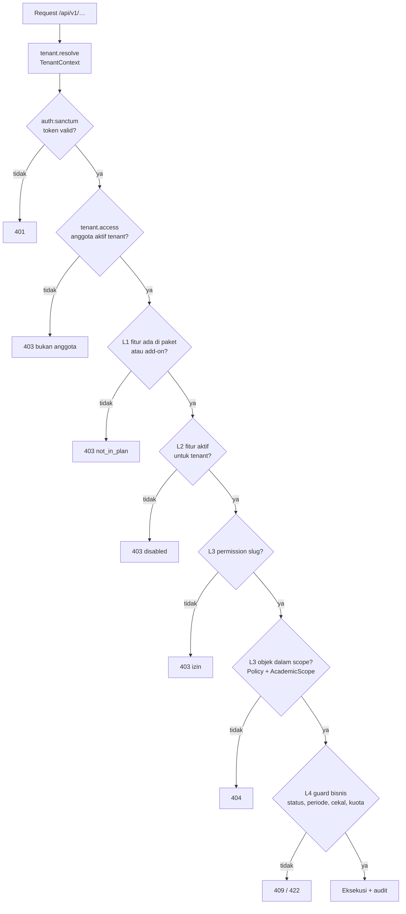
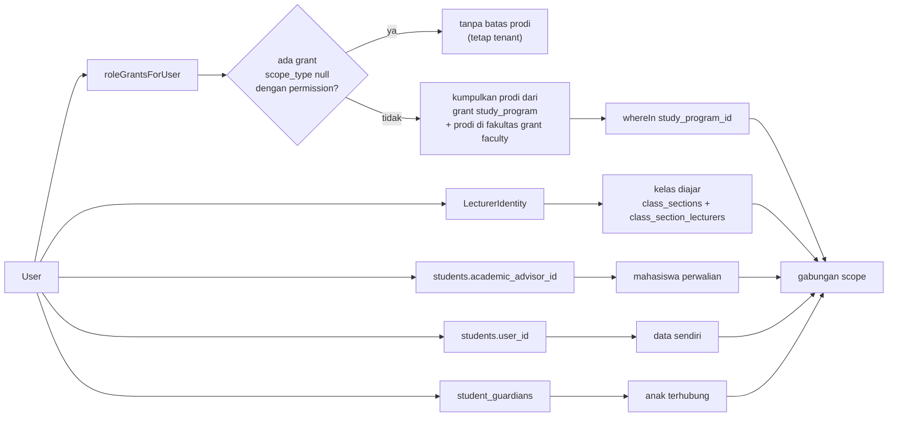

# Peran, Hak Akses & Entitlement — Akademik & Pembelajaran

> **Status:** rancangan · **Disusun:** 2026-10-11 · kembali ke [README](README.md)
>
> Dokumen ini merancang RBAC, scope data, empat lapis otorisasi, dan entitlement paket untuk modul Akademik & Pembelajaran. Rancangan **memperluas** arsitektur yang sudah ada: tabel `roles`/`permissions`/`role_permissions`/`user_roles`, `PermissionRegistry`, middleware `permission:`, Policy per model, dan `ClassSectionAccess`. Nama role, permission, dan feature key mengikuti kanon [README §5.3, §5.5, §5.7](README.md#5-kanon-penamaan-wajib-diikuti-seluruh-dokumen). Aturan bisnis yang dirujuk (`BR-…`) ada di [10-business-rules.md](10-business-rules.md).

## Daftar Isi

1. [Prinsip](#1-prinsip)
2. [Empat Lapis Otorisasi](#2-empat-lapis-otorisasi)
3. [Role Kanon & Scope](#3-role-kanon--scope)
4. [Penegakan Scope Data](#4-penegakan-scope-data)
5. [Matriks Hak Akses per Modul](#5-matriks-hak-akses-per-modul)
6. [Katalog Permission Slug](#6-katalog-permission-slug)
7. [Entitlement Paket](#7-entitlement-paket)
8. [Aksi Sensitif Wajib Audit](#8-aksi-sensitif-wajib-audit)
9. [Catatan Migrasi dari Kondisi Saat Ini](#9-catatan-migrasi-dari-kondisi-saat-ini)

---

## 1. Prinsip

1. **Permission slug adalah gerbang kasar, Policy adalah gerbang objek.** Slug `resource.action` menjawab "boleh melakukan aksi jenis ini?"; Policy dan helper scope menjawab "boleh atas data *ini*?". Keduanya wajib. Pola ini sudah ada (`ExamParticipationPolicy`, `KrsSubmissionPolicy`, `ClassSectionAccess`).
2. **Self-service memakai resource terpisah.** Mahasiswa tidak pernah menerima slug admin (`krs.create`, `grades.read`); ia memakai `krs_self_service.*`, `student_portal.*`, `exam_participation.*`, dan resource sejenis yang selalu di-resolve dari `$user->student` di server (Ada). Pola yang sama dipakai untuk `guardian_portal.*` dan `edom_participation.*` (Baru).
3. **Scope tidak pernah diambil dari input klien.** `university_id` dari `TenantContext`, fakultas/prodi dari `user_roles.scope_type/scope_id`, identitas dosen dari `LecturerIdentity`, identitas mahasiswa dari `students.user_id`.
4. **Least privilege & pemisahan tugas.** Pengusul dan penyetuju aksi sensitif adalah orang berbeda (empat mata, [10 §2.3](10-business-rules.md#23-daftar-transisi-empat-mata)).
5. **Super Admin platform bukan operator akademik.** Bypass `super_admin` di `PermissionRegistry::userHasPermission()` tetap ada sebagai jalur dukungan teknis, tetapi akses ke data akademik tenant wajib melalui sesi dukungan tercatat (`support_sessions`, saat ini baru tabel) — lihat [13-security-audit.md](13-security-audit.md).
6. **Fitur, bukan nama paket.** Kode memeriksa *feature key* (`cbt`, `lms.proctoring`), tidak pernah nama paket.

---

## 2. Empat Lapis Otorisasi

[Referensi] brief §12. Setiap request ke fitur akademik melewati empat lapis berurutan; kegagalan lapis mana pun menghentikan request.

| Lapis | Pertanyaan | Sumber data | Komponen penegak | Gagal → |
|---|---|---|---|---|
| **L1 — Tersedia di paket** | Apakah paket (dan add-on) tenant mencakup fitur ini? | `university_subscriptions` aktif → `subscription_plans` → `plan_feature_entitlements` (Baru) | `EnsureFeatureEntitled` (Baru) via `FeatureEntitlementService` (Baru) | 403, `errors.feature = ["not_in_plan"]` |
| **L2 — Diaktifkan untuk tenant** | Apakah admin tenant menyalakan fitur ini? | `university_feature_flags` (Ada) per feature key + `university_modules.is_enabled` (Ada) untuk modul kasar | idem | 403, `errors.feature = ["disabled"]` |
| **L3 — Izin & scope pengguna** | Apakah pengguna punya permission dan data berada dalam scope-nya? | `user_roles` (+`scope_type`, `scope_id`, `expires_at`) → `role_permissions` → `permissions` | `permission:` middleware (`EnsurePermission`, Ada), Policy, `AcademicScope` (Baru), `ClassSectionAccess` (Ada) | 403 (izin) / 404 (objek di luar scope) |
| **L4 — Data memenuhi syarat** | Apakah keadaan data mengizinkan aksi ini sekarang? | Status entitas, periode, cekal, kuota | Service domain (guard transisi, [10 §3](10-business-rules.md#3-state-machine-per-entitas)) | 409 / 422 |



### 2.1 Urutan middleware rute

```php
// Usulan (Baru) — contoh grup LMS
Route::prefix('lms')
    ->middleware(['auth:sanctum', 'tenant.access', 'feature:lms'])
    ->group(function () {
        Route::get('classes/{lmsClass}/analytics', [LmsAnalyticsController::class, 'show'])
            ->middleware(['feature:lms.engagement_score', 'permission:lms_analytics.read']);
    });
```

- `tenant.access` (`EnsureUniversityAccessMiddleware`, Ada) **wajib** ditambahkan ke semua grup rute akademik. Saat ini hanya dipasang di `/tenant` dan `/hr`; rute akademik mengandalkan `PermissionRegistry` yang hanya menghitung grant tenant aktif. Penambahan ini menutup kasus konteks `null` dan header `X-University-ID` yang diklaim tanpa keanggotaan (detail [13-security-audit.md](13-security-audit.md)).
- `feature:` diletakkan **sebelum** `permission:` agar pesan ke pengguna jelas ("fitur tidak tersedia di paket") dan tidak membocorkan detail izin.
- Parameter `feature:a,b` bermakna **AND** (semua wajib), berbeda dengan `permission:a,b` yang bermakna OR (Ada). Perbedaan ini dicatat di docblock middleware.

### 2.2 Rancangan `plan_feature_entitlements` (Baru)

Tabel **global** (tanpa `university_id`, kelompok GLOBAL di [MULTI-TENANT-ARCHITECTURE.md §2](../MULTI-TENANT-ARCHITECTURE.md)). Rincian kolom final di [07-database-erd.md](07-database-erd.md).

| Kolom | Tipe | Keterangan |
|---|---|---|
| `id` | ULID | PK |
| `subscription_plan_id` | ULID FK → `subscription_plans` | Paket dasar atau paket add-on |
| `feature_key` | string(100) | Feature key kanon [README §5.7](README.md#57-feature-key-entitlement-kanon) |
| `is_included` | bool | Fitur termasuk dalam paket |
| `enabled_by_default` | bool | Saat tenant baru berlangganan, L2 dianggap aktif tanpa baris `university_feature_flags` |
| `limit_value` | decimal(12,2) null | Untuk feature key limit: `lms.storage_gb`, `lms.general_classes_per_term` |
| `timestamps` | timestamptz | |

Unique `(subscription_plan_id, feature_key)`.

**Add-on** (mis. OBE, OBE AI): direkam sebagai `subscription_plans` berjenis add-on (kolom baru `plan_type`: `base`/`addon`) dengan baris `plan_feature_entitlements`-nya sendiri; tenant memiliki satu `university_subscriptions` aktif untuk paket dasar ditambah satu per add-on. Entitlement efektif = **gabungan** semua langganan aktif. Limit diambil nilai **terbesar** untuk storage dasar, lalu ditambah add-on storage bila ada [Rekomendasi].

### 2.3 Algoritme `FeatureEntitlementService::isEntitled($key)` (Baru)

1. Ambil `university_id` dari `TenantContext`; bila `null` → `false` (rute tenant tidak boleh berjalan di konteks platform).
2. L1: kumpulkan `plan_feature_entitlements.is_included = true` dari semua `university_subscriptions` berstatus aktif/trial yang belum kedaluwarsa. Bila `$key` tidak ada → `not_in_plan`.
3. Induk: untuk `lms.proctoring`, cek juga `lms` (BR-ENT-PKG-03).
4. L2: baris `university_feature_flags(key = $key)` bila ada; jika tidak ada, pakai `enabled_by_default`. Untuk feature key yang terikat modul kasar (`siakad*` → `academic`, `siakad.mbkm*` → `mbkm`), `university_modules.is_enabled` juga harus `true`.
5. Hasil di-cache per tenant sebagai **array biasa** (bukan `Collection`, untuk menghindari korupsi serialisasi pada cache hit), dengan kunci berversi seperti `PermissionRegistry` (`entitlements:v{n}:tenant:{id}`) dan di-flush saat langganan, add-on, atau flag berubah (BR-ENT-LIM-03).

`/api/v1/me` mengembalikan `data.features` (daftar feature key aktif) dan `data.limits` (nilai + pemakaian) sehingga frontend menyembunyikan menu (BR-ENT-PKG-05); `usePermission()` dilengkapi `useFeature()` (Baru).

---

## 3. Role Kanon & Scope

Jenis scope:

| Kode | Jenis scope | Sumber kebenaran | Contoh role |
|---|---|---|---|
| `u` | Seluruh tenant (universitas) | `user_roles.university_id`, `scope_type = null` | `academic_administrator`, `rector` |
| `f` | Fakultas | `user_roles.scope_type = 'faculty'`, `scope_id = faculties.id` | `dean`, `faculty_administrator` |
| `p` | Program studi | `user_roles.scope_type = 'study_program'`, `scope_id = study_programs.id` | `head_of_study_program`, `study_program_administrator` |
| `k` | Kelas yang diajar | `class_sections.lecturer_id` (Ada) + `class_section_lecturers` (Baru) via `LecturerIdentity` | `lecturer` |
| `w` | Mahasiswa perwalian | `students.academic_advisor_id` (Ada) | `academic_advisor` |
| `s` | Data milik sendiri | `students.user_id` / `lecturers.user_id` | `student`, `lecturer` (profil) |
| `o` | Anak yang terhubung | `student_guardians` terverifikasi (Baru) | `guardian` |
| `t` | Penugasan spesifik | `thesis_supervisors`, `thesis_examiners`, `mbkm_participations` (pembimbing), penugasan pengawas ujian | `lecturer`, `exam_proctor` |

| Role (slug) | Nama | Status | Deskripsi tanggung jawab | Scope | Cara scope ditegakkan |
|---|---|---|---|---|---|
| `super_admin` | Super Admin platform | Ada | Mengelola tenant, paket, dan pemeliharaan platform | Global | Grant `university_id = null`; bypass di `PermissionRegistry`. Akses data tenant hanya lewat sesi dukungan tercatat |
| `university_owner` | Pemilik/Yayasan | Ada | Melihat seluruh data, mengatur profil tenant & pengaturan | `u` | Grant per tenant |
| `university_administrator` | Admin perguruan tinggi | Ada | Mengelola pengguna & role, fitur tenant, struktur organisasi | `u` | Grant per tenant |
| `academic_administrator` | BAAK / Bagian Akademik | Ada | Operator SIAKAD: term, periode, kelas, jadwal, KRS, cekal, layanan akademik | `u` (opsional `f`) | Grant per tenant; `classes.update` membuka semua kelas (Ada di `ClassSectionAccess`) |
| `faculty_administrator` | Admin fakultas | **Baru** | Operator SIAKAD di tingkat fakultas: ruang fakultas, jadwal & kelas prodi di fakultasnya | `f` | `AcademicScope` memetakan `faculty` → semua `study_programs.faculty_id` |
| `study_program_administrator` | Admin program studi | **Baru** | Kurikulum, paket MK, penawaran kelas & draf jadwal, administrasi OBE prodi | `p` | `AcademicScope` |
| `lecturer` | Dosen | Ada | Mengajar: sesi & jurnal, presensi, materi, tugas, nilai, ujian, RPS kelasnya | `k`, `t`, `s` | `ClassSectionAccess` (Ada) diperluas ke `class_section_lecturers` |
| `academic_advisor` | Dosen wali | Ada | Persetujuan KRS, catatan konsultasi, pemantauan mahasiswa perwalian | `w` | `students.academic_advisor_id` = dosen user (Ada di `KrsSubmissionPolicy`) |
| `student` | Mahasiswa | Ada | Self-service: KRS, jadwal, nilai, LMS, ujian, EDOM, layanan | `s` | Resource self-service; `$user->student` |
| `head_of_study_program` | Ketua program studi | Ada | Persetujuan nilai/revisi/konversi, pengesahan RPS & CPL, monitoring prodi | `p` | Saat ini grant global tanpa scope; **wajib** di-scope `study_program` |
| `dean` | Dekan | Ada | Monitoring fakultas, pengesahan tertentu (opsional) | `f` | Wajib di-scope `faculty` |
| `rector`, `vice_rector` | Pimpinan | Ada | Dashboard & laporan seluruh tenant; penyetuju dispensasi tingkat tinggi | `u` | Grant per tenant |
| `quality_assurance` | LPM | **Baru** | EDOM, evaluasi OBE, laporan akreditasi | `u` | Grant per tenant |
| `exam_committee` | Panitia ujian | **Baru** | Mengelola ujian UTS/UAS/PMB, bank soal bersama, keputusan pelanggaran | `u`, `f`, atau `p` | `AcademicScope`; scope `u` untuk ujian PMB |
| `exam_proctor` | Pengawas ujian | **Baru** | Memantau sesi ujian yang ditugaskan, menandai pelanggaran | `t` | Penugasan pengawas per ujian/ruang (Baru) |
| `guardian` | Orang tua/wali | **Baru** | Melihat ringkasan akademik anak | `o` | `student_guardians` terverifikasi + persetujuan mahasiswa bila diwajibkan ([OD-21](16-open-decisions.md#od-21)) |
| `lms_administrator` | Pengelola LMS | **Baru** | Konfigurasi LMS, kelas umum, storage, whitelabel | `u` | Grant per tenant |
| `auditor` | Auditor | Ada | Baca-saja seluruh data + audit log | `u` | Grant per tenant; tanpa aksi tulis |
| `finance_administrator` | Bagian keuangan | Ada | Sumber cekal keuangan dan dispensasinya | `u` | Grant per tenant |

Role baru dibuat sebagai **role template global** (`roles.university_id = null`, `is_system = true`) melalui `OrganizationalRoleSeeder`, lalu diberikan per tenant lewat `user_roles`, sama seperti role yang sudah ada.

---

## 4. Penegakan Scope Data

### 4.1 Komponen

| Komponen | Status | Tanggung jawab |
|---|---|---|
| `PermissionRegistry::roleGrantsForUser()` / `userHasRoleInScope()` | Ada | Menyediakan grant beserta `scope_type/scope_id` (cache per user+tenant) |
| `AcademicScope` (`Modules\Academic\Support\AcademicScope`) | Baru | Mengubah grant menjadi batasan query: `studyProgramIdsFor(User)` (gabungan `p` dan prodi di bawah `f`; `null` = tanpa batas), `restrict(Builder, User, column)` |
| `ClassSectionAccess` | Ada, diperluas | `teaches()` memeriksa `class_section_lecturers` selain `lecturer_id`; tetap tunduk pada flag `academic.lecturer_ownership` |
| `LecturerIdentity` | Ada | Memetakan user → dosen |
| Policy per model | Ada/Baru | Memanggil `AcademicScope` + `ClassSectionAccess` + relasi kepemilikan |
| `GuardianAccess` | Baru | Memastikan relasi `student_guardians` terverifikasi dan persetujuan aktif |

### 4.2 Aturan penggabungan scope

1. User dengan beberapa grant untuk resource yang sama → scope efektif adalah **gabungan** (mis. dosen yang juga kaprodi melihat kelas yang ia ajar **dan** seluruh kelas prodinya).
2. Grant global (`scope_type = null`) untuk role yang sama adalah superset (sesuai `userHasRoleInScope`, Ada).
3. Daftar (`index`) dibatasi di query (`AcademicScope::restrict`) — bukan difilter setelah pagination — agar `meta.total` benar dan tidak membocorkan jumlah.
4. Objek tunggal di luar scope → **404**, bukan 403 (tidak membocorkan keberadaan).
5. Ekspor memakai query yang sama dengan daftar (scope identik).



### 4.3 Kolom acuan scope per entitas

| Entitas | Kolom/jalur prodi | Jalur kelas | Jalur pemilik |
|---|---|---|---|
| `students` | `study_program_id` | — | `user_id`, `academic_advisor_id` |
| `class_sections`, `class_schedules`, `lecture_sessions` | `class_sections.study_program_id` | `class_sections.id` | — |
| `krs_submissions`, `krs_items` | via `students.study_program_id` | `krs_items.class_section_id` | `student_id` |
| `attendances`, `grades`, `assessment_scores` | via kelas | via `krs_items.class_section_id` | via `krs_items.student_id` |
| `grade_submissions`, `grade_revisions` | via kelas | `class_section_id` | — |
| `academic_blocks` | via `students` | — | `student_id` |
| `curriculums`, `courses`, artefak OBE | `study_program_id` | — | — |
| `lms_classes` | via `class_sections` (akademik) / pembuat (umum) | `class_section_id` | anggota |
| `exams` | via kelas / `study_program_id` panitia | `class_section_id` | `exam_participants` |
| `edom_*` | via kelas/dosen | target | `edom_participations.student_id` (identitas, terpisah dari jawaban) |
| `mbkm_participations` | via `students` | — | `student_id`, pembimbing |
| `theses` | via `students` | — | `student_id`, `thesis_supervisors`, `thesis_examiners` |

---

## 5. Matriks Hak Akses per Modul

**Legenda aksi:** **V** lihat · **C** buat · **U** ubah · **A** setujui/tolak · **P** publikasi · **E** ekspor · **R** arsip/nonaktifkan · **X** batalkan · **—** tidak ada akses.
**Legenda scope** (ditulis setelah garis miring): `u` tenant · `f` fakultas · `p` prodi · `k` kelas yang diajar · `w` perwalian · `s` milik sendiri · `o` anak terhubung · `t` penugasan. Tanda **\*** = aksi sensitif wajib audit (§8).

**Kolom:** APT = `university_administrator`/`university_owner` · BAAK = `academic_administrator` · AF = `faculty_administrator` · AP = `study_program_administrator` · DSN = `lecturer` · DW = `academic_advisor` · MHS = `student` · KP = `head_of_study_program` · PMP = `rector`/`vice_rector` (`u`) dan `dean` (`f`) · LPM = `quality_assurance` · PU = `exam_committee` · PG = `exam_proctor` · ORT = `guardian` · ALMS = `lms_administrator` · AUD = `auditor`.

`super_admin` tidak dicantumkan: secara teknis lolos semua permission, tetapi tidak dipakai untuk operasi akademik (Prinsip 5).

### 5.1 SIAKAD — Data master & kurikulum

| Fitur / resource | APT | BAAK | AF | AP | DSN | DW | MHS | KP | PMP | LPM | PU | PG | ORT | ALMS | AUD |
|---|---|---|---|---|---|---|---|---|---|---|---|---|---|---|---|
| Fakultas, prodi | VCUR/u | V/u | V/f | V/p | V | — | — | V/p | V | V | — | — | — | — | V |
| Tahun akademik, term, periode | V | VCUR\*/u | V | V | V | V | V/s | V | V | V | V | — | — | V | V |
| Ruang | V | VCUR/u | VCU/f | V/p | V | — | — | V | V | — | V | V | — | — | V |
| Mahasiswa (biodata, status) | VE/u | VCUE\*/u | VE/f | V/p | V/k | V/w | VU/s | VE/p | VE | V | V | — | V/o | — | V |
| Riwayat status mahasiswa | V | V/u | V/f | V/p | — | V/w | V/s | V/p | V | — | — | — | — | — | V |
| Dosen (data induk, homebase) | V | V/u | V/f | V/p | VU/s | — | — | V/p | V | V | V | — | — | — | V |
| Riwayat mengajar dosen | V | V/u | V/f | V/p | V/s | — | — | V/p | V | V | — | — | — | — | V |
| Kurikulum (versi) & angkatan | V | VCU/u | V/f | VCU\*/p | V | V | V/s | VA\*/p | V | V | — | — | — | — | V |
| Mata kuliah, prasyarat | V | VCUR/u | V/f | VCUR\*/p | V | V | V | VA/p | V | V | V | — | — | — | V |
| Paket MK, ekuivalensi | V | VCU/u | V/f | VCU/p | V | V | V/s | VA\*/p | V | — | — | — | — | — | V |
| Kalender akademik | V | VCUR/u | V | V | V | V | V | V | V | V | V | V | V/o | V | V |

### 5.2 SIAKAD — Kelas, jadwal, perkuliahan

| Fitur / resource | APT | BAAK | AF | AP | DSN | DW | MHS | KP | PMP | LPM | PU | PG | ORT | ALMS | AUD |
|---|---|---|---|---|---|---|---|---|---|---|---|---|---|---|---|
| Penawaran kelas, kapasitas, dosen | V | VCUX\*/u | VCU/f | VCU/p | V/k | — | V | VA/p | V | — | V | — | — | — | V |
| Pembatalan kelas berjalan | — | X\*/u | — | — | — | — | — | A\*/p | — | — | — | — | — | — | — |
| Jadwal (draf, ajukan) | V | VCU/u | VCU/f | VCU/p | V/k | — | V/s | V/p | V | — | V | — | V/o | — | V |
| Publikasi & revisi jadwal | — | APUX\*/u | — | — | — | — | — | — | — | — | — | — | — | — | V |
| Override bentrok dosen | — | U\*/u | — | — | — | — | — | — | — | — | — | — | — | — | — |
| Sesi kuliah & jurnal mengajar | V | VCUX/u | V/f | V/p | VCUX/k | — | V/s | V/p | V | V | — | — | — | — | V |
| Presensi (input) | V | VCU/u | V/f | V/p | VCU/k | V/w | V/s | V/p | V | — | — | — | V/o | — | V |
| Koreksi presensi | — | CA\*/u | — | — | C\*/k | — | C/s (permohonan) | V/p | — | — | — | — | — | — | V |
| Rekap presensi & realisasi | VE | VE/u | VE/f | VE/p | VE/k | V/w | V/s | VE/p | VE | V | — | — | V/o | — | VE |

### 5.3 SIAKAD — KRS & perwalian

| Fitur / resource | APT | BAAK | AF | AP | DSN | DW | MHS | KP | PMP | LPM | PU | PG | ORT | ALMS | AUD |
|---|---|---|---|---|---|---|---|---|---|---|---|---|---|---|---|
| Isi & ajukan KRS | — | — | — | — | — | — | CUX/s | — | — | — | — | — | — | — | — |
| Daftarkan MK atas nama mahasiswa | — | CU\*/u | — | — | — | — | — | — | — | — | — | — | — | — | — |
| Override prasyarat/SKS/bentrok/kapasitas | — | U\*/u | — | — | — | — | — | — | — | — | — | — | — | — | — |
| Persetujuan / revisi KRS | — | A\*/u | — | — | — | A\*/w | — | V/p | — | — | — | — | — | — | V |
| Kunci KRS & perubahan setelah kunci | — | UA\*/u | — | — | — | A\*/w | C/s | — | — | — | — | — | — | — | V |
| Pembatalan KRS / drop | — | X\*/u | — | — | — | — | X/s (add/drop) | — | — | — | — | — | — | — | V |
| Riwayat persetujuan KRS | V | V/u | V/f | V/p | — | V/w | V/s | V/p | V | — | — | — | — | — | V |
| Rekap KRS & peserta kelas | VE | VE/u | VE/f | VE/p | V/k | V/w | — | VE/p | VE | — | V | — | — | — | VE |
| Penetapan dosen wali | — | U\*/u | U/f | U/p | — | — | — | U/p | — | — | — | — | — | — | V |
| Catatan konsultasi perwalian | — | V/u | — | — | — | VCU/w | V/s | V/p | — | — | — | — | — | — | V |
| Penanda mahasiswa butuh pendampingan | V | V/u | V/f | V/p | — | V/w | — | V/p | V | — | — | — | — | — | V |

### 5.4 SIAKAD — Penilaian & hasil studi

| Fitur / resource | APT | BAAK | AF | AP | DSN | DW | MHS | KP | PMP | LPM | PU | PG | ORT | ALMS | AUD |
|---|---|---|---|---|---|---|---|---|---|---|---|---|---|---|---|
| Skala nilai | V | VCU\*/u | V | VCU\*/p | V | V | V | V/p | V | V | — | — | — | — | V |
| Komponen & bobot nilai | V | VU/u | V/f | V/p | VCU/k | — | V/s | V/p | V | V | — | — | — | — | V |
| Input nilai komponen | — | U\*/u | — | — | CU\*/k | — | — | — | — | — | — | — | — | — | — |
| Kirim lembar nilai | — | — | — | — | C/k | — | — | — | — | — | — | — | — | — | — |
| Persetujuan & publikasi nilai | — | P\*/u | — | — | — | — | — | AP\*/p | — | — | — | — | — | — | V |
| Buka kembali nilai terpublikasi | — | C\*/u | — | — | C\*/k | — | — | A\*/p | — | — | — | — | — | — | V |
| Revisi / pemutihan nilai | — | C\*/u | — | — | C\*/k | — | C/s (permohonan) | A\*/p | — | — | — | — | — | — | V |
| Nilai akhir, KHS, IPS/IPK | VE | VE/u | VE/f | VE/p | VE/k | V/w | V/s | VE/p | VE | V | — | — | V/o | — | VE |
| Nilai per komponen | — | V/u | — | V/p | V/k | V/w ([OD-28](16-open-decisions.md#od-28)) | V/s | V/p | — | — | — | — | — | — | V |
| Transkrip resmi | — | VCE\*/u | V/f | V/p | — | V/w | V/s | V/p | V | — | — | — | — | — | V |

### 5.5 SIAKAD — Cekal & layanan akademik

| Fitur / resource | APT | BAAK | AF | AP | DSN | DW | MHS | KP | PMP | LPM | PU | PG | ORT | ALMS | AUD |
|---|---|---|---|---|---|---|---|---|---|---|---|---|---|---|---|
| Aturan cekal | V | VCU\*/u | — | — | — | — | — | V | V | — | — | — | — | — | V |
| Daftar cekal mahasiswa | VE | VCUXE\*/u | V/f | V/p | — | V/w | V/s | V/p | VE | — | V | — | V/o (status saja) | — | VE |
| Dispensasi cekal | — | C\*/u | — | — | — | — | — | A\*/p | A\*/u (`vice_rector`) | — | — | — | — | — | V |
| Cuti & aktif kembali | — | A\*/u | — | — | — | A/w | CX/s | A/p | — | — | — | — | — | — | V |
| Transfer & konversi nilai | — | VCU\*/u | — | VC/p | — | — | V/s | A\*/p | — | — | — | — | — | — | V |
| Double degree | — | VCU\*/u | — | V/p | — | — | V/s | A/p | — | — | — | — | — | — | V |
| Tugas akhir: judul & pembimbing | — | V/u | — | VCU/p | V/t | V/w | CX/s | A\*/p | — | — | — | — | — | — | V |
| Bimbingan & sidang TA | — | V/u | — | VCU/p | VCUA/t | — | VC/s | A\*/p | — | — | — | — | — | — | V |
| Pengumuman massal (email/SMS) | — | CP/u | CP/f | CP/p | CP/k | CP/w | — | CP/p | CP | CP | CP | — | — | CP | V |
| Akses orang tua (relasi, verifikasi) | V | VCAX\*/u | — | — | — | — | VA/s (persetujuan) | — | — | — | — | — | V/s | — | V |

### 5.6 MBKM

| Fitur / resource | APT | BAAK | AF | AP | DSN | DW | MHS | KP | PMP | LPM | PU | PG | ORT | ALMS | AUD |
|---|---|---|---|---|---|---|---|---|---|---|---|---|---|---|---|
| Mitra (PT & instansi) | V | VCUR/u | V/f | V/p | — | — | — | V/p | V | — | — | — | — | — | V |
| Program & penawaran | V | VCUPX/u | VCUP/f | VCUP/p | V | V | V | V/p | V | — | — | — | — | — | V |
| Pendaftaran | — | V/u | V/f | V/p | — | V/w | CX/s | V/p | — | — | — | — | — | — | V |
| Seleksi & penetapan pembimbing | — | A\*/u | A/f | A/p | — | — | — | A\*/p | — | — | — | — | — | — | V |
| Logbook | — | V/u | — | V/p | VA/t | V/w | CU/s | V/p | — | — | — | — | — | — | V |
| Evaluasi | — | V/u | — | V/p | CU/t | — | V/s | V/p | — | — | — | — | — | — | V |
| Konversi SKS/MK | — | V/u | — | C/p | — | — | V/s | A\*/p | — | — | — | — | — | — | V |
| Rekap MBKM standar | VE | VE/u | VE/f | VE/p | — | — | — | VE/p | VE | VE | — | — | — | — | VE |
| Rekap IKU otomatis (Enterprise) | VE | VE/u | V/f | V/p | — | — | — | V/p | VE | VE | — | — | — | — | VE |

### 5.7 EDLINK/LMS

| Fitur / resource | APT | BAAK | AF | AP | DSN | DW | MHS | KP | PMP | LPM | PU | PG | ORT | ALMS | AUD |
|---|---|---|---|---|---|---|---|---|---|---|---|---|---|---|---|
| Kelas akademik | V | VU/u | V/f | V/p | VUR/k | — | V/s | V/p | V | — | — | — | — | VUR/u | V |
| Kelas umum & anggotanya | V | V | — | — | VCUR/s (pembuat) | — | V/s (anggota) | — | V | — | — | — | — | VCUR/u | V |
| Duplikasi kelas & bahan ajar | — | C/u | — | — | C/k | — | — | — | — | — | — | — | — | C/u | — |
| Materi & versi | V | VCUR/u | — | — | VCUPR/k | — | V/s | V/p | — | — | — | — | — | V/u | V |
| Tugas & pengumpulan | — | VCU/u | — | — | VCUP/k | — | VC/s | V/p | — | — | — | — | — | V/u | V |
| Kuis LMS (via CBT) | — | V/u | — | — | VCUP/k | — | VC/s | V/p | — | — | — | — | — | — | V |
| Forum & pengumuman kelas | — | V/u | — | — | VCUR/k | — | VC/s | — | — | — | — | — | — | VR/u (moderasi) | V |
| Presensi QR | — | V/u | — | — | CX/k (terbitkan/cabut token) | — | C/s (pindai) | — | — | — | — | — | — | — | V |
| Dashboard & analitik kelas | — | V/u | V/f | V/p | VE/k | V/w | V/s | VE/p | VE | V | — | — | — | VE/u | V |
| Engagement & Lecture Performance Score | — | V/u | V/f | V/p | V/k (kelas sendiri) | V/w | V/s | VE/p | VE | V | — | — | — | VE/u | V |
| Gamification | — | — | — | — | VU/k | — | V/s | — | — | — | — | — | — | VU/u | — |
| Storage & kuota | V | — | — | — | V/s (pemakaian sendiri) | — | — | — | V | — | — | — | — | VU\*/u | V |
| Whitelabel (nama, logo, APK) | VU\*/u | — | — | — | — | — | — | — | — | — | — | — | — | VU/u | V |
| SPADA / MOOC (ekspor-impor) | — | — | — | — | CE/k | — | — | — | — | — | — | — | — | VCE/u | V |

### 5.8 CBT & CBT AI

| Fitur / resource | APT | BAAK | AF | AP | DSN | DW | MHS | KP | PMP | LPM | PU | PG | ORT | ALMS | AUD |
|---|---|---|---|---|---|---|---|---|---|---|---|---|---|---|---|
| Bank soal (susun) | — | V/u | — | — | VCUR/k | — | — | V/p | — | — | VCUR/u | — | — | — | V |
| Review & publikasi butir soal | — | — | — | — | A\*/t (peninjau) | — | — | — | — | — | AP\*/u | — | — | — | V |
| Pembuatan & publikasi ujian | — | V/u | — | — | VCUPX/k | — | V/s | V/p | — | — | VCUPX\*/u | V/t | — | — | V |
| Peserta ujian (sinkron, PMB) | — | V/u | — | — | V/k | — | — | — | — | — | VCU/u | V/t | — | — | V |
| Mengerjakan ujian | — | — | — | — | — | — | C/s | — | — | — | — | — | — | — | — |
| Pemantauan sesi & proctoring | — | — | — | — | V/k | — | — | — | — | — | V/u | VU/t | — | — | V |
| Penandaan pelanggaran | — | — | — | — | U/k | — | — | — | — | — | U/u | U/t | — | — | V |
| Pembatalan percobaan (void) | — | — | — | — | C\*/k (usul) | — | — | — | — | — | A\*/u | C\*/t (usul) | — | — | V |
| Penilaian manual & rilis hasil | — | — | — | — | UP\*/k | — | V/s | V/p | — | — | UP\*/u | — | — | — | V |
| Rekap & ekspor hasil | — | VE/u | — | — | VE/k | — | — | VE/p | VE | — | VE/u | — | — | — | VE |
| Generate soal AI | — | — | — | — | C/k | — | — | — | — | — | C/u | — | — | — | V |

### 5.9 OBE

| Fitur / resource | APT | BAAK | AF | AP | DSN | DW | MHS | KP | PMP | LPM | PU | PG | ORT | ALMS | AUD |
|---|---|---|---|---|---|---|---|---|---|---|---|---|---|---|---|
| Profil lulusan | V | V | V/f | VCU/p | V | — | V | VA\*/p | VA\*/f (`dean`, opsional) | V | — | — | — | — | V |
| CPL & indikator | V | V | V/f | VCU/p | V | — | V | VA\*/p | VA\*/f | V | — | — | — | — | V |
| Pemetaan profil–CPL–MK–CPMK | V | V | V/f | VCU/p | VCU/k (CPMK MK-nya) | — | — | VA\*/p | V | V | — | — | — | — | V |
| RPS | V | V | V/f | V/p | VCU/k | — | V/s | A\*/p | V | V | — | — | — | — | V |
| Pemetaan komponen nilai–CPMK | — | V | — | V/p | VCU/k | — | — | V/p | — | V | — | — | — | — | V |
| Pengukuran CPMK/CPL | V | V | V/f | VC/p | V/k | — | V/s | V/p | V | V | — | — | — | — | V |
| Laporan evaluasi & tindak lanjut | V | — | V/f | VC/p | — | — | — | VA\*/p | V | VAE/u | — | — | — | — | V |
| Laporan akreditasi & ekspor | VE | — | VE/f | VE/p | — | — | — | VE/p | VE | VE/u | — | — | — | — | VE |
| OBE AI (draf) | — | — | — | C/p | C/k (RPS) | — | — | C/p | — | C/u | — | — | — | — | V |

### 5.10 EDOM

| Fitur / resource | APT | BAAK | AF | AP | DSN | DW | MHS | KP | PMP | LPM | PU | PG | ORT | ALMS | AUD |
|---|---|---|---|---|---|---|---|---|---|---|---|---|---|---|---|
| Periode EDOM | V | V/u | — | — | — | — | — | V/p | V | VCUPX\*/u | — | — | — | — | V |
| Formulir & pertanyaan | V | — | — | — | — | — | — | V | V | VCUR/u | — | — | — | — | V |
| Pengisian | — | — | — | — | — | — | C/s | — | — | — | — | — | — | — | — |
| Status partisipasi (agregat) | V | V/u | V/f | V/p | — | V/w (sudah/belum) | V/s | V/p | V | V/u | — | — | — | — | V |
| Rekap per dosen | — | — | V/f | V/p | V/s | — | — | VE/p | VE (`dean`/f) | VE/u | — | — | — | — | V |
| Komentar terbuka | — | — | — | — | V/s (setelah publikasi) | — | — | V/p | — | VU/u (moderasi) | — | — | — | — | — |
| Identitas pengisi (EDOM anonim) | — | — | — | — | — | — | — | — | — | — | — | — | — | — | — |

Baris terakhir sengaja kosong: tidak ada role yang dapat menghubungkan jawaban dengan identitas pada periode anonim (BR-EDM-PRV-03).

### 5.11 Laporan, audit & pengaturan

| Fitur / resource | APT | BAAK | AF | AP | DSN | DW | MHS | KP | PMP | LPM | PU | PG | ORT | ALMS | AUD |
|---|---|---|---|---|---|---|---|---|---|---|---|---|---|---|---|
| Laporan akademik ([12](12-reports-analytics.md)) | VE/u | VE/u | VE/f | VE/p | VE/k | V/w | — | VE/p | VE | VE | VE | — | — | VE | VE |
| Pengaturan kebijakan `academic.*` | VU\*/u | VU\*/u | — | — | — | — | — | — | V | — | — | — | — | VU/u (`academic.lms.*`) | V |
| Aktivasi fitur tenant (L2) | VU\*/u | — | — | — | — | — | — | — | — | — | — | — | — | — | V |
| Penugasan role & scope | VCX\*/u | — | — | — | — | — | — | — | — | — | — | — | — | — | V |
| Audit log | V/u | — | — | — | — | — | — | — | V (`rector`) | — | — | — | — | — | V/u |

---

## 6. Katalog Permission Slug

Action berasal dari enum `PermissionAction` (Ada): `create`, `read`, `update`, `delete`, `approve`, `reject`, `export`, `import`, `publish`, `finalize`. Pemetaan huruf matriks → action: V=`read`, C=`create`, U=`update`, A=`approve`(+`reject`), P=`publish`, E=`export`, R=`delete` (dimaknai menonaktifkan/mengarsipkan; data transaksi tidak dihapus fisik), X=`update` (pembatalan adalah transisi status) kecuali dinyatakan lain.

### 6.1 Resource yang sudah ada (diperluas)

| Resource | Action saat ini (Ada) | Action ditambahkan (Baru) | Role penerima (tambahan dicetak tebal) |
|---|---|---|---|
| `students` | read, create, update | export | BAAK (r/c/u/**e**); APT, PMP, KP, AF, AP, LPM, AUD (r, **e** untuk APT/PMP/KP/AF/AUD); DSN (r) |
| `lecturers` | read, create, update, delete | — | `hr_administrator` (CRUD, Ada); BAAK, KP, PMP, AUD (r); **AF, AP, PU** (r) |
| `study_programs` | read | create, update | **APT** (c/u); semua role staf (r) |
| `classes` | read, update | create, delete | BAAK (r/u/**c/d**); **AF, AP** (r/c/u, scope f/p); DSN, KP, PMP, AUD (r) |
| `curriculums` | read | create, update, approve | **AP** (r/c/u), **KP** (r/approve), BAAK (r/**c/u**) |
| `courses` | read, update | create, delete | BAAK, **AP** (c/u/d); semua staf (r) |
| `krs` | read, create, update, approve | export | BAAK (semua + **e**); KP, PMP, AF, AP (r, **e**) |
| `krs_advising` | read, approve | update | DW & DSN (r/approve/**update** untuk buka kembali & catatan) |
| `krs_self_service` | read, create, update | — | MHS |
| `student_portal` | read, update | — | MHS |
| `student_requests` | read, create, update | approve | MHS (r/c/u); **BAAK, DW, KP** (approve via workflow) |
| `course_materials` | read, create, update, delete | publish | DSN, BAAK (+**publish**); **ALMS** (r) |
| `assignments` | read, create, update, delete | publish | DSN, BAAK (+**publish**) |
| `assignment_submissions` | read, create, update | — | MHS (c); DSN, BAAK (r/u) |
| `academic_calendar` | read, create, update, delete | — | BAAK (CRUD); semua (r) |
| `grades` | read, create, update | export, finalize | DSN (r/c/u); BAAK (r/**e/finalize**); KP, PMP, AUD (r/**e**) |
| `attendance` | read, create, update | export | DSN, BAAK (r/c/u/**e**); KP (r/**e**) |
| `exams` | read, create, update, delete, publish | export | DSN (semua); **PU** (semua + **e**); BAAK, KP (r/**e**) |
| `exam_attempts` | read, create, update | — | DSN; **PU**, **PG** (r/u) |
| `exam_participation` | read, create, update | — | MHS |
| `question_bank` | read, create, update, delete | approve, publish | DSN (r/c/u/d); **PU** (semua + **approve/publish**) |
| `theses` | read | create, update, approve | **AP** (c/u); **KP** (approve); DSN (r/**u** untuk pembimbing/penguji); BAAK (r) |
| `internships` | read | — | Tetap hingga keputusan [OD-14](16-open-decisions.md#od-14) |

### 6.2 Resource baru (README §5.5)

| Resource | Action | Penerima | Catatan scope |
|---|---|---|---|
| `faculties` | read, create, update, delete | APT (c/u/d), semua staf (r) | — |
| `academic_terms` | read, create, update, delete | BAAK (semua); staf & DSN (r) | Selaras [semester-pendek/peran-dan-izin.md](../semester-pendek/peran-dan-izin.md) |
| `rooms` | read, create, update, delete | BAAK (semua), AF (c/u, f); staf (r) | |
| `course_packages` | read, create, update, delete | AP (semua, p), BAAK (semua) | |
| `course_equivalencies` | read, create, update, approve | AP (r/c/u), KP (approve) | |
| `class_schedules` | read, create, update, approve, publish | AP, AF (r/c/u); BAAK (semua) | Override bentrok = `class_schedules.approve` + alasan |
| `lecture_sessions` | read, create, update | DSN (k), BAAK | `update` mencakup buka/tutup/batal |
| `attendance_corrections` | read, create, approve | DSN (c, k), BAAK (c/approve), MHS lewat `student_requests` | |
| `grade_scales` | read, create, update | BAAK (u), AP (p, bila [OD-04](16-open-decisions.md#od-04) mengizinkan skala prodi) | |
| `assessment_components` | read, create, update | DSN (k), BAAK | |
| `grade_submissions` | read, create, update, approve, reject, publish | DSN (r/c/u — kirim & usul buka kembali); KP (r/approve/reject); BAAK (r/publish/u) | |
| `grade_revisions` | read, create, approve, reject | DSN (c), BAAK (c), KP (approve/reject) | Empat mata |
| `advising_records` | read, create, update | DW (w); KP, BAAK (r) | Catatan bertanda internal tidak terlihat MHS |
| `academic_blocks` | read, create, update, export | BAAK (semua), `finance_administrator` (c/u untuk jenis keuangan), DW (r, w), KP/AF/AP (r) | |
| `academic_block_rules` | read, create, update | BAAK; `finance_administrator` (r) | |
| `academic_block_exemptions` | read, create, approve | BAAK, `finance_administrator` (c); KP, `vice_rector` (approve) sesuai aturan | Empat mata |
| `student_transfers` | read, create, update, approve | BAAK (r/c/u), KP (approve) | |
| `credit_conversions` | read, create, approve | AP, BAAK (c); KP (approve) | |
| `mbkm_programs` | read, create, update, publish | BAAK, AF, AP; staf (r) | MHS melihat program lewat `mbkm_participations.read` |
| `mbkm_partners` | read, create, update, delete | BAAK | |
| `mbkm_participations` | read, create, update, approve | MHS (r/c/u, s); BAAK, AP, KP (approve = seleksi); DSN pembimbing (r/u, t) | |
| `mbkm_logbooks` | read, create, update, approve | MHS (c/u, s); DSN pembimbing (approve = validasi) | |
| `iku_reports` | read, export | PMP, BAAK, LPM | Butuh feature `siakad.mbkm.iku` |
| `lms_classes` | read, create, update, delete | DSN (k / pembuat), ALMS (semua), BAAK (r/u) | MHS mengakses lewat `student_portal.read` + keanggotaan |
| `lms_discussions` | read, create, update, delete | DSN (k), ALMS (moderasi), MHS (r/c) | Policy selalu memeriksa keanggotaan kelas |
| `lms_analytics` | read, export | DSN (k), KP, AF, PMP, ALMS, LPM | |
| `lms_storage` | read, update | ALMS (r/u), APT (r) | |
| `exam_proctoring` | read, update, approve | PG (r/u, t), PU (r/u/approve), DSN (r/u, k) | `approve` = putusan void |
| `ai_question_generation` | create, read | DSN, PU | Butuh feature `cbt.ai` |
| `obe_profiles` | read, create, update, approve | AP (r/c/u), KP (approve), `dean` (approve opsional), LPM & PMP (r) | |
| `obe_outcomes` | read, create, update, approve | idem | |
| `obe_mappings` | read, create, update | AP, DSN (CPMK MK-nya), KP | |
| `lesson_plans` | read, create, update, approve | DSN (r/c/u, k), KP (approve), AP & LPM (r) | |
| `obe_measurements` | read, create | AP, KP (create = hitung ulang); DSN (r, k); LPM, PMP (r) | |
| `obe_reports` | read, create, approve, export | AP (c), KP (approve), LPM (r/approve/e), PMP (r/e) | |
| `edom_periods` | read, create, update, publish | LPM (semua); BAAK, KP (r) | |
| `edom_forms` | read, create, update, delete | LPM | |
| `edom_participation` | read, create | MHS | Self-service; identitas hanya di `edom_participations` |
| `edom_reports` | read, export | DSN (diri sendiri), KP (p), `dean` (f), LPM, `rector`/`vice_rector` | |
| `guardian_portal` | read | ORT | Self-service; scope `o` |
| `academic_reports` | read, export | APT, BAAK, AF, AP, KP, PMP, LPM, AUD | Scope sesuai role |

Permission baru ditambahkan ke `RolePermissionSeeder::PERMISSION_MAP` dan pemberiannya ke `OrganizationalRoleSeeder::ROLE_PERMISSIONS`. Setiap perubahan pemberian memanggil `PermissionRegistry::flushAll()` (Ada).

---

## 7. Entitlement Paket

### 7.1 Matriks fitur × paket referensi

Sumber: [SEVIMA_Penjelasan_Modul.md](../SEVIMA_Penjelasan_Modul.md) §7–§11 dan [SEVIMA_Platform_Proposal.md](../SEVIMA_Platform_Proposal.md) §6.1. **Nama paket dan harga adalah penawaran SEVIMA, bukan ketentuan Civitas One** — pemetaan ke paket Civitas One menunggu [OD-01](16-open-decisions.md#od-01); harga add-on menunggu [OD-02](16-open-decisions.md#od-02).

✓ = termasuk · Add-on = dapat dibeli terpisah · — = tidak tersedia · ⚑ = perlu verifikasi.

| Feature key | Fitur | Growth | Business | Professional | Premium | Enterprise |
|---|---|---|---|---|---|---|
| `siakad` | SIAKAD inti | ✓ | ✓ | ✓ | ✓ | ✓ |
| `siakad.mbkm` | MBKM standar | ✓ | ✓ | ✓ | ✓ | ✓ |
| `siakad.mbkm.iku` | Pencapaian IKU otomatis | — | — | — | — | ✓ |
| `lms` | EDLINK inti (hybrid, dashboard, Android, QR, SPADA, monitoring, MOOC) | ✓ | ✓ | ✓ | ✓ | ✓ |
| `lms.material_duplication` | Manajemen & duplikasi bahan ajar (dalam pengembangan di referensi) | ✓ | ✓ | ✓ | ✓ | ✓ |
| `lms.gamification` | Gamification (dalam pengembangan di referensi) | ✓ | ✓ | ✓ | ✓ | ✓ |
| `lms.engagement_score` | Student Engagement Score | — | ✓ | ✓ | ✓ | ✓ |
| `lms.cbt_integration` | Integrasi CBT | — | ✓ | ✓ | ✓ | ✓ |
| `lms.employee_attendance` | Presensi pegawai | — | ✓ | ✓ | ✓ | ✓ |
| `lms.lecture_performance_score` | Lecture Performance Score | — | ✓ | ✓ | ✓ | ✓ |
| `lms.proctoring` | Proctoring | — | — | ✓ | ✓ | ✓ |
| `lms.pdf_annotation` | Penilaian dokumen PDF | — | — | ✓ | ✓ | ✓ |
| `lms.ios_app` | Aplikasi iOS | — | — | ✓ | ✓ | ✓ |
| `lms.ai_attendance` | Presensi AI (wajah) | — | — | — | ✓ | ✓ |
| `lms.interactive_video` | Video interaktif | — | — | — | ✓ | ✓ |
| `lms.whitelabel` | Whitelabel web & APK | — | — | — | ✓ | ✓ |
| `cbt` | CBT | — | ✓ | ✓ | ✓ | ✓ |
| `cbt.ai` | CBT AI | — | ✓ | ✓ | ✓ | ✓ |
| `obe` | OBE | Add-on ⚑ | Add-on ⚑ | ✓ | ✓ | ✓ |
| `obe.ai` | OBE AI | Add-on ⚑ | Add-on ⚑ | Add-on ⚑ | Add-on ⚑ | Add-on ⚑ |
| `edom` | EDOM | ✓ | ✓ | ✓ | ✓ | ✓ |

### 7.2 Batas kuantitatif

| Feature key (limit) | Growth | Business | Professional | Premium | Enterprise | Catatan |
|---|---|---|---|---|---|---|
| `lms.storage_gb` | 50 | 100 | 200 | 400 | 750 | Diukur dari `file_uploads.size_bytes` milik tenant (BR-LMS-STO-01). Kebijakan saat penuh [OD-20](16-open-decisions.md#od-20) ⚑ |
| `lms.general_classes_per_term` | 10 | 10 | 10 | 10 | 10 | Kelas akademik **tidak dibatasi**. Cara hitung & efek arsip [OD-27](16-open-decisions.md#od-27) ⚑ |

Catatan: `subscription_plans.limits.max_storage_gb` (Ada) mencakup seluruh modul. Rancangan ini memperlakukan `lms.storage_gb` sebagai kuota **khusus berkas LMS**; apakah keduanya digabung atau terpisah termasuk dalam [OD-01](16-open-decisions.md#od-01).

### 7.3 Usulan pemetaan ke paket Civitas One [Konfirmasi]

| Paket Civitas One (`subscription_plans.code`) | Usulan setara referensi | Keterangan |
|---|---|---|
| `trial` | Growth, berbatas waktu | `trial_ends_at` (Ada) |
| `starter` | Growth | |
| `professional` | Business + Professional | |
| `enterprise` | Premium + Enterprise | |
| Add-on `obe` | Add-on OBE (referensi Rp3 jt/bln) ⚑ | [OD-02](16-open-decisions.md#od-02) |
| Add-on `obe.ai` | Add-on OBE AI (referensi mulai Rp3 jt/bln) ⚑ | Cakupan & harga perlu konfirmasi |

Pemetaan ini hanya mengisi `plan_feature_entitlements`; mengubahnya tidak memerlukan perubahan kode.

### 7.4 Contoh penerapan empat lapis

| Skenario | L1 | L2 | L3 | L4 | Hasil |
|---|---|---|---|---|---|
| Dosen di tenant paket setara Growth membuat ujian CBT | ✗ `cbt` tidak di paket | — | — | — | 403 `not_in_plan` |
| Tenant paket setara Business mematikan `cbt.ai`; dosen meminta draf soal AI | ✓ | ✗ | — | — | 403 `disabled` |
| Mahasiswa memanggil endpoint input nilai | ✓ | ✓ | ✗ tidak punya `grades.update` | — | 403 |
| Kaprodi prodi A membuka KHS mahasiswa prodi B | ✓ | ✓ | ✗ di luar scope `p` | — | 404 |
| Mahasiswa tercekal keuangan mengajukan KRS | ✓ | ✓ | ✓ | ✗ BR-SIA-KRS-10 | 409 |
| Dosen membuat kelas umum ke-11 dalam satu term | ✓ | ✓ | ✓ | ✗ BR-LMS-KLS-04 | 409 |

---

## 8. Aksi Sensitif Wajib Audit

[Referensi] brief §5: ubah nilai, dispensasi cekal, persetujuan KRS, ubah kurikulum, pengesahan CPL — diperluas dengan aksi sejenis. Semua ditulis lewat `AuditLogService::recordAction()` / `record()` (Ada) **di dalam** transaksi (BR-SEC-STATE-05).

### 8.1 Field audit

| Field `audit_logs` | Status | Isi untuk aksi akademik |
|---|---|---|
| `university_id` | Ada | Dari `TenantContext` |
| `user_id` | Ada | Pelaku; `null` untuk job sistem |
| `auditable_type`, `auditable_id` | Ada | Entitas yang berubah |
| `action` | Ada | `AuditAction` (lihat kolom "Aksi" di bawah) |
| `old_values`, `new_values` | Ada | Nilai sebelum/sesudah; untuk transisi: `{from, to, transition}` + konteks. Disamarkan/dibuang sesuai `$auditMasked`/`$hidden` |
| `reason` | Ada | Alasan wajib untuk aksi bertanda ✍ |
| `ip_address`, `user_agent` | Ada | Dari request |
| Konteks tambahan di `new_values` | Baru (konvensi) | `acting_role` (role yang dipakai), `scope` (`{type, id}`), `approval_request_id` bila lewat workflow, `request_id` (korelasi log), `support_session_id` bila dilakukan via sesi dukungan |

### 8.2 Daftar aksi

| Aksi | Entitas | `AuditAction` | Alasan ✍ | Empat mata |
|---|---|---|---|---|
| Input/ubah nilai komponen sebelum publikasi | `assessment_scores` | `updated` | — | — |
| Persetujuan & publikasi nilai | `grade_submissions` | `approved` / `published` (Baru) | — | Bila [OD-07](16-open-decisions.md#od-07) |
| Buka kembali nilai terpublikasi | `grade_submissions` | `forced_override` | ✍ | ✓ |
| Revisi / pemutihan nilai | `grade_revisions`, `grades` | `created`, `approved`, `rejected`, `updated` | ✍ | ✓ |
| Perubahan skala nilai | `grade_scales` | `updated` | ✍ | — |
| Persetujuan / revisi / buka kembali KRS | `krs_submissions` | `approved` / `returned` / `forced_override` | ✍ (revisi, buka kembali) | — |
| Pendaftaran MK dengan override | `krs_items` | `forced_override` | ✍ | — |
| Penguncian & pembatalan KRS | `krs_submissions` | `status_changed` (Baru) | ✍ (manual) | — |
| Penetapan/perubahan dosen wali | `students` | `updated` | — | — |
| Penetapan cekal manual, pencabutan | `academic_blocks` | `created` / `status_changed` | ✍ | — |
| Dispensasi cekal | `academic_block_exemptions` | `created`, `approved` | ✍ | ✓ (bila dikonfigurasi) |
| Perubahan aturan cekal | `academic_block_rules` | `updated` | ✍ | — |
| Koreksi presensi | `attendance_corrections` | `created`, `approved` | ✍ | — |
| Perubahan kurikulum & aktivasi versi | `curriculums`, `curriculum_courses`, `course_prerequisites`, `course_equivalencies` | `created`, `updated`, `approved` | ✍ | ✓ (aktivasi) |
| Pengesahan profil lulusan, CPL, RPS | artefak OBE | `approved` | — | ✓ |
| Pembatalan kelas, publikasi & revisi jadwal | `class_sections`, `class_schedules` | `status_changed`, `updated`, `forced_override` | ✍ | ✓ (kelas berjalan) |
| Konversi nilai transfer/MBKM | `credit_conversions` | `approved` | — | ✓ |
| Persetujuan cuti/aktif kembali | `student_requests` | `approved` / `rejected` | — | Lewat workflow |
| Publikasi, pembatalan ujian | `exams` | `published` / `status_changed` | ✍ (batal) | ✓ (batal saat aktif) |
| Pembatalan percobaan ujian (void) | `exam_attempts` | `forced_override` | ✍ | ✓ |
| Akses rekaman/snapshot proctoring | `proctoring_snapshots` | `viewed_sensitive` | — | — |
| Persetujuan butir soal | `question_bank_items` | `approved` | — | ✓ |
| Pembukaan/perpanjangan/publikasi EDOM | `edom_periods` | `status_changed` / `published` | ✍ (perpanjangan) | — |
| Akses data anak oleh orang tua | `students` | `viewed_sensitive` | — | — |
| Verifikasi/pencabutan relasi orang tua | `student_guardians` | `verified` / `updated` | ✍ (pencabutan) | — |
| Ekspor data pribadi/nilai massal | berbagai | `exported` | — | — |
| Perubahan pengaturan `academic.*` | `university_settings` | `updated` | ✍ | — |
| Aktivasi/deaktivasi fitur tenant | `university_feature_flags` | `updated` | — | — |
| Penugasan/pencabutan role & scope | `user_roles` | `created` / `deleted` | — | — |

`published` dan `status_changed` adalah nilai baru yang diusulkan untuk enum `AuditAction`; seluruh aksi lain memakai nilai yang sudah ada.

---

## 9. Catatan Migrasi dari Kondisi Saat Ini

| No | Kondisi saat ini (Ada) | Perubahan (Baru) | Risiko jika tidak dilakukan |
|---|---|---|---|
| 1 | `head_of_study_program`, `dean` mendapat grant tanpa scope → melihat seluruh tenant | Isi `user_roles.scope_type/scope_id` untuk grant yang ada; `AcademicScope` diterapkan di semua query akademik | Kebocoran data antarprodi/fakultas |
| 2 | Rute akademik tanpa `tenant.access` | Tambahkan ke semua grup rute modul akademik | Konteks tenant `null` atau klaim header tanpa keanggotaan |
| 3 | `academic_advisor` hanya `krs_advising.*` + `hr_self_service.*` | Tambah `advising_records.*`, `academic_blocks.read`, baca nilai mahasiswa perwalian | Dosen wali tidak dapat memantau perwalian |
| 4 | `lecturer` mendapat `grades.*`, `attendance.*`, `exams.*` dengan kepemilikan bergantung flag `academic.lecturer_ownership` (default mati) | Nyalakan flag per tenant setelah data dosen pengampu lengkap; `ClassSectionAccess` membaca `class_section_lecturers` | Dosen dapat menulis nilai kelas lain |
| 5 | `subscription_plans`/`university_modules` tidak ditegakkan | `plan_feature_entitlements` + `EnsureFeatureEntitled` | Fitur berbayar terbuka untuk semua paket |
| 6 | `PermissionAction` sudah memuat `import` dan `finalize`, tetapi [README §5.5](README.md#55-permission-slug-kanon) hanya menyebut delapan action | Kanon diperbarui oleh integrator | Ketidaksesuaian dokumentasi |
| 7 | `krs_submissions.status = rejected` | Migrasi ke `revision_requested`; endpoint `reject` dipertahankan sebagai alias | Klien lama menampilkan label salah |
