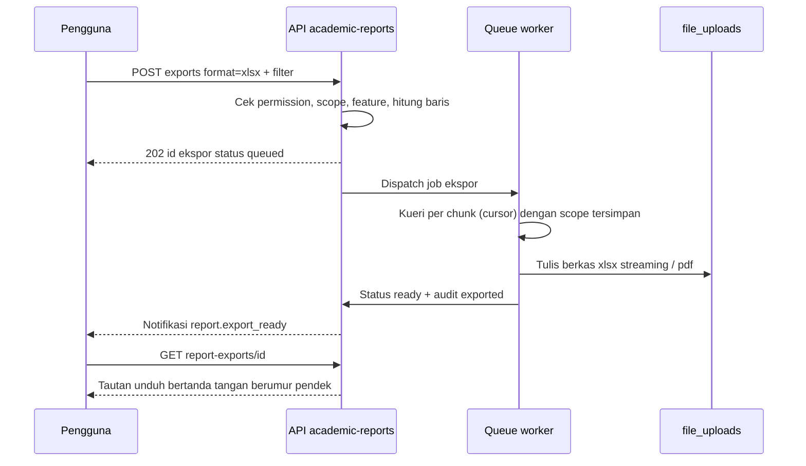

# 12 — Laporan, Dashboard Analitik, dan Ekspor Modul Akademik & Pembelajaran

> **Status:** rancangan (bukan dokumentasi fitur jadi). Tidak ada kode atau skema yang diubah.
> **Disusun:** 2026-10-11, berdasarkan repository pada commit `ab81cc7`.
> Kembali ke [README](README.md) · UI laporan & dashboard: [09-ui-ux-specification.md](09-ui-ux-specification.md) · Hak akses: [11-roles-permissions.md](11-roles-permissions.md) · Keamanan & privasi: [13-security-audit.md](13-security-audit.md) · Endpoint: [08-api-specification.md](08-api-specification.md)

Dokumen ini memenuhi brief §9: setiap laporan minimal (mahasiswa aktif & status, rekap KRS, peserta kelas, jadwal, presensi, realisasi perkuliahan, nilai, IPS & IPK, transkrip, mahasiswa tercekal, riwayat dispensasi, aktivitas MBKM, penggunaan LMS, aktivitas pembelajaran, hasil CBT, ketercapaian CPMK & CPL, rekap EDOM) dirinci dengan filter, kolom, sumber data (tabel kanon README §5.2), agregasi, hak akses (role kanon + scope), format ekspor, dan aturan masking. Dokumen ini juga membedakan **dashboard operasional** dari **laporan analitik**, serta menetapkan strategi performa (ekspor asinkron, snapshot) dan aturan data sensitif.

## Daftar Isi

1. [Kondisi Saat Ini dan Ruang Lingkup](#1-kondisi-saat-ini-dan-ruang-lingkup)
2. [Dashboard Operasional vs Laporan Analitik](#2-dashboard-operasional-vs-laporan-analitik)
3. [Konvensi Laporan](#3-konvensi-laporan)
4. [Katalog Laporan](#4-katalog-laporan)
5. [Matriks Hak Akses Laporan](#5-matriks-hak-akses-laporan)
6. [Aturan Data Sensitif](#6-aturan-data-sensitif)
7. [Performa dan Ekspor](#7-performa-dan-ekspor)
8. [Format Berkas Ekspor](#8-format-berkas-ekspor)
9. [Keterlacakan terhadap Brief §9](#9-keterlacakan-terhadap-brief-9)
10. [Keputusan Terbuka Terkait Laporan](#10-keputusan-terbuka-terkait-laporan)

---

## 1. Kondisi Saat Ini dan Ruang Lingkup

### 1.1 Yang sudah ada di repository

| Komponen | Kondisi (terverifikasi) | Dipakai ulang untuk |
|---|---|---|
| Modul `app/Modules/Report` | `GET /reports` dan `GET /reports/{type}` dengan middleware `permission:reports.read`; `ReportService::build()` mendukung tipe `mahasiswa`, `akademik`, `keuangan`, `sdm`; keluaran `{columns:[{key,label}], rows, summary}` | Pola struktur respons laporan (kolom + baris + ringkasan). Tipe `akademik` saat ini hanya daftar nilai huruf tanpa filter, scope, atau paginasi (**Parsial**) |
| Halaman `frontend/src/pages/report/ReportsPage.tsx` | Route `ROUTES.laporan` (`/laporan`) | Diperluas menjadi katalog laporan akademik ([09 §5.2.2](09-ui-ux-specification.md#522-mbkm-lms-cbt-obe-edom)) |
| Ekspor xlsx | `openspout/openspout` di `composer.json`; `HrExportService` menulis XLSX secara *streaming* (`OpenSpout\Writer\XLSX\Writer`) | Semua ekspor xlsx laporan akademik |
| Ekspor pdf | `barryvdh/laravel-dompdf` di `composer.json`; `HrExportService` (`Pdf::loadView('hr.report-pdf')`), `StudentDocumentService::krsPdf/khsPdf/transcriptPdf/letterPdf` | Dokumen resmi (KRS, KHS, transkrip) dan laporan ringkas pdf |
| Dashboard | `GET /dashboard` (`DashboardController`, hanya `auth:sanctum`), komponen grafik di `frontend/src/components/dashboard/*` (recharts) | Dashboard operasional per role ([09 §4](09-ui-ux-specification.md#4-a-dashboard-per-role)) |
| Audit | `AuditLogService::recordAction()` dengan `AuditAction::exported`, `downloaded`, `viewed_sensitive`; `maskValue()` | Pencatatan setiap ekspor dan pembukaan data sensitif |
| Paginasi & filter | `ListQuery` (`search`, `filter[...]`, `sort`, `per_page` ≤ 100), envelope `ApiResponse` | Semua laporan tabular di layar |

### 1.2 Ruang lingkup

- Laporan **modul akademik & pembelajaran** (SIAKAD, LMS, CBT, OBE, EDOM, MBKM).
- Laporan keuangan, SDM, perpustakaan, PMB, dan yudisium di luar cakupan; hanya status cekal yang berasal dari modul tersebut yang dilaporkan di sini.
- Format laporan akreditasi LAM/BAN-PT tertentu **tidak** ditetapkan di sini; laporan OBE inti dirancang agar dapat dipetakan ke format tersebut setelah konfirmasi ([OD-19](16-open-decisions.md#od-19)).
- Pelaporan PDDikti (Neo Feeder) di luar cakupan (README §1.3).

---

## 2. Dashboard Operasional vs Laporan Analitik

| Aspek | Dashboard operasional | Laporan analitik |
|---|---|---|
| Pertanyaan yang dijawab | "Apa yang harus saya kerjakan sekarang?" | "Bagaimana kondisi/tren dan apa yang perlu diperbaiki?" |
| Pengguna utama | Pelaksana: mahasiswa, dosen, dosen wali, BAAK, admin prodi, pengawas ujian | Pengambil keputusan & penjamin mutu: kaprodi, dekan, rektor/wakil rektor, LPM, BAAK |
| Kesegaran data | Waktu nyata atau cache singkat (detik–menit) | Snapshot terjadwal atau per penutupan periode (jam–semester); tanggal snapshot selalu ditampilkan |
| Sumber | Tabel transaksi langsung | Snapshot (`outcome_measurements`, `edom_reports`, `iku_snapshots`, `storage_usage_snapshots`, `academic_report_snapshots`) atau kueri agregat atas data yang sudah final (nilai terbit, periode tertutup) |
| Granularitas | Item yang dapat ditindaklanjuti (KRS ini, sesi ini, cekal ini) | Agregat per prodi/angkatan/semester dengan drill-down terbatas |
| Interaksi | Tombol aksi langsung (setujui, mulai sesi) | Filter, perbandingan antarsemester, ekspor |
| Ekspor | Umumnya tidak; bila ada, sinkron dan kecil | Wajib (xlsx/pdf), besar → asinkron |
| Lokasi UI | `/dashboard` (widget per role) | `/laporan` dan halaman analitik modul (`/obe/ketercapaian`, `/edom/rekap`, `/lms/analitik`, `/mbkm/iku`) |
| Contoh | "12 KRS menunggu persetujuan", "Sesi IF201-A sedang berlangsung", "3 nilai belum diajukan" | Distribusi IPK per angkatan, tren partisipasi EDOM, ketercapaian CPL vs target |

Aturan pemisahan:

1. **BR-SIA-RPT-01** — Laporan analitik nilai, IPS/IPK, dan ketercapaian CPL hanya memakai nilai berstatus terbit (`grades.is_published = true` / `grade_submissions.status = published`). Nilai draf hanya muncul di layar operasional dosen pemiliknya.
2. **BR-SIA-RPT-02** — Setiap laporan analitik menampilkan "Data per {tanggal snapshot/kueri}" dan versi konfigurasi yang dipakai (mis. skala nilai, metode agregasi CPL).
3. Widget dashboard tidak boleh menjadi jalan pintas ke data yang tidak boleh dilihat di laporan; drill-down dari widget membuka laporan dengan filter dan scope yang sama.

---

## 3. Konvensi Laporan

### 3.1 Endpoint (Baru, final di [08](08-api-specification.md))

| Method | URL | Fungsi | Permission |
|---|---|---|---|
| GET | `/academic-reports` | Katalog laporan yang boleh diakses pengguna (sudah disaring permission, scope, dan feature) | `academic_reports.read` |
| GET | `/academic-reports/{type}` | Data laporan di layar: `?filter[...]`, `?sort=`, `?per_page=` (≤ 100); respons `{columns, rows, summary}` dalam envelope `ApiResponse` dengan `meta` paginasi | `academic_reports.read` + permission resource terkait |
| POST | `/academic-reports/{type}/exports` | Membuat permintaan ekspor (`format: xlsx|pdf`, filter); mengembalikan `202` + id ekspor bila asinkron, atau berkas langsung bila kecil | `academic_reports.export` |
| GET | `/report-exports/{id}` | Status ekspor (`queued`, `processing`, `ready`, `failed`, `expired`) dan tautan unduh bertanda tangan | Pemilik permintaan |

Endpoint `/reports/{type}` (Ada) dipertahankan untuk empat tipe lama; tipe `akademik` lama dialihkan ke `/academic-reports/grades` setelah tersedia.

### 3.2 Filter umum

| Filter | Kunci | Catatan |
|---|---|---|
| Semester | `filter[academic_term_id]` | Default `academic_terms.is_current`; laporan tren menerima rentang (`filter[academic_term_id]=a,b,c`) |
| Fakultas | `filter[faculty_id]` | Dipaksa ke scope bila pengguna ber-scope fakultas |
| Program studi | `filter[study_program_id]` | Dipaksa ke scope prodi |
| Angkatan | `filter[admission_year]` | `students.admission_year` |
| Status mahasiswa | `filter[student_status]` | Enum `students.status` |
| Kelas / MK / dosen | `filter[class_section_id]`, `filter[course_id]`, `filter[lecturer_id]` | Dosen otomatis dibatasi ke kelasnya |
| Pencarian | `search` | NIM/nama/kode |

### 3.3 Penegakan scope (berlaku untuk semua laporan)

**BR-SEC-RPT-01** — Server menambahkan klausa scope sebelum filter pengguna; filter pengguna hanya dapat **mempersempit**, tidak memperluas. Urutan: `university_id` (TenantScoped) → scope role (`user_roles.scope_type/scope_id`: fakultas, prodi) → relasi kepemilikan (dosen: kelas di `class_section_lecturers`/`class_sections.lecturer_id`; dosen wali: `students.academic_advisor_id`; mahasiswa: dirinya; orang tua: `student_guardians` terverifikasi) → filter pengguna.

| Role kanon | Scope data laporan |
|---|---|
| `super_admin` | Platform: hanya agregat lintas tenant tanpa data individual; data individual hanya setelah memilih tenant (`TenantSwitcher`) dan tercatat audit |
| `university_owner`, `university_administrator` | Seluruh tenant |
| `academic_administrator` (BAAK) | Seluruh tenant |
| `rector`, `vice_rector` | Seluruh tenant, agregat + drill-down sampai tingkat kelas; data individual mahasiswa hanya pada laporan yang ditandai |
| `dean` | Fakultas (scope `faculty`) |
| `faculty_administrator` | Fakultas |
| `head_of_study_program`, `study_program_administrator` | Prodi (scope `study_program`) |
| `quality_assurance` (LPM) | Seluruh tenant untuk EDOM, OBE, realisasi perkuliahan; agregat untuk nilai |
| `lecturer` | Kelas yang diampu |
| `academic_advisor` | Mahasiswa bimbingan |
| `exam_committee` | Ujian yang menjadi tanggung jawabnya (konteks prodi/periode) |
| `exam_proctor` | Ujian yang ditugaskan; tanpa nilai |
| `lms_administrator` | Data penggunaan LMS seluruh tenant (tanpa nilai akademik) |
| `student` | Dirinya sendiri |
| `guardian` | Mahasiswa terhubung, subset data ([§6.4](#64-batas-akses-orang-tua)) |
| `auditor` | Baca seluruh tenant; ekspor hanya bila diberi `academic_reports.export` |

### 3.4 Template spesifikasi laporan

Setiap laporan di §4 memakai baris: **ID & nama**, **Jenis** (operasional/analitik), **Label** ([Referensi]/[Rekomendasi]), **Tujuan**, **Filter**, **Kolom**, **Sumber data**, **Agregasi/rumus**, **Hak akses**, **Ekspor**, **Masking**, **Snapshot/performa**. Filter umum §3.2 berlaku dan hanya filter tambahan yang ditulis. Feature key mengikuti README §5.7; laporan modul yang tidak aktif untuk tenant tidak muncul di katalog.

---

## 4. Katalog Laporan

### 4.1 Mahasiswa aktif dan status (RPT-SIA-01)

| Aspek | Spesifikasi |
|---|---|
| Jenis / label | Analitik + operasional (daftar) · [Referensi] · feature `siakad` |
| Tujuan | Jumlah dan daftar mahasiswa per status, perubahan status per semester (aktif, cuti, lulus, nonaktif, DO, mengundurkan diri) |
| Filter tambahan | Status, jenis kelamin, rentang tanggal efektif perubahan status |
| Kolom (rinci) | NIM · Nama · Prodi · Fakultas · Angkatan · Status · Tanggal efektif status · Dosen wali · Semester ke- · SKS lulus · IPK |
| Kolom (rekap) | Prodi · Angkatan · Aktif · Cuti · Nonaktif · Lulus · DO · Mengundurkan diri · Total |
| Sumber data | `students`, `student_status_histories`, `study_programs`, `faculties`, `lecturers` (wali), `academic_terms`; IPK dari `AcademicRecordService` (Ada) |
| Agregasi | `COUNT` per (prodi, angkatan, status) pada akhir semester terpilih — status per semester diambil dari `student_status_histories` dengan `effective_date ≤ end_date` semester, bukan status saat ini |
| Hak akses | BAAK, admin PT, rektor/wakil rektor (rekap + rinci), dekan/admin fakultas (fakultas), kaprodi/admin prodi (prodi), dosen wali (bimbingan, rinci), auditor (baca) |
| Ekspor | xlsx (rinci & rekap), pdf (rekap) |
| Masking | Tanggal lahir, alamat, telepon, email pribadi **tidak termasuk** kolom laporan. Bila diperlukan (laporan internal BAAK), kolom kontak hanya untuk BAAK dan dicatat `viewed_sensitive` |
| Snapshot | Rekap per semester di-snapshot saat semester ditutup (`academic_report_snapshots`), kueri langsung untuk semester berjalan |

### 4.2 Rekap KRS (RPT-SIA-02)

| Aspek | Spesifikasi |
|---|---|
| Jenis / label | Operasional (progres saat periode KRS) + analitik (pasca periode) · [Referensi] |
| Tujuan | Memantau progres pengisian dan persetujuan KRS, mahasiswa belum KRS, dan beban SKS |
| Filter tambahan | Status `krs_submissions`, dosen wali, "belum KRS", rentang SKS |
| Kolom (rinci) | NIM · Nama · Prodi · Angkatan · Dosen wali · Status KRS · Total SKS · Batas SKS · Jumlah MK · Diajukan · Diputuskan · Diputuskan oleh · Jumlah revisi |
| Kolom (rekap) | Prodi · Mahasiswa aktif · Belum mengisi · Draf · Diajukan · Revisi diminta · Disetujui · Dikunci · % disetujui · Rata-rata SKS |
| Sumber data | `krs_submissions`, `krs_items` (status `enrolled`/`pending`), `krs_submission_events` (jumlah revisi, waktu keputusan), `students`, `academic_terms` |
| Agregasi | "Belum mengisi" = mahasiswa `active` tanpa `krs_submissions` pada semester; rata-rata SKS dari `total_credits` yang `approved`/`locked`; waktu rata-rata persetujuan = rata-rata (`decided_at` − `submitted_at`) |
| Hak akses | BAAK, admin prodi/kaprodi (prodi), dekan (fakultas), dosen wali (bimbingan), rektor (rekap) |
| Ekspor | xlsx, pdf (rekap) |
| Masking | Catatan keputusan (`decision_note`) hanya untuk BAAK, dosen wali terkait, dan kaprodi |
| Snapshot | Langsung selama periode KRS; snapshot rekap saat periode KRS ditutup |

### 4.3 Peserta kelas (RPT-SIA-03)

| Aspek | Spesifikasi |
|---|---|
| Jenis / label | Operasional · [Referensi] |
| Tujuan | Daftar peserta per kelas untuk dosen, BAAK, dan presensi manual/cetak |
| Filter tambahan | Kelas (wajib untuk ekspor pdf), status `krs_items` |
| Kolom | No · NIM · Nama · Prodi · Angkatan · Status KRS item · Kehadiran % (berjalan) · Status cekal ujian (ya/tidak) |
| Sumber data | `krs_items` (`enrolled`), `class_sections`, `students`, `attendances`, `academic_blocks` |
| Agregasi | Jumlah peserta per kelas vs `capacity` (rekap kelas) |
| Hak akses | Dosen pengampu (kelasnya), BAAK, admin prodi/kaprodi (prodi), `exam_committee`/`exam_proctor` (kelas ujian yang ditugaskan, tanpa kolom kehadiran) |
| Ekspor | xlsx, pdf (daftar hadir cetak dengan kolom tanda tangan) |
| Masking | Tidak ada kolom kontak. Alasan cekal tidak ditampilkan ke dosen/pengawas — hanya "Tercekal: {layanan}" |
| Snapshot | Langsung |

### 4.4 Jadwal (RPT-SIA-04)

| Aspek | Spesifikasi |
|---|---|
| Jenis / label | Operasional · [Referensi] |
| Tujuan | Jadwal kuliah per prodi, dosen, ruang, dan kelas; utilisasi ruang; daftar konflik |
| Filter tambahan | Hari, ruang, dosen, jenis jadwal (teori/praktikum/tutorial), status jadwal, "hanya konflik" |
| Kolom | Hari · Jam mulai–selesai · Kode MK · MK · Kelas · Kelompok · Jenis · Dosen (koordinator + tim) · Ruang · Kapasitas ruang · Peserta · Status jadwal |
| Kolom (utilisasi ruang) | Ruang · Kapasitas · Jam terpakai/minggu · Jam tersedia · Utilisasi % · Rata-rata keterisian kursi % |
| Sumber data | `class_schedules`, `class_sections`, `class_section_lecturers`, `rooms`, `courses`, `krs_items` |
| Agregasi | Utilisasi = Σ durasi slot terjadwal ÷ jam operasional ruang per minggu (jam operasional = konfigurasi); keterisian = peserta ÷ kapasitas ruang |
| Hak akses | Semua role internal dapat melihat jadwal **terbit** sesuai scope; jadwal `draft`/`in_review` hanya BAAK/admin prodi; mahasiswa via portal (jadwal pribadi) |
| Ekspor | xlsx, pdf (per prodi/per ruang/per dosen, lanskap) |
| Masking | Tidak ada data pribadi |
| Snapshot | Langsung |

### 4.5 Presensi (RPT-SIA-05)

| Aspek | Spesifikasi |
|---|---|
| Jenis / label | Operasional (per kelas) + analitik (per prodi) · [Referensi] |
| Tujuan | Rekap kehadiran per mahasiswa, per kelas, dan mahasiswa di bawah batas minimal kehadiran ujian |
| Filter tambahan | Kelas, rentang pertemuan, status presensi, "di bawah batas", metode (QR/manual) |
| Kolom (per mahasiswa dalam kelas) | NIM · Nama · Hadir · Izin · Sakit · Alpa · Total sesi terlaksana · % kehadiran · Memenuhi batas ujian (ya/tidak) · Jumlah koreksi |
| Kolom (per kelas) | Kelas · MK · Dosen · Sesi terlaksana · Rata-rata kehadiran % · Mahasiswa di bawah batas |
| Sumber data | `attendances` (+ `lecture_session_id`, `method`), `lecture_sessions` (status `held`), `attendance_corrections` (`approved`), `krs_items`, `class_sections` |
| Agregasi | % kehadiran = (jumlah status yang dihitung hadir) ÷ (jumlah sesi `held`) × 100. Apakah `permitted`/`sick` dihitung hadir = konfigurasi ([OD-06](16-open-decisions.md#od-06)); batas minimal = `academic.*` (75% hanya contoh). Sesi `cancelled` tidak dihitung |
| Hak akses | Dosen (kelasnya), BAAK, kaprodi/admin prodi (prodi), dosen wali (bimbingan), mahasiswa (dirinya), orang tua (% per MK saja) |
| Ekspor | xlsx, pdf (rekap kelas untuk arsip/BAP) |
| Masking | Catatan presensi (`notes`) dan lampiran koreksi (surat sakit) **tidak** ikut ekspor; hanya dilihat BAAK/dosen terkait di layar dengan audit `viewed_sensitive` |
| Snapshot | Langsung; rekap akhir semester di-snapshot setelah lembar nilai terbit |

### 4.6 Realisasi perkuliahan (RPT-SIA-06)

| Aspek | Spesifikasi |
|---|---|
| Jenis / label | Analitik + operasional (monitoring) · [Referensi] (jurnal mengajar, smart dashboard monitoring perkuliahan) |
| Tujuan | Membandingkan rencana pertemuan (jadwal dan RPS) dengan realisasi sesi dan jurnal; memantau perkuliahan daring |
| Filter tambahan | Dosen, mode sesi (tatap muka/daring/hybrid), status sesi, "jurnal belum diisi" |
| Kolom | Kelas · MK · Dosen · Pertemuan direncanakan · Sesi terlaksana · Dibatalkan · Dijadwal ulang · Jurnal lengkap · % realisasi · % kesesuaian dengan RPS · Sesi daring · Rata-rata kehadiran |
| Sumber data | `lecture_sessions` (status, mode, jurnal), `class_schedules`, `lesson_plans`, `lesson_plan_meetings`, `lecture_session_materials`, `attendances` |
| Agregasi | % realisasi = sesi `held` ÷ pertemuan direncanakan (konfigurasi jumlah pertemuan per semester); % kesesuaian RPS = sesi `held` yang terhubung ke `lesson_plan_meetings` dengan topik sesuai ÷ sesi `held` (hanya bila `obe` aktif) |
| Hak akses | Kaprodi/admin prodi (prodi), dekan (fakultas), rektor/wakil rektor, LPM, BAAK, dosen (kelasnya) |
| Ekspor | xlsx, pdf |
| Masking | Isi jurnal lengkap tidak diekspor ke rekap pimpinan (hanya status lengkap/tidak); isi jurnal tersedia di detail kelas |
| Snapshot | Mingguan untuk tren (`academic_report_snapshots`), langsung untuk monitoring |

### 4.7 Nilai (RPT-SIA-07)

| Aspek | Spesifikasi |
|---|---|
| Jenis / label | Operasional (status lembar nilai) + analitik (distribusi) · [Referensi] |
| Tujuan | Status pengisian & publikasi nilai per kelas, distribusi nilai huruf, kelulusan MK, dan riwayat revisi nilai |
| Filter tambahan | Status `grade_submissions`, MK, dosen, huruf |
| Kolom (status) | Kelas · MK · Dosen · Peserta · Nilai terisi % · Status lembar · Diajukan · Diterbitkan · Batas input |
| Kolom (distribusi) | Kelas/MK · Peserta · A · AB · B · BC · C · D · E · (kolom huruf mengikuti `grade_scale_items` aktif) · Rata-rata skor · % lulus |
| Kolom (rinci per mahasiswa) | NIM · Nama · MK · Nilai akhir · Huruf · Bobot · Status terbit · Revisi (ya/tidak) |
| Kolom (revisi) | Mahasiswa · MK · Jenis (koreksi/pemutihan) · Huruf lama → baru · Diajukan oleh · Disetujui oleh · Tanggal · Alasan |
| Sumber data | `grade_submissions`, `grades` (`final_score`, `grade_scale_item_id`, `grade_point`, `is_published`), `grade_scale_items`, `assessment_components`, `assessment_scores`, `grade_revisions`, `krs_items` |
| Agregasi | Distribusi = `COUNT` per huruf; % lulus = huruf dengan bobot ≥ batas lulus konfigurasi ÷ peserta bernilai; nilai kosong tidak dihitung dalam rata-rata dan dilaporkan terpisah |
| Hak akses | Status: BAAK, kaprodi/admin prodi, dosen (kelasnya). Distribusi: + dekan, rektor, LPM (agregat kelas, tanpa nama). Rinci per mahasiswa: BAAK, kaprodi (prodi), dosen (kelasnya), dosen wali (bimbingan, nilai akhir; komponen menurut [OD-28](16-open-decisions.md#od-28)). Revisi: BAAK, kaprodi, auditor |
| Ekspor | xlsx (semua), pdf (rekap kelas bertanda tangan dosen/kaprodi) |
| Masking | Nilai belum terbit tidak pernah tampil selain untuk dosen pemilik dan BAAK (BR-SIA-RPT-01). Alasan revisi hanya di laporan revisi |
| Snapshot | Distribusi di-snapshot saat `grade_submissions` menjadi `published`; revisi yang `applied` memicu snapshot ulang kelas terkait |

### 4.8 IPS dan IPK (RPT-SIA-08)

| Aspek | Spesifikasi |
|---|---|
| Jenis / label | Analitik · [Referensi] |
| Tujuan | Sebaran IPS/IPK per prodi dan angkatan, mahasiswa berisiko, dan predikat |
| Filter tambahan | Rentang IPK, rentang IPS, "berisiko" (ambang konfigurasi) |
| Kolom (rinci) | NIM · Nama · Prodi · Angkatan · Semester ke- · SKS semester · IPS · SKS kumulatif · IPK · Dosen wali · Indikator risiko |
| Kolom (rekap) | Prodi · Angkatan · N · Rata-rata IPK · Median · Min · Maks · Sebaran per rentang (konfigurasi, mis. <2,00; 2,00–2,99; 3,00–3,49; ≥3,50 — contoh) |
| Sumber data | `grades` (terbit), `krs_items`, `courses.credits`, `grade_scale_items.grade_point`, `credit_conversion_items` (konversi transfer/MBKM), `grade_revisions` (`applied`) — dihitung oleh `AcademicRecordService`/`StudentGradeService` (Ada) |
| Agregasi | IPS = Σ(SKS × bobot) ÷ Σ SKS MK bernilai pada semester; IPK = sama untuk seluruh MK dengan aturan MK diulang (Ada: nilai terbaik; kebijakan final [OD-08](16-open-decisions.md#od-08)); pembulatan tampilan 2 desimal ([OD-29](16-open-decisions.md#od-29)) |
| Hak akses | Rinci: BAAK, kaprodi/admin prodi (prodi), dosen wali (bimbingan), mahasiswa (dirinya), orang tua (anaknya, IPS/IPK saja). Rekap: + dekan, rektor, LPM |
| Ekspor | xlsx, pdf (rekap) |
| Masking | Daftar "berisiko" hanya untuk BAAK, kaprodi, dosen wali; tidak dipublikasikan ke rekap pimpinan dengan nama |
| Snapshot | Per semester saat semua lembar nilai prodi terbit (atau batas waktu) — angka historis tetap meski ada revisi kemudian, dengan catatan "direvisi pada {tanggal}" |

### 4.9 Transkrip (RPT-SIA-09)

| Aspek | Spesifikasi |
|---|---|
| Jenis / label | Dokumen resmi (operasional) · [Referensi] · (Ada: `GET students/{id}/transcript`, `StudentDocumentService::transcriptPdf`) |
| Tujuan | Transkrip akademik per mahasiswa dan transkrip massal (mis. untuk calon lulusan) |
| Filter tambahan | Massal: prodi, angkatan, status, "calon lulusan" |
| Kolom | Identitas (NIM, nama, prodi, tempat/tanggal lahir — hanya di dokumen resmi) · Kode MK · MK · SKS · Huruf · Bobot · SKS×Bobot · Keterangan (konversi, pemutihan) · Total SKS · IPK · Predikat |
| Sumber data | Sama seperti 4.8 + `curriculums`/`curriculum_courses` (urutan), `credit_conversions`, `double_degree_enrollments` (bentuk transkrip [OD-23](16-open-decisions.md#od-23)) |
| Agregasi | Sesuai 4.8; transkrip sementara vs resmi dibedakan dengan watermark |
| Hak akses | Mahasiswa (dirinya, transkrip sementara), BAAK (resmi, massal), kaprodi (prodi, baca), dosen wali (bimbingan, baca). Orang tua tidak (cukup KHS) |
| Ekspor | pdf (resmi/sementara, dompdf), xlsx (massal untuk verifikasi internal BAAK) |
| Masking | Tanggal lahir hanya pada pdf resmi. Ekspor xlsx massal tanpa tanggal lahir. Setiap unduh transkrip resmi dicatat `AuditAction::downloaded` |
| Snapshot | Tidak; dihasilkan saat diminta. Transkrip massal > ambang → job asinkron menghasilkan zip pdf |

### 4.10 Mahasiswa tercekal dan riwayat dispensasi (RPT-SIA-10, RPT-SIA-11)

| Aspek | RPT-SIA-10 Mahasiswa tercekal | RPT-SIA-11 Riwayat dispensasi |
|---|---|---|
| Jenis / label | Operasional · [Referensi] | Analitik/audit · [Referensi] |
| Tujuan | Daftar cekal aktif per jenis dan layanan | Jejak pemberian/pencabutan dispensasi untuk akuntabilitas |
| Filter tambahan | Jenis cekal (keuangan, akademik, kemahasiswaan, perpustakaan, kehadiran), layanan (KRS/ujian/yudisium), sumber (otomatis/manual), status | Pemberi, rentang tanggal, jenis cekal, status dispensasi (berlaku/berakhir/dicabut) |
| Kolom | NIM · Nama · Prodi · Angkatan · Jenis · Layanan dibatasi · Alasan ringkas · Sumber · Aktif sejak · Status · Dispensasi s.d. | NIM · Nama · Jenis cekal · Layanan dikecualikan · Mulai · Berakhir · Alasan · Diberikan oleh · Dicabut oleh · Tanggal cabut |
| Sumber data | `academic_blocks`, `academic_block_rules`, `academic_block_exemptions`, `students` | `academic_block_exemptions`, `academic_block_histories`, `audit_logs` (aksi dispensasi) |
| Agregasi | Rekap: jumlah per jenis × layanan × prodi; mahasiswa dengan ≥2 cekal bersamaan dihitung sekali per jenis dan sekali di kolom "mahasiswa unik" | Jumlah dispensasi per pemberi, per jenis, rata-rata durasi |
| Hak akses | BAAK; `finance_administrator` (jenis keuangan), `library_administrator` (perpustakaan); kaprodi/admin prodi (prodi, tanpa nominal); dosen wali (bimbingan); panitia ujian (status ujian saja) | BAAK, admin PT, auditor, kaprodi (prodi, baca) |
| Ekspor | xlsx, pdf | xlsx, pdf |
| Masking | Nominal tagihan **tidak** ditampilkan di laporan akademik (hanya "tagihan belum lunas"); alasan rinci cekal kemahasiswaan (pelanggaran) hanya untuk BAAK | Alasan dispensasi utuh hanya untuk BAAK/auditor; kaprodi melihat kategori alasan |
| Snapshot | Langsung | Langsung (data append-only) |

### 4.11 Aktivitas MBKM dan rekap IKU

**RPT-MBK-01 Aktivitas MBKM** — feature `siakad.mbkm`

| Aspek | Spesifikasi |
|---|---|
| Jenis / label | Operasional + analitik · [Referensi] |
| Tujuan | Rekap program, peserta, mitra, logbook, evaluasi, dan konversi SKS per jenis aktivitas (8 aktivitas + pertukaran antarprodi) |
| Filter tambahan | Jenis aktivitas, program, mitra, status peserta, pembimbing |
| Kolom (peserta) | NIM · Nama · Prodi · Program · Jenis aktivitas · Mitra · Pembimbing · Periode · Logbook terisi/minggu berjalan · Logbook tervalidasi · Nilai evaluasi · SKS dikonversi · MK konversi · Status |
| Kolom (rekap) | Jenis aktivitas · Program · Pendaftar · Diterima · Aktif · Selesai · Mengundurkan diri · Total SKS dikonversi · Rata-rata nilai |
| Sumber data | `mbkm_programs`, `mbkm_partners`, `mbkm_participations`, `mbkm_logbooks`, `mbkm_assessments`, `credit_conversions` (`source_type` MBKM), `credit_conversion_items` |
| Agregasi | Kepatuhan logbook = entri tervalidasi ÷ minggu berjalan program; SKS dikonversi = Σ `credit_conversion_items` yang disetujui |
| Hak akses | BAAK/pengelola MBKM, kaprodi/admin prodi (prodi), dekan, rektor (rekap), dosen pembimbing (pesertanya), mahasiswa (dirinya) |
| Ekspor | xlsx, pdf |
| Masking | Isi logbook dan lampiran tidak ikut ekspor rekap; nilai evaluasi mitra hanya untuk pembimbing, kaprodi, BAAK |
| Snapshot | Langsung; snapshot per semester untuk tren |

**RPT-MBK-02 Rekap IKU** — feature `siakad.mbkm.iku` (Enterprise referensi) · [Referensi] "Perhitungan pencapaian IKU otomatis"

| Aspek | Spesifikasi |
|---|---|
| Tujuan | Kontribusi MBKM (dan data lain yang ditetapkan) terhadap indikator IKU per periode |
| Kolom | Indikator · Definisi (konfigurasi) · Pembilang · Penyebut · Capaian % · Target · Periode · Tanggal snapshot |
| Sumber data | `iku_snapshots` (dihasilkan dari `mbkm_participations`, `credit_conversions`, `students`) |
| Agregasi | Rumus per indikator **tidak di-hardcode**; definisi indikator, pembilang, penyebut, dan aturan SKS minimal disimpan sebagai konfigurasi dan menunggu [OD-13](16-open-decisions.md#od-13) |
| Hak akses | Rektor/wakil rektor, admin PT, BAAK, LPM, dekan (fakultas) |
| Ekspor | xlsx, pdf |
| Masking | Agregat saja; daftar mahasiswa pembilang hanya untuk BAAK (verifikasi) |
| Snapshot | Wajib snapshot (per semester dan saat diminta), angka lama tidak berubah |

### 4.12 Penggunaan LMS dan aktivitas pembelajaran

**RPT-LMS-01 Penggunaan LMS** — feature `lms`

| Aspek | Spesifikasi |
|---|---|
| Jenis / label | Analitik · [Referensi] (dashboard aktivitas pembelajaran, monitoring perkuliahan online) |
| Tujuan | Adopsi LMS per prodi/kelas: kelas aktif, materi diunggah, tugas, forum, storage |
| Filter tambahan | Jenis kelas (akademik/umum), status kelas LMS, dosen |
| Kolom | Prodi/Kelas · Dosen · Status kelas · Materi terbit · Tugas · Thread forum · Pengumuman · Mahasiswa aktif (≥1 aktivitas dalam 14 hari — konfigurasi) · Aktivitas terakhir dosen · Storage terpakai |
| Kolom (storage) | Prodi · Kelas akademik · Kelas umum · Berkas · Ukuran · % kuota tenant |
| Sumber data | `lms_classes`, `course_materials`, `course_material_versions`, `assignments`, `lms_discussion_threads`, `lms_class_announcements`, `lms_activity_events`, `storage_usage_snapshots`, `file_uploads.size_bytes` |
| Agregasi | Kelas aktif = kelas `active` dengan ≥1 aktivitas dosen dan mahasiswa dalam jendela waktu konfigurasi; storage = Σ `size_bytes` berkas tidak terhapus per kelas (snapshot harian) |
| Hak akses | `lms_administrator`, BAAK, kaprodi (prodi), dekan, rektor (rekap), LPM, dosen (kelasnya) |
| Ekspor | xlsx, pdf |
| Masking | Tidak ada data individual mahasiswa pada laporan ini |
| Snapshot | Harian (`storage_usage_snapshots`, `academic_report_snapshots`) |

**RPT-LMS-02 Aktivitas pembelajaran** — feature `lms`; skor engagement `lms.engagement_score`, skor kinerja dosen `lms.lecture_performance_score`

| Aspek | Spesifikasi |
|---|---|
| Jenis / label | Analitik · [Referensi] (Student Engagement Score, Lecture Performance Score sesuai paket) |
| Tujuan | Keterlibatan mahasiswa dan dosen di kelas daring, progres materi, penyelesaian tugas |
| Kolom (mahasiswa dalam kelas) | NIM · Nama · Materi dibuka/total · Tugas dikumpulkan/total · Terlambat · Post forum · Presensi % · Engagement score (bila aktif) · Aktivitas terakhir |
| Kolom (dosen) | Dosen · Kelas · Materi diunggah · Tugas dinilai tepat waktu % · Respons forum (median jam) · Sesi daring · Lecture performance score (bila aktif) |
| Sumber data | `lms_activity_events`, `lms_material_progress`, `assignment_submissions`, `lms_discussion_posts`, `attendances`, `lms_engagement_scores`, `lms_lecture_performance_scores` |
| Agregasi | Skor memakai bobot komponen yang dikonfigurasi dan ditampilkan di laporan ("Lihat rumus"); skor tidak dihitung bila data < minimum aktivitas |
| Hak akses | Rinci mahasiswa: dosen (kelasnya), dosen wali (bimbingan), mahasiswa (dirinya). Rinci dosen: kaprodi (prodi), dekan, LPM, dosen (dirinya). Rekap: rektor |
| Ekspor | xlsx |
| Masking | **BR-LMS-RPT-01** — Laporan menampilkan keterangan "indikator keaktifan, bukan ukuran pemahaman atau nilai"; skor engagement tidak boleh dipakai sebagai komponen nilai otomatis kecuali dosen memetakannya secara eksplisit sebagai `assessment_components`. **BR-LMS-RPT-02** — Skor kinerja dosen tidak ditampilkan ke mahasiswa dan tidak ke sesama dosen |
| Snapshot | Skor dihitung harian/mingguan (job), aktivitas mentah tidak diekspor |

### 4.13 Hasil CBT (RPT-CBT-01) — feature `cbt`

| Aspek | Spesifikasi |
|---|---|
| Jenis / label | Operasional (rekap ujian) + analitik (analisis butir) · [Referensi]; analisis butir [Rekomendasi] |
| Tujuan | Rekap hasil per ujian, partisipasi, pelanggaran, dan kualitas soal |
| Filter tambahan | Ujian, jenis ujian (kuis/UTS/UAS/seleksi PMB), status attempt, rentang skor |
| Kolom (rekap peserta) | NIM/No. peserta · Nama · Status attempt · Mulai · Selesai · Durasi · Skor mentah · Penalti · Skor akhir · Huruf ujian (`exam_grade_ranges`) · Jumlah pelanggaran · Keputusan pengawas |
| Kolom (ringkasan ujian) | Ujian · Peserta terdaftar · Hadir · Selesai · Auto-submit · Dibatalkan · Rata-rata · Median · Min · Maks · % lulus |
| Kolom (analisis butir) | No. soal · Topik · Kesulitan (label) · Indeks kesukaran p (proporsi benar) · Daya beda (kelompok atas–bawah 27%) · Distribusi pilihan per opsi · Rekomendasi tinjau |
| Sumber data | `exams`, `exam_participants`, `exam_attempts`, `exam_attempt_answers`, `exam_questions`, `exam_question_options`, `exam_violations`, `exam_grade_ranges`, `question_bank_items` (ada `ExamRecapPage`/rekap ujian yang sudah ada sebagai basis) |
| Agregasi | Skor akhir dari `exam_attempts.score` (Ada; tidak ada tabel hasil terpisah, README §5.2); attempt `voided` dikecualikan dari statistik; analisis butir hanya bila peserta ≥ n minimum (konfigurasi) |
| Hak akses | Dosen pengampu/penyusun (ujiannya), `exam_committee`, kaprodi (prodi, ringkasan + butir), BAAK; `exam_proctor` (status & pelanggaran, tanpa skor); mahasiswa (hasil dirinya bila `show_result_after_submission`); panitia PMB (ujian seleksi) |
| Ekspor | xlsx, pdf (ringkasan) |
| Masking | Kunci jawaban dan teks soal **tidak** ikut ekspor rekap (hanya nomor & topik) kecuali penyusun/panitia; bukti proctoring (snapshot) tidak pernah masuk ekspor (**BR-CBT-RPT-01**), hanya jumlah dan jenis kejadian; label "indikasi, bukan bukti" pada kolom pelanggaran |
| Snapshot | Saat ujian `graded`/`published` |

### 4.14 Ketercapaian CPMK dan CPL (RPT-OBE-01, RPT-OBE-02) — feature `obe`

| Aspek | RPT-OBE-01 Ketercapaian CPMK | RPT-OBE-02 Ketercapaian CPL |
|---|---|---|
| Jenis / label | Analitik · [Referensi] | Analitik · [Referensi] (laporan inti akreditasi) |
| Tujuan | Capaian tiap CPMK per kelas/MK dan per mahasiswa | Capaian CPL per prodi, angkatan, dan mahasiswa vs target; area di bawah target dan tindak lanjut |
| Filter tambahan | MK, kelas, CPMK | Kurikulum (versi), CPL, angkatan |
| Kolom | MK · Kelas · CPMK · Komponen penilai (bobot) · Rata-rata capaian · % mahasiswa ≥ ambang · Target · Status | CPL · Kategori · Target · Realisasi · Selisih · N mahasiswa terukur · MK kontributor · Status · Tindak lanjut |
| Kolom (per mahasiswa) | NIM · Nama · CPMK-1..n | NIM · Nama · CPL-1..n |
| Sumber data | `assessment_scores`, `assessment_components`, `assessment_component_outcomes`, `course_learning_outcomes`, `outcome_measurements` | `outcome_measurements`, `clo_plo_mappings`, `course_plo_mappings`, `program_learning_outcomes`, `graduate_profile_outcomes`, `outcome_evaluation_reports`, `outcome_followups` |
| Agregasi | Capaian CPMK mahasiswa = Σ(skor komponen × bobot komponen→CPMK) ÷ Σ bobot, hanya komponen bernilai terbit | Agregasi CPMK→CPL dengan metode konfigurasi (mis. rata-rata tertimbang SKS, rata-rata tertimbang bobot pemetaan, atau persentase mahasiswa ≥ ambang) — default dan ambang [OD-16](16-open-decisions.md#od-16); metode yang dipakai dicetak di laporan |
| Hak akses | Dosen (MK-nya), kaprodi/admin prodi, LPM, dekan (fakultas, agregat) | Kaprodi/admin prodi, LPM, dekan, rektor/wakil rektor (agregat); mahasiswa (capaian dirinya) [Rekomendasi] |
| Ekspor | xlsx, pdf | xlsx, pdf (matriks dan ringkasan untuk dokumen akreditasi; format lembaga [OD-19](16-open-decisions.md#od-19)) |
| Masking | Rinci per mahasiswa hanya untuk dosen MK, kaprodi, LPM; ekspor akreditasi memakai agregat atau NIM tersamar (`maskValue`) | Sama |
| Snapshot | `outcome_measurements` per semester (hitung ulang membuat snapshot baru, lama disimpan) | Sama |

Laporan OBE pendukung (inti, [Referensi] D.6): profil lulusan & CPL, matriks CPL–MK, matriks CPMK–CPL, rekap realisasi RPS (dari RPT-SIA-06), bukti asesmen (daftar komponen dan contoh berkas per CPMK dari `file_uploads` yang ditautkan), riwayat evaluasi & perbaikan (`outcome_evaluation_reports`, `outcome_followups`). Semua: hak akses kaprodi, LPM, dekan; ekspor xlsx/pdf.

### 4.15 Rekap EDOM (RPT-EDM-01) — feature `edom`

| Aspek | Spesifikasi |
|---|---|
| Jenis / label | Analitik · [Referensi] (rekap per dosen & per kelas) |
| Tujuan | Rekap per dosen, kelas, prodi; distribusi jawaban; partisipasi; tren antarsemester; aspek yang perlu pembinaan |
| Filter tambahan | Periode EDOM, kategori pertanyaan, dosen, kelas |
| Kolom (per dosen-kelas) | Dosen · Kelas · MK · Peserta layak · Responden · Partisipasi % · Rata-rata per kategori · Rata-rata total · Simpangan baku · Kategori terendah |
| Kolom (prodi) | Prodi · Sasaran · Partisipasi % · Rata-rata · Distribusi skala · Δ vs semester lalu |
| Kolom (partisipasi) | Prodi/Kelas · Peserta layak · Sudah mengisi · Belum · % |
| Sumber data | `edom_periods`, `edom_forms`, `edom_questions`, `edom_targets`, `edom_participations` (status pengisian), `edom_responses`, `edom_answers`, `edom_reports` (snapshot hasil analisis) |
| Agregasi | Rata-rata skala per pertanyaan → kategori → total (bobot kategori = konfigurasi formulir); partisipasi = responden ÷ peserta layak; tren memakai `edom_reports` antarperiode dengan formulir sebanding (kategori yang sama) |
| Hak akses | LPM (semua), kaprodi/admin prodi (prodi), dekan (fakultas), rektor (rekap), dosen (dirinya, setelah periode `published`). **Partisipasi per mahasiswa** (siapa sudah/belum) hanya untuk mahasiswa sendiri dan BAAK/LPM untuk tindak lanjut pengingat — tanpa jawaban |
| Ekspor | xlsx, pdf |
| Masking | Aturan §6.2 (ambang n, komentar terbuka, pemisahan identitas) |
| Snapshot | `edom_reports` dibuat saat periode `analyzed`; yang dipublikasikan adalah snapshot, bukan kueri langsung |

Laporan EDOM wajib memuat catatan: "EDOM adalah masukan untuk pembinaan dan penjaminan mutu, bukan satu-satunya ukuran kinerja dosen."

### 4.16 Laporan pendukung — [Rekomendasi]

| ID | Laporan | Sumber | Hak akses | Ekspor |
|---|---|---|---|---|
| RPT-SIA-12 | Beban & riwayat mengajar dosen (SKS mengajar per semester, kelas, team teaching) | `class_sections`, `class_section_lecturers`, `courses`, `lecturers` | BAAK, kaprodi, dekan, dosen (dirinya) | xlsx, pdf |
| RPT-SIA-13 | Perwalian: konsultasi per dosen wali, mahasiswa tanpa konsultasi | `advising_records`, `students` | Kaprodi, BAAK, dosen wali (dirinya) | xlsx |
| RPT-SIA-14 | Layanan akademik: pengajuan cuti/aktif kembali/surat per status dan waktu proses | `student_requests`, `approval_requests` | BAAK, kaprodi | xlsx |
| RPT-SIA-15 | Tugas akhir: progres per tahap, beban pembimbing, lama studi TA | `theses`, `thesis_supervisors`, `thesis_guidance_records`, `thesis_examinations` | Kaprodi, BAAK, dekan | xlsx, pdf |
| RPT-SIA-16 | Transfer & konversi nilai | `student_transfers`, `credit_conversions`, `credit_conversion_items` | BAAK, kaprodi | xlsx |
| RPT-SEC-01 | Jejak aksi sensitif akademik (ubah nilai, dispensasi, persetujuan KRS, ubah kurikulum, pengesahan CPL) | `audit_logs` | Auditor, admin PT, BAAK (terbatas) | xlsx |

---

## 5. Matriks Hak Akses Laporan

Legenda: **R** = rinci (data individual) sesuai scope · **A** = agregat saja · **S** = diri sendiri · **—** = tidak. Ekspor mengikuti kolom yang sama ditambah permission `academic_reports.export`.

| Laporan | BAAK | Admin PT | Rektor/WR | Dekan / admin fak. | Kaprodi / admin prodi | LPM | Dosen | Dosen wali | Panitia ujian | Pengawas | Pengelola LMS | Mahasiswa | Orang tua | Auditor |
|---|---|---|---|---|---|---|---|---|---|---|---|---|---|---|
| 4.1 Mahasiswa & status | R | R | A | R | R | A | — | R | — | — | — | S | S (status) | R |
| 4.2 Rekap KRS | R | R | A | R | R | — | — | R | — | — | — | S | — | R |
| 4.3 Peserta kelas | R | R | — | R | R | — | R (kelas) | — | R (ujian) | R (ujian) | — | — | — | R |
| 4.4 Jadwal | R | R | A | R | R | A | R | R | R | R | — | S | — | R |
| 4.5 Presensi | R | R | A | A | R | A | R (kelas) | R | — | — | — | S | S (% per MK) | R |
| 4.6 Realisasi perkuliahan | R | R | A | R | R | R | R (kelas) | — | — | — | A | — | — | R |
| 4.7 Nilai (status/distribusi) | R | R | A | A | R | A | R (kelas) | R (nilai akhir) | — | — | — | S | S (huruf) | R |
| 4.8 IPS & IPK | R | R | A | A | R | A | — | R | — | — | — | S | S | R |
| 4.9 Transkrip | R | — | — | — | R (baca) | — | — | R (baca) | — | — | — | S (sementara) | — | R |
| 4.10 Tercekal / dispensasi | R | R | A | A | R / A | — | — (status di peserta) | R | A (status ujian) | — | — | S | — | R |
| 4.11 MBKM / IKU | R | R | A | A | R | A | R (bimbingan) | — | — | — | — | S | — | R |
| 4.12 LMS | A | A | A | A | R (dosen) / A | A | R (kelas) | R (bimbingan) | — | — | R (tanpa nilai) | S | — | A |
| 4.13 Hasil CBT | R | — | — | — | R | — | R (ujiannya) | — | R | Status saja | — | S | — | R |
| 4.14 CPMK & CPL | A | A | A | A | R | R | R (MK) | — | — | — | — | S [Rekomendasi] | — | A |
| 4.15 EDOM | Partisipasi | A | A | A | A per dosen | R (tanpa identitas responden) | S | — | — | — | — | Partisipasi S | — | A |

Catatan: "R" untuk EDOM berarti rekap per dosen/kelas, **tidak pernah** jawaban individual yang dapat dikaitkan ke mahasiswa.

---

## 6. Aturan Data Sensitif

### 6.1 Masking dan minimisasi kolom

| Data | Aturan | Siapa melihat utuh |
|---|---|---|
| NIK, nomor KK, nama ibu kandung | Tidak pernah masuk laporan akademik | — (data master, menu Mahasiswa dengan `viewed_sensitive`) |
| Tanggal lahir, tempat lahir | Hanya pada transkrip/ijazah resmi pdf | BAAK |
| Alamat, telepon, email pribadi | Tidak masuk laporan; kebutuhan kontak via fitur notifikasi | BAAK (menu Mahasiswa) |
| NIM pada ekspor untuk pihak eksternal/akreditasi | Disamarkan `maskValue()` (mis. `2201****01`) | Pengekspor internal |
| Nominal tagihan | Tidak ditampilkan di laporan akademik | Modul Keuangan |
| Nilai komponen | Dosen kelas, kaprodi, BAAK; dosen wali sesuai [OD-28](16-open-decisions.md#od-28) | — |
| Catatan konsultasi perwalian | Tidak masuk laporan rekap; hanya jumlah | Dosen wali, kaprodi |
| Alasan cekal kemahasiswaan, surat sakit, dokumen pengajuan | Tidak diekspor | BAAK di layar (audit) |
| Bukti proctoring (snapshot) | Tidak pernah diekspor (BR-CBT-RPT-01) | Pengawas/panitia di layar, audit `viewed_sensitive` ([OD-12](16-open-decisions.md#od-12)) |
| Kunci jawaban & teks soal | Tidak masuk rekap hasil | Penyusun, panitia |

**BR-SEC-RPT-02** — Kolom yang tidak berhak dilihat dihapus di server dari `columns` dan `rows` (bukan disembunyikan di frontend).

### 6.2 EDOM: ambang responden dan privasi

| ID | Aturan |
|---|---|
| **BR-EDM-RPT-01** | Rekap per dosen/kelas/pertanyaan hanya ditampilkan bila jumlah responden ≥ `n_min` (konfigurasi `academic.edom.min_respondents`, contoh 5). Di bawah ambang: sel berisi "Data tidak cukup" dan tidak ikut ekspor rinci; nilai tetap masuk agregat tingkat lebih tinggi (prodi) bila agregat itu memenuhi ambang |
| **BR-EDM-RPT-02** | Supresi komplementer: bila satu sel ditekan dan totalnya ditampilkan, sel lain yang memungkinkan pengurangan (mis. hanya dua kelas dalam satu dosen) juga ditekan |
| **BR-EDM-RPT-03** | Mode anonim: laporan tidak boleh menggabungkan `edom_responses` dengan `edom_participations` (kunci penghubung tidak tersedia di skema); ekspor tidak memuat cap waktu presisi (dibulatkan ke tanggal) agar tidak dapat dicocokkan dengan log akses |
| **BR-EDM-RPT-04** | Komentar terbuka ditampilkan tanpa metadata dan dalam urutan acak, hanya untuk kelas yang memenuhi ambang; dosen menerima komentar setelah periode `published`; penyaringan bahasa kasar oleh LPM sebelum publikasi tercatat di audit |
| **BR-EDM-RPT-05** | Dosen hanya melihat rekap dirinya; perbandingan dengan rata-rata prodi ditampilkan sebagai angka agregat tanpa nama dosen lain |
| **BR-EDM-RPT-06** | Daftar "belum mengisi" hanya dipakai untuk pengingat dan tidak pernah memuat jawaban; tidak tersedia bagi dosen yang dievaluasi |

Model privasi lengkap ada di [05-edom.md](05-edom.md) dan [13-security-audit.md](13-security-audit.md); default anonimitas [OD-10](16-open-decisions.md#od-10).

### 6.3 Ambang sel kecil umum

**BR-SEC-RPT-03** — Laporan agregat yang dibagikan ke role berlabel **A** (§5) menekan sel dengan N < `academic.reports.min_cell_size` (konfigurasi, contoh 5) bila sel tersebut dapat mengungkap individu (mis. distribusi nilai kelas berisi 3 mahasiswa, IPK per angkatan kecil). Role dengan akses **R** tidak terkena supresi.

### 6.4 Batas akses orang tua

| ID | Aturan |
|---|---|
| **BR-SEC-RPT-04** | Orang tua hanya mengakses mahasiswa dengan relasi `student_guardians` terverifikasi dan aktif ([OD-21](16-open-decisions.md#od-21)); pencabutan relasi berlaku seketika (cache izin dibersihkan) |
| **BR-SEC-RPT-05** | Data yang boleh: status mahasiswa, KHS (huruf, SKS, IPS/IPK) yang sudah terbit, % kehadiran per MK, status tagihan. Tidak boleh: nilai komponen, presensi per sesi, jawaban/hasil ujian rinci, EDOM, catatan perwalian, logbook MBKM, dokumen pengajuan, transkrip resmi |
| **BR-SEC-RPT-06** | Orang tua tidak memiliki permission ekspor laporan; unduh KHS pdf hanya bila diizinkan konfigurasi tenant dan dicatat audit |

### 6.5 Audit ekspor

**BR-SEC-RPT-07** — Setiap ekspor (xlsx/pdf) dicatat `AuditLogService::recordAction(..., AuditAction::exported)` dengan tipe laporan, filter efektif (setelah scope), format, dan jumlah baris; unduhan berkas hasil dicatat `downloaded`. Audit tidak menyimpan isi berkas, token, maupun tautan bertanda tangan.

---

## 7. Performa dan Ekspor

### 7.1 Sinkron vs asinkron

| Kondisi | Mode | Perilaku |
|---|---|---|
| Tampilan layar | Sinkron, paginasi server (`per_page` ≤ 100) | Kueri dengan indeks komposit diawali `university_id` |
| Ekspor ≤ ambang (konfigurasi, contoh 2.000 baris xlsx atau 50 halaman pdf) | Sinkron | Berkas dikirim langsung (streaming xlsx) |
| Ekspor > ambang, transkrip massal, rekap lintas semester | Asinkron (queue) | `POST .../exports` → `202` + id; status di `report_exports`; notifikasi `report.export_ready` saat selesai |

Aturan job:

1. Scope dan filter efektif **dibekukan saat permintaan**; job berjalan sebagai pengguna peminta dalam `TenantContext` tenant tersebut (tidak konteks platform).
2. Kueri memakai `cursor()`/`lazyById()` per chunk (contoh 1.000 baris) dan menulis langsung ke `OpenSpout\Writer\XLSX\Writer` (pola `HrExportService`) — memori konstan.
3. PDF (dompdf) dibatasi untuk laporan ringkas; laporan rinci besar diarahkan ke xlsx. PDF besar (transkrip massal) dipecah per mahasiswa lalu di-zip.
4. Berkas hasil disimpan sebagai `file_uploads` (`is_public = false`) di path per tenant dengan masa berlaku (konfigurasi, contoh 7 hari) lalu dihapus oleh job pembersih; status `expired`.
5. Batas konkurensi per pengguna (contoh 3 job aktif) dan rate limit endpoint ekspor.
6. Kegagalan: status `failed` dengan pesan ramah; retry otomatis maksimal 3 kali untuk kesalahan sementara.

Tabel baru pendukung (NEW NAMES): `report_exports` (`id`, `university_id`, `requested_by`, `report_type`, `format`, `filters` json efektif, `status` `queued|processing|ready|failed|expired`, `row_count`, `file_upload_id`, `error_message`, `started_at`, `finished_at`, `expires_at`).

### 7.2 Snapshot

| Snapshot | Pemicu | Isi | Tabel |
|---|---|---|---|
| Rekap status mahasiswa per semester | Penutupan semester | Jumlah per prodi × angkatan × status | `academic_report_snapshots` |
| Rekap KRS | Penutupan periode KRS | Jumlah per status per prodi | `academic_report_snapshots` |
| Distribusi nilai | `grade_submissions` → `published`; revisi `applied` | Distribusi per kelas | `academic_report_snapshots` |
| IPS/IPK per semester | Semua nilai prodi terbit / batas waktu | Statistik per prodi × angkatan | `academic_report_snapshots` |
| Realisasi perkuliahan | Mingguan | % realisasi per kelas | `academic_report_snapshots` |
| Ketercapaian CPMK/CPL | Permintaan "Hitung ulang" / akhir semester | Nilai capaian | `outcome_measurements` (kanon) |
| EDOM | Periode → `analyzed` | Rekap per sasaran, kategori | `edom_reports` (kanon) |
| IKU | Akhir semester / permintaan | Pembilang, penyebut, capaian | `iku_snapshots` (kanon) |
| Storage | Harian | Ukuran per kelas/prodi | `storage_usage_snapshots` (kanon) |

`academic_report_snapshots` (NEW NAMES, [Rekomendasi]): `id`, `university_id`, `report_type`, `academic_term_id`, `scope_type`, `scope_id`, `payload` json, `config_version` (versi skala nilai/metode yang dipakai), `generated_at`, `generated_by`. Snapshot bersifat append-only; laporan menampilkan snapshot terbaru dan dapat memilih snapshot historis.

### 7.3 Optimasi kueri dan cache

1. Indeks komposit pendukung laporan (rincian di [07](07-database-erd.md)): `krs_submissions(university_id, academic_term_id, status)`, `krs_items(university_id, academic_term_id, class_section_id, status)`, `attendances(university_id, lecture_session_id)`, `lecture_sessions(university_id, class_section_id, status)`, `grades(university_id, is_published)`, `academic_blocks(university_id, status, block_type)`, `lms_activity_events(university_id, lms_class_id, occurred_at)`.
2. `lms_activity_events` bersifat append-only dan bervolume tinggi: laporan tidak membaca langsung untuk rentang panjang, melainkan agregat harian (job) — partisi per bulan [Rekomendasi].
3. Cache hasil laporan layar per (pengguna, tipe, filter efektif) berumur pendek (contoh 5 menit). Payload cache harus berupa **array biasa**, bukan `Collection`, karena `Collection` di dalam `Cache::remember()` rusak saat cache hit Redis dan memecah `.map()` di frontend.
4. Read replica untuk laporan analitik bila tersedia [Rekomendasi]; laporan operasional tetap ke primary agar segar.
5. `ReportService` (Ada) memuat seluruh baris dengan `->get()`; laporan akademik baru wajib paginasi/cursor.

---

## 8. Format Berkas Ekspor

| Elemen | xlsx (openspout) | pdf (dompdf) |
|---|---|---|
| Kepala | Baris 1–4: nama kampus (tenant/whitelabel), judul laporan, filter efektif (teks), "Dibuat {tanggal jam} oleh {nama}"; baris kosong; header kolom tebal | Kop kampus (logo tenant), judul, filter, tanggal cetak |
| Isi | Satu baris per entitas; angka sebagai numerik (bukan teks); tanggal sebagai tanggal Excel; satu sheet "Data" + sheet "Ringkasan" (bila ada `summary`) + sheet "Keterangan" (definisi kolom, rumus, versi konfigurasi, ambang supresi) | Tabel dengan pengulangan header per halaman; lanskap untuk > 7 kolom |
| Kaki | — | Nomor halaman "x dari y", catatan kerahasiaan |
| Penanda | — | Watermark "SEMENTARA"/"RAHASIA — INTERNAL" untuk dokumen tidak resmi dan laporan berisi data individual |
| Nama berkas | `{tipe}_{prodi|semua}_{semester}_{yyyymmdd-hhmm}.xlsx` | Sama `.pdf` |
| Bahasa | Mengikuti bahasa pengguna (ID/EN) untuk judul kolom | Sama |
| Dokumen resmi | — | KRS, KHS, transkrip memakai template `StudentDocumentService` (Ada) dan tanda tangan pejabat dari konfigurasi |

CSV tidak disediakan secara default [Rekomendasi: opsional untuk integrasi], karena brief dan pustaka yang ada fokus pada xlsx/pdf.

---

## 9. Keterlacakan terhadap Brief §9

| Laporan minimal brief §9 | Bagian |
|---|---|
| Mahasiswa aktif & status | §4.1 |
| Rekap KRS | §4.2 |
| Peserta kelas | §4.3 |
| Jadwal | §4.4 |
| Presensi | §4.5 |
| Realisasi perkuliahan | §4.6 |
| Nilai | §4.7 |
| IPS & IPK | §4.8 |
| Transkrip | §4.9 |
| Mahasiswa tercekal | §4.10 (RPT-SIA-10) |
| Riwayat dispensasi | §4.10 (RPT-SIA-11) |
| Aktivitas MBKM | §4.11 (RPT-MBK-01, RPT-MBK-02) |
| Penggunaan LMS | §4.12 (RPT-LMS-01) |
| Aktivitas pembelajaran | §4.12 (RPT-LMS-02) |
| Hasil CBT | §4.13 |
| Ketercapaian CPMK & CPL | §4.14 |
| Rekap EDOM | §4.15 |
| Per laporan: filter, kolom, sumber data, agregasi, hak akses, format ekspor | Tabel tiap laporan §4, §5 |
| Bedakan dashboard operasional vs laporan analitik | §2 |
| Hindari data sensitif ke role tak berwenang | §3.3, §5, §6 |

ID aturan yang didefinisikan: BR-SIA-RPT-01..02, BR-SEC-RPT-01..07, BR-EDM-RPT-01..06, BR-LMS-RPT-01..02, BR-CBT-RPT-01. Skenario uji terkait (mis. EDOM anonim, batas akses orang tua, isolasi antar-PT pada ekspor) ada di [14-test-scenarios.md](14-test-scenarios.md).

---

## 10. Keputusan Terbuka Terkait Laporan

| ID | Dampak ke laporan |
|---|---|
| [OD-06](16-open-decisions.md#od-06) | Rumus % kehadiran (izin/sakit dihitung hadir?) |
| [OD-08](16-open-decisions.md#od-08) | IPK untuk MK diulang dan tampilan transkrip |
| [OD-10](16-open-decisions.md#od-10) | Mode anonim EDOM dan cakupan laporan partisipasi |
| [OD-12](16-open-decisions.md#od-12) | Keberadaan bukti proctoring di layar review (tetap tidak diekspor) |
| [OD-13](16-open-decisions.md#od-13) | Definisi indikator IKU |
| [OD-16](16-open-decisions.md#od-16) | Metode agregasi CPL default dan ambang |
| [OD-19](16-open-decisions.md#od-19) | Format ekspor akreditasi |
| [OD-21](16-open-decisions.md#od-21) | Verifikasi relasi orang tua |
| [OD-22](16-open-decisions.md#od-22) | Sumber cekal kemahasiswaan/perpustakaan |
| [OD-23](16-open-decisions.md#od-23) | Bentuk transkrip double degree |
| [OD-28](16-open-decisions.md#od-28) | Akses dosen wali ke nilai komponen |
| [OD-29](16-open-decisions.md#od-29) | Pembulatan nilai akhir |
| OD-NEW-report-thresholds | Nilai default ambang ekspor asinkron, `min_cell_size`, `edom.min_respondents`, masa berlaku berkas ekspor |
| OD-NEW-student-cpl-visibility | Apakah mahasiswa melihat capaian CPL dirinya |
