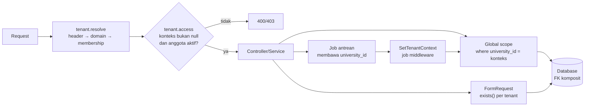

# Keamanan, Audit, Privasi & Ketahanan — Akademik & Pembelajaran

> **Status:** rancangan · **Disusun:** 2026-10-11 · kembali ke [README](README.md)
>
> Dokumen ini merinci kontrol keamanan untuk modul SIAKAD, LMS, CBT, OBE, dan EDOM ([Referensi] brief §11). Kontrol yang **sudah ada** di repository ditandai (Ada); sisanya usulan (Baru) atau [Rekomendasi]. Angka (masa retensi, RPO/RTO, batas rate) adalah **usulan/contoh** yang perlu ditetapkan pemilik produk dan, untuk aspek hukum, dikonfirmasi penasihat hukum tenant. Hak akses dan entitlement dirinci di [11-roles-permissions.md](11-roles-permissions.md); aturan bisnis di [10-business-rules.md](10-business-rules.md); integrasi dan dead-letter di [06-integrasi-arsitektur.md](06-integrasi-arsitektur.md).

## Daftar Isi

1. [Model Ancaman Ringkas](#1-model-ancaman-ringkas)
2. [Autentikasi](#2-autentikasi)
3. [Otorisasi](#3-otorisasi)
4. [Isolasi Antar-Perguruan Tinggi](#4-isolasi-antar-perguruan-tinggi)
5. [Validasi Server-Side](#5-validasi-server-side)
6. [Perlindungan Data Pribadi (UU PDP)](#6-perlindungan-data-pribadi-uu-pdp)
7. [Rancangan Audit Log](#7-rancangan-audit-log)
8. [Riwayat Nilai & Kurikulum](#8-riwayat-nilai--kurikulum)
9. [Kontrol Akses Dokumen](#9-kontrol-akses-dokumen)
10. [Manajemen File & Batas Storage](#10-manajemen-file--batas-storage)
11. [Rate Limiting](#11-rate-limiting)
12. [Pencegahan Akses Tidak Sah](#12-pencegahan-akses-tidak-sah)
13. [Backup & Pemulihan](#13-backup--pemulihan)
14. [Retensi Data](#14-retensi-data)
15. [Penanganan Error Integrasi](#15-penanganan-error-integrasi)
16. [Monitoring Sinkronisasi](#16-monitoring-sinkronisasi)
17. [Keamanan Ujian Daring](#17-keamanan-ujian-daring)
18. [Privasi Proctoring](#18-privasi-proctoring)
19. [Batas Akses Orang Tua/Wali](#19-batas-akses-orang-tuawali)
20. [Kontrol Persetujuan & Dispensasi](#20-kontrol-persetujuan--dispensasi)
21. [Daftar Periksa Rilis](#21-daftar-periksa-rilis)

---

## 1. Model Ancaman Ringkas

| ID | Ancaman | Aset | Pelaku tipikal | Kontrol utama (bagian) |
|---|---|---|---|---|
| T-01 | Mahasiswa mengubah nilai atau presensi | `grades`, `attendances` | Mahasiswa | Resource self-service terpisah, Policy, audit (§3, §7, §8) |
| T-02 | Dosen mengubah nilai kelas yang tidak diajar | `grades`, `assessment_scores` | Dosen | `ClassSectionAccess` + flag kepemilikan (§3) |
| T-03 | Kebocoran data lintas tenant | Semua data tenant | Pengguna tenant lain, bug query | `TenantScoped`, `tenant.access`, FK komposit (§4) |
| T-04 | Kebocoran data antarprodi/fakultas | Data mahasiswa, nilai | Kaprodi/dekan | `AcademicScope` (§3) |
| T-05 | Akses berkas langsung tanpa izin | Tugas, dokumen pengajuan, snapshot proctoring | Siapa pun yang mendapat URL | `RestrictsFileAccess`, URL bertanda tangan (§9) |
| T-06 | Kecurangan ujian daring | Integritas hasil CBT | Peserta | Token sesi, timer server, acak soal, proctoring (§17) |
| T-07 | De-anonimisasi EDOM | Jawaban EDOM | Dosen, admin | Pemisahan identitas, ambang responden (§6.4) |
| T-08 | Penyalahgunaan QR presensi | `attendances` | Mahasiswa titip absen | Token berotasi HMAC (§12) |
| T-09 | Dispensasi/override tanpa kendali | Cekal, KRS, nilai | Operator | Empat mata, alasan wajib, audit (§20) |
| T-10 | Kebocoran rahasia lewat log | Token, kata sandi, kunci API | Pembaca log | Larangan di audit, masking (§7.3) |
| T-11 | Brute force / scraping | Login, ujian publik, endpoint daftar | Bot | Rate limiting (§11) |
| T-12 | Kehilangan data | Seluruh basis data & berkas | Insiden infrastruktur, kesalahan operator | Backup & restore teruji (§13) |
| T-13 | Orang tua melihat data di luar haknya | Data mahasiswa dewasa | Orang tua | Relasi terverifikasi, persetujuan, whitelist data (§19) |

---

## 2. Autentikasi

| Kontrol | Kondisi saat ini | Rancangan |
|---|---|---|
| Mekanisme | Laravel Sanctum bearer token (Ada); `user_sessions` mencatat sesi, perangkat, `revoked_at` (Ada) | Dipertahankan untuk web & mobile |
| Masa berlaku token | `config/sanctum.php` `expiration = null` (token tidak kedaluwarsa) | Tetapkan masa berlaku absolut (contoh 30 hari mobile, 12 jam web) dan *idle timeout* (contoh 2 jam web) berbasis `user_sessions.last_activity_at` [Rekomendasi] |
| Batas percobaan login | `RateLimiter` per email/NIM + IP, `security.max_login_attempts` (default 5) (Ada) | Dipertahankan; ditambah pemberitahuan ke pemilik akun setelah penguncian [Rekomendasi] |
| Login NIM | Ada (`AuthenticateUserAction`) | Dipertahankan |
| MFA | Belum ada | Wajib untuk role dengan aksi sensitif: `academic_administrator`, `head_of_study_program`, `university_administrator`, `exam_committee`, `quality_assurance`; opsional untuk dosen [Rekomendasi] |
| Re-autentikasi aksi kritis | Belum ada | Konfirmasi kata sandi/OTP (≤ 5 menit) sebelum: buka kembali nilai, dispensasi, publikasi nilai massal, ekspor data pribadi massal, perubahan pengaturan `academic.*` [Rekomendasi] |
| Pencabutan sesi | `revoked_at` (Ada) | Perubahan role, penonaktifan akun, atau status mahasiswa `dropped_out/resigned` → semua token dicabut |
| Ujian publik (PMB) | `/public/exams/{accessToken}` + NIM, tanpa login, `throttle:10,1` pada `access` (Ada) | Token akses ujian dapat dirotasi (`PATCH exams/{id}/access-link`, Ada); sesi peserta memakai `session_token_hash` (Ada) |
| Orang tua/wali | Belum ada | Akun sendiri (bukan berbagi akun mahasiswa), verifikasi identitas sebelum relasi aktif ([OD-21](16-open-decisions.md#od-21)) |

---

## 3. Otorisasi

Ringkasan dari [11-roles-permissions.md §2](11-roles-permissions.md#2-empat-lapis-otorisasi):

1. **L1 paket** dan **L2 aktivasi tenant** → `EnsureFeatureEntitled` (Baru).
2. **L3 izin & scope** → `permission:` (`EnsurePermission`, Ada) + Policy + `AcademicScope` (Baru) + `ClassSectionAccess` (Ada).
3. **L4 data** → guard di service domain.

Kontrol tambahan:

- **Policy wajib untuk setiap route model binding** akademik. Uji arsitektur (Pest arch test) memastikan setiap controller di `Modules\Academic`, `Lms`, `Cbt`, `Obe`, `Edom`, `Mbkm` memanggil `authorize()` atau memakai middleware `can:` [Rekomendasi].
- **Flag `academic.lecturer_ownership`** (Ada, default mati) wajib dinyalakan untuk tenant produksi segera setelah data dosen pengampu lengkap; selama mati, dosen dengan `grades.update` dapat menulis nilai kelas lain (T-02). Status flag ini dipantau di dashboard platform.
- **Scope fakultas/prodi** belum diterapkan pada query (README §3.3 butir 6). Sampai `AcademicScope` diterapkan, role `dean`/`head_of_study_program` melihat seluruh tenant (T-04). Ini prioritas Tahap 0 ([15-implementation-roadmap.md](15-implementation-roadmap.md)).

---

## 4. Isolasi Antar-Perguruan Tinggi

Arsitektur: shared database, kolom `university_id`, trait `TenantScoped` + global scope `BelongsToInstitutionScope`, `TenantContext` di-resolve `tenant.resolve` ([MULTI-TENANT-ARCHITECTURE.md](../MULTI-TENANT-ARCHITECTURE.md)).

### 4.1 Risiko yang teridentifikasi dari kode

| ID | Temuan (kondisi Ada) | Dampak | Kontrol usulan |
|---|---|---|---|
| ISO-01 | `TenantContext` **null = konteks platform tanpa filter**. `ResolveUniversityMiddleware` dapat menghasilkan `null` bila tidak ada header, domain, maupun membership aktif. Global scope tidak membatasi apa pun dalam konteks ini. | Rute akademik tanpa `tenant.access` yang dipanggil pengguna tanpa membership akan menjalankan query tanpa filter tenant. Saat ini dimitigasi sebagian karena `PermissionRegistry` hanya menghitung grant global/tenant aktif, sehingga pengguna biasa tidak punya permission di konteks `null` | (a) Pasang `tenant.access` di **semua** grup rute akademik — middleware ini menolak `null` (400) dan non-anggota (403). (b) Model akademik baru memakai varian scope *fail-closed*: di luar rute `/platform/*`, konteks `null` → query `whereRaw('1 = 0')` dan log peringatan [Rekomendasi]. (c) Endpoint publik (`/public/exams/{token}`) me-resolve tenant dari entitas token, lalu meng-set `TenantContext` eksplisit sebelum query lain |
| ISO-02 | Header `X-University-ID` adalah **klaim klien** yang belum tervalidasi oleh `tenant.resolve`; validasi keanggotaan hanya di `tenant.access` | Tanpa `tenant.access`, pengguna dapat mengarahkan konteks ke tenant lain; data tetap terlindungi oleh permission per tenant, tetapi endpoint yang hanya mengandalkan `auth:sanctum` (tanpa `permission:`) akan terbuka | Sama dengan ISO-01 (a); tambahan uji otomatis "header tenant lain tanpa membership → 403" untuk setiap grup rute |
| ISO-03 | FK antar tabel tenant hanya ke `id` (mis. `krs_items.class_section_id → class_sections.id`); DB tidak menjamin keduanya milik tenant yang sama | Bug validasi dapat menautkan data tenant A ke entitas tenant B | (a) Validasi FormRequest memakai `Rule::exists(...)->where('university_id', $tenantId)` (pola wajib). (b) Untuk tabel inti baru, **FK komposit** `(university_id, x_id) → (university_id, id)` dengan unique `(university_id, id)` pada tabel induk [Rekomendasi]; daftar tabel di [07-database-erd.md](07-database-erd.md) |
| ISO-04 | Job antrean berjalan tanpa request → `TenantContext` kosong | Job yang lupa meng-set konteks berjalan sebagai platform (tanpa filter) | Middleware job `SetTenantContext` (Baru) membaca `university_id` dari payload job dan wajib untuk semua job akademik; job tanpa `university_id` gagal (fail-fast) |
| ISO-05 | Path berkas `uploads/{uploader_id}/…` belum per-tenant (MULTI-TENANT §9 butir 7) | Tidak bocor (akses lewat baris DB + Policy), tetapi menyulitkan hitung storage, backup, dan penghapusan per tenant | Path baru `universities/{university_id}/{module}/{yyyy}/{mm}/{ulid}.{ext}` untuk berkas akademik baru; migrasi berkas lama bertahap |
| ISO-06 | Cache permission per tenant sudah berkunci tenant (Ada) | — | Semua cache baru (entitlement, dashboard, rekap) wajib memuat `tenant:{id}` di kunci; payload berupa array biasa |
| ISO-07 | Pencarian teks & ekspor | Query mentah (`DB::table`) melewati global scope | Larang `DB::table` pada tabel tenant di modul akademik kecuali menambahkan `where university_id` eksplisit; dicek dengan arch test/code review |

### 4.2 Diagram penegakan

### 4.3 Uji isolasi wajib

Selain uji yang sudah ada ([MULTI-TENANT-ARCHITECTURE.md §11](../MULTI-TENANT-ARCHITECTURE.md)), setiap modul baru menyertakan uji berikut (detail di [14-test-scenarios.md](14-test-scenarios.md)):

1. Membaca entitas tenant B dengan ID valid dari konteks tenant A → 404.
2. Membuat entitas tenant A yang mereferensikan ID tenant B (mis. `class_section_id`) → 422.
3. Header `X-University-ID` tenant B tanpa membership → 403.
4. Job akademik tanpa `university_id` → gagal, tidak menyentuh data.
5. Rekap/ekspor tenant A tidak memuat baris tenant B.
6. Unduh berkas tenant B dari konteks tenant A → 404.

---

## 5. Validasi Server-Side

| Prinsip | Penerapan |
|---|---|
| Server adalah sumber kebenaran | Validasi frontend (zod) hanya untuk UX; semua aturan diulang di FormRequest + service |
| Validasi bentuk vs aturan bisnis | FormRequest → 422 (tipe, format, panjang, `exists` per tenant). Service → 409 (status, periode, kuota, cekal) |
| Field terlarang | `university_id`, `status`, `decided_by`, `created_by`, `score` (untuk mahasiswa), `is_published` tidak pernah diambil dari body; diisi server |
| Mass assignment | `$fillable` eksplisit; kolom status tidak termasuk (BR-SEC-STATE-01) |
| Angka & batas | Nilai 0–`max_score`, bobot 0–100 dan total 100, SKS bilangan bulat positif, kapasitas ≥ kursi terpakai |
| Waktu | Semua waktu diterima ISO-8601 dengan zona; dibandingkan dalam UTC (BR-SEC-STATE-15) |
| Teks bebas | Panjang maksimum per field; HTML disanitasi (forum, pengumuman, deskripsi materi) dengan whitelist tag; tidak ada eksekusi markup di PDF |
| Berkas | Lihat §10 |
| Pesan error | Bahasa Indonesia, tanpa detail internal (stack trace, nama tabel) di produksi |

---

## 6. Perlindungan Data Pribadi (UU PDP)

Konteks: Undang-Undang No. 27 Tahun 2022 tentang Pelindungan Data Pribadi. Perguruan tinggi (tenant) berperan sebagai **pengendali data**; Civitas One sebagai **prosesor data** atas nama tenant. Penafsiran hukum final **[Konfirmasi]** dengan penasihat hukum; dokumen ini hanya menyediakan kontrol teknis.

### 6.1 Prinsip yang diterapkan

1. **Minimisasi:** setiap modul hanya membaca kolom yang dibutuhkan (mis. LMS tidak membaca NIK, alamat, atau data keuangan).
2. **Pembatasan tujuan:** data EDOM hanya untuk evaluasi pembelajaran; data proctoring hanya untuk integritas ujian.
3. **Akurasi & hak subjek:** mahasiswa dapat melihat data dirinya dan mengajukan koreksi lewat `student_requests` tipe `data_change` (Ada).
4. **Keamanan:** enkripsi saat transit (TLS), enkripsi kolom sangat rahasia saat diam, kontrol akses berlapis, audit.
5. **Retensi terbatas:** §14.
6. **Akuntabilitas:** audit akses data sensitif (`viewed_sensitive`, `exported`, `downloaded` — Ada di enum `AuditAction`).

### 6.2 Klasifikasi data

| Kelas | Definisi | Contoh data akademik | Kontrol minimum |
|---|---|---|---|
| **K1 Publik** | Boleh dipublikasikan | Nama prodi, kalender akademik umum, daftar MK & SKS, profil lulusan & CPL terpublikasi | Tidak ada pembatasan baca dalam tenant |
| **K2 Internal** | Untuk sivitas tenant | Jadwal kelas, nama dosen pengampu, materi kuliah, pengumuman kelas | Login + keanggotaan tenant/kelas |
| **K3 Rahasia** | Data pribadi umum & akademik individu | Nama + NIM, email, telepon, alamat, tanggal lahir, foto, status akademik, KRS, presensi, nilai, IPK, catatan perwalian, jawaban ujian, logbook MBKM | Scope ketat (§3), audit ekspor, masking di log, tidak dikirim ke pihak ketiga tanpa dasar |
| **K4 Sangat Rahasia** | Data pribadi spesifik (UU PDP) & bukti sensitif | Data kesehatan (bukti izin sakit), data biometrik (presensi wajah, [OD-18](16-open-decisions.md#od-18)), snapshot kamera proctoring, data anak, catatan disiplin, informasi keuangan pribadi, NIK | Enkripsi kolom/berkas, akses by-need dengan audit `viewed_sensitive`, retensi terpendek, persetujuan eksplisit bila diperlukan |
| **K-EDOM** | Jawaban evaluasi anonim | `edom_responses`, `edom_answers` | Tidak tertaut identitas (BR-EDM-PRV-01…03); agregasi dengan ambang |

### 6.3 Kontrol teknis per kelas

| Kontrol | K2 | K3 | K4 |
|---|---|---|---|
| Masking di audit log (`$auditMasked`) | — | NIK, telepon, email (sebagian) | Semua |
| Enkripsi kolom (`encrypted` cast) | — | — | NIK, catatan kesehatan; berkas di disk terenkripsi |
| Ekspor | Bebas dalam scope | Audit `exported` + filter tercatat | Hanya role khusus + re-autentikasi + audit |
| Tampilan daftar | Penuh | Kolom sensitif disembunyikan default | Tidak tampil di daftar; hanya di detail dengan audit |
| Pengiriman ke pihak ketiga (AI, SMS, SPADA) | Boleh sesuai integrasi | Hanya field minimum; untuk AI tidak dikirim data pribadi ([OD-11](16-open-decisions.md#od-11)) | Dilarang kecuali dasar hukum & persetujuan |

### 6.4 Privasi EDOM

Ringkasan dari [05-edom.md](05-edom.md) dan BR-EDM-PRV-01…05: identitas (`edom_participations`) dan jawaban (`edom_responses`) disimpan di tabel terpisah tanpa kolom penghubung; waktu kirim jawaban dibulatkan ke tanggal; rekap ditampilkan hanya bila responden ≥ ambang; audit log **tidak** mencatat isi jawaban maupun pasangan mahasiswa–target pada periode anonim (hanya "partisipasi tercatat").

### 6.5 Insiden & pemberitahuan

- Insiden yang melibatkan data K3/K4 → prosedur respons insiden platform: isolasi, investigasi berbasis audit log, dan **pemberitahuan kepada tenant** (pengendali) agar tenant dapat memenuhi kewajiban pemberitahuan kepada subjek data dan otoritas dalam tenggat yang diatur UU PDP **[Konfirmasi]** tenggat dan isi pemberitahuan.
- Audit log dan log akses berkas adalah sumber utama penentuan cakupan insiden; karena itu retensinya lebih panjang dari data operasional (§14).

---

## 7. Rancangan Audit Log

### 7.1 Komponen yang sudah ada

| Komponen | Fungsi |
|---|---|
| `audit_logs` (`university_id`, `user_id`, `auditable_type/id`, `action`, `old_values`, `new_values`, `reason`, `ip_address`, `user_agent`) | Ledger bukti |
| `activity_logs` | Linimasa yang dapat dibaca manusia (bukan bukti) |
| Trait `Auditable` | Mencatat `created/updated/deleted/restored` otomatis |
| `AuditLogService::recordAction()` | Aksi non-CRUD (approved, rejected, returned, resubmitted, delegated, verified, downloaded, viewed_sensitive, linked_account, forced_override, exported, imported) |
| Masking | Atribut `$hidden` dibuang; `$auditMasked` disamarkan `****1234`; kolom `encrypted` didekripsi dulu lalu disamarkan |
| Akses | Hanya `audit_logs.read`; tidak ada endpoint ubah/hapus |

### 7.2 Apa yang dicatat

| Kategori | Mekanisme | Contoh |
|---|---|---|
| Perubahan data master | `Auditable` | `courses`, `curriculums`, `class_sections`, `rooms`, `grade_scales`, `academic_block_rules` |
| Transisi status | `recordAction` dengan `{from, to, transition}` | Semua state machine [10 §3](10-business-rules.md#3-state-machine-per-entitas) |
| Aksi sensitif | `recordAction` + `reason` | Daftar [11 §8](11-roles-permissions.md#8-aksi-sensitif-wajib-audit) |
| Akses data sensitif | `viewed_sensitive` | Orang tua membuka data anak; pengawas membuka snapshot proctoring; admin membuka bukti dispensasi |
| Ekspor & unduhan | `exported`, `downloaded` | Ekspor nilai satu prodi; unduh transkrip resmi |
| Override | `forced_override` | Jadwal bentrok dipaksa; pendaftaran KRS melanggar batas SKS |
| Aksi sistem | `user_id = null`, `new_values.actor = "system"`, `new_values.job` | Penguncian KRS, cekal otomatis, auto-submit ujian |
| Sesi dukungan Super Admin | `new_values.support_session_id` | Setiap aksi `super_admin` di konteks tenant [Rekomendasi] |

**Volume:** data berfrekuensi tinggi (jawaban ujian per soal, event aktivitas LMS, pemindaian QR) **tidak** dicatat per kejadian di `audit_logs`; jejaknya ada di tabel domain (`exam_attempt_answers.answered_at`, `lms_activity_events`, `attendances.method/recorded_by`). Audit hanya untuk perubahan setelah fakta (koreksi, void, override).

### 7.3 Yang tidak boleh pernah disimpan

| Data | Alasan | Penegakan |
|---|---|---|
| Kata sandi (plain maupun hash) | Rahasia autentikasi | `$hidden` pada `User` (dibuang oleh `AuditLogService`) |
| Token Sanctum, `session_token_hash`, `exams.access_token`, token QR presensi, tautan bertanda tangan | Dapat dipakai ulang | `$hidden` pada model terkait + uji otomatis "audit tidak memuat kolom token" |
| Kunci API pihak ketiga (AI, SMS, SPADA) | Rahasia integrasi | Disimpan di konfigurasi terenkripsi, tidak pernah di model yang `Auditable` |
| Isi jawaban EDOM dan pasangan identitas–jawaban | Anonimitas | Model EDOM tidak memakai `Auditable`; hanya transisi periode diaudit |
| Isi jawaban ujian | Volume & kerahasiaan | Tidak di audit; tersedia di tabel domain dengan akses terbatas |
| Snapshot kamera / data biometrik | K4 | Audit hanya mencatat ID & aksi |
| Prompt/respons AI mentah | Bisa memuat materi berhak cipta | Hanya `prompt_hash`; mentah disimpan terenkripsi terpisah dengan retensi ([03-cbt-cbt-ai.md](03-cbt-cbt-ai.md)) |

### 7.4 Integritas & akses

- **Append-only:** tidak ada endpoint ubah/hapus (Ada). Usulan tambahan: hak `UPDATE/DELETE` pada tabel `audit_logs` dicabut dari user database aplikasi; pembersihan retensi dijalankan oleh user database terpisah [Rekomendasi].
- **Rantai hash (opsional):** kolom `prev_hash`/`row_hash` per tenant untuk mendeteksi penyuntingan langsung di database [Rekomendasi].
- **Penelusuran:** filter per entitas (`auditable_type/id`), pelaku, aksi, rentang waktu; tampilan riwayat di halaman detail entitas sensitif (nilai, KRS, cekal) untuk role berwenang.
- **Pembaca:** `auditor`, `university_administrator`, `university_owner`, `rector` (Ada: `audit_logs.read`). Pembacaan audit log itu sendiri tidak diaudit (hindari rekursi), tetapi ekspor audit log dicatat `exported`.

---

## 8. Riwayat Nilai & Kurikulum

| Objek | Mekanisme riwayat | Aturan |
|---|---|---|
| Nilai komponen sebelum kirim | `Auditable` pada `assessment_scores` | Riwayat terlihat dosen & BAAK |
| Snapshot nilai saat kirim | `grade_submissions` menyimpan snapshot terhitung | Dibandingkan saat publikasi ulang |
| Nilai setelah publikasi | `grade_revisions` (nilai lama, nilai baru, jenis, alasan, bukti, pengaju, penyetuju, waktu) | Tidak ada perubahan langsung (BR-SIA-NIL-12) |
| Nilai yang diulang | Semua `grades` dipertahankan; IPK memilih sesuai `academic.repeat_grade_policy` | Transkrip menampilkan sesuai `academic.transcript_repeat_display` (selaras [semester-pendek](../semester-pendek/penilaian-dan-transkrip.md)) |
| Skala nilai | Versi baru; skala terpakai tidak dapat diubah (BR-SIA-NIL-09) | `grades.grade_scale_item_id` menunjuk item versi yang dipakai |
| Kurikulum | Versi (`curriculums` satu baris = satu versi), `curriculum_courses` per versi, audit perubahan, empat mata aktivasi | Versi terpakai tidak dapat diubah strukturnya (BR-SIA-KUR-02) |
| Prasyarat & ekuivalensi | `Auditable` | Perubahan berlaku untuk evaluasi berikutnya; KRS yang sudah disetujui tidak dievaluasi ulang |
| Artefak OBE | Versi `draft → ratified → superseded`; pemetaan per versi | Pengukuran historis menunjuk versi saat itu (BR-OBE-UKR-06) |
| Presensi | `attendance_corrections` | BR-SIA-PRS-10…12 |

---

## 9. Kontrol Akses Dokumen

### 9.1 Mekanisme yang ada

- `file_uploads` (polymorphic `fileable`, `is_public`, `checksum`, status scan `pending/scanning/clean/rejected`, `softDeletes`) (Ada).
- `FileUploadPolicy` (Ada): berkas yang `fileable`-nya mengimplementasikan `RestrictsFileAccess` **tidak** bisa diakses lewat izin generik `file_uploads.read`; keputusan diserahkan ke `allowsFileAccess(User)` milik pemilik. Pengecekan berdasarkan tipe kelas, sehingga pemilik yang sudah dihapus tetap terbatas.
- Model akademik yang sudah mengimplementasikan `RestrictsFileAccess` (Ada): `Student`, `CourseMaterial`, `Assignment`, `AssignmentSubmission`, `StudentRequest`, `Announcement`.
- Unduhan saat ini di-stream melalui `FileUploadController::download` (Ada) setelah Policy.

### 9.2 Model pemilik berkas baru yang wajib `RestrictsFileAccess`

| Model | Siapa yang boleh mengakses |
|---|---|
| `course_material_versions` | Pengajar kelas; anggota kelas bila materi terpublikasi |
| `lms_discussion_posts` (lampiran) | Anggota kelas |
| `thesis_guidance_records`, `thesis_examinations` (dokumen) | Mahasiswa ybs, pembimbing, penguji, admin prodi |
| `academic_block_exemptions` (dokumen pendukung) | Pemberi & penyetuju dispensasi, BAAK; mahasiswa ybs |
| `attendance_corrections` (bukti) | Pengaju, dosen kelas, BAAK |
| `grade_revisions` (bukti) | Pengaju, penyetuju, BAAK |
| `mbkm_logbooks`, `mbkm_assessments` (lampiran) | Mahasiswa ybs, pembimbing, admin MBKM prodi |
| `credit_conversions` (transkrip asal) | Mahasiswa ybs, admin prodi, kaprodi, BAAK |
| `proctoring_snapshots` | `exam_committee`, pengawas yang ditugaskan, dosen pengampu — dengan audit `viewed_sensitive` |
| `ai_generation_jobs` (berkas sumber) | Pembuat job |

### 9.3 URL bertanda tangan

Untuk pemutar video, pratinjau PDF, dan aplikasi mobile yang tidak dapat mengirim header bearer pada tag media:

- Endpoint `POST /file-uploads/{id}/signed-url` (Baru) memeriksa Policy, lalu mengembalikan URL bertanda tangan (Laravel `temporarySignedRoute` atau URL pra-tanda tangan object storage) dengan masa berlaku pendek (contoh 5 menit), terikat `file_upload_id`, `user_id`, dan `university_id`.
- URL tidak pernah dicatat di audit log maupun log akses aplikasi (BR-SEC-AUD-02); yang dicatat hanya peristiwa `downloaded`.
- Berkas K4 (snapshot proctoring, bukti kesehatan) **tidak** diberi URL bertanda tangan; selalu di-stream setelah Policy + audit.
- `is_public = true` hanya untuk aset K1 (logo whitelabel, gambar pengumuman publik).

---

## 10. Manajemen File & Batas Storage

| Kontrol | Rancangan |
|---|---|
| Unggah | `POST /file-uploads` lalu `FileAttacher` (Ada). Ukuran maksimum per konteks (tugas: `assignments.max_file_size_mb`, Ada; materi: konfigurasi LMS) |
| Validasi tipe | Ekstensi **dan** MIME hasil deteksi isi (bukan header klien) harus cocok dengan whitelist (`academic.lms.allowed_mime_types`); berkas eksekusi (`.exe`, `.sh`, `.php`, `.js` mandiri) selalu ditolak |
| Pemindaian | Status `pending → scanning → clean/rejected` (Ada). Berkas belum `clean` tidak dapat diunduh pengguna lain; `rejected` dikarantina |
| Integritas | `checksum` (Ada) diverifikasi saat unduh berkas K3/K4 [Rekomendasi] |
| Path | Per tenant (ISO-05) |
| Kuota | Pemakaian = Σ `size_bytes` per tenant, snapshot harian `storage_usage_snapshots`; peringatan 80%/95% (contoh); 100% → unggahan materi ditolak, pengumpulan mahasiswa diberi toleransi (BR-LMS-STO-01…03). Kebijakan final [OD-20](16-open-decisions.md#od-20) |
| Hapus | Soft delete (`deleted_at`, Ada) → masuk "sampah" selama masa tenggang (contoh 30 hari) → hapus permanen berkas fisik oleh job; storage dibebaskan saat hapus permanen |
| Arsip | Kelas LMS `archived` tetap menyimpan berkas; kebijakan pemindahan ke penyimpanan dingin [Rekomendasi] |
| Isolasi antar-PT | Baris `file_uploads` ber-`university_id` + global scope; path per tenant; URL bertanda tangan terikat tenant |
| Duplikasi bahan ajar | Duplikasi kelas tidak menyalin byte berkas; versi baru menunjuk `file_upload_id` yang sama (hitung storage sekali) [Rekomendasi] |

---

## 11. Rate Limiting

Saat ini: limiter login (Ada, `security.max_login_attempts`) dan `throttle:10,1` pada `POST /public/exams/{accessToken}/access` (Ada). Usulan limiter bernama (didefinisikan di `RateLimiter::for()`), kunci default `user_id` (atau IP untuk tamu) + `university_id`:

| Limiter | Endpoint | Batas (contoh) | Kunci | Respons |
|---|---|---|---|---|
| `login` | Login email/NIM | 5 gagal / menit (Ada) | email/NIM + IP | 429 |
| `public-exam-access` | `POST /public/exams/{token}/access` | 10 / menit (Ada) | IP + token | 429 |
| `api-default` | Semua `/api/v1` terautentikasi | 120 / menit | user + tenant | 429 + `Retry-After` |
| `krs-mutation` | `POST/DELETE /student/krs/items`, `submit`, `cancel` | 30 / menit | user | 429 |
| `exam-answer` | `PUT …/exam-attempts/{id}/answer` | 120 / menit | attempt | 429 (klien menyimpan antrean lokal & mengirim ulang) |
| `exam-violation` | `POST …/violations` | 60 / menit | attempt | 429; kejadian berlebih dirangkum |
| `attendance-qr` | Pindai QR | 10 / menit | user + sesi | 429 |
| `export` | Endpoint `…/export` dan laporan berat | 10 / jam | user | 429; ekspor besar dijalankan sebagai job |
| `ai-generation` | `POST /cbt/ai-jobs`, OBE AI | `academic.ai.daily_job_limit` / hari | tenant | 429 (BR-CBT-AI-03) |
| `bulk-notification` | Pengumuman massal | 5 / jam | user | 429 + persetujuan bila melebihi ambang |
| `file-upload` | `POST /file-uploads` | 30 / menit | user | 429 |
| `guardian` | `/guardian/*` | 60 / menit | user | 429 |

---

## 12. Pencegahan Akses Tidak Sah

| Vektor | Kontrol |
|---|---|
| IDOR (menebak ID) | ULID (Ada) tidak berurutan, **dan** Policy per objek; di luar scope → 404 |
| Eskalasi via self-service | Resource self-service selalu di-resolve dari `$user->student`/`$user->guardian`; parameter `student_id` dari klien diabaikan |
| Mass assignment | `$fillable` eksplisit; status & kolom keputusan diisi service |
| Enumerasi | Respons 404 seragam untuk "tidak ada" dan "bukan milik Anda"; pesan login tidak membedakan email tidak terdaftar dan kata sandi salah |
| Token QR presensi | HMAC atas `(lecture_session_id, university_id, window)`, masa berlaku pendek & berotasi (BR-LMS-QR-01…04); tidak dapat dipakai lintas sesi |
| Tautan ujian publik | Token acak panjang, dapat dirotasi (Ada); rate limit; peserta tetap harus cocok NIM |
| Sesi ganda ujian | Satu `session_token_hash` aktif per percobaan (Ada); sesi baru mencabut sesi lama dan dicatat (BR-CBT-ATT-05) |
| Penyalahgunaan role kedaluwarsa | `user_roles.expires_at` (Ada) diabaikan oleh `PermissionRegistry`; job harian mencabut cache saat grant kedaluwarsa |
| CORS & header | CORS hanya untuk domain frontend tenant (`university_domains`) dan origin resmi; header keamanan standar (HSTS, `X-Content-Type-Options`, `Content-Security-Policy` untuk frontend) |
| Super Admin | Aksi di konteks tenant wajib `support_sessions` dengan alasan dan masa berlaku; dicatat di audit (MULTI-TENANT §9 butir 4) [Rekomendasi] |
| Dependensi | Pemindaian kerentanan paket Composer/npm/pub di CI [Rekomendasi] |

---

## 13. Backup & Pemulihan

Repository belum memiliki paket/konfigurasi backup aplikasi; backup diasumsikan di tingkat infrastruktur. Usulan berikut adalah sasaran **[Konfirmasi]** pemilik produk/infrastruktur.

### 13.1 Sasaran RPO/RTO usulan

| Kelas data | Contoh | RPO usulan | RTO usulan |
|---|---|---|---|
| Transaksi akademik kritis | `krs_*`, `grades`, `grade_*`, `attendances`, `academic_blocks`, `exam_attempts`, `exam_attempt_answers` | ≤ 15 menit (point-in-time recovery dari WAL/binlog) | ≤ 4 jam |
| Data master & konfigurasi | `students`, `lecturers`, `courses`, `curriculums`, `university_settings`, RBAC | ≤ 1 jam | ≤ 4 jam |
| Berkas LMS & dokumen | `file_uploads` + object storage | ≤ 24 jam (versioning object storage untuk berkas K3/K4) | ≤ 24 jam |
| Analitik & turunan | `lms_engagement_scores`, `outcome_measurements`, `edom_reports`, `storage_usage_snapshots` | Dapat dihitung ulang | ≤ 48 jam |
| Audit log | `audit_logs` | ≤ 15 menit | ≤ 24 jam |

**Masa ujian dan KRS** adalah jendela kritis: selama periode `krs`, `midterm_exam`, `final_exam`, perubahan infrastruktur dibekukan dan RTO operasional diturunkan (contoh ≤ 1 jam) dengan replika siaga [Rekomendasi].

### 13.2 Kebijakan

| Aspek | Usulan |
|---|---|
| Frekuensi | Snapshot penuh harian + log transaksi berkelanjutan; berkas: versioning + replikasi lintas zona |
| Penyimpanan | Terenkripsi, lokasi terpisah dari produksi, akses terbatas (dua orang untuk penghapusan backup) |
| Masa simpan | Harian 35 hari, bulanan 12 bulan, tahunan sesuai kebutuhan akreditasi/hukum [Konfirmasi] |
| Uji pemulihan | Restore penuh ke lingkungan terisolasi setiap kuartal; restore per tabel/tenant setiap bulan; hasil dicatat |
| Pemulihan per tenant | Shared database membuat restore per tenant tidak trivial. Prosedur: restore ke basis data sementara → ekstraksi baris `university_id = X` (urutan dependensi FK) → impor terkontrol dengan audit `imported` [Rekomendasi]. Alat ekstraksi per tenant juga dipakai untuk ekspor data saat tenant berhenti berlangganan |
| Data terhapus vs retensi | Backup mengikuti retensi §14: data yang dihapus karena retensi tetap ada di backup sampai backup itu kedaluwarsa; restore tidak boleh mengembalikan data yang sudah melewati retensi (job retensi dijalankan ulang setelah restore) |

---

## 14. Retensi Data

Angka adalah usulan; tenant dapat memperpanjang sesuai kebijakan internal dan regulasi **[Konfirmasi]**. Data akademik permanen (nilai, transkrip) dipertahankan karena dibutuhkan untuk verifikasi ijazah dan akreditasi.

| Jenis data | Tabel | Retensi usulan | Setelah retensi |
|---|---|---|---|
| Identitas & riwayat status mahasiswa | `students`, `student_status_histories` | Permanen (status lulus/keluar) | — |
| Nilai, transkrip, konversi | `grades`, `grade_revisions`, `credit_conversion*` | Permanen | — |
| KRS & riwayatnya | `krs_submissions`, `krs_items`, `krs_submission_events` | Permanen (bukti beban studi) | — |
| Presensi & jurnal | `attendances`, `lecture_sessions`, `attendance_corrections` | 10 tahun (contoh; kebutuhan akreditasi) | Agregasi per kelas dipertahankan, detail dihapus |
| Nilai komponen | `assessment_scores` | 10 tahun | idem |
| Cekal & dispensasi | `academic_blocks`, `academic_block_*` | 5 tahun setelah mahasiswa lulus/keluar | Hapus |
| Catatan perwalian | `advising_records` | 5 tahun setelah lulus/keluar | Hapus |
| Tugas akhir | `theses`, `thesis_*` | Permanen (metadata); dokumen bimbingan 5 tahun setelah lulus | Hapus dokumen |
| Materi LMS | `course_materials`, `course_material_versions` | Selama kelas ada + kebijakan [OD-20](16-open-decisions.md#od-20) | Hapus berkas versi lama |
| Pengumpulan tugas & berkas | `assignment_submissions` + berkas | 2 tahun setelah term berakhir (contoh) | Hapus berkas; skor dipertahankan |
| Forum & pengumuman kelas | `lms_discussion_*`, `lms_class_announcements` | 2 tahun setelah kelas diarsip | Hapus |
| Log aktivitas belajar | `lms_activity_events` | 13 bulan detail | Agregat bulanan dipertahankan |
| Skor engagement/kinerja | `lms_engagement_scores`, `lms_lecture_performance_scores` | 5 tahun | Hapus |
| Jawaban ujian | `exam_attempt_answers` | 1 tahun setelah nilai dipublikasi (contoh; masa sanggah) | Hapus; `exam_attempts.score` dipertahankan |
| Kejadian proctoring (event) | `exam_violations` | Mengikuti hasil ujian | — |
| Snapshot kamera | `proctoring_snapshots` | Publikasi nilai + 90 hari (contoh, `academic.cbt.proctoring_retention_days`, [OD-12](16-open-decisions.md#od-12)); ditahan lebih lama hanya bila ada sengketa terbuka | Hapus berkas & baris |
| Prompt/respons AI mentah | Penyimpanan terenkripsi terpisah | 180 hari (contoh, selaras [03](03-cbt-cbt-ai.md)) | Hapus |
| Data biometrik presensi wajah | — | Selama persetujuan aktif; segera dihapus saat dicabut ([OD-18](16-open-decisions.md#od-18)) | Hapus |
| EDOM jawaban | `edom_responses`, `edom_answers` | 5 tahun | Agregat `edom_reports` dipertahankan |
| EDOM partisipasi (identitas) | `edom_participations` | Sampai periode `published` + 1 term | Hapus identitas; jumlah partisipasi dipertahankan |
| Relasi & log akses orang tua | `student_guardians`, audit `viewed_sensitive` | Selama relasi aktif + 1 tahun | Hapus |
| Logbook & evaluasi MBKM | `mbkm_*` | 5 tahun setelah program selesai | Hapus lampiran |
| Audit log | `audit_logs` | 7 tahun (contoh) | Arsip dingin terenkripsi, lalu hapus |
| Log integrasi | `integration_failures`, `integration_sync_runs` ([06](06-integrasi-arsitektur.md)) | 1 tahun | Hapus |
| Notifikasi terkirim | tabel notifikasi database | 1 tahun | Hapus |

Penghapusan dijalankan job `ApplyRetentionPolicyJob` (Baru) per tenant dengan laporan jumlah baris terhapus per tabel (dicatat `activity_logs`), tidak di-audit per baris.

---

## 15. Penanganan Error Integrasi

Rincian mekanisme di [06-integrasi-arsitektur.md §9](06-integrasi-arsitektur.md#9-retry-dead-letter-logging-dan-monitoring); dokumen ini menetapkan aturan keamanannya.

| Aturan | Rincian |
|---|---|
| Transaksi lokal dulu | Aksi pengguna selesai dan di-commit sebelum integrasi dijalankan; event setelah commit (BR-SEC-STATE-07) |
| Idempotensi | Setiap job integrasi punya kunci unik (mis. `exam_id + participant_id + component_id`, BR-CBT-NIL-02) sehingga retry tidak menggandakan data |
| Retry terbatas | Backoff eksponensial; error permanen (validasi, entitas batal) tidak di-retry |
| Dead-letter | Gagal final → `integration_failures` dengan `university_id`, kunci integrasi, ID entitas, kode error, pesan **tanpa** payload rahasia; notifikasi ke admin terkait |
| Tidak menebak | Sumber eksternal tidak tersedia → keadaan terakhir dipertahankan (mis. cekal, BR-SIA-CKL-14), tidak membuat atau mencabut keputusan berdasarkan data parsial |
| Isolasi kegagalan | Kegagalan satu tenant tidak menghentikan antrean tenant lain (antrean dipartisi atau job per tenant) |
| Rahasia | Kunci API di konfigurasi terenkripsi/secret manager; tidak masuk log, audit, atau payload job yang disimpan |
| Pemulihan manual | Admin dapat "kirim ulang" dari `integration_failures` setelah perbaikan; aksi kirim ulang diaudit |

---

## 16. Monitoring Sinkronisasi

| Metrik | Sumber | Ambang peringatan (contoh) | Penerima |
|---|---|---|---|
| Jumlah `integration_failures` terbuka per kunci integrasi | `integration_failures` | > 0 untuk `grade.*`; > 10 untuk lainnya | BAAK, admin LMS, tim platform |
| Selisih peserta kelas SIAKAD vs anggota LMS/CBT | Rekonsiliasi harian `integration_sync_runs` | > 0 | Admin LMS |
| Usia job tertua di antrean akademik | Metrik antrean | > 5 menit (masa ujian: > 1 menit) | Tim platform |
| Ujian `active` tanpa heartbeat peserta | `exam_attempts` | > 20% peserta tanpa jawaban tersimpan 5 menit | Panitia ujian |
| Evaluasi cekal terakhir per sumber | `integration_sync_runs` | > 24 jam | BAAK, Keuangan |
| Pengukuran OBE gagal | `integration_sync_runs` | status `failed` | Admin prodi |
| Kegagalan notifikasi per kanal | `failed_jobs` (Ada) | > 5% per jam | Tim platform |
| Pemakaian storage | `storage_usage_snapshots` | 80% / 95% | Admin LMS |
| Flag `academic.lecturer_ownership` mati di tenant produksi | `university_feature_flags` | Mati > 30 hari setelah go-live | Tim platform |

Dashboard "Kesehatan Integrasi" untuk BAAK/admin LMS dirinci di [12-reports-analytics.md](12-reports-analytics.md).

---

## 17. Keamanan Ujian Daring

| Lapis | Kontrol | Status |
|---|---|---|
| Akses | Hanya peserta `exam_participants`; ujian `active`; cekal & kehadiran dicek saat mulai (BR-CBT-ATT-01) | Parsial |
| Sesi | `session_token_hash` + `session_expires_at` per percobaan; satu sesi aktif | Ada |
| Waktu | Timer dihitung server dari `started_at` dan `ends_at`; jam klien tidak dipercaya; auto-submit di server | Parsial |
| Soal | Acak urutan soal & opsi per peserta (`question_order`, `option_order`); subset acak (`questions_per_participant`) | Ada |
| Kunci jawaban | Tidak pernah dikirim ke klien sebelum ujian `published` dan `show_result_after_submission` | Ada (pola) |
| Penyimpanan jawaban | Autosave per soal; klien menyimpan antrean lokal saat offline dan mengirim ulang (idempoten per soal) | Parsial |
| Gangguan jaringan | Timer tetap berjalan; sambung ulang dalam `academic.cbt.reconnect_grace_minutes`; kebijakan perpanjangan individual hanya oleh panitia dengan audit | Baru |
| Integritas klien | Deteksi pindah tab, blur, keluar layar penuh, salin/tempel, menu konteks (`exam_violations`) | Ada |
| Proctoring kamera | Hanya fitur `lms.proctoring`, dengan pemberitahuan & izin (§18) | Baru |
| Bank soal | Akses penyusun/peninjau; butir `published` saja yang dipakai; soal ujian adalah salinan (perubahan bank tidak mengubah ujian berjalan) | Parsial |
| Hasil | Pelanggaran ditinjau manusia sebelum rilis; void empat mata (§3.16 di [10](10-business-rules.md#316-percobaan-ujian--exam_attempts)) | Baru |
| PMB | Tautan publik + NIM, rate limit, token dapat dirotasi | Ada |
| Unduhan soal | `GET exams/{id}/download` (Ada) dibatasi pemilik ujian/panitia dan diaudit `downloaded` | Parsial |

Keterbatasan yang diakui: aplikasi web tidak dapat mencegah perangkat kedua, tangkapan layar oleh kamera lain, atau bantuan orang lain di ruangan. Deteksi otomatis adalah **indikasi**, bukan bukti (BR-CBT-PRC-02).

---

## 18. Privasi Proctoring

| Aspek | Kontrol |
|---|---|
| Dasar & pemberitahuan | Sebelum ujian berkamera, peserta melihat data yang dikumpulkan, tujuan, pihak yang dapat melihat, masa retensi, dan haknya; persetujuan (waktu, versi teks) dicatat ([03-cbt-cbt-ai.md](03-cbt-cbt-ai.md) §8) |
| Alternatif | Peserta yang tidak dapat/ tidak bersedia memakai kamera diarahkan ke ujian luring/pengawasan langsung sesuai kebijakan kampus **[Konfirmasi]** |
| Minimisasi | Default: hanya event (tanpa gambar). Snapshot berkala (bukan video kontinu) bila diaktifkan; tidak ada perekaman audio [Rekomendasi] |
| Pemrosesan | Deteksi wajah (bila ada) di perangkat atau server tenant; tidak ada identifikasi biometrik terhadap basis data wajah kecuali fitur presensi AI dengan persetujuan terpisah ([OD-18](16-open-decisions.md#od-18)) |
| Penyimpanan | Berkas K4: path per tenant, terenkripsi, tanpa URL bertanda tangan, `RestrictsFileAccess` |
| Akses | `exam_committee`, pengawas yang ditugaskan, dosen pengampu; setiap pembukaan dicatat `viewed_sensitive` |
| Retensi | §14 — snapshot dihapus otomatis setelah masa sanggah kecuali sengketa terbuka |
| Peninjauan | Keputusan berdampak (void, pengurangan nilai) hanya oleh manusia dengan empat mata; peserta diberi tahu dan dapat mengajukan keberatan lewat `student_requests` |

---

## 19. Batas Akses Orang Tua/Wali

| Aturan | Rincian |
|---|---|
| Identitas | Akun `guardian` sendiri; relasi `student_guardians` aktif hanya setelah verifikasi (dokumen identitas/kartu keluarga atau undangan dari mahasiswa) oleh BAAK ([OD-21](16-open-decisions.md#od-21)) |
| Persetujuan | Untuk mahasiswa dewasa, relasi memerlukan persetujuan mahasiswa bila `academic.guardian.require_student_consent = true`; mahasiswa dapat mencabut kapan saja (BR-SIA-ORT-03) |
| Whitelist data | Nilai akhir terpublikasi, IPS/IPK, rekap kehadiran, status tagihan, jadwal (BR-SIA-ORT-02). Endpoint `/guardian/*` memakai Resource khusus yang hanya memuat field ini — bukan Resource admin yang disaring |
| Dilarang | Catatan perwalian, nilai komponen, jawaban ujian/EDOM, snapshot proctoring, data kesehatan, alamat/kontak mahasiswa yang diperbarui setelah relasi dicabut |
| Scope | Hanya mahasiswa terhubung; ID lain → 404 |
| Audit | Setiap akses `viewed_sensitive` (tanpa isi data); mahasiswa dapat melihat riwayat akses orang tuanya [Rekomendasi] |
| Notifikasi | `guardian.grade_published` hanya bila relasi & persetujuan aktif |

---

## 20. Kontrol Persetujuan & Dispensasi

| Kontrol | Penerapan |
|---|---|
| Empat mata | Daftar transisi [10 §2.3](10-business-rules.md#23-daftar-transisi-empat-mata); penyetuju ≠ pengaju (BR-SEC-APV-01), termasuk untuk `super_admin` |
| Alasan & bukti wajib | Dispensasi cekal, override, buka kembali nilai, revisi nilai, void ujian, pembatalan kelas berjalan |
| Batas waktu | Dispensasi selalu punya `valid_until` ≤ batas konfigurasi; job harian mengakhiri dispensasi kedaluwarsa (§3.8 di [10](10-business-rules.md#38-cekal--academic_blocks)) |
| Batas cakupan | Dispensasi per layanan dan per term, bukan menyeluruh (BR-SIA-CKL-10) |
| Workflow | Persetujuan bertingkat memakai `ApprovalWorkflow` (Ada): `approval_requests`, `approval_actions`, `approval_histories`; listener menyinkronkan status entitas (BR-SEC-APV-02) |
| Delegasi | `ApprovalActionService::delegate` (Ada) mencatat pendelegasian; delegasi tidak boleh ke pengaju |
| Pemantauan | Laporan "riwayat dispensasi" dan "override" per periode untuk pimpinan & auditor ([12-reports-analytics.md](12-reports-analytics.md)); anomali (mis. satu operator > N dispensasi/hari) disorot [Rekomendasi] |
| Tidak dapat dihapus | Dispensasi dan override tidak dapat dihapus; hanya dicabut dengan jejak |

---

## 21. Daftar Periksa Rilis

Setiap fitur akademik baru dinyatakan siap rilis bila:

- [ ] Rute berada di grup dengan `auth:sanctum`, `tenant.access`, `feature:<key>`, dan `permission:<slug>`.
- [ ] Setiap route model binding diotorisasi Policy; objek di luar scope → 404.
- [ ] Query daftar & ekspor memakai `AcademicScope`/`ClassSectionAccess`.
- [ ] FormRequest memakai `exists` per tenant; FK komposit untuk tabel inti baru.
- [ ] Transisi status hanya lewat service; audit di dalam transaksi; ETag/`If-Match` didukung.
- [ ] Aksi sensitif menulis audit dengan alasan; uji otomatis memverifikasi.
- [ ] Tidak ada token/kata sandi/kunci API/jawaban EDOM di `audit_logs` (uji otomatis).
- [ ] Berkas terlampir ke model `RestrictsFileAccess` bila K3/K4.
- [ ] Limiter bernama dipasang untuk endpoint mutasi berfrekuensi tinggi.
- [ ] Job membawa `university_id` dan memakai `SetTenantContext`.
- [ ] Retensi data baru terdaftar di §14 dan job retensi.
- [ ] Uji isolasi tenant §4.3 lulus.
