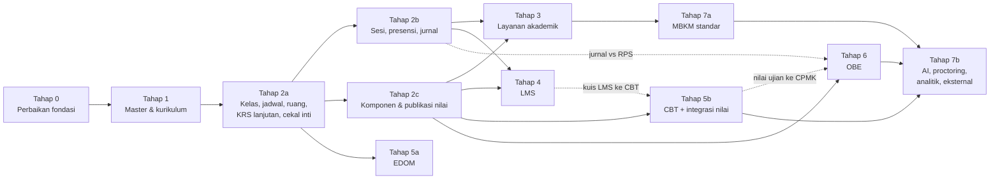
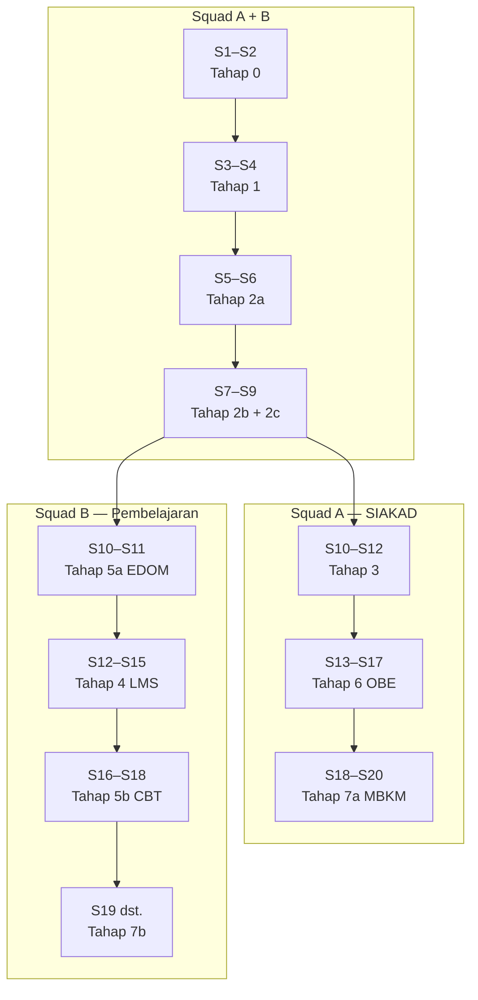
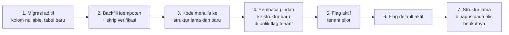

# 15 — Tahapan Implementasi, Prioritas, Risiko, dan Definition of Done

> **Status:** rancangan. **Disusun:** 2026-10-11, berdasarkan kondisi repository pada commit `ab81cc7`.
> Kembali ke [README](README.md) · Urutan ringkas: [README §7](README.md#7-dependensi-dan-urutan-implementasi) · Skenario uji: [14-test-scenarios.md](14-test-scenarios.md) · Keputusan terbuka: [16-open-decisions.md](16-open-decisions.md)
>
> Dokumen ini mengevaluasi tujuh tahap pada brief terhadap **dependensi nyata** antarentitas dan terhadap **kondisi kode saat ini** ([README §3](README.md#3-temuan-repository)), lalu menetapkan urutan kerja, prioritas, risiko, hasil, dan definition of done per tahap. Estimasi waktu ditulis dalam **sprint relatif** (S1, S2, …; asumsi 1 sprint = 2 minggu dan dua squad). Ini **bukan** komitmen tanggal.

## Daftar Isi

1. [Ringkasan Keputusan Urutan](#1-ringkasan-keputusan-urutan)
2. [Evaluasi Tahapan Brief terhadap Dependensi dan Kode](#2-evaluasi-tahapan-brief-terhadap-dependensi-dan-kode)
3. [Peta Dependensi dan Rencana Sprint Relatif](#3-peta-dependensi-dan-rencana-sprint-relatif)
4. [Skala Prioritas](#4-skala-prioritas)
5. [Detail Tahap](#5-detail-tahap)
6. [Definition of Done Umum](#6-definition-of-done-umum)
7. [Strategi Rilis, Migrasi, dan Rollback](#7-strategi-rilis-migrasi-dan-rollback)
8. [Keputusan Terbuka yang Memblokir per Tahap](#8-keputusan-terbuka-yang-memblokir-per-tahap)
9. [Rekomendasi Langkah Berikutnya: Backlog Sprint 1–3](#9-rekomendasi-langkah-berikutnya-backlog-sprint-13)

---

## 1. Ringkasan Keputusan Urutan

1. **Tahap 0 (Perbaikan fondasi) ditambahkan sebelum Tahap 1 brief.** Multi-tenant dan RBAC pada Tahap 1 brief sebagian besar **sudah ada** (`TenantScoped`, `tenant.resolve`, `user_roles` ber-scope). Yang belum ada adalah penegakannya: scope fakultas/prodi belum dipakai di query, entitlement paket belum ditegakkan, kebijakan akademik masih hardcoded, dan penegakan kepemilikan kelas dosen masih nonaktif secara default. Keempatnya memengaruhi setiap tahap berikutnya.
2. **Cekal inti dimajukan ke Tahap 2.** Siklus KRS (A.4 langkah 8) wajib memeriksa cekal. Tabel `academic_blocks` + cekal keuangan + pemeriksaan di KRS dikerjakan di Tahap 2. Dispensasi lengkap, sumber cekal lain, dan cekal yudisium tetap di Tahap 3.
3. **Sesi pertemuan (`lecture_sessions`) di Tahap 2, presensi QR di Tahap 4.** QR adalah metode pengisian di atas sesi, sehingga sesi harus ada lebih dulu.
4. **EDOM dapat berjalan paralel segera setelah Tahap 2a** karena hanya bergantung pada kelas dan dosen pengajar. EDOM tersedia untuk semua paket dan halaman portalnya sudah ada sebagai mock, sehingga ini adalah *quick win*.
5. **OBE bergantung keras pada komponen nilai (Tahap 2c)** dan hanya bergantung lunak pada CBT. Nilai CBT masuk melalui `assessment_scores`, sehingga OBE tidak perlu menunggu CBT selesai. Pemetaan komponen → CPMK otomatis mencakup ujian begitu CBT mengirim nilai.
6. **MBKM standar (paket Growth) dapat dimajukan** setelah Tahap 3 karena `credit_conversions` dibangun di Tahap 3 untuk transfer. Rekap IKU (Enterprise) tetap di Tahap 7.
7. **AI (CBT AI, OBE AI) di Tahap 7** dan diblokir oleh [OD-11](16-open-decisions.md#od-11) (penyedia & kebijakan data), meskipun CBT AI termasuk paket Business.

---

## 2. Evaluasi Tahapan Brief terhadap Dependensi dan Kode

| Tahap brief | Isi menurut brief | Temuan dari kode & dependensi | Penyesuaian |
|---|---|---|---|
| 1 Fondasi | Master, multi-tenant & RBAC, tahun akademik, MK & kurikulum | Multi-tenant dan RBAC sudah ada. Scope `faculty`/`study_program` di `user_roles` belum diterapkan. `subscription_plans`/`university_modules` tidak ditegakkan. `LetterGrade` dan `SKS_LIMIT_TIERS` (di `AcademicRecordService`) hardcoded. `courses.curriculum_id` tunggal | Dipecah menjadi **Tahap 0** (penegakan scope, entitlement, konfigurasi kebijakan, identitas dosen, wiring halaman) dan **Tahap 1** (master & kurikulum berversi) |
| 2 Operasional | Kelas & jadwal, KRS, presensi, jurnal, nilai | KRS self-service dan persetujuan wali sudah ada (`KrsPlanService`). Deteksi bentrok berbasis teks ruang sudah ada (`SCHEDULE_CONFLICT`). Tidak ada sesi/BAP, komponen nilai, alur publikasi | Tetap, dipecah 2a/2b/2c, **ditambah cekal inti** |
| 3 Layanan | Cekal, perwalian, cuti, transfer, TA, kalender | Cuti dan kalender sudah ada. TA parsial (`theses` satu pembimbing). Cekal belum ada | Cekal inti pindah ke Tahap 2. Ditambah akses orang tua, pengumuman massal, pemutihan nilai |
| 4 LMS | Materi & tugas, QR, dashboard | Materi & tugas terikat `class_section_id` sudah ada. Tidak ada `lms_classes`, forum, kuota | Tetap. QR bergantung pada `lecture_sessions` (Tahap 2b) |
| 5 Ujian & evaluasi | CBT, integrasi nilai, EDOM | Mesin ujian sudah matang di modul `Academic` ([OD-15](16-open-decisions.md#od-15)). EDOM belum ada | Dipecah: **5a EDOM** (paralel sejak Tahap 2a) dan **5b CBT** (setelah 2c dan 4 untuk integrasi kuis LMS) |
| 6 OBE | — | Tidak ada sama sekali | Tetap. Mulai setelah 2c, tidak harus menunggu 5b |
| 7 Lanjutan | MBKM, AI, proctoring, analitik, integrasi eksternal | `internships` tumpang tindih dengan MBKM ([OD-14](16-open-decisions.md#od-14)) | MBKM standar dapat dimajukan setelah Tahap 3. IKU, AI, proctoring kamera, analitik lanjutan, SPADA, MOOC, whitelabel tetap di sini |

---

## 3. Peta Dependensi dan Rencana Sprint Relatif

### 3.1 Dependensi antartahap

Garis putus-putus adalah dependensi lunak: tahap tujuan dapat dimulai, tetapi fitur integrasinya baru lengkap setelah tahap sumber selesai.

**Jalur kritis:** Tahap 0 → 1 → 2a → 2c → 6. Setiap keterlambatan pada skala nilai yang dapat dikonfigurasi (Tahap 0) dan komponen nilai (Tahap 2c) langsung menunda OBE.

### 3.2 Rencana sprint relatif (dua squad)

Squad A berfokus pada inti SIAKAD. Squad B berfokus pada pembelajaran dan evaluasi. Pada Tahap 0–2 kedua squad bekerja bersama di inti SIAKAD.

Catatan: Tahap 7b berisi banyak fitur independen (AI, proctoring kamera, gamification, SPADA, whitelabel). Urutannya ditentukan oleh permintaan pelanggan per paket dan oleh keputusan OD terkait, bukan oleh dependensi teknis.

---

## 4. Skala Prioritas

| Prioritas | Arti | Contoh |
|---|---|---|
| **P0** | Pemblokir. Tanpa ini tahap lain tidak benar secara data atau keamanan | Scope fakultas/prodi, entitlement, konfigurasi skala nilai, cekal di KRS, komponen nilai |
| **P1** | Fitur inti referensi yang tersedia di semua paket atau yang menjadi syarat proses akademik semester | Sesi & presensi, publikasi nilai, perwalian, LMS inti, EDOM |
| **P2** | Fitur referensi untuk paket menengah/atas atau penguat proses | CBT, OBE, transfer, double degree, engagement score |
| **P3** | Fitur lanjutan, eksperimental, atau berstatus `(*)` dalam pengembangan di referensi | Gamification, video interaktif, presensi AI, MOOC |

---

## 5. Detail Tahap

### 5.1 Tahap 0 — Perbaikan Fondasi

| Aspek | Isi |
|---|---|
| **Tujuan** | Menegakkan empat lapis izin dan memindahkan kebijakan dari kode ke konfigurasi sebelum entitas baru dibangun |
| **Prioritas** | P0 |
| **Estimasi relatif** | S1–S2 |
| **Dependensi** | Tidak ada |

**Cakupan:**

| No | Pekerjaan | Kondisi saat ini | Hasil |
|---|---|---|---|
| 0.1 | **Scope fakultas/prodi.** Terapkan `user_roles.scope_type/scope_id` pada query dan policy untuk `dean`, `head_of_study_program`, serta role baru `faculty_administrator`, `study_program_administrator` | Kolom ada, tidak dipakai | Trait/scope query bersama (mis. `AppliesAcademicScope`) dipakai di daftar mahasiswa, dosen, kelas, KRS, nilai. Akses di luar scope → 404 |
| 0.2 | **Penegakan entitlement.** Tabel `plan_feature_entitlements`, middleware `EnsureFeatureEntitled` (lapis 1) yang memeriksa feature key kanon README §5.7, dan pemeriksaan aktivasi tenant (lapis 2) | `subscription_plans`, `modules`, `university_modules`, `university_feature_flags` ada tetapi tidak ditegakkan | Route modul baru wajib memakai middleware. Feature key aktif dikirim ke frontend & mobile (mis. di `GET /me`). Pemetaan paket memakai default sementara sampai [OD-01](16-open-decisions.md#od-01) diputuskan |
| 0.3 | **Migrasi kebijakan hardcoded ke konfigurasi.** `LetterGrade` → `grade_scales` + `grade_scale_items` dengan skala default tenant hasil seed dari nilai enum saat ini. `SKS_LIMIT_TIERS` → `university_settings` `academic.krs.max_sks_tiers` | Hardcoded di `Modules\Academic\Enums\LetterGrade` dan `AcademicRecordService` | Perilaku identik untuk tenant lama (seed sama dengan nilai lama). Enum dipertahankan sementara sebagai adaptor baca agar kompatibel |
| 0.4 | **Identitas dan kepemilikan dosen.** `lecturers.user_id`, `LecturerIdentity`, `ClassSectionAccess`, dan flag `academic.lecturer_ownership` **sudah ada** (default nonaktif). Pekerjaan: backfill akun dosen, laporan kelas tanpa pengampu, rencana menyalakan flag per tenant, lalu menjadi default | Ada, nonaktif | Flag aktif di tenant pilot. Laporan "kelas tanpa dosen ber-akun" = 0 sebelum flag dinyalakan |
| 0.5 | **Wiring halaman mock dan menu tanpa route.** Pasang route untuk `/akademik/kelas-saya`, `/akademik/kelas-saya/:id`, `/akademik/persetujuan-krs`, `/akademik/pengajuan-mahasiswa` (konstanta sudah ada di `frontend/src/constants/routes.ts`, endpoint backend sudah ada). Tandai halaman portal mock (EDOM, perwalian, cuti, kuis, dsb.) sebagai "segera hadir" atau sembunyikan sampai tahapnya | Menu tanpa route; halaman mock menampilkan data statis | Tidak ada halaman yang menampilkan data palsu kepada pengguna produksi |
| 0.6 | **Standar kode error.** Gunakan `ConflictException` dengan `errorCode` untuk semua penolakan aturan bisnis baru (pola `SCHEDULE_CONFLICT`) | Sebagian | Daftar kode di [08-api-specification.md](08-api-specification.md) |
| 0.7 | **Kerangka modul baru.** Buat kerangka `app/Modules/{Lms,Cbt,Obe,Edom,Mbkm}` (kosong) dan daftarkan direktori `Tests/{Unit,Feature}` di `phpunit.xml` | `phpunit.xml` mendaftarkan direktori per modul secara eksplisit | Uji modul baru otomatis terbawa CI |

**Risiko & mitigasi:**

| Risiko | Dampak | Mitigasi |
|---|---|---|
| Penegakan scope memutus akses Dekan/Kaprodi yang selama ini melihat semua data | Keluhan pengguna, laporan kosong | Audit `user_roles` yang tidak memiliki `scope_id` sebelum rilis. Rilis di balik flag per tenant. Sediakan laporan penugasan scope |
| Entitlement menolak tenant produksi yang tidak memiliki baris pemetaan | Fitur yang sedang dipakai tiba-tiba hilang | Seed `plan_feature_entitlements` memberi semua fitur **yang sudah ada** ke semua paket aktif. Mode *log-only* satu sprint sebelum mode *enforce* |
| Skala nilai hasil migrasi berbeda dari enum | IPK berubah | Uji kesetaraan: hitung ulang IPK seluruh mahasiswa dengan dua jalur dan pastikan selisih = 0 sebelum memotong jalur lama |
| Menyalakan kepemilikan dosen saat penugasan belum lengkap | Dosen tidak dapat input nilai/presensi | Hanya nyalakan setelah laporan 0.4 bersih; tetap dapat dimatikan per tenant |

**Hasil yang diharapkan:** setiap endpoint akademik melewati empat lapis izin; kebijakan nilai dan SKS dapat diubah per tenant tanpa deploy; menu web tidak mengarah ke halaman kosong atau palsu.

**Kriteria selesai (DoD):**

- [ ] TS-SEC-01, TS-SEC-06, TS-SEC-07, TS-SEC-08, TS-ENT-01, TS-ENT-03, TS-ENT-09 lulus.
- [ ] TS-SIA-03 lulus dengan tier dari konfigurasi. Regresi KRS-05/KRS-06, NIL-01/NIL-02, `TranscriptTest` hijau tanpa perubahan angka.
- [ ] Migrasi `grade_scales`, `grade_scale_items`, `plan_feature_entitlements` memiliki `down()` yang teruji (`migrate:rollback` di CI).
- [ ] Permission baru (`faculties.*`, `grade_scales.*`, `academic_terms.*`) di `RolePermissionSeeder`; role `faculty_administrator`, `study_program_administrator` di `OrganizationalRoleSeeder`; cache `PermissionRegistry` diinvalidasi.
- [ ] [11-roles-permissions.md](11-roles-permissions.md) dan [../BLACK-BOX-TESTING.md](../BLACK-BOX-TESTING.md) (AKM-05, NIL-09) diperbarui.

### 5.2 Tahap 1 — Data Master dan Kurikulum

| Aspek | Isi |
|---|---|
| **Tujuan** | Menyediakan data master yang lengkap dan kurikulum berversi agar proses semester dapat dibangun tanpa duplikasi data |
| **Prioritas** | P0 (ruang, periode, kurikulum berversi), P1 (ekuivalensi, paket MK, endpoint tulis fakultas/prodi) |
| **Estimasi relatif** | S3–S4 |
| **Dependensi** | Tahap 0 (scope, konfigurasi) |

**Cakupan:**

| Fitur | Tabel kanon | Status |
|---|---|---|
| Endpoint tulis fakultas & prodi | `faculties`, `study_programs` | Parsial (baca saja) |
| Jenis term reguler/pendek | `academic_terms.term_type` | Diperluas |
| Periode yang mengikat proses (KRS, kuliah, UTS, UAS, nilai, EDOM) | `academic_term_periods` | Baru |
| Ruang kuliah | `rooms` | Baru |
| Kurikulum berversi per angkatan | `curriculums` (diperluas), `curriculum_courses`, `curriculum_cohorts` | Baru ([OD-03](16-open-decisions.md#od-03)) |
| Prasyarat (sudah ada) | `course_prerequisites` | Ada |
| Ekuivalensi antarversi | `course_equivalencies` | Baru |
| Paket mata kuliah | `course_packages`, `course_package_items` | Baru |
| Orang tua/wali (tabel saja) | `student_guardians` | Baru (fitur portal di Tahap 3) |
| Riwayat perubahan kurikulum | `audit_logs` via `Auditable` | Parsial |

**Risiko & mitigasi:**

| Risiko | Mitigasi |
|---|---|
| Migrasi `courses.curriculum_id` → `curriculum_courses` merusak data KRS/nilai lama | Backfill satu baris `curriculum_courses` per `courses` yang ada; `courses.curriculum_id` dipertahankan (deprecated) sampai seluruh pembaca pindah; uji kesetaraan daftar MK per kurikulum sebelum/sesudah |
| `rooms` menggantikan `class_schedules.room` teks bebas | Kolom `room_id` nullable; skrip pencocokan teks → ruang dengan laporan teks yang tidak cocok; deteksi bentrok memakai `room_id` bila ada, fallback teks |
| Periode ganda (`academic_calendar_events` vs `academic_term_periods`) membingungkan | Kalender tetap untuk tampilan; proses hanya membaca `academic_term_periods`. Backfill periode KRS dari `krs_start_date`/`krs_end_date` |

**Hasil yang diharapkan:** angkatan berbeda memakai versi kurikulum berbeda; jadwal dapat divalidasi terhadap ruang nyata; periode proses berasal dari satu sumber.

**Kriteria selesai (DoD):**

- [ ] TS-SIA-16, TS-SIA-36, TS-SIA-37, TS-SIA-39 lulus; TS-SEC-01 diperluas ke tabel baru.
- [ ] Migrasi backfill dapat di-rollback tanpa kehilangan data (`courses.curriculum_id` tetap terisi).
- [ ] Permission `faculties.*`, `rooms.*`, `course_packages.*`, `course_equivalencies.*`, `academic_terms.*` di-seed.
- [ ] Halaman admin Ruang, Periode, Kurikulum (versi & struktur) memakai komponen `frontend/src/components/ui` dan guard `RequirePermission`.
- [ ] [07-database-erd.md](07-database-erd.md) dan [08-api-specification.md](08-api-specification.md) sesuai implementasi.

### 5.3 Tahap 2 — Operasional Perkuliahan

| Aspek | Isi |
|---|---|
| **Tujuan** | Menjalankan satu semester penuh: kelas dan jadwal tervalidasi, KRS lengkap dengan cekal, sesi dan presensi, serta nilai berkomponen yang dipublikasikan |
| **Prioritas** | P0 |
| **Estimasi relatif** | 2a: S5–S6 · 2b dan 2c: S7–S9 (paralel) |
| **Dependensi** | Tahap 1 |

**Cakupan:**

| Sub-tahap | Fitur | Tabel kanon |
|---|---|---|
| **2a** Kelas, jadwal, KRS, cekal inti | Status kelas, team teaching, jenis jadwal & kelompok, publikasi & notifikasi perubahan jadwal, validasi bentrok dosen/ruang/kelas | `class_sections` (+`status`), `class_section_lecturers`, `class_schedules` (+`room_id`, `schedule_type`, `group_label`, `status`) |
| | Status KRS `revision_requested`, `locked`, `cancelled`; riwayat; perubahan setelah kunci ([OD-09](16-open-decisions.md#od-09)); paket KRS semester awal | `krs_submissions` (diperluas), `krs_submission_events` |
| | Cekal inti: aturan, cekal aktif, riwayat, pemeriksaan di KRS & ujian, cekal keuangan dari event modul Finance | `academic_blocks`, `academic_block_rules`, `academic_block_histories` |
| **2b** Sesi & presensi | Sesi pertemuan + jurnal mengajar, materi per sesi, presensi per sesi, koreksi berotorisasi, persentase & batas kehadiran ujian ([OD-06](16-open-decisions.md#od-06)) | `lecture_sessions`, `lecture_session_materials`, `attendances` (+`lecture_session_id`, `method`, `recorded_by`), `attendance_corrections` |
| **2c** Penilaian | Komponen & bobot, skor komponen, lembar nilai kelas dengan alur publikasi ([OD-07](16-open-decisions.md#od-07)), pembulatan ([OD-29](16-open-decisions.md#od-29)), revisi nilai setelah publikasi | `assessment_components`, `assessment_scores`, `grade_submissions`, `grades` (diperluas), `grade_revisions` |

**Risiko & mitigasi:**

| Risiko | Mitigasi |
|---|---|
| Migrasi status KRS `rejected` → `revision_requested` mengubah perilaku layar wali yang ada | Migrasi data + pemetaan di resource API selama satu rilis; uji regresi `StudentKrsSelfServiceTest` |
| `attendances` lama tidak memiliki sesi | Backfill sesi dari pasangan (`class_section`, `meeting_number`, `meeting_date`); `lecture_session_id` nullable sampai backfill terverifikasi |
| Kelas lama tanpa komponen nilai | Komponen default tunggal "Nilai Akhir" 100% di-backfill agar `PUT /krs-items/{id}/grade` tetap bekerja untuk term lampau |
| Nilai yang sudah ada dianggap belum dipublikasikan | Backfill `grades.is_published = true` dan `grade_submissions.status = published` untuk term lampau |
| Kapasitas terlampaui saat beban tinggi | Kunci baris (sudah ada `lockForUpdate`) + uji grup `mysql` (TS-SIA-06) di CI sebelum rilis |
| Cekal keuangan bergantung pada modul Finance yang read-only | Kontrak event/kueri status tagihan disepakati; cekal manual BAAK tersedia sebagai cadangan |

**Hasil yang diharapkan:** satu semester dapat dijalankan dari pembukaan kelas sampai publikasi nilai dengan kebijakan per tenant; seluruh perubahan nilai setelah publikasi tercatat dan disetujui.

**Kriteria selesai (DoD):**

- [ ] TS-SIA-01 … TS-SIA-15, TS-SIA-17 … TS-SIA-19, TS-SIA-21 … TS-SIA-24, TS-SIA-40 lulus; TS-SIA-06 lulus di grup `mysql`.
- [ ] Regresi: `KrsEnrollmentTest`, `StudentKrsSelfServiceTest`, `AttendanceRecordingTest`, `GradeRecordingTest`, `TranscriptTest`, `ExamAttemptTest` hijau; perubahan sengaja (NIL-04) terdaftar di PR.
- [ ] Setiap migrasi backfill memiliki skrip verifikasi jumlah baris dan `down()` yang mengembalikan kolom/status lama.
- [ ] Permission `class_schedules.*`, `lecture_sessions.*`, `attendance_corrections.*`, `assessment_components.*`, `grade_submissions.*`, `grade_revisions.*`, `academic_blocks.*`, `academic_block_rules.*` di-seed dan dipetakan ke role.
- [ ] Template notifikasi (perubahan jadwal, keputusan KRS, cekal, publikasi nilai) disiapkan melalui `StudentNotificationService::ensureTemplates`.
- [ ] Halaman portal Jadwal, KRS, Presensi, KHS memakai API (tidak ada data mock).

### 5.4 Tahap 3 — Layanan Akademik

| Aspek | Isi |
|---|---|
| **Tujuan** | Melengkapi layanan pendukung studi: cekal lengkap & dispensasi, perwalian, transfer, TA, akses orang tua, pengumuman massal |
| **Prioritas** | P1 (dispensasi, perwalian, orang tua, TA), P2 (transfer, double degree, pengumuman SMS) |
| **Estimasi relatif** | S10–S12 (Squad A) |
| **Dependensi** | Tahap 2b dan 2c |

**Cakupan:**

| Fitur | Tabel kanon |
|---|---|
| Dispensasi cekal, masa berlaku, sumber cekal akademik/kemahasiswaan/perpustakaan/kehadiran ([OD-22](16-open-decisions.md#od-22)) | `academic_block_exemptions`, `academic_block_rules` (diperluas) |
| Catatan perwalian, penanda mahasiswa butuh pendampingan ([OD-28](16-open-decisions.md#od-28)) | `advising_records` |
| Cuti & aktif kembali (sudah ada) | `student_requests` (`leave`, `reactivation`) |
| Transfer masuk & konversi nilai | `student_transfers`, `credit_conversions`, `credit_conversion_items` |
| Double degree ([OD-23](16-open-decisions.md#od-23)) | `double_degree_enrollments` |
| Tugas akhir: multi-pembimbing, bimbingan, seminar, sidang, penguji | `theses` (diperluas), `thesis_supervisors`, `thesis_examiners`, `thesis_guidance_records`, `thesis_examinations` |
| Pemutihan nilai ([OD-08](16-open-decisions.md#od-08)) | `grade_revisions` (`revision_type = remediation`) |
| Akses orang tua ([OD-21](16-open-decisions.md#od-21)) | `student_guardians`, endpoint `/guardian/...` |
| Pengumuman massal email & SMS ([OD-24](16-open-decisions.md#od-24)) | `NotificationDispatcher` (ada) |

**Risiko & mitigasi:**

| Risiko | Mitigasi |
|---|---|
| Akses orang tua melanggar privasi (UU PDP) | Verifikasi identitas dan persetujuan mahasiswa sesuai OD-21; respons `/guardian/...` memakai allowlist atribut (TS-SEC-03) |
| Enum status `theses` lama berbeda dari kanon | Pemetaan nilai lama ke kanon (01 §A.9) dengan migrasi reversibel |
| Data sumber cekal perpustakaan/kemahasiswaan belum tersedia | Aturan cekal untuk sumber tersebut dinonaktifkan sampai modul sumber siap; cekal manual tersedia |

**Hasil yang diharapkan:** seluruh layanan A.7–A.9 berjalan melalui alur status dan persetujuan yang tercatat; halaman portal perwalian dan cuti tidak lagi mock.

**Kriteria selesai (DoD):**

- [ ] TS-SIA-08, TS-SIA-09, TS-SIA-25 … TS-SIA-35, TS-SEC-02, TS-SEC-03 lulus.
- [ ] Permission `academic_block_exemptions.*`, `advising_records.*`, `student_transfers.*`, `credit_conversions.*`, `guardian_portal.*` dan role `guardian` di-seed.
- [ ] Dispensasi dan perubahan nilai tercatat di `audit_logs` dengan alasan (TS-SEC-10).
- [ ] Halaman `AcademicAdvising`, `LeaveRequest`, `ThesisAdvising` portal tersambung API.

### 5.5 Tahap 4 — EDLINK/LMS

| Aspek | Isi |
|---|---|
| **Tujuan** | Menyediakan ruang belajar daring/hybrid yang membaca data SIAKAD tanpa menyalinnya |
| **Prioritas** | P1 (kelas, materi, tugas, forum, QR, dashboard dasar, storage), P2 (engagement score, lecture performance score), P3 (gamification, video interaktif) |
| **Estimasi relatif** | S12–S15 (Squad B) |
| **Dependensi** | Tahap 2b (sesi untuk QR), 2c (pengiriman nilai tugas) |

**Cakupan:**

| Fitur | Tabel kanon | Feature key |
|---|---|---|
| Kelas akademik & umum, anggota kelas umum, arsip, duplikasi | `lms_classes`, `lms_class_members` | `lms`, `lms.material_duplication` |
| Materi berversi, tugas (perluasan yang ada), pengumuman kelas, forum | `course_materials` (+`lms_class_id`, `topic`, `current_version_id`), `course_material_versions`, `assignments`, `assignment_submissions`, `lms_class_announcements`, `lms_discussion_threads`, `lms_discussion_posts` | `lms` |
| Sesi hybrid & presensi QR | `attendance_qr_tokens` (di atas `lecture_sessions`) | `lms` |
| Progres & log aktivitas, dashboard per role | `lms_material_progress`, `lms_activity_events` | `lms` |
| Engagement & lecture performance score | `lms_engagement_scores`, `lms_lecture_performance_scores` | `lms.engagement_score`, `lms.lecture_performance_score` |
| Gamification | `lms_point_ledgers`, `lms_badges`, `lms_badge_awards` | `lms.gamification` |
| Kuota storage & kelas umum ([OD-20](16-open-decisions.md#od-20), [OD-27](16-open-decisions.md#od-27)) | `storage_usage_snapshots` | limit `lms.storage_gb`, `lms.general_classes_per_term` |

**Risiko & mitigasi:**

| Risiko | Mitigasi |
|---|---|
| Path disk `file_uploads` belum per-tenant | Ubah strategi path untuk unggahan baru (prefiks `university_id`); berkas lama tetap di path lama dengan pemeriksaan akses melalui `file_uploads` |
| Volume `lms_activity_events` tinggi | Tabel append-only dengan indeks terbatas; agregasi terjadwal; retensi sesuai [13-security-audit.md](13-security-audit.md) |
| Penyalahgunaan QR | Token berotasi, hash disimpan, waktu server, rate limit (TS-LMS-05, TS-LMS-06) |
| Mobile baru memiliki fitur `auth`, `dashboard`, `exam` | Fitur mobile LMS dibatasi pada kelas, materi, tugas, dan pemindai QR pada rilis pertama |

**Hasil yang diharapkan:** kelas akademik LMS terbentuk otomatis dari SIAKAD; dosen dapat mengelola pembelajaran hybrid dengan presensi QR; nilai tugas mengalir ke komponen nilai setelah validasi.

**Kriteria selesai (DoD):**

- [ ] TS-LMS-01 … TS-LMS-20 lulus (TS-LMS-21, TS-LMS-22 di Tahap 7b); TS-ENT-05, TS-ENT-06 lulus.
- [ ] Modul `app/Modules/Lms` terdaftar di `phpunit.xml`; route memakai `EnsureFeatureEntitled`.
- [ ] Permission `lms_classes.*`, `lms_discussions.*`, `lms_analytics.*`, `lms_storage.*` dan role `lms_administrator` di-seed.
- [ ] Flutter: pemindai QR + uji widget (TS-LMS-04).
- [ ] Halaman `Quizzes` portal disembunyikan sampai integrasi CBT (Tahap 5b) atau diarahkan ke kuis LMS.

### 5.6 Tahap 5a — EDOM

| Aspek | Isi |
|---|---|
| **Tujuan** | Evaluasi dosen oleh mahasiswa dengan jaminan anonimitas yang dapat diverifikasi |
| **Prioritas** | P1 |
| **Estimasi relatif** | S10–S11 (Squad B) |
| **Dependensi** | Tahap 2a (kelas & `class_section_lecturers`), Tahap 1 (`academic_term_periods` jenis EDOM); syarat lihat nilai memerlukan 2c |

**Cakupan:** `edom_periods`, `edom_forms`, `edom_questions`, `edom_targets`, `edom_participations`, `edom_responses`, `edom_answers`, `edom_reports`; endpoint `/edom/...` dan `/student/edom`; penggantian halaman mock `PortalLecturerEvaluationPage`. Feature key `edom`.

**Risiko & mitigasi:**

| Risiko | Mitigasi |
|---|---|
| Anonimitas bocor melalui korelasi waktu/urutan atau log | Desain pemisahan tabel (05), stempel waktu dibulatkan, ID respons tidak berurutan, larangan log ID respons; TS-EDM-02 sebagai uji wajib dan *review* khusus untuk setiap perubahan tabel `edom_*` |
| Laporan kelas kecil memungkinkan identifikasi | Ambang minimum responden terkonfigurasi (TS-EDM-08) |
| Kebijakan anonimitas & syarat nilai belum diputuskan | Default anonim dan syarat nilai nonaktif sampai [OD-10](16-open-decisions.md#od-10) diputuskan |

**Hasil yang diharapkan:** periode EDOM berjalan penuh dari penyiapan sampai publikasi laporan; LPM memperoleh rekap lintas semester.

**Kriteria selesai (DoD):**

- [ ] TS-EDM-01 … TS-EDM-14 lulus; TS-EDM-02 ditinjau oleh reviewer keamanan.
- [ ] Permission `edom_periods.*`, `edom_forms.*`, `edom_participation.*`, `edom_reports.*` dan role `quality_assurance` di-seed.
- [ ] Migrasi `edom_*` dapat di-rollback; tidak ada kolom identitas di `edom_responses`/`edom_answers` (diuji otomatis).

### 5.7 Tahap 5b — CBT dan Integrasi Nilai

| Aspek | Isi |
|---|---|
| **Tujuan** | Mematangkan mesin ujian yang ada menjadi CBT lengkap (bank soal bertinjauan, peserta eksplisit, jenis soal, status ujian) dan mengalirkan nilai ke SIAKAD |
| **Prioritas** | P2 (paket Business ke atas) |
| **Estimasi relatif** | S16–S18 (Squad B) |
| **Dependensi** | Tahap 2c (`assessment_scores`); Tahap 4 (kuis LMS, lunak); [OD-15](16-open-decisions.md#od-15) (lokasi modul), [OD-26](16-open-decisions.md#od-26) (jenis soal) |

**Cakupan:** `question_banks`; `question_bank_items` (+`question_bank_id`, `question_type`, `difficulty`, `topic`, `status`); `exams` (+`exam_type`, `context_type`, `status`); `exam_participants`; `exam_attempts`/`exam_attempt_answers` (+jawaban esai, skor manual, status `auto_submitted`, `voided`); pengiriman nilai ke `assessment_scores`; peserta PMB; antrean jawaban luring di Flutter. Feature key `cbt`, `lms.cbt_integration`.

**Risiko & mitigasi:**

| Risiko | Mitigasi |
|---|---|
| Pemindahan mesin ujian dari `Academic` ke `Cbt` memutus endpoint yang ada | Endpoint yang ada **tidak diubah** (README §5.6). Pindahkan kelas secara bertahap dengan alias namespace; uji regresi `Exam*Test`, `PublicExamAccessTest`, `StudentExamParticipationTest` |
| Ujian berlangsung saat migrasi | Jalankan migrasi di luar jendela ujian; status baru diturunkan dari `is_published` + jadwal untuk data lama |
| Timer dan jaringan putus di mobile | Waktu server sebagai sumber kebenaran (sudah ada `attemptDeadline`), uji integrasi Flutter TS-CBT-02/03 |

**Hasil yang diharapkan:** UTS/UAS, kuis, dan seleksi PMB berjalan di CBT; nilai ujian masuk komponen nilai tanpa input ulang.

**Kriteria selesai (DoD):**

- [ ] TS-CBT-01 … TS-CBT-14, TS-CBT-19 … TS-CBT-24 lulus (proctoring kamera dan AI di Tahap 7b).
- [ ] Regresi seluruh uji ujian yang ada hijau; [../EXAM_MODULE.md](../EXAM_MODULE.md) diperbarui.
- [ ] Permission `exam_proctoring.*` dan role `exam_committee`, `exam_proctor` di-seed.

### 5.8 Tahap 6 — OBE

| Aspek | Isi |
|---|---|
| **Tujuan** | Menyediakan rantai Profil Lulusan → CPL → MK → CPMK → RPS & Penilaian → Evaluasi ketercapaian dengan rumus transparan |
| **Prioritas** | P2 (P1 untuk tenant yang berlangganan `obe`) |
| **Estimasi relatif** | S13–S17 (Squad A) |
| **Dependensi** | Tahap 2c (keras), Tahap 2b (jurnal vs RPS, lunak), Tahap 5b (nilai ujian, lunak); [OD-16](16-open-decisions.md#od-16), [OD-19](16-open-decisions.md#od-19) |

**Cakupan:** `graduate_profiles`, `program_learning_outcomes`, `graduate_profile_outcomes`, `course_plo_mappings`, `course_learning_outcomes`, `clo_plo_mappings`, `lesson_plans`, `lesson_plan_meetings`, `assessment_component_outcomes`, `outcome_measurements`, `outcome_evaluation_reports`, `outcome_followups`; tautan `lecture_sessions` ↔ `lesson_plan_meetings`. Feature key `obe`.

**Risiko & mitigasi:**

| Risiko | Mitigasi |
|---|---|
| Metode agregasi belum disepakati | Implementasikan beberapa metode sebagai konfigurasi; snapshot menyimpan metode & parameter (TS-OBE-02) |
| Data nilai lampau tanpa pemetaan CPMK | Pengukuran hanya untuk term setelah pemetaan disahkan; laporan menyatakan cakupan data |
| Format laporan akreditasi berbeda per lembaga | Laporan inti dahulu; format khusus menunggu OD-19 |
| Perhitungan berat untuk satu prodi | Dijalankan sebagai job antrean dengan snapshot |

**Hasil yang diharapkan:** Kaprodi dapat menyusun dan mengesahkan artefak OBE, memetakan asesmen ke CPMK, dan melihat ketercapaian CPMK/CPL beserta tindak lanjut.

**Kriteria selesai (DoD):**

- [ ] TS-OBE-01 … TS-OBE-10, TS-OBE-13 … TS-OBE-15, TS-SIA-20 lulus; dataset uji perhitungan disimpan sebagai fixture.
- [ ] Permission `obe_profiles.*`, `obe_outcomes.*`, `obe_mappings.*`, `lesson_plans.*`, `obe_measurements.*`, `obe_reports.*` di-seed.
- [ ] Rumus di [04-obe.md](04-obe.md) sama dengan implementasi (ditinjau tim kurikulum).

### 5.9 Tahap 7a — MBKM Standar

| Aspek | Isi |
|---|---|
| **Tujuan** | Mengelola program MBKM dari penawaran sampai konversi SKS/MK |
| **Prioritas** | P1 untuk tenant yang aktif MBKM (paket Growth ke atas), selain itu P2 |
| **Estimasi relatif** | S18–S20 (Squad A); dapat dimajukan setelah Tahap 3 bila ada permintaan |
| **Dependensi** | Tahap 3 (`credit_conversions`); [OD-14](16-open-decisions.md#od-14) |

**Cakupan:** `mbkm_partners`, `mbkm_programs`, `mbkm_participations`, `mbkm_logbooks`, `mbkm_assessments`, `credit_conversions` (`source_type = mbkm`); strategi data `internships`. Feature key `siakad.mbkm`.

**Risiko & mitigasi:** tumpang tindih dengan `internships` → putuskan OD-14 sebelum migrasi; migrasi data dengan verifikasi jumlah baris dan rollback (TS-MBK-09).

**Kriteria selesai (DoD):** TS-MBK-01 … TS-MBK-07, TS-MBK-09, TS-MBK-10 lulus; permission `mbkm_programs.*`, `mbkm_partners.*`, `mbkm_participations.*`, `mbkm_logbooks.*` di-seed; modul `app/Modules/Mbkm` terdaftar di `phpunit.xml`.

### 5.10 Tahap 7b — Fitur Lanjutan dan Integrasi Eksternal

| Fitur | Feature key | Prioritas | Pemblokir |
|---|---|---|---|
| CBT AI (draf soal) | `cbt.ai` | P2 | [OD-11](16-open-decisions.md#od-11) |
| OBE AI | `obe.ai` | P3 | [OD-11](16-open-decisions.md#od-11), [OD-02](16-open-decisions.md#od-02) |
| Proctoring kamera & peninjauan pengawas | `lms.proctoring` | P2 | [OD-12](16-open-decisions.md#od-12) |
| Rekap IKU otomatis | `siakad.mbkm.iku` | P2 | [OD-13](16-open-decisions.md#od-13) |
| SPADA | `lms` | P3 | [OD-17](16-open-decisions.md#od-17) |
| MOOC | `lms` | P3 | [OD-30](16-open-decisions.md#od-30) |
| Whitelabel web & APK | `lms.whitelabel` | P3 | [OD-25](16-open-decisions.md#od-25) |
| Presensi AI (wajah) | `lms.ai_attendance` | P3 | [OD-18](16-open-decisions.md#od-18) |
| Video interaktif, anotasi PDF | `lms.interactive_video`, `lms.pdf_annotation` | P3 | — |
| Presensi pegawai | `lms.employee_attendance` | P3 | Integrasi modul HumanResource |
| Aplikasi iOS | `lms.ios_app` | P3 | Akun developer |

**Tabel kanon:** `ai_generation_jobs`, `ai_question_drafts`, `proctoring_snapshots`, `iku_snapshots`.

**Risiko utama & mitigasi:**

| Risiko | Mitigasi |
|---|---|
| Output AI dipakai tanpa tinjauan | Status draf terpisah, tidak ada jalur langsung ke artefak `published`/`ratified` (TS-CBT-05, TS-OBE-11) |
| Data materi/soal terkirim ke pihak ketiga tanpa dasar | Kebijakan OD-11, minimisasi data, log job tanpa data pribadi |
| Bukti proctoring disalahgunakan atau dianggap bukti pasti | Akses terbatas & tercatat, retensi terkonfigurasi, keputusan pengawas wajib (TS-CBT-16 … TS-CBT-18) |
| Biaya penyedia eksternal (AI, SMS) tidak terkendali | Kuota per tenant dan pemantauan pemakaian |

**Kriteria selesai (DoD):** skenario terkait (TS-CBT-04, TS-CBT-05, TS-CBT-15 … TS-CBT-18, TS-OBE-11, TS-OBE-12, TS-MBK-08, TS-LMS-16, TS-LMS-17, TS-LMS-21, TS-LMS-22, TS-SEC-17) lulus untuk fitur yang dirilis; OD pemblokir sudah diputuskan; permission `ai_question_generation.*`, `exam_proctoring.*`, `iku_reports.*` di-seed.

---

## 6. Definition of Done Umum

Berlaku untuk setiap fitur di semua tahap, selain DoD khusus tahap.

| Area | Kriteria |
|---|---|
| **Uji** | Pest Feature untuk setiap endpoint baru mencakup: sukses, validasi 422, tanpa permission 403, di luar scope 404, ID tenant lain 404, konflik aturan 409 dengan `errors.code`. Unit untuk setiap kalkulator/aturan. Skenario `TS-*` terkait di [14-test-scenarios.md](14-test-scenarios.md) lulus. Uji konkurensi di grup `mysql` bila menyentuh kapasitas/kuota |
| **Regresi** | Seluruh suite lama hijau. Perubahan perilaku yang disengaja didaftar di deskripsi PR beserta ID uji yang diubah |
| **Migrasi** | Indeks komposit diawali `university_id`; `down()` tersedia dan diuji (`migrate:rollback --step` di CI); backfill idempoten dengan skrip verifikasi; kolom lama dipertahankan minimal satu rilis bila ada pembaca |
| **Izin** | Permission slug kanon di `RolePermissionSeeder`; pemetaan role di `OrganizationalRoleSeeder`; route memakai `permission:` dan `EnsureFeatureEntitled`; policy memeriksa scope; cache `PermissionRegistry` diinvalidasi |
| **Audit & notifikasi** | Aksi sensitif memakai `AuditLogService::recordAction` dengan alasan; tanpa password/token di audit. Template notifikasi didaftarkan per tenant |
| **API** | Envelope `ApiResponse`; daftar memakai `ListQuery`; dokumentasi Scramble terbarui; [08-api-specification.md](08-api-specification.md) sesuai |
| **Frontend** | Route + menu + guard `RequirePermission` + feature key; state kosong, memuat, galat; komponen `components/ui`; `npm run lint` dan `npm run build` hijau; tidak ada data mock di halaman yang dirilis |
| **Mobile** (bila tercakup) | Uji unit/widget di `mobile/test/features/<fitur>/`; perilaku luring terdefinisi |
| **Dokumentasi** | Dokumen modul (01–05), 07, 10, 11 diperbarui bila implementasi menyimpang dari rancangan; [../BLACK-BOX-TESTING.md](../BLACK-BOX-TESTING.md) ditambah ID regresi |
| **Konfigurasi** | Angka kebijakan baru tersedia di `university_settings` grup `academic.*` dengan default terdokumentasi; tidak ada konstanta kebijakan baru di kode |

---

## 7. Strategi Rilis, Migrasi, dan Rollback

| Prinsip | Penerapan |
|---|---|
| Ekspansi lalu kontraksi | Kolom/tabel lama (`courses.curriculum_id`, `class_schedules.room`, `LetterGrade`) tidak dihapus pada rilis yang sama dengan penggantinya |
| Flag per tenant | `university_feature_flags` dipakai untuk perubahan perilaku (kepemilikan dosen, scope, penegakan entitlement, cekal di KRS) |
| Mode bayangan | Entitlement dan scope berjalan *log-only* satu sprint untuk mendeteksi penolakan yang tidak diharapkan |
| Rollback | Rollback kode tidak memerlukan rollback skema karena migrasi aditif. Rollback skema hanya untuk rilis yang belum menulis data baru |
| Jendela waktu | Migrasi yang mengubah status KRS/nilai/ujian dijalankan di luar periode KRS, penilaian, dan ujian |

---

## 8. Keputusan Terbuka yang Memblokir per Tahap

| Tahap | Keputusan yang harus ada sebelum mulai | Dapat dimulai dengan default sementara |
|---|---|---|
| 0 | [OD-01](16-open-decisions.md#od-01) pemetaan paket | Ya: semua fitur yang sudah ada diberikan ke semua paket aktif |
| 0 | [OD-04](16-open-decisions.md#od-04) skala nilai, [OD-05](16-open-decisions.md#od-05) tier SKS | Ya: nilai hardcoded saat ini menjadi default |
| 1 | [OD-03](16-open-decisions.md#od-03) MK lintas versi kurikulum | Tidak: menentukan struktur tabel |
| 2 | [OD-06](16-open-decisions.md#od-06), [OD-07](16-open-decisions.md#od-07), [OD-09](16-open-decisions.md#od-09), [OD-29](16-open-decisions.md#od-29) | Ya: semua berupa konfigurasi tenant |
| 3 | [OD-08](16-open-decisions.md#od-08), [OD-21](16-open-decisions.md#od-21), [OD-22](16-open-decisions.md#od-22), [OD-23](16-open-decisions.md#od-23), [OD-24](16-open-decisions.md#od-24), [OD-28](16-open-decisions.md#od-28) | OD-21 tidak (privasi); lainnya ya |
| 4 | [OD-20](16-open-decisions.md#od-20), [OD-27](16-open-decisions.md#od-27) | Ya |
| 5a | [OD-10](16-open-decisions.md#od-10) | Ya: default anonim |
| 5b | [OD-15](16-open-decisions.md#od-15), [OD-26](16-open-decisions.md#od-26) | OD-15 tidak (struktur modul); OD-26 ya (pilihan ganda dulu) |
| 6 | [OD-16](16-open-decisions.md#od-16), [OD-19](16-open-decisions.md#od-19) | Ya: beberapa metode sebagai opsi; laporan inti dulu |
| 7a | [OD-14](16-open-decisions.md#od-14) | Tidak |
| 7b | [OD-02](16-open-decisions.md#od-02), [OD-11](16-open-decisions.md#od-11), [OD-12](16-open-decisions.md#od-12), [OD-13](16-open-decisions.md#od-13), [OD-17](16-open-decisions.md#od-17), [OD-18](16-open-decisions.md#od-18), [OD-25](16-open-decisions.md#od-25), [OD-30](16-open-decisions.md#od-30) | Tidak, per fitur |

---

## 9. Rekomendasi Langkah Berikutnya: Backlog Sprint 1–3

Prioritas awal adalah menutup celah fondasi yang sudah terasa di kode saat ini, lalu memulai Tahap 1 dengan keputusan OD-03 yang sudah diambil.

### 9.1 Sprint 1 — Penegakan izin dan konfigurasi kebijakan

| No | Item backlog | Jenis | Skenario penerimaan |
|---|---|---|---|
| 1 | Putuskan default sementara OD-01, OD-04, OD-05 dan daftarkan di 16 | Keputusan | — |
| 2 | Migrasi `plan_feature_entitlements` + seed feature key kanon README §5.7 untuk paket trial/starter/professional/enterprise (semua fitur yang sudah ada = diizinkan) | BE | TS-ENT-12 |
| 3 | Middleware `EnsureFeatureEntitled` mode *log-only* + feature key aktif di respons `GET /me` | BE | TS-ENT-01 (mode log) |
| 4 | Query scope fakultas/prodi bersama + penerapan di `students`, `lecturers`, `class-sections`, `krs-items`, `grades` (di balik flag tenant) | BE | TS-SEC-06, TS-SEC-07 |
| 5 | Seed role `faculty_administrator`, `study_program_administrator` + permission `faculties.*` | BE | TS-SEC-07 |
| 6 | Laporan audit `user_roles` tanpa `scope_id` untuk role ber-scope | BE/Ops | — |
| 7 | Daftarkan direktori uji modul baru (kerangka) di `phpunit.xml`; tambah job CI grup `mysql` | DevOps | TS-SIA-06 (kerangka) |
| 8 | Pasang route `/akademik/kelas-saya`, `/akademik/kelas-saya/:id`, `/akademik/persetujuan-krs`, `/akademik/pengajuan-mahasiswa` ke endpoint yang ada | FE | Regresi manual |

### 9.2 Sprint 2 — Kebijakan sebagai konfigurasi dan kepemilikan dosen

| No | Item backlog | Jenis | Skenario penerimaan |
|---|---|---|---|
| 1 | `grade_scales` + `grade_scale_items` + seed dari `LetterGrade`; adaptor agar `LetterGrade::fromScore` membaca skala tenant | BE | TS-SIA-21 (bagian konversi), regresi NIL-01/NIL-02 |
| 2 | Uji kesetaraan IPK: hitung ulang seluruh mahasiswa via jalur lama dan baru, selisih = 0 | BE/QA | TS-SIA-40 |
| 3 | `academic.krs.max_sks_tiers` di `university_settings` menggantikan `SKS_LIMIT_TIERS`; halaman Pengaturan Akademik (baca/ubah) | BE/FE | TS-SIA-03 |
| 4 | Backfill akun dosen + laporan kelas tanpa pengampu ber-akun; nyalakan `academic.lecturer_ownership` di tenant pilot | BE/Ops | TS-SEC-08 |
| 5 | Entitlement mode *enforce* untuk route modul baru (modul lama tetap *log-only* sampai laporan penolakan bersih) | BE | TS-ENT-01, TS-ENT-03 |
| 6 | Sembunyikan/tandai halaman portal mock (EDOM, perwalian, cuti, kuis, surat, beasiswa, tagihan) | FE | — |
| 7 | Uji isolasi tenant generatif dari daftar route | QA/BE | TS-SEC-01 |
| 8 | Perbarui [../BLACK-BOX-TESTING.md](../BLACK-BOX-TESTING.md) (AKM-05, NIL-09) | QA | — |

### 9.3 Sprint 3 — Awal Tahap 1

| No | Item backlog | Jenis | Skenario penerimaan |
|---|---|---|---|
| 1 | Putuskan OD-03; rancang migrasi `curriculum_courses` + `curriculum_cohorts` + backfill dari `courses.curriculum_id` | Keputusan/BE | TS-SIA-16 |
| 2 | `rooms` + `class_schedules.room_id` nullable + skrip pencocokan teks ruang | BE | TS-SIA-14 (bagian ruang) |
| 3 | `academic_terms.term_type` + `academic_term_periods` + backfill periode KRS | BE | TS-SIA-10, TS-SIA-39 |
| 4 | Endpoint tulis `faculties` dan `study_programs` dengan audit | BE | TS-SEC-10 |
| 5 | Halaman admin Ruang dan Periode Akademik | FE | — |
| 6 | Entitlement mode *enforce* untuk seluruh modul setelah laporan penolakan Sprint 2 bersih | BE | TS-ENT-01 … TS-ENT-03 |

Setelah Sprint 3, tinjau ulang estimasi Tahap 1–2 berdasarkan kecepatan aktual tim dan status keputusan OD-03, OD-06, OD-07, dan OD-09.
