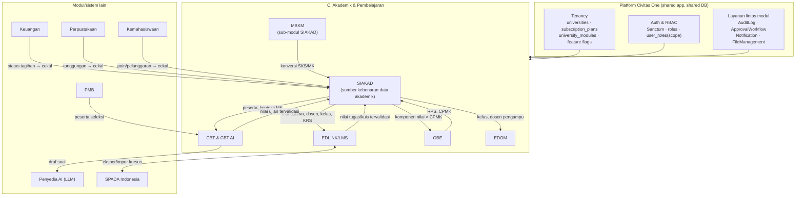
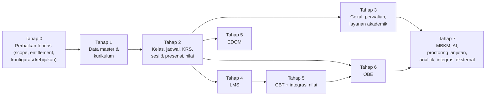

# Rancangan Modul Akademik & Pembelajaran — Civitas One

> **Status dokumen:** Rancangan sistem (bukan dokumentasi fitur jadi). Tidak ada kode aplikasi atau skema database yang diubah dalam penyusunan dokumen ini.
> **Disusun:** 2026-10-11, berdasarkan kondisi repository pada commit `ab81cc7`.
> **Referensi utama:** [SEVIMA_Penjelasan_Modul.md](../SEVIMA_Penjelasan_Modul.md) §7–§11 dan [SEVIMA_Platform_Proposal.md](../SEVIMA_Platform_Proposal.md) §3.5, §3.7, §3.8, §3.14, §6.1.
> **Dokumen terkait yang sudah ada:** [RANCANGAN-AKUN-AKADEMIK.md](../RANCANGAN-AKUN-AKADEMIK.md), [RANCANGAN-AKUN-DOSEN.md](../RANCANGAN-AKUN-DOSEN.md), [RANCANGAN-AKUN-MAHASISWA.md](../RANCANGAN-AKUN-MAHASISWA.md), [RANCANGAN-APLIKASI.md](../RANCANGAN-APLIKASI.md), [MULTI-TENANT-ARCHITECTURE.md](../MULTI-TENANT-ARCHITECTURE.md), [EXAM_MODULE.md](../EXAM_MODULE.md), [EXAM_RANDOMIZATION.md](../EXAM_RANDOMIZATION.md), [semester-pendek/](../semester-pendek/README.md).

Dokumen set ini adalah rancangan target modul **C. Akademik & Pembelajaran** Civitas One, yang terdiri dari lima modul: **SIAKAD, EDLINK/LMS, CBT & CBT AI, OBE, dan EDOM**. Rancangan ini **memperluas implementasi yang sudah ada** di `app/Modules/Academic` dan tidak menggantinya. Nama tabel, model, enum, permission, dan endpoint yang sudah ada dipertahankan. Entitas baru mengikuti konvensi kode yang sama.

---

## Daftar Isi

1. [Tujuan dan Ruang Lingkup](#1-tujuan-dan-ruang-lingkup)
2. [Peta Dokumen](#2-peta-dokumen)
3. [Temuan Repository](#3-temuan-repository)
4. [Arsitektur Umum](#4-arsitektur-umum)
5. [Kanon Penamaan (wajib diikuti seluruh dokumen)](#5-kanon-penamaan-wajib-diikuti-seluruh-dokumen)
6. [Label Klasifikasi Fitur](#6-label-klasifikasi-fitur)
7. [Dependensi dan Urutan Implementasi](#7-dependensi-dan-urutan-implementasi)
8. [Asumsi Penting](#8-asumsi-penting)
9. [Glosarium](#9-glosarium)

---

## 1. Tujuan dan Ruang Lingkup

### 1.1 Tujuan

Dokumen ini menjadi acuan untuk tim berikut:

- **System Analyst**: alur proses, aturan bisnis, dan state machine.
- **Backend Developer**: entitas, service, endpoint, validasi, dan integrasi.
- **Frontend Web Developer** (`frontend/`, React 19): halaman, komponen, dan state UI.
- **Mobile Developer** (`mobile/`, Flutter): alur mahasiswa dan dosen di perangkat seluler.
- **Database Engineer**: skema, indeks, constraint, dan migrasi bertahap.
- **QA Engineer**: skenario uji dan kriteria penerimaan.

### 1.2 Ruang lingkup

| Modul | Cakupan | Dokumen utama |
|---|---|---|
| SIAKAD | Data master, kurikulum, kelas & jadwal, KRS, presensi & jurnal mengajar, penilaian & hasil studi, perwalian, pencekalan, layanan akademik, MBKM | [01-siakad.md](01-siakad.md) |
| EDLINK/LMS | Kelas akademik & umum, materi, tugas, kuis, forum, perkuliahan hybrid, presensi QR, dashboard, fitur lanjutan, storage & whitelabel | [02-edlink-lms.md](02-edlink-lms.md) |
| CBT & CBT AI | Bank soal, pengaturan ujian, pengerjaan, penilaian, CBT AI, proctoring, integrasi | [03-cbt-cbt-ai.md](03-cbt-cbt-ai.md) |
| OBE | Profil lulusan, CPL, pemetaan, CPMK, RPS, pengukuran ketercapaian, pelaporan akreditasi, OBE AI | [04-obe.md](04-obe.md) |
| EDOM | Pengaturan periode & formulir, pengisian, privasi/anonimitas, rekap & analisis | [05-edom.md](05-edom.md) |

### 1.3 Di luar ruang lingkup

Modul berikut hanya dibahas sebatas titik integrasinya dan tidak dirancang ulang di sini:

- PMB.
- Keuangan (`app/Modules/Finance`).
- SDM (`app/Modules/HumanResource`).
- Perpustakaan (`app/Modules/Library`).
- Kemahasiswaan/poin.
- Yudisium & Wisuda.
- Integrasi PDDikti Neo Feeder.
- RPL.

---

## 2. Peta Dokumen

| No | Dokumen | Isi | Pembaca utama |
|---|---|---|---|
| — | **README.md** (dokumen ini) | Indeks, temuan repository, arsitektur umum, **kanon penamaan**, dan urutan implementasi | Semua |
| 01 | [01-siakad.md](01-siakad.md) | Rancangan fungsional SIAKAD A.1–A.10 | SA, BE, FE, QA |
| 02 | [02-edlink-lms.md](02-edlink-lms.md) | Rancangan fungsional LMS B.1–B.6 | SA, BE, FE, Mobile |
| 03 | [03-cbt-cbt-ai.md](03-cbt-cbt-ai.md) | Rancangan fungsional CBT C.1–C.5 | SA, BE, FE, Mobile |
| 04 | [04-obe.md](04-obe.md) | Rancangan fungsional OBE D.1–D.7, termasuk rumus pengukuran | SA, BE, Tim Kurikulum |
| 05 | [05-edom.md](05-edom.md) | Rancangan fungsional EDOM E.1–E.3, termasuk model privasi | SA, BE, LPM |
| 06 | [06-integrasi-arsitektur.md](06-integrasi-arsitektur.md) | Integrasi antarmodul, pemilik data, sinkronisasi, retry, dan konflik | SA, BE |
| 07 | [07-database-erd.md](07-database-erd.md) | Rancangan tabel lengkap per modul, ERD, dan strategi multi-tenant | BE, DBE |
| 08 | [08-api-specification.md](08-api-specification.md) | Endpoint REST `/api/v1`, contoh JSON, error, idempotency, dan audit | BE, FE, Mobile |
| 09 | [09-ui-ux-specification.md](09-ui-ux-specification.md) | Navigasi, dashboard per role, spesifikasi halaman, dan standar UI | FE, Mobile, UI/UX |
| 10 | [10-business-rules.md](10-business-rules.md) | Aturan bisnis yang dapat diuji dan state machine | SA, BE, QA |
| 11 | [11-roles-permissions.md](11-roles-permissions.md) | RBAC, matriks hak akses, dan scope data | SA, BE |
| 12 | [12-reports-analytics.md](12-reports-analytics.md) | Daftar laporan, dashboard analitik, dan format ekspor | SA, BE, FE |
| 13 | [13-security-audit.md](13-security-audit.md) | Keamanan, audit, privasi, retensi, dan backup | BE, DevOps |
| 14 | [14-test-scenarios.md](14-test-scenarios.md) | Skenario uji dan kriteria penerimaan | QA |
| 15 | [15-implementation-roadmap.md](15-implementation-roadmap.md) | Tahapan implementasi, prioritas, risiko, dan definition of done | PM, Tech Lead |
| 16 | [16-open-decisions.md](16-open-decisions.md) | Keputusan yang menunggu konfirmasi pemilik produk/kebijakan kampus | PO, SA |

Urutan baca yang disarankan:

1. README.
2. Dokumen modul 01–05.
3. 10 dan 11.
4. 06, 07, dan 08.
5. 09 dan 12.
6. 13, 14, 15, dan 16.

---

## 3. Temuan Repository

Hasil pemeriksaan repository per 2026-10-11. Dokumen [RANCANGAN-AKUN-AKADEMIK.md](../RANCANGAN-AKUN-AKADEMIK.md) (2026-09-11) **sudah tertinggal**: sejak tanggal itu sudah ditambahkan jadwal, prasyarat, pengajuan KRS dengan persetujuan dosen wali, riwayat status mahasiswa, kalender akademik, materi, tugas, pengajuan mahasiswa (cuti), pelanggaran ujian, dan rentang nilai ujian.

### 3.1 Teknologi terverifikasi

| Aspek | Kondisi aktual | Sumber |
|---|---|---|
| Backend | Laravel 13, PHP 8.3, modular `app/Modules/*` (namespace `Modules\`) | `composer.json` |
| Struktur modul | `Controllers/ Database/{Migrations,Factories,Seeders} Enums/ Models/ Policies/ Requests/ Resources/ Routes/api.php Services/ Support/ Tests/` | `app/Modules/Academic` |
| Database | Relasional. **PK ULID** di semua tabel bisnis. `timestampsTz`. Indeks komposit diawali `university_id`. Enum status disimpan `string(20)` dengan PHP enum (pola terbaru) | migration Academic |
| Auth | Laravel Sanctum, bearer token | `app/Models/PersonalAccessToken.php` |
| RBAC | Kustom: `roles`, `permissions`, `role_permissions`, `user_roles` (`scope_type`, `scope_id`, `university_id`, `expires_at`). Slug `resource.action` | `PermissionRegistry`, `RolePermissionSeeder` |
| Multi-tenant | Shared DB, kolom `university_id`, trait `TenantScoped` + global scope `BelongsToInstitutionScope`, `TenantContext` di-resolve oleh middleware `tenant.resolve` | [MULTI-TENANT-ARCHITECTURE.md](../MULTI-TENANT-ARCHITECTURE.md) |
| API | Prefix `/api/v1`. Envelope `ApiResponse` `{success, message, data, meta}`. List melalui `ListQuery` (`search`, `filter[...]`, `sort`, `per_page` ≤ 100). Konflik aturan bisnis melalui `ConflictException` (409) | `app/Support/Http` |
| Audit | `audit_logs` + trait `Auditable` + `AuditLogService::recordAction()` | `app/Modules/AuditLog` |
| Persetujuan | `approval_workflows/*` + `ApprovalRequestService` / `ApprovalActionService`. Contoh penggunaan: `StudentRequestService` + listener `SyncStudentRequestDecision` | `app/Modules/ApprovalWorkflow` |
| Notifikasi | `NotificationDispatcher` (database/mail/push/whatsapp/sms), `notification_templates` per tenant. Wrapper akademik: `StudentNotificationService` | `app/Modules/Notification` |
| File | `file_uploads` (polymorphic `fileable`, checksum, status scan) + `FileAttacher` | `app/Modules/FileManagement` |
| Feature flag | `feature_flags` (global) + `university_feature_flags` (override per tenant), `FeatureFlagService::isEnabled()`. Kunci akademik: `academic.lecturer_ownership`, `academic.short_term` | `app/Modules/SystemSetting` |
| Paket | `subscription_plans`: **trial / starter / professional / enterprise**. `limits` (json) baru berisi `max_users`, `max_storage_gb`. `modules` + `university_modules` ada, **tetapi belum ada yang menegakkannya** | `TenancySeeder` |
| Frontend aktif | `frontend/`: React 19 SPA, react-router 7, Tailwind 3, react-hook-form + zod, recharts. Komponen kustom di `frontend/src/components/ui/` (Button, DataTable, Modal, Badge, StatCard, EmptyState, Skeleton, dll.). Inertia (`resources/js`) praktis tidak dipakai | `frontend/src` |
| Mobile | Flutter (`mobile/`). Fitur yang ada baru `auth`, `dashboard`, `exam` | `mobile/lib/features` |

### 3.2 Inventaris fitur akademik yang sudah ada

Legenda: **Ada** = tabel dan endpoint tersedia · **Parsial** = ada tetapi belum memenuhi cakupan referensi · **Belum** = belum ada sama sekali.

| Area | Status | Entitas/komponen yang ada | Kekurangan utama terhadap referensi |
|---|---|---|---|
| Fakultas, prodi | Ada (baca) | `faculties`, `study_programs` | Belum ada endpoint tulis |
| Tahun akademik/semester | Parsial | `academic_terms` (ganjil/genap, `is_current`, `krs_start_date`/`krs_end_date`) | Semester pendek baru berupa flag `academic.short_term`. Periode lain (perkuliahan, ujian, EDOM) belum terstruktur |
| Mahasiswa | Parsial | `students` (+ `academic_advisor_id`, `user_id`), `student_status_histories` | Orang tua/wali, transfer, double degree |
| Dosen | Parsial | `lecturers` (+ `user_id`, `study_program_id` homebase, data SDM) | Riwayat mengajar baru bisa diturunkan dari `class_sections.lecturer_id` (satu dosen per kelas) |
| Kurikulum & mata kuliah | Parsial | `curriculums`, `courses` (satu `curriculum_id` per course), `course_prerequisites` (`min_letter_grade`) | Belum ada ekuivalensi, paket mata kuliah, versi kurikulum per angkatan, atau riwayat perubahan |
| Kelas & jadwal | Parsial | `class_sections` (satu `lecturer_id`), `class_schedules` (`room` berupa teks bebas) | Belum ada tabel ruang, team teaching, jenis jadwal (teori/praktikum), validasi bentrok, publikasi, atau notifikasi perubahan |
| KRS | Parsial | `krs_submissions` (draft/submitted/approved/rejected), `krs_items` (draft/pending/enrolled/dropped), `KrsPlanService` (status aktif, periode, batas SKS, prasyarat, persetujuan dosen wali) | Belum ada cek cekal, paket KRS otomatis, penguncian, mekanisme perubahan (add/drop), atau riwayat persetujuan terstruktur |
| Presensi | Parsial | `attendances` (per `krs_item` × `meeting_number`, 4 status) | Belum ada entitas sesi/pertemuan, jurnal mengajar, koreksi berotorisasi, QR, atau batas kehadiran ujian |
| Nilai | Parsial | `grades` (1:1 `krs_item`, `score`, `letter_grade`), `LetterGrade` enum 7 tingkat **hardcoded** | Belum ada komponen & bobot, skala yang dapat dikonfigurasi, alur publikasi, riwayat revisi, atau pemutihan |
| IPS/IPK, transkrip | Ada | `AcademicRecordService`, `StudentGradeService` (nilai terbaik untuk mata kuliah yang diulang) | Batas SKS `SKS_LIMIT_TIERS` masih hardcoded |
| Perwalian | Parsial | `students.academic_advisor_id`, endpoint persetujuan KRS | Belum ada catatan konsultasi atau penanda mahasiswa berisiko |
| Cekal | **Belum** | — | Seluruhnya |
| Cuti studi | Ada | `student_requests` (type `leave`) melalui ApprovalWorkflow | — |
| Tugas akhir | Parsial | `theses` (1 pembimbing, status ringkas) | Belum ada multi-pembimbing, catatan bimbingan, seminar/sidang, atau penguji |
| MBKM | Parsial | `internships` (`program_type` magang/kkn/mbkm, `sks_converted` berupa angka) | Belum ada penawaran program, mitra, seleksi, logbook, evaluasi, konversi per mata kuliah, atau IKU |
| Kalender akademik | Ada | `academic_calendar_events` (kategori registration/krs/lecture/midterm_exam/final_exam/holiday/graduation/other) | Belum dipakai sebagai sumber periode yang mengikat |
| LMS | Parsial | `course_materials`, `assignments`, `assignment_submissions` (terikat `class_section_id`) | Belum ada kelas umum, forum, pengumuman kelas, versi materi, progres, QR, gamification, engagement score, kuota storage, atau whitelabel |
| CBT | Parsial (matang) | `exams`, `exam_questions`, `exam_question_options`, `exam_attempts`, `exam_attempt_answers`, `exam_violations`, `exam_grade_ranges`, `question_bank_items(+_options)`, ujian publik dengan `access_token` | Pilihan ganda saja. Belum ada status review soal, tingkat kesulitan, peserta non-KRS (PMB), CBT AI, rekaman kamera, atau alur kirim nilai |
| OBE | **Belum** | — | Seluruhnya |
| EDOM | **Belum** | Halaman mock `PortalLecturerEvaluationPage` (data statis) | Seluruhnya |
| Entitlement paket | **Belum ditegakkan** | `subscription_plans`, `modules`, `university_modules`, `feature_flags` | Penegakan di middleware/policy dan pemetaan fitur → paket |

### 3.3 Konflik dan celah yang memengaruhi rancangan

1. **Nama paket berbeda.** Referensi memakai Growth/Business/Professional/Premium/Enterprise, sedangkan Civitas One memakai trial/starter/professional/enterprise. Referensi adalah **penawaran SEVIMA**, bukan ketentuan final Civitas One. Rancangan memakai *feature key* yang dipetakan ke paket melalui konfigurasi ([OD-01](16-open-decisions.md)).
2. **Kebijakan akademik yang hardcoded.** Skala nilai (`LetterGrade`) dan batas SKS (`SKS_LIMIT_TIERS`) harus dipindahkan ke konfigurasi tenant ([01-siakad.md](01-siakad.md) A.6, [10-business-rules.md](10-business-rules.md)).
3. **Satu dosen per kelas.** `class_sections.lecturer_id` tidak mendukung team teaching. Rancangan menambahkan `class_section_lecturers`, dan `lecturer_id` dipertahankan sebagai *dosen koordinator* agar kompatibel.
4. **Satu kurikulum per mata kuliah.** `courses.curriculum_id` membuat mata kuliah yang sama tidak bisa dipakai di dua versi kurikulum tanpa duplikasi baris. Rancangan menambahkan `curriculum_courses` ([OD-03](16-open-decisions.md)).
5. **Ruang berupa teks bebas.** `class_schedules.room` tidak bisa dipakai untuk validasi bentrok ruang. Rancangan menambahkan tabel `rooms` dan `class_schedules.room_id`.
6. **Scope Dekan/Kaprodi belum diterapkan di query.** `user_roles.scope_type/scope_id` sudah tersedia tetapi belum dipakai. Rancangan mewajibkan scope fakultas/prodi ([11-roles-permissions.md](11-roles-permissions.md)).
7. **Entitlement paket belum ditegakkan.** Rancangan menambahkan lapisan `EnsureFeatureEntitled` ([11-roles-permissions.md](11-roles-permissions.md), [13-security-audit.md](13-security-audit.md)).
8. **Halaman frontend tanpa route/API.** Sebagian halaman portal (EDOM, perwalian, cuti, kuis) masih mock, dan beberapa menu (`/akademik/kelas-saya`, `/akademik/persetujuan-krs`, `/akademik/pengajuan-mahasiswa`) belum memiliki route padahal endpoint backend sudah ada. Ini dicatat di [09-ui-ux-specification.md](09-ui-ux-specification.md) dan [15-implementation-roadmap.md](15-implementation-roadmap.md).
9. **Modul `Internship` dan MBKM tumpang tindih.** `internships.program_type = mbkm` belum terstruktur. Rancangan menjadikan MBKM entitas sendiri dan menetapkan strategi migrasi `internships` sebagai keputusan terbuka ([OD-14](16-open-decisions.md)).

---

## 4. Arsitektur Umum

**Prinsip arsitektur:**

1. **Satu sumber kebenaran per entitas.** Mahasiswa, dosen, kelas, dan KRS hanya ada di SIAKAD. LMS, CBT, dan EDOM **mereferensikannya dengan foreign key** dan tidak menyalinnya. Daftar pemilik data ada di [06-integrasi-arsitektur.md](06-integrasi-arsitektur.md).
2. **Satu codebase modular.** Modul baru ditempatkan sebagai modul Laravel terpisah (`app/Modules/Lms`, `Cbt`, `Obe`, `Edom`, `Mbkm`) yang bergantung pada `Academic`. Integrasi di dalam satu database memakai **foreign key + domain event + service call**, bukan sinkronisasi HTTP antarlayanan. Mesin ujian yang saat ini berada di `Academic` dipindahkan secara bertahap ke modul `Cbt` ([OD-15](16-open-decisions.md)).
3. **Kebijakan sebagai konfigurasi.** Setiap angka kebijakan (batas SKS, kehadiran minimum, skala nilai, bobot, pembulatan) disimpan di `university_settings` grup `academic.*` atau di tabel konfigurasi khusus, tidak di kode.
4. **Empat lapis izin** (lihat [11-roles-permissions.md](11-roles-permissions.md) §2):
   1. Fitur tersedia di paket.
   2. Fitur diaktifkan untuk tenant.
   3. Pengguna punya permission dan scope.
   4. Data memenuhi syarat proses.

---

## 5. Kanon Penamaan (wajib diikuti seluruh dokumen)

Bagian ini adalah **daftar acuan tunggal**. Dokumen 01–16 tidak boleh memakai nama tabel, status, role, atau prefix endpoint yang berbeda dari daftar ini. Kandidat nama dari brief (misalnya `classes`, `semesters`, `study_plan_items`) **tidak dipakai** jika repository sudah punya padanannya.

### 5.1 Konvensi teknis

- Primary key: `id` ULID (`char(26)`).
- Setiap tabel tenant memiliki `university_id` ULID dengan FK → `universities`, trait `TenantScoped`, dan indeks komposit diawali `university_id`.
- Waktu: `timestampsTz`. Kolom waktu domain memakai akhiran `_at` (timestamptz) atau `_date` (date).
- Status: kolom `status string(20)` dengan PHP backed enum. Transisi **hanya** lewat service (lihat [10-business-rules.md](10-business-rules.md)).
- Soft delete hanya untuk data master yang direferensikan riwayat. Data transaksi akademik **tidak dihapus**, tetapi dibatalkan atau diarsipkan melalui status.
- Konfigurasi kebijakan: `university_settings` dengan `group = 'academic'` dan key bertitik (`academic.krs.max_sks_tiers`, dst.).

### 5.2 Entitas — padanan nama brief → nama kanon

| Konsep | Nama kanon | Status | Catatan |
|---|---|---|---|
| Perguruan tinggi | `universities` | Ada | Tenant |
| Fakultas / prodi | `faculties`, `study_programs` | Ada | |
| Tahun akademik + semester | `academic_terms` | Ada, diperluas | Brief `academic_years`/`semesters` digabung. Ditambah `term_type` (regular/short) |
| Periode akademik (KRS, kuliah, UTS, UAS, EDOM, nilai) | `academic_term_periods` | **Baru** | Periode yang mengikat proses. `academic_calendar_events` tetap untuk tampilan kalender |
| Mahasiswa | `students` | Ada | |
| Riwayat status mahasiswa | `student_status_histories` | Ada | |
| Dosen | `lecturers` | Ada | Homebase = `lecturers.study_program_id` |
| Orang tua/wali | `student_guardians` | **Baru** | Relasi `users` ↔ `students` |
| Ruang | `rooms` | **Baru** | |
| Kurikulum (versi) | `curriculums` | Ada, diperluas | Satu baris = satu versi kurikulum prodi |
| Mata kuliah | `courses` | Ada, diperluas | |
| Mata kuliah dalam kurikulum | `curriculum_courses` | **Baru** | Wajib/pilihan, semester rekomendasi per versi |
| Angkatan ↔ kurikulum | `curriculum_cohorts` | **Baru** | Angkatan/prodi yang memakai versi kurikulum |
| Prasyarat | `course_prerequisites` | Ada, diperluas | |
| Ekuivalensi | `course_equivalencies` | **Baru** | |
| Paket mata kuliah | `course_packages`, `course_package_items` | **Baru** | |
| Kelas perkuliahan | `class_sections` | Ada, diperluas | Brief `classes`/`course_offerings` → `class_sections` |
| Dosen pengajar kelas | `class_section_lecturers` | **Baru** | `class_sections.lecturer_id` = koordinator |
| Jadwal | `class_schedules` | Ada, diperluas | + `room_id`, `schedule_type`, `group_label`, `status` |
| KRS (header) | `krs_submissions` | Ada, diperluas | Brief `study_plan_periods`/`study_plan_approvals` |
| KRS (baris) | `krs_items` | Ada | Brief `study_plan_items`/`student_course_registrations` |
| Riwayat KRS | `krs_submission_events` | **Baru** | Jejak ajukan/setujui/revisi/kunci/ubah |
| Sesi pertemuan + jurnal mengajar | `lecture_sessions` | **Baru** | Brief `attendance_sessions` + `teaching_journals` disatukan |
| Materi jurnal | `lecture_session_materials` | **Baru** | Pivot sesi ↔ `course_materials` |
| Presensi mahasiswa | `attendances` | Ada, diperluas | + `lecture_session_id`, `method`, `recorded_by` |
| Koreksi presensi | `attendance_corrections` | **Baru** | |
| Token QR presensi | `attendance_qr_tokens` | **Baru** | |
| Skala nilai | `grade_scales`, `grade_scale_items` | **Baru** | Menggantikan `LetterGrade` hardcoded |
| Komponen nilai | `assessment_components` | **Baru** | Per `class_section` |
| Nilai komponen | `assessment_scores` | **Baru** | Per `krs_item` × komponen |
| Lembar nilai kelas (alur publikasi) | `grade_submissions` | **Baru** | Satu per `class_section` |
| Nilai akhir | `grades` | Ada, diperluas | + `final_score`, `grade_scale_item_id`, `grade_point`, `is_published` |
| Revisi/pemutihan nilai | `grade_revisions` | **Baru** | `revision_type`: correction / remediation (pemutihan) |
| Catatan perwalian | `advising_records` | **Baru** | |
| Cekal | `academic_blocks`, `academic_block_rules`, `academic_block_exemptions`, `academic_block_histories` | **Baru** | |
| Cuti, aktif kembali | `student_requests` | Ada | `type = leave` / `reactivation` |
| Transfer & double degree | `student_transfers`, `double_degree_enrollments` | **Baru** | |
| Konversi nilai/SKS (transfer, MBKM) | `credit_conversions`, `credit_conversion_items` | **Baru** | Brief `transfer_credit_conversions` + `course_credit_conversions` disatukan, dengan `source_type` |
| Tugas akhir | `theses` | Ada, diperluas | |
| Pembimbing/penguji TA | `thesis_supervisors`, `thesis_examiners` | **Baru** | |
| Bimbingan TA | `thesis_guidance_records` | **Baru** | |
| Seminar/sidang | `thesis_examinations` | **Baru** | |
| Mitra MBKM | `mbkm_partners` | **Baru** | |
| Program/penawaran MBKM | `mbkm_programs` | **Baru** | |
| Keikutsertaan MBKM | `mbkm_participations` | **Baru** | |
| Logbook MBKM | `mbkm_logbooks` | **Baru** | |
| Penilaian MBKM | `mbkm_assessments` | **Baru** | |
| Snapshot IKU | `iku_snapshots` | **Baru** | Enterprise |
| Kelas LMS | `lms_classes` | **Baru** | `class_type`: academic / general |
| Anggota kelas umum | `lms_class_members` | **Baru** | Hanya kelas umum. Kelas akademik memakai `krs_items` + `class_section_lecturers` |
| Materi | `course_materials` | Ada, diperluas | + `lms_class_id`, `topic`, `current_version_id` |
| Versi materi | `course_material_versions` | **Baru** | |
| Tugas | `assignments`, `assignment_submissions` | Ada, diperluas | + `lms_class_id`, `lms_class_member_id` |
| Forum | `lms_discussion_threads`, `lms_discussion_posts` | **Baru** | |
| Pengumuman kelas | `lms_class_announcements` | **Baru** | |
| Progres materi | `lms_material_progress` | **Baru** | |
| Log aktivitas belajar | `lms_activity_events` | **Baru** | Append-only |
| Skor engagement/kinerja | `lms_engagement_scores`, `lms_lecture_performance_scores` | **Baru** | Business+ |
| Gamification | `lms_point_ledgers`, `lms_badges`, `lms_badge_awards` | **Baru** | |
| Pemakaian storage | `storage_usage_snapshots` | **Baru** | Sumber hitung = `file_uploads.size_bytes` |
| Bank soal | `question_banks` | **Baru** | Wadah. `question_bank_items` (ada) ditambah `question_bank_id`, `question_type`, `difficulty`, `topic`, `status` |
| Soal & opsi ujian | `exam_questions`, `exam_question_options` | Ada, diperluas | + `question_type`, `answer_key` |
| Ujian | `exams` | Ada, diperluas | + `exam_type`, `context_type`, `status` |
| Peserta ujian | `exam_participants` | **Baru** | Peserta eksplisit (KRS atau PMB) |
| Percobaan & jawaban | `exam_attempts`, `exam_attempt_answers` | Ada, diperluas | + `exam_participant_id`, jawaban esai, skor manual |
| Kejadian proctoring | `exam_violations` | Ada, diperluas | Brief `proctoring_events` → `exam_violations` + `proctoring_snapshots` (baru) |
| Hasil ke nilai | `exam_grade_ranges` (ada), kirim melalui `assessment_scores` | | Brief `examination_results` tidak dibuat: hasil = `exam_attempts.score` |
| Job AI soal | `ai_generation_jobs`, `ai_question_drafts` | **Baru** | `ai_generation_jobs` dipakai bersama oleh OBE AI |
| Profil lulusan | `graduate_profiles` | **Baru** | |
| CPL | `program_learning_outcomes` | **Baru** | Brief `learning_outcomes` |
| Profil ↔ CPL | `graduate_profile_outcomes` | **Baru** | |
| CPL ↔ mata kuliah | `course_plo_mappings` | **Baru** | Brief `curriculum_outcome_mappings` |
| CPMK & Sub-CPMK | `course_learning_outcomes` | **Baru** | `parent_id` untuk Sub-CPMK |
| CPMK ↔ CPL | `clo_plo_mappings` | **Baru** | |
| RPS | `lesson_plans`, `lesson_plan_meetings` | **Baru** | |
| Komponen nilai ↔ CPMK | `assessment_component_outcomes` | **Baru** | Brief `outcome_assessment_mappings` |
| Hasil pengukuran | `outcome_measurements` | **Baru** | Snapshot terhitung |
| Evaluasi kurikulum | `outcome_evaluation_reports`, `outcome_followups` | **Baru** | |
| EDOM | `edom_periods`, `edom_forms`, `edom_questions`, `edom_targets`, `edom_participations`, `edom_responses`, `edom_answers`, `edom_reports` | **Baru** | `edom_participations` menyimpan identitas. `edom_responses` tidak menyimpan identitas jika anonim |
| Entitlement | `subscription_plans` (ada), `plan_feature_entitlements` (**baru**), `university_feature_flags` (ada) | | |

### 5.3 Role kanon

Role yang sudah ada dipakai apa adanya. Role baru ditandai **Rekomendasi Pengembangan**.

| Role (brief) | Slug kanon | Status |
|---|---|---|
| Super Admin platform | `super_admin` | Ada |
| Admin perguruan tinggi | `university_administrator` (+ `university_owner`) | Ada |
| BAAK | `academic_administrator` | Ada |
| Admin fakultas | `faculty_administrator` | **Baru**, scope `faculty` |
| Admin program studi | `study_program_administrator` | **Baru**, scope `study_program` |
| Dosen | `lecturer` | Ada |
| Dosen wali | `academic_advisor` | Ada. Data scope diturunkan dari `students.academic_advisor_id` |
| Mahasiswa | `student` | Ada |
| Ketua program studi | `head_of_study_program` | Ada, scope `study_program` |
| Pimpinan akademik | `rector`, `vice_rector`, `dean` | Ada. `dean` di-scope `faculty` |
| LPM | `quality_assurance` | **Baru** |
| Panitia ujian | `exam_committee` | **Baru** |
| Pengawas ujian | `exam_proctor` | **Baru** |
| Orang tua/wali | `guardian` | **Baru** |
| Pengelola LMS | `lms_administrator` | **Baru** |
| Auditor | `auditor` | Ada (read-only) |

### 5.4 Status kanon (state machine lengkap di [10-business-rules.md](10-business-rules.md))

| Entitas | Nilai status (kode) |
|---|---|
| `krs_submissions.status` | `draft`, `submitted`, `revision_requested`, `approved`, `locked`, `cancelled` (nilai lama `rejected` dimigrasikan → `revision_requested`) |
| `krs_items.status` | `draft`, `pending`, `enrolled`, `dropped` (ada) |
| `class_sections.status` | `planned`, `open`, `running`, `completed`, `cancelled` |
| `class_schedules.status` | `draft`, `in_review`, `published`, `cancelled` ("diubah" = revisi atas `published`, dicatat sebagai riwayat) |
| `lecture_sessions.status` | `scheduled`, `ongoing`, `held`, `cancelled`, `rescheduled` |
| `grade_submissions.status` | `draft`, `submitted`, `in_review`, `published`, `reopened` |
| `grade_revisions.status` | `requested`, `approved`, `rejected`, `applied` |
| `academic_blocks.status` | `active`, `exempted`, `revoked`, `expired` |
| `student_requests.status` | `draft`, `submitted`, `approved`, `rejected`, `cancelled` (ada) |
| `theses.status` | `submitted`, `in_review`, `approved`, `in_supervision`, `ready_for_defense`, `completed`, `rejected`, `cancelled` (enum lama dipetakan, lihat 01 §A.9) |
| `mbkm_programs.status` | `draft`, `offered`, `registration_open`, `selection`, `running`, `evaluating`, `completed`, `cancelled` |
| `mbkm_participations.status` | `applied`, `selected`, `rejected`, `active`, `evaluated`, `converted`, `completed`, `withdrawn` |
| `lms_classes.status` | `draft`, `active`, `archived` |
| `question_bank_items.status` | `draft`, `in_review`, `published`, `retired` |
| `exams.status` | `draft`, `scheduled`, `active`, `finished`, `grading`, `graded`, `published`, `cancelled` |
| `exam_attempts.status` | `in_progress`, `submitted`, `auto_submitted`, `graded`, `voided` |
| Artefak OBE (`graduate_profiles`, `program_learning_outcomes`, `lesson_plans`) | `draft`, `in_review`, `ratified`, `superseded` |
| `outcome_evaluation_reports.status` | `draft`, `evaluated`, `followed_up` |
| `edom_periods.status` | `prepared`, `open`, `closed`, `analyzed`, `published` |

### 5.5 Permission slug kanon

Format `resource.action`, dengan action dari enum `PermissionAction`: `create`, `read`, `update`, `delete`, `approve`, `reject`, `publish`, `export`. Resource yang **sudah ada** tetap dipakai: `students`, `lecturers`, `study_programs`, `classes`, `curriculums`, `courses`, `krs`, `krs_advising`, `krs_self_service`, `student_portal`, `student_requests`, `course_materials`, `assignments`, `assignment_submissions`, `academic_calendar`, `grades`, `attendance`, `exams`, `exam_attempts`, `exam_participation`, `question_bank`, `theses`, `internships`.

Resource **baru**: `faculties`, `academic_terms`, `rooms`, `course_packages`, `course_equivalencies`, `class_schedules`, `lecture_sessions`, `attendance_corrections`, `grade_scales`, `assessment_components`, `grade_submissions`, `grade_revisions`, `advising_records`, `academic_blocks`, `academic_block_rules`, `academic_block_exemptions`, `student_transfers`, `credit_conversions`, `mbkm_programs`, `mbkm_partners`, `mbkm_participations`, `mbkm_logbooks`, `iku_reports`, `lms_classes`, `lms_discussions`, `lms_analytics`, `lms_storage`, `exam_proctoring`, `ai_question_generation`, `obe_profiles`, `obe_outcomes`, `obe_mappings`, `lesson_plans`, `obe_measurements`, `obe_reports`, `edom_periods`, `edom_forms`, `edom_participation`, `edom_reports`, `guardian_portal`, `academic_reports`.

### 5.6 Prefix endpoint kanon

Semua endpoint di bawah `/api/v1`, `auth:sanctum`, dan `tenant.resolve`. Path kebab-case jamak. Endpoint yang sudah ada **tidak diubah**.

| Kelompok | Prefix | Contoh |
|---|---|---|
| Master & operasional SIAKAD (admin) | tanpa prefix (konsisten dengan yang ada) | `/students`, `/class-sections`, `/krs-items`, `/rooms`, `/academic-blocks` |
| Self-service mahasiswa | `/student/...` (ada) | `/student/krs`, `/student/exams` |
| Dosen pengajar | `/teaching/...` (ada) | `/teaching/classes`, `/teaching/lecture-sessions/{id}` |
| Dosen wali | `/advising/...` | `/advising/students`, `/advising/krs-submissions/{id}/approve` |
| Orang tua/wali | `/guardian/...` | `/guardian/students/{id}/grades` |
| MBKM | `/mbkm/...` | `/mbkm/programs` |
| LMS | `/lms/...` | `/lms/classes/{id}/materials` |
| CBT | `/exams`, `/question-banks` (dilanjutkan), `/cbt/ai-jobs` | |
| OBE | `/obe/...` | `/obe/program-learning-outcomes` |
| EDOM | `/edom/...` | `/edom/periods`, `/student/edom` |
| Ujian publik (PMB) | `/public/exams/{accessToken}` (ada) | |

### 5.7 Feature key entitlement kanon

| Feature key | Fitur | Paket referensi minimum (SEVIMA) | Catatan |
|---|---|---|---|
| `siakad` | SIAKAD inti | Growth | |
| `siakad.mbkm` | MBKM standar | Growth | |
| `siakad.mbkm.iku` | Perhitungan pencapaian IKU otomatis | Enterprise | |
| `lms` | EDLINK inti (hybrid, dashboard, Android, QR, SPADA, monitoring, MOOC) | Growth | |
| `lms.material_duplication` | Manajemen & duplikasi bahan ajar | Growth | Status `(*)` dalam pengembangan di referensi |
| `lms.gamification` | Gamification | Growth | Status `(*)` dalam pengembangan di referensi |
| `lms.engagement_score` | Student Engagement Score | Business | |
| `lms.cbt_integration` | Integrasi CBT | Business | |
| `lms.employee_attendance` | Presensi pegawai | Business | |
| `lms.lecture_performance_score` | Lecture Performance Score | Business | |
| `lms.proctoring` | Proctoring | Professional | |
| `lms.pdf_annotation` | Penilaian dokumen PDF | Professional | |
| `lms.ios_app` | Aplikasi iOS | Professional | |
| `lms.ai_attendance` | Presensi AI (wajah) | Premium | |
| `lms.interactive_video` | Video interaktif | Premium | |
| `lms.whitelabel` | Whitelabel web & APK | Premium | |
| `cbt` | CBT | Business | |
| `cbt.ai` | CBT AI | Business | |
| `obe` | OBE | Professional, atau add-on | Add-on dari paket mana pun ([OD-01](16-open-decisions.md)) |
| `obe.ai` | OBE AI | Professional (add-on berbayar) | Cakupan & harga **Perlu Konfirmasi** |
| `edom` | EDOM | Growth | |

Batas kuantitatif (limit): `lms.storage_gb` (50/100/200/400/750) dan `lms.general_classes_per_term` (10).

---

## 6. Label Klasifikasi Fitur

Setiap fitur dalam dokumen 01–05 diberi salah satu label berikut:

| Label | Arti |
|---|---|
| **[Referensi]** | Tercantum di dokumen sumber (SEVIMA §7–§11 / proposal §3) |
| **[Rekomendasi]** | Rekomendasi Pengembangan: tambahan yang disarankan, tidak ada di sumber |
| **[Konfirmasi]** | Perlu Konfirmasi: bergantung pada keputusan produk atau kebijakan kampus. Dirujuk dengan ID `OD-xx` di [16-open-decisions.md](16-open-decisions.md) |

Selain label klasifikasi, status implementasi ditandai **(Ada)**, **(Parsial)**, atau **(Baru)** sesuai §3.2.

---

## 7. Dependensi dan Urutan Implementasi

Ringkasan:

- **Tahap 0** ditambahkan sebelum Tahap 1 brief karena celah scope Dekan/Kaprodi, entitlement yang belum ditegakkan, dan kebijakan yang hardcoded akan memengaruhi semua tahap berikutnya.
- **EDOM** bisa dikerjakan paralel setelah Tahap 2 karena hanya bergantung pada kelas dan dosen.
- **OBE** memerlukan komponen nilai (Tahap 2) dan sebaiknya menunggu CBT agar pemetaan komponen ↔ CPMK mencakup nilai ujian.

Detail, risiko, dan definition of done ada di [15-implementation-roadmap.md](15-implementation-roadmap.md).

---

## 8. Asumsi Penting

1. **Referensi = dokumen SEVIMA.** Fitur dan paket diambil dari penawaran SEVIMA sebagai acuan cakupan fungsional. Harga dan nama paket **bukan** ketentuan final Civitas One (OD-01, OD-02).
2. **Rancangan target, bukan klaim implementasi.** Endpoint dan tabel berlabel **Baru** belum ada di sistem.
3. **Regulasi.** Rujukan seperti SN-Dikti, IKU, LAM/BAN-PT, MBKM, dan SPADA dinyatakan sebagai konteks. Nilai ambang, format laporan, dan definisi IKU harus dikonfigurasi atau dikonfirmasi, tidak di-hardcode.
4. **Semester pendek** mengikuti rancangan yang sudah ada di [semester-pendek/](../semester-pendek/README.md). Dokumen ini hanya menyediakan titik sambungnya (`academic_terms.term_type`).
5. **Satu instalasi multi-tenant** (shared DB) dipertahankan, sesuai [MULTI-TENANT-ARCHITECTURE.md](../MULTI-TENANT-ARCHITECTURE.md).
6. **Penyedia AI** diasumsikan layanan LLM eksternal yang dipanggil dari backend melalui antrean job. Pemilihan penyedia dan kebijakan data adalah OD-11.

---

## 9. Glosarium

| Istilah | Arti |
|---|---|
| BAAK | Biro Administrasi Akademik & Kemahasiswaan (role `academic_administrator`) |
| BAP | Berita Acara Perkuliahan. Di rancangan ini menyatu dengan jurnal mengajar (`lecture_sessions`) |
| CBT | Computer Based Test |
| Cekal | Pencekalan: pemblokiran layanan tertentu karena syarat belum terpenuhi |
| CPL | Capaian Pembelajaran Lulusan (Program Learning Outcome, PLO) |
| CPMK | Capaian Pembelajaran Mata Kuliah (Course Learning Outcome, CLO) |
| Dispensasi | Pengecualian sementara atas cekal |
| EDOM | Evaluasi Dosen oleh Mahasiswa |
| IKU | Indikator Kinerja Utama perguruan tinggi |
| IPS / IPK | Indeks Prestasi Semester / Kumulatif |
| KRS / KHS | Kartu Rencana Studi / Kartu Hasil Studi |
| LPM | Lembaga Penjaminan Mutu (role `quality_assurance`) |
| MBKM | Merdeka Belajar Kampus Merdeka |
| OBE | Outcome Based Education |
| RPS | Rencana Pembelajaran Semester (`lesson_plans`) |
| SKS | Satuan Kredit Semester |
| SPADA | Sistem Pembelajaran Daring Indonesia |
| Tenant | Satu perguruan tinggi (`universities`) |
