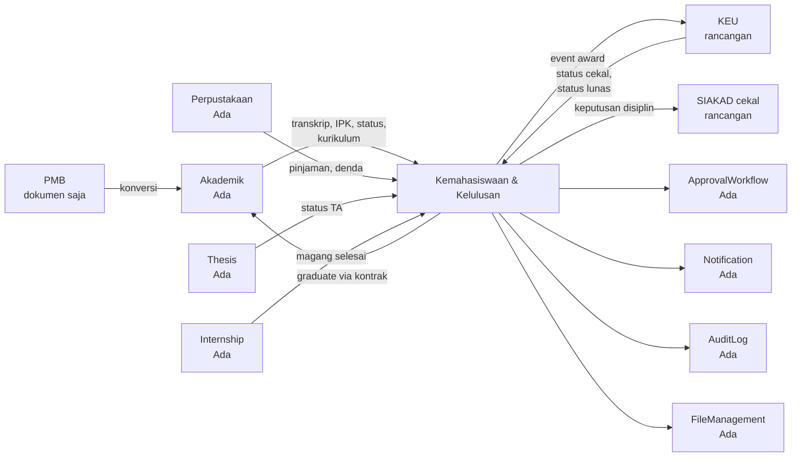

# 01 — Overview dan Ruang Lingkup

> **Status:** rancangan · Disusun 2026-10-13 (commit `47043ca`) · Kembali ke [README](README.md)

## 1. Latar Belakang

Kelompok modul **E. Kemahasiswaan & Kelulusan** mencakup perjalanan mahasiswa dari kegiatan non-akademik selama kuliah, penetapan kelulusan, wisuda, dokumen pendamping ijazah, hingga karier setelah lulus dan pengukuran outcome lulusan. Referensi fungsional: [SEVIMA_Penjelasan_Modul.md §13–17](../SEVIMA_Penjelasan_Modul.md), [RANCANGAN-APLIKASI.md §4.25, §4.30, §4.31, §4.34, §4.35](../RANCANGAN-APLIKASI.md).

Kondisi repository saat ini: belum ada modul poin, pelanggaran, yudisium, wisuda, SKPI, tracer study, atau career center. Yang sudah ada dan relevan: `Alumni` (tabel minimal, baca saja), `Scholarship` (baca saja), `Thesis`, `Internship`, `Library`, alur surat keterangan melalui `student_requests` (Akademik), serta infrastruktur generik ApprovalWorkflow, FileManagement, Notification, AuditLog, FeatureFlag, dan Tenancy. Rincian ada di [README §3](README.md#3-temuan-repository).

## 2. Tujuan

| Modul | Tujuan |
|---|---|
| Poin Kemahasiswaan | Mengelola aktivitas non-akademik, prestasi, pelanggaran, beasiswa, dan surat keterangan aktif kuliah secara terverifikasi dan dapat diaudit |
| Yudisium & Wisuda | Memeriksa persyaratan kelulusan, menetapkan kelulusan sesuai tata kelola, menerbitkan dokumen resmi bernomor, dan menyelenggarakan wisuda |
| SKPI | Menerbitkan Surat Keterangan Pendamping Ijazah dua bahasa berbasis capaian terverifikasi |
| Tracer Study | Mengumpulkan dan menganalisis outcome lulusan dan kepuasan pengguna lulusan untuk evaluasi, kinerja, dan akreditasi |
| Karirlink | Menghubungkan mahasiswa, alumni, pusat karier, dan perusahaan secara aman |

## 3. Ruang Lingkup

### 3.1 Termasuk

| Modul | Fitur | Dokumen |
|---|---|---|
| Poin Kemahasiswaan | Master kategori & aturan poin, ledger poin, koreksi, banding | [05](05-rancangan-poin-kemahasiswaan.md) |
| | Pengajuan aktivitas & prestasi, bukti, verifikasi, kegiatan terdaftar, anti-manipulasi | [06](06-rancangan-aktivitas-dan-prestasi.md) |
| | Laporan, kasus, keputusan sanksi, keberatan | [07](07-rancangan-pelanggaran-dan-sanksi.md) |
| | Program, seleksi, penerima, evaluasi beasiswa | [08](08-rancangan-beasiswa-mahasiswa.md) |
| | Surat keterangan aktif kuliah | [09](09-rancangan-surat-keterangan-aktif.md) |
| Yudisium & Wisuda | Periode & rule engine persyaratan | [10](10-rancangan-periode-dan-syarat-yudisium.md) |
| | Eligibility engine | [11](11-rancangan-eligibilitas-yudisium.md) |
| | Pendaftaran, verifikasi, rapat, keputusan, predikat | [12](12-rancangan-peserta-dan-penetapan-kelulusan.md) |
| | Layanan dokumen resmi & penomoran | [13](13-rancangan-penomoran-dokumen-kelulusan.md) |
| | Wisuda & buku wisuda | [14](14-rancangan-wisuda-dan-buku-wisuda.md) |
| SKPI | Capaian, dua bahasa, penerbitan | [15](15-rancangan-skpi.md) |
| Tracer Study | Periode, target, status karier | [16](16-rancangan-tracer-study.md) |
| | Kuesioner & survei | [17](17-rancangan-kuesioner-dan-survei.md) |
| | Distribusi, reminder, kuota | [18](18-rancangan-distribusi-dan-reminder-tracer.md) |
| | Dashboard & laporan | [19](19-rancangan-dashboard-dan-laporan-tracer.md) |
| Karirlink | Portal, branding, profil & CV, artikel, publikasi tracer | [20](20-rancangan-career-center-karirlink.md) |
| | Lowongan & lamaran | [21](21-rancangan-lowongan-dan-lamaran-kerja.md) |
| | Perusahaan mitra & CRM | [22](22-rancangan-mitra-perusahaan-dan-crm.md) |
| | Rekomendasi lulusan | [23](23-rancangan-rekomendasi-lulusan.md) |

### 3.2 Tidak termasuk

| Hal | Alasan / pemilik |
|---|---|
| Manajemen organisasi mahasiswa (pengurus, proposal dana, LPJ) | [KK-KD-02](33-glossary-dan-keputusan-bisnis.md#2-keputusan-desain-kk-kd) |
| Perhitungan tagihan, pembayaran, potongan, refund | Modul KEU ([keuangan/](../keuangan/README.md)) |
| Perhitungan IPK, SKS, nilai, status akademik | Modul Akademik (Ada) |
| Penegakan cekal layanan akademik | SIAKAD (`academic-learning`) |
| Pencetakan blanko ijazah fisik, legalisasi fisik | Di luar sistem ([KK-KD-11](33-glossary-dan-keputusan-bisnis.md#2-keputusan-desain-kk-kd)) |
| Pengiriman data kelulusan ke sistem nasional (otomatis) | Integrasi menyusul ([KK-Q-13](33-glossary-dan-keputusan-bisnis.md#3-pertanyaan-terbuka-kk-q)) |
| Penyaluran dana beasiswa tunai | [KK-Q-23](33-glossary-dan-keputusan-bisnis.md#3-pertanyaan-terbuka-kk-q) |
| Job fair, asesmen kandidat, penjadwalan wawancara terintegrasi | Pengembangan lanjut |
| Event alumni, donasi alumni (`RANCANGAN-APLIKASI.md §4.35`) | Bukan bagian kelompok E pada kebutuhan ini |
| Pengaduan layanan mahasiswa | `RANCANGAN-APLIKASI.md §4.32` |

## 4. Batas terhadap Modul Lain

| Modul | Modul ini **membaca** | Modul ini **tidak** melakukan |
|---|---|---|
| Akademik | Data mahasiswa, transkrip, IPK, kurikulum, status | Mengubah nilai, menghitung IPK, menulis `students` langsung |
| KEU | Status cekal dan lunas | Menghitung saldo/potongan, membuat tagihan |
| Perpustakaan | Pinjaman & denda | Mengubah pinjaman |
| Thesis / Internship | Status penyelesaian | Mengelola proses skripsi/magang |
| SIAKAD cekal | Status cekal untuk layanan `yudisium`/`graduation` | Menulis `academic_blocks` langsung (melalui projector) |

## 5. Pemangku Kepentingan

| Pemangku | Kepentingan utama |
|---|---|
| Mahasiswa & alumni | Pengakuan prestasi, kelulusan tepat waktu, dokumen sah, peluang kerja, privasi |
| Bagian kemahasiswaan | Verifikasi efisien, data prestasi untuk pelaporan, penegakan tata tertib |
| BAAK & bagian kelulusan | Yudisium tertib, dokumen bernomor tanpa kesalahan |
| Fakultas & prodi | Verifikasi unit, SKPI, data outcome untuk akreditasi |
| Panitia wisuda | Peserta valid, sesi tertib, buku wisuda akurat |
| Pusat karier & LPM | Tracer dengan response rate baik, data outcome, relasi mitra |
| Perusahaan | Kandidat relevan, proses rekrutmen jelas |
| Pimpinan | Indikator kinerja dan outcome yang dapat dipertanggungjawabkan |
| Auditor | Jejak keputusan dan dokumen |
| Platform (Civitas One) | Entitlement paket, isolasi tenant, marketplace |

## 6. Prinsip Rancangan

1. **Perluas, bukan ganti**: memakai tabel, alur, dan infrastruktur yang ada (`student_requests`, `scholarships`, `alumni`, ApprovalWorkflow, FileManagement, Notification, AuditLog).
2. **Keputusan berwenang, bukan otomatis**: sistem memeriksa dan menyarankan; keputusan final melalui pejabat dan workflow.
3. **Immutable untuk yang resmi**: ledger poin, keputusan, dokumen terbit, versi aturan, dan versi kuesioner tidak diubah diam-diam.
4. **Tidak ada angka kebijakan di kode**: ambang dan batas paket berasal dari konfigurasi.
5. **Privasi secara default**: data karier privat, tracer anonim secara default, akses berbasis dasar & consent.
6. **Sumber data tunggal**: setiap data punya satu pemilik ([04 §3](04-arsitektur-dan-integrasi-antarmodul.md#3-kepemilikan-data)).
