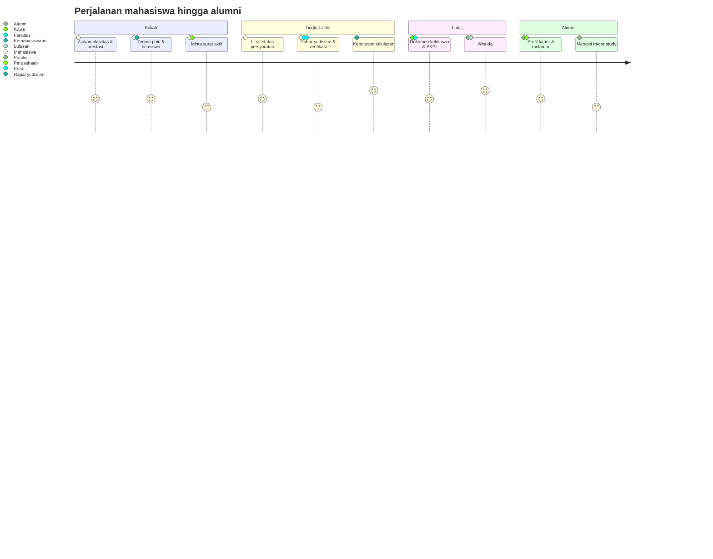

# 02 — Analisis Kebutuhan Bisnis

> **Status:** rancangan · Disusun 2026-10-13 (commit `47043ca`) · Kembali ke [README](README.md)

## 1. Proses Bisnis

| ID | Proses | Aktor utama | Pemicu | Hasil | Dokumen |
|---|---|---|---|---|---|
| PB-01 | Pengakuan aktivitas & prestasi | Mahasiswa, petugas kemahasiswaan | Mahasiswa mengikuti kegiatan | Pengajuan terverifikasi, poin tercatat | [05](05-rancangan-poin-kemahasiswaan.md), [06](06-rancangan-aktivitas-dan-prestasi.md) |
| PB-02 | Penegakan tata tertib | Pelapor, petugas disiplin, pejabat | Dugaan pelanggaran | Keputusan sanksi atau penutupan | [07](07-rancangan-pelanggaran-dan-sanksi.md) |
| PB-03 | Siklus beasiswa | Petugas, panitia, pejabat, mahasiswa | Program dibuka | Penerima ditetapkan & dievaluasi | [08](08-rancangan-beasiswa-mahasiswa.md) |
| PB-04 | Layanan surat aktif | Mahasiswa, BAAK | Kebutuhan surat | Surat bernomor terverifikasi | [09](09-rancangan-surat-keterangan-aktif.md) |
| PB-05 | Penyiapan yudisium | BAAK, prodi, fakultas | Kalender akademik | Periode & aturan aktif | [10](10-rancangan-periode-dan-syarat-yudisium.md) |
| PB-06 | Pemeriksaan kelayakan | Sistem, petugas | Periode dibuka/data berubah | Hasil eligibility terkini | [11](11-rancangan-eligibilitas-yudisium.md) |
| PB-07 | Penetapan kelulusan | Mahasiswa, verifikator, rapat, pengesah | Pendaftaran yudisium | Keputusan final, status lulusan, SK | [12](12-rancangan-peserta-dan-penetapan-kelulusan.md), [13](13-rancangan-penomoran-dokumen-kelulusan.md) |
| PB-08 | Penerbitan dokumen kelulusan | Petugas kelulusan, penandatangan | Keputusan final | Transkrip akhir, ijazah, SKL | [13](13-rancangan-penomoran-dokumen-kelulusan.md) |
| PB-09 | Penyelenggaraan wisuda | Panitia, lulusan, KEU | Jadwal wisuda | Peserta, sesi, kehadiran, buku | [14](14-rancangan-wisuda-dan-buku-wisuda.md) |
| PB-10 | Penerbitan SKPI | Lulusan, petugas SKPI, pejabat | Kelulusan | SKPI dua bahasa | [15](15-rancangan-skpi.md) |
| PB-11 | Tracer study | Petugas tracer, alumni, pengguna lulusan | Siklus tahunan | Data outcome & laporan | [16](16-rancangan-tracer-study.md)–[19](19-rancangan-dashboard-dan-laporan-tracer.md) |
| PB-12 | Rekrutmen melalui portal | Perusahaan, pusat karier, pelamar | Lowongan | Lamaran & penempatan | [21](21-rancangan-lowongan-dan-lamaran-kerja.md) |
| PB-13 | Pengelolaan mitra | Pusat karier, perusahaan | Undangan/registrasi | Kemitraan & riwayat interaksi | [22](22-rancangan-mitra-perusahaan-dan-crm.md) |
| PB-14 | Rekomendasi lulusan | Perusahaan, pusat karier, alumni | Kebutuhan kandidat | Kandidat dibagikan dengan consent | [23](23-rancangan-rekomendasi-lulusan.md) |

### 1.1 Alur ujung ke ujung mahasiswa

## 2. Kebutuhan Fungsional

ID `KK-FR-<AREA>-NN`. Area: `PNT` poin, `ACT` aktivitas, `DIS` disiplin, `SCH` beasiswa, `LTR` surat, `YUD` yudisium, `ELG` eligibility, `DEC` keputusan, `DOC` dokumen, `WIS` wisuda, `SKPI`, `TRC` tracer, `CAR` karier, `ENT` paket.

| ID | Kebutuhan | Prioritas | Dokumen |
|---|---|---|---|
| KK-FR-PNT-01 | Kampus mengonfigurasi kategori kegiatan, jenis, dokumen wajib, masa berlaku, dan kebijakan yudisium | Wajib | [05](05-rancangan-poin-kemahasiswaan.md) |
| KK-FR-PNT-02 | Aturan poin default/rentang per peran × tingkat dan batas periode | Wajib | [05](05-rancangan-poin-kemahasiswaan.md) |
| KK-FR-PNT-03 | Riwayat poin lengkap, koreksi, pencabutan, banding | Wajib | [05](05-rancangan-poin-kemahasiswaan.md) |
| KK-FR-ACT-01 | Mahasiswa mengajukan aktivitas dengan bukti | Wajib | [06](06-rancangan-aktivitas-dan-prestasi.md) |
| KK-FR-ACT-02 | Verifikasi: setuju, tolak, kembalikan | Wajib | [06](06-rancangan-aktivitas-dan-prestasi.md) |
| KK-FR-ACT-03 | Kegiatan kolektif dengan daftar peserta | Penting | [06](06-rancangan-aktivitas-dan-prestasi.md) |
| KK-FR-ACT-04 | Deteksi duplikat bukti & kegiatan | Wajib | [06](06-rancangan-aktivitas-dan-prestasi.md) |
| KK-FR-DIS-01 | Laporan, kasus, keputusan, keberatan terpisah | Wajib | [07](07-rancangan-pelanggaran-dan-sanksi.md) |
| KK-FR-DIS-02 | Masa berlaku sanksi dan efek layanan terkendali | Wajib | [07](07-rancangan-pelanggaran-dan-sanksi.md) |
| KK-FR-SCH-01 | Program, persyaratan, kuota, periode | Wajib | [08](08-rancangan-beasiswa-mahasiswa.md) |
| KK-FR-SCH-02 | Seleksi bertahap & penetapan penerima | Wajib | [08](08-rancangan-beasiswa-mahasiswa.md) |
| KK-FR-SCH-03 | Evaluasi, perpanjangan, penghentian; sinkron ke KEU | Wajib | [08](08-rancangan-beasiswa-mahasiswa.md) |
| KK-FR-LTR-01 | Surat aktif bernomor resmi, snapshot, verifikasi, pembatalan | Wajib | [09](09-rancangan-surat-keterangan-aktif.md) |
| KK-FR-YUD-01 | Periode yudisium multi-unit dengan jadwal | Wajib | [10](10-rancangan-periode-dan-syarat-yudisium.md) |
| KK-FR-YUD-02 | Persyaratan terkonfigurasi per jenjang/prodi/kurikulum/angkatan/periode, berversi | Wajib | [10](10-rancangan-periode-dan-syarat-yudisium.md) |
| KK-FR-ELG-01 | Pemeriksaan otomatis dengan hasil per syarat, sumber, waktu, versi | Wajib | [11](11-rancangan-eligibilitas-yudisium.md) |
| KK-FR-ELG-02 | Pemeriksaan ulang saat data berubah; hasil kedaluwarsa | Wajib | [11](11-rancangan-eligibilitas-yudisium.md) |
| KK-FR-DEC-01 | Verifikasi berjenjang, rapat, pengesahan, keputusan per mahasiswa | Wajib | [12](12-rancangan-peserta-dan-penetapan-kelulusan.md) |
| KK-FR-DEC-02 | Predikat dari aturan kampus | Wajib | [12](12-rancangan-peserta-dan-penetapan-kelulusan.md) |
| KK-FR-DEC-03 | Koreksi & pembatalan resmi berhistori | Wajib | [12](12-rancangan-peserta-dan-penetapan-kelulusan.md) |
| KK-FR-DOC-01 | Penomoran terkonfigurasi, unik, aman konkurensi | Wajib | [13](13-rancangan-penomoran-dokumen-kelulusan.md) |
| KK-FR-DOC-02 | Snapshot, PDF, tanda tangan, verifikasi keaslian | Wajib | [13](13-rancangan-penomoran-dokumen-kelulusan.md) |
| KK-FR-WIS-01 | Pendaftaran, validasi, biaya via KEU, konfirmasi | Wajib | [14](14-rancangan-wisuda-dan-buku-wisuda.md) |
| KK-FR-WIS-02 | Sesi, kapasitas, check-in | Wajib | [14](14-rancangan-wisuda-dan-buku-wisuda.md) |
| KK-FR-WIS-03 | Buku wisuda dari data terverifikasi | Wajib | [14](14-rancangan-wisuda-dan-buku-wisuda.md) |
| KK-FR-SKPI-01 | Pengumpulan & verifikasi capaian | Wajib | [15](15-rancangan-skpi.md) |
| KK-FR-SKPI-02 | Dua bahasa dengan peninjauan terjemahan | Wajib | [15](15-rancangan-skpi.md) |
| KK-FR-SKPI-03 | Persetujuan, penerbitan, revisi, verifikasi | Wajib | [15](15-rancangan-skpi.md) |
| KK-FR-TRC-01 | Periode & target alumni/pengguna lulusan | Wajib | [16](16-rancangan-tracer-study.md) |
| KK-FR-TRC-02 | Kuesioner kampus & template standar berversi | Wajib | [17](17-rancangan-kuesioner-dan-survei.md) |
| KK-FR-TRC-03 | Undangan, pengingat, token, status, bounce | Wajib | [18](18-rancangan-distribusi-dan-reminder-tracer.md) |
| KK-FR-TRC-04 | Kuota kuesioner terkirim per paket | Wajib | [18](18-rancangan-distribusi-dan-reminder-tracer.md) |
| KK-FR-TRC-05 | Dashboard outcome, ekspor, rekap akreditasi | Wajib | [19](19-rancangan-dashboard-dan-laporan-tracer.md) |
| KK-FR-CAR-01 | Marketplace & portal (default/whitelabel) | Wajib | [20](20-rancangan-career-center-karirlink.md) |
| KK-FR-CAR-02 | Profil karier & CV dengan kendali privasi | Wajib | [20](20-rancangan-career-center-karirlink.md) |
| KK-FR-CAR-03 | Lowongan, moderasi, lamaran, status | Wajib | [21](21-rancangan-lowongan-dan-lamaran-kerja.md) |
| KK-FR-CAR-04 | Perusahaan, undangan, verifikasi, CRM | Wajib | [22](22-rancangan-mitra-perusahaan-dan-crm.md) |
| KK-FR-CAR-05 | Rekomendasi lulusan dengan consent | Wajib (Professional+) | [23](23-rancangan-rekomendasi-lulusan.md) |
| KK-FR-CAR-06 | Artikel karier & publikasi tracer | Wajib (sesuai paket) | [20](20-rancangan-career-center-karirlink.md) |
| KK-FR-ENT-01 | Pembatasan paket terpusat tanpa hardcode | Wajib | [34](34-matriks-paket-dan-entitlement.md) |

## 3. Kebutuhan Non-Fungsional

| ID | Kebutuhan | Target / ukuran |
|---|---|---|
| KK-NFR-01 | Multi-tenant ketat | Uji isolasi otomatis untuk semua endpoint daftar (UMUM-TC-001) |
| KK-NFR-02 | Multi fakultas/prodi | Scope `f`/`p` pada semua query staf |
| KK-NFR-03 | Integritas dokumen resmi | Nomor unik pada 1.000 penerbitan paralel; hash berkas tetap |
| KK-NFR-04 | Ketertelusuran | Setiap keputusan & aksi sensitif memiliki histori + audit dengan alasan |
| KK-NFR-05 | Kinerja eligibility | 5.000 mahasiswa ≤ 15 menit (staging acuan) |
| KK-NFR-06 | Kinerja check-in | ≤ 1 detik per pindaian daring; mode luring tersedia |
| KK-NFR-07 | Ketersediaan survei publik | Halaman survei tetap berfungsi saat dashboard internal sedang berat (rute & cache terpisah) |
| KK-NFR-08 | Privasi | Default privat/anonim; ekspor berizin; sel minimum |
| KK-NFR-09 | Aksesibilitas | Halaman publik & portal mobile lolos audit a11y otomatis tanpa pelanggaran kritis |
| KK-NFR-10 | Bahasa | Antarmuka staf Bahasa Indonesia; SKPI & survei mendukung ID/EN; portal Civitas One mengikuti i18n |
| KK-NFR-11 | Zona waktu | Penyimpanan UTC; tampilan & batas hari zona tenant |
| KK-NFR-12 | Keandalan integrasi | Event `afterCommit`, retry 3×, rekonsiliasi harian |
| KK-NFR-13 | Konfigurabilitas | Tidak ada angka kebijakan kampus di kode (uji statis) |

## 4. Pemetaan Proses → Fitur → Data

| Proses | Fitur | Entitas utama | Integrasi |
|---|---|---|---|
| PB-01 | Kategori, pengajuan, verifikasi, ledger | `activity_*`, `student_point_ledgers` | FileManagement, SKPI, Eligibility |
| PB-02 | Laporan, kasus, keputusan | `violation_*`, `disciplinary_decisions` | ApprovalWorkflow, SIAKAD, Akademik |
| PB-03 | Program, seleksi, award | `scholarship_*` | KEU |
| PB-04 | Surat | `student_requests`, `issued_documents` | Akademik, OfficialDocument |
| PB-05–07 | Periode, aturan, eligibility, keputusan | `yudisium_*`, `graduation_*` | Akademik, KEU, Library, Thesis, Poin |
| PB-08 | Dokumen | `issued_documents` | Akademik |
| PB-09 | Wisuda | `graduation_ceremonies`, `ceremony_*`, `graduation_book_*` | KEU |
| PB-10 | SKPI | `skpi_*` | Aktivitas, Internship, OfficialDocument |
| PB-11 | Tracer | `tracer_*`, `alumni_career_records` | Notification, Alumni |
| PB-12–14 | Karier | `career_*`, `data_sharing_consents` | Tracer, SKPI |

## 5. Analisis Kesenjangan Kebutuhan vs Repository

| Kebutuhan | Kondisi | Kesenjangan |
|---|---|---|
| Surat aktif | Alur pengajuan & persetujuan Ada | Nomor resmi, snapshot, verifikasi, pembatalan |
| Beasiswa | Tabel program & pendaftaran (baca saja) | Seleksi, penerima, evaluasi, endpoint tulis |
| Alumni | Tabel ringkas, status wajib tanpa sumber | Sumber data, riwayat, kontak, privasi |
| Kelulusan | `students.graduated_at`, status `graduated`, `StudentObserver` | Seluruh proses yudisium |
| Dokumen | PDF dompdf (KRS, KHS, transkrip sementara, surat) | Penomoran, template berversi, verifikasi |
| Paket | Tabel paket & modul | Entitlement dan kuota |
| Scope fakultas/prodi | Kolom ada | Penegakan |

## 6. Risiko Bisnis

| Risiko | Dampak | Mitigasi |
|---|---|---|
| Aturan yudisium berbeda tiap fakultas dan tidak terdokumentasi | Konfigurasi salah | Simulasi, versi, publikasi terpisah |
| Petugas menganggap eligibility sebagai keputusan | Kelulusan tidak sah | UI & API memisahkan tegas; keputusan hanya via rapat |
| Response rate tracer rendah | Data outcome lemah | Pengingat terjadwal, portal alumni, kontak terverifikasi |
| Penipuan lowongan | Kerugian mahasiswa | Verifikasi perusahaan, moderasi, laporan |
| Kebocoran data karier | Hukum & reputasi | Consent, dasar akses, log akses |
| Ketergantungan modul belum ada (KEU, SIAKAD cekal) | Fitur tertunda | Jalur sementara ([32 §1](32-roadmap-implementasi.md#1-dependensi-eksternal-terhadap-kelompok-modul-ini)) |
