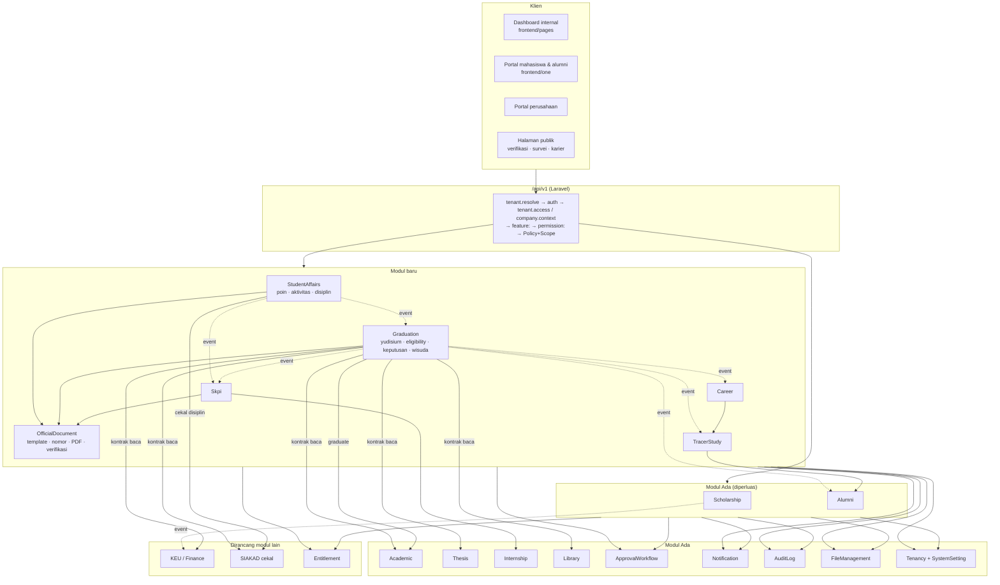
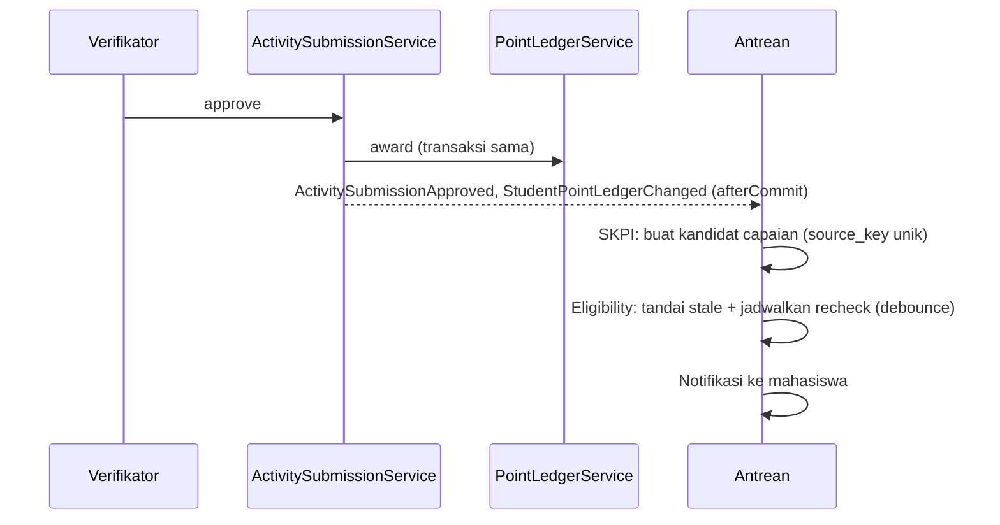

# 04 — Arsitektur dan Integrasi Antarmodul

> **Status:** rancangan · Disusun 2026-10-13 (commit `47043ca`) · Kembali ke [README](README.md)
> Rincian kontrak & event: [26 §11–12](26-rancangan-api-dan-integrasi.md#11-kontrak-in-process-dan-event) · Skema: [25](25-rancangan-database-dan-erd.md)

## 1. Arsitektur yang Ada (terverifikasi)

| Lapisan | Kondisi |
|---|---|
| Backend | Laravel 13, PHP 8.3, monolit modular `app/Modules/*` (namespace `Modules\`), rute modul dimuat otomatis dari `app/Modules/*/Routes/api.php` di bawah `/api/v1` + `tenant.resolve` |
| Data | Satu basis data (MySQL produksi, SQLite uji), PK ULID, `timestampsTz`, tenant via `university_id` + `TenantScoped` |
| Otorisasi | RBAC kustom (`PermissionRegistry`, `EnsurePermission`, Policy) |
| Antrean | Redis (predis). Notifikasi `ShouldQueue`. Scheduler: `hr:daily-maintenance` |
| PDF / Spreadsheet | dompdf, openspout |
| Frontend | React (admin `pages/`, Civitas One `one/`) |
| Dokumentasi API | Scramble (`dedoc/scramble`) |

## 2. Arsitektur Target



### 2.1 Struktur direktori modul (pola Ada)

```text
app/Modules/Graduation/
├── Contracts/          (GraduationRecordReader, RequirementChecker)
├── Checkers/           (AcademicTotalCreditsChecker, FinanceClearanceChecker, …)
├── Controllers/
├── Database/{Migrations,Factories,Seeders}
├── Enums/              (YudisiumPeriodStatus, EligibilityResult, …)
├── Events/  Listeners/  Jobs/
├── Models/  Policies/  Requests/  Resources/
├── Routes/api.php
├── Services/           (EligibilityService, DecisionService, CeremonyService, …)
├── Support/            (GraduationFeature — konstanta feature key, pola AcademicFeature)
└── Tests/{Feature,Unit}
```

## 3. Kepemilikan Data

Setiap data memiliki **satu pemilik** yang menulisnya. Modul lain hanya membaca melalui kontrak atau bereaksi melalui event.

| Data | Pemilik | Pembaca | Catatan |
|---|---|---|---|
| Identitas & status mahasiswa, transkrip, IPK | Akademik | Semua | Status `graduated` ditulis Akademik atas permintaan Yudisium |
| Tagihan, pembayaran, potongan, cekal keuangan | KEU | Yudisium, Wisuda | Tidak ada perhitungan ulang |
| Pinjaman & denda perpustakaan | Library | Yudisium | |
| Status tugas akhir | Thesis | Yudisium, SKPI | |
| Magang | Internship | SKPI, Karier | |
| Aktivitas, poin, disiplin | StudentAffairs | Yudisium, SKPI, Beasiswa, Surat | |
| Program & penerima beasiswa | Scholarship | KEU, Portal | |
| Periode, aturan, eligibility, keputusan kelulusan, wisuda | Graduation | Wisuda, SKPI, Tracer, Alumni, Karier | |
| Dokumen resmi & nomor | OfficialDocument | Semua penerbit | Isi dari `DocumentDataProvider` pemilik sumber |
| SKPI | Skpi | Karier (tautan verifikasi) | |
| Jawaban tracer | TracerStudy | Agregat, Alumni (atas consent) | |
| Ringkasan & riwayat karier alumni | Alumni | Tracer, Karier, laporan | Sumber dicatat |
| Profil karier, CV, lamaran, consent | Career | Perusahaan (dengan dasar akses) | |
| Perusahaan & lowongan marketplace | Career (platform) | Semua tenant | |
| Entitlement & kuota | Tenancy/Entitlement | Semua | |

## 4. Pola Integrasi

| Pola | Kapan dipakai | Contoh | Konsistensi |
|---|---|---|---|
| **Kontrak baca sinkron** | Keputusan memerlukan data terkini pemilik lain | `FinanceClearanceService::check`, `StudentTranscriptReader` | Kuat (baca saat itu). Hasil menyimpan `as_of` |
| **Kontrak tulis sinkron dalam transaksi** | Perubahan yang harus atomik dengan keputusan | `StudentStatusTransitionContract::graduate` saat finalisasi | Atomik (satu DB) |
| **Event `afterCommit` + listener sinkron** | Reaksi wajib yang murah, di modul yang sama/terkait erat | Approval → status pengajuan (preseden `SyncStudentRequestDecision`) | Atomik |
| **Event `afterCommit` + listener queued** | Reaksi yang boleh tertunda/mahal | Eligibility stale & recheck, impor kandidat SKPI, notifikasi, event award → KEU | Eventual. Retry + rekonsiliasi |
| **Job terjadwal** | Waktu sebagai pemicu | Tutup periode, pengingat tracer, kedaluwarsa lowongan, retensi, evaluasi beasiswa | Idempoten per hari |
| **Adaptor eksternal** | Sistem di luar aplikasi | Penyedia email (webhook), tanda tangan elektronik, marketplace eksternal (bila dipilih) | Retry + log kegagalan |

### 4.1 Idempotensi

| Lapisan | Mekanisme |
|---|---|
| HTTP | `Idempotency-Key` + `idempotency_keys` ([26 §1](26-rancangan-api-dan-integrasi.md#1-konvensi)) |
| Listener/job | Kunci unik bisnis di tabel tujuan (mis. `skpi_achievements.source_key`, `issued_documents.idempotency_key`, `tracer_invitations.dedupe_key`, `feature_usage_ledgers` unik) sehingga eksekusi ulang menjadi no-op |
| Notifikasi | `notification_logs.dedupe_key` |
| Webhook | `provider_event_id` unik |

### 4.2 Retry & kegagalan

- Job queued: `tries = 3`, backoff 60/300/900 detik, lalu `failed_jobs` (Laravel) + pemantauan (dashboard antrean di konsol platform).
- Kontrak sinkron yang gagal (mis. KEU timeout): checker mengembalikan `source_unavailable`, sehingga hasil `manual_review` (tidak gagal diam-diam).
- Finalisasi massal: per mahasiswa dalam transaksi sendiri, dan kegagalan dicatat per baris.

### 4.3 Rekonsiliasi

| Command (harian) | Membandingkan | Keluaran |
|---|---|---|
| `graduation:reconcile-alumni` | Keputusan final `graduated` ↔ `alumni` & role `alumni` | Daftar selisih |
| `graduation:reconcile-student-status` | Keputusan final ↔ `students.status` | Daftar selisih (tanpa perbaikan otomatis) |
| `scholarship:reconcile-discounts` | Award aktif ↔ `student_discounts` aktif (KEU) | Daftar selisih |
| `tracer:reconcile-quota` | Ledger ↔ undangan `initial` terkirim − refund | Selisih → insiden |
| `documents:reconcile-sources` | Sumber yang wajib berdokumen ↔ `issued_documents` | Antrean penerbitan |

Rekonsiliasi **melaporkan**. Perbaikan dilakukan melalui aksi berizin agar tercatat audit.

## 5. Alur Integrasi Utama

### 5.1 Finalisasi kelulusan

```mermaid
sequenceDiagram
    autonumber
    participant GO as Petugas kelulusan
    participant DS as DecisionService
    participant EL as EligibilityService
    participant AC as Akademik (kontrak)
    participant DB as DB (transaksi)
    participant Q as Antrean
    GO->>DS: finalize(batch) [Idempotency-Key]
    loop per keputusan graduated
        DS->>EL: pastikan hasil segar (≤ 60 menit)
        DS->>DB: BEGIN
        DS->>DB: graduation_decisions → final
        DS->>AC: graduate(student, date, decision)
        AC->>DB: students.status=graduated, graduated_at; StudentObserver → histori
        DS->>DB: graduation_status_histories, audit
        DS->>DB: COMMIT
        DB-->>Q: GraduationDecisionFinalized (afterCommit)
    end
    Q->>Q: Alumni: buat/aktifkan alumni + role alumni
    Q->>Q: OfficialDocument: antrean transkrip akhir/SKL/ijazah
    Q->>Q: SKPI: buka penyusunan; Wisuda: lulusan eligible
    Q->>Q: Notifikasi graduation.decision.final
```

### 5.2 Aktivitas disetujui → poin → SKPI → eligibility



### 5.3 Beasiswa → KEU

Lihat [08 §5.6](08-rancangan-beasiswa-mahasiswa.md#5-alur-bisnis-utama).

### 5.4 Keputusan disiplin → cekal SIAKAD

Keputusan `final` dengan `restricted_services` → event `DisciplinaryDecisionChanged` → projector SIAKAD membuat/mencabut `academic_blocks` (`block_type = student_affairs`, `source_reference_id = decision_id`) → `disciplinary_decisions.block_sync_status`. Bila SIAKAD belum ada, checker `student_affairs.discipline` membaca langsung ([07 §12](07-rancangan-pelanggaran-dan-sanksi.md#12-relasi-antarmodul)).

## 6. Integrasi per Modul yang Diminta

| Modul | Data | Status repo | Pola | Rincian |
|---|---|---|---|---|
| **PMB** | Calon mahasiswa → mahasiswa aktif, identitas, riwayat pendidikan | Hanya dokumen (`docs/pmb`) | Tidak langsung: modul ini membaca `students` setelah konversi oleh PMB/Akademik | [26 §12](26-rancangan-api-dan-integrasi.md#12-integrasi-antarmodul) |
| **Akademik** | Mahasiswa, prodi, kurikulum, SKS, IPK, status TA (via Thesis), status akademik, tanggal & status lulus | Ada | Kontrak baca + kontrak tulis status | [11 §12](11-rancangan-eligibilitas-yudisium.md#12-relasi-antarmodul), [12 §12](12-rancangan-peserta-dan-penetapan-kelulusan.md#12-relasi-antarmodul) |
| **Keuangan** | Status kewajiban, bebas tunggakan, biaya wisuda | Ada terbatas; KEU dirancang | Kontrak baca + event | Tidak menduplikasi tagihan/saldo |
| **Perpustakaan & fasilitas** | Bebas pinjaman/denda; bebas laboratorium | Library Ada; fasilitas belum ada | Kontrak baca; fasilitas sebagai checker manual | [10 §5.3](10-rancangan-periode-dan-syarat-yudisium.md#5-alur-bisnis-utama) |
| **Dokumen** | Template, nomor, PDF, tanda tangan, verifikasi | Baru (OfficialDocument) | Layanan bersama | [13](13-rancangan-penomoran-dokumen-kelulusan.md) |
| **Notifikasi** | Email, pengingat, status kirim | Ada (diperluas) | Dispatcher + log | [27](27-rancangan-notifikasi-dan-email.md) |
| **Karier & alumni** | Status alumni, profil lulusan, tracer, lowongan & lamaran | Alumni Ada; lainnya Baru | Event + kontrak | [16](16-rancangan-tracer-study.md), [20](20-rancangan-career-center-karirlink.md) |
