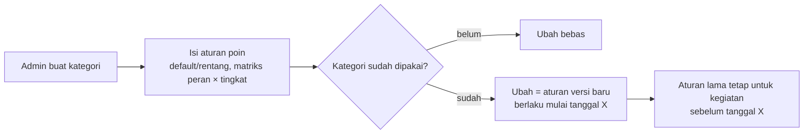
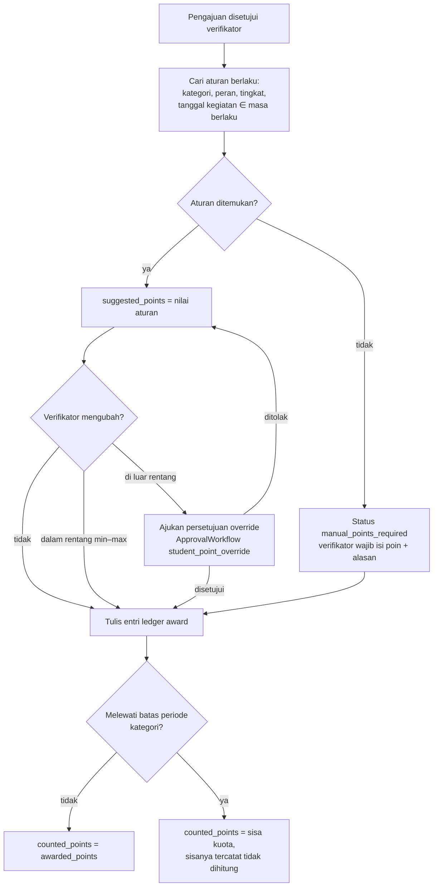
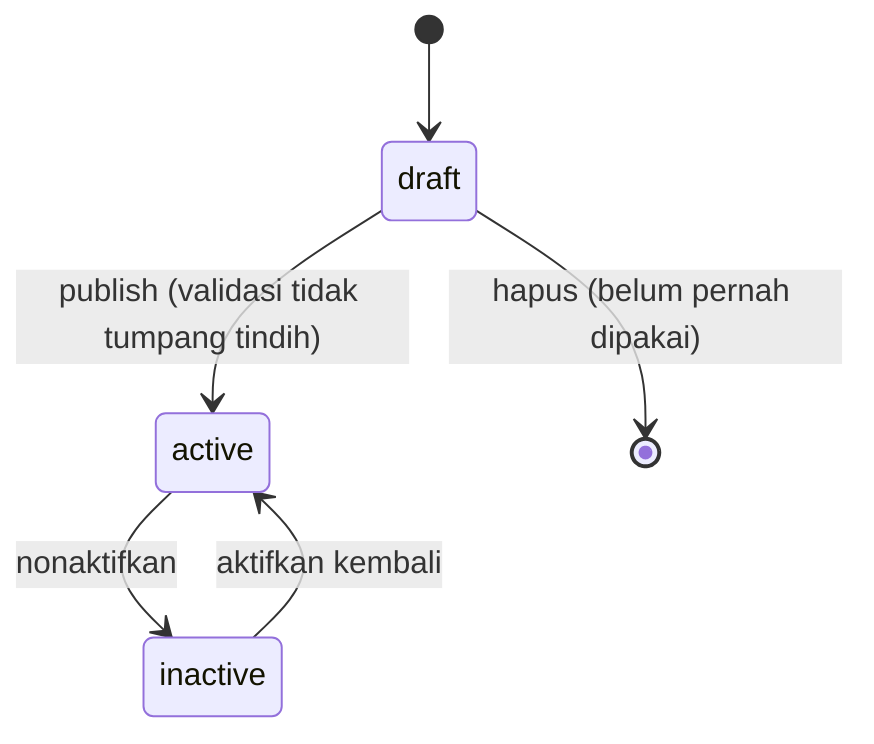
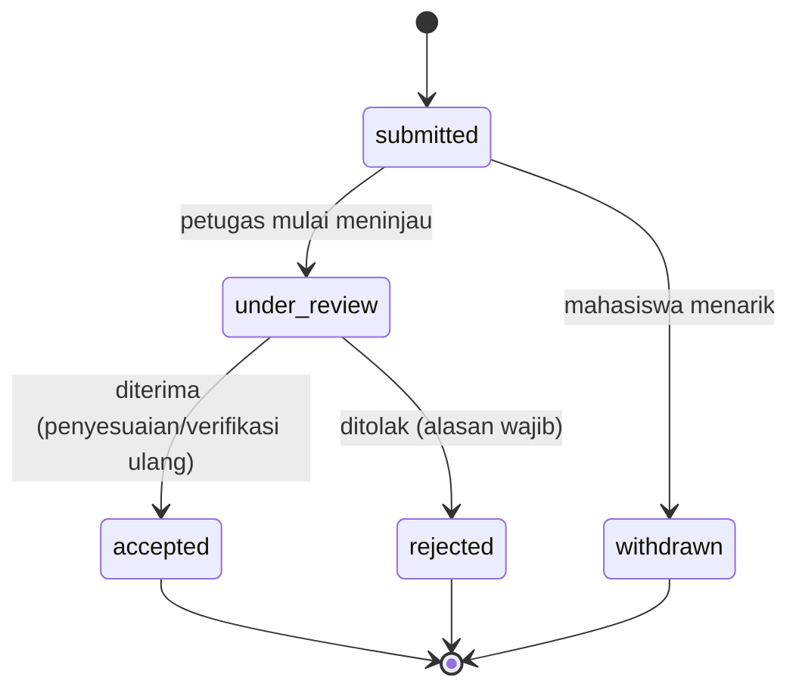

# 05 — Rancangan Poin Kemahasiswaan

> **Status:** rancangan · Disusun 2026-10-13 (commit `47043ca`) · Kembali ke [README](README.md)
> Skema acuan: [25 §2](25-rancangan-database-dan-erd.md#2-kelompok-kemahasiswaan) · Aturan: `KEM-BR-001`–`KEM-BR-013` ([29](29-business-rules-dan-validasi.md)) · API: [26 §3](26-rancangan-api-dan-integrasi.md#3-kemahasiswaan) · Pengajuan & bukti: [06](06-rancangan-aktivitas-dan-prestasi.md)

Dokumen ini mengatur **master kategori kegiatan, aturan poin, buku besar (ledger) poin, koreksi, pencabutan, banding, dan pemakaian poin** untuk yudisium dan SKPI. Proses pengajuan aktivitas oleh mahasiswa, bukti, verifikasi, dan pencegahan manipulasi dirinci di [06](06-rancangan-aktivitas-dan-prestasi.md). Poin pelanggaran (bila kampus memakainya) dicatat terpisah di [07](07-rancangan-pelanggaran-dan-sanksi.md) dan **tidak** mengurangi poin aktivitas kecuali kebijakan kampus menyatakannya ([KK-Q-07](33-glossary-dan-keputusan-bisnis.md#3-pertanyaan-terbuka-kk-q)).

## Daftar Isi

1. [Tujuan](#1-tujuan)
2. [Ruang Lingkup](#2-ruang-lingkup)
3. [Aktor dan Hak Akses](#3-aktor-dan-hak-akses)
4. [Prasyarat](#4-prasyarat)
5. [Alur Bisnis Utama](#5-alur-bisnis-utama)
6. [Alur Alternatif dan Kegagalan](#6-alur-alternatif-dan-kegagalan)
7. [Status dan Transisi Status](#7-status-dan-transisi-status)
8. [Data Input dan Output](#8-data-input-dan-output)
9. [Aturan Bisnis](#9-aturan-bisnis)
10. [Validasi](#10-validasi)
11. [Rancangan Database](#11-rancangan-database)
12. [Relasi Antarmodul](#12-relasi-antarmodul)
13. [Kontrak API Konseptual](#13-kontrak-api-konseptual)
14. [Rancangan Halaman UI/UX](#14-rancangan-halaman-uiux)
15. [Notifikasi](#15-notifikasi)
16. [Laporan](#16-laporan)
17. [Keamanan dan Audit](#17-keamanan-dan-audit)
18. [Acceptance Criteria](#18-acceptance-criteria)
19. [Test Case](#19-test-case)
20. [Asumsi dan Keputusan Terbuka](#20-asumsi-dan-keputusan-terbuka)

---

## 1. Tujuan

| Aspek | Isi |
|---|---|
| Tujuan bisnis | Mengakui kegiatan non-akademik mahasiswa secara terukur, adil, dan dapat diaudit, sehingga poin dapat dipakai sebagai syarat yudisium dan sumber SKPI bila kampus mewajibkannya |
| Masalah yang diselesaikan | Poin dicatat manual di spreadsheet, aturan berubah tanpa jejak, poin dapat diubah tanpa alasan, dan rekap untuk yudisium dihitung ulang setiap periode |
| Hasil yang diharapkan | Setiap poin dapat ditelusuri ke pengajuan, bukti, verifikator, dan versi aturan. Saldo poin selalu dapat direkonstruksi dari ledger |

## 2. Ruang Lingkup

**Termasuk:**

- Master kategori kegiatan (`activity_categories`) yang dapat dikonfigurasi per tenant.
- Aturan poin (`activity_point_rules`): poin default atau rentang, matriks peran × tingkat kegiatan, batas poin per periode, dan masa berlaku aturan.
- Ledger poin (`student_point_ledgers`): pemberian, koreksi, pencabutan, dan penyesuaian hasil banding.
- Banding poin (`point_appeals`).
- Ringkasan poin mahasiswa: total, per kategori, poin yang dihitung untuk yudisium.
- Kontrak baca `StudentPointsReader` untuk modul Yudisium ([11](11-rancangan-eligibilitas-yudisium.md)) dan SKPI ([15](15-rancangan-skpi.md)).

**Tidak termasuk:**

| Hal | Ditangani oleh |
|---|---|
| Formulir pengajuan, bukti, verifikasi, deteksi duplikat | [06](06-rancangan-aktivitas-dan-prestasi.md) |
| Manajemen organisasi mahasiswa (struktur pengurus, proposal dana, LPJ) — `RANCANGAN-APLIKASI.md §4.30` | Di luar ruang lingkup ([KK-KD-02](33-glossary-dan-keputusan-bisnis.md#2-keputusan-desain-kk-kd)). Kegiatan organisasi masuk sebagai pengajuan aktivitas |
| Poin pelanggaran | [07](07-rancangan-pelanggaran-dan-sanksi.md) |
| Penetapan apakah poin menjadi syarat yudisium dan berapa ambangnya | Aturan persyaratan di [10](10-rancangan-periode-dan-syarat-yudisium.md) |

## 3. Aktor dan Hak Akses

| Aktor (role) | Aksi | Permission | Scope data |
|---|---|---|---|
| Admin kemahasiswaan (`student_affairs_manager`) | Kelola kategori & aturan poin, setujui koreksi di luar rentang, putuskan banding | `activity_categories.create/update/delete`, `student_points.approve`, `point_appeals.approve/reject` | Tenant (`u`) |
| Petugas kemahasiswaan (`student_affairs_officer`) | Lihat poin, ajukan koreksi, tinjau banding | `student_points.read/update`, `point_appeals.read` | Tenant, atau fakultas (`f`) bila petugas fakultas |
| Admin fakultas/prodi (`faculty_administrator`, `study_program_administrator`) | Lihat poin mahasiswa dalam unitnya | `student_points.read` | `f` / `p` |
| Dosen wali (`academic_advisor`) | Lihat ringkasan poin mahasiswa perwalian | `student_points.read` + scope `w` | Mahasiswa perwalian |
| Mahasiswa (`student`) | Lihat poin & riwayat sendiri, ajukan banding | `student_affairs_self_service.read/create` | Data sendiri (diselesaikan dari `$user->student`) |
| Auditor | Baca seluruh ledger dan audit | `student_points.read`, `audit_logs.read` | Tenant |

Matriks lengkap: [03](03-aktor-role-dan-hak-akses.md).

## 4. Prasyarat

1. Entitlement `student_affairs.core` aktif ([34](34-matriks-paket-dan-entitlement.md)).
2. Minimal satu kategori aktif dengan aturan poin yang berlaku.
3. Pengaturan tenant grup `student_affairs.points.*` terisi (§10.2). Tanpa nilai, sistem memakai default yang tercantum, dan **tidak** ada ambang yudisium bawaan.
4. `students.user_id` terisi agar mahasiswa dapat mengakses layanan mandiri (sudah ada, `2026_08_26_173744_add_user_id_to_students_table`).

## 5. Alur Bisnis Utama

### 5.1 Pengelolaan master kategori



Kategori contoh (seluruhnya dapat diubah tenant; **bukan** nilai bawaan wajib):

| Kode | Nama | Jenis aktivitas | Contoh dokumen wajib | Dapat dihitung untuk yudisium |
|---|---|---|---|---|
| `ORG` | Organisasi Mahasiswa | `organization` | SK kepengurusan | Ya |
| `PAN` | Kepanitiaan | `committee` | SK panitia / surat tugas | Ya |
| `SEM` | Seminar & Pelatihan | `training` | Sertifikat | Ya |
| `KMP` | Kompetisi | `competition` | Sertifikat/piagam, bukti lomba | Ya |
| `PRA` | Prestasi Akademik | `achievement_academic` | Piagam | Ya |
| `PRN` | Prestasi Non-Akademik | `achievement_non_academic` | Piagam | Ya |
| `PKM` | Pengabdian Masyarakat | `community_service` | Surat tugas, laporan | Ya |
| `MAG` | Magang / Kegiatan Profesional | `internship` | Surat keterangan instansi | Ya (bila tidak dikonversi SKS) |
| `SRT` | Sertifikasi | `certification` | Sertifikat kompetensi | Ya |
| `LNS` | Kegiatan Lain yang Disetujui | `other` | Bukti sesuai keputusan | Sesuai kebijakan |

### 5.2 Penentuan poin

Mahasiswa **tidak** mengusulkan angka poin ([KK-KD-04](33-glossary-dan-keputusan-bisnis.md#2-keputusan-desain-kk-kd)). Poin dihitung sistem dari aturan dan dapat disesuaikan verifikator dalam rentang:



Pencarian aturan ("aturan paling spesifik menang"):

1. Aturan dengan `category_id`, `participant_role`, dan `activity_level` yang cocok.
2. Aturan dengan `category_id` dan `participant_role` cocok, `activity_level = null`.
3. Aturan dengan `category_id` dan `activity_level` cocok, `participant_role = null`.
4. Aturan default kategori (`participant_role = null`, `activity_level = null`).

Hanya aturan dengan `status = active` dan `effective_from ≤ activity_date < effective_until` (atau `effective_until = null`) yang dipertimbangkan. Bila pada tingkat yang sama ada lebih dari satu aturan, publikasi aturan ditolak (§10.1), sehingga hasil pencarian selalu deterministik.

### 5.3 Contoh perhitungan

Aturan kategori `KMP` (contoh): juara 1 tingkat nasional 40 poin (rentang 35–45), tingkat provinsi 25 poin, peserta tingkat nasional 10 poin. Batas `KMP` per tahun akademik 100 poin.

| Pengajuan | Aturan | Disarankan | Diberikan | Akumulasi KMP TA 2026/2027 sebelum | Dihitung | Catatan |
|---|---|---|---|---|---|---|
| Juara 1 nasional | KMP × juara1 × nasional | 40 | 42 (dalam rentang) | 50 | 42 | Alasan wajib karena berbeda dari saran |
| Peserta nasional | KMP × peserta × nasional | 10 | 10 | 92 | 8 | 2 poin melebihi batas; `capped_points = 2` |
| Juara 1 internasional | tidak ada aturan | — | 60 | 100 | 0 | Diisi manual, alasan wajib; dihitung 0 karena batas tercapai |

### 5.4 Koreksi, pencabutan, dan banding

| Proses | Pemicu | Hasil di ledger |
|---|---|---|
| Koreksi | Salah input poin, aturan salah dipilih | Entri `correction` bertanda ± (selisih), menunjuk entri asal (`reverses_entry_id`) |
| Pencabutan | Bukti terbukti palsu, kegiatan dibatalkan penyelenggara | Entri `revocation` sebesar −poin aktif pengajuan; pengajuan menjadi `revoked` ([06](06-rancangan-aktivitas-dan-prestasi.md)) |
| Banding diterima | Mahasiswa menilai poin terlalu rendah atau pengajuan salah ditolak | Entri `appeal_adjustment` (bila pengajuan sudah disetujui) atau pengajuan dibuka kembali untuk verifikasi ulang (bila sebelumnya ditolak) |
| Rekalkulasi massal | Kampus memutuskan aturan baru berlaku surut (jarang) | Batch `recalculation` dengan persetujuan; entri `correction` per mahasiswa |

Ledger bersifat **append-only**. Baris yang sudah ditulis tidak pernah diubah atau dihapus ([KEM-BR-002](29-business-rules-dan-validasi.md#kem-br-002)).

## 6. Alur Alternatif dan Kegagalan

| Kode | Kondisi | Penanganan |
|---|---|---|
| AF-PNT-01 | Tidak ada aturan yang cocok | Pengajuan tetap dapat disetujui. Verifikator wajib mengisi poin dan alasan. Ditandai `rule_id = null`, `is_manual = true`, dan masuk laporan "poin manual" |
| AF-PNT-02 | Override di luar rentang ditolak penyetuju | Poin kembali ke saran aturan. Verifikator dapat menyetujui dengan poin saran atau mengembalikan pengajuan |
| AF-PNT-03 | Dua verifikator memproses pengajuan yang sama bersamaan | Optimistic locking (`lock_version`). Yang kedua menerima 409 `STALE_VERSION` |
| AF-PNT-04 | Kategori dinonaktifkan saat ada pengajuan `submitted` | Pengajuan berjalan tetap diproses dengan aturan pada tanggal kegiatan. Kategori tidak dapat dipilih untuk pengajuan baru |
| AF-PNT-05 | Mahasiswa sudah berstatus `graduated` dan ada koreksi poin | Koreksi tetap tercatat. Bila hasil yudisium sudah final, koreksi **tidak** mengubah keputusan kelulusan, tetapi dicatat sebagai peringatan bagi petugas ([KEL-BR-049](29-business-rules-dan-validasi.md#kel-br-049)) |
| AF-PNT-06 | Banding diajukan setelah batas waktu | Ditolak sistem (422 `APPEAL_WINDOW_CLOSED`) kecuali admin membuka banding luar waktu dengan alasan (`forced_override`) |
| AF-PNT-07 | Perhitungan batas periode berbenturan karena dua persetujuan bersamaan untuk mahasiswa sama | Penulisan ledger mengunci baris ringkasan `student_point_summaries` (`SELECT … FOR UPDATE`) per mahasiswa |

## 7. Status dan Transisi Status

### 7.1 Kategori dan aturan poin



`activity_categories.status` dan `activity_point_rules.status`: `draft`, `active`, `inactive`. Aturan aktif tidak diubah nilainya. Perubahan dibuat sebagai aturan baru dengan `effective_from` baru, lalu aturan lama ditutup dengan `effective_until`.

### 7.2 Entri ledger

Entri ledger tidak memiliki status. `entry_type`: `award`, `correction`, `revocation`, `appeal_adjustment`. Hanya entri `award` dan `appeal_adjustment` yang dapat dibalik (oleh `correction` atau `revocation`).

### 7.3 Banding poin (`point_appeals.status`)



## 8. Data Input dan Output

### 8.1 Input master kategori

| Field | Tipe | Wajib | Validasi |
|---|---|---|---|
| `code` | string(20) | Ya | Unik per tenant, `^[A-Z0-9_-]+$` |
| `name` | string(150) | Ya | |
| `description` | text | Tidak | |
| `activity_type` | enum | Ya | `organization`, `committee`, `training`, `competition`, `achievement_academic`, `achievement_non_academic`, `community_service`, `internship`, `certification`, `other` |
| `allowed_participant_roles` | json array | Ya | Contoh: `chair`, `member`, `participant`, `winner_1`, `winner_2`, `winner_3`, `finalist`, `speaker`, `committee_chair`, `committee_member` |
| `allowed_levels` | json array | Ya | `internal`, `regional`, `provincial`, `national`, `international` |
| `required_evidence_types` | json array | Ya | `certificate`, `decree`, `assignment_letter`, `photo`, `report`, `other` (min. 1) |
| `requires_organizer_verification` | bool | Ya | Bila `true`, pengajuan wajib menunjuk `activity_events` yang terverifikasi ([06 §5.3](06-rancangan-aktivitas-dan-prestasi.md#5-alur-bisnis-utama)) |
| `counts_for_graduation` | bool | Ya | Kebijakan kategori untuk yudisium |
| `skpi_category_id` | ulid | Tidak | Pemetaan default ke kategori SKPI ([15](15-rancangan-skpi.md)) |
| `submission_window_days` | int | Tidak | Batas hari pengajuan setelah kegiatan selesai. `null` = ikut setting tenant |
| `valid_from`, `valid_until` | date | `valid_from` ya | Periode berlaku kategori |
| `verification_level` | enum | Ya | `study_program`, `faculty`, `university` — unit yang memverifikasi |

### 8.2 Input aturan poin

| Field | Tipe | Wajib | Validasi |
|---|---|---|---|
| `activity_category_id` | ulid | Ya | Kategori aktif atau draft |
| `participant_role` | string(30) | Tidak | Termasuk `allowed_participant_roles` kategori |
| `activity_level` | string(20) | Tidak | Termasuk `allowed_levels` kategori |
| `default_points` | decimal(6,2) | Ya | ≥ 0 |
| `min_points`, `max_points` | decimal(6,2) | Tidak | `min ≤ default ≤ max` |
| `period_cap_points` | decimal(8,2) | Tidak | Batas poin terhitung per `cap_period` untuk kategori |
| `cap_period` | enum | Bila cap diisi | `academic_term`, `academic_year`, `study_period` |
| `effective_from`, `effective_until` | date | `effective_from` ya | Tidak tumpang tindih dengan aturan lain pada kunci yang sama |

### 8.3 Output ringkasan poin mahasiswa

```json
{
  "student_id": "01J...",
  "total_awarded_points": "148.00",
  "total_counted_points": "140.00",
  "graduation_counted_points": "120.00",
  "by_category": [
    { "category_code": "KMP", "awarded": "60.00", "counted": "52.00", "capped": "8.00" }
  ],
  "last_entry_at": "2026-10-10T03:12:00Z",
  "as_of": "2026-10-13T01:00:00Z"
}
```

`graduation_counted_points` hanya menjumlahkan entri dari kategori `counts_for_graduation = true` dan kegiatan dalam masa studi mahasiswa ([KEM-BR-008](29-business-rules-dan-validasi.md#kem-br-008)).

## 9. Aturan Bisnis

| ID | Aturan |
|---|---|
| [KEM-BR-001](29-business-rules-dan-validasi.md#kem-br-001) | Poin hanya diberikan setelah proses verifikasi sesuai kebijakan kampus |
| [KEM-BR-002](29-business-rules-dan-validasi.md#kem-br-002) | Perubahan poin harus mempertahankan riwayat sebelumnya (ledger append-only) |
| [KEM-BR-003](29-business-rules-dan-validasi.md#kem-br-003) | Poin dihitung dari aturan yang berlaku pada **tanggal kegiatan**, bukan tanggal verifikasi |
| [KEM-BR-004](29-business-rules-dan-validasi.md#kem-br-004) | Verifikator boleh mengubah poin hanya dalam rentang aturan dengan alasan. Di luar rentang wajib persetujuan `student_affairs_manager` |
| [KEM-BR-005](29-business-rules-dan-validasi.md#kem-br-005) | Poin yang melewati batas periode tetap tercatat (`awarded_points`) tetapi tidak dihitung (`counted_points`) |
| [KEM-BR-006](29-business-rules-dan-validasi.md#kem-br-006) | Saldo poin adalah turunan ledger. Ringkasan dapat dibangun ulang dan tidak dapat diedit manual |
| [KEM-BR-007](29-business-rules-dan-validasi.md#kem-br-007) | Kategori atau aturan yang sudah dipakai tidak dapat dihapus, hanya dinonaktifkan |
| [KEM-BR-008](29-business-rules-dan-validasi.md#kem-br-008) | Poin untuk yudisium hanya dari kategori `counts_for_graduation` dan kegiatan dalam masa studi |
| [KEM-BR-009](29-business-rules-dan-validasi.md#kem-br-009) | Koreksi poin wajib alasan, menunjuk entri asal, dan memerlukan persetujuan bila menambah poin di atas rentang aturan |
| [KEM-BR-010](29-business-rules-dan-validasi.md#kem-br-010) | Pencabutan poin karena bukti tidak sah membatalkan seluruh poin aktif pengajuan dan dapat memicu laporan pelanggaran |
| [KEM-BR-011](29-business-rules-dan-validasi.md#kem-br-011) | Banding diajukan dalam batas waktu `student_affairs.points.appeal_window_days`, maksimal satu banding aktif per pengajuan |
| [KEM-BR-012](29-business-rules-dan-validasi.md#kem-br-012) | Perubahan aturan poin tidak mengubah poin yang sudah diberikan, kecuali melalui rekalkulasi yang disetujui |
| [KEM-BR-013](29-business-rules-dan-validasi.md#kem-br-013) | Pengajuan baru hanya untuk mahasiswa berstatus yang diizinkan (`student_affairs.submission.allowed_student_statuses`, default `active`, `leave`) |

## 10. Validasi

### 10.1 Validasi master

| Kode | Validasi | Error |
|---|---|---|
| V-PNT-01 | `code` unik per tenant | 422 `VALIDATION_FAILED` |
| V-PNT-02 | Aturan aktif dengan kunci (`category`, `participant_role`, `activity_level`) yang sama tidak boleh memiliki masa berlaku tumpang tindih | 409 `RULE_OVERLAP` |
| V-PNT-03 | `min_points ≤ default_points ≤ max_points` | 422 |
| V-PNT-04 | `participant_role`/`activity_level` aturan harus termasuk daftar yang diizinkan kategori | 422 |
| V-PNT-05 | Kategori dengan pengajuan/ledger tidak dapat dihapus | 409 `CATEGORY_IN_USE` |
| V-PNT-06 | Mengubah `counts_for_graduation` pada kategori yang sudah dipakai memerlukan konfirmasi dan alasan. Perubahan dicatat sebagai versi kebijakan dan **menandai stale** hasil eligibility yang memakai poin ([KEL-BR-022](29-business-rules-dan-validasi.md#kel-br-022)) | 409 bila tanpa konfirmasi `CONFIRMATION_REQUIRED` |

### 10.2 Pengaturan tenant (`university_settings`, grup `student_affairs`)

| Kunci | Tipe | Default | Keterangan |
|---|---|---|---|
| `student_affairs.points.appeal_window_days` | integer | 14 | Batas hari banding sejak keputusan |
| `student_affairs.points.override_requires_approval` | boolean | true | Override di luar rentang wajib persetujuan |
| `student_affairs.points.decimal_places` | integer | 0 | Presisi tampilan poin. Penyimpanan tetap `decimal(8,2)` |
| `student_affairs.submission.allowed_student_statuses` | array | `["active","leave"]` | Status yang boleh mengajukan |
| `student_affairs.submission.default_window_days` | integer | 90 | Batas hari pengajuan setelah kegiatan, bila kategori tidak menentukan |
| `student_affairs.points.cap_period_basis` | enum | `academic_year` | Basis default batas periode |

Angka di atas adalah **default rancangan** yang dapat diubah tenant, bukan ketentuan kampus ([KK-A-03](33-glossary-dan-keputusan-bisnis.md#4-asumsi-kk-a)).

## 11. Rancangan Database

Ringkasan. Definisi kolom lengkap ada di [25 §2](25-rancangan-database-dan-erd.md#2-kelompok-kemahasiswaan).

| Tabel | Status | Fungsi |
|---|---|---|
| `activity_categories` | Baru | Master kategori kegiatan |
| `activity_point_rules` | Baru | Aturan poin bermasa berlaku |
| `student_point_ledgers` | Baru | Mutasi poin append-only |
| `student_point_summaries` | Baru | Ringkasan per mahasiswa × kategori × periode cap (turunan, dapat dibangun ulang). Dipakai untuk penguncian dan kinerja |
| `point_appeals` | Baru | Banding poin |
| `student_affairs_status_histories` | Baru | Riwayat status entitas modul (polimorfik ringan) |

Kolom inti `student_point_ledgers`:

| Kolom | Tipe | Keterangan |
|---|---|---|
| `id` | ulid | PK |
| `university_id` | ulid | FK tenant |
| `student_id` | ulid | FK → `students` **restrict** (bukan cascade, [KK-KD-12](33-glossary-dan-keputusan-bisnis.md#2-keputusan-desain-kk-kd)) |
| `activity_submission_id` | ulid null | FK → `activity_submissions` restrict |
| `activity_category_id` | ulid | FK → `activity_categories` restrict |
| `activity_point_rule_id` | ulid null | Aturan yang dipakai |
| `entry_type` | string(20) | `award`, `correction`, `revocation`, `appeal_adjustment` |
| `awarded_points` | decimal(8,2) | Bertanda |
| `counted_points` | decimal(8,2) | Bertanda, ≤ `awarded_points` untuk entri positif |
| `cap_period_key` | string(30) | Contoh `AY:2026/2027`, `TERM:01J…`, `STUDY` |
| `activity_date` | date | Tanggal kegiatan (acuan aturan) |
| `reverses_entry_id` | ulid null | Entri yang dikoreksi/dicabut |
| `reason` | text null | Wajib untuk selain `award` dan untuk `award` manual/override |
| `approval_request_id` | ulid null | Bila melalui persetujuan |
| `created_by` | ulid | Pengguna penulis |
| `created_at` | timestamptz | Tanpa `updated_at` (immutable) |

Indeks: `(university_id, student_id, activity_category_id, cap_period_key)`, `(university_id, activity_submission_id)`. Unik idempotensi: `(activity_submission_id, entry_type, idempotency_token)`, dengan `idempotency_token` yang dihasilkan service per aksi.

## 12. Relasi Antarmodul

| Modul | Arah | Data | Mekanisme |
|---|---|---|---|
| Akademik | Baca | `students` (status, prodi, angkatan, `enrolled_at`, `graduated_at`), `academic_terms` (penentu `cap_period_key`) | Query model Akademik melalui service baca |
| ApprovalWorkflow | Tulis/baca | `approval_requests` (`workflowable_type = student_point_override`, `student_point_correction`) | `ApprovalRequestService::submit()` + listener `ApprovalRequestApproved/Rejected` (pola `SyncStudentRequestDecision`) |
| Yudisium | Dibaca | `StudentPointsReader::graduationPoints($student, $asOf)` | Kontrak in-process ([11](11-rancangan-eligibilitas-yudisium.md)) |
| Yudisium | Event | `StudentPointLedgerChanged` → tandai stale hasil eligibility | Event Laravel `afterCommit` |
| SKPI | Baca | Pengajuan `approved` beserta poin, kategori, dan bukti | [15](15-rancangan-skpi.md) |
| Cekal SIAKAD | Opsional | Bila kampus memakai cekal poin, `StudentAffairsBlockSource` membaca `graduation_counted_points` | Rancangan `academic-learning/01 A.8.6` |

## 13. Kontrak API Konseptual

Semua endpoint di bawah prefix `/api/v1`, middleware `auth:sanctum`, `tenant.access`, `feature:student_affairs.core`. Rincian request/response di [26 §3](26-rancangan-api-dan-integrasi.md#3-kemahasiswaan).

| Method | URL | Tujuan | Permission |
|---|---|---|---|
| GET | `/student-affairs/activity-categories` | Daftar kategori (`ListQuery`) | `activity_categories.read` |
| POST | `/student-affairs/activity-categories` | Buat kategori | `activity_categories.create` |
| PUT | `/student-affairs/activity-categories/{category}` | Ubah kategori (dengan aturan V-PNT-06) | `activity_categories.update` |
| POST | `/student-affairs/activity-categories/{category}/publish` | Aktifkan | `activity_categories.update` |
| GET/POST | `/student-affairs/activity-categories/{category}/point-rules` | Daftar/buat aturan | `activity_categories.read` / `.update` |
| GET | `/student-affairs/students/{student}/points` | Ringkasan & ledger mahasiswa | `student_points.read` |
| POST | `/student-affairs/students/{student}/point-corrections` | Ajukan koreksi (Idempotency-Key) | `student_points.update` |
| GET | `/student-affairs/point-appeals` | Daftar banding | `point_appeals.read` |
| POST | `/student-affairs/point-appeals/{appeal}/decide` | Putuskan banding | `point_appeals.approve` |
| GET | `/student/affairs/points` | Poin saya | `student_affairs_self_service.read` |
| POST | `/student/affairs/activity-submissions/{submission}/appeal` | Ajukan banding | `student_affairs_self_service.create` |

## 14. Rancangan Halaman UI/UX

| Halaman | Rute | Ringkasan |
|---|---|---|
| Master Kategori Kegiatan | `/kemahasiswaan/kategori` | Tabel kategori (kode, nama, jenis, status, dipakai untuk yudisium, jumlah aturan). Drawer aturan poin dengan matriks peran × tingkat. Tombol "Buat versi aturan" pada kategori aktif |
| Poin Mahasiswa | `/kemahasiswaan/poin` | Tabel mahasiswa (NIM, nama, prodi, angkatan, total, dihitung untuk yudisium). Filter prodi, angkatan, rentang poin. Detail: grafik per kategori dan timeline ledger |
| Banding Poin | `/kemahasiswaan/banding` | Antrean banding dengan SLA hari tersisa |
| Portal: Poin Saya | `/portal/kemahasiswaan/poin` | Kartu total, progress terhadap syarat yudisium **bila** prodi mahasiswa mewajibkan (ambang dibaca dari aturan yudisium aktif), riwayat ledger |

Spesifikasi komponen, state, dan aksesibilitas ada di [24](24-rancangan-ui-ux-dan-struktur-menu.md).

## 15. Notifikasi

| Event key | Penerima | Kanal |
|---|---|---|
| `student_affairs.points.awarded` | Mahasiswa | `database`, `mail` |
| `student_affairs.points.corrected` | Mahasiswa | `database`, `mail` |
| `student_affairs.points.revoked` | Mahasiswa, dosen wali | `database`, `mail` |
| `student_affairs.point_appeal.decided` | Mahasiswa | `database`, `mail` |
| `student_affairs.point_override.approval_requested` | Penyetuju | Melalui `ApprovalStepAssigned` (Ada) |

Detail template dan idempotensi: [27](27-rancangan-notifikasi-dan-email.md).

## 16. Laporan

| ID | Laporan | Isi | Hak akses |
|---|---|---|---|
| KEM-RPT-01 | Rekap poin per prodi/angkatan | Rata-rata, median, distribusi, jumlah mahasiswa di bawah ambang yudisium prodi (bila ada) | `student_points.read` + `export` |
| KEM-RPT-02 | Poin manual & override | Seluruh entri `is_manual`/override beserta penyetuju | `student_points.read` (manager, auditor) |
| KEM-RPT-03 | Koreksi & pencabutan | Entri `correction`/`revocation` dan alasannya | Manager, auditor |

## 17. Keamanan dan Audit

- Ledger tidak memiliki endpoint `PUT`/`DELETE`.
- Setiap entri non-`award` dan setiap `award` manual/override menulis `audit_logs` dengan aksi `forced_override` (override) atau `updated` beserta `reason`.
- Ringkasan poin hanya dibangun ulang oleh command `student-affairs:rebuild-point-summaries` yang mencatat audit `updated` dengan selisih bila ada.
- Pemisahan tugas: pengaju koreksi ≠ penyetuju (guard service, karena ApprovalWorkflow belum mencegah self-approval untuk langkah `role`/`user`; lihat [28 §6](28-keamanan-privasi-dan-audit.md#6-pemisahan-tugas)).

## 18. Acceptance Criteria

| ID | Kriteria |
|---|---|
| KEM-AC-01 | Poin muncul di ledger hanya setelah pengajuan `approved`. Pengajuan `submitted` tidak menambah saldo (diuji KEM-TC-001, KEM-TC-002) |
| KEM-AC-02 | Saldo yang dibangun ulang dari ledger sama persis dengan ringkasan untuk 100% mahasiswa pada data uji 1.000 entri |
| KEM-AC-03 | Override di luar rentang tanpa persetujuan ditolak 409. Dengan persetujuan, entri mencatat `approval_request_id` |
| KEM-AC-04 | Perubahan aturan poin aktif tidak mengubah `awarded_points` entri lama mana pun |
| KEM-AC-05 | Koreksi menghasilkan entri baru. Jumlah baris lama dan nilainya tidak berubah (dibuktikan checksum tabel sebelum/sesudah) |

## 19. Test Case

| ID | Judul | Prioritas |
|---|---|---|
| KEM-TC-001 | Pengajuan disetujui → entri `award` sesuai aturan | P1 |
| KEM-TC-002 | Pengajuan `submitted` tidak memengaruhi saldo | P1 |
| KEM-TC-003 | Aturan paling spesifik dipilih | P1 |
| KEM-TC-004 | Aturan berdasarkan tanggal kegiatan, bukan tanggal verifikasi | P1 |
| KEM-TC-005 | Override dalam rentang dengan alasan | P2 |
| KEM-TC-006 | Override di luar rentang memerlukan persetujuan | P1 |
| KEM-TC-007 | Batas poin periode: kelebihan tercatat tidak dihitung | P1 |
| KEM-TC-008 | Koreksi poin menambah entri, tidak mengubah entri lama | P1 |
| KEM-TC-009 | Pencabutan poin karena bukti tidak sah | P1 |
| KEM-TC-010 | Banding diterima menghasilkan `appeal_adjustment` | P2 |
| KEM-TC-011 | Banding di luar batas waktu ditolak | P2 |
| KEM-TC-012 | Kategori terpakai tidak dapat dihapus | P2 |
| KEM-TC-013 | Aturan tumpang tindih ditolak saat publish | P2 |
| KEM-TC-014 | Persetujuan bersamaan tidak melampaui batas periode | P1 |

Langkah dan data uji lengkap: [30 §2](30-skenario-pengujian.md#2-kemahasiswaan).

## 20. Asumsi dan Keputusan Terbuka

| ID | Hal | Status |
|---|---|---|
| [KK-KD-04](33-glossary-dan-keputusan-bisnis.md#2-keputusan-desain-kk-kd) | Poin ditentukan aturan, bukan diusulkan mahasiswa | Keputusan rancangan, perlu konfirmasi kampus |
| [KK-Q-05](33-glossary-dan-keputusan-bisnis.md#3-pertanyaan-terbuka-kk-q) | Apakah poin kemahasiswaan wajib untuk yudisium, dan ambangnya per prodi/angkatan | Terbuka |
| [KK-Q-06](33-glossary-dan-keputusan-bisnis.md#3-pertanyaan-terbuka-kk-q) | Basis batas periode poin (term, tahun akademik, masa studi) | Terbuka; default `academic_year` |
| [KK-Q-07](33-glossary-dan-keputusan-bisnis.md#3-pertanyaan-terbuka-kk-q) | Apakah poin pelanggaran mengurangi poin aktivitas | Terbuka; default tidak |
| [KK-A-03](33-glossary-dan-keputusan-bisnis.md#4-asumsi-kk-a) | Angka default di §10.2 hanya default rancangan | Asumsi |
