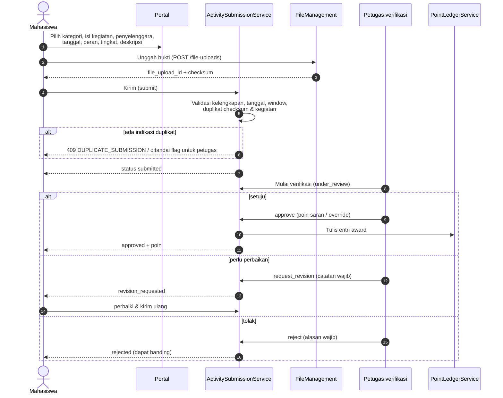
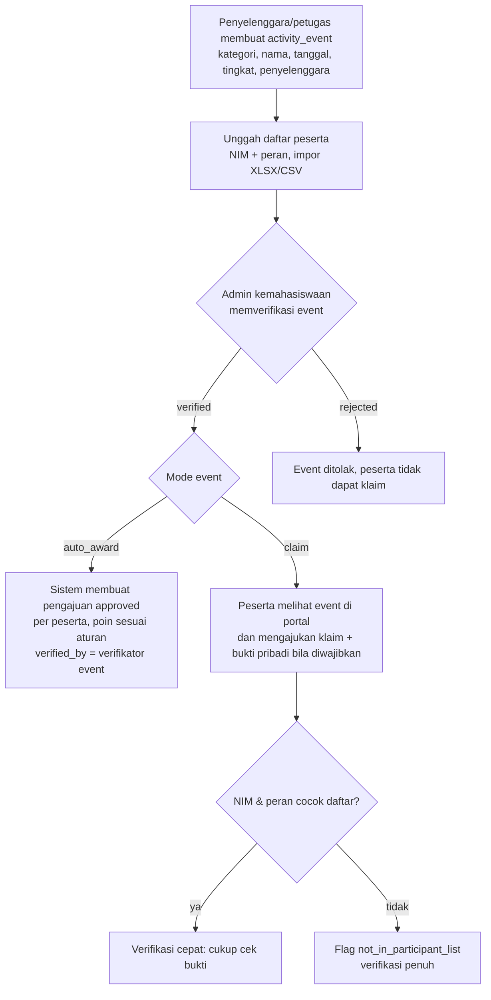
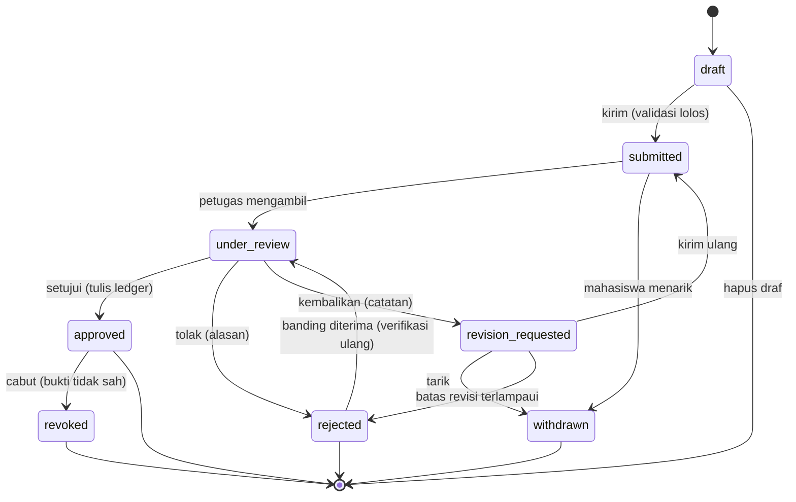

# 06 — Rancangan Aktivitas dan Prestasi

> **Status:** rancangan · Disusun 2026-10-13 (commit `47043ca`) · Kembali ke [README](README.md)
> Skema acuan: [25 §2](25-rancangan-database-dan-erd.md#2-kelompok-kemahasiswaan) · Aturan: `KEM-BR-020`–`KEM-BR-029` · Poin & ledger: [05](05-rancangan-poin-kemahasiswaan.md) · SKPI: [15](15-rancangan-skpi.md)

Dokumen ini mengatur **pengajuan aktivitas dan prestasi oleh mahasiswa**, pengelolaan bukti dan sertifikat, verifikasi berjenjang, kegiatan kolektif (satu kegiatan untuk banyak mahasiswa), verifikasi penyelenggara, serta pencegahan manipulasi. Hasil pengajuan yang disetujui menjadi entri poin ([05](05-rancangan-poin-kemahasiswaan.md)) dan sumber capaian SKPI ([15](15-rancangan-skpi.md)).

## Daftar Isi

1. [Tujuan](#1-tujuan)
2. [Ruang Lingkup](#2-ruang-lingkup)
3. [Aktor dan Hak Akses](#3-aktor-dan-hak-akses)
4. [Prasyarat](#4-prasyarat)
5. [Alur Bisnis Utama](#5-alur-bisnis-utama)
6. [Alur Alternatif dan Kegagalan](#6-alur-alternatif-dan-kegagalan)
7. [Status dan Transisi Status](#7-status-dan-transisi-status)
8. [Data Input dan Output](#8-data-input-dan-output)
9. [Aturan Bisnis](#9-aturan-bisnis)
10. [Validasi](#10-validasi)
11. [Rancangan Database](#11-rancangan-database)
12. [Relasi Antarmodul](#12-relasi-antarmodul)
13. [Kontrak API Konseptual](#13-kontrak-api-konseptual)
14. [Rancangan Halaman UI/UX](#14-rancangan-halaman-uiux)
15. [Notifikasi](#15-notifikasi)
16. [Laporan](#16-laporan)
17. [Keamanan dan Audit](#17-keamanan-dan-audit)
18. [Acceptance Criteria](#18-acceptance-criteria)
19. [Test Case](#19-test-case)
20. [Asumsi dan Keputusan Terbuka](#20-asumsi-dan-keputusan-terbuka)

---

## 1. Tujuan

Menyediakan jalur tunggal bagi mahasiswa untuk melaporkan kegiatan dan prestasi beserta bukti, dan bagi kampus untuk memverifikasinya secara konsisten. Setiap keputusan verifikasi harus dapat ditelusuri dan sulit dimanipulasi.

## 2. Ruang Lingkup

**Termasuk:** pengajuan individual, pengajuan berdasarkan kegiatan terdaftar (kolektif), unggah bukti, pemeriksaan kelengkapan otomatis, deteksi duplikat, verifikasi, pengembalian untuk perbaikan, penolakan, penarikan, pencabutan setelah disetujui, verifikasi penyelenggara, dan riwayat verifikasi.

**Tidak termasuk:** penilaian angka poin dan banding poin ([05](05-rancangan-poin-kemahasiswaan.md)), pelaporan pelanggaran atas bukti palsu ([07](07-rancangan-pelanggaran-dan-sanksi.md); dokumen ini hanya memicu laporan), serta magang yang dikonversi SKS (dikelola modul `Internship`, Ada).

## 3. Aktor dan Hak Akses

| Aktor | Aksi | Permission | Scope |
|---|---|---|---|
| Mahasiswa | Buat, ubah draf, kirim, tarik, perbaiki pengajuan sendiri | `student_affairs_self_service.read/create/update` | Milik sendiri |
| Petugas kemahasiswaan prodi/fakultas/universitas | Verifikasi sesuai `verification_level` kategori | `activity_submissions.read/approve/reject` | `p`/`f`/`u` |
| Admin kemahasiswaan | Kelola kegiatan terdaftar (`activity_events`), daftar peserta, cabut pengajuan | `activity_events.create/update`, `activity_submissions.update` | `u` |
| Pembina/penyelenggara internal (dosen/unit) | Mengusulkan kegiatan terdaftar dan mengunggah daftar peserta | `activity_events.create` (tanpa `approve`) | Kegiatan yang ia buat |
| Dosen wali | Melihat pengajuan mahasiswa perwalian | `activity_submissions.read` scope `w` | Perwalian |

## 4. Prasyarat

1. Kategori aktif dengan aturan poin ([05](05-rancangan-poin-kemahasiswaan.md)).
2. Mahasiswa berstatus yang diizinkan ([KEM-BR-013](29-business-rules-dan-validasi.md#kem-br-013)).
3. Modul `FileManagement` (Ada) untuk penyimpanan bukti, batas ukuran `file.max_upload_size_mb` (Ada, default 10) dan MIME `pdf,jpg,jpeg,png,doc,docx,xls,xlsx` (Ada). Untuk bukti aktivitas, rancangan mempersempit MIME menjadi `pdf,jpg,jpeg,png` (§10).

## 5. Alur Bisnis Utama

### 5.1 Pengajuan individual

Data yang diisi mahasiswa: kategori, nama kegiatan, penyelenggara, tanggal mulai & selesai, peran, tingkat kegiatan, lokasi (opsional), deskripsi singkat, tautan publik (opsional), dan bukti sesuai `required_evidence_types` kategori.

### 5.2 Pemeriksaan otomatis saat pengajuan

| Urutan | Pemeriksaan | Hasil bila gagal |
|---|---|---|
| 1 | Field wajib & bukti wajib lengkap per jenis | 422 |
| 2 | Status mahasiswa diizinkan | 409 `STUDENT_STATUS_NOT_ALLOWED` |
| 3 | `start_date ≤ end_date ≤ hari ini` (zona tenant), `start_date ≥ students.enrolled_at` | 422 |
| 4 | Dalam batas pengajuan: `hari ini ≤ end_date + submission_window_days` | 409 `SUBMISSION_WINDOW_CLOSED` |
| 5 | Kategori aktif dan berlaku pada `end_date` | 422 |
| 6 | Peran & tingkat termasuk daftar kategori | 422 |
| 7 | Checksum bukti sudah dipakai pengajuan lain yang tidak `rejected`/`withdrawn` (tenant yang sama) | Mahasiswa sama: 409 `DUPLICATE_EVIDENCE`. Mahasiswa lain: pengajuan diterima tetapi diberi flag `shared_evidence` untuk petugas (sertifikat kolektif sah dapat sama) |
| 8 | Kunci kegiatan (`dedupe_key`) sama dengan pengajuan aktif mahasiswa sama | 409 `DUPLICATE_SUBMISSION` |
| 9 | Kategori `requires_organizer_verification` → `activity_event_id` wajib dan event `verified` | 422 |

`dedupe_key` = sha256(`student_id` | `activity_category_id` | normalisasi(`activity_name`) | `start_date` | `participant_role`). Normalisasi: huruf kecil, buang tanda baca, spasi tunggal, transliterasi aksara non-ASCII.

### 5.3 Kegiatan terdaftar dan pengajuan kolektif

Untuk kegiatan yang diikuti banyak mahasiswa (kepanitiaan kampus, seminar internal, delegasi lomba), petugas atau penyelenggara internal membuat **kegiatan terdaftar** (`activity_events`) beserta daftar peserta (`activity_event_participants`).

Aturan kolektif:

- Satu mahasiswa hanya dapat memiliki satu pengajuan aktif per (`activity_event_id`, `participant_role`) ([KEM-BR-025](29-business-rules-dan-validasi.md#kem-br-025)).
- Impor peserta divalidasi per baris: NIM ada di tenant, peran diizinkan, tidak duplikat dalam file. Hasil impor tersedia sebagai laporan baris gagal.
- Mode `auto_award` hanya boleh dipilih oleh `student_affairs_manager` dan dicatat audit. Pembuat event tidak boleh memverifikasi event-nya sendiri ([KEM-BR-026](29-business-rules-dan-validasi.md#kem-br-026)).

### 5.4 Verifikasi penyelenggara

| Jenis penyelenggara | Cara verifikasi | Penyimpanan |
|---|---|---|
| Unit internal kampus | Event dibuat atau dikonfirmasi oleh unit melalui akun pegawai | `activity_events.organizer_type = internal`, `organizer_unit_id` |
| Organisasi mahasiswa resmi | Dikonfirmasi pembina/admin kemahasiswaan | `organizer_type = student_org` |
| Penyelenggara eksternal | Petugas memeriksa bukti publik (situs resmi, surat undangan, kontak penyelenggara). Hasil verifikasi dan metode dicatat | `activity_organizers` (master penyelenggara eksternal yang pernah diverifikasi, `verification_status`, `verification_note`) |

Master penyelenggara eksternal mempercepat verifikasi berikutnya, tetapi tidak membuat pengajuan otomatis sah. Bukti per mahasiswa tetap diperiksa.

### 5.5 Pencabutan setelah disetujui

Bila kemudian ditemukan bahwa bukti tidak sah (sertifikat palsu, kegiatan fiktif, nama diubah):

1. Petugas membuka **pemeriksaan ulang** (`reopen_for_review`) dengan alasan. Pengajuan tetap `approved`, dan poin tetap dihitung sampai keputusan.
2. Hasil "bukti tidak sah" → `revoked`. Sistem menulis entri `revocation` ([KEM-BR-010](29-business-rules-dan-validasi.md#kem-br-010)), menandai stale hasil eligibility yudisium, dan menandai capaian SKPI turunan sebagai `source_revoked` ([15](15-rancangan-skpi.md)).
3. Opsional: petugas membuat laporan pelanggaran dengan bukti tautan ke pengajuan ([07](07-rancangan-pelanggaran-dan-sanksi.md)). Pencabutan poin sendiri **bukan** sanksi disiplin.

## 6. Alur Alternatif dan Kegagalan

| Kode | Kondisi | Penanganan |
|---|---|---|
| AF-ACT-01 | Unggah bukti gagal atau berkas ditolak pemindai | `file_uploads.status = rejected` (Ada). Pengajuan tidak dapat dikirim sampai bukti diganti |
| AF-ACT-02 | Mahasiswa mengirim ulang setelah `revision_requested` melewati batas revisi (`student_affairs.submission.max_revisions`, default 2) | Pengajuan otomatis `rejected` dengan alasan sistem `max_revisions_exceeded` |
| AF-ACT-03 | Petugas tidak memproses dalam SLA (`student_affairs.verification.sla_days`) | Masuk daftar "melewati SLA" dan notifikasi eskalasi ke manager. Tidak ada persetujuan otomatis |
| AF-ACT-04 | Event dibatalkan setelah peserta disetujui | Admin mencabut event → seluruh pengajuan terkait ditinjau ulang secara massal (batch dengan ringkasan) |
| AF-ACT-05 | Mahasiswa pindah prodi saat pengajuan berjalan | Verifikator ditentukan dari prodi saat ini. Riwayat mencatat perubahan |
| AF-ACT-06 | Kategori butuh verifikasi penyelenggara, tetapi event belum ada | Mahasiswa dapat mengusulkan event (`proposed_by_student`) yang masuk antrean verifikasi event |

## 7. Status dan Transisi Status

`activity_submissions.status`: `draft`, `submitted`, `under_review`, `revision_requested`, `approved`, `rejected`, `withdrawn`, `revoked`.

Setiap transisi menulis `activity_verifications` (append-only: aktor, aksi, dari/ke status, catatan, poin saran/diberikan) dan `student_affairs_status_histories`.

`activity_events.status`: `draft`, `pending_verification`, `verified`, `rejected`, `cancelled`.

## 8. Data Input dan Output

| Field pengajuan | Tipe | Wajib | Catatan |
|---|---|---|---|
| `activity_category_id` | ulid | Ya | |
| `activity_event_id` | ulid | Kondisional | Wajib bila kategori `requires_organizer_verification` |
| `activity_name` | string(200) | Ya | |
| `organizer_name` | string(200) | Ya | Diisi otomatis dari event bila ada |
| `organizer_type` | enum | Ya | `internal`, `student_org`, `external` |
| `start_date`, `end_date` | date | Ya | |
| `participant_role` | string(30) | Ya | |
| `activity_level` | string(20) | Ya | |
| `location` | string(200) | Tidak | |
| `description` | text (≤ 2000) | Ya | |
| `public_url` | url | Tidak | Hanya `https` |
| `evidences[]` | array of {`file_upload_id`, `evidence_type`} | Ya | Min. jumlah per `required_evidence_types` |

Output detail pengajuan untuk petugas menambahkan: `flags[]` (`shared_evidence`, `not_in_participant_list`, `late_submission_override`, `organizer_unverified`), `suggested_points`, `matched_rule`, `verification_history[]`, dan ringkasan poin mahasiswa pada kategori.

## 9. Aturan Bisnis

| ID | Aturan |
|---|---|
| [KEM-BR-020](29-business-rules-dan-validasi.md#kem-br-020) | Pengajuan hanya dapat dikirim bila seluruh bukti wajib kategori terunggah dan berstatus `clean` |
| [KEM-BR-021](29-business-rules-dan-validasi.md#kem-br-021) | Bukti aktivitas hanya `pdf`, `jpg`, `jpeg`, `png`, maksimal `student_affairs.evidence.max_size_mb` (default 5, ≤ `file.max_upload_size_mb`) |
| [KEM-BR-022](29-business-rules-dan-validasi.md#kem-br-022) | Checksum bukti yang sama tidak boleh dipakai dua pengajuan aktif oleh mahasiswa yang sama. Bila dipakai mahasiswa lain, pengajuan diberi flag |
| [KEM-BR-023](29-business-rules-dan-validasi.md#kem-br-023) | Kegiatan yang sama (`dedupe_key`) tidak boleh diajukan ulang selama ada pengajuan aktif atau disetujui |
| [KEM-BR-024](29-business-rules-dan-validasi.md#kem-br-024) | Tanggal kegiatan tidak di masa depan, tidak sebelum masa studi, dan pengajuan dalam batas hari setelah kegiatan |
| [KEM-BR-025](29-business-rules-dan-validasi.md#kem-br-025) | Pada kegiatan terdaftar, satu mahasiswa hanya memiliki satu pengajuan aktif per peran |
| [KEM-BR-026](29-business-rules-dan-validasi.md#kem-br-026) | Verifikator tidak boleh memverifikasi pengajuan atau kegiatan yang ia ajukan/buat sendiri |
| [KEM-BR-027](29-business-rules-dan-validasi.md#kem-br-027) | Penolakan dan pengembalian wajib alasan. Pengembalian dibatasi `max_revisions` |
| [KEM-BR-028](29-business-rules-dan-validasi.md#kem-br-028) | Kategori yang mewajibkan verifikasi penyelenggara hanya menerima pengajuan untuk kegiatan terdaftar berstatus `verified` |
| [KEM-BR-029](29-business-rules-dan-validasi.md#kem-br-029) | Mahasiswa hanya dapat menarik pengajuan sebelum disetujui atau ditolak |

## 10. Validasi

| Kode | Validasi | HTTP / kode |
|---|---|---|
| V-ACT-01 | Field wajib (§8) | 422 `VALIDATION_FAILED` |
| V-ACT-02 | MIME bukti via deteksi konten (bukan hanya ekstensi). Ekstensi dan MIME harus konsisten | 422 |
| V-ACT-03 | Ukuran ≤ batas kategori/tenant | 422 |
| V-ACT-04 | `file_upload_id` milik pengguna pengaju, belum terlampir ke entitas lain, status `clean` | 422 `EVIDENCE_NOT_USABLE` |
| V-ACT-05 | Duplikat bukti/kegiatan (§5.2) | 409 `DUPLICATE_EVIDENCE` / `DUPLICATE_SUBMISSION` |
| V-ACT-06 | Transisi tidak sah | 409 `INVALID_STATUS_TRANSITION` |
| V-ACT-07 | `lock_version` usang | 409 `STALE_VERSION` |
| V-ACT-08 | Verifikator = pengaju/pembuat event | 403 `SELF_APPROVAL_FORBIDDEN` |
| V-ACT-09 | Impor peserta: maksimal `student_affairs.event.max_participants_per_import` (default 2.000) baris per berkas | 422 |

## 11. Rancangan Database

| Tabel | Status | Fungsi |
|---|---|---|
| `activity_submissions` | Baru | Pengajuan aktivitas |
| `activity_evidences` | Baru | Relasi pengajuan ↔ `file_uploads` + `evidence_type` + salinan `checksum` (untuk indeks duplikat per tenant) |
| `activity_verifications` | Baru | Riwayat verifikasi append-only |
| `activity_events` | Baru | Kegiatan terdaftar |
| `activity_event_participants` | Baru | Daftar peserta kegiatan terdaftar |
| `activity_organizers` | Baru | Master penyelenggara eksternal terverifikasi |
| `file_uploads` | Ada | Penyimpanan berkas (`fileable` → `activity_submissions`) |

Constraint penting:

- `activity_submissions.active_dedupe_key` (generated): `IF(status IN ('submitted','under_review','revision_requested','approved'), dedupe_key, NULL)`, unik per `university_id` ([KEM-BR-023](29-business-rules-dan-validasi.md#kem-br-023)).
- `activity_submissions.active_event_key` (generated): `IF(activity_event_id IS NOT NULL AND status IN (...aktif), CONCAT(activity_event_id,':',student_id,':',participant_role), NULL)`, unik.
- `activity_evidences` indeks `(university_id, checksum)`.
- Model `ActivitySubmission` mengimplementasikan `RestrictsFileAccess` (Ada) agar bukti hanya dapat diunduh pemilik, verifikator dalam scope, dan auditor.

## 12. Relasi Antarmodul

| Modul | Hubungan |
|---|---|
| FileManagement (Ada) | Penyimpanan bukti, checksum sha256 (Ada), pemindaian virus di belakang flag `file_upload.virus_scan_enabled` (Ada; implementasi `NullVirusScanner`) |
| Poin ([05](05-rancangan-poin-kemahasiswaan.md)) | `approve` memanggil `PointLedgerService::award()` dalam transaksi yang sama |
| SKPI ([15](15-rancangan-skpi.md)) | Pengajuan `approved` menjadi kandidat capaian SKPI. Event `ActivitySubmissionRevoked` menandai capaian turunan |
| Yudisium ([11](11-rancangan-eligibilitas-yudisium.md)) | Event `StudentPointLedgerChanged` → stale |
| Internship (Ada) | Magang yang sudah dikonversi SKS (`internships.sks_converted` terisi) **tidak** boleh diajukan sebagai aktivitas kategori `internship` bila kategori diatur `exclude_converted_internships = true` |
| Pelanggaran ([07](07-rancangan-pelanggaran-dan-sanksi.md)) | Pencabutan dapat membuat `violation_reports` dengan `source_type = activity_submission` |

## 13. Kontrak API Konseptual

| Method | URL | Tujuan | Permission |
|---|---|---|---|
| GET | `/student/affairs/activity-submissions` | Pengajuan saya | `student_affairs_self_service.read` |
| POST | `/student/affairs/activity-submissions` | Buat draf | `student_affairs_self_service.create` |
| PUT | `/student/affairs/activity-submissions/{submission}` | Ubah draf / perbaikan | `student_affairs_self_service.update` |
| POST | `/student/affairs/activity-submissions/{submission}/submit` | Kirim (Idempotency-Key) | `student_affairs_self_service.update` |
| POST | `/student/affairs/activity-submissions/{submission}/withdraw` | Tarik | `student_affairs_self_service.update` |
| GET | `/student/affairs/activity-events` | Kegiatan terdaftar yang dapat diklaim | `student_affairs_self_service.read` |
| GET | `/student-affairs/activity-submissions` | Antrean verifikasi (filter `status`, `flags`, `category`, `study_program_id`, `overdue`) | `activity_submissions.read` |
| POST | `/student-affairs/activity-submissions/{submission}/start-review` | Ambil untuk ditinjau | `activity_submissions.approve` |
| POST | `/student-affairs/activity-submissions/{submission}/approve` | Setujui (`points`, `reason`) | `activity_submissions.approve` |
| POST | `/student-affairs/activity-submissions/{submission}/request-revision` | Kembalikan | `activity_submissions.approve` |
| POST | `/student-affairs/activity-submissions/{submission}/reject` | Tolak | `activity_submissions.reject` |
| POST | `/student-affairs/activity-submissions/{submission}/revoke` | Cabut | `activity_submissions.update` |
| POST | `/student-affairs/activity-events` | Buat kegiatan terdaftar | `activity_events.create` |
| POST | `/student-affairs/activity-events/{event}/participants/import` | Impor peserta | `activity_events.update` |
| POST | `/student-affairs/activity-events/{event}/verify` | Verifikasi event | `activity_events.approve` |

## 14. Rancangan Halaman UI/UX

| Halaman | Rute | Inti |
|---|---|---|
| Pengajuan Aktivitas (staf) | `/kemahasiswaan/pengajuan` | Daftar semua pengajuan, filter status/kategori/prodi/flag |
| Verifikasi Aktivitas | `/kemahasiswaan/verifikasi` | Antrean `submitted` sesuai scope. Panel kanan: pratinjau bukti (PDF/gambar), flag duplikat dengan tautan ke pengajuan terkait, poin saran, form keputusan |
| Kegiatan Terdaftar | `/kemahasiswaan/kegiatan` | CRUD event, impor peserta, hasil impor |
| Portal: Aktivitas & Prestasi | `/portal/kemahasiswaan/aktivitas` | Daftar pengajuan saya, tombol "Ajukan", wizard 3 langkah (kategori → detail → bukti), status, catatan petugas |

## 15. Notifikasi

| Event key | Penerima |
|---|---|
| `student_affairs.activity.submitted` | Mahasiswa (tanda terima) |
| `student_affairs.activity.revision_requested` | Mahasiswa |
| `student_affairs.activity.approved` | Mahasiswa (beserta poin) |
| `student_affairs.activity.rejected` | Mahasiswa |
| `student_affairs.activity.revoked` | Mahasiswa, dosen wali |
| `student_affairs.activity.sla_overdue` | `student_affairs_manager` (ringkasan harian) |

## 16. Laporan

| ID | Laporan |
|---|---|
| KEM-RPT-04 | Aktivitas & prestasi per kategori, tingkat, prodi, periode (jumlah pengajuan, disetujui, ditolak, rata-rata waktu verifikasi) |
| KEM-RPT-05 | Prestasi tingkat nasional/internasional (untuk pelaporan kinerja). Hanya pengajuan `approved` kategori prestasi/kompetisi |
| KEM-RPT-06 | Pengajuan dengan flag dan hasilnya (kontrol mutu verifikasi) |

## 17. Keamanan dan Audit

- Bukti hanya dapat diakses melalui `RestrictsFileAccess` (pemilik, verifikator dalam scope, manager, auditor). Setiap unduhan oleh staf dicatat `audit_logs` aksi `downloaded`.
- Persetujuan, penolakan, pencabutan, dan mode `auto_award` dicatat `audit_logs` (aksi `approved`, `rejected`, `updated`/`forced_override`) dengan alasan.
- Data pribadi di bukti (mis. NIK pada sertifikat) tidak diekstrak ke basis data.

## 18. Acceptance Criteria

| ID | Kriteria |
|---|---|
| KEM-AC-06 | Pengajuan tanpa bukti wajib tidak dapat dikirim (422) pada 100% kategori uji |
| KEM-AC-07 | Unggahan ulang berkas identik (checksum sama) oleh mahasiswa yang sama ditolak 409. Oleh mahasiswa lain, pengajuan diterima dengan flag `shared_evidence` |
| KEM-AC-08 | Verifikator tidak dapat menyetujui pengajuan yang ia buat (403) |
| KEM-AC-09 | Setiap pengajuan `approved` memiliki tepat satu entri ledger `award` aktif, dan setiap transisi memiliki baris `activity_verifications` |
| KEM-AC-10 | Impor peserta 2.000 baris selesai < 60 detik dengan laporan baris gagal yang dapat diunduh |

## 19. Test Case

| ID | Judul | Prioritas |
|---|---|---|
| KEM-TC-020 | Pengajuan lengkap dikirim dan disetujui | P1 |
| KEM-TC-021 | Bukti tidak valid (MIME palsu) ditolak | P1 |
| KEM-TC-022 | Pengajuan duplikat (kegiatan sama) ditolak | P1 |
| KEM-TC-023 | Bukti sama dipakai mahasiswa lain → flag | P2 |
| KEM-TC-024 | Penolakan dengan alasan wajib | P2 |
| KEM-TC-025 | Pengembalian melebihi batas revisi | P2 |
| KEM-TC-026 | Klaim kegiatan terdaftar: NIM tidak di daftar peserta → flag | P2 |
| KEM-TC-027 | Pengajuan melewati batas hari | P2 |
| KEM-TC-028 | Verifikator memverifikasi pengajuan sendiri ditolak | P1 |
| KEM-TC-029 | Pencabutan setelah disetujui menulis entri revocation dan menandai stale | P1 |

## 20. Asumsi dan Keputusan Terbuka

| ID | Hal |
|---|---|
| [KK-Q-31](33-glossary-dan-keputusan-bisnis.md#3-pertanyaan-terbuka-kk-q) | Unit verifikator per kategori (prodi/fakultas/universitas) dan SLA verifikasi |
| [KK-A-12](33-glossary-dan-keputusan-bisnis.md#4-asumsi-kk-a) | Sertifikat kolektif (satu PDF untuk banyak nama) sah dan tidak dianggap duplikat lintas mahasiswa |
| [KK-KD-02](33-glossary-dan-keputusan-bisnis.md#2-keputusan-desain-kk-kd) | Manajemen organisasi mahasiswa di luar ruang lingkup |
