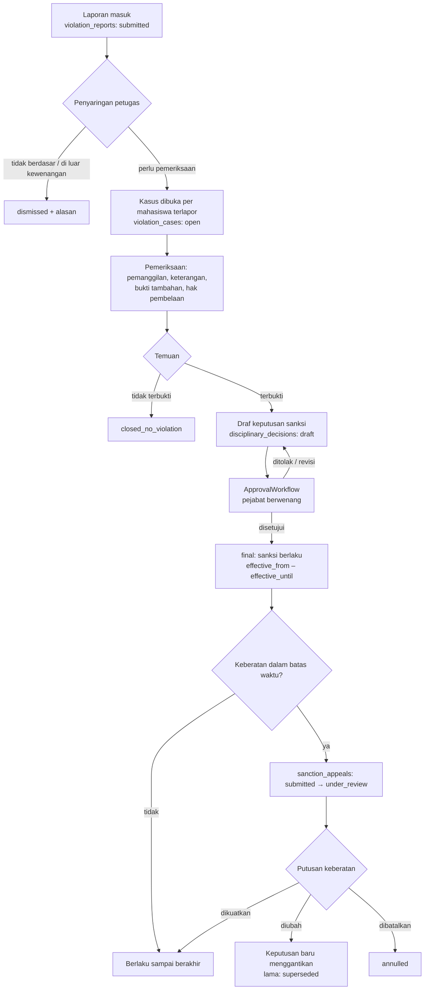
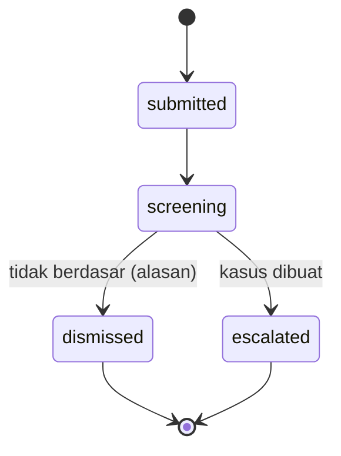
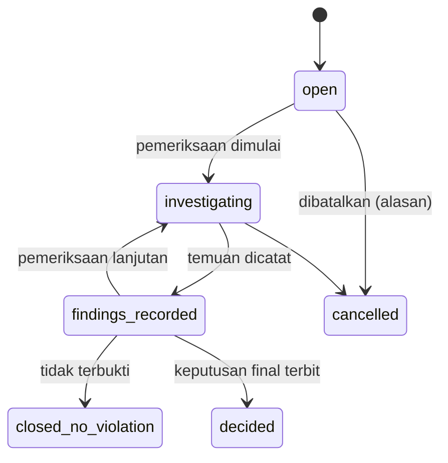
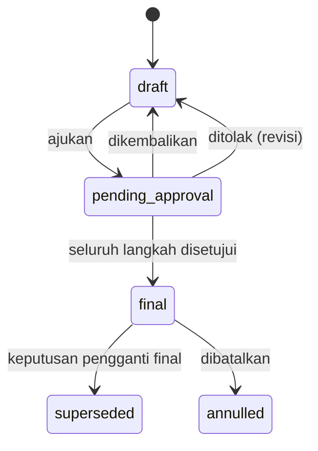

# 07 — Rancangan Pelanggaran dan Sanksi

> **Status:** rancangan · Disusun 2026-10-13 (commit `47043ca`) · Kembali ke [README](README.md)
> Skema acuan: [25 §2](25-rancangan-database-dan-erd.md#2-kelompok-kemahasiswaan) · Aturan: `KEM-BR-030`–`KEM-BR-039` · Keputusan: [KK-KD-05](33-glossary-dan-keputusan-bisnis.md#2-keputusan-desain-kk-kd)

Dokumen ini mengatur pencatatan pelanggaran tata tertib mahasiswa dengan **tiga lapis data yang dipisahkan secara tegas**: **laporan** (klaim awal yang belum terbukti), **kasus/pemeriksaan** (proses pembuktian dan temuan), dan **keputusan sanksi** (keputusan final oleh pejabat berwenang). Laporan yang belum diputus tidak pernah diperlakukan sebagai sanksi, tidak tampil di dokumen mahasiswa, dan tidak memengaruhi yudisium.

## Daftar Isi

1. [Tujuan](#1-tujuan)
2. [Ruang Lingkup](#2-ruang-lingkup)
3. [Aktor dan Hak Akses](#3-aktor-dan-hak-akses)
4. [Prasyarat](#4-prasyarat)
5. [Alur Bisnis Utama](#5-alur-bisnis-utama)
6. [Alur Alternatif dan Kegagalan](#6-alur-alternatif-dan-kegagalan)
7. [Status dan Transisi Status](#7-status-dan-transisi-status)
8. [Data Input dan Output](#8-data-input-dan-output)
9. [Aturan Bisnis](#9-aturan-bisnis)
10. [Validasi](#10-validasi)
11. [Rancangan Database](#11-rancangan-database)
12. [Relasi Antarmodul](#12-relasi-antarmodul)
13. [Kontrak API Konseptual](#13-kontrak-api-konseptual)
14. [Rancangan Halaman UI/UX](#14-rancangan-halaman-uiux)
15. [Notifikasi](#15-notifikasi)
16. [Laporan](#16-laporan)
17. [Keamanan dan Audit](#17-keamanan-dan-audit)
18. [Acceptance Criteria](#18-acceptance-criteria)
19. [Test Case](#19-test-case)
20. [Asumsi dan Keputusan Terbuka](#20-asumsi-dan-keputusan-terbuka)

---

## 1. Tujuan

Mendukung penegakan tata tertib yang adil dan dapat dipertanggungjawabkan: setiap sanksi berasal dari pemeriksaan yang terdokumentasi, keputusan pejabat berwenang, dan memberi mahasiswa kesempatan menyampaikan pembelaan serta keberatan sesuai peraturan kampus.

## 2. Ruang Lingkup

**Termasuk:** master jenis dan tingkat pelanggaran, master jenis sanksi, laporan pelanggaran, penyaringan laporan, kasus pemeriksaan (pemanggilan, pembelaan, temuan), keputusan sanksi beserta masa berlaku, keberatan, koreksi/pembatalan keputusan, pembatasan akses, dan audit.

**Tidak termasuk:**

- Proses hukum pidana/perdata di luar kampus.
- Pengaduan layanan umum (`RANCANGAN-APLIKASI.md §4.32`).
- Penerbitan cekal secara otomatis. Dampak ke layanan akademik (mis. yudisium) hanya terjadi bila keputusan **secara eksplisit** memuat pembatasan layanan dan peraturan kampus menentukannya ([KEM-BR-038](29-business-rules-dan-validasi.md#kem-br-038)).

## 3. Aktor dan Hak Akses

| Aktor | Aksi | Permission | Scope |
|---|---|---|---|
| Pelapor (dosen, pegawai, petugas keamanan) | Membuat laporan, melihat status laporan **sendiri** (bukan isi keputusan) | `violation_reports.create` | Laporan sendiri |
| Mahasiswa sebagai pelapor | Membuat laporan melalui portal | `student_affairs_self_service.create` | Laporan sendiri |
| Petugas disiplin (`discipline_officer`) | Menyaring laporan, membuka kasus, mencatat pemeriksaan & temuan, menyusun draf keputusan | `violation_reports.read/update`, `violation_cases.create/read/update`, `disciplinary_decisions.create` | `u` atau `f` |
| Komisi disiplin (`discipline_committee_member`) | Mengikuti pemeriksaan, memberi rekomendasi | `violation_cases.read/update` | Kasus yang ditugaskan |
| Pejabat berwenang (mis. Wakil Rektor/Dekan, sesuai workflow) | Menyetujui/menolak keputusan, memutus keberatan | `disciplinary_decisions.approve/reject`, `sanction_appeals.approve/reject` | Sesuai langkah workflow |
| Mahasiswa terlapor | Melihat kasus tentang dirinya (tanpa identitas pelapor yang dirahasiakan), menyampaikan pembelaan, mengajukan keberatan | `student_affairs_self_service.read/create` | Kasus tentang dirinya |
| Dosen wali | Melihat **ringkasan keputusan final yang berlaku** untuk mahasiswa perwalian (bila kebijakan mengizinkan) | `disciplinary_decisions.read` scope `w` | Perwalian |
| Auditor | Baca seluruh data | `violation_cases.read`, `disciplinary_decisions.read` | `u` |

Admin universitas, rektor, dan dekan **tidak** otomatis mendapat akses ke isi kasus. Akses diberikan melalui permission eksplisit ([KEM-BR-036](29-business-rules-dan-validasi.md#kem-br-036)).

## 4. Prasyarat

1. Master jenis pelanggaran, tingkat, dan jenis sanksi telah diisi sesuai peraturan tata tertib kampus. Rancangan ini **tidak** menyediakan daftar pelanggaran bawaan yang mengikat.
2. Workflow persetujuan `disciplinary_decision` per tingkat pelanggaran dikonfigurasi di ApprovalWorkflow (Ada) ([KK-Q-08](33-glossary-dan-keputusan-bisnis.md#3-pertanyaan-terbuka-kk-q)).
3. Pengaturan `student_affairs.discipline.*` (§10.2).

## 5. Alur Bisnis Utama

### 5.1 Laporan

Laporan berisi: tanggal & waktu kejadian, lokasi, uraian, jenis pelanggaran yang **diduga**, satu atau lebih mahasiswa terlapor (NIM), saksi (opsional), bukti (berkas), pelapor, dan permintaan kerahasiaan identitas pelapor. Laporan **tidak** memiliki tingkat sanksi.

### 5.2 Kasus dan pemeriksaan

Satu laporan dapat menghasilkan beberapa kasus, satu per mahasiswa terlapor, karena temuan dan keputusan bersifat individual. Kasus mencatat:

- Jadwal pemeriksaan (`violation_case_hearings`): tanggal, peserta, hasil kehadiran, notulen (berkas), dan pembelaan mahasiswa.
- Bukti tambahan (berkas `file_uploads` dengan `fileable = violation_cases`).
- Temuan (`findings`): pelanggaran yang **terbukti** (jenis final, tingkat), dasar temuan, dan rekomendasi sanksi.

Hak didengar: sebelum draf keputusan dapat diajukan, kasus wajib memiliki minimal satu catatan pemeriksaan dengan kehadiran mahasiswa **atau** catatan bahwa mahasiswa telah dipanggil secara patut dan tidak hadir (`student_notified_at` dan `hearing_attendance = absent_after_notice`), kecuali kebijakan kampus menyatakan lain ([KEM-BR-032](29-business-rules-dan-validasi.md#kem-br-032)).

### 5.3 Keputusan sanksi

| Field | Keterangan |
|---|---|
| `sanction_type_id` | Master jenis sanksi (contoh: teguran lisan, peringatan tertulis I/II/III, skorsing, kewajiban pengganti, pemberhentian) — seluruhnya dikonfigurasi kampus |
| `violation_points` | Poin pelanggaran (opsional, bila kampus memakai sistem poin pelanggaran) |
| `effective_from`, `effective_until` | Masa berlaku. `effective_until = null` untuk sanksi tanpa batas waktu (mis. pemberhentian) |
| `restricted_services` | Opsional. Subset kunci layanan cekal SIAKAD (`yudisium`, `graduation`, `krs`, …) yang dibatasi selama sanksi berlaku |
| `student_status_effect` | Opsional: `leave_forced` (skorsing), `dropped_out` (pemberhentian). **Tidak** diterapkan langsung oleh modul ini, tetapi diteruskan sebagai permintaan perubahan status ke Akademik melalui `StudentStatusTransitionContract` dengan referensi keputusan |
| `decision_number` | Nomor SK/keputusan dari OfficialDocument ([13](13-rancangan-penomoran-dokumen-kelulusan.md)) bila keputusan diterbitkan sebagai surat |
| `legal_basis` | Pasal peraturan yang dilanggar (teks) |

Keputusan menjadi `final` hanya setelah seluruh langkah ApprovalWorkflow disetujui. Status "sanksi aktif" adalah turunan: `status = final ∧ effective_from ≤ hari ini < effective_until` ([KEM-BR-033](29-business-rules-dan-validasi.md#kem-br-033)).

### 5.4 Keberatan

Mahasiswa dapat mengajukan keberatan dalam `student_affairs.discipline.appeal_window_days` sejak pemberitahuan keputusan. Selama keberatan diproses, sanksi **tetap berlaku**, kecuali pejabat menetapkan penangguhan (`suspension_granted = true`) ([KEM-BR-034](29-business-rules-dan-validasi.md#kem-br-034)). Putusan keberatan:

| Putusan | Efek |
|---|---|
| `upheld` (dikuatkan) | Keputusan tetap |
| `modified` (diubah) | Keputusan baru dibuat dan menggantikan keputusan lama (`superseded_by_id`). Keputusan lama tetap tersimpan |
| `annulled` (dibatalkan) | Keputusan lama berstatus `annulled`. Cekal dan efek status dicabut melalui kontrak masing-masing |
| `rejected` (tidak dapat diterima) | Keberatan tidak memenuhi syarat formal (mis. lewat waktu) |

### 5.5 Koreksi dan pembatalan di luar keberatan

Kesalahan administratif (salah tanggal, salah ketik pasal) dikoreksi dengan keputusan pengganti melalui workflow yang sama (`correction_of_id`). Tidak ada pengeditan langsung pada keputusan `final` ([KEM-BR-035](29-business-rules-dan-validasi.md#kem-br-035)).

## 6. Alur Alternatif dan Kegagalan

| Kode | Kondisi | Penanganan |
|---|---|---|
| AF-DIS-01 | Laporan untuk NIM yang tidak ditemukan | Laporan tetap tersimpan dengan `unidentified_party`. Petugas mengidentifikasi saat penyaringan |
| AF-DIS-02 | Mahasiswa terlapor sudah lulus/keluar | Kasus dapat dibuka hanya oleh manager dengan alasan, karena kewenangan disiplin terhadap alumni bergantung peraturan ([KK-Q-08](33-glossary-dan-keputusan-bisnis.md#3-pertanyaan-terbuka-kk-q)) |
| AF-DIS-03 | Pejabat penyetuju adalah pelapor | Guard pemisahan tugas menolak (403 `CONFLICT_OF_INTEREST`). Langkah dialihkan melalui delegasi (`DelegateStepRequest`, Ada) |
| AF-DIS-04 | Draf keputusan diajukan tanpa catatan pemeriksaan | 409 `HEARING_REQUIRED` |
| AF-DIS-05 | Sinkronisasi cekal ke SIAKAD gagal | Keputusan tetap `final`. Status sinkronisasi `failed` dan masuk antrean retry. Petugas melihat peringatan (pola `sync_status` KEU) |
| AF-DIS-06 | Keberatan diterima setelah sanksi berakhir | Diproses untuk pemulihan nama baik/riwayat. Efek layanan tidak berlaku lagi |

## 7. Status dan Transisi Status

`violation_reports.status`: `submitted`, `screening`, `dismissed`, `escalated`.

`violation_cases.status`: `open`, `investigating`, `findings_recorded`, `closed_no_violation`, `decided`, `cancelled`.

`disciplinary_decisions.status`: `draft`, `pending_approval`, `final`, `superseded`, `annulled`.

`sanction_appeals.status`: `submitted`, `under_review`, `upheld`, `modified`, `annulled`, `rejected`, `withdrawn`.

## 8. Data Input dan Output

**Master jenis pelanggaran** (`violation_types`): `code`, `name`, `description`, `severity_level` (`light`, `moderate`, `severe` — label dapat diganti), `default_violation_points` (opsional), `recommended_sanction_type_ids` (json), `legal_basis`, `is_active`.

**Master jenis sanksi** (`sanction_types`): `code`, `name`, `requires_duration` (bool), `max_duration_days` (opsional), `allowed_restricted_services` (json), `allowed_student_status_effects` (json), `is_active`.

**Output untuk mahasiswa** (portal): daftar keputusan **final** tentang dirinya beserta masa berlaku, dasar, dan tombol keberatan. Kasus yang masih berjalan ditampilkan sebagai "Dalam pemeriksaan" dengan jadwal pemanggilan, tanpa identitas pelapor yang dirahasiakan.

**Output untuk modul lain**: kontrak `DisciplinaryRecordReader::activeSanctions($student, $asOf)` yang hanya mengembalikan keputusan `final` yang berlaku, beserta `restricted_services`. Laporan dan kasus **tidak** pernah diekspos melalui kontrak ini.

## 9. Aturan Bisnis

| ID | Aturan |
|---|---|
| [KEM-BR-030](29-business-rules-dan-validasi.md#kem-br-030) | Laporan pelanggaran dan kasus yang belum diputus tidak diperlakukan sebagai sanksi dan tidak memengaruhi layanan, dokumen, atau yudisium |
| [KEM-BR-031](29-business-rules-dan-validasi.md#kem-br-031) | Sanksi hanya berlaku dari keputusan `final` yang disetujui pejabat berwenang sesuai workflow tingkat pelanggaran |
| [KEM-BR-032](29-business-rules-dan-validasi.md#kem-br-032) | Draf keputusan memerlukan bukti pemenuhan hak didengar (pemeriksaan dihadiri atau pemanggilan patut) kecuali dikecualikan kebijakan |
| [KEM-BR-033](29-business-rules-dan-validasi.md#kem-br-033) | Status sanksi aktif adalah turunan dari keputusan `final` dan masa berlakunya |
| [KEM-BR-034](29-business-rules-dan-validasi.md#kem-br-034) | Keberatan diajukan dalam batas waktu. Sanksi tetap berlaku selama keberatan kecuali ada penangguhan |
| [KEM-BR-035](29-business-rules-dan-validasi.md#kem-br-035) | Keputusan final tidak diedit. Koreksi/perubahan/pembatalan menghasilkan keputusan baru atau status `annulled` dengan jejak lengkap |
| [KEM-BR-036](29-business-rules-dan-validasi.md#kem-br-036) | Data pelanggaran hanya dapat diakses oleh pemegang permission eksplisit sesuai kebutuhan. Identitas pelapor yang meminta kerahasiaan tidak ditampilkan kepada terlapor |
| [KEM-BR-037](29-business-rules-dan-validasi.md#kem-br-037) | Poin pelanggaran dicatat terpisah dari poin aktivitas dan tidak mengurangi poin aktivitas kecuali kebijakan tenant menyatakannya |
| [KEM-BR-038](29-business-rules-dan-validasi.md#kem-br-038) | Dampak pada yudisium hanya terjadi melalui syarat yudisium yang dikonfigurasi atau `restricted_services` keputusan final yang berlaku |
| [KEM-BR-039](29-business-rules-dan-validasi.md#kem-br-039) | Keputusan yang dibatalkan tidak tampil pada dokumen mahasiswa (surat keterangan, SKPI) dan tidak dihitung pada laporan sanksi aktif |

## 10. Validasi

### 10.1 Validasi data

| Kode | Validasi |
|---|---|
| V-DIS-01 | `incident_at ≤ sekarang`, dan pelaporan dalam `student_affairs.discipline.report_window_days` sejak kejadian (peringatan, bukan penolakan) |
| V-DIS-02 | Jenis sanksi dengan `requires_duration` wajib `effective_until > effective_from`, durasi ≤ `max_duration_days` |
| V-DIS-03 | `restricted_services` ⊆ `sanction_types.allowed_restricted_services` |
| V-DIS-04 | Keberatan: satu keberatan aktif per keputusan, dalam batas waktu |
| V-DIS-05 | Bukti: MIME `pdf,jpg,jpeg,png,mp4` (video opsional, ukuran per `student_affairs.discipline.max_evidence_mb`) |

### 10.2 Pengaturan tenant

| Kunci | Default | Keterangan |
|---|---|---|
| `student_affairs.discipline.appeal_window_days` | 14 | Batas keberatan |
| `student_affairs.discipline.require_hearing` | true | Hak didengar wajib |
| `student_affairs.discipline.notify_advisor_on_final` | false | Kirim ringkasan ke dosen wali |
| `student_affairs.discipline.notify_guardian` | false | Notifikasi ke wali (bergantung modul portal wali, `academic-learning` `guardian_portal`, belum ada) |
| `student_affairs.discipline.violation_points_enabled` | false | Mengaktifkan poin pelanggaran |

## 11. Rancangan Database

| Tabel | Status | Fungsi |
|---|---|---|
| `violation_types`, `sanction_types` | Baru | Master |
| `violation_reports` | Baru | Laporan |
| `violation_report_parties` | Baru | Mahasiswa terlapor per laporan (bisa lebih dari satu) |
| `violation_cases` | Baru | Kasus per mahasiswa |
| `violation_case_hearings` | Baru | Pemeriksaan/pemanggilan |
| `disciplinary_decisions` | Baru | Keputusan sanksi |
| `sanction_appeals` | Baru | Keberatan |

Seluruh FK ke `students` memakai `restrict`. Model `ViolationReport`, `ViolationCase`, dan `DisciplinaryDecision` mengimplementasikan `RestrictsFileAccess`, sehingga berkas terlampir tidak dapat diakses melalui izin generik `file_uploads.read` (perilaku kontrak Ada).

## 12. Relasi Antarmodul

| Modul | Hubungan |
|---|---|
| ApprovalWorkflow (Ada) | `workflowable_type = disciplinary_decision`; `conditions` workflow memakai `severity_level` agar sanksi berat memerlukan pejabat lebih tinggi (`WorkflowSelector`, Ada) |
| Akademik | Efek status (skorsing/pemberhentian) diajukan melalui `StudentStatusTransitionContract` (Baru, dimiliki Akademik), yang menulis `students.status` dan `student_status_histories` (Ada) dengan `reason` merujuk keputusan |
| SIAKAD cekal (`academic_blocks`, rancangan `academic-learning`) | Keputusan final dengan `restricted_services` → `academic_blocks` `block_type = student_affairs`, `source = student_affairs`, `source_reference_id = decision_id`. Dicabut otomatis saat masa berlaku habis atau keputusan dibatalkan/digantikan |
| Yudisium ([11](11-rancangan-eligibilitas-yudisium.md)) | Checker `discipline_clearance` (opsional) memakai `DisciplinaryRecordReader` |
| OfficialDocument ([13](13-rancangan-penomoran-dokumen-kelulusan.md)) | Penomoran dan PDF SK sanksi bila diterbitkan sebagai surat |

## 13. Kontrak API Konseptual

| Method | URL | Permission |
|---|---|---|
| POST | `/student-affairs/violation-reports` | `violation_reports.create` |
| GET | `/student-affairs/violation-reports` | `violation_reports.read` |
| POST | `/student-affairs/violation-reports/{report}/screen` (`dismiss`/`escalate`) | `violation_reports.update` |
| GET | `/student-affairs/violation-cases` | `violation_cases.read` |
| POST | `/student-affairs/violation-cases/{case}/hearings` | `violation_cases.update` |
| POST | `/student-affairs/violation-cases/{case}/findings` | `violation_cases.update` |
| POST | `/student-affairs/violation-cases/{case}/decisions` | `disciplinary_decisions.create` |
| POST | `/student-affairs/disciplinary-decisions/{decision}/submit` | `disciplinary_decisions.create` |
| GET | `/student-affairs/sanction-appeals` | `sanction_appeals.read` |
| POST | `/student-affairs/sanction-appeals/{appeal}/decide` | `sanction_appeals.approve` |
| GET | `/student/affairs/discipline` | `student_affairs_self_service.read` |
| POST | `/student/affairs/disciplinary-decisions/{decision}/appeal` | `student_affairs_self_service.create` |
| POST | `/student/affairs/violation-cases/{case}/statement` | `student_affairs_self_service.create` |

Persetujuan langkah menggunakan endpoint ApprovalWorkflow yang sudah ada (`/approval-requests/...`).

## 14. Rancangan Halaman UI/UX

| Halaman | Rute | Inti |
|---|---|---|
| Pelanggaran dan Sanksi | `/kemahasiswaan/pelanggaran` | Tab: Laporan · Kasus · Keputusan · Keberatan. Label status dibedakan secara visual: "Laporan (belum terbukti)" abu-abu, "Kasus berjalan" kuning, "Sanksi berlaku" merah, "Dibatalkan" tercoret |
| Detail Kasus | `/kemahasiswaan/pelanggaran/kasus/:id` | Timeline (laporan → pemeriksaan → temuan → keputusan → keberatan), panel bukti terbatas, peringatan konflik kepentingan |
| Portal: Kedisiplinan | `/portal/kemahasiswaan/kedisiplinan` | Pemanggilan, unggah pembelaan, keputusan final, keberatan |

Konfirmasi tindakan sensitif: dialog dengan ringkasan efek (layanan yang dibatasi, efek status) dan input alasan sebelum keputusan diajukan atau keberatan diputus.

## 15. Notifikasi

| Event key | Penerima |
|---|---|
| `student_affairs.violation.report_received` | Pelapor |
| `student_affairs.violation.hearing_scheduled` | Mahasiswa terlapor (kanal `mail` + `database`; tanda terima dibaca disimpan sebagai bukti pemanggilan) |
| `student_affairs.violation.decision_final` | Mahasiswa, dosen wali (bila diaktifkan) |
| `student_affairs.violation.appeal_decided` | Mahasiswa |
| `student_affairs.violation.sanction_expiring` | Petugas disiplin (H-3) |

Isi notifikasi kepada dosen wali hanya ringkasan (jenis sanksi dan masa berlaku), bukan uraian kasus.

## 16. Laporan

| ID | Laporan | Akses |
|---|---|---|
| KEM-RPT-07 | Rekap pelanggaran per jenis/tingkat/fakultas/periode (agregat, tanpa identitas) | `violation_cases.read` + `export`; pimpinan menerima agregat |
| KEM-RPT-08 | Sanksi aktif (beridentitas) | Petugas disiplin, manager, auditor |
| KEM-RPT-09 | Waktu penyelesaian kasus & keberatan | Manager |

Laporan agregat menyembunyikan sel dengan jumlah < `reports.min_cell_size` (default 5) untuk mencegah identifikasi ulang.

## 17. Keamanan dan Audit

- Setiap akses ke detail kasus dicatat `audit_logs` aksi `viewed_sensitive`.
- Setiap transisi keputusan dan keberatan dicatat `approved`/`rejected`/`updated` dengan alasan.
- Ekspor beridentitas memerlukan `violation_cases.export` dan menulis `exported`.
- Retensi: data kasus disimpan sesuai kebijakan arsip kampus ([28 §9](28-keamanan-privasi-dan-audit.md#9-retensi-data)). Keputusan yang dibatalkan ditandai, tidak dihapus.

## 18. Acceptance Criteria

| ID | Kriteria |
|---|---|
| KEM-AC-11 | Mahasiswa dengan laporan `submitted`/kasus `investigating` tanpa keputusan final: `DisciplinaryRecordReader` mengembalikan kosong dan eligibility yudisium tidak terpengaruh |
| KEM-AC-12 | Keputusan tidak dapat menjadi `final` tanpa seluruh langkah approval dan tanpa catatan pemeriksaan (bila `require_hearing`) |
| KEM-AC-13 | Mengubah sanksi menghasilkan keputusan baru. Keputusan lama berstatus `superseded` dan masih dapat dibaca auditor |
| KEM-AC-14 | Pengguna dengan `students.read` tetapi tanpa `violation_cases.read` mendapat 403 pada seluruh endpoint kasus |

## 19. Test Case

| ID | Judul | Prioritas |
|---|---|---|
| KEM-TC-030 | Laporan belum diputus tidak memengaruhi yudisium | P1 |
| KEM-TC-031 | Laporan disaring → dismissed | P3 |
| KEM-TC-032 | Draf keputusan tanpa pemeriksaan ditolak | P1 |
| KEM-TC-033 | Keputusan final dengan `restricted_services = [yudisium]` menerbitkan cekal | P1 |
| KEM-TC-034 | Perubahan sanksi melalui keberatan `modified` | P1 |
| KEM-TC-035 | Pembatalan keputusan mencabut cekal | P1 |
| KEM-TC-036 | Identitas pelapor rahasia tidak tampil di portal terlapor | P1 |
| KEM-TC-037 | Akses tanpa permission eksplisit ditolak | P1 |
| KEM-TC-038 | Penyetuju = pelapor ditolak | P2 |

## 20. Asumsi dan Keputusan Terbuka

| ID | Hal |
|---|---|
| [KK-KD-05](33-glossary-dan-keputusan-bisnis.md#2-keputusan-desain-kk-kd) | Laporan, kasus, dan keputusan dipisah |
| [KK-Q-08](33-glossary-dan-keputusan-bisnis.md#3-pertanyaan-terbuka-kk-q) | Prosedur komisi disiplin, pejabat berwenang per tingkat, kewenangan terhadap alumni |
| [KK-Q-07](33-glossary-dan-keputusan-bisnis.md#3-pertanyaan-terbuka-kk-q) | Poin pelanggaran mengurangi poin aktivitas atau tidak |
| [KK-Q-32](33-glossary-dan-keputusan-bisnis.md#3-pertanyaan-terbuka-kk-q) | Apakah sanksi tertentu menghalangi yudisium berdasarkan peraturan universitas |
