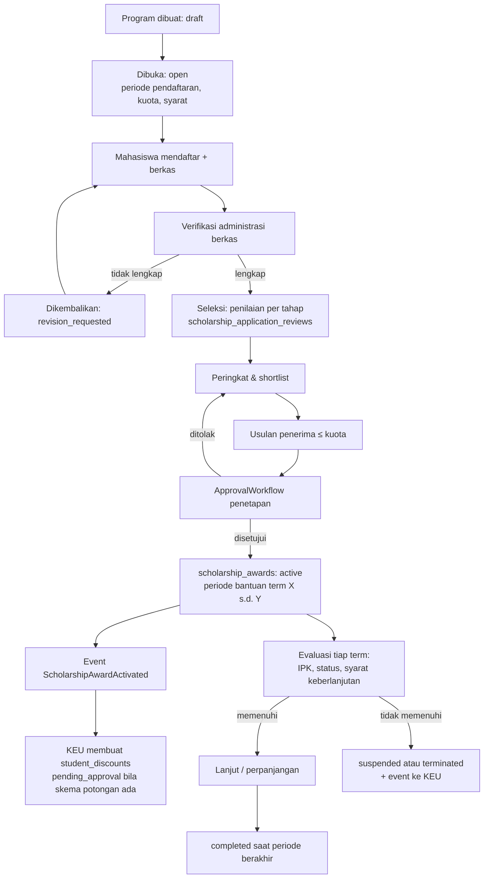
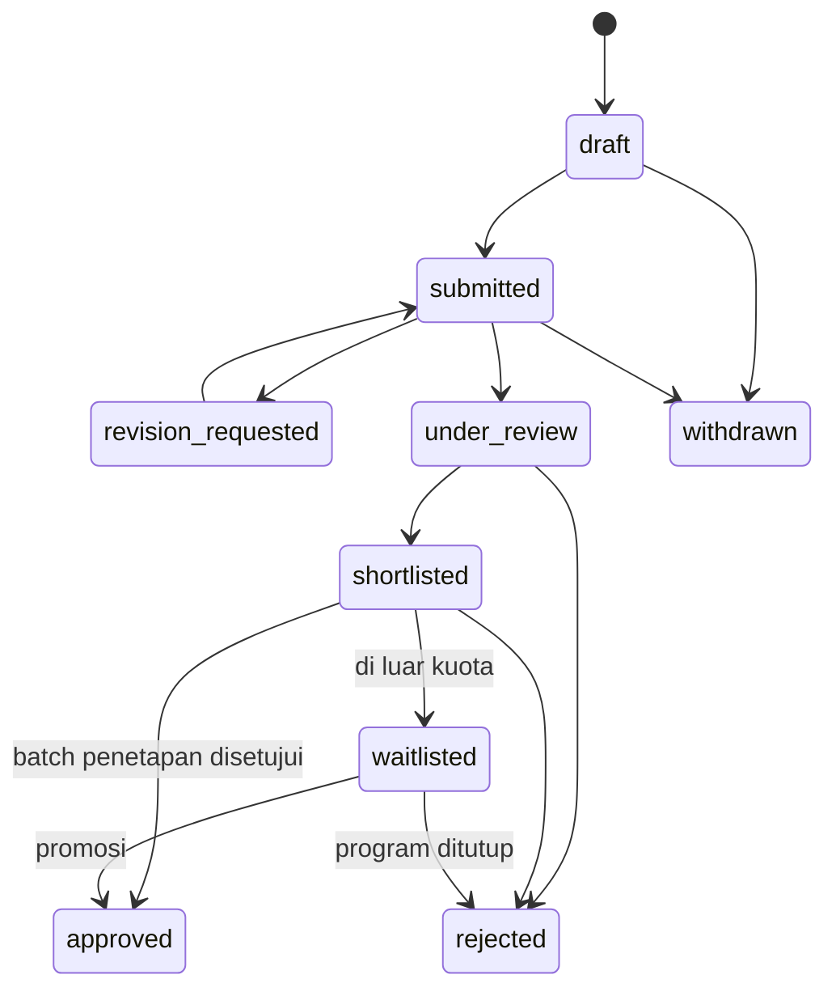
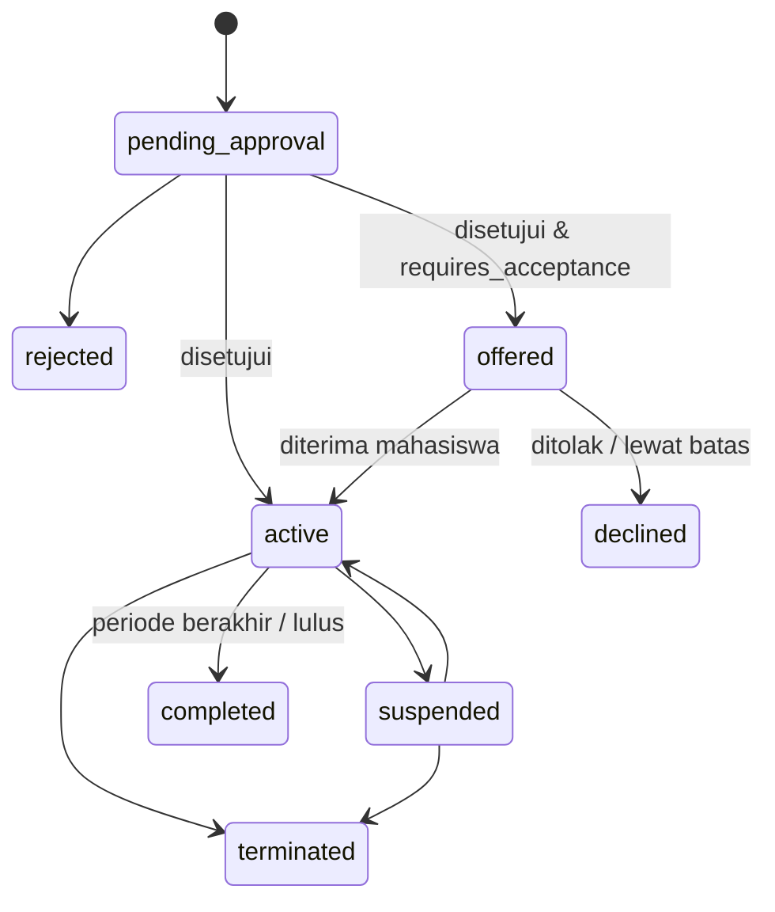

# 08 — Rancangan Beasiswa Mahasiswa

> **Status:** rancangan · Disusun 2026-10-13 (commit `47043ca`) · Kembali ke [README](README.md)
> Skema acuan: [25 §2.4](25-rancangan-database-dan-erd.md#24-beasiswa) · Aturan: `KEM-BR-050`–`KEM-BR-059` · Keputusan: [KK-KD-03](33-glossary-dan-keputusan-bisnis.md#2-keputusan-desain-kk-kd)
> **Rancangan terkait:** [keuangan/11 — Beasiswa dan Potongan](../keuangan/11-rancangan-beasiswa-dan-potongan.md) (potongan tagihan)

Dokumen ini **memperluas modul `app/Modules/Scholarship` yang sudah ada** (tabel `scholarships` dan `scholarship_applications`, saat ini hanya endpoint baca). Fokusnya adalah pengelolaan **program, pendaftaran, seleksi, penetapan penerima, periode bantuan, perpanjangan, penghentian, dan evaluasi** beasiswa. Perhitungan potongan pada tagihan **bukan** bagian dokumen ini, tetapi milik modul Keuangan (KEU) melalui `discount_schemes` dan `student_discounts` ([keuangan/11](../keuangan/11-rancangan-beasiswa-dan-potongan.md)).

## Daftar Isi

1. [Tujuan](#1-tujuan)
2. [Ruang Lingkup](#2-ruang-lingkup)
3. [Aktor dan Hak Akses](#3-aktor-dan-hak-akses)
4. [Prasyarat](#4-prasyarat)
5. [Alur Bisnis Utama](#5-alur-bisnis-utama)
6. [Alur Alternatif dan Kegagalan](#6-alur-alternatif-dan-kegagalan)
7. [Status dan Transisi Status](#7-status-dan-transisi-status)
8. [Data Input dan Output](#8-data-input-dan-output)
9. [Aturan Bisnis](#9-aturan-bisnis)
10. [Validasi](#10-validasi)
11. [Rancangan Database](#11-rancangan-database)
12. [Relasi Antarmodul](#12-relasi-antarmodul)
13. [Kontrak API Konseptual](#13-kontrak-api-konseptual)
14. [Rancangan Halaman UI/UX](#14-rancangan-halaman-uiux)
15. [Notifikasi](#15-notifikasi)
16. [Laporan](#16-laporan)
17. [Keamanan dan Audit](#17-keamanan-dan-audit)
18. [Acceptance Criteria](#18-acceptance-criteria)
19. [Test Case](#19-test-case)
20. [Asumsi dan Keputusan Terbuka](#20-asumsi-dan-keputusan-terbuka)

---

## 1. Tujuan

Mengelola siklus hidup beasiswa dari pembukaan program hingga berakhirnya bantuan secara transparan, dengan satu sumber kebenaran untuk "siapa penerima, untuk periode apa" dan tanpa duplikasi keputusan dengan Keuangan.

## 2. Ruang Lingkup

### 2.1 Pembagian tanggung jawab (sumber kebenaran)

| Hal | Modul Scholarship (dokumen ini) | Modul KEU |
|---|---|---|
| Program beasiswa, sumber dana, persyaratan, kuota, periode pendaftaran | ✓ | — |
| Pendaftaran, berkas, seleksi, peringkat | ✓ | — |
| Penetapan penerima, periode bantuan, perpanjangan, penghentian, evaluasi | ✓ (`scholarship_awards`) | — |
| Skema potongan: komponen biaya, persen/nominal, plafon | — | ✓ (`discount_schemes` dengan `scholarship_id`) |
| Penerapan potongan pada tagihan dan persetujuan bendahara | — | ✓ (`student_discounts`, `invoice_items`) |
| Penyaluran dana tunai ke rekening mahasiswa (beasiswa non-potongan) | Pencatatan status penyaluran saja (opsional) | Di luar KEU saat ini ([KK-Q-23](33-glossary-dan-keputusan-bisnis.md#3-pertanyaan-terbuka-kk-q)) |

Prinsip: **Scholarship memutuskan siapa dan kapan, KEU memutuskan berapa potongan pada tagihan.** Tidak ada modul yang menulis tabel milik modul lain ([KEM-BR-055](29-business-rules-dan-validasi.md#kem-br-055)).

### 2.2 Tidak termasuk

Akuntansi dana beasiswa, pelaporan ke pemberi dana eksternal dalam format khusus mereka (mis. format pelaporan KIP Kuliah) — hanya ekspor data dasar yang disediakan ([KK-Q-23](33-glossary-dan-keputusan-bisnis.md#3-pertanyaan-terbuka-kk-q)).

## 3. Aktor dan Hak Akses

| Aktor | Aksi | Permission | Scope |
|---|---|---|---|
| Petugas beasiswa (`student_affairs_officer`) | Kelola program, verifikasi berkas, input nilai seleksi, usulkan penerima | `scholarships.create/update`, `scholarship_applications.read/update/approve/reject` | `u` |
| Panitia seleksi (`scholarship_reviewer`) | Menilai pendaftar yang ditugaskan | `scholarship_applications.read/update` | Pendaftar yang ditugaskan |
| Pejabat penetap (mis. Wakil Rektor bidang kemahasiswaan) | Menyetujui penetapan, perpanjangan, penghentian | `scholarship_awards.approve/reject` | `u` |
| Bagian Keuangan (`finance_administrator`, Ada) | Membaca program & penerima untuk menyusun skema potongan | `scholarships.read` (Ada), `scholarship_awards.read` | `u` |
| Mahasiswa | Daftar, unggah berkas, lihat status, terima/tolak tawaran | `student_affairs_self_service.*` | Milik sendiri |
| Pimpinan, auditor | Laporan | `scholarship_awards.read`, `.export` | `u` |

## 4. Prasyarat

1. `scholarships` diperluas dengan kolom status dan konfigurasi (§11). Data lama dimigrasi: `is_active = true` → `status = open` bila hari ini dalam `registration_start..registration_end`, selain itu `closed`.
2. Kolom `scholarship_applications.status` diubah dari MySQL enum menjadi `string(20)` + enum PHP (preseden `widen_status_on_krs_items_table`) agar status baru dapat ditambahkan.
3. Workflow persetujuan `scholarship_award` dikonfigurasi.

## 5. Alur Bisnis Utama

### 5.1 Program beasiswa

Atribut program (tambahan pada tabel `scholarships` yang ada): `code`, `funding_source_type` (`government`, `foundation`, `university`, `corporate`, `alumni`, `other`), `sponsor_name` (kolom `provider` yang sudah ada dipertahankan sebagai nama pemberi), `benefit_type` (`tuition_discount`, `cash_stipend`, `mixed`, `non_monetary`), `award_duration_terms`, `max_renewals`, `stacking_policy` (`exclusive`, `allowed_with_list`, `any`), `stackable_scholarship_ids`, `eligible_study_program_ids`, `eligible_admission_years`, `eligible_degree_levels`, `selection_stages` (json urutan tahap: administrasi, wawancara, dsb.), `continuation_rules` (json, mis. `{"min_term_gpa": null, "min_gpa": null, "max_credits_failed": null}` — nilai **wajib diisi kampus** bila dipakai), dan `status`.

`scholarships.amount` (Ada) dipertahankan sebagai **informasi nilai program**. Nilai potongan pada tagihan tetap ditentukan skema KEU ([keuangan/19 §3.8.4](../keuangan/19-rancangan-database-dan-relasi.md)).

### 5.2 Persyaratan

`scholarship_requirements` menyimpan daftar periksa per program:

| `requirement_type` | Contoh parameter | Pemeriksaan |
|---|---|---|
| `document` | `{"label": "Surat keterangan tidak mampu", "evidence_types": ["pdf"]}` | Manual oleh petugas |
| `gpa_min` | `{"min": <angka dari kampus>}` | Otomatis dari layanan IPK Akademik |
| `student_status` | `{"in": ["active"]}` | Otomatis |
| `semester_range` | `{"min": 2, "max": 6}` | Otomatis dari `StudentAcademicService::semesterNumber` (Ada) |
| `no_active_sanction` | `{"severity_at_least": "moderate"}` | Otomatis dari `DisciplinaryRecordReader` ([07](07-rancangan-pelanggaran-dan-sanksi.md)) |
| `custom` | teks | Manual |

Data ekonomi pemohon (penghasilan orang tua, jumlah tanggungan) disimpan sebagai jawaban formulir terenkripsi (`application_form_data`, kolom terenkripsi Laravel `encrypted:array`) dengan akses terbatas ([KEM-BR-059](29-business-rules-dan-validasi.md#kem-br-059)).

### 5.3 Seleksi dan penetapan

- Penilaian per tahap dicatat di `scholarship_application_reviews` (penilai, tahap, skor, catatan). Skor akhir dihitung dengan bobot tahap dari `selection_stages`.
- Peringkat dihitung sistem. Petugas dapat mengubah urutan dengan alasan (`ranking_override_reason`).
- Usulan penerima diajukan sebagai satu **batch penetapan** (`scholarship_award_batches`) ke ApprovalWorkflow. Satu persetujuan untuk satu batch mengurangi beban pejabat, sementara setiap baris penerima tetap dicatat.
- Saat batch disetujui, sistem mengunci program (`SELECT … FOR UPDATE`) dan memastikan `jumlah award active + batch ≤ quota` ([KEM-BR-052](29-business-rules-dan-validasi.md#kem-br-052)).
- Pendaftar di luar kuota dapat berstatus `waitlisted` dan dipromosikan bila ada penerima yang mengundurkan diri sebelum bantuan dimulai.

### 5.4 Penerimaan tawaran

Bila program mengatur `requires_acceptance = true`, penerima harus menerima tawaran dalam `acceptance_deadline`. Bila lewat, award `declined` dan kuota kembali.

### 5.5 Evaluasi keberlanjutan, perpanjangan, penghentian

- Job `scholarship:evaluate-continuation` berjalan setelah nilai semester dipublikasikan (event Akademik) atau terjadwal per akhir term. Hasil per award dicatat di `scholarship_award_evaluations` (`passed`, `failed`, `manual_review`).
- Hasil `failed` **tidak** otomatis menghentikan. Petugas mengusulkan `suspend` atau `terminate` dengan alasan, lalu disetujui pejabat.
- Perubahan status mahasiswa (cuti, DO, lulus, mengundurkan diri) yang tercatat di `student_status_histories` (Ada) memicu evaluasi luar jadwal ([KEM-BR-058](29-business-rules-dan-validasi.md#kem-br-058)).
- Perpanjangan membuat periode bantuan baru pada award yang sama (`scholarship_award_periods`), sampai `max_renewals`.

### 5.6 Sinkronisasi ke KEU

| Event (Scholarship → KEU) | Payload | Tindakan KEU (rancangan KEU) |
|---|---|---|
| `ScholarshipAwardActivated` | `award_id`, `scholarship_id`, `student_id`, `from_term_id`, `until_term_id`, `scholarship_application_id` | Membuat `student_discounts` `pending_approval` untuk skema yang menunjuk `scholarship_id` |
| `ScholarshipAwardPeriodExtended` | `award_id`, `until_term_id` baru | Mengusulkan perpanjangan `valid_until_term_id` |
| `ScholarshipAwardSuspended` / `Resumed` | `award_id`, `effective_term_id` | `student_discounts` `suspended`/`active` |
| `ScholarshipAwardTerminated` | `award_id`, `effective_term_id`, `reason` | `student_discounts` `revoked` mulai term tersebut. Tidak berlaku surut pada tagihan lunas ([KEM-BR-057](29-business-rules-dan-validasi.md#kem-br-057)) |

Event dikirim `afterCommit`. Listener KEU bersifat idempoten (kunci `award_id` + `event_type` + `effective_term_id`). Rekonsiliasi harian membandingkan award aktif dengan `student_discounts` aktif dan melaporkan selisih tanpa memperbaikinya otomatis.

> **Koordinasi rancangan:** [keuangan/11 §4](../keuangan/11-rancangan-beasiswa-dan-potongan.md#4-integrasi-dengan-modul-scholarship) memicu `student_discounts` dari `scholarship_applications.status = approved`. Rancangan ini menambahkan entitas penerima (`scholarship_awards`) sebagai pemicu yang lebih tepat. KEU diusulkan menambah kolom `student_discounts.scholarship_award_id` dan mempertahankan `scholarship_application_id` untuk keterlacakan ([INK-04](README.md#33-kesenjangan-dan-inkonsistensi)).

## 6. Alur Alternatif dan Kegagalan

| Kode | Kondisi | Penanganan |
|---|---|---|
| AF-SCH-01 | Pendaftar sudah penerima program `exclusive` lain | Pendaftaran tetap boleh, dengan peringatan. Penetapan ditolak kecuali penerima mengundurkan diri dari program lain atau pejabat mengizinkan dengan alasan |
| AF-SCH-02 | Kuota terlampaui saat persetujuan batch | Batch ditolak sistem (409 `QUOTA_EXCEEDED`) dengan daftar kelebihan |
| AF-SCH-03 | Event ke KEU gagal diproses | Masuk antrean retry. Laporan rekonsiliasi menunjukkan award tanpa potongan |
| AF-SCH-04 | Mahasiswa lulus di tengah periode bantuan | Award `completed` per term kelulusan. Periode sisa tidak dipakai |
| AF-SCH-05 | Program ditutup saat ada pendaftaran `draft` | Draf tidak dapat dikirim. Mahasiswa dinotifikasi |

## 7. Status dan Transisi Status

`scholarships.status`: `draft`, `open`, `closed`, `archived`.

`scholarship_applications.status` (diperluas dari `submitted`, `under_review`, `approved`, `rejected` yang ada): `draft`, `submitted`, `revision_requested`, `under_review`, `shortlisted`, `waitlisted`, `approved`, `rejected`, `withdrawn`.

`scholarship_awards.status`: `pending_approval`, `offered`, `active`, `suspended`, `terminated`, `completed`, `declined`, `rejected`.

## 8. Data Input dan Output

Formulir pendaftaran: data dasar ditarik dari profil mahasiswa (tidak diketik ulang), jawaban formulir program (`application_form_data`), berkas per persyaratan `document`, pernyataan kebenaran data, dan persetujuan penggunaan data untuk seleksi.

Output untuk mahasiswa: status per tahap, alasan penolakan, tawaran, periode bantuan, hasil evaluasi, dan tautan ke "Beasiswa Saya" di portal keuangan untuk melihat efek potongan ([keuangan/11 §12](../keuangan/11-rancangan-beasiswa-dan-potongan.md#12-uiux)).

## 9. Aturan Bisnis

| ID | Aturan |
|---|---|
| [KEM-BR-050](29-business-rules-dan-validasi.md#kem-br-050) | Program hanya dapat dibuka bila sumber dana, periode pendaftaran, kuota, dan minimal satu persyaratan terisi |
| [KEM-BR-051](29-business-rules-dan-validasi.md#kem-br-051) | Satu mahasiswa hanya memiliki satu pendaftaran per program (constraint unik `scholarship_id, student_id` yang ada dipertahankan) |
| [KEM-BR-052](29-business-rules-dan-validasi.md#kem-br-052) | Jumlah award `active`/`offered`/`suspended` per program tidak melebihi kuota, diperiksa dengan penguncian baris |
| [KEM-BR-053](29-business-rules-dan-validasi.md#kem-br-053) | Penetapan, perpanjangan, dan penghentian penerima memerlukan persetujuan pejabat berwenang. Pengusul tidak boleh menyetujui |
| [KEM-BR-054](29-business-rules-dan-validasi.md#kem-br-054) | Penerimaan ganda dibatasi `stacking_policy` program |
| [KEM-BR-055](29-business-rules-dan-validasi.md#kem-br-055) | Scholarship adalah sumber kebenaran penerima dan periode bantuan, sedangkan KEU adalah sumber kebenaran potongan tagihan. Sinkronisasi hanya melalui event |
| [KEM-BR-056](29-business-rules-dan-validasi.md#kem-br-056) | Evaluasi keberlanjutan dicatat per term. Kegagalan evaluasi tidak otomatis menghentikan bantuan tanpa keputusan |
| [KEM-BR-057](29-business-rules-dan-validasi.md#kem-br-057) | Penghentian berlaku mulai term efektif dan tidak mengubah tagihan yang sudah lunas |
| [KEM-BR-058](29-business-rules-dan-validasi.md#kem-br-058) | Perubahan status akademik penerima memicu evaluasi luar jadwal |
| [KEM-BR-059](29-business-rules-dan-validasi.md#kem-br-059) | Data ekonomi pendaftar dienkripsi dan hanya dapat dibaca petugas seleksi program terkait |

## 10. Validasi

| Kode | Validasi |
|---|---|
| V-SCH-01 | `registration_start < registration_end`; pendaftaran hanya dalam rentang (zona tenant) |
| V-SCH-02 | `quota ≥ 1`; menurunkan kuota di bawah jumlah award aktif ditolak |
| V-SCH-03 | Persyaratan otomatis dievaluasi saat kirim. Gagal → tidak dapat dikirim, kecuali persyaratan bertanda `soft` (peringatan) |
| V-SCH-04 | `until_term ≥ from_term`; durasi ≤ `award_duration_terms` |
| V-SCH-05 | Ambang numerik dalam persyaratan dan `continuation_rules` wajib diisi eksplisit bila tipe dipakai (tidak ada default tersembunyi) |

## 11. Rancangan Database

| Tabel | Status | Perubahan / fungsi |
|---|---|---|
| `scholarships` | **Ubah** | + `code`, `status`, `funding_source_type`, `benefit_type`, `description`, `award_duration_terms`, `max_renewals`, `stacking_policy`, `stackable_scholarship_ids`, `eligibility` json, `selection_stages` json, `continuation_rules` json, `requires_acceptance`, `acceptance_days`. `is_active` dipertahankan sebagai turunan kompatibilitas |
| `scholarship_requirements` | Baru | Daftar persyaratan per program |
| `scholarship_applications` | **Ubah** | `status` → string(20); + `academic_term_id`, `application_form_data` (encrypted), `final_score`, `rank`, `ranking_override_reason`, `lock_version`. FK `student_id` diubah dari `cascade` ke `restrict` |
| `scholarship_application_documents` | Baru | Pemenuhan persyaratan dokumen (requirement × file) |
| `scholarship_application_reviews` | Baru | Penilaian per tahap per penilai |
| `scholarship_award_batches` | Baru | Batch penetapan (`approval_request_id`) |
| `scholarship_awards` | Baru | Penerima |
| `scholarship_award_periods` | Baru | Periode bantuan (awal + perpanjangan) |
| `scholarship_award_evaluations` | Baru | Evaluasi keberlanjutan per term |

## 12. Relasi Antarmodul

| Modul | Hubungan |
|---|---|
| KEU | Event §5.6. Baca `scholarship_awards` melalui `ScholarshipAwardReader` |
| Akademik | IPK/IPS, semester, status mahasiswa (baca). Event publikasi nilai → evaluasi |
| Pelanggaran ([07](07-rancangan-pelanggaran-dan-sanksi.md)) | Persyaratan `no_active_sanction` |
| ApprovalWorkflow | `workflowable_type = scholarship_award_batch`, `scholarship_award_change` |
| Portal Keuangan | Halaman "Beasiswa Saya" KEU menampilkan efek potongan, dan menautkan ke halaman status beasiswa dokumen ini |

## 13. Kontrak API Konseptual

| Method | URL | Permission |
|---|---|---|
| GET | `/scholarships` (Ada) | `scholarships.read` |
| POST/PUT | `/scholarships`, `/scholarships/{scholarship}` | `scholarships.create/update` |
| POST | `/scholarships/{scholarship}/open`, `/close` | `scholarships.publish` |
| GET | `/scholarship-applications` (Ada, diperluas filter) | `scholarships.read` → dipersempit ke `scholarship_applications.read` setelah migrasi permission |
| POST | `/scholarship-applications/{application}/verify-documents` | `scholarship_applications.update` |
| POST | `/scholarship-applications/{application}/reviews` | `scholarship_applications.update` |
| POST | `/scholarships/{scholarship}/award-batches` | `scholarship_awards.create` |
| GET | `/scholarship-awards` | `scholarship_awards.read` |
| POST | `/scholarship-awards/{award}/suspend`, `/resume`, `/terminate`, `/extend` | `scholarship_awards.update` (diajukan ke approval) |
| GET | `/student/affairs/scholarships` | Program terbuka yang sesuai profil saya |
| POST | `/student/affairs/scholarships/{scholarship}/applications` | `student_affairs_self_service.create` |
| POST | `/student/affairs/scholarship-awards/{award}/accept`, `/decline` | `student_affairs_self_service.update` |

> Endpoint `GET /scholarship-applications` yang ada saat ini dilindungi `scholarships.read`. Rancangan memisahkan permission `scholarship_applications.read` karena data pendaftar lebih sensitif daripada katalog program. Migrasi permission dilakukan bertahap: kedua slug diterima selama satu rilis ([32](32-roadmap-implementasi.md)).

## 14. Rancangan Halaman UI/UX

| Halaman | Rute |
|---|---|
| Program Beasiswa | `/kemahasiswaan/beasiswa` (menggantikan `/keuangan/beasiswa` yang ada untuk sisi program. Menu KEU tetap untuk skema potongan) |
| Pendaftar & Seleksi | `/kemahasiswaan/beasiswa/:id/pendaftar` |
| Penerima Beasiswa | `/kemahasiswaan/beasiswa/penerima` |
| Portal: Beasiswa | `/portal/kemahasiswaan/beasiswa` (menggantikan `PortalScholarshipPage` yang saat ini statis) |

## 15. Notifikasi

`scholarship.program.opened` (mahasiswa sasaran, opsional massal), `scholarship.application.submitted`, `scholarship.application.revision_requested`, `scholarship.application.result`, `scholarship.award.offered`, `scholarship.award.activated`, `scholarship.award.status_changed`, `scholarship.award.evaluation_failed` (petugas).

## 16. Laporan

| ID | Laporan |
|---|---|
| KEM-RPT-10 | Penerima per program, sumber dana, prodi, angkatan, term |
| KEM-RPT-11 | Rekap seleksi: pendaftar, lolos administrasi, shortlist, ditetapkan, waitlist |
| KEM-RPT-12 | Evaluasi keberlanjutan & penghentian |
| KEM-RPT-13 | Rekonsiliasi award ↔ potongan KEU (selisih) |

## 17. Keamanan dan Audit

- Kolom data ekonomi dienkripsi saat disimpan. Pembacaannya dicatat `viewed_sensitive`.
- Penetapan, penghentian, dan perubahan peringkat dicatat dengan alasan.
- Panitia seleksi hanya melihat pendaftar yang ditugaskan.

## 18. Acceptance Criteria

| ID | Kriteria |
|---|---|
| KEM-AC-15 | Persetujuan batch yang membuat penerima aktif > kuota ditolak tanpa perubahan data |
| KEM-AC-16 | Setiap award `active` memicu tepat satu event `ScholarshipAwardActivated`. Pengulangan event tidak membuat `student_discounts` ganda (diuji bersama KEU) |
| KEM-AC-17 | Penghentian dengan term efektif T tidak mengubah tagihan term < T |
| KEM-AC-18 | Pengguna tanpa `scholarship_applications.read` tidak dapat membaca `application_form_data` |

## 19. Test Case

| ID | Judul | Prioritas |
|---|---|---|
| KEM-TC-050 | Pendaftaran di luar periode ditolak | P2 |
| KEM-TC-051 | Kuota penuh saat penetapan | P1 |
| KEM-TC-052 | Penetapan oleh pengusul ditolak | P1 |
| KEM-TC-053 | Event aktivasi idempoten ke KEU | P1 |
| KEM-TC-054 | Mahasiswa DO memicu evaluasi luar jadwal | P2 |
| KEM-TC-055 | Program exclusive menolak penerimaan ganda | P2 |
| KEM-TC-056 | Data ekonomi terenkripsi & akses terbatas | P1 |

## 20. Asumsi dan Keputusan Terbuka

| ID | Hal |
|---|---|
| [KK-KD-03](33-glossary-dan-keputusan-bisnis.md#2-keputusan-desain-kk-kd) | Pembagian Scholarship vs KEU |
| [KK-Q-23](33-glossary-dan-keputusan-bisnis.md#3-pertanyaan-terbuka-kk-q) | Pejabat penetap, kebijakan stacking, penyaluran beasiswa tunai, pelaporan ke pemberi dana |
| INK-04 | Penyesuaian KEU untuk `scholarship_award_id` |
