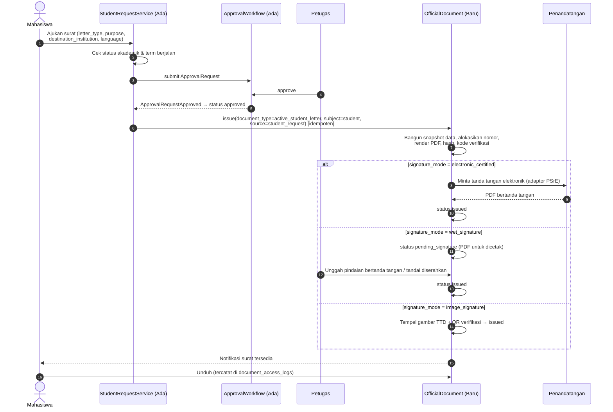
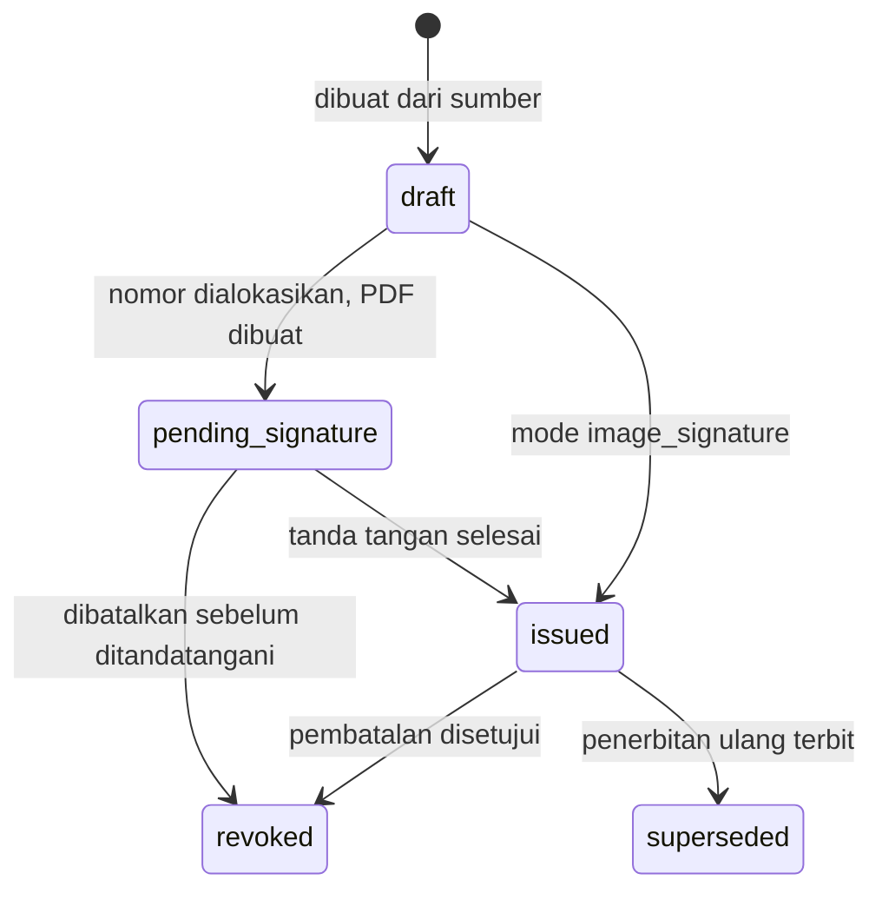

# 09 — Rancangan Surat Keterangan Aktif Kuliah

> **Status:** rancangan · Disusun 2026-10-13 (commit `47043ca`) · Kembali ke [README](README.md)
> Aturan: `KEM-BR-070`–`KEM-BR-077` · Penomoran & penerbitan: [13](13-rancangan-penomoran-dokumen-kelulusan.md) · Keputusan: [KK-KD-06](33-glossary-dan-keputusan-bisnis.md#2-keputusan-desain-kk-kd)

## Kondisi saat ini (terverifikasi)

Pengajuan surat keterangan aktif **sudah berjalan** di repository, dan rancangan ini memperluasnya, bukan menggantinya:

| Komponen | Kondisi | Sumber |
|---|---|---|
| Pengajuan | `student_requests` dengan `type = letter`, `payload.letter_type = active_student`, `payload.purpose` | `StudentRequestService::LETTER_TYPES`, migration `2026_10_06_200012` |
| Persetujuan | Setiap pengajuan membuat `ApprovalRequest`. Keputusan disalin balik oleh `SyncStudentRequestDecision` | `Modules\Academic\Listeners` |
| Endpoint | `POST /student/requests`, `/submit`, `/cancel`; `GET /student/requests/{id}/letter`; staf `GET/POST /student-requests/{id}/approve|reject` | `Academic/Routes/api.php` |
| PDF | `StudentDocumentService::letterPdf()` merender view `student.letter-pdf` (dompdf) **setiap kali diunduh** dari data hidup | `StudentDocumentService` |
| Nomor surat | `sprintf('%s/AK/%s', strtoupper(substr($request->id, -6)), m/Y)`: diturunkan dari 6 karakter akhir ULID, **tidak tercatat**, tidak dijamin unik, tidak berurutan | idem |
| Validasi keaslian, tanda tangan, riwayat unduhan, pembatalan | **Belum ada** | — |
| Portal | `PortalLetterRequestPage` tidak memanggil service API (statis). Pengajuan yang berfungsi melalui halaman pengajuan umum (`studentPortalService.requests`) | `frontend/src/pages/portal` |

Masalah yang diselesaikan: (1) nomor tidak resmi dan berpotensi bentrok, (2) isi PDF dapat berubah bila data mahasiswa berubah setelah surat diterbitkan, (3) tidak ada cara memverifikasi keaslian, (4) tidak ada histori unduhan dan pembatalan.

## Daftar Isi

1. [Tujuan](#1-tujuan)
2. [Ruang Lingkup](#2-ruang-lingkup)
3. [Aktor dan Hak Akses](#3-aktor-dan-hak-akses)
4. [Prasyarat](#4-prasyarat)
5. [Alur Bisnis Utama](#5-alur-bisnis-utama)
6. [Alur Alternatif dan Kegagalan](#6-alur-alternatif-dan-kegagalan)
7. [Status dan Transisi Status](#7-status-dan-transisi-status)
8. [Data Input dan Output](#8-data-input-dan-output)
9. [Aturan Bisnis](#9-aturan-bisnis)
10. [Validasi](#10-validasi)
11. [Rancangan Database](#11-rancangan-database)
12. [Relasi Antarmodul](#12-relasi-antarmodul)
13. [Kontrak API Konseptual](#13-kontrak-api-konseptual)
14. [Rancangan Halaman UI/UX](#14-rancangan-halaman-uiux)
15. [Notifikasi](#15-notifikasi)
16. [Laporan](#16-laporan)
17. [Keamanan dan Audit](#17-keamanan-dan-audit)
18. [Acceptance Criteria](#18-acceptance-criteria)
19. [Test Case](#19-test-case)
20. [Asumsi dan Keputusan Terbuka](#20-asumsi-dan-keputusan-terbuka)

---

## 1. Tujuan

Menerbitkan surat keterangan aktif kuliah dengan nomor resmi yang unik, isi yang dibekukan saat terbit, mekanisme tanda tangan yang sesuai kebijakan kampus, dan halaman validasi keaslian.

## 2. Ruang Lingkup

**Termasuk:** pengajuan (memakai `student_requests`), pemeriksaan status akademik, verifikasi petugas, penerbitan melalui OfficialDocument ([13](13-rancangan-penomoran-dokumen-kelulusan.md)), template, PDF, tanda tangan, pembatalan dan penerbitan ulang, validasi publik, serta riwayat unduhan.

**Rancangan berlaku umum** untuk jenis surat lain di `LETTER_TYPES` (`good_conduct`, `recommendation`, `other`). Surat "berkelakuan baik" memakai sumber `DisciplinaryRecordReader` ([07](07-rancangan-pelanggaran-dan-sanksi.md)) untuk pemeriksaan, tetapi isinya tetap ditentukan template kampus.

**Tidak termasuk:** legalisasi ijazah/transkrip (terkait [13](13-rancangan-penomoran-dokumen-kelulusan.md)), surat yang ditandatangani pihak luar.

## 3. Aktor dan Hak Akses

| Aktor | Aksi | Permission (Ada / Baru) |
|---|---|---|
| Mahasiswa | Ajukan, batalkan sebelum diputus, unduh surat terbit | `student_requests.create/read/update` (Ada) |
| Petugas BAAK/akademik (`academic_administrator`, Ada) | Meninjau, menyetujui, menolak (melalui ApprovalWorkflow) | `approval_requests.read` (Ada) + langkah workflow |
| Petugas penerbit | Menerbitkan dokumen (mengalokasikan nomor, membekukan isi) | `issued_documents.publish` (Baru) |
| Pejabat penandatangan | Menandatangani (sesuai mode) | `document_signatories` terdaftar + `issued_documents.publish` atau langkah workflow |
| Pejabat berwenang | Membatalkan surat terbit | `document_revocations.approve` (Baru) |
| Publik | Memeriksa keaslian di halaman verifikasi | Tanpa autentikasi, rate limited |

## 4. Prasyarat

1. OfficialDocument tersedia: template `active_student_letter`, skema penomoran, dan penandatangan ([13](13-rancangan-penomoran-dokumen-kelulusan.md)).
2. Pengaturan `academic.letters.*` (§10).
3. Mode tanda tangan ditetapkan kampus ([KK-Q-09](33-glossary-dan-keputusan-bisnis.md#3-pertanyaan-terbuka-kk-q)).

## 5. Alur Bisnis Utama

### 5.1 Data surat

Snapshot yang dibekukan saat terbit: nama, NIM, tempat/tanggal lahir, program studi, fakultas, jenjang, semester ke-n (dihitung `StudentAcademicService::semesterNumber`, Ada), tahun akademik & semester, status akademik, keperluan, instansi tujuan, bahasa, nomor surat, tanggal terbit, penandatangan (nama, jabatan, NIP/NIDN bila ada), dan kode verifikasi.

### 5.2 Penomoran

Nomor dialokasikan **hanya saat penerbitan** oleh `DocumentNumberService` ([13](13-rancangan-penomoran-dokumen-kelulusan.md)) dengan format kampus, contoh `{seq:4}/UN.AK/SKA/{roman_month}/{year}`. Format lama (`substr(ULID)/AK/m/Y`) tidak dipakai lagi untuk surat baru. Surat yang telah diunduh dengan format lama tetap dapat dicetak ulang dengan format lama sampai migrasi, dan ditandai `legacy_unregistered` ([KK-Q-24](33-glossary-dan-keputusan-bisnis.md#3-pertanyaan-terbuka-kk-q)).

### 5.3 Tanda tangan

| Mode | Klaim pada dokumen | Kapan boleh |
|---|---|---|
| `wet_signature` | PDF dicetak dan ditandatangani basah. Sistem mencatat pindaian/penyerahan | Default bila kampus belum menetapkan |
| `image_signature` | Gambar tanda tangan + QR verifikasi. **Tidak** diklaim sebagai tanda tangan elektronik tersertifikasi | Bila kebijakan kampus mengizinkan |
| `electronic_certified` | Tanda tangan elektronik tersertifikasi melalui penyelenggara sertifikasi elektronik (adaptor `DocumentSigningProvider`) | Hanya bila kampus memiliki kerja sama dan adaptor terkonfigurasi |

Sistem **tidak** menampilkan teks "ditandatangani secara elektronik dan sah tanpa tanda tangan basah" kecuali mode `electronic_certified` aktif dan berhasil ([KEM-BR-074](29-business-rules-dan-validasi.md#kem-br-074)).

### 5.4 Pembatalan dan penerbitan ulang

- **Pembatalan**: pejabat berwenang menyetujui `document_revocations`. Dokumen menjadi `revoked`. Halaman verifikasi menampilkan "DIBATALKAN" beserta tanggal. Nomor tidak dipakai ulang.
- **Penerbitan ulang** (salah data, permintaan bahasa lain): dokumen baru dengan `supersedes_document_id`, dan dokumen lama menjadi `superseded`. Nomor baru dialokasikan sesuai `reissue_number_policy` ([13 §5.4](13-rancangan-penomoran-dokumen-kelulusan.md#5-alur-bisnis-utama)).
- **Cetak ulang** (unduh lagi) tidak membuat dokumen baru. Berkas PDF tersimpan yang sama yang diberikan.

## 6. Alur Alternatif dan Kegagalan

| Kode | Kondisi | Penanganan |
|---|---|---|
| AF-LTR-01 | Mahasiswa berstatus `leave` meminta surat aktif | Ditolak otomatis bila `leave` tidak termasuk `academic.letters.active_student.allowed_statuses`. Pesan menyarankan "surat keterangan cuti" bila jenis itu tersedia |
| AF-LTR-02 | Tidak ada `academic_terms.is_current` | 409 `NO_CURRENT_TERM`; surat tidak dapat diterbitkan |
| AF-LTR-03 | Status mahasiswa berubah antara persetujuan dan penerbitan | Penerbitan memeriksa ulang status. Bila tidak lagi memenuhi → 409 `STUDENT_STATUS_CHANGED`, petugas memutuskan |
| AF-LTR-04 | Gagal render PDF | Dokumen tetap `draft`, nomor **belum** dialokasikan (alokasi terjadi dalam transaksi bersama penyimpanan berkas). Retry aman |
| AF-LTR-05 | Penyedia tanda tangan elektronik tidak tersedia | Status `pending_signature`, retry terjadwal, notifikasi ke petugas setelah N kali gagal |
| AF-LTR-06 | Melebihi batas pengajuan aktif | 429/409 `TOO_MANY_ACTIVE_REQUESTS` (default 3 surat aktif belum terbit per mahasiswa) |

## 7. Status dan Transisi Status

`student_requests.status` (Ada): `draft`, `submitted`, `approved`, `rejected`, `cancelled`. Tidak diubah.

`issued_documents.status` (Baru, berlaku untuk semua dokumen resmi): `draft`, `pending_signature`, `issued`, `revoked`, `superseded`.

Status gabungan untuk tampilan mahasiswa: *Diajukan* → *Disetujui, sedang diterbitkan* → *Menunggu tanda tangan* → *Terbit* / *Dibatalkan*.

## 8. Data Input dan Output

| Input (payload `student_requests`) | Wajib | Catatan |
|---|---|---|
| `letter_type` | Ya | `active_student` (Ada) |
| `purpose` | Ya | ≤ 255 (Ada) |
| `destination_institution` | Tidak | **Baru**, ≤ 200 |
| `language` | Tidak | **Baru**, `id` (default) / `en`, bila template bahasa tersedia |
| `copies_note` | Tidak | Catatan kebutuhan cetak |

Output: tautan unduh PDF, nomor surat, tanggal terbit, kode verifikasi, status.

## 9. Aturan Bisnis

| ID | Aturan |
|---|---|
| [KEM-BR-070](29-business-rules-dan-validasi.md#kem-br-070) | Surat aktif hanya untuk mahasiswa berstatus yang diizinkan pada term berjalan |
| [KEM-BR-071](29-business-rules-dan-validasi.md#kem-br-071) | Nomor resmi dialokasikan sekali saat penerbitan dan tidak pernah dipakai ulang |
| [KEM-BR-072](29-business-rules-dan-validasi.md#kem-br-072) | Isi surat dibekukan (snapshot + PDF + hash) saat terbit. Unduhan berikutnya tidak merender ulang dari data hidup |
| [KEM-BR-073](29-business-rules-dan-validasi.md#kem-br-073) | Pembatalan tidak menghapus. Penerbitan ulang adalah dokumen baru yang menunjuk dokumen lama |
| [KEM-BR-074](29-business-rules-dan-validasi.md#kem-br-074) | Klaim keabsahan elektronik hanya ditampilkan bila mode `electronic_certified` aktif dan penandatanganan berhasil |
| [KEM-BR-075](29-business-rules-dan-validasi.md#kem-br-075) | Halaman verifikasi publik hanya menampilkan data minimal |
| [KEM-BR-076](29-business-rules-dan-validasi.md#kem-br-076) | Setiap unduhan dokumen terbit dicatat |
| [KEM-BR-077](29-business-rules-dan-validasi.md#kem-br-077) | Jumlah pengajuan surat aktif yang belum terbit dibatasi per mahasiswa |

## 10. Validasi

| Kunci pengaturan | Default |
|---|---|
| `academic.letters.active_student.allowed_statuses` | `["active"]` |
| `academic.letters.max_open_requests` | 3 |
| `academic.letters.validity_days` | `null` (masa berlaku ditulis di surat hanya bila diisi) |
| `documents.signature_mode.active_student_letter` | `wet_signature` |

Validasi tambahan: `destination_institution` tanpa karakter kontrol, `language` hanya bila template versi bahasa itu `published`.

## 11. Rancangan Database

| Tabel | Status | Catatan |
|---|---|---|
| `student_requests` | **Ubah** | + `issued_document_id` (FK → `issued_documents`, null). Payload menerima `destination_institution`, `language` |
| `issued_documents`, `document_templates`, `document_template_versions`, `document_numbering_schemes`, `document_number_sequences`, `document_signatories`, `document_revocations`, `document_access_logs`, `issued_document_events` | Baru | Didefinisikan di [13](13-rancangan-penomoran-dokumen-kelulusan.md) dan [25 §4](25-rancangan-database-dan-erd.md#4-kelompok-dokumen-resmi) |

## 12. Relasi Antarmodul

- **Akademik (Ada)**: sumber pengajuan, status, semester. `StudentDocumentService::letterPdf()` diubah menjadi: bila `issued_document_id` ada, kembalikan berkas tersimpan. Bila tidak (data lama), perilaku lama dipertahankan dengan label `legacy`.
- **ApprovalWorkflow (Ada)**: tetap dipakai untuk keputusan.
- **OfficialDocument (Baru)**: penerbitan.
- **Listener baru** `IssueApprovedStudentLetter` (`afterCommit`, queued, idempoten berdasarkan `student_request_id`) memanggil `OfficialDocumentService::issue()` setelah status `approved`, bila `documents.auto_issue.active_student_letter = true`. Bila `false`, petugas menerbitkan manual dari antrean.

## 13. Kontrak API Konseptual

| Method | URL | Status | Catatan |
|---|---|---|---|
| POST | `/student/requests` | Ada | Payload diperluas |
| GET | `/student/requests/{studentRequest}/letter` | Ada, **diubah** | Mengembalikan PDF tersimpan + mencatat akses |
| POST | `/official-documents/issue` | Baru | Penerbitan manual: `{source_type: "student_request", source_id}`; Idempotency-Key |
| GET | `/official-documents?document_type=active_student_letter` | Baru | Daftar surat terbit |
| POST | `/official-documents/{document}/revocations` | Baru | Ajukan pembatalan |
| POST | `/official-documents/{document}/reissue` | Baru | Terbitkan ulang |
| GET | `/public/verify/{code}` | Baru | Publik, `throttle` |

## 14. Rancangan Halaman UI/UX

- **Staf — Surat Keterangan Aktif** (`/kemahasiswaan/surat-aktif`): tab *Menunggu Persetujuan* (dari ApprovalWorkflow), *Siap Diterbitkan*, *Menunggu Tanda Tangan*, *Terbit*, *Dibatalkan*. Aksi: Terbitkan, Unggah pindaian bertanda tangan, Terbitkan ulang, Ajukan pembatalan.
- **Portal — Surat Keterangan** (`/portal/surat`): `PortalLetterRequestPage` dihubungkan ke `/student/requests` (saat ini statis). Menampilkan status gabungan (§7) dan tombol unduh hanya untuk status *Terbit*.
- **Publik — Verifikasi Dokumen** (`/verifikasi/:code`): lihat [15 §14](15-rancangan-skpi.md#14-rancangan-halaman-uiux).

## 15. Notifikasi

`academic.letter.approved` (Ada dalam bentuk `ApprovalRequestDecided`), `documents.issued` (Baru: dokumen siap diunduh), `documents.revoked` (Baru: ke pemilik), `documents.signature_pending_overdue` (petugas).

## 16. Laporan

KEM-RPT-14: Rekap surat per jenis/periode/prodi, rata-rata waktu dari pengajuan ke terbit, jumlah pembatalan & penerbitan ulang.

## 17. Keamanan dan Audit

- Unduhan dicatat di `document_access_logs` (pengguna, waktu, IP, kanal: portal/staf/verifikasi publik).
- Kode verifikasi 128-bit acak, disimpan sebagai hash. URL verifikasi tidak mengandung NIM.
- Penerbitan, pembatalan, dan penerbitan ulang dicatat `audit_logs`.

## 18. Acceptance Criteria

| ID | Kriteria |
|---|---|
| KEM-AC-19 | 1.000 penerbitan bersamaan menghasilkan 1.000 nomor unik tanpa celah yang tidak tercatat |
| KEM-AC-20 | Setelah nama mahasiswa diubah, PDF surat yang sudah terbit (diunduh ulang) tetap memuat nama lama dan hash sama |
| KEM-AC-21 | Surat `revoked` ditampilkan "DIBATALKAN" pada halaman verifikasi |
| KEM-AC-22 | Mode `wet_signature`: PDF tidak memuat frasa keabsahan elektronik |

## 19. Test Case

| ID | Judul | Prioritas |
|---|---|---|
| KEM-TC-070 | Pengajuan surat aktif lengkap sampai terbit | P1 |
| KEM-TC-071 | Mahasiswa cuti ditolak | P2 |
| KEM-TC-072 | Unduh ulang memberikan berkas tersimpan yang sama (hash) | P1 |
| KEM-TC-073 | Pembatalan & verifikasi publik | P1 |
| KEM-TC-074 | Penerbitan ulang menunjuk dokumen lama | P2 |
| KEM-TC-075 | Retry listener tidak menerbitkan dua kali | P1 |
| KEM-TC-076 | Batas pengajuan aktif | P3 |

## 20. Asumsi dan Keputusan Terbuka

| ID | Hal |
|---|---|
| [KK-KD-06](33-glossary-dan-keputusan-bisnis.md#2-keputusan-desain-kk-kd) | Memakai `student_requests` + ApprovalWorkflow yang ada, penerbitan via OfficialDocument |
| [KK-Q-09](33-glossary-dan-keputusan-bisnis.md#3-pertanyaan-terbuka-kk-q) | Mode tanda tangan & penyedia sertifikasi elektronik |
| [KK-Q-24](33-glossary-dan-keputusan-bisnis.md#3-pertanyaan-terbuka-kk-q) | Status yang boleh, masa berlaku surat, perlakuan surat lama berformat nomor `substr(ULID)` |
