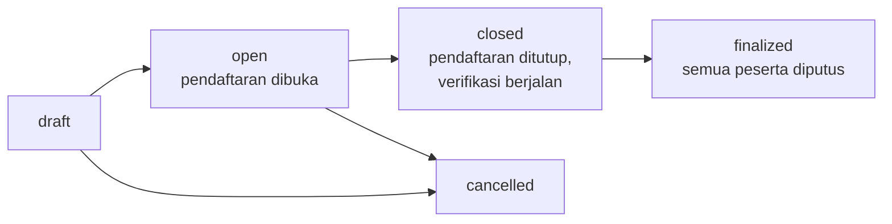
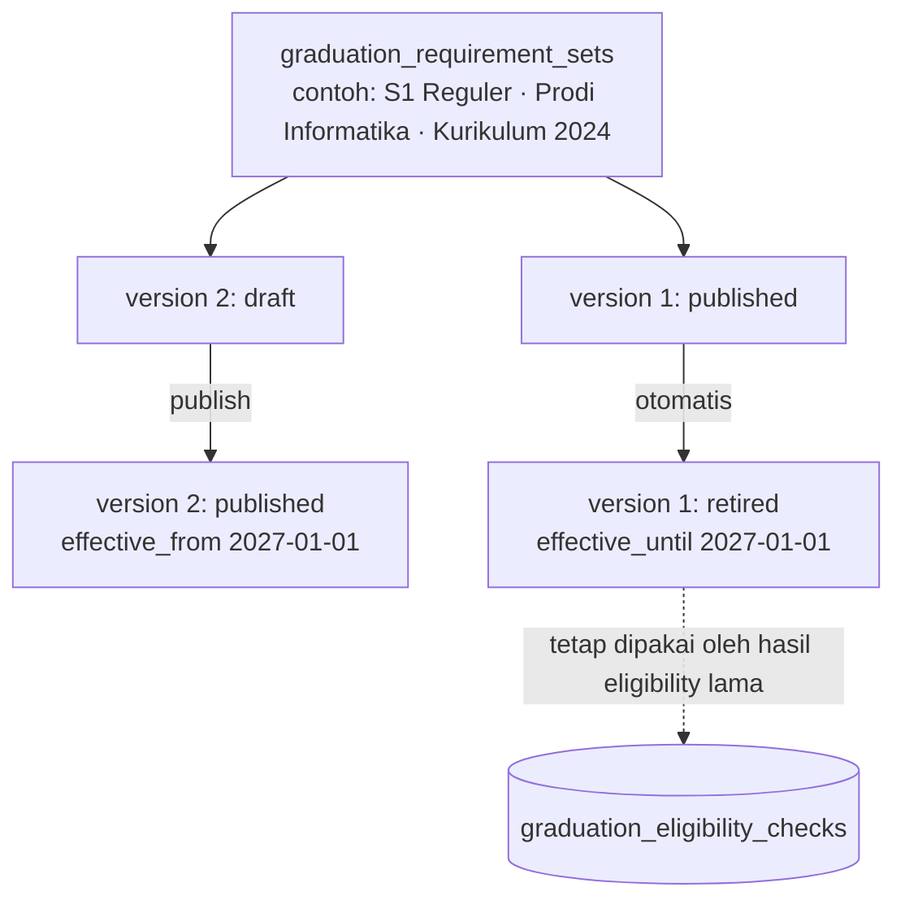
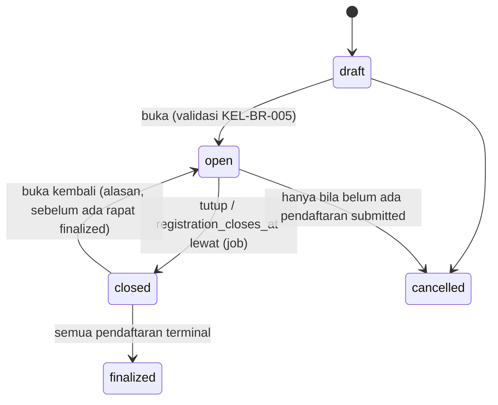

# 10 — Rancangan Periode dan Syarat Yudisium

> **Status:** rancangan · Disusun 2026-10-13 (commit `47043ca`) · Kembali ke [README](README.md)
> Skema acuan: [25 §3](25-rancangan-database-dan-erd.md#3-kelompok-yudisium-dan-wisuda) · Aturan: `KEL-BR-005`–`KEL-BR-010` · Eligibility: [11](11-rancangan-eligibilitas-yudisium.md) · Keputusan: [KK-KD-07](33-glossary-dan-keputusan-bisnis.md#2-keputusan-desain-kk-kd)

Dokumen ini mengatur **periode yudisium** dan **mesin aturan persyaratan kelulusan** (rule engine). Seluruh angka ambang (SKS minimum, IPK minimum, poin minimum, dan lain-lain) **berasal dari konfigurasi kampus** dan tidak pernah ditanam di kode ([KEL-BR-008](29-business-rules-dan-validasi.md#kel-br-008)).

## Daftar Isi

1. [Tujuan](#1-tujuan)
2. [Ruang Lingkup](#2-ruang-lingkup)
3. [Aktor dan Hak Akses](#3-aktor-dan-hak-akses)
4. [Prasyarat](#4-prasyarat)
5. [Alur Bisnis Utama](#5-alur-bisnis-utama)
6. [Alur Alternatif dan Kegagalan](#6-alur-alternatif-dan-kegagalan)
7. [Status dan Transisi Status](#7-status-dan-transisi-status)
8. [Data Input dan Output](#8-data-input-dan-output)
9. [Aturan Bisnis](#9-aturan-bisnis)
10. [Validasi](#10-validasi)
11. [Rancangan Database](#11-rancangan-database)
12. [Relasi Antarmodul](#12-relasi-antarmodul)
13. [Kontrak API Konseptual](#13-kontrak-api-konseptual)
14. [Rancangan Halaman UI/UX](#14-rancangan-halaman-uiux)
15. [Notifikasi](#15-notifikasi)
16. [Laporan](#16-laporan)
17. [Keamanan dan Audit](#17-keamanan-dan-audit)
18. [Acceptance Criteria](#18-acceptance-criteria)
19. [Test Case](#19-test-case)
20. [Asumsi dan Keputusan Terbuka](#20-asumsi-dan-keputusan-terbuka)

---

## 1. Tujuan

Memungkinkan kampus menjalankan beberapa periode yudisium per tahun untuk banyak fakultas dan program studi, masing-masing dengan persyaratan yang dapat berbeda menurut jenjang, prodi, kurikulum, dan angkatan, serta tetap konsisten dan dapat diaudit ketika persyaratan berubah.

## 2. Ruang Lingkup

**Termasuk:** periode yudisium, unit peserta (fakultas/prodi), jadwal (pembukaan, penutupan, tenggat berkas, rapat penetapan), batas administratif, set persyaratan berversi, katalog *checker*, resolusi aturan per mahasiswa, dan simulasi aturan.

**Tidak termasuk:** eksekusi pemeriksaan dan penyimpanan hasil ([11](11-rancangan-eligibilitas-yudisium.md)), pendaftaran & verifikasi peserta ([12](12-rancangan-peserta-dan-penetapan-kelulusan.md)), serta perhitungan IPK/SKS (milik Akademik, [KEL-BR-026](29-business-rules-dan-validasi.md#kel-br-026)).

## 3. Aktor dan Hak Akses

| Aktor | Aksi | Permission | Scope |
|---|---|---|---|
| Petugas kelulusan BAAK (`graduation_officer`) | Kelola periode, set persyaratan, simulasi | `yudisium_periods.create/update/publish/finalize`, `graduation_requirement_sets.create/update` | `u` |
| Pejabat akademik (mis. Wakil Rektor I / Kabiro Akademik) | Mempublikasikan versi set persyaratan | `graduation_requirement_sets.publish` | `u` |
| Admin fakultas | Mengusulkan persyaratan khusus fakultas, melihat periode | `graduation_requirement_sets.create` (draf saja), `yudisium_periods.read` | `f` |
| Admin prodi / Kaprodi | Mengusulkan persyaratan khusus prodi | idem | `p` |
| Mahasiswa | Melihat periode terbuka & daftar persyaratan yang berlaku baginya | `graduation_self_service.read` | Sendiri |

## 4. Prasyarat

1. Data akademik tersedia: `study_programs.degree_level` (Ada), `curriculums` (Ada), `students.admission_year` (Ada), layanan IPK & SKS lulus (Ada: `StudentGradeService::transcript`, `AcademicRecordService`).
2. Checker yang bergantung modul lain hanya dapat dipakai bila modul sumbernya aktif. Checker tanpa sumber menghasilkan `source_unavailable` ([KEL-BR-021](29-business-rules-dan-validasi.md#kel-br-021)).
3. Entitlement `graduation.core`.

## 5. Alur Bisnis Utama

### 5.1 Periode yudisium



Atribut periode: `code` (unik per tenant), `name`, `academic_term_id` (tahun akademik & semester, Ada), `registration_opens_at`, `registration_closes_at`, `document_deadline_at`, `verification_deadline_at`, `meeting_scheduled_at` (rencana), `graduation_date_policy` (`meeting_date` / `decree_date` / `manual`), `max_participants` (opsional, batas administratif), `participating_units` (fakultas/prodi), dan `notes`.

Sebuah prodi dapat ikut lebih dari satu periode per tahun, tetapi tidak boleh ada dua periode `open` untuk prodi yang sama pada waktu yang tumpang tindih ([KEL-BR-009](29-business-rules-dan-validasi.md#kel-br-009)).

### 5.2 Set persyaratan berversi



- **Set** (`graduation_requirement_sets`) mendefinisikan **lingkup penerapan** (selector): `degree_level`, `faculty_id`, `study_program_id`, `curriculum_id`, `admission_year_from`, `admission_year_to`, `yudisium_period_id` (opsional, untuk syarat khusus satu periode).
- **Versi** (`graduation_requirement_set_versions`) berisi daftar persyaratan. Versi `published` bersifat **immutable**. Perubahan dibuat sebagai versi baru ([KEL-BR-006](29-business-rules-dan-validasi.md#kel-br-006)).
- **Persyaratan** (`graduation_requirements`) per versi: `code`, `label`, `checker_key`, `parameters` (json), `severity` (`mandatory` / `advisory`), `verification_mode` (`automatic`, `automatic_with_verification`, `manual`), `waivable` (boleh dikecualikan), `sort_order`.

### 5.3 Katalog checker

Checker adalah kode terdaftar (registry) yang membaca sumber data pemilik melalui kontrak baca. Kampus memilih checker dan mengisi parameternya. Kampus **tidak** menulis kode.

| `checker_key` | Sumber data (status) | Parameter wajib (contoh bentuk, **nilai dari kampus**) | Hasil |
|---|---|---|---|
| `academic.total_credits` | Akademik: SKS lulus dari transkrip (`StudentGradeService::transcript`, Ada) | `{"min_credits": <int>, "count_policy": "passed_only"}` | Nilai aktual SKS, ambang |
| `academic.gpa` | Akademik: IPK (`AcademicRecordService`, Ada; nilai terbaik untuk mata kuliah ulang) | `{"min_gpa": <decimal>}` | IPK aktual |
| `academic.mandatory_courses` | Akademik: kurikulum mahasiswa (`curriculums`, `courses`, Ada) + nilai | `{"course_group": "mandatory", "min_letter_grade": "<huruf>"}` | Daftar MK wajib belum lulus |
| `academic.no_failing_grades` | Akademik | `{"forbidden_letter_grades": ["E"], "scope": "all"}` | Daftar MK dengan nilai terlarang |
| `academic.max_grade_count` | Akademik | `{"letter_grade": "D", "max_credits": <int>}` | Total SKS nilai D |
| `academic.study_period` | Akademik: `enrolled_at`, term aktif, cuti | `{"max_terms": <int>, "exclude_leave_terms": true}` | Jumlah term |
| `thesis.completed` | Thesis (Ada): `theses.status = selesai`, `completed_at` | `{"accepted_types": ["skripsi"]}` | Status & tanggal |
| `exam.final_defense_passed` | Thesis/ujian akhir. **Belum ada** entitas ujian sidang terpisah (`ThesisStatus::Sidang` hanya tahapan) | `{}` | `manual` sampai sumber tersedia |
| `finance.clearance` | KEU: `FinanceClearanceService::check($student, 'yudisium')` (rancangan KEU 17 §9) | `{"service_key": "yudisium"}` | Lolos / tercekal (tanpa nominal) |
| `library.clearance` | Library (Ada): `book_loans` aktif/terlambat, `fine_amount` | `{"block_on_fines": true}` | Pinjaman/denda terbuka. Status pelunasan denda belum terstruktur → `manual` untuk denda ([KK-Q-28](33-glossary-dan-keputusan-bisnis.md#3-pertanyaan-terbuka-kk-q)) |
| `student_affairs.points` | Poin ([05](05-rancangan-poin-kemahasiswaan.md)): `graduation_counted_points` | `{"min_points": <decimal>, "category_minimums": {"ORG": <decimal>}}` | Total & per kategori |
| `student_affairs.discipline` | Pelanggaran ([07](07-rancangan-pelanggaran-dan-sanksi.md)): sanksi final berlaku dengan layanan `yudisium` | `{}` | Daftar sanksi menghalangi |
| `academic.blocks` | SIAKAD `AcademicBlockGuard` untuk layanan `yudisium` (rancangan `academic-learning`) | `{}` | Cekal aktif tanpa dispensasi |
| `documents.uploaded` | Berkas pendaftaran yudisium | `{"document_types": ["photo", "id_card", "toefl"]}` | Dokumen belum lengkap/terverifikasi |
| `test_score.min` | Berkas + verifikasi manual (TOEFL, dsb.) | `{"test": "TOEFL", "min_score": <int>}` | `automatic_with_verification` |
| `manual.checklist` | Verifikasi petugas | `{"label": "Bebas laboratorium"}` | `manual` |

Menambah checker baru adalah perubahan kode (pengembang), bukan konfigurasi tenant. Setiap checker mendeklarasikan skema parameter (JSON Schema) yang dipakai validasi form konfigurasi.

### 5.4 Resolusi aturan per mahasiswa

Untuk mahasiswa M pada periode P, sistem memilih **satu** versi set persyaratan:

1. Kandidat: set aktif yang selector-nya cocok dengan M (jenjang, fakultas, prodi, kurikulum, angkatan) dan, bila diisi, `yudisium_period_id = P`.
2. Urutkan berdasarkan spesifisitas (bobot): `yudisium_period_id` (32) > `curriculum_id` (16) > `study_program_id` (8) > rentang angkatan (4) > `faculty_id` (2) > `degree_level` (1). Ambil skor tertinggi.
3. Dari set terpilih, ambil versi `published` dengan `effective_from ≤ waktu pemeriksaan < effective_until`.
4. Bila dua set memiliki skor sama dan sama-sama cocok, konfigurasi dianggap konflik. Pencegahan dilakukan saat publikasi ([KEL-BR-007](29-business-rules-dan-validasi.md#kel-br-007)). Bila tetap terjadi (data lama), pemeriksaan menghasilkan `manual_review` dengan alasan `RULE_CONFLICT`.
5. Tidak ada set yang cocok → `manual_review` dengan alasan `NO_RULE_SET`. Sistem **tidak** memakai aturan bawaan.

**Pewarisan opsional:** set prodi dapat menyatakan `extends_set_id` (set fakultas/jenjang). Versi efektif adalah gabungan: persyaratan anak menimpa persyaratan induk dengan `code` yang sama. Hasil gabungan dibekukan sebagai `resolved_requirements` saat versi anak dipublikasikan, sehingga perubahan induk memerlukan publikasi ulang anak (sistem memberi peringatan daftar set turunan).

### 5.5 Simulasi

Sebelum publikasi, petugas menjalankan **simulasi** versi draf terhadap sekelompok mahasiswa (mis. seluruh calon peserta periode). Simulasi menghasilkan perbandingan "lolos dengan versi aktif vs lolos dengan versi draf" **tanpa** menulis hasil eligibility resmi.

## 6. Alur Alternatif dan Kegagalan

| Kode | Kondisi | Penanganan |
|---|---|---|
| AF-YRS-01 | Versi baru dipublikasikan saat periode `open` | Hasil eligibility yang memakai versi lama ditandai stale ([KEL-BR-022](29-business-rules-dan-validasi.md#kel-br-022)). Pendaftaran yang sudah diverifikasi **tidak** otomatis dibatalkan, tetapi wajib diperiksa ulang sebelum penetapan |
| AF-YRS-02 | Kampus ingin versi baru hanya berlaku untuk periode berikutnya | Isi `effective_from` = tanggal pembukaan periode berikutnya |
| AF-YRS-03 | Parameter checker tidak valid (mis. `min_gpa` > 4 pada skala 4) | Ditolak saat simpan. Skala dibaca dari konfigurasi skala nilai Akademik bila tersedia (`grade_scales`, rancangan `academic-learning`) |
| AF-YRS-04 | Periode ditutup sementara ada pendaftaran `draft` | Draf tidak dapat dikirim. Petugas dapat memperpanjang `registration_closes_at` (tercatat) |
| AF-YRS-05 | Rapat penetapan dijadwalkan ulang | Perubahan jadwal tercatat di histori dan dinotifikasikan ke peserta |

## 7. Status dan Transisi Status

`yudisium_periods.status`: `draft`, `open`, `closed`, `finalized`, `cancelled`.



`graduation_requirement_sets.status`: `active`, `inactive`. `graduation_requirement_set_versions.status`: `draft`, `published`, `retired`.

## 8. Data Input dan Output

**Output resolusi untuk satu mahasiswa** (dipakai portal & eligibility):

```json
{
  "student_id": "01J...",
  "yudisium_period_id": "01J...",
  "requirement_set": { "id": "01J...", "name": "S1 Informatika Kurikulum 2024" },
  "requirement_set_version": { "id": "01J...", "version_no": 2, "published_at": "2026-09-01T02:00:00Z" },
  "requirements": [
    { "code": "SKS", "label": "Total SKS lulus", "checker_key": "academic.total_credits",
      "parameters": { "min_credits": 144 }, "severity": "mandatory", "verification_mode": "automatic" }
  ],
  "resolution": { "matched_by": ["study_program_id", "curriculum_id"], "specificity_score": 24 }
}
```

Angka `144` di atas adalah **contoh** pengisian kampus, bukan nilai bawaan.

## 9. Aturan Bisnis

| ID | Aturan |
|---|---|
| [KEL-BR-005](29-business-rules-dan-validasi.md#kel-br-005) | Periode hanya dapat dibuka bila memiliki minimal satu unit peserta dan setiap prodi peserta memiliki set persyaratan terpublikasi yang dapat diresolusi |
| [KEL-BR-006](29-business-rules-dan-validasi.md#kel-br-006) | Versi persyaratan yang sudah dipublikasikan tidak dapat diubah. Perubahan dibuat sebagai versi baru |
| [KEL-BR-007](29-business-rules-dan-validasi.md#kel-br-007) | Resolusi aturan memilih set paling spesifik. Publikasi yang menimbulkan dua set setara untuk himpunan mahasiswa yang sama ditolak |
| [KEL-BR-008](29-business-rules-dan-validasi.md#kel-br-008) | Seluruh ambang numerik berasal dari parameter yang diisi kampus. Tidak ada nilai bawaan tersembunyi |
| [KEL-BR-009](29-business-rules-dan-validasi.md#kel-br-009) | Satu prodi tidak boleh memiliki dua periode `open` yang rentang pendaftarannya tumpang tindih |
| [KEL-BR-010](29-business-rules-dan-validasi.md#kel-br-010) | Periode hanya dapat difinalisasi bila seluruh pendaftaran berstatus terminal |

## 10. Validasi

| Kode | Validasi |
|---|---|
| V-YRS-01 | `registration_opens_at < registration_closes_at ≤ document_deadline_at ≤ verification_deadline_at ≤ meeting_scheduled_at` (tanggal yang diisi) |
| V-YRS-02 | `parameters` lolos JSON Schema checker |
| V-YRS-03 | Checker berstatus `deprecated` tidak dapat dipakai di versi baru |
| V-YRS-04 | Minimal satu persyaratan `mandatory` per versi |
| V-YRS-05 | Rentang angkatan valid (`from ≤ to`) |
| V-YRS-06 | Bila `max_participants` diisi, penolakan pendaftaran saat penuh memakai penguncian baris periode |

## 11. Rancangan Database

| Tabel | Status | Fungsi |
|---|---|---|
| `yudisium_periods` | Baru | Periode |
| `yudisium_period_units` | Baru | Fakultas/prodi peserta (`unit_type`, `unit_id`) |
| `yudisium_period_schedule_changes` | Baru | Histori perubahan jadwal |
| `graduation_requirement_sets` | Baru | Lingkup penerapan |
| `graduation_requirement_set_versions` | Baru | Versi (`resolved_requirements` json snapshot) |
| `graduation_requirements` | Baru | Persyaratan per versi |
| `graduation_checker_definitions` | Baru (platform, tanpa `university_id`) | Katalog checker: `key`, `name`, `parameter_schema`, `source_module`, `status` |

## 12. Relasi Antarmodul

Lihat [04](04-arsitektur-dan-integrasi-antarmodul.md). Ringkas: Akademik (transkrip, IPK, kurikulum), Thesis, Library, KEU, Kemahasiswaan, SIAKAD cekal. Semua dibaca melalui kontrak baca, tidak melalui query langsung ke tabel modul lain dari kode Graduation ([KEL-BR-026](29-business-rules-dan-validasi.md#kel-br-026)).

## 13. Kontrak API Konseptual

| Method | URL | Permission |
|---|---|---|
| GET/POST | `/graduation/yudisium-periods` | `yudisium_periods.read/create` |
| PUT | `/graduation/yudisium-periods/{period}` | `yudisium_periods.update` |
| POST | `/graduation/yudisium-periods/{period}/open`, `/close`, `/reopen`, `/finalize`, `/cancel` | `yudisium_periods.publish` / `.finalize` |
| GET | `/graduation/requirement-checkers` | `graduation_requirement_sets.read` |
| GET/POST | `/graduation/requirement-sets` | `graduation_requirement_sets.read/create` |
| POST | `/graduation/requirement-sets/{set}/versions` | `graduation_requirement_sets.update` |
| PUT | `/graduation/requirement-set-versions/{version}` (draf saja) | `graduation_requirement_sets.update` |
| POST | `/graduation/requirement-set-versions/{version}/simulate` | `graduation_requirement_sets.update` |
| POST | `/graduation/requirement-set-versions/{version}/publish` | `graduation_requirement_sets.publish` |
| GET | `/graduation/students/{student}/requirements?period_id=` | `graduation_eligibility.read` |
| GET | `/student/graduation/requirements` | `graduation_self_service.read` |

## 14. Rancangan Halaman UI/UX

| Halaman | Rute | Inti |
|---|---|---|
| Periode Yudisium | `/yudisium/periode` | Tabel periode (kode, term, status, unit, jadwal, jumlah pendaftar). Form periode dengan pemilih unit berpohon fakultas → prodi |
| Aturan Persyaratan | `/yudisium/aturan` | Daftar set dengan selector yang mudah dibaca ("S1 · FTI · Informatika · Kurikulum 2024 · Angkatan 2020–2023"). Editor versi: daftar persyaratan, pemilih checker, form parameter dari JSON Schema, tombol Simulasi, diff antarversi |
| Portal: Persyaratan Kelulusan | `/portal/kelulusan/persyaratan` | Daftar persyaratan yang berlaku bagi mahasiswa dan status terakhir (dari [11](11-rancangan-eligibilitas-yudisium.md)) |

## 15. Notifikasi

`graduation.period.opened` (calon peserta di unit peserta, opsional), `graduation.period.schedule_changed`, `graduation.period.closing_soon` (H-3, calon peserta belum mendaftar), `graduation.requirements.version_published` (petugas prodi).

## 16. Laporan

KEL-RPT-01 Ringkasan periode (pendaftar per status per prodi). KEL-RPT-02 Katalog aturan aktif per prodi (untuk audit mutu dan akreditasi).

## 17. Keamanan dan Audit

Publikasi versi, perubahan jadwal, pembukaan kembali periode, dan finalisasi dicatat `audit_logs` dengan alasan. Hanya `graduation_requirement_sets.publish` yang dapat mempublikasikan, dan pengusul draf tidak boleh mempublikasikan versinya sendiri bila `graduation.rules.require_separate_publisher = true` (default true).

## 18. Acceptance Criteria

| ID | Kriteria |
|---|---|
| KEL-AC-01 | Tidak ada ambang numerik di kode checker. Uji statis memastikan checker gagal jika parameter wajib kosong |
| KEL-AC-02 | Versi `published` menolak semua upaya ubah (409) |
| KEL-AC-03 | Untuk 20 kombinasi selector uji, resolusi memilih set sesuai tabel spesifisitas |
| KEL-AC-04 | Simulasi tidak membuat baris di `graduation_eligibility_checks` |

## 19. Test Case

| ID | Judul | Prioritas |
|---|---|---|
| KEL-TC-001 | Buka periode tanpa set persyaratan prodi ditolak | P1 |
| KEL-TC-002 | Versi terpublikasi immutable | P1 |
| KEL-TC-003 | Resolusi set paling spesifik | P1 |
| KEL-TC-004 | Konflik set setara ditolak saat publikasi | P2 |
| KEL-TC-005 | Parameter checker kosong ditolak | P1 |
| KEL-TC-006 | Periode tumpang tindih untuk prodi sama ditolak | P2 |
| KEL-TC-007 | Finalisasi periode dengan pendaftaran belum terminal ditolak | P2 |
| KEL-TC-008 | Simulasi tidak menulis hasil resmi | P2 |

## 20. Asumsi dan Keputusan Terbuka

| ID | Hal |
|---|---|
| [KK-KD-07](33-glossary-dan-keputusan-bisnis.md#2-keputusan-desain-kk-kd) | Rule engine berbasis katalog checker + versi immutable |
| [KK-Q-10](33-glossary-dan-keputusan-bisnis.md#3-pertanyaan-terbuka-kk-q) | Daftar persyaratan resmi per jenjang/prodi dan pejabat yang mempublikasikan |
| [KK-Q-28](33-glossary-dan-keputusan-bisnis.md#3-pertanyaan-terbuka-kk-q) | Bebas perpustakaan & denda |
| [KK-Q-33](33-glossary-dan-keputusan-bisnis.md#3-pertanyaan-terbuka-kk-q) | Sumber data ujian akhir/sidang (belum ada entitas terpisah) |
