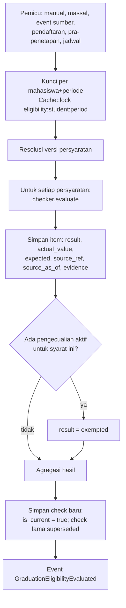
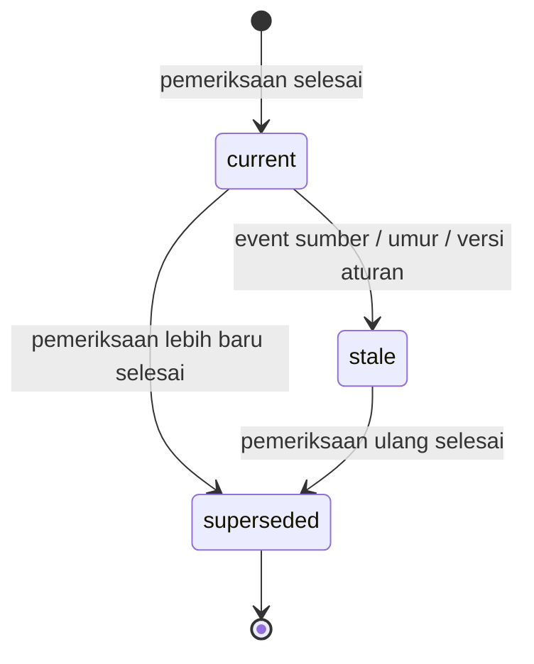

# 11 — Rancangan Eligibilitas Yudisium

> **Status:** rancangan · Disusun 2026-10-13 (commit `47043ca`) · Kembali ke [README](README.md)
> Skema acuan: [25 §3](25-rancangan-database-dan-erd.md#3-kelompok-yudisium-dan-wisuda) · Aturan: `KEL-BR-001`, `KEL-BR-002`, `KEL-BR-020`–`KEL-BR-027` · Aturan persyaratan: [10](10-rancangan-periode-dan-syarat-yudisium.md)

*Eligibility engine* menjalankan persyaratan yang telah diresolusi ([10 §5.4](10-rancangan-periode-dan-syarat-yudisium.md#5-alur-bisnis-utama)) terhadap data terkini setiap mahasiswa, menyimpan hasilnya secara rinci dan berversi, serta mengetahui kapan hasil itu **tidak lagi berlaku**. Hasil eligibility adalah **masukan** bagi verifikasi dan penetapan. Hasil ini **bukan** keputusan kelulusan ([KEL-BR-002](29-business-rules-dan-validasi.md#kel-br-002)).

## Daftar Isi

1. [Tujuan](#1-tujuan)
2. [Ruang Lingkup](#2-ruang-lingkup)
3. [Aktor dan Hak Akses](#3-aktor-dan-hak-akses)
4. [Prasyarat](#4-prasyarat)
5. [Alur Bisnis Utama](#5-alur-bisnis-utama)
6. [Alur Alternatif dan Kegagalan](#6-alur-alternatif-dan-kegagalan)
7. [Status dan Transisi Status](#7-status-dan-transisi-status)
8. [Data Input dan Output](#8-data-input-dan-output)
9. [Aturan Bisnis](#9-aturan-bisnis)
10. [Validasi](#10-validasi)
11. [Rancangan Database](#11-rancangan-database)
12. [Relasi Antarmodul](#12-relasi-antarmodul)
13. [Kontrak API Konseptual](#13-kontrak-api-konseptual)
14. [Rancangan Halaman UI/UX](#14-rancangan-halaman-uiux)
15. [Notifikasi](#15-notifikasi)
16. [Laporan](#16-laporan)
17. [Keamanan dan Audit](#17-keamanan-dan-audit)
18. [Acceptance Criteria](#18-acceptance-criteria)
19. [Test Case](#19-test-case)
20. [Asumsi dan Keputusan Terbuka](#20-asumsi-dan-keputusan-terbuka)

---

## 1. Tujuan

Memberi jawaban yang dapat dijelaskan untuk pertanyaan "apakah mahasiswa ini memenuhi persyaratan yudisium saat ini, dan jika belum, apa yang kurang", lengkap dengan sumber data, waktu, dan versi aturan. Engine ini juga mencegah keputusan dibuat di atas data yang sudah berubah.

## 2. Ruang Lingkup

**Termasuk:** pemeriksaan per mahasiswa dan massal, hasil per syarat, agregasi hasil, pengecualian syarat, deteksi kedaluwarsa (stale), pemeriksaan ulang terjadwal maupun dipicu event, riwayat, dan daftar calon peserta otomatis.

**Tidak termasuk:** keputusan kelulusan ([12](12-rancangan-peserta-dan-penetapan-kelulusan.md)) dan perhitungan IPK/SKS/saldo (dibaca dari pemiliknya).

## 3. Aktor dan Hak Akses

| Aktor | Aksi | Permission | Scope |
|---|---|---|---|
| Sistem (job) | Pemeriksaan terjadwal & dipicu event | — (konteks tenant dari job) | — |
| Petugas kelulusan | Menjalankan pemeriksaan massal, melihat hasil, menyelesaikan item manual | `graduation_eligibility.read/create` | `u` |
| Admin prodi/fakultas | Melihat & menjalankan pemeriksaan dalam unitnya, menyelesaikan item manual unit | idem | `p` / `f` |
| Pejabat berwenang (dekan/WR sesuai workflow) | Memberi pengecualian syarat | `graduation_requirement_exemptions.approve` | Sesuai workflow |
| Mahasiswa | Melihat hasil sendiri, meminta pemeriksaan ulang (dibatasi frekuensi) | `graduation_self_service.read/create` | Sendiri |
| Dosen wali / pembimbing skripsi | Melihat ringkasan hasil mahasiswa bimbingan | `graduation_eligibility.read` scope `w` / pembimbing | Bimbingan |

## 4. Prasyarat

1. Set persyaratan terpublikasi dan dapat diresolusi ([10](10-rancangan-periode-dan-syarat-yudisium.md)).
2. Kontrak baca modul sumber terpasang (§12). Bila belum, checker terkait menghasilkan `source_unavailable`.
3. Antrean (Redis, Ada di konfigurasi) untuk pemeriksaan massal.

## 5. Alur Bisnis Utama

### 5.1 Eksekusi pemeriksaan



### 5.2 Hasil per syarat (`graduation_eligibility_check_items.result`)

| Nilai | Makna |
|---|---|
| `passed` | Terpenuhi berdasarkan data sumber |
| `failed` | Tidak terpenuhi |
| `pending_verification` | Data ada tetapi menunggu verifikasi petugas (mis. berkas TOEFL terunggah belum diverifikasi) |
| `manual_review` | Checker manual, atau data tidak dapat dinilai otomatis (mis. konflik aturan) |
| `source_unavailable` | Modul sumber tidak aktif/gagal diakses |
| `exempted` | Dikecualikan oleh keputusan berwenang |

### 5.3 Agregasi hasil (`graduation_eligibility_checks.result`)

Dievaluasi berurutan, hanya atas persyaratan `mandatory`. Persyaratan `advisory` ditampilkan tetapi tidak memengaruhi hasil:

1. Ada item `failed` → **`not_eligible`** (belum memenuhi syarat).
2. Selain itu, ada item `pending_verification` → **`pending_verification`** (menunggu verifikasi).
3. Selain itu, ada item `manual_review` atau `source_unavailable` → **`manual_review`** (memerlukan pemeriksaan manual).
4. Selain itu, semua `passed`/`exempted` dan minimal satu `exempted` → **`exempted`** (memenuhi dengan pengecualian berwenang).
5. Selain itu → **`eligible`** (memenuhi syarat).

`source_unavailable` **tidak pernah** dianggap lolos ([KEL-BR-021](29-business-rules-dan-validasi.md#kel-br-021)).

### 5.4 Masa berlaku dan kedaluwarsa (stale)

Hasil `is_current = true` menjadi **tidak berlaku** (`stale_at` diisi, `stale_reason`) bila salah satu terjadi ([KEL-BR-022](29-business-rules-dan-validasi.md#kel-br-022)):

| Pemicu | Event / sumber | Contoh |
|---|---|---|
| Nilai dipublikasikan/diubah | Akademik: `GradesPublished`, perubahan `grades` (Baru, event Akademik) | Nilai perbaikan masuk |
| Status mahasiswa berubah | `student_status_histories` (Ada, `StudentObserver`) | Cuti |
| Status tagihan berubah | KEU: `InvoiceStatusChanged`, `FinanceHoldChanged` | Pelunasan |
| Poin berubah | `StudentPointLedgerChanged` ([05](05-rancangan-poin-kemahasiswaan.md)) | Pencabutan poin |
| Sanksi berubah | `DisciplinaryDecisionChanged` ([07](07-rancangan-pelanggaran-dan-sanksi.md)) | |
| Status skripsi berubah | Thesis: perubahan `theses.status` (event Baru) | |
| Peminjaman buku berubah | Library: perubahan `book_loans` (event Baru) | |
| Cekal SIAKAD berubah | `AcademicBlockChanged` (rancangan `academic-learning`) | |
| Versi aturan berganti | Publikasi versi baru yang mencakup mahasiswa | |
| Berkas yudisium diverifikasi/ditolak | [12](12-rancangan-peserta-dan-penetapan-kelulusan.md) | |
| Waktu | `checked_at + graduation.eligibility.max_age_hours` terlampaui | Default 72 jam |

Event yang menandai stale **tidak** langsung menjalankan pemeriksaan penuh. Sistem menjadwalkan `RecheckEligibilityJob` dengan *debounce* (`graduation.eligibility.recheck_debounce_seconds`, default 300) per mahasiswa+periode, sehingga rentetan perubahan nilai menghasilkan satu pemeriksaan ulang.

Hasil stale tetap dapat dilihat (riwayat), tetapi **tidak dapat dipakai** untuk verifikasi prodi/fakultas atau penetapan. Aksi tersebut akan memaksa pemeriksaan ulang sinkron terlebih dahulu ([KEL-BR-023](29-business-rules-dan-validasi.md#kel-br-023)).

### 5.5 Pengecualian syarat

Pengecualian (`graduation_requirement_exemptions`) diberikan per mahasiswa, per `requirement_code`, untuk satu periode atau sampai tanggal tertentu, dengan alasan, dasar (nomor surat keputusan bila ada), berkas pendukung, dan persetujuan melalui ApprovalWorkflow. Hanya persyaratan dengan `waivable = true` yang dapat dikecualikan ([KEL-BR-024](29-business-rules-dan-validasi.md#kel-br-024)).

### 5.6 Daftar calon peserta otomatis

Saat periode dibuka dan setiap malam selama periode `open`, job `graduation:discover-candidates` memeriksa mahasiswa `active` pada unit peserta yang memenuhi **pra-saring ringan** (mis. SKS lulus ≥ ambang SKS persyaratan dikurangi `graduation.candidates.credit_margin`, default 0). Mahasiswa yang lolos pra-saring dijalankan pemeriksaan penuh. Hasilnya menjadi daftar **Calon Peserta** beserta hasil eligibility. Mahasiswa tetap harus mendaftar ([12](12-rancangan-peserta-dan-penetapan-kelulusan.md)) kecuali kampus memakai mode `auto_enroll` ([KK-Q-10](33-glossary-dan-keputusan-bisnis.md#3-pertanyaan-terbuka-kk-q)).

### 5.7 Contoh hasil

Mahasiswa A, persyaratan versi 2 (angka contoh dari kampus):

| Syarat | Checker | Ambang | Aktual | Sumber & waktu | Hasil |
|---|---|---|---|---|---|
| SKS | `academic.total_credits` | ≥ 144 | 146 | Transkrip, 2026-10-13 01:00Z | passed |
| IPK | `academic.gpa` | ≥ 2,00 | 3,41 | AcademicRecordService | passed |
| Skripsi | `thesis.completed` | selesai | selesai 2026-09-30 | `theses` | passed |
| Keuangan | `finance.clearance` | tanpa cekal yudisium | tercekal | KEU, 2026-10-13 00:58Z | **failed** |
| Poin | `student_affairs.points` | ≥ 100 | 88 | Ledger | **failed** |
| TOEFL | `test_score.min` | ≥ 450 | 470 (berkas) | Berkas, belum diverifikasi | pending_verification |

Hasil agregat: **`not_eligible`**. Portal menampilkan dua syarat yang belum terpenuhi beserta unit penanggung jawab (Keuangan, Kemahasiswaan) dan satu syarat menunggu verifikasi. Nominal tunggakan **tidak** ditampilkan di modul kelulusan ([KEL-BR-026](29-business-rules-dan-validasi.md#kel-br-026)).

## 6. Alur Alternatif dan Kegagalan

| Kode | Kondisi | Penanganan |
|---|---|---|
| AF-ELG-01 | Checker melempar exception | Item `source_unavailable` dengan `error_code`. Pemeriksaan lain tetap berjalan. Insiden dicatat log |
| AF-ELG-02 | Timeout layanan KEU | Retry 2× dengan jeda, lalu `source_unavailable` |
| AF-ELG-03 | Pemeriksaan bersamaan untuk mahasiswa sama | Lock. Permintaan kedua menunggu ≤ 10 detik lalu memakai hasil terbaru (bukan pemeriksaan ganda) |
| AF-ELG-04 | Pemeriksaan massal 5.000 mahasiswa | Batch job (`Bus::batch`) per 100 mahasiswa, progres terlihat, kegagalan per mahasiswa tidak menggagalkan batch |
| AF-ELG-05 | Mahasiswa meminta pemeriksaan ulang terlalu sering | Dibatasi `graduation.eligibility.self_recheck_per_hour` (default 3) → 429 |
| AF-ELG-06 | Data akademik belum sinkron (mis. nilai term terakhir belum dipublikasikan) | Checker `academic.*` mengembalikan `pending_verification` bila ada KRS term berjalan tanpa nilai final dan parameter `require_final_grades = true` |

## 7. Status dan Transisi Status

Hasil pemeriksaan tidak memiliki state machine, tetapi siklus hidup:



Diwakili kolom `is_current` (bool), `stale_at`, `superseded_by_id`. `graduation_requirement_exemptions.status`: `pending_approval`, `active`, `rejected`, `revoked`, `expired`.

## 8. Data Input dan Output

Output `GET /graduation/students/{student}/eligibility?period_id=`:

```json
{
  "check_id": "01J...",
  "result": "not_eligible",
  "is_current": true,
  "is_stale": false,
  "checked_at": "2026-10-13T01:00:12Z",
  "valid_until": "2026-10-16T01:00:12Z",
  "requirement_set_version": { "id": "01J...", "version_no": 2 },
  "trigger": "scheduled",
  "items": [
    { "code": "FIN", "label": "Bebas tunggakan", "result": "failed", "severity": "mandatory",
      "responsible_unit": "Bagian Keuangan", "message": "Masih terdapat kewajiban keuangan yang membatasi yudisium.",
      "source": { "module": "finance", "as_of": "2026-10-13T00:58:40Z" } }
  ],
  "summary": { "passed": 3, "failed": 2, "pending_verification": 1, "manual_review": 0, "exempted": 0 }
}
```

## 9. Aturan Bisnis

| ID | Aturan |
|---|---|
| [KEL-BR-001](29-business-rules-dan-validasi.md#kel-br-001) | Eligibility dihitung berdasarkan versi aturan yang berlaku pada saat pemeriksaan, dan versi itu disimpan pada hasil |
| [KEL-BR-002](29-business-rules-dan-validasi.md#kel-br-002) | Hasil eligibility tidak sama dengan keputusan kelulusan final |
| [KEL-BR-020](29-business-rules-dan-validasi.md#kel-br-020) | Setiap item hasil menyimpan nilai aktual, ambang, sumber, dan waktu data sumber |
| [KEL-BR-021](29-business-rules-dan-validasi.md#kel-br-021) | Sumber yang tidak tersedia menghasilkan `source_unavailable` dan tidak pernah dianggap lolos |
| [KEL-BR-022](29-business-rules-dan-validasi.md#kel-br-022) | Hasil menjadi stale saat data sumber relevan berubah, versi aturan berganti, atau umur melewati batas |
| [KEL-BR-023](29-business-rules-dan-validasi.md#kel-br-023) | Hasil stale tidak dapat dipakai untuk verifikasi atau penetapan. Sistem memaksa pemeriksaan ulang |
| [KEL-BR-024](29-business-rules-dan-validasi.md#kel-br-024) | Pengecualian hanya untuk persyaratan `waivable`, per mahasiswa, dengan alasan dan persetujuan berwenang |
| [KEL-BR-025](29-business-rules-dan-validasi.md#kel-br-025) | Agregasi hasil mengikuti urutan §5.3 dan hanya memperhitungkan persyaratan `mandatory` |
| [KEL-BR-026](29-business-rules-dan-validasi.md#kel-br-026) | Modul kelulusan tidak menghitung ulang IPK, SKS, saldo, atau denda. Nilai dibaca dari modul pemilik melalui kontrak |
| [KEL-BR-027](29-business-rules-dan-validasi.md#kel-br-027) | Hanya satu pemeriksaan berjalan per mahasiswa per periode. Hasil terbaru menggantikan yang lama tanpa menghapusnya |

## 10. Validasi

| Kunci | Default | Keterangan |
|---|---|---|
| `graduation.eligibility.max_age_hours` | 72 | Umur maksimum hasil |
| `graduation.eligibility.pre_decision_max_age_minutes` | 60 | Hasil harus lebih muda dari ini saat penetapan |
| `graduation.eligibility.recheck_debounce_seconds` | 300 | |
| `graduation.eligibility.self_recheck_per_hour` | 3 | |
| `graduation.candidates.credit_margin` | 0 | Margin pra-saring |

## 11. Rancangan Database

| Tabel | Status | Fungsi |
|---|---|---|
| `graduation_eligibility_checks` | Baru | Header hasil: mahasiswa, periode, versi aturan, trigger, result, `is_current`, `stale_at`, `stale_reason`, `superseded_by_id`, `checked_by` |
| `graduation_eligibility_check_items` | Baru | Item per syarat |
| `graduation_requirement_exemptions` | Baru | Pengecualian |
| `graduation_eligibility_batches` | Baru | Pemeriksaan massal (progres, jumlah per hasil) |

Unique parsial: satu `is_current = true` per (`student_id`, `yudisium_period_id`) melalui generated column `current_key`. Hasil tidak pernah dihapus. Retensi mengikuti kebijakan dokumen kelulusan ([28](28-keamanan-privasi-dan-audit.md)).

## 12. Relasi Antarmodul

| Kontrak baca | Pemilik | Status |
|---|---|---|
| `StudentTranscriptReader` (SKS lulus, IPK, nilai per MK, MK wajib kurikulum) | Akademik | Dibungkus dari `StudentGradeService`/`AcademicRecordService` (Ada) |
| `FinanceClearanceService::check($student, 'yudisium')` | KEU | Rancangan KEU 17 §9 (Baru) |
| `LibraryClearanceReader` | Library | Baru, membaca `book_loans` (Ada) |
| `ThesisStatusReader` | Thesis | Baru, membaca `theses` (Ada) |
| `StudentPointsReader` | Kemahasiswaan | Baru ([05](05-rancangan-poin-kemahasiswaan.md)) |
| `DisciplinaryRecordReader` | Kemahasiswaan | Baru ([07](07-rancangan-pelanggaran-dan-sanksi.md)) |
| `AcademicBlockService::check($student, 'yudisium')` | SIAKAD | Rancangan `academic-learning` (Baru) |

Seluruh kontrak mengembalikan DTO yang memuat `as_of`. Kontrak tidak mengembalikan data yang tidak dibutuhkan (mis. KEU tidak mengirim nominal).

## 13. Kontrak API Konseptual

| Method | URL | Permission |
|---|---|---|
| POST | `/graduation/eligibility-checks` (`student_id`, `yudisium_period_id`) | `graduation_eligibility.create` |
| POST | `/graduation/yudisium-periods/{period}/eligibility-batches` | `graduation_eligibility.create` |
| GET | `/graduation/eligibility-batches/{batch}` | `graduation_eligibility.read` |
| GET | `/graduation/yudisium-periods/{period}/candidates` (filter `result`, `study_program_id`, `is_stale`) | `graduation_eligibility.read` |
| GET | `/graduation/students/{student}/eligibility` (+ `/history`) | `graduation_eligibility.read` |
| POST | `/graduation/eligibility-check-items/{item}/resolve` (`passed`/`failed` untuk item manual, catatan) | `graduation_eligibility.create` |
| POST | `/graduation/requirement-exemptions` | `graduation_requirement_exemptions.create` |
| GET | `/student/graduation/eligibility` | `graduation_self_service.read` |
| POST | `/student/graduation/eligibility/recheck` | `graduation_self_service.create` (rate limited) |

## 14. Rancangan Halaman UI/UX

| Halaman | Rute | Inti |
|---|---|---|
| Pemeriksaan Eligibility | `/yudisium/eligibility` | Pilih periode → kartu ringkasan per hasil, tombol "Periksa ulang semua" (batch dengan progres), tabel mahasiswa (NIM, nama, prodi, hasil, item gagal, umur hasil, ikon stale) |
| Calon Peserta | `/yudisium/calon-peserta` | Daftar hasil discovery dengan status pendaftaran |
| Detail Eligibility | Drawer | Tabel item (syarat, ambang, aktual, sumber, waktu, hasil), riwayat pemeriksaan, tombol "Selesaikan item manual", "Ajukan pengecualian" |
| Portal: Status Kelulusan | `/portal/kelulusan` | Menggantikan `PortalGraduationPage` statis untuk bagian eligibility. Checklist syarat dengan unit penanggung jawab dan langkah penyelesaian |

Pola warna: `eligible` hijau, `exempted` hijau dengan ikon perisai, `pending_verification` biru, `manual_review` kuning, `not_eligible` merah, dan stale ditandai badge abu-abu "Perlu diperiksa ulang".

## 15. Notifikasi

| Event key | Penerima | Kapan |
|---|---|---|
| `graduation.eligibility.incomplete` | Mahasiswa | Pemeriksaan pertama di periode menghasilkan `not_eligible`, lalu ringkasan mingguan selama periode `open` (bukan setiap pemeriksaan) |
| `graduation.eligibility.now_eligible` | Mahasiswa | Hasil berubah menjadi `eligible`/`exempted` |
| `graduation.eligibility.manual_items_pending` | Petugas unit | Ringkasan harian |

## 16. Laporan

KEL-RPT-03 Rekap eligibility per periode/prodi (jumlah per hasil, syarat paling sering gagal). KEL-RPT-04 Daftar pengecualian yang diberikan (untuk audit).

## 17. Keamanan dan Audit

- Penyelesaian item manual dan pengecualian dicatat `audit_logs` (`verified`, `approved`, `forced_override`).
- Mahasiswa hanya melihat hasil miliknya. Pesan item dari KEU tidak memuat nominal.
- Job berjalan dalam konteks tenant eksplisit (`TenantContext::set` di awal job), dan diuji isolasinya.

## 18. Acceptance Criteria

| ID | Kriteria |
|---|---|
| KEL-AC-05 | Setiap hasil memuat `requirement_set_version_id` dan setiap item memuat `source.as_of` |
| KEL-AC-06 | Perubahan nilai setelah pemeriksaan membuat hasil `is_stale = true` ≤ 1 menit, dan pemeriksaan ulang berjalan ≤ debounce + 2 menit |
| KEL-AC-07 | Verifikasi atau penetapan dengan hasil stale memicu pemeriksaan ulang sinkron, dan memakai hasil baru |
| KEL-AC-08 | KEU tidak tersedia → hasil `manual_review` (bukan `eligible`) |
| KEL-AC-09 | Pemeriksaan massal 5.000 mahasiswa selesai ≤ 15 menit di lingkungan staging acuan |

## 19. Test Case

| ID | Judul | Prioritas |
|---|---|---|
| KEL-TC-020 | Mahasiswa memenuhi semua syarat → eligible | P1 |
| KEL-TC-021 | Kurang SKS → not_eligible dengan item SKS failed | P1 |
| KEL-TC-022 | IPK belum memenuhi | P1 |
| KEL-TC-023 | Tunggakan keuangan → failed tanpa nominal | P1 |
| KEL-TC-024 | Data akademik belum sinkron → pending_verification | P1 |
| KEL-TC-025 | Poin kemahasiswaan belum terpenuhi | P1 |
| KEL-TC-026 | Pemeriksaan ulang setelah perubahan nilai | P1 |
| KEL-TC-027 | Sumber tidak tersedia → manual_review | P1 |
| KEL-TC-028 | Pengecualian syarat waivable | P2 |
| KEL-TC-029 | Pengecualian syarat non-waivable ditolak | P2 |
| KEL-TC-030 | Pemeriksaan bersamaan tidak ganda | P2 |
| KEL-TC-031 | Isolasi tenant pada job massal | P1 |

## 20. Asumsi dan Keputusan Terbuka

| ID | Hal |
|---|---|
| [KK-KD-08](33-glossary-dan-keputusan-bisnis.md#2-keputusan-desain-kk-kd) | Eligibility terpisah dari keputusan |
| [KK-A-10](33-glossary-dan-keputusan-bisnis.md#4-asumsi-kk-a) | `FinanceClearanceService` (KEU) tersedia, atau checker keuangan menjadi manual |
| [KK-Q-10](33-glossary-dan-keputusan-bisnis.md#3-pertanyaan-terbuka-kk-q) | Mode pendaftaran: mahasiswa mendaftar atau auto-enroll |
