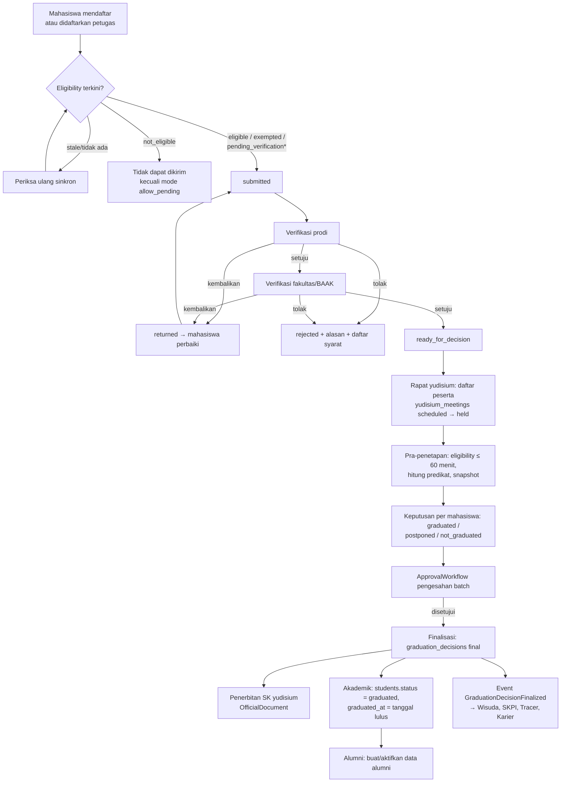
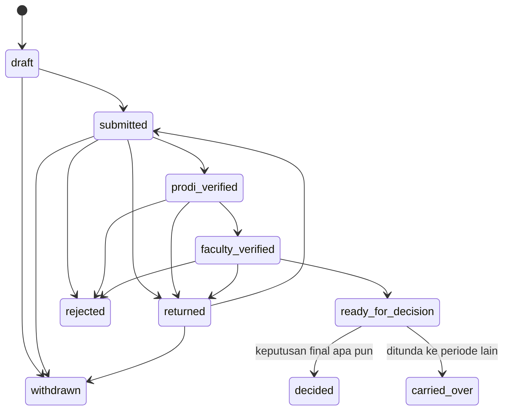
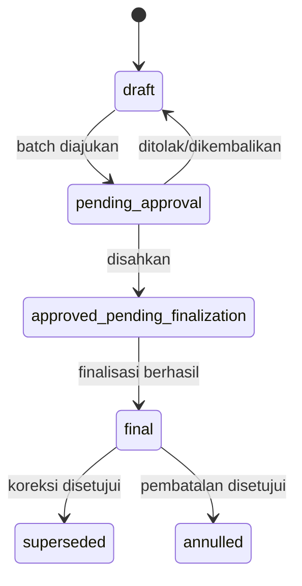

# 12 — Rancangan Peserta dan Penetapan Kelulusan

> **Status:** rancangan · Disusun 2026-10-13 (commit `47043ca`) · Kembali ke [README](README.md)
> Skema acuan: [25 §3](25-rancangan-database-dan-erd.md#3-kelompok-yudisium-dan-wisuda) · Aturan: `KEL-BR-003`, `KEL-BR-040`–`KEL-BR-051` · Keputusan: [KK-KD-08](33-glossary-dan-keputusan-bisnis.md#2-keputusan-desain-kk-kd), [KK-KD-09](33-glossary-dan-keputusan-bisnis.md#2-keputusan-desain-kk-kd)

Dokumen ini mengatur jalannya **pendaftaran peserta yudisium, verifikasi berjenjang, rapat penetapan, keputusan kelulusan, predikat, tanggal lulus, perubahan status mahasiswa menjadi lulusan**, serta **koreksi dan pembatalan** keputusan. Urutan tahapan dapat dikonfigurasi sesuai tata kelola kampus melalui ApprovalWorkflow (Ada).

## Daftar Isi

1. [Tujuan](#1-tujuan)
2. [Ruang Lingkup](#2-ruang-lingkup)
3. [Aktor dan Hak Akses](#3-aktor-dan-hak-akses)
4. [Prasyarat](#4-prasyarat)
5. [Alur Bisnis Utama](#5-alur-bisnis-utama)
6. [Alur Alternatif dan Kegagalan](#6-alur-alternatif-dan-kegagalan)
7. [Status dan Transisi Status](#7-status-dan-transisi-status)
8. [Data Input dan Output](#8-data-input-dan-output)
9. [Aturan Bisnis](#9-aturan-bisnis)
10. [Validasi](#10-validasi)
11. [Rancangan Database](#11-rancangan-database)
12. [Relasi Antarmodul](#12-relasi-antarmodul)
13. [Kontrak API Konseptual](#13-kontrak-api-konseptual)
14. [Rancangan Halaman UI/UX](#14-rancangan-halaman-uiux)
15. [Notifikasi](#15-notifikasi)
16. [Laporan](#16-laporan)
17. [Keamanan dan Audit](#17-keamanan-dan-audit)
18. [Acceptance Criteria](#18-acceptance-criteria)
19. [Test Case](#19-test-case)
20. [Asumsi dan Keputusan Terbuka](#20-asumsi-dan-keputusan-terbuka)

---

## 1. Tujuan

Menghasilkan keputusan kelulusan yang sah menurut prosedur kampus, berbasis data terkini, dapat dipertanggungjawabkan per mahasiswa, dan menjadi sumber tunggal untuk status lulusan, dokumen kelulusan, wisuda, SKPI, alumni, dan tracer study.

## 2. Ruang Lingkup

**Termasuk:** pendaftaran (oleh mahasiswa atau oleh petugas), kelengkapan berkas, verifikasi prodi, verifikasi fakultas/BAAK, penolakan beralasan, pengembalian untuk perbaikan, rapat yudisium, keputusan per mahasiswa (lulus/ditunda/tidak lulus), predikat, tanggal lulus, snapshot data akademik, penerbitan SK yudisium (melalui [13](13-rancangan-penomoran-dokumen-kelulusan.md)), pembaruan status mahasiswa, pembentukan data alumni, koreksi dan pembatalan.

**Tidak termasuk:** desain blanko ijazah/transkrip fisik dan pengiriman data ke PDDikti (lihat [KK-Q-13](33-glossary-dan-keputusan-bisnis.md#3-pertanyaan-terbuka-kk-q)).

## 3. Aktor dan Hak Akses

| Aktor | Aksi | Permission | Scope |
|---|---|---|---|
| Mahasiswa tingkat akhir | Mendaftar, unggah berkas, perbaiki, tarik | `graduation_self_service.read/create/update` | Sendiri |
| Admin prodi / Kaprodi | Verifikasi prodi (setuju/kembalikan/tolak) | `yudisium_registrations.read/approve/reject` | `p` |
| Admin fakultas / Wakil Dekan | Verifikasi fakultas | idem | `f` |
| Petugas kelulusan BAAK | Verifikasi akhir administrasi, menyusun rapat, rekap | `yudisium_registrations.*`, `yudisium_meetings.create/update` | `u` |
| Pengesah (Dekan / Rektor / Senat sesuai kampus) | Menyetujui keputusan rapat | `graduation_decisions.approve` (melalui langkah workflow) | Sesuai workflow |
| Petugas kelulusan | Finalisasi keputusan setelah disahkan, mengajukan koreksi | `graduation_decisions.finalize`, `graduation_decision_corrections.create` | `u` |
| Pejabat berwenang koreksi | Menyetujui koreksi/pembatalan | `graduation_decision_corrections.approve` | `u` |
| Dosen pembimbing (lecturer) | Melihat status yudisium mahasiswa bimbingan | `yudisium_registrations.read` scope pembimbing (`theses.supervisor_lecturer_id`, Ada) | Bimbingan |

Pemisahan tugas: verifikator tahap N tidak boleh juga menjadi verifikator tahap N+1 untuk pendaftaran yang sama, dan petugas yang menyusun rapat tidak boleh menjadi pengesah tunggal ([KEL-BR-041](29-business-rules-dan-validasi.md#kel-br-041)).

## 4. Prasyarat

1. Periode `open` ([10](10-rancangan-periode-dan-syarat-yudisium.md)).
2. Eligibility engine aktif ([11](11-rancangan-eligibilitas-yudisium.md)).
3. Workflow `yudisium_registration` (tahapan verifikasi) dan `graduation_decision_batch` (pengesahan) dikonfigurasi ([KK-Q-10](33-glossary-dan-keputusan-bisnis.md#3-pertanyaan-terbuka-kk-q)).
4. Aturan predikat terpublikasi untuk jenjang terkait (§5.6).
5. `StudentStatusTransitionContract` disediakan modul Akademik (Baru).

## 5. Alur Bisnis Utama

### 5.1 Alur umum



\* `pending_verification` hanya boleh dikirim bila item yang tertunda adalah berkas yang memang diverifikasi dalam alur pendaftaran (mis. TOEFL), karena verifikasinya terjadi di tahap prodi/fakultas.

### 5.2 Pendaftaran

- **Mode** (`graduation.registration.mode`): `student_self` (default, mahasiswa mendaftar), `staff_enroll` (petugas mendaftarkan dari daftar calon), `auto_enroll` (sistem mendaftarkan semua calon `eligible`, mahasiswa melengkapi berkas).
- Berkas pendaftaran (`yudisium_registration_documents`) sesuai persyaratan `documents.uploaded` versi aturan: foto, KTP, bukti TOEFL, lembar pengesahan skripsi, surat bebas laboratorium, dan lainnya. Tiap berkas memiliki status `submitted`, `verified`, `rejected` (alasan).
- **Konfirmasi data diri** sebelum kirim: nama sesuai ijazah SMA/akta, tempat/tanggal lahir, NIK (terenkripsi), dan judul skripsi bahasa Indonesia/Inggris. Perbedaan dengan data induk memicu **permintaan perubahan data** melalui `student_requests` `type = data_change` (Ada), bukan pengeditan langsung data induk ([KEL-BR-043](29-business-rules-dan-validasi.md#kel-br-043)).

### 5.3 Verifikasi berjenjang

Setiap tahap verifikasi dicatat di `yudisium_verifications` (append-only): tahap, verifikator, keputusan (`approved`, `returned`, `rejected`), catatan, daftar item yang dipermasalahkan, dan `eligibility_check_id` yang dipakai. Pengembalian (`returned`) menyertakan daftar perbaikan terstruktur (`issues[]`: kode syarat/berkas + pesan), sehingga mahasiswa melihat tugas yang jelas.

Urutan tahapan dikonfigurasi di ApprovalWorkflow (`approval_workflow_steps.sequence`, Ada). Contoh konfigurasi umum: Prodi → Fakultas → BAAK. Kampus lain dapat memakai Prodi → BAAK. Status pendaftaran `prodi_verified`/`faculty_verified` dipetakan dari langkah yang ditandai `stage_code` pada konfigurasi workflow modul ini (`graduation_workflow_stage_maps`).

### 5.4 Rapat yudisium dan keputusan

- `yudisium_meetings`: periode, tanggal & tempat, unit (fakultas atau universitas), pimpinan rapat, notulen (berkas), dan daftar peserta (`ready_for_decision`).
- Saat rapat berlangsung (`held`), petugas memasukkan keputusan per mahasiswa: `graduated`, `postponed` (ditunda ke periode berikutnya, alasan), `not_graduated` (alasan).
- **Pra-penetapan** untuk keputusan `graduated`: sistem menjalankan ulang eligibility bila umur hasil > `pre_decision_max_age_minutes`. Bila hasil bukan `eligible`/`exempted`, keputusan `graduated` **tidak dapat** diajukan, dan sistem menampilkan item yang berubah ([KEL-BR-045](29-business-rules-dan-validasi.md#kel-br-045)).
- Snapshot akademik dibekukan per keputusan (`academic_snapshot` json): IPK, total SKS, judul tugas akhir, pembimbing, tanggal ujian akhir bila ada, prodi/fakultas/jenjang, gelar (dari konfigurasi prodi), nama & tempat/tanggal lahir, `eligibility_check_id`, dan `requirement_set_version_id`.
- Keputusan seluruh peserta rapat diajukan sebagai **satu batch** ke ApprovalWorkflow (`graduation_decision_batch`). Setelah disetujui, petugas menjalankan **finalisasi** yang, dalam satu transaksi per mahasiswa:
  1. Mengubah `graduation_decisions.status` → `final`.
  2. Memanggil `StudentStatusTransitionContract::graduate($student, $graduationDate, $decisionId)`: Akademik mengubah `students.status = graduated`, `students.graduated_at`, dan `StudentObserver` (Ada) menulis `student_status_histories` dengan `reason` referensi keputusan ([KEL-BR-048](29-business-rules-dan-validasi.md#kel-br-048)).
  3. Menulis event `GraduationDecisionFinalized` (afterCommit).
- Kegagalan satu mahasiswa (mis. status sudah berubah) tidak menggagalkan mahasiswa lain. Mahasiswa itu tetap `approved_pending_finalization` dengan galat yang ditampilkan.

### 5.5 Tanggal lulus

`graduation_date` ditentukan oleh `yudisium_periods.graduation_date_policy` ([KEL-BR-047](29-business-rules-dan-validasi.md#kel-br-047)):

| Kebijakan | Nilai |
|---|---|
| `meeting_date` | Tanggal rapat yudisium (zona tenant) |
| `decree_date` | Tanggal SK yudisium terbit |
| `manual` | Diisi petugas per rapat dengan alasan (mis. mengikuti tanggal sidang terakhir sesuai peraturan) |

Tanggal input (waktu sistem) **tidak** dipakai sebagai tanggal lulus.

### 5.6 Predikat kelulusan

Predikat dihitung dari **aturan predikat** yang dikonfigurasi (`graduation_honor_rules`) per jenjang, dengan versi dan masa berlaku. Rancangan **tidak** menetapkan ambang IPK atau masa studi ([KEL-BR-046](29-business-rules-dan-validasi.md#kel-br-046)).

Struktur aturan (contoh bentuk; nilai dari peraturan akademik kampus):

```json
{
  "degree_level": "S1",
  "tiers": [
    { "code": "CUMLAUDE", "label_id": "Dengan Pujian", "label_en": "Cum Laude", "priority": 1,
      "conditions": { "min_gpa": "<diisi kampus>", "max_study_terms": "<diisi kampus>",
                      "forbidden_letter_grades": ["<diisi kampus>"], "no_repeated_courses": "<true/false>",
                      "no_disciplinary_sanction": "<true/false>" },
      "fallback_tier_if_conditions_unmet": "VERY_SATISFACTORY" },
    { "code": "VERY_SATISFACTORY", "label_id": "Sangat Memuaskan", "label_en": "Very Satisfactory", "priority": 2,
      "conditions": { "min_gpa": "<diisi kampus>" } },
    { "code": "SATISFACTORY", "label_id": "Memuaskan", "label_en": "Satisfactory", "priority": 3,
      "conditions": { "min_gpa": "<diisi kampus>" } }
  ]
}
```

Algoritme: evaluasi tier menurut `priority`, lalu pilih tier pertama yang semua kondisinya terpenuhi. Bila kondisi IPK tier terpenuhi tetapi syarat lain gagal, `fallback_tier_if_conditions_unmet` menentukan turunannya. Hasil disimpan sebagai `honor_code`, `honor_label_id`, `honor_label_en`, `honor_rule_version_id`, dan `honor_evaluation` (kondisi yang terpenuhi/gagal). Petugas dapat mengubah predikat hanya melalui keputusan rapat dengan alasan (`honor_override_reason`), dan perubahan itu tercatat.

### 5.7 Koreksi dan pembatalan keputusan

| Jenis | Contoh | Proses | Efek |
|---|---|---|---|
| Koreksi data | Salah ketik nama, tanggal lulus, predikat karena nilai dikoreksi resmi | `graduation_decision_corrections` (`correction`) → approval → keputusan baru `final` menggantikan lama (`superseded`) | Dokumen terdampak (SK, transkrip, ijazah, SKPI) masuk antrean penerbitan ulang ([13](13-rancangan-penomoran-dokumen-kelulusan.md)) |
| Pembatalan | Ditemukan pelanggaran akademik berat, data kelulusan tidak sah | `graduation_decision_corrections` (`annulment`) → approval pejabat tertinggi sesuai workflow | Keputusan `annulled`. Akademik mengembalikan status mahasiswa melalui kontrak (`revertGraduation`), dokumen kelulusan di-*revoke*, alumni dinonaktifkan, dan wisuda dibatalkan |

Keputusan `final` **tidak pernah** diedit langsung ([KEL-BR-049](29-business-rules-dan-validasi.md#kel-br-049), [KEL-BR-050](29-business-rules-dan-validasi.md#kel-br-050)).

## 6. Alur Alternatif dan Kegagalan

| Kode | Kondisi | Penanganan |
|---|---|---|
| AF-DEC-01 | Mahasiswa sudah memiliki keputusan `final` `graduated` | Pendaftaran baru ditolak 409 `ALREADY_GRADUATED` ([KEL-BR-051](29-business-rules-dan-validasi.md#kel-br-051)) |
| AF-DEC-02 | Mahasiswa `postponed` | Pendaftaran dipindahkan (`carried_over`) ke periode berikutnya dengan riwayat, tanpa mengisi ulang berkas yang masih berlaku |
| AF-DEC-03 | Kontrak Akademik gagal saat finalisasi | Transaksi mahasiswa itu di-rollback. Status `approved_pending_finalization` dengan galat. Retry manual |
| AF-DEC-04 | Nilai dikoreksi setelah keputusan final | Event Akademik memicu peringatan "keputusan final memakai snapshot berbeda", lalu petugas menilai perlu tidaknya koreksi keputusan. Tidak ada perubahan otomatis |
| AF-DEC-05 | Pengesah menolak batch | Seluruh keputusan batch kembali `draft` dengan catatan. Rapat dapat dibuka kembali |
| AF-DEC-06 | Peserta tidak hadir/menarik diri sebelum rapat | `withdrawn`. Tidak memengaruhi peserta lain |
| AF-DEC-07 | Verifikasi melewati `verification_deadline_at` | Pendaftaran tidak otomatis ditolak. Masuk daftar terlambat, dan petugas memutuskan ikut rapat atau ditunda |

## 7. Status dan Transisi Status

`yudisium_registrations.status`: `draft`, `submitted`, `returned`, `prodi_verified`, `faculty_verified`, `ready_for_decision`, `decided`, `rejected`, `withdrawn`, `carried_over`.



Bila workflow tidak memakai tahap fakultas, transisi `prodi_verified → ready_for_decision` diizinkan oleh konfigurasi.

`yudisium_meetings.status`: `scheduled`, `held`, `finalized`, `cancelled`.

`graduation_decisions.status`: `draft`, `pending_approval`, `approved_pending_finalization`, `final`, `superseded`, `annulled`. `outcome`: `graduated`, `postponed`, `not_graduated`.



`graduation_decision_corrections.status`: `submitted`, `approved`, `rejected`, `applied`.

## 8. Data Input dan Output

**Output keputusan final** (dipakai modul lain melalui `GraduationRecordReader`):

```json
{
  "decision_id": "01J...",
  "student_id": "01J...",
  "outcome": "graduated",
  "graduation_date": "2026-11-20",
  "honor": { "code": "CUMLAUDE", "label_id": "Dengan Pujian", "label_en": "Cum Laude" },
  "academic_snapshot": { "gpa": "3.81", "total_credits": 146, "degree_title": "S.Kom.", "thesis_title_id": "...", "thesis_title_en": "..." },
  "yudisium_period": { "code": "YUD-2026-2", "name": "Yudisium Periode II 2026" },
  "decree": { "official_number": "123/UN.X/SK/2026", "issued_at": "2026-11-21" },
  "status": "final"
}
```

## 9. Aturan Bisnis

| ID | Aturan |
|---|---|
| [KEL-BR-003](29-business-rules-dan-validasi.md#kel-br-003) | Penetapan kelulusan membutuhkan otorisasi yang ditentukan kampus (workflow pengesahan) |
| [KEL-BR-040](29-business-rules-dan-validasi.md#kel-br-040) | Pendaftaran hanya dapat dikirim dengan hasil eligibility terkini `eligible`, `exempted`, atau `pending_verification` untuk berkas pendaftaran |
| [KEL-BR-041](29-business-rules-dan-validasi.md#kel-br-041) | Verifikasi mengikuti tahapan workflow. Satu orang tidak memverifikasi dua tahap untuk pendaftaran yang sama |
| [KEL-BR-042](29-business-rules-dan-validasi.md#kel-br-042) | Penolakan dan pengembalian wajib menyertakan alasan dan daftar syarat/berkas yang bermasalah |
| [KEL-BR-043](29-business-rules-dan-validasi.md#kel-br-043) | Perbaikan data induk dilakukan melalui pengajuan perubahan data Akademik, bukan diedit di modul kelulusan |
| [KEL-BR-044](29-business-rules-dan-validasi.md#kel-br-044) | Keputusan hanya dibuat dalam rapat berstatus `held` dan menyimpan snapshot akademik |
| [KEL-BR-045](29-business-rules-dan-validasi.md#kel-br-045) | Keputusan `graduated` memerlukan eligibility `eligible`/`exempted` yang lebih muda dari batas pra-penetapan |
| [KEL-BR-046](29-business-rules-dan-validasi.md#kel-br-046) | Predikat dihitung dari aturan predikat terkonfigurasi versi berlaku pada tanggal lulus, tanpa ambang bawaan |
| [KEL-BR-047](29-business-rules-dan-validasi.md#kel-br-047) | Tanggal lulus mengikuti kebijakan periode, bukan waktu input |
| [KEL-BR-048](29-business-rules-dan-validasi.md#kel-br-048) | Finalisasi mengubah status mahasiswa melalui kontrak Akademik dalam transaksi yang sama |
| [KEL-BR-049](29-business-rules-dan-validasi.md#kel-br-049) | Koreksi keputusan final dilakukan melalui pengajuan koreksi yang disetujui, sehingga menghasilkan keputusan pengganti |
| [KEL-BR-050](29-business-rules-dan-validasi.md#kel-br-050) | Pembatalan kelulusan mencabut dokumen kelulusan dan mengembalikan status melalui kontrak, dengan jejak lengkap |
| [KEL-BR-051](29-business-rules-dan-validasi.md#kel-br-051) | Satu mahasiswa hanya memiliki satu keputusan `final` `graduated` yang berlaku |

## 10. Validasi

| Kode | Validasi |
|---|---|
| V-DEC-01 | Pendaftaran di luar `registration_opens_at..registration_closes_at` → 409 `PERIOD_NOT_OPEN` |
| V-DEC-02 | Mahasiswa bukan anggota unit peserta → 409 `UNIT_NOT_PARTICIPATING` |
| V-DEC-03 | Satu pendaftaran aktif per mahasiswa per periode, dan tidak ada pendaftaran aktif di periode lain |
| V-DEC-04 | Keputusan `postponed`/`not_graduated` wajib alasan |
| V-DEC-05 | Finalisasi hanya setelah approval batch `approved` |
| V-DEC-06 | `honor_override_reason` wajib bila predikat berbeda dari hasil hitung |

## 11. Rancangan Database

| Tabel | Status | Fungsi |
|---|---|---|
| `yudisium_registrations` | Baru | Pendaftaran |
| `yudisium_registration_documents` | Baru | Berkas & status verifikasi |
| `yudisium_verifications` | Baru | Riwayat verifikasi |
| `graduation_workflow_stage_maps` | Baru | Pemetaan langkah workflow → `stage_code` |
| `yudisium_meetings` | Baru | Rapat |
| `graduation_decision_batches` | Baru | Batch pengesahan (`approval_request_id`) |
| `graduation_decisions` | Baru | Keputusan per mahasiswa |
| `graduation_honor_rules` | Baru | Aturan predikat berversi |
| `graduation_decision_corrections` | Baru | Koreksi/pembatalan |
| `graduation_status_histories` | Baru | Riwayat status entitas modul |

## 12. Relasi Antarmodul

| Modul | Hubungan |
|---|---|
| Akademik | `StudentStatusTransitionContract::graduate()` / `revertGraduation()` (Baru, dimiliki Akademik). `student_requests` `data_change` (Ada) |
| Alumni (Ada, diperluas) | Listener `CreateAlumniFromGraduation` membuat/mengaktifkan `alumni` (`graduation_year`, `student_id`) secara idempoten. `employment_status` **tidak** diisi dengan nilai tebakan (mis. `belum_bekerja`). Kolom diubah menjadi nullable (`null` = belum diketahui) dan hanya diisi dari sumber yang sah ([16](16-rancangan-tracer-study.md), [KK-KD-21](33-glossary-dan-keputusan-bisnis.md#2-keputusan-desain-kk-kd)) |
| OfficialDocument | SK yudisium, transkrip akhir, ijazah ([13](13-rancangan-penomoran-dokumen-kelulusan.md)) |
| Wisuda ([14](14-rancangan-wisuda-dan-buku-wisuda.md)) | Membaca keputusan final |
| SKPI ([15](15-rancangan-skpi.md)) | Snapshot akademik & predikat |
| Tracer ([16](16-rancangan-tracer-study.md)) | Cohort lulusan dari `graduation_date` |
| ApprovalWorkflow | `yudisium_registration`, `graduation_decision_batch`, `graduation_decision_correction` |
| KEU | Tidak ada tulis. Hanya cek cekal melalui eligibility |

## 13. Kontrak API Konseptual

| Method | URL | Permission |
|---|---|---|
| GET/POST | `/student/graduation/registrations` | `graduation_self_service.read/create` |
| POST | `/student/graduation/registrations/{registration}/documents` | `graduation_self_service.update` |
| POST | `/student/graduation/registrations/{registration}/submit` | `graduation_self_service.update` |
| GET | `/graduation/yudisium-registrations` (filter `period`, `status`, `study_program_id`, `faculty_id`) | `yudisium_registrations.read` |
| POST | `/graduation/yudisium-registrations` (pendaftaran oleh petugas) | `yudisium_registrations.create` |
| POST | `/graduation/yudisium-registrations/{registration}/verify` (`decision`, `issues[]`, `note`) | `yudisium_registrations.approve` |
| POST | `/graduation/yudisium-registrations/{registration}/documents/{doc}/verify` | `yudisium_registrations.approve` |
| POST/PUT | `/graduation/yudisium-meetings` | `yudisium_meetings.create/update` |
| POST | `/graduation/yudisium-meetings/{meeting}/decisions` (bulk) | `yudisium_meetings.update` |
| POST | `/graduation/yudisium-meetings/{meeting}/submit-for-approval` | `yudisium_meetings.update` |
| POST | `/graduation/decision-batches/{batch}/finalize` (Idempotency-Key) | `graduation_decisions.finalize` |
| GET | `/graduation/decisions` | `graduation_decisions.read` |
| POST | `/graduation/decisions/{decision}/corrections` | `graduation_decision_corrections.create` |
| GET/POST | `/graduation/honor-rules` | `graduation_honor_rules.read/create/publish` |

## 14. Rancangan Halaman UI/UX

| Halaman | Rute |
|---|---|
| Calon Peserta / Pendaftar | `/yudisium/peserta` |
| Verifikasi Prodi | `/yudisium/verifikasi-prodi` (antrean scope prodi) |
| Verifikasi Fakultas | `/yudisium/verifikasi-fakultas` |
| Penetapan Kelulusan (Rapat) | `/yudisium/rapat` — daftar peserta rapat, keputusan massal dengan pengecualian per baris, ringkasan sebelum mengajukan pengesahan |
| Predikat Kelulusan | `/yudisium/predikat` — editor aturan per jenjang, uji coba terhadap peserta periode |
| Riwayat Keputusan | `/yudisium/keputusan` |
| Portal: Pendaftaran Yudisium | `/portal/kelulusan/yudisium` |

Tindakan sensitif (finalisasi, koreksi, pembatalan) memakai dialog konfirmasi dengan ringkasan dampak (jumlah mahasiswa, dokumen yang akan diterbitkan atau dicabut) dan input alasan.

## 15. Notifikasi

`graduation.registration.submitted`, `graduation.registration.returned`, `graduation.registration.rejected`, `graduation.registration.verified` (per tahap, opsional), `graduation.meeting.scheduled` (peserta), `graduation.decision.final` (mahasiswa, isi sesuai `outcome`), `graduation.decision.corrected`, `graduation.decision.annulled`, `graduation.documents.available` (lihat [13](13-rancangan-penomoran-dokumen-kelulusan.md)).

## 16. Laporan

KEL-RPT-05 Daftar lulusan per periode/prodi (NIM, nama, tanggal lulus, IPK, predikat, masa studi). KEL-RPT-06 Statistik lulusan: rata-rata IPK, masa studi, persentase predikat, tepat waktu. KEL-RPT-07 Waktu proses verifikasi per tahap. KEL-RPT-08 Koreksi & pembatalan.

## 17. Keamanan dan Audit

- Finalisasi, koreksi, dan pembatalan: `audit_logs` (`approved`, `updated`, `forced_override`) + `graduation_status_histories`.
- NIK dan data identitas dalam snapshot dienkripsi dan tidak ditampilkan di daftar.
- Finalisasi menggunakan Idempotency-Key. Pengulangan permintaan tidak menjalankan ulang perubahan status.

## 18. Acceptance Criteria

| ID | Kriteria |
|---|---|
| KEL-AC-10 | Tidak ada jalur API yang mengubah `students.status` menjadi `graduated` selain finalisasi keputusan (uji pencarian kode + uji API) |
| KEL-AC-11 | Keputusan `graduated` ditolak bila eligibility pra-penetapan bukan `eligible`/`exempted` |
| KEL-AC-12 | Predikat yang tersimpan sama dengan hasil evaluasi aturan untuk 100% data uji (dengan override tercatat terpisah) |
| KEL-AC-13 | Koreksi keputusan menghasilkan keputusan baru dan keputusan lama `superseded`, dengan dokumen terdampak masuk antrean penerbitan ulang |
| KEL-AC-14 | Finalisasi diulang dengan Idempotency-Key sama tidak membuat riwayat status ganda |

## 19. Test Case

| ID | Judul | Prioritas |
|---|---|---|
| KEL-TC-040 | Pendaftaran lengkap → verifikasi → rapat → final | P1 |
| KEL-TC-041 | Pendaftaran dengan hasil not_eligible ditolak | P1 |
| KEL-TC-042 | Penolakan verifikasi wajib alasan | P2 |
| KEL-TC-043 | Pengembalian & perbaikan berkas | P2 |
| KEL-TC-044 | Verifikator sama untuk dua tahap ditolak | P2 |
| KEL-TC-045 | Pra-penetapan menemukan perubahan data → keputusan ditolak | P1 |
| KEL-TC-046 | Predikat sesuai aturan terkonfigurasi | P1 |
| KEL-TC-047 | Override predikat tanpa alasan ditolak | P2 |
| KEL-TC-048 | Finalisasi memperbarui status mahasiswa & alumni | P1 |
| KEL-TC-049 | Koreksi keputusan final | P1 |
| KEL-TC-050 | Pembatalan kelulusan mencabut dokumen | P1 |
| KEL-TC-051 | Pendaftaran ulang mahasiswa yang sudah lulus ditolak | P2 |

## 20. Asumsi dan Keputusan Terbuka

| ID | Hal |
|---|---|
| [KK-KD-08](33-glossary-dan-keputusan-bisnis.md#2-keputusan-desain-kk-kd), [KK-KD-09](33-glossary-dan-keputusan-bisnis.md#2-keputusan-desain-kk-kd) | Keputusan via rapat + workflow; status melalui kontrak Akademik |
| [KK-Q-10](33-glossary-dan-keputusan-bisnis.md#3-pertanyaan-terbuka-kk-q) | Urutan verifikasi & pengesah |
| [KK-Q-11](33-glossary-dan-keputusan-bisnis.md#3-pertanyaan-terbuka-kk-q) | Aturan predikat per jenjang |
| [KK-Q-13](33-glossary-dan-keputusan-bisnis.md#3-pertanyaan-terbuka-kk-q) | Pelaporan ke PDDikti & PIN |
