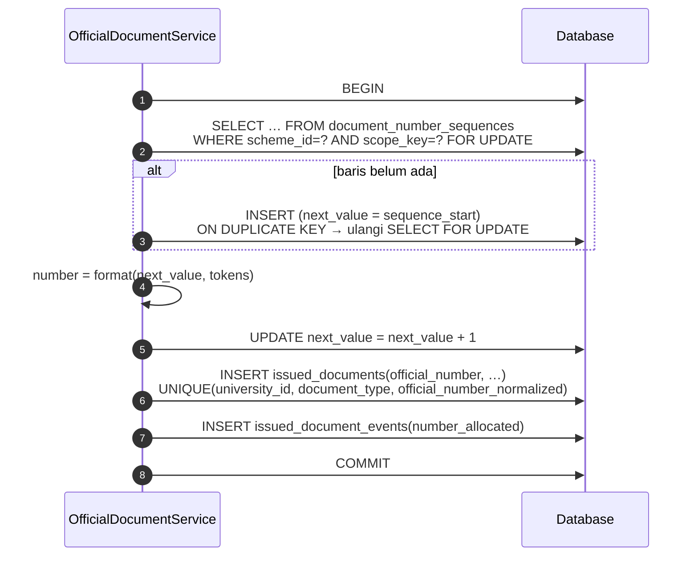
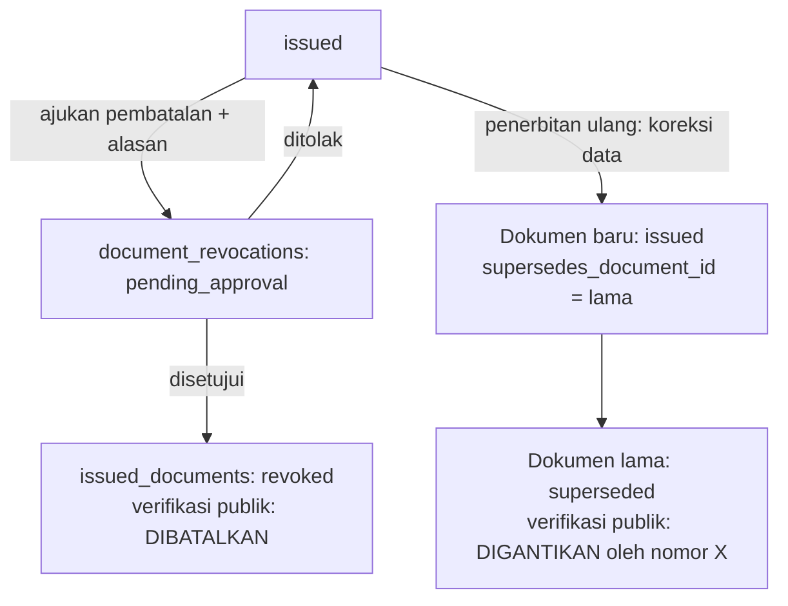

# 13 — Rancangan Penomoran dan Penerbitan Dokumen Kelulusan

> **Status:** rancangan · Disusun 2026-10-13 (commit `47043ca`) · Kembali ke [README](README.md)
> Skema acuan: [25 §4](25-rancangan-database-dan-erd.md#4-kelompok-dokumen-resmi) · Aturan: `KEL-BR-004`, `KEL-BR-060`–`KEL-BR-067` · Keputusan: [KK-KD-10](33-glossary-dan-keputusan-bisnis.md#2-keputusan-desain-kk-kd), [KK-KD-11](33-glossary-dan-keputusan-bisnis.md#2-keputusan-desain-kk-kd), [KK-KD-17](33-glossary-dan-keputusan-bisnis.md#2-keputusan-desain-kk-kd)

Dokumen ini merancang **layanan dokumen resmi bersama** (modul baru `OfficialDocument`, terkait kunci modul platform `document` "Surat dan Dokumen" yang sudah ada di `TenancySeeder`). Layanan ini dipakai oleh SK yudisium, transkrip akhir, ijazah, SKPI, surat keterangan aktif, SK sanksi, dan surat lain. Isinya meliputi template berversi, skema penomoran, alokasi nomor yang aman terhadap konkurensi, snapshot isi, PDF, tanda tangan, pembatalan, penerbitan ulang, verifikasi keaslian, dan riwayat.

## Daftar Isi

1. [Tujuan](#1-tujuan)
2. [Ruang Lingkup](#2-ruang-lingkup)
3. [Aktor dan Hak Akses](#3-aktor-dan-hak-akses)
4. [Prasyarat](#4-prasyarat)
5. [Alur Bisnis Utama](#5-alur-bisnis-utama)
6. [Alur Alternatif dan Kegagalan](#6-alur-alternatif-dan-kegagalan)
7. [Status dan Transisi Status](#7-status-dan-transisi-status)
8. [Data Input dan Output](#8-data-input-dan-output)
9. [Aturan Bisnis](#9-aturan-bisnis)
10. [Validasi](#10-validasi)
11. [Rancangan Database](#11-rancangan-database)
12. [Relasi Antarmodul](#12-relasi-antarmodul)
13. [Kontrak API Konseptual](#13-kontrak-api-konseptual)
14. [Rancangan Halaman UI/UX](#14-rancangan-halaman-uiux)
15. [Notifikasi](#15-notifikasi)
16. [Laporan](#16-laporan)
17. [Keamanan dan Audit](#17-keamanan-dan-audit)
18. [Acceptance Criteria](#18-acceptance-criteria)
19. [Test Case](#19-test-case)
20. [Asumsi dan Keputusan Terbuka](#20-asumsi-dan-keputusan-terbuka)

---

## 1. Tujuan

Menjamin setiap dokumen resmi memiliki nomor yang unik dalam ruang lingkupnya, isi yang tidak berubah setelah terbit, jejak penerbitan/koreksi/pembatalan yang lengkap, dan dapat diverifikasi keasliannya, tanpa setiap modul membangun mekanisme penomorannya sendiri.

## 2. Ruang Lingkup

### 2.1 Jenis dokumen (`document_type`) awal

| `document_type` | Pemilik sumber | Nomor resmi | Catatan |
|---|---|---|---|
| `yudisium_decree` | Yudisium ([12](12-rancangan-peserta-dan-penetapan-kelulusan.md)) | Dihasilkan sistem | Satu SK per rapat/batch. Lampiran daftar lulusan |
| `graduation_statement` | Yudisium | Dihasilkan sistem | Surat keterangan lulus (SKL) sebelum ijazah terbit, bila kampus memakainya |
| `final_transcript` | Yudisium + Akademik | Dihasilkan sistem | Transkrip akademik akhir dari snapshot keputusan (bukan "Transkrip Nilai Sementara" yang Ada) |
| `diploma` | Yudisium | **Nomor eksternal** + nomor registrasi internal | Nomor Ijazah Nasional (PIN) berasal dari sistem nasional, sehingga diinput atau diimpor, bukan dihasilkan ([KEL-BR-066](29-business-rules-dan-validasi.md#kel-br-066)) |
| `skpi` | SKPI ([15](15-rancangan-skpi.md)) | Dihasilkan sistem | Dua bahasa |
| `active_student_letter` | Akademik ([09](09-rancangan-surat-keterangan-aktif.md)) | Dihasilkan sistem | |
| `disciplinary_decree` | Kemahasiswaan ([07](07-rancangan-pelanggaran-dan-sanksi.md)) | Dihasilkan sistem | Akses dibatasi |
| `other_letter` | Berbagai | Dihasilkan sistem | Untuk jenis surat lain di `LETTER_TYPES` |

### 2.2 Batas tanggung jawab ijazah dan transkrip

Modul kelulusan **menyiapkan data, nomor, snapshot, dan PDF** (bila kampus memakai cetak dari template). Pencetakan di blanko pengaman, legalisasi fisik, dan pengiriman data kelulusan ke sistem nasional berada di luar rancangan ini dan dicatat sebagai integrasi yang perlu dikonfirmasi ([KK-Q-13](33-glossary-dan-keputusan-bisnis.md#3-pertanyaan-terbuka-kk-q)).

## 3. Aktor dan Hak Akses

| Aktor | Aksi | Permission |
|---|---|---|
| Admin dokumen (`document_administrator`, Baru) | Kelola template, skema penomoran, penandatangan | `document_templates.*`, `document_numbering_schemes.*`, `document_signatories.*` |
| Petugas penerbit (per modul: `graduation_officer`, `academic_administrator`, `skpi_officer`) | Menerbitkan dokumen jenis yang diizinkan | `issued_documents.publish` + daftar `document_type` yang diizinkan (scope izin per jenis, §17) |
| Pejabat penandatangan | Menandatangani | Terdaftar di `document_signatories` |
| Pejabat berwenang pembatalan | Menyetujui `document_revocations` | `document_revocations.approve` |
| Pemilik dokumen (mahasiswa/alumni) | Mengunduh dokumennya | `graduation_self_service.read` / `student_requests.read` |
| Publik | Verifikasi keaslian | — |
| Auditor | Membaca seluruh riwayat | `issued_documents.read`, `audit_logs.read` |

## 4. Prasyarat

1. Template versi `published` untuk `document_type` dan bahasa.
2. Skema penomoran aktif untuk `document_type` dan unit penerbit.
3. Penandatangan aktif dengan masa jabatan mencakup tanggal terbit.
4. Disk penyimpanan privat (Ada: `file_uploads` disk `local`).

## 5. Alur Bisnis Utama

### 5.1 Template berversi

- `document_templates`: `document_type`, `name`, `language` (`id`/`en`/`bilingual`), `issuing_unit_type`, `issuing_unit_id` (opsional: template khusus fakultas).
- `document_template_versions`: konten (Blade terbatas yang disanitasi, atau HTML dengan placeholder `{{ student.name }}`), skema data yang dibutuhkan (`required_fields`), ukuran kertas, orientasi, aset (logo dari `universities.logo_file_id`, Ada), `status` (`draft`, `published`, `retired`). Versi `published` immutable.
- Rendering memakai dompdf (Ada: `barryvdh/laravel-dompdf`). Template hanya dapat mengakses data snapshot. Template tidak dapat menjalankan query.

### 5.2 Skema penomoran

`document_numbering_schemes`:

| Kolom | Contoh | Keterangan |
|---|---|---|
| `document_type` | `yudisium_decree` | |
| `issuing_unit_type` / `issuing_unit_id` | `faculty` / FTI | `null` = universitas |
| `format` | `{seq:3}/{unit_code}/SK-YUD/{roman_month}/{year}` | Token yang didukung (§8.1) |
| `reset_period` | `yearly` | `never`, `yearly`, `academic_year`, `monthly` |
| `sequence_start` | 1 | |
| `effective_from`, `effective_until` | | Perubahan format = skema baru |
| `reissue_number_policy` | `new_number` | `new_number` atau `same_number_with_suffix` (sufiks `{revision_suffix}` mis. `-R1`) |

### 5.3 Alokasi nomor (aman konkurensi)

- `scope_key` dibentuk dari `reset_period` dan unit, misalnya `2026` atau `2026/2027:FTI`.
- Unique constraint pada `issued_documents` menjadi pertahanan terakhir. Pelanggaran memicu rollback dan retry (maks. 3), lalu galat `NUMBER_ALLOCATION_CONFLICT` yang dicatat sebagai insiden ([KEL-BR-061](29-business-rules-dan-validasi.md#kel-br-061)).
- Karena PDF memuat nomor, nomor harus ada sebelum rendering. Urutannya: (1) bangun snapshot, (2) transaksi: alokasi nomor + simpan baris `issued_documents` `draft`, commit, (3) render PDF dengan nomor, (4) simpan berkas + hash + ubah status, commit. Bila langkah 3–4 gagal, dokumen tetap `draft` **dengan nomor** dan job retry merender ulang. Nomor tidak pernah dialokasikan ulang ke dokumen lain. Dengan begitu, celah nomor hanya terjadi bila dokumen draf bernomor dibatalkan, dan pembatalannya tercatat ([KEL-BR-062](29-business-rules-dan-validasi.md#kel-br-062)).
- Penomoran massal (mis. 500 ijazah) dilakukan berurutan menurut kriteria sort yang ditentukan (NIM atau urutan daftar SK) dalam satu job. Setiap dokumen memakai transaksi sendiri, dan kunci baris sequence menjamin urutan.

### 5.4 Penerbitan, snapshot, dan hash

1. Modul sumber memanggil `OfficialDocumentService::issue(DocumentIssueRequest)` dengan `document_type`, `subject` (mahasiswa), `source_type`/`source_id` (mis. `graduation_decision`), `language`, `issuing_unit`, dan `idempotency_key` (mis. `graduation_decision:{id}:final_transcript`).
2. Service memanggil **penyedia data** milik modul sumber (`DocumentDataProvider` per `document_type`) untuk membangun **snapshot** (json) yang memuat seluruh nilai yang tercetak.
3. Validasi `required_fields` template terhadap snapshot.
4. Alokasi nomor (§5.3).
5. Render PDF, hitung `sha256` berkas, buat `verification_code` acak 128-bit (base32, 26 karakter) dan simpan **hash**-nya, lalu sematkan QR berisi URL verifikasi.
6. Tanda tangan sesuai `signature_mode` ([09 §5.3](09-rancangan-surat-keterangan-aktif.md#5-alur-bisnis-utama)).
7. Status `issued`, event `OfficialDocumentIssued`.

Snapshot dan berkas **tidak pernah diperbarui** setelah `issued` ([KEL-BR-063](29-business-rules-dan-validasi.md#kel-br-063)). Bila data sumber berubah, dokumen lama tetap sama. Perubahan isi hanya melalui penerbitan ulang.

### 5.5 Ijazah dan nomor eksternal

- `issued_documents.external_number` menyimpan nomor dari sistem eksternal (PIN ijazah), dengan `external_number_source` (`pddikti_pin` atau `manual`) dan `external_number_assigned_at`.
- Impor PIN: berkas XLSX/CSV (openspout, Ada) `NIM, PIN`. Validasi: NIM ada dan memiliki keputusan `final` `graduated`, format PIN sesuai `documents.diploma.external_number_pattern` (regex dari kampus), PIN unik per tenant, dan belum ada PIN lain untuk mahasiswa yang sama.
- Nomor registrasi internal ijazah (bila kampus memakai nomor seri sendiri) tetap memakai skema penomoran `diploma`.

### 5.6 Pembatalan dan penerbitan ulang

- Nomor dokumen pengganti mengikuti `reissue_number_policy` skema ([KEL-BR-064](29-business-rules-dan-validasi.md#kel-br-064)). Dengan `same_number_with_suffix`, nomor dasar tetap sama dan sufiks revisi bertambah. Uniknya dijamin oleh kombinasi nomor + sufiks.
- Dokumen yang dibatalkan dan digantikan **tetap tersimpan** dan tetap dapat diverifikasi dengan status yang sesuai ([KEL-BR-065](29-business-rules-dan-validasi.md#kel-br-065)).
- Koreksi keputusan kelulusan ([12 §5.7](12-rancangan-peserta-dan-penetapan-kelulusan.md#5-alur-bisnis-utama)) membuat **antrean penerbitan ulang** untuk setiap dokumen terdampak. Antrean tidak menerbitkan ulang otomatis karena penandatanganan memerlukan tindakan manusia.

### 5.7 Verifikasi keaslian

Halaman publik `/verifikasi/{code}` dan API `GET /public/verify/{code}`:

| Ditampilkan | Tidak ditampilkan |
|---|---|
| Jenis dokumen, nomor resmi, nama pemegang (dapat disamarkan sebagian sesuai `documents.verification.mask_holder_name`), program studi, tanggal terbit, penerbit, status (`SAH`, `DIBATALKAN`, `DIGANTIKAN`), dan hash SHA-256 berkas | NIM, tanggal lahir, nilai, IPK (kecuali kebijakan kampus mengizinkan), alamat, dan berkas PDF |

Opsi unggah berkas: pengunjung dapat mengunggah PDF untuk dibandingkan hash-nya di sisi server. Berkas tidak disimpan. Rate limit `throttle:20,1` per IP dan penundaan untuk kode yang salah ([KEM-BR-075](29-business-rules-dan-validasi.md#kem-br-075)).

## 6. Alur Alternatif dan Kegagalan

| Kode | Kondisi | Penanganan |
|---|---|---|
| AF-DOC-01 | Tidak ada skema penomoran aktif | 409 `NUMBERING_SCHEME_MISSING`, tanpa alokasi |
| AF-DOC-02 | Template versi bahasa tidak tersedia | 409 `TEMPLATE_MISSING` |
| AF-DOC-03 | Penandatangan tidak aktif pada tanggal terbit | 409 `SIGNATORY_INACTIVE` |
| AF-DOC-04 | Permintaan issue diulang (retry) | `idempotency_key` unik per tenant, sehingga mengembalikan dokumen yang sama |
| AF-DOC-05 | Render gagal setelah nomor dialokasikan | Dokumen `draft` bernomor dan job retry. Setelah N gagal, petugas diberi tahu. Nomor tidak dipakai ulang |
| AF-DOC-06 | Skema penomoran diubah di tengah tahun | Skema baru dengan `effective_from`. Sequence skema lama berhenti, dan skema baru mulai dari `sequence_start` atau lanjut (`continue_from_scheme_id`) sesuai pilihan admin |
| AF-DOC-07 | Impor PIN duplikat | Baris ditolak dengan alasan, dan baris lain tetap diproses |

## 7. Status dan Transisi Status

`issued_documents.status`: `draft`, `pending_signature`, `issued`, `revoked`, `superseded`. Diagram di [09 §7](09-rancangan-surat-keterangan-aktif.md#7-status-dan-transisi-status). Tambahan: `draft` → `revoked` (draf bernomor dibatalkan, tercatat sebagai celah nomor yang sah).

`document_revocations.status`: `pending_approval`, `approved`, `rejected`. `document_template_versions.status`: `draft`, `published`, `retired`. `document_numbering_schemes.status`: `active`, `inactive`.

## 8. Data Input dan Output

### 8.1 Token format nomor

| Token | Hasil |
|---|---|
| `{seq:N}` | Nomor urut, dipad nol hingga N digit |
| `{year}`, `{year2}` | Tahun terbit 4/2 digit (zona tenant) |
| `{month}`, `{roman_month}` | Bulan angka / Romawi |
| `{academic_year}` | Mis. `2026-2027` dari term berjalan |
| `{unit_code}` | Kode unit penerbit (`faculties.code`/`study_programs.code`, Ada) |
| `{university_code}` | `universities.code` (Ada) |
| `{doc_code}` | Kode jenis dari skema |
| `{revision_suffix}` | Sufiks revisi |

Validasi format: harus mengandung `{seq:N}` dan, bila `reset_period ≠ never`, token periode yang sesuai (mis. `{year}` untuk `yearly`), agar nomor unik lintas periode ([KEL-BR-060](29-business-rules-dan-validasi.md#kel-br-060)).

### 8.2 Tiga jenis identitas dokumen

| Identitas | Contoh | Dipakai untuk |
|---|---|---|
| ID internal (`issued_documents.id`, ULID) | `01JABC…` | Relasi basis data, API. Tidak tercetak |
| Nomor resmi (`official_number`) | `045/FTI/SK-YUD/XI/2026` | Tercetak, ditetapkan institusi melalui skema |
| Nomor eksternal (`external_number`) | PIN ijazah | Tercetak, berasal dari otoritas eksternal |
| Kode verifikasi | `K7Q2…` (26 karakter) | QR/URL verifikasi. Bukan nomor dokumen |

([KEL-BR-067](29-business-rules-dan-validasi.md#kel-br-067))

## 9. Aturan Bisnis

| ID | Aturan |
|---|---|
| [KEL-BR-004](29-business-rules-dan-validasi.md#kel-br-004) | Nomor dokumen resmi harus unik dalam ruang lingkup penomoran yang ditentukan |
| [KEL-BR-060](29-business-rules-dan-validasi.md#kel-br-060) | Format nomor dikonfigurasi per skema dan wajib memuat token urut serta token periode yang sesuai reset |
| [KEL-BR-061](29-business-rules-dan-validasi.md#kel-br-061) | Nomor dialokasikan dengan penguncian baris sequence dan dilindungi unique constraint |
| [KEL-BR-062](29-business-rules-dan-validasi.md#kel-br-062) | Nomor yang telah dialokasikan tidak pernah dipakai ulang. Celah hanya terjadi karena pembatalan yang tercatat |
| [KEL-BR-063](29-business-rules-dan-validasi.md#kel-br-063) | Snapshot dan berkas dokumen terbit tidak berubah ketika data sumber berubah |
| [KEL-BR-064](29-business-rules-dan-validasi.md#kel-br-064) | Koreksi dilakukan dengan penerbitan ulang yang menunjuk dokumen lama sesuai kebijakan nomor skema |
| [KEL-BR-065](29-business-rules-dan-validasi.md#kel-br-065) | Dokumen dibatalkan/digantikan tetap tersimpan dan terverifikasi dengan statusnya |
| [KEL-BR-066](29-business-rules-dan-validasi.md#kel-br-066) | Nomor eksternal (PIN ijazah) diinput/diimpor dan divalidasi, bukan dihasilkan sistem |
| [KEL-BR-067](29-business-rules-dan-validasi.md#kel-br-067) | ID internal, nomor resmi, nomor eksternal, dan kode verifikasi adalah identitas yang berbeda |

## 10. Validasi

V-DOC-01 format skema (§8.1). V-DOC-02 rentang `effective_*` skema tidak tumpang tindih untuk `document_type` + unit yang sama. V-DOC-03 `required_fields` template terpenuhi snapshot. V-DOC-04 penandatangan aktif. V-DOC-05 impor PIN (§5.5). V-DOC-06 ukuran snapshot ≤ 256 KB (lampiran besar seperti daftar lulusan SK disimpan sebagai lampiran berkas).

## 11. Rancangan Database

`document_templates`, `document_template_versions`, `document_numbering_schemes`, `document_number_sequences`, `document_signatories`, `issued_documents`, `issued_document_events`, `document_revocations`, `document_access_logs`. Kolom lengkap di [25 §4](25-rancangan-database-dan-erd.md#4-kelompok-dokumen-resmi).

Constraint kunci:

- `document_number_sequences` unik (`numbering_scheme_id`, `scope_key`).
- `issued_documents` unik (`university_id`, `document_type`, `official_number_normalized`), unik (`university_id`, `idempotency_key`), unik (`university_id`, `document_type`, `external_number`) bila tidak null, unik `verification_code_hash`.
- `issued_documents.source_type`/`source_id` diindeks. Satu dokumen `issued` aktif per (`source_type`, `source_id`, `document_type`, `language`) melalui generated column `active_source_key`.

## 12. Relasi Antarmodul

`DocumentDataProvider` didaftarkan oleh setiap modul pemilik sumber: `GraduationDecreeProvider`, `FinalTranscriptProvider` (membaca snapshot keputusan + transkrip Akademik saat keputusan), `DiplomaProvider`, `SkpiProvider`, `ActiveStudentLetterProvider`, `DisciplinaryDecreeProvider`. OfficialDocument tidak mengetahui isi domain.

Penandatangan (`document_signatories`) dapat ditautkan ke `employees` dan `positions` (Ada di modul SDM) untuk nama/jabatan/NIP. Namun nilai yang tercetak disalin ke snapshot saat terbit, sehingga perubahan data SDM tidak mengubah dokumen lama ([KK-Q-29](33-glossary-dan-keputusan-bisnis.md#3-pertanyaan-terbuka-kk-q)).

## 13. Kontrak API Konseptual

| Method | URL | Permission |
|---|---|---|
| GET/POST | `/official-documents/templates`, `/templates/{template}/versions` | `document_templates.read/create` |
| POST | `/official-documents/template-versions/{version}/publish` | `document_templates.publish` |
| POST | `/official-documents/template-versions/{version}/preview` (data contoh/sebenarnya, watermark PRATINJAU) | `document_templates.read` |
| GET/POST/PUT | `/official-documents/numbering-schemes` | `document_numbering_schemes.*` |
| GET/POST/PUT | `/official-documents/signatories` | `document_signatories.*` |
| POST | `/official-documents/issue` (Idempotency-Key) | `issued_documents.publish` |
| POST | `/official-documents/issue-batch` (mis. transkrip akhir satu periode) | `issued_documents.publish` |
| GET | `/official-documents` (filter jenis, status, nomor, mahasiswa, periode) | `issued_documents.read` |
| GET | `/official-documents/{document}/file` | `issued_documents.read` atau pemilik |
| POST | `/official-documents/{document}/revocations` | `document_revocations.create` |
| POST | `/official-documents/revocations/{revocation}/decide` | `document_revocations.approve` |
| POST | `/official-documents/{document}/reissue` | `issued_documents.publish` |
| POST | `/official-documents/diplomas/external-numbers/import` | `issued_documents.publish` + `import` |
| GET | `/public/verify/{code}`; POST `/public/verify/{code}/compare` | Publik (throttle) |

## 14. Rancangan Halaman UI/UX

| Halaman | Rute |
|---|---|
| SK Yudisium | `/yudisium/sk` |
| Dokumen Kelulusan | `/yudisium/dokumen` (transkrip akhir, ijazah, SKL per periode; impor PIN; status penerbitan & tanda tangan; antrean penerbitan ulang) |
| Riwayat Penerbitan | `/yudisium/riwayat-penerbitan` (seluruh `issued_document_events`) |
| Pengaturan Dokumen | `/pengaturan/dokumen` (template, penomoran, penandatangan) |
| Verifikasi Dokumen (publik) | `/verifikasi/:code` |

## 15. Notifikasi

`documents.issued` (pemilik), `documents.revoked` (pemilik), `documents.reissue_required` (petugas penerbit), `documents.signature_pending_overdue` (petugas).

## 16. Laporan

KEL-RPT-09 Register dokumen per jenis/periode (nomor, pemegang, status), termasuk dokumen yang dibatalkan. KEL-RPT-10 Celah nomor (nomor teralokasi tanpa dokumen `issued` beserta alasannya). KEL-RPT-11 Akses verifikasi publik (agregat per hari, deteksi pola penebakan).

## 17. Keamanan dan Audit

- `issued_documents.publish` dibatasi per `document_type` melalui konfigurasi `document_issuer_assignments` (role → jenis dokumen), sehingga petugas surat aktif tidak dapat menerbitkan ijazah.
- Setiap unduhan → `document_access_logs`. Akses staf ke dokumen orang lain → `audit_logs` `downloaded`.
- Berkas disimpan privat. Unduhan melalui controller berpolicy (pola `FileUploadController::download`, Ada).
- Kode verifikasi disimpan sebagai hash. Kegagalan verifikasi berulang dari satu IP dibatasi.

## 18. Acceptance Criteria

| ID | Kriteria |
|---|---|
| KEL-AC-15 | Uji beban 1.000 permintaan issue paralel untuk skema yang sama menghasilkan 1.000 nomor unik berurutan (setelah sort), tanpa duplikat |
| KEL-AC-16 | Mengubah nama mahasiswa setelah ijazah terbit tidak mengubah hash berkas maupun snapshot |
| KEL-AC-17 | Dokumen `revoked` dan `superseded` tetap muncul di register dan verifikasi publik dengan status yang benar |
| KEL-AC-18 | Petugas tanpa izin jenis `diploma` mendapat 403 saat menerbitkan ijazah |
| KEL-AC-19 | Impor PIN menolak duplikat dan format salah per baris tanpa menggagalkan seluruh berkas |

## 19. Test Case

| ID | Judul | Prioritas |
|---|---|---|
| KEL-TC-060 | Format nomor sesuai skema & token | P1 |
| KEL-TC-061 | Nomor dokumen ganda dicegah pada konkurensi | P1 |
| KEL-TC-062 | Retry issue idempoten | P1 |
| KEL-TC-063 | Render gagal → draf bernomor → retry | P2 |
| KEL-TC-064 | Penerbitan ulang `new_number` dan `same_number_with_suffix` | P2 |
| KEL-TC-065 | Pembatalan → verifikasi publik DIBATALKAN | P1 |
| KEL-TC-066 | Snapshot tidak berubah saat data sumber berubah | P1 |
| KEL-TC-067 | Impor PIN | P2 |
| KEL-TC-068 | Verifikasi publik tidak menampilkan NIM/IPK | P1 |
| KEL-TC-069 | Rate limit verifikasi publik | P2 |

## 20. Asumsi dan Keputusan Terbuka

| ID | Hal |
|---|---|
| [KK-KD-10](33-glossary-dan-keputusan-bisnis.md#2-keputusan-desain-kk-kd) | Penomoran terpusat, tiga identitas dokumen |
| [KK-KD-11](33-glossary-dan-keputusan-bisnis.md#2-keputusan-desain-kk-kd) | Batas tanggung jawab ijazah & transkrip |
| [KK-KD-17](33-glossary-dan-keputusan-bisnis.md#2-keputusan-desain-kk-kd) | Verifikasi keaslian |
| [KK-Q-12](33-glossary-dan-keputusan-bisnis.md#3-pertanyaan-terbuka-kk-q) | Format nomor per jenis dokumen & unit penerbit |
| [KK-Q-13](33-glossary-dan-keputusan-bisnis.md#3-pertanyaan-terbuka-kk-q) | PIN ijazah & integrasi nasional |
| [KK-Q-09](33-glossary-dan-keputusan-bisnis.md#3-pertanyaan-terbuka-kk-q) | Mode tanda tangan |
