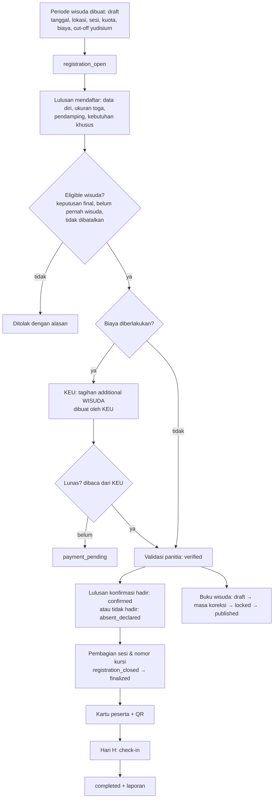
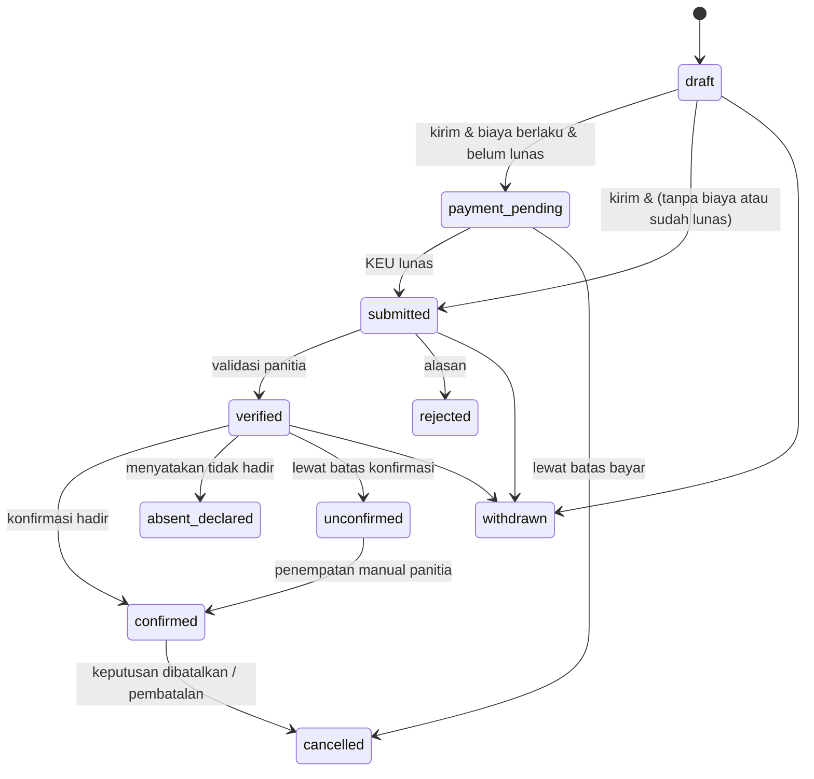

# 14 — Rancangan Wisuda dan Buku Wisuda

> **Status:** rancangan · Disusun 2026-10-13 (commit `47043ca`) · Kembali ke [README](README.md)
> Skema acuan: [25 §3](25-rancangan-database-dan-erd.md#3-kelompok-yudisium-dan-wisuda) · Aturan: `WIS-BR-001`–`WIS-BR-013` · Keputusan: [KK-KD-13](33-glossary-dan-keputusan-bisnis.md#2-keputusan-desain-kk-kd), [KK-KD-14](33-glossary-dan-keputusan-bisnis.md#2-keputusan-desain-kk-kd)

Dokumen ini mengatur **periode wisuda, pendaftaran peserta, validasi administrasi (termasuk biaya bila diberlakukan), konfirmasi kehadiran, pendamping, kebutuhan khusus, pembagian sesi, check-in, buku wisuda, dan laporan**. Wisuda adalah **upacara**: dasar kelulusannya adalah keputusan yudisium final ([12](12-rancangan-peserta-dan-penetapan-kelulusan.md)), bukan pendaftaran wisuda.

## Daftar Isi

1. [Tujuan](#1-tujuan)
2. [Ruang Lingkup](#2-ruang-lingkup)
3. [Aktor dan Hak Akses](#3-aktor-dan-hak-akses)
4. [Prasyarat](#4-prasyarat)
5. [Alur Bisnis Utama](#5-alur-bisnis-utama)
6. [Alur Alternatif dan Kegagalan](#6-alur-alternatif-dan-kegagalan)
7. [Status dan Transisi Status](#7-status-dan-transisi-status)
8. [Data Input dan Output](#8-data-input-dan-output)
9. [Aturan Bisnis](#9-aturan-bisnis)
10. [Validasi](#10-validasi)
11. [Rancangan Database](#11-rancangan-database)
12. [Relasi Antarmodul](#12-relasi-antarmodul)
13. [Kontrak API Konseptual](#13-kontrak-api-konseptual)
14. [Rancangan Halaman UI/UX](#14-rancangan-halaman-uiux)
15. [Notifikasi](#15-notifikasi)
16. [Laporan](#16-laporan)
17. [Keamanan dan Audit](#17-keamanan-dan-audit)
18. [Acceptance Criteria](#18-acceptance-criteria)
19. [Test Case](#19-test-case)
20. [Asumsi dan Keputusan Terbuka](#20-asumsi-dan-keputusan-terbuka)

---

## 1. Tujuan

Menyelenggarakan wisuda yang tertib: hanya lulusan yang berhak yang terdaftar, kapasitas sesi tidak terlampaui, kehadiran tercatat akurat, dan buku wisuda memuat data yang sudah diverifikasi.

## 2. Ruang Lingkup

**Termasuk:** periode wisuda (`graduation_ceremonies`), sesi (`ceremony_sessions`), pendaftaran, eligibility peserta wisuda, validasi biaya melalui KEU, konfirmasi kehadiran, pendamping, kebutuhan khusus & ukuran atribut (toga), pembagian sesi otomatis/manual, kartu peserta (QR), check-in, buku wisuda berversi, ekspor daftar wisudawan, dan laporan pelaksanaan.

**Tidak termasuk:** pembuatan tagihan biaya wisuda dan pembayarannya (milik KEU: komponen kategori `graduation`, kode contoh `WISUDA`, `invoice_type = additional` — [keuangan/04](../keuangan/04-master-data-dan-konfigurasi.md), [keuangan/06](../keuangan/06-rancangan-tagihan-mahasiswa.md)), logistik vendor, dan siaran langsung.

## 3. Aktor dan Hak Akses

| Aktor | Aksi | Permission | Scope |
|---|---|---|---|
| Panitia wisuda (`graduation_committee`) | Kelola periode & sesi, validasi peserta, pembagian sesi, check-in, buku wisuda | `graduation_ceremonies.*`, `ceremony_registrations.*`, `ceremony_sessions.*`, `ceremony_attendance.*`, `graduation_books.create/update` | `u` |
| Petugas check-in (`ceremony_checkin_officer`) | Memindai QR & mencatat kehadiran | `ceremony_attendance.create` | Sesi yang ditugaskan |
| Admin prodi/fakultas | Memeriksa data wisudawan unitnya pada masa koreksi buku | `graduation_books.read`, `graduation_book_corrections.create` | `p`/`f` |
| Pejabat (mis. Wakil Rektor I) | Menyetujui publikasi buku wisuda | `graduation_books.publish` | `u` |
| Lulusan | Mendaftar, mengisi data, konfirmasi kehadiran, unduh kartu, memeriksa data buku | `graduation_self_service.*` | Sendiri |

## 4. Prasyarat

1. Keputusan yudisium `final` dengan `outcome = graduated` ([12](12-rancangan-peserta-dan-penetapan-kelulusan.md)), atau kebijakan khusus (§5.2).
2. Bila berbayar: komponen biaya wisuda di KEU dan kontrak `FinanceObligationReader` (Baru, milik KEU) untuk membaca status lunas tagihan tertentu.
3. Entitlement `graduation.core`.

## 5. Alur Bisnis Utama

### 5.1 Periode wisuda

Atribut: `code`, `name`, `ceremony_date(s)`, `venue`, `registration_opens_at`, `registration_closes_at`, `graduation_date_from`/`graduation_date_to` atau daftar `yudisium_period_ids` (cut-off lulusan yang boleh ikut), `fee_required` (bool) + `fee_component_code` (kode komponen KEU), `max_companions_per_graduate`, `requires_attendance_confirmation`, `attire_options` (ukuran), `status`.

### 5.2 Eligibility peserta wisuda

Dasar pendaftaran (`graduation.ceremony.registration_basis`):

| Nilai | Syarat |
|---|---|
| `final_decision` (default) | Keputusan yudisium `final` `graduated` dalam cut-off periode |
| `ready_for_decision` | Diizinkan mendaftar saat pendaftaran yudisium `ready_for_decision`, tetapi **tidak dapat** `verified` sebelum keputusan final. Dipakai kampus yang jadwal yudisium dan wisudanya berdekatan |

Tambahan: belum memiliki pendaftaran wisuda `completed`/`confirmed` di periode lain ([WIS-BR-002](29-business-rules-dan-validasi.md#wis-br-002)), keputusan tidak `annulled`/`superseded` tanpa pengganti, dan tidak ada sanksi aktif dengan `restricted_services` memuat `graduation`.

### 5.3 Biaya wisuda

- KEU membuat tagihan (otomatis saat pendaftaran melalui event `CeremonyRegistrationSubmitted`, bila KEU mengonfigurasi aturan tagihan otomatis, atau manual oleh Bagian Keuangan).
- Modul Wisuda menyimpan `invoice_id` referensi dan membaca status melalui `FinanceObligationReader::isSettled($invoiceId)`. Modul Wisuda **tidak** menghitung nominal, potongan, atau saldo ([WIS-BR-003](29-business-rules-dan-validasi.md#wis-br-003)).
- Event KEU `InvoiceStatusChanged` → pendaftaran `payment_pending` → `submitted` (siap divalidasi panitia).
- Pembatalan setelah bayar: Wisuda mencatat pembatalan, dan pengembalian dana diproses KEU melalui refund ([keuangan/18](../keuangan/18-rancangan-rekonsiliasi-dan-penyesuaian.md)) ([WIS-BR-012](29-business-rules-dan-validasi.md#wis-br-012)).

### 5.4 Pendamping dan kebutuhan khusus

- `ceremony_companions`: nama, hubungan, nomor identitas (opsional, terenkripsi, hanya bila kampus mewajibkan untuk keamanan), dan kebutuhan aksesibilitas. Jumlah ≤ `max_companions_per_graduate`.
- Kebutuhan khusus peserta (`special_needs`: kursi roda, juru bahasa isyarat, dsb.) hanya dapat dilihat panitia, dan dipakai untuk penempatan kursi.

### 5.5 Pembagian sesi

- Sesi (`ceremony_sessions`): tanggal, jam, kapasitas wisudawan, kapasitas pendamping, unit yang dialokasikan (fakultas/prodi), dan urutan.
- **Alokasi otomatis** (deterministik): kelompokkan per fakultas → prodi → urutan NIM. Isi sesi berurutan tanpa memecah satu prodi bila memungkinkan. Peserta dengan kebutuhan khusus ditempatkan pada baris akses. Hasil berupa usulan yang dapat diubah manual dengan alasan sebelum `finalized` ([WIS-BR-013](29-business-rules-dan-validasi.md#wis-br-013)).
- Kapasitas dijaga dengan penguncian baris sesi saat penempatan ([WIS-BR-004](29-business-rules-dan-validasi.md#wis-br-004)). Penempatan yang melebihi kapasitas ditolak 409 `SESSION_FULL`.
- Lulusan dapat memilih sesi bila `allow_session_choice = true`, dalam batas kapasitas (siapa cepat dia dapat, dengan penguncian).

### 5.6 Check-in

- Kartu peserta memuat QR berisi token check-in acak (bukan NIM), yang disimpan sebagai hash.
- Pemindaian: validasi token → peserta `confirmed` → sesi cocok dengan sesi petugas → catat `ceremony_checkins` (waktu, petugas, perangkat). Pemindaian kedua mengembalikan "Sudah check-in pukul …" **tanpa** membuat baris kehadiran baru, dan percobaan itu dicatat sebagai `duplicate_scan` ([WIS-BR-007](29-business-rules-dan-validasi.md#wis-br-007)).
- Mode luring: aplikasi petugas mengunduh daftar hash token per sesi, lalu menyinkronkan hasil saat daring. Konflik diselesaikan dengan waktu pemindaian paling awal.

### 5.7 Buku wisuda

Buku wisuda adalah **snapshot berversi** (`graduation_book_editions`) yang entrinya (`graduation_book_entries`) dibangun dari sumber resmi. Entri tidak diketik ulang ([WIS-BR-009](29-business-rules-dan-validasi.md#wis-br-009)).

| Kolom buku | Sumber resmi | Catatan |
|---|---|---|
| Nama lengkap (dengan gelar) | `graduation_decisions.academic_snapshot` (nama) + gelar dari konfigurasi prodi saat keputusan | Ejaan mengikuti data induk yang sudah diverifikasi saat yudisium |
| NIM | Snapshot keputusan | Ditampilkan sesuai kebijakan (`show_nim`) |
| Program studi, fakultas, jenjang | Snapshot keputusan | |
| Tempat & tanggal lahir | Snapshot keputusan | Opsional (`show_birth_info`), default **tidak** ditampilkan |
| Tanggal lulus / tahun kelulusan | `graduation_decisions.graduation_date` | |
| IPK | Snapshot keputusan | Opsional (`show_gpa`) |
| Predikat | `graduation_decisions.honor_label_*` | |
| Judul tugas akhir | Snapshot keputusan | Opsional |
| Foto | Berkas pendaftaran wisuda/yudisium yang `verified` | Hanya bila lulusan memberi persetujuan publikasi foto (`photo_publication_consent`) |
| Pesan/kesan | Diisi lulusan | Moderasi panitia, opsional |

Alur edisi:

1. `draft`: dibangun dari seluruh pendaftaran `verified`/`confirmed`. Entri dengan data belum lengkap/terverifikasi diberi status `held` dan tidak dimasukkan ke cetakan, tetapi muncul di laporan pengecualian.
2. `in_review` (masa koreksi, `correction_closes_at`): lulusan dan admin prodi memeriksa entri. Koreksi data identitas **tidak** diedit di buku, tetapi melalui koreksi data induk/keputusan ([12 §5.7](12-rancangan-peserta-dan-penetapan-kelulusan.md#5-alur-bisnis-utama)). Koreksi tampilan (urutan, pesan, persetujuan foto) dicatat di `graduation_book_corrections`.
3. `locked`: dibangun ulang dari sumber, dibandingkan dengan edisi sebelumnya (diff ditampilkan), dan tidak dapat diubah.
4. `published`: setelah persetujuan. Berkas PDF disimpan. Bila perlu revisi setelah publikasi, dibuat edisi baru dan edisi lama menjadi `superseded` ([WIS-BR-010](29-business-rules-dan-validasi.md#wis-br-010)).

Data pribadi dibatasi: tidak memuat NIK, alamat, telepon, atau email. Publikasi publik (situs) hanya bila kampus mengizinkan dan entri yang menolak publikasi dikecualikan ([WIS-BR-011](29-business-rules-dan-validasi.md#wis-br-011)).

## 6. Alur Alternatif dan Kegagalan

| Kode | Kondisi | Penanganan |
|---|---|---|
| AF-WIS-01 | Mahasiswa tidak eligible | 409 `NOT_ELIGIBLE_FOR_CEREMONY` dengan alasan |
| AF-WIS-02 | Kuota sesi penuh | 409 `SESSION_FULL`. Pilihan sesi lain ditawarkan |
| AF-WIS-03 | Perubahan jadwal/lokasi | Histori perubahan + notifikasi seluruh peserta terdampak. Kartu peserta diterbitkan ulang otomatis bila sesi berubah ([WIS-BR-006](29-business-rules-dan-validasi.md#wis-br-006)) |
| AF-WIS-04 | Check-in ganda | Lihat §5.6 |
| AF-WIS-05 | Keputusan yudisium dibatalkan setelah pendaftaran wisuda | Pendaftaran otomatis `cancelled` (alasan sistem), entri buku dikeluarkan pada edisi berikut, dan KEU diberi event untuk menangani biaya |
| AF-WIS-06 | Lulusan tidak konfirmasi sebelum batas | Status `unconfirmed`. Tidak mendapat kursi kecuali panitia menempatkan manual |
| AF-WIS-07 | Data buku belum tervalidasi saat penguncian | Entri `held`. Edisi tetap dapat dikunci dengan laporan pengecualian yang harus disetujui pejabat |
| AF-WIS-08 | Pembayaran lunas setelah pendaftaran ditutup | Panitia dapat memvalidasi manual dengan alasan |

## 7. Status dan Transisi Status

`graduation_ceremonies.status`: `draft`, `registration_open`, `registration_closed`, `finalized` (sesi & kursi dikunci), `completed`, `cancelled`.

`ceremony_registrations.status`: `draft`, `payment_pending`, `submitted`, `verified`, `confirmed`, `absent_declared`, `unconfirmed`, `rejected`, `cancelled`, `withdrawn`.

Kehadiran adalah atribut terpisah (`attendance_status`): `not_checked_in`, `checked_in`, `no_show` (diisi saat periode `completed`).

`graduation_book_editions.status`: `draft`, `in_review`, `locked`, `published`, `superseded`. `graduation_book_entries.entry_status`: `included`, `held`, `excluded`.

## 8. Data Input dan Output

Input pendaftaran: konfirmasi data (tampilan dari snapshot, bukan formulir bebas), ukuran atribut, pendamping, kebutuhan khusus, persetujuan publikasi foto & data buku, pilihan sesi (bila diizinkan), dan pesan/kesan (opsional).

Output: kartu peserta PDF (nama, prodi, sesi, kursi, QR), daftar wisudawan (XLSX/CSV, kolom terpilih, data pribadi dimasking default), dan buku wisuda PDF.

## 9. Aturan Bisnis

| ID | Aturan |
|---|---|
| [WIS-BR-001](29-business-rules-dan-validasi.md#wis-br-001) | Pendaftaran wisuda hanya untuk lulusan sesuai `registration_basis` (default: keputusan yudisium final `graduated` dalam cut-off) |
| [WIS-BR-002](29-business-rules-dan-validasi.md#wis-br-002) | Satu lulusan hanya mengikuti satu wisuda. Tidak ada pendaftaran aktif ganda lintas periode |
| [WIS-BR-003](29-business-rules-dan-validasi.md#wis-br-003) | Status lunas biaya wisuda dibaca dari KEU. Modul wisuda tidak menghitung nominal |
| [WIS-BR-004](29-business-rules-dan-validasi.md#wis-br-004) | Penempatan sesi tidak boleh melebihi kapasitas dan diperiksa dengan penguncian |
| [WIS-BR-005](29-business-rules-dan-validasi.md#wis-br-005) | Jumlah pendamping ≤ batas periode |
| [WIS-BR-006](29-business-rules-dan-validasi.md#wis-br-006) | Perubahan jadwal/lokasi/sesi dicatat dan dinotifikasikan ke peserta terdampak |
| [WIS-BR-007](29-business-rules-dan-validasi.md#wis-br-007) | Check-in idempoten: satu kehadiran per peserta, dan pemindaian ulang hanya dicatat sebagai percobaan |
| [WIS-BR-008](29-business-rules-dan-validasi.md#wis-br-008) | Check-in hanya untuk peserta `confirmed` pada sesi yang sesuai |
| [WIS-BR-009](29-business-rules-dan-validasi.md#wis-br-009) | Buku wisuda hanya memuat data terverifikasi dari sumber resmi. Entri belum valid ditahan |
| [WIS-BR-010](29-business-rules-dan-validasi.md#wis-br-010) | Buku memiliki masa koreksi. Edisi terpublikasi tidak berubah, dan revisi dibuat sebagai edisi baru |
| [WIS-BR-011](29-business-rules-dan-validasi.md#wis-br-011) | Data pribadi di buku diminimalkan, dan foto/publikasi publik hanya dengan persetujuan lulusan |
| [WIS-BR-012](29-business-rules-dan-validasi.md#wis-br-012) | Pembatalan setelah pembayaran tidak memproses refund di modul wisuda, tetapi diteruskan ke KEU |
| [WIS-BR-013](29-business-rules-dan-validasi.md#wis-br-013) | Pembagian sesi otomatis bersifat deterministik dan dapat dikoreksi manual dengan alasan sebelum periode `finalized` |

## 10. Validasi

V-WIS-01 tanggal pendaftaran dalam rentang. V-WIS-02 cut-off kelulusan. V-WIS-03 ukuran atribut ∈ `attire_options`. V-WIS-04 pendamping ≤ batas. V-WIS-05 kapasitas sesi ≥ jumlah yang sudah ditempatkan saat kapasitas diturunkan. V-WIS-06 token check-in valid & belum kedaluwarsa (berlaku hingga akhir hari upacara).

## 11. Rancangan Database

`graduation_ceremonies`, `ceremony_sessions`, `ceremony_session_units`, `ceremony_registrations`, `ceremony_companions`, `ceremony_checkins`, `ceremony_schedule_changes`, `graduation_book_editions`, `graduation_book_entries`, `graduation_book_corrections`. Lihat [25 §3](25-rancangan-database-dan-erd.md#3-kelompok-yudisium-dan-wisuda).

Constraint: `ceremony_registrations` generated `active_graduate_key` = `IF(status NOT IN ('rejected','cancelled','withdrawn'), student_id, NULL)` unik per tenant ([WIS-BR-002](29-business-rules-dan-validasi.md#wis-br-002)). `ceremony_checkins` unik (`ceremony_registration_id`) untuk baris `result = checked_in`.

## 12. Relasi Antarmodul

| Modul | Hubungan |
|---|---|
| Yudisium | `GraduationRecordReader` (keputusan final, snapshot). Event `GraduationDecisionAnnulled` → batalkan pendaftaran |
| KEU | Event `CeremonyRegistrationSubmitted` (pemicu tagihan bila dikonfigurasi). Kontrak `FinanceObligationReader`. Event `InvoiceStatusChanged`. Event `CeremonyRegistrationCancelled` (pertimbangan refund) |
| Kemahasiswaan | Sanksi `graduation` |
| Notification | §15 |
| Alumni/Tracer | Tidak langsung. Data kehadiran wisuda tidak dipakai tracer |

## 13. Kontrak API Konseptual

| Method | URL | Permission |
|---|---|---|
| GET/POST/PUT | `/graduation/ceremonies` | `graduation_ceremonies.*` |
| POST | `/graduation/ceremonies/{ceremony}/open`, `/close`, `/finalize`, `/complete`, `/cancel` | `graduation_ceremonies.publish/finalize` |
| GET/POST/PUT | `/graduation/ceremonies/{ceremony}/sessions` | `ceremony_sessions.*` |
| POST | `/graduation/ceremonies/{ceremony}/allocate-sessions` (usulan; `commit=true` untuk menerapkan) | `ceremony_sessions.update` |
| GET | `/graduation/ceremony-registrations` | `ceremony_registrations.read` |
| POST | `/graduation/ceremony-registrations/{registration}/verify`, `/reject` | `ceremony_registrations.approve/reject` |
| PUT | `/graduation/ceremony-registrations/{registration}/session` | `ceremony_sessions.update` |
| POST | `/graduation/ceremony-checkins` (`token`, `session_id`) | `ceremony_attendance.create` |
| GET | `/graduation/ceremonies/{ceremony}/checkin-manifest?session_id=` (mode luring) | `ceremony_attendance.read` |
| GET/POST | `/graduation/ceremonies/{ceremony}/book-editions` | `graduation_books.read/create` |
| POST | `/graduation/book-editions/{edition}/open-review`, `/lock`, `/publish` | `graduation_books.update/publish` |
| GET | `/graduation/ceremonies/{ceremony}/graduates/export` | `ceremony_registrations.export` |
| GET/POST | `/student/graduation/ceremonies`, `/student/graduation/ceremony-registrations` | `graduation_self_service.*` |
| POST | `/student/graduation/ceremony-registrations/{registration}/confirm` | `graduation_self_service.update` |
| GET | `/student/graduation/ceremony-registrations/{registration}/card` | `graduation_self_service.read` |

## 14. Rancangan Halaman UI/UX

| Halaman | Rute |
|---|---|
| Periode Wisuda | `/wisuda/periode` |
| Pendaftaran Peserta | `/wisuda/pendaftaran` |
| Validasi Peserta | `/wisuda/validasi` (antrean `submitted`, status biaya dari KEU sebagai badge "Lunas/Belum lunas", tanpa nominal kecuali pengguna punya `invoices.read`) |
| Pengelompokan Sesi | `/wisuda/sesi` (papan sesi dengan bar kapasitas, seret-lepas antar sesi dengan konfirmasi) |
| Konfirmasi Kehadiran | `/wisuda/konfirmasi` |
| Check-in | `/wisuda/check-in` (layar pemindai responsif untuk ponsel/tablet, umpan balik besar hijau/kuning/merah dengan suara) |
| Buku Wisuda | `/wisuda/buku` (edisi, diff, laporan entri `held`) |
| Laporan Wisuda | `/wisuda/laporan` |
| Portal: Wisuda | `/portal/kelulusan/wisuda` (menggantikan bagian pendaftaran pada `PortalGraduationPage` statis) |

## 15. Notifikasi

`graduation.ceremony.registration_opened` (lulusan eligible), `graduation.ceremony.registration_received`, `graduation.ceremony.payment_pending`, `graduation.ceremony.registration_verified`, `graduation.ceremony.confirmation_reminder`, `graduation.ceremony.session_assigned` (+ kartu), `graduation.ceremony.schedule_changed`, `graduation.ceremony.book_review_open` (lulusan & admin prodi), `graduation.ceremony.registration_cancelled`.

## 16. Laporan

| ID | Laporan |
|---|---|
| WIS-RPT-01 | Peserta per status/prodi/sesi |
| WIS-RPT-02 | Kehadiran per sesi (hadir, tidak hadir, check-in ganda) |
| WIS-RPT-03 | Kebutuhan atribut (rekap ukuran) & kebutuhan khusus (tanpa identitas untuk vendor) |
| WIS-RPT-04 | Pelaksanaan: jadwal vs realisasi, perubahan jadwal |
| WIS-RPT-05 | Entri buku `held` dan alasannya |

## 17. Keamanan dan Audit

Validasi, penolakan, penempatan manual, perubahan jadwal, penguncian, dan publikasi buku dicatat `audit_logs`. Ekspor daftar wisudawan dicatat `exported`, dan data pendamping hanya diekspor dengan izin khusus. Token QR tidak memuat data pribadi.

## 18. Acceptance Criteria

| ID | Kriteria |
|---|---|
| WIS-AC-01 | Mahasiswa tanpa keputusan final `graduated` tidak dapat mendaftar (mode default) |
| WIS-AC-02 | 200 penempatan paralel ke sesi berkapasitas 150 menghasilkan tepat 150 berhasil dan 50 `SESSION_FULL` |
| WIS-AC-03 | Pemindaian QR yang sama 3× menghasilkan 1 baris `checked_in` dan 2 percobaan `duplicate_scan` |
| WIS-AC-04 | Buku edisi `published` tidak dapat diubah. Revisi menghasilkan edisi baru dengan diff |
| WIS-AC-05 | Entri dengan foto tanpa persetujuan publikasi tidak menampilkan foto |

## 19. Test Case

| ID | Judul | Prioritas |
|---|---|---|
| WIS-TC-001 | Pendaftaran peserta lengkap sampai confirmed | P1 |
| WIS-TC-002 | Mahasiswa tidak eligible ditolak | P1 |
| WIS-TC-003 | Kuota sesi penuh | P1 |
| WIS-TC-004 | Perubahan jadwal memicu notifikasi & kartu baru | P2 |
| WIS-TC-005 | Check-in ganda | P1 |
| WIS-TC-006 | Buku wisuda dengan data belum tervalidasi → entri held | P1 |
| WIS-TC-007 | Status lunas dibaca dari KEU | P1 |
| WIS-TC-008 | Keputusan yudisium dibatalkan → pendaftaran wisuda dibatalkan | P2 |
| WIS-TC-009 | Pendamping melebihi batas ditolak | P3 |
| WIS-TC-010 | Pendaftaran ganda lintas periode ditolak | P2 |

## 20. Asumsi dan Keputusan Terbuka

| ID | Hal |
|---|---|
| [KK-KD-13](33-glossary-dan-keputusan-bisnis.md#2-keputusan-desain-kk-kd) | Wisuda berbasis keputusan final; biaya oleh KEU |
| [KK-KD-14](33-glossary-dan-keputusan-bisnis.md#2-keputusan-desain-kk-kd) | Buku wisuda sebagai snapshot edisi |
| [KK-Q-14](33-glossary-dan-keputusan-bisnis.md#3-pertanyaan-terbuka-kk-q) | Dasar pendaftaran wisuda, biaya wisuda |
| [KK-Q-15](33-glossary-dan-keputusan-bisnis.md#3-pertanyaan-terbuka-kk-q) | Kolom buku wisuda (IPK, foto, judul TA, publikasi publik) |
