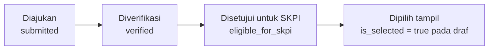
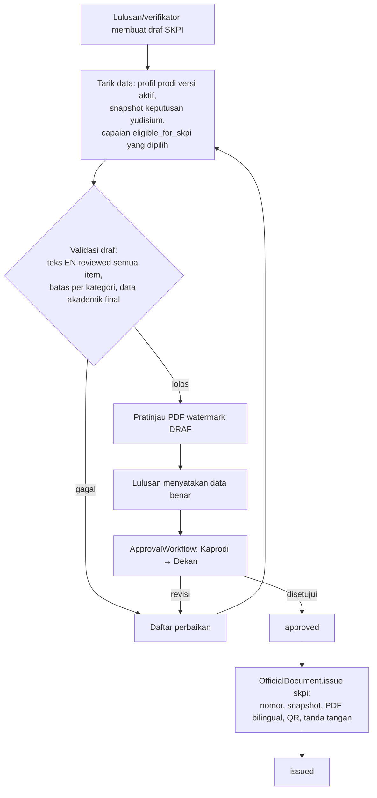
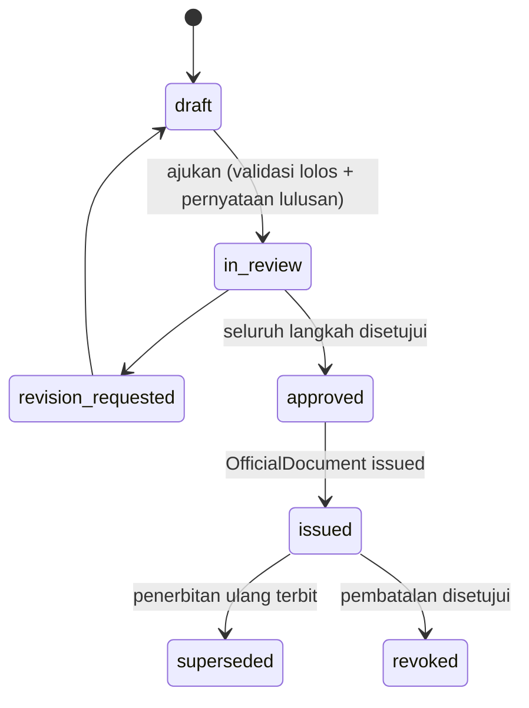

# 15 — Rancangan SKPI (Surat Keterangan Pendamping Ijazah)

> **Status:** rancangan · Disusun 2026-10-13 (commit `47043ca`) · Kembali ke [README](README.md)
> Skema acuan: [25 §5](25-rancangan-database-dan-erd.md#5-kelompok-skpi) · Aturan: `SKPI-BR-001`–`SKPI-BR-011` · Penerbitan: [13](13-rancangan-penomoran-dokumen-kelulusan.md) · Keputusan: [KK-KD-15](33-glossary-dan-keputusan-bisnis.md#2-keputusan-desain-kk-kd), [KK-KD-16](33-glossary-dan-keputusan-bisnis.md#2-keputusan-desain-kk-kd), [KK-KD-17](33-glossary-dan-keputusan-bisnis.md#2-keputusan-desain-kk-kd)

SKPI adalah dokumen resmi pendamping ijazah yang memuat informasi institusi, program studi, capaian pembelajaran, dan capaian tambahan lulusan dalam **Bahasa Indonesia dan Bahasa Inggris**. Struktur bagian SKPI wajib mengikuti ketentuan nasional dan peraturan kampus yang berlaku. Rancangan ini menyediakan struktur yang dapat dikonfigurasi dan **tidak** menetapkan isi wajib secara normatif ([KK-Q-16](33-glossary-dan-keputusan-bisnis.md#3-pertanyaan-terbuka-kk-q)).

## Daftar Isi

1. [Tujuan](#1-tujuan)
2. [Ruang Lingkup](#2-ruang-lingkup)
3. [Aktor dan Hak Akses](#3-aktor-dan-hak-akses)
4. [Prasyarat](#4-prasyarat)
5. [Alur Bisnis Utama](#5-alur-bisnis-utama)
6. [Alur Alternatif dan Kegagalan](#6-alur-alternatif-dan-kegagalan)
7. [Status dan Transisi Status](#7-status-dan-transisi-status)
8. [Data Input dan Output](#8-data-input-dan-output)
9. [Aturan Bisnis](#9-aturan-bisnis)
10. [Validasi](#10-validasi)
11. [Rancangan Database](#11-rancangan-database)
12. [Relasi Antarmodul](#12-relasi-antarmodul)
13. [Kontrak API Konseptual](#13-kontrak-api-konseptual)
14. [Rancangan Halaman UI/UX](#14-rancangan-halaman-uiux)
15. [Notifikasi](#15-notifikasi)
16. [Laporan](#16-laporan)
17. [Keamanan dan Audit](#17-keamanan-dan-audit)
18. [Acceptance Criteria](#18-acceptance-criteria)
19. [Test Case](#19-test-case)
20. [Asumsi dan Keputusan Terbuka](#20-asumsi-dan-keputusan-terbuka)

---

## 1. Tujuan

Menghasilkan SKPI yang akurat, dua bahasa, berbasis capaian terverifikasi, dan dapat dibuktikan keasliannya, dengan memanfaatkan data yang sudah diverifikasi di modul lain tanpa verifikasi ganda yang tidak perlu.

## 2. Ruang Lingkup

**Termasuk:** pengumpulan capaian dari sumber internal, pengajuan capaian tambahan oleh mahasiswa, verifikasi, kategori dan bidang kompetensi, pemetaan capaian ke kategori, pemilihan capaian yang ditampilkan, profil program studi dua bahasa, glosarium istilah, pengelolaan terjemahan dan peninjauannya, penyusunan draf, pemeriksaan, persetujuan, penerbitan (nomor, PDF, tanda tangan via [13](13-rancangan-penomoran-dokumen-kelulusan.md)), pembatalan, penerbitan ulang, dan verifikasi keaslian.

**Tidak termasuk:** penyusunan CPL/OBE (dibaca dari rancangan OBE `academic-learning/04` bila tersedia), terjemahan mesin otomatis tanpa peninjauan, dan sertifikat kompetensi/profesi.

## 3. Aktor dan Hak Akses

| Aktor | Aksi | Permission | Scope |
|---|---|---|---|
| Mahasiswa tingkat akhir/lulusan | Melihat capaian terkumpul, mengajukan capaian tambahan, memilih capaian tampil, mengisi/meninjau terjemahan miliknya, menyetujui draf (pernyataan kebenaran data) | `skpi_self_service.read/create/update` | Sendiri |
| Verifikator SKPI prodi (`skpi_officer` scope `p`) | Verifikasi capaian SKPI-native, meninjau terjemahan, menyusun draf | `skpi_achievements.read/approve/reject`, `skpi_documents.create/update` | `p` |
| Kaprodi | Memeriksa draf | `skpi_documents.approve/reject` (langkah 1) | `p` |
| Dekan/pejabat penandatangan | Menyetujui akhir & menandatangani | `skpi_documents.approve` (langkah akhir) | `f` |
| Admin SKPI universitas | Kategori, bidang kompetensi, template, glosarium, profil institusi | `skpi_categories.*`, `skpi_templates.*`, `skpi_glossary.*` | `u` |
| Petugas penerbit | Menerbitkan | `skpi_documents.publish` + `issued_documents.publish` jenis `skpi` | `u`/`f` |
| Publik | Verifikasi keaslian | — | — |

## 4. Prasyarat

1. Entitlement `skpi.core`.
2. Profil institusi dan profil prodi dua bahasa terisi (`skpi_program_profiles`).
3. Template SKPI `bilingual` versi `published` di OfficialDocument.
4. Untuk penerbitan: keputusan yudisium `final` `graduated` ([SKPI-BR-003](29-business-rules-dan-validasi.md#skpi-br-003)).

## 5. Alur Bisnis Utama

### 5.1 Sumber capaian

| Sumber | Status di sumber yang dianggap terverifikasi | Cara masuk SKPI | Verifikasi SKPI tambahan |
|---|---|---|---|
| Aktivitas & prestasi ([06](06-rancangan-aktivitas-dan-prestasi.md)) | `activity_submissions.status = approved` | Diimpor otomatis sebagai kandidat (`source_type = activity_submission`) dengan kategori SKPI dari `activity_categories.skpi_category_id` | Tidak, kecuali kategori SKPI `requires_skpi_verification = true` |
| Organisasi & kepanitiaan | Subset aktivitas kategori `organization`/`committee` | idem | idem |
| Magang/PKL/KKN (`internships`, Ada) | `internships.status = selesai` | Kandidat `source_type = internship` | Ya bila tidak memiliki bukti terunggah (modul Internship belum menyimpan bukti) |
| Sertifikasi | Aktivitas kategori `certification` `approved`, atau capaian SKPI-native | | |
| Pengabdian masyarakat | Aktivitas kategori `community_service` | | |
| Kompetensi tambahan / pengalaman profesional | Capaian SKPI-native yang diajukan mahasiswa | `source_type = manual` | Ya |
| Data akademik (judul tugas akhir, IPK, predikat, tanggal lulus, gelar) | Snapshot keputusan yudisium | Bukan capaian. Diambil langsung saat penyusunan | Tidak |
| Capaian pembelajaran prodi (CPL) | Profil prodi SKPI / OBE (bila tersedia) | Bagian profil, bukan per mahasiswa | Ditinjau saat profil prodi dipublikasikan |

### 5.2 Empat tahap status capaian

Rancangan membedakan dengan tegas ([SKPI-BR-001](29-business-rules-dan-validasi.md#skpi-br-001), [SKPI-BR-002](29-business-rules-dan-validasi.md#skpi-br-002)):

| Tahap | Makna | Siapa |
|---|---|---|
| Diajukan | Klaim mahasiswa atau kandidat impor dari sumber | Mahasiswa/sistem |
| Diverifikasi | Kebenaran fakta dan bukti telah diperiksa (di sumber atau di SKPI) | Verifikator sumber/SKPI |
| Disetujui untuk SKPI | Memenuhi aturan kelayakan kategori SKPI (tingkat minimum, relevansi, masa studi) dan memiliki teks ID+EN yang telah ditinjau | Verifikator SKPI |
| Dipilih tampil | Dipilih untuk dicantumkan pada dokumen (dalam batas jumlah per kategori) | Mahasiswa memilih, verifikator menyetujui melalui draf |

### 5.3 Kategori dan pemetaan

- `skpi_categories` (contoh, dapat diubah kampus): Prestasi & Penghargaan, Pengalaman Organisasi, Kepanitiaan, Sertifikasi Keahlian, Magang/Kerja Praktik, Pengabdian Masyarakat, Pelatihan & Seminar, Kemampuan Bahasa, Karya Ilmiah/Publikasi. Atribut: `code`, `name_id`, `name_en`, `sort_order`, `max_items_displayed`, `min_activity_level` (opsional), `requires_skpi_verification`, `eligibility_rules` json.
- `skpi_competency_areas`: bidang kompetensi (mis. kepemimpinan, komunikasi, keahlian teknis), `name_id`/`name_en`. Capaian dipetakan ke 0..n bidang (`skpi_achievement_competencies`) beserta `level` (`basic`, `intermediate`, `advanced`, atau skala kampus).
- Pemetaan default berasal dari kategori aktivitas. Verifikator dapat mengubahnya per capaian dengan alasan.

### 5.4 Dua bahasa

| Elemen | Pengelolaan | Validasi terjemahan |
|---|---|---|
| Label tetap dokumen (judul bagian, label field) | Template versi per bahasa / bilingual | Ditinjau saat template dipublikasikan |
| Istilah baku (nama gelar, jenjang, predikat, nama prodi/fakultas, jabatan) | `skpi_glossary_terms` (`term_id`, `term_en`, `context`, `status`) | Disetujui admin SKPI. Satu istilah ID memiliki satu padanan EN per konteks agar konsisten |
| Profil institusi & prodi (sistem pendidikan, CPL ringkas, KKNI level, akreditasi) | `skpi_program_profiles` berversi, kolom `*_id`/`*_en` | Disetujui Kaprodi + admin SKPI |
| Capaian per mahasiswa (judul, deskripsi, peran, penyelenggara) | `skpi_achievements.title_id/en`, `description_id/en`, `role_id/en` | `translation_status`: `missing`, `draft`, `reviewed`, `rejected`. Mahasiswa/sistem mengisi draf (sistem dapat menyarankan dari glosarium dan memorinya), lalu verifikator SKPI meninjau ([SKPI-BR-005](29-business-rules-dan-validasi.md#skpi-br-005)) |
| Nama orang, nama lembaga, judul karya asli | Tidak diterjemahkan, ditandai `no_translate` | — |

**Memori terjemahan**: frasa yang sudah `reviewed` disimpan (`skpi_translation_memories`, per tenant) untuk saran berikutnya. Saran tetap berstatus `draft` sampai ditinjau. Tidak ada terjemahan mesin eksternal tanpa konfigurasi dan persetujuan kampus ([KK-Q-16](33-glossary-dan-keputusan-bisnis.md#3-pertanyaan-terbuka-kk-q)).

### 5.5 Penyusunan, pemeriksaan, persetujuan, penerbitan

- Draf menyimpan **snapshot item** (`skpi_document_items`): salinan teks ID/EN, kategori, tanggal, dan referensi capaian. Bila capaian berubah setelah draf dibuat (mis. dicabut di sumber), draf ditandai `source_changed` dan harus disegarkan sebelum persetujuan ([SKPI-BR-002](29-business-rules-dan-validasi.md#skpi-br-002)).
- Penerbitan memakai `document_type = skpi` dan `DocumentDataProvider` SKPI ([13](13-rancangan-penomoran-dokumen-kelulusan.md)). Versi template dicatat ([SKPI-BR-010](29-business-rules-dan-validasi.md#skpi-br-010)).
- **Revisi setelah terbit**: draf baru dari dokumen terbit → persetujuan → penerbitan ulang yang menggantikan (`superseded`) dokumen lama. Riwayat penerbitan dan koreksi terlihat di halaman dokumen ([SKPI-BR-006](29-business-rules-dan-validasi.md#skpi-br-006)).

### 5.6 Verifikasi keaslian

Memakai halaman verifikasi bersama ([13 §5.7](13-rancangan-penomoran-dokumen-kelulusan.md#5-alur-bisnis-utama)). Untuk SKPI, halaman menampilkan jenis dokumen, nomor, nama pemegang, program studi, tanggal terbit, status, dan hash. Daftar capaian **tidak** ditampilkan ([SKPI-BR-009](29-business-rules-dan-validasi.md#skpi-br-009)).

## 6. Alur Alternatif dan Kegagalan

| Kode | Kondisi | Penanganan |
|---|---|---|
| AF-SKPI-01 | Capaian sumber dicabut setelah SKPI terbit | SKPI terbit tidak berubah. Sistem membuat tugas peninjauan untuk petugas dengan rekomendasi penerbitan ulang atau pembatalan sesuai kebijakan |
| AF-SKPI-02 | Keputusan yudisium dikoreksi | Antrean penerbitan ulang ([13](13-rancangan-penomoran-dokumen-kelulusan.md)) |
| AF-SKPI-03 | Keputusan yudisium dibatalkan | SKPI terbit dicabut melalui `document_revocations` yang dibuat otomatis berstatus `pending_approval` |
| AF-SKPI-04 | Item tanpa terjemahan reviewed | Draf tidak dapat diajukan (`TRANSLATION_NOT_REVIEWED`) |
| AF-SKPI-05 | Jumlah item melebihi batas kategori | Draf tidak dapat diajukan. Mahasiswa diminta memilih |
| AF-SKPI-06 | Profil prodi versi baru dipublikasikan saat draf berjalan | Draf ditandai untuk disegarkan, dan versi profil yang dipakai dicatat |

## 7. Status dan Transisi Status

`skpi_achievements.verification_status`: `submitted`, `verified`, `rejected`, `revision_requested`, `source_revoked`. `skpi_achievements.skpi_eligibility`: `pending`, `eligible`, `not_eligible` (alasan).

`skpi_documents.status`: `draft`, `in_review`, `revision_requested`, `approved`, `issued`, `revoked`, `superseded`.

## 8. Data Input dan Output

Input capaian SKPI-native: kategori, judul (ID; EN opsional saat mengajukan), deskripsi, penyelenggara/instansi, peran, tingkat, tanggal mulai–selesai, dan bukti (pdf/jpg/png).

Output dokumen (struktur bagian dapat dikonfigurasi di template; contoh umum): (1) identitas pemegang, (2) identitas penyelenggara program & program studi, (3) capaian pembelajaran, (4) capaian tambahan per kategori, (5) informasi sistem pendidikan tinggi & KKNI, dan (6) pengesahan (nomor, tanggal, penandatangan, QR).

## 9. Aturan Bisnis

| ID | Aturan |
|---|---|
| [SKPI-BR-001](29-business-rules-dan-validasi.md#skpi-br-001) | Capaian yang belum diverifikasi tidak boleh otomatis dipublikasikan dalam SKPI final |
| [SKPI-BR-002](29-business-rules-dan-validasi.md#skpi-br-002) | Capaian dari sumber terverifikasi dipakai dengan referensi, tanpa verifikasi ganda kecuali diwajibkan kategori. Perubahan di sumber menandai draf/dokumen terkait |
| [SKPI-BR-003](29-business-rules-dan-validasi.md#skpi-br-003) | SKPI hanya diterbitkan untuk lulusan dengan keputusan yudisium final `graduated`. Draf boleh disusun sejak tingkat akhir |
| [SKPI-BR-004](29-business-rules-dan-validasi.md#skpi-br-004) | Setiap elemen yang tampil memiliki teks Bahasa Indonesia dan Bahasa Inggris, kecuali yang bertanda `no_translate` |
| [SKPI-BR-005](29-business-rules-dan-validasi.md#skpi-br-005) | Terjemahan isi capaian wajib berstatus `reviewed` sebelum draf diajukan. Istilah baku wajib mengikuti glosarium |
| [SKPI-BR-006](29-business-rules-dan-validasi.md#skpi-br-006) | Isi SKPI terbit dibekukan. Perubahan dilakukan dengan penerbitan ulang yang menggantikan dokumen lama dengan riwayat |
| [SKPI-BR-007](29-business-rules-dan-validasi.md#skpi-br-007) | Nomor SKPI dialokasikan oleh OfficialDocument |
| [SKPI-BR-008](29-business-rules-dan-validasi.md#skpi-br-008) | Jumlah capaian tampil per kategori ≤ `max_items_displayed`. Pemilihan mahasiswa disahkan melalui persetujuan draf |
| [SKPI-BR-009](29-business-rules-dan-validasi.md#skpi-br-009) | Dokumen dan bukti capaian hanya dapat diakses pemilik, petugas dalam scope, dan pejabat terkait. Verifikasi publik hanya menampilkan data minimal |
| [SKPI-BR-010](29-business-rules-dan-validasi.md#skpi-br-010) | Versi template dan versi profil prodi yang dipakai dicatat pada dokumen |
| [SKPI-BR-011](29-business-rules-dan-validasi.md#skpi-br-011) | Data akademik (IPK, gelar, tanggal lulus, predikat) diambil dari snapshot keputusan yudisium, tidak diinput manual |

## 10. Validasi

V-SKPI-01 `title_id` ≤ 200, `title_en` ≤ 200, `description_*` ≤ 500 (agar muat cetak). V-SKPI-02 tanggal capaian dalam masa studi (toleransi `skpi.achievement_date_tolerance_days` sebelum `enrolled_at`, default 0). V-SKPI-03 bukti wajib untuk capaian SKPI-native. V-SKPI-04 karakter EN hanya Latin dasar + tanda baca umum (peringatan untuk karakter lain). V-SKPI-05 batas per kategori.

## 11. Rancangan Database

`skpi_categories`, `skpi_competency_areas`, `skpi_achievements`, `skpi_achievement_competencies`, `skpi_achievement_verifications`, `skpi_program_profiles`, `skpi_glossary_terms`, `skpi_translation_memories`, `skpi_documents`, `skpi_document_items`. Template & penerbitan memakai tabel OfficialDocument. Lihat [25 §5](25-rancangan-database-dan-erd.md#5-kelompok-skpi).

Constraint: `skpi_achievements` unik (`university_id`, `student_id`, `source_type`, `source_id`) untuk sumber non-manual (impor idempoten). Satu `skpi_documents` non-terminal per mahasiswa (generated `active_key`).

## 12. Relasi Antarmodul

| Modul | Hubungan |
|---|---|
| Kemahasiswaan | Event `ActivitySubmissionApproved` → impor kandidat. `ActivitySubmissionRevoked` → `source_revoked` |
| Internship (Ada) | Pembacaan `internships` selesai (pull terjadwal + saat draf dibuat). Belum ada event |
| Yudisium | `GraduationRecordReader` (snapshot, predikat). Event `GraduationDecisionFinalized`/`Corrected`/`Annulled` |
| OfficialDocument | Template, nomor, PDF, tanda tangan, verifikasi |
| OBE (`academic-learning/04`, rancangan) | Sumber CPL prodi bila tersedia. Bila tidak, CPL diisi di `skpi_program_profiles` |
| Karier ([20](20-rancangan-career-center-karirlink.md)) | Lulusan dapat melampirkan SKPI terbit ke profil karier (tautan verifikasi, bukan salinan data) atas pilihannya sendiri |

## 13. Kontrak API Konseptual

| Method | URL | Permission |
|---|---|---|
| GET/POST/PUT | `/skpi/categories`, `/skpi/competency-areas`, `/skpi/glossary-terms` | `skpi_categories.*`, `skpi_glossary.*` |
| GET/POST | `/skpi/program-profiles`, POST `/skpi/program-profiles/{profile}/publish` | `skpi_templates.*` |
| GET | `/skpi/achievements` (filter prodi, status verifikasi, status terjemahan) | `skpi_achievements.read` |
| POST | `/skpi/achievements/{achievement}/verify`, `/reject`, `/translation-review` | `skpi_achievements.approve/reject` |
| GET/POST | `/skpi/documents` | `skpi_documents.read/create` |
| POST | `/skpi/documents/{document}/refresh`, `/submit` | `skpi_documents.update` |
| POST | `/skpi/documents/{document}/issue` (Idempotency-Key) | `skpi_documents.publish` |
| GET | `/skpi/documents/{document}/preview` | `skpi_documents.read` atau pemilik |
| GET/POST | `/student/skpi/achievements` | `skpi_self_service.read/create` |
| PUT | `/student/skpi/achievements/{achievement}` (terjemahan draf, pilihan tampil) | `skpi_self_service.update` |
| GET/POST | `/student/skpi/document`, POST `/student/skpi/document/acknowledge` | `skpi_self_service.*` |

## 14. Rancangan Halaman UI/UX

| Halaman | Rute | Inti |
|---|---|---|
| Dashboard SKPI | `/skpi` | Jumlah lulusan per periode vs SKPI terbit, item menunggu verifikasi/terjemahan |
| Kategori Capaian | `/skpi/kategori` | Kategori, bidang kompetensi, batas tampil |
| Capaian Mahasiswa | `/skpi/capaian` | Daftar capaian per mahasiswa, sumber, status verifikasi & terjemahan |
| Verifikasi Capaian | `/skpi/verifikasi` | Panel dua kolom ID ↔ EN berdampingan, saran glosarium, bukti |
| Template SKPI | `/skpi/template` | Mengarah ke pengaturan dokumen jenis `skpi` + profil prodi |
| Penyusunan Dokumen | `/skpi/dokumen` | Draf per mahasiswa, pratinjau PDF |
| Persetujuan | `/skpi/persetujuan` | Antrean ApprovalWorkflow |
| Penerbitan | `/skpi/penerbitan` | Terbitkan tunggal/massal, status tanda tangan |
| Verifikasi Dokumen (publik) | `/verifikasi/:code` | Halaman publik bersama semua dokumen resmi: status besar (SAH/DIBATALKAN/DIGANTIKAN), data minimal, form unggah PDF untuk cocokkan hash. Tidak memuat menu internal, cookie pelacak, atau data lain |
| Portal: SKPI Saya | `/portal/kelulusan/skpi` | Capaian terkumpul, ajukan capaian, pilih tampil, isi terjemahan, pratinjau, pernyataan, unduh SKPI terbit |

## 15. Notifikasi

`skpi.achievement.verified`/`rejected`, `skpi.translation.review_needed` (mahasiswa bila terjemahan ditolak), `skpi.document.ready_for_review` (mahasiswa: pratinjau siap untuk pernyataan; petugas: draf diajukan), `skpi.document.revision_requested`, `skpi.document.issued`, `skpi.document.revoked`.

## 16. Laporan

SKPI-RPT-01 Cakupan SKPI per periode kelulusan/prodi (lulusan, draf, terbit). SKPI-RPT-02 Distribusi capaian per kategori & bidang kompetensi (agregat, untuk evaluasi prodi). SKPI-RPT-03 Antrean verifikasi & terjemahan (umur antrean).

## 17. Keamanan dan Audit

Model `SkpiAchievement` dan `SkpiDocument` mengimplementasikan `RestrictsFileAccess`. Verifikasi, peninjauan terjemahan, persetujuan, penerbitan, dan pembatalan dicatat `audit_logs`. Pratinjau memakai watermark "DRAF" dan tidak memiliki kode verifikasi.

## 18. Acceptance Criteria

| ID | Kriteria |
|---|---|
| SKPI-AC-01 | Draf yang memuat capaian `submitted` (belum terverifikasi) tidak dapat diajukan (409) |
| SKPI-AC-02 | Aktivitas `approved` muncul sebagai kandidat SKPI ≤ 1 menit setelah persetujuan, tanpa memerlukan verifikasi ulang (kategori default) |
| SKPI-AC-03 | PDF terbit memuat setiap item dalam dua bahasa, dan istilah baku sesuai glosarium (uji pembanding teks) |
| SKPI-AC-04 | SKPI tidak dapat diterbitkan untuk mahasiswa tanpa keputusan final `graduated` |
| SKPI-AC-05 | Verifikasi publik dengan kode SKPI menampilkan status dan data minimal saja, tanpa daftar capaian |

## 19. Test Case

| ID | Judul | Prioritas |
|---|---|---|
| SKPI-TC-001 | Capaian valid dari aktivitas approved masuk kandidat | P1 |
| SKPI-TC-002 | Capaian tidak valid (ditolak) tidak masuk | P1 |
| SKPI-TC-003 | Capaian belum diverifikasi memblokir pengajuan draf | P1 |
| SKPI-TC-004 | Template dua bahasa: item tanpa EN reviewed diblokir | P1 |
| SKPI-TC-005 | Generate PDF & hash | P1 |
| SKPI-TC-006 | Revisi dokumen menggantikan dokumen lama | P1 |
| SKPI-TC-007 | Verifikasi nomor dokumen di halaman publik | P1 |
| SKPI-TC-008 | Pembatasan akses dokumen & bukti | P1 |
| SKPI-TC-009 | Pencabutan capaian sumber menandai draf | P2 |
| SKPI-TC-010 | Data akademik diambil dari snapshot keputusan | P2 |

## 20. Asumsi dan Keputusan Terbuka

| ID | Hal |
|---|---|
| [KK-KD-15](33-glossary-dan-keputusan-bisnis.md#2-keputusan-desain-kk-kd) | Reuse verifikasi sumber |
| [KK-KD-16](33-glossary-dan-keputusan-bisnis.md#2-keputusan-desain-kk-kd) | Model dua bahasa per field + glosarium + review |
| [KK-Q-16](33-glossary-dan-keputusan-bisnis.md#3-pertanyaan-terbuka-kk-q) | Struktur SKPI resmi kampus & regulasi acuan, penggunaan terjemahan mesin |
| [KK-A-11](33-glossary-dan-keputusan-bisnis.md#4-asumsi-kk-a) | Bahasa kedua hanya Bahasa Inggris |
